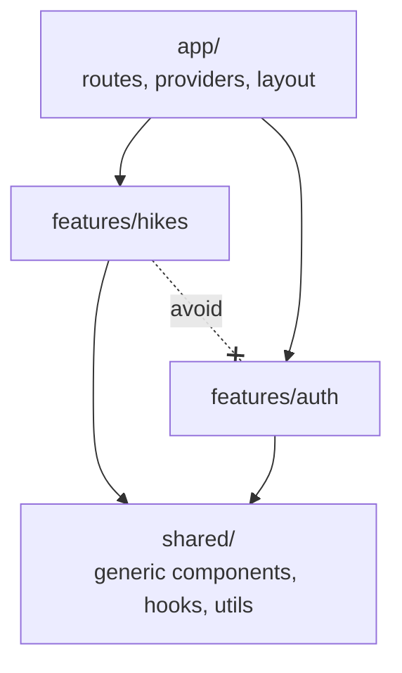

# Project structure and performance profiling

> **Before this lesson:** you need custom hooks ([Custom hooks and useRef](#/lesson/react/custom-hooks-refs)), memoisation ([memo, useMemo and useCallback](#/lesson/react/memoization)) and JavaScript modules, meaning `import` and `export` between files ([ES modules and CommonJS](#/lesson/javascript/es-modules-commonjs)).

## In plain words

Two housekeeping skills in one lesson.

**Structure.** A kitchen with one drawer for everything works when you own four utensils. With four hundred, you need a system: cutlery here, baking there, and things used together stored together. A **project structure** is the system for where files live in a codebase. A good one lets a newcomer guess where a piece of code is before searching for it.

**Profiling.** When your car feels sluggish, a good mechanic does not start replacing parts at random. They plug in a diagnostic tool and read which part is at fault. **Profiling** means *measuring* where a program spends its time before changing anything. Guessing at performance problems wastes days and often makes code worse.

Both are things you do far more in a job than in a tutorial: every team has structure conventions, and "the page feels slow, find out why" is a typical ticket.

## Part 1: project structure

### Start small: one file is fine

React imposes no folder layout. A project with three components can keep them in `App.jsx`. Splitting too early costs more than it saves: you spend time navigating files instead of reading code. Grow the structure when the pain appears.

A useful progression:

**Stage 1: a few files.**

```text
src/
  main.jsx
  App.jsx
  HikeList.jsx
  AddHikeForm.jsx
```

**Stage 2: group by kind** when the list gets long.

```text
src/
  components/   Button.jsx  Card.jsx  HikeList.jsx  AddHikeForm.jsx
  hooks/        useStoredState.js  useDebouncedValue.js
  utils/        formatDistance.js
  App.jsx
  main.jsx
```

This works up to a few dozen files. Then `components/` holds eighty unrelated files, and one change to the "hikes" feature touches four distant folders.

**Stage 3: group by feature.**

```text
src/
  app/                      application shell
    App.jsx
    routes.jsx
    providers.jsx
  features/
    hikes/
      components/           HikeList.jsx  HikeCard.jsx  AddHikeForm.jsx
      hooks/                useHikes.js
      api.js                requests for hikes
      hikesReducer.js
      hikesReducer.test.js
      index.js              the feature's public entry point
    auth/
      components/           SignInForm.jsx  SignUpForm.jsx
      AuthContext.jsx
      api.js
      index.js
  shared/                   used by several features
    components/             Button.jsx  Card.jsx  Spinner.jsx
    hooks/                  useDebouncedValue.js
    utils/                  formatDistance.js
  main.jsx
```

- A **feature** is a slice of what the product does: hikes, authentication, billing. Its components, hooks, requests, state logic and tests sit together. This is **colocation**: keeping things that change together next to each other.
- `shared/` holds building blocks with no knowledge of any one feature.
- `app/` wires everything together: routes, global providers, layout.

### Rules that keep it healthy

**1. Dependencies point one way.** `app` may import from `features` and `shared`. A feature may import from `shared`. `shared` imports from neither. Features should avoid importing from each other; when two features need the same thing, move it to `shared` or combine them in `app`.



**2. Give each feature a front door.** An `index.js` that re-exports only what outsiders should use:

```javascript
// features/hikes/index.js
export { HikeList } from "./components/HikeList";
export { AddHikeForm } from "./components/AddHikeForm";
export { useHikes } from "./hooks/useHikes";
```

Other code writes `import { HikeList } from "@/features/hikes";` and never reaches into the feature's internals. You are then free to reorganise inside the folder. (A file that only re-exports is called a **barrel**. One per feature is helpful. A giant barrel for the whole app slows tooling and blurs boundaries.)

**3. Tests live beside the code.** `HikeCard.test.jsx` next to `HikeCard.jsx` is found, moved and deleted together with it.

**4. Separate what from how, inside a feature.** A typical division:

| Layer | Contains | Knows about React? |
|---|---|---|
| Components | JSX, event wiring | yes |
| Hooks | state and effects for the feature | yes |
| API module | functions that send requests and return data | no |
| Pure logic | reducers, validators, formatters | no |

The bottom two layers are plain JavaScript and trivial to test. Components stay thin: they call a hook and render.

```jsx
// features/hikes/api.js
export async function fetchHikes(query) {
  const response = await fetch(`/api/hikes?q=${encodeURIComponent(query)}`);
  if (!response.ok) throw new Error(`Server replied ${response.status}`);
  return response.json();
}
```

- The component never sees a URL or a status code. If the back end changes (or you move to Firebase, as later in this track), only this file changes.

**5. Naming conventions.** One component per file, the file named like the component in PascalCase (`HikeCard.jsx`). Hooks in camelCase starting with `use` (`useHikes.js`). Pick named exports or default exports and stay consistent; named exports make renaming and searching more reliable.

### Path aliases

Deep relative imports such as `../../../shared/components/Button` are fragile. An **alias** maps a short prefix to a folder:

```javascript
// vite.config.js
import { defineConfig } from "vite";
import react from "@vitejs/plugin-react";
import path from "node:path";

export default defineConfig({
  plugins: [react()],
  resolve: { alias: { "@": path.resolve(__dirname, "src") } },
});
```

Now `import { Button } from "@/shared/components/Button";` works from any depth. (With TypeScript, declare the same mapping under `paths` in `tsconfig.json`.)

### Configuration and secrets

Values that differ between your machine and production (an API address, a Firebase project id) go in **environment variables**. Vite reads files named `.env`, `.env.development` and `.env.production`, and exposes only variables whose names start with `VITE_`:

```text
# .env.development
VITE_API_URL=http://localhost:8000
```

```javascript
const apiUrl = import.meta.env.VITE_API_URL;
```

> [!WARNING]
> Everything in a front-end bundle is public. A `VITE_` variable is copied into the JavaScript that every visitor downloads. Never put a secret (a private API key, a database password) there. Secrets belong on a server.

## Part 2: finding out why something is slow

### What can be slow

There are two different kinds of "slow", with different tools.

1. **Loading**: how long until the page is usable. Dominated by the size of the JavaScript bundle and by network requests.
2. **Interaction**: how quickly the screen responds to typing and clicking. Dominated by how much rendering each state change causes.

For any interaction, a rough budget is **16 milliseconds** per frame for animation to look smooth (60 frames a second) and about **100 ms** for a click to feel instant. Work shorter than a few milliseconds is not worth optimising.

### Step 1: measure a production build

Development mode is deliberately slower: extra warnings, Strict Mode's double rendering, unminified code. Before believing any number, run:

```bash
npm run build
npm run preview
```

### Step 2: the React Profiler

Install the React Developer Tools browser extension and open its **Profiler** tab. Press record, perform the slow interaction once, and stop. You get:

- a list of **commits** (each time React applied changes to the DOM),
- for each commit, a **flame graph**: one bar per component, wider and warmer-coloured the longer it took, and grey if it did not render,
- for a selected component, **why it rendered** (enable "Record why each component rendered" in the settings): "props changed: onSelect", "hook 2 changed", or "the parent component rendered".

Read it with three questions:

1. Which commit was slow?
2. Which component took the time? Was it one slow component, or hundreds of fast ones?
3. Did it need to render at all? If its output did not change, why was it called?

The answers map to fixes you already know:

| What the profiler shows | Likely fix |
|---|---|
| Large subtree renders on every keystroke | Move the state down, or pass the subtree as `children` |
| A component renders because "parent rendered", with identical props | `memo` |
| A `memo` component renders because a function or object prop changed | `useCallback` / `useMemo` in the parent |
| One component is slow by itself | `useMemo` the heavy calculation, or do less work |
| Thousands of rows render | Virtualise the list (render only visible rows) |
| Everything using a context renders | Split the context or memoise its value |

Then record again. An optimisation that does not show up in a second measurement should be removed.

### Measuring in code

React's `<Profiler>` component reports render timings to a callback:

```jsx
import { Profiler } from "react";

function onRender(id, phase, actualDuration) {
  console.log(`${id} ${phase} took ${actualDuration.toFixed(1)} ms`);
}

<Profiler id="HikeList" onRender={onRender}>
  <HikeList hikes={hikes} />
</Profiler>
```

- `id` is the label you gave.
- `phase` is `"mount"` for the first render or `"update"` for later ones.
- `actualDuration` is how long this subtree took to render in this commit.

For plain JavaScript, `performance.now()` returns a high-resolution timestamp in milliseconds:

```javascript
const start = performance.now();
const sorted = sortHikes(hikes);
console.log("sort took", (performance.now() - start).toFixed(2), "ms");
```

The browser's own **Performance** panel records everything the page did (scripting, layout, painting), which you need when the time is not in React at all, for example a CSS animation forcing layout.

### Load performance: ship less JavaScript

The first load is governed by bundle size. Three standard techniques:

**Code splitting with `lazy`.** By default the whole app is one file. `lazy` puts a component in its own file that is downloaded only when first rendered:

```jsx
import { lazy, Suspense } from "react";

const AdminPage = lazy(() => import("./features/admin/AdminPage"));

function App() {
  return (
    <Suspense fallback={<p>Loading page…</p>}>
      <AdminPage />
    </Suspense>
  );
}
```

- `import("./...")` with parentheses is a **dynamic import**: it loads a file on demand and returns a promise.
- `lazy` turns that into a component.
- `<Suspense fallback={...}>` shows the fallback while the file downloads ([Suspense, error boundaries and server components](#/lesson/react/suspense-boundaries-rsc)).

Splitting by route is the highest-value place: users download the admin screens only if they go there.

**Look at what is in the bundle.** A bundle visualiser (for example `rollup-plugin-visualizer`) draws each dependency as a box sized by weight. A date library or icon set imported wholesale often turns out to be half the bundle.

**Measure what users feel.** Lighthouse (in Chrome's developer tools) scores a page and reports **Core Web Vitals**: Largest Contentful Paint (how soon the main content appears), Interaction to Next Paint (how quickly the page responds to input) and Cumulative Layout Shift (how much things jump around while loading).

> [!INTERVIEW]
> "A React page is slow. What do you do?" *Reproduce it in a production build. Decide whether it is load or interaction. For interaction: record with the React Profiler, find the slow commit, see which components rendered and why, then fix structurally first (state colocation, children), then memoise, then virtualise long lists, and measure again. For load: check bundle size, split by route with `lazy`, look for heavy dependencies and unoptimised images, and check Core Web Vitals.* The structure "measure, find the cause, fix, measure again" matters more than any single trick.

## Run it: measure, do not guess

The script builds a list of hikes, then times three ways of answering "which hikes match the search?" over 50 simulated keystroke renders. It prints timings from *your* browser.

```js-run
// 20,000 hikes: big enough to measure.
const hikes = Array.from({ length: 20000 }, (_, i) => ({ id: i, name: "Trail " + ((i * 7919) % 20000), km: (i * 37) % 40 }));

function expensiveStats(list) {                       // pretend this is a heavy calculation
  return list.slice().sort((a, b) => a.km - b.km || a.name.localeCompare(b.name)).slice(0, 10);
}

function time(label, fn) {
  const start = performance.now();
  const result = fn();
  console.log(label.padEnd(46), (performance.now() - start).toFixed(1).padStart(7), "ms");
  return result;
}

const keystrokes = Array.from({ length: 50 }, (_, i) => "t".repeat(1 + (i % 3)));   // 50 renders

time("A. recompute stats on every render", () => {
  for (const query of keystrokes) { expensiveStats(hikes); query.length; }
});

time("B. useMemo-style: recompute only if hikes changed", () => {
  let cachedFor = null, cached = null;
  for (const query of keystrokes) {
    if (cachedFor !== hikes) { cached = expensiveStats(hikes); cachedFor = hikes; }   // deps: [hikes]
    query.length;
  }
});

time("C. cheap work (filter 50 items) every render", () => {
  const few = hikes.slice(0, 50);
  for (const query of keystrokes) few.filter((h) => h.name.includes(query));
});

console.log("\nLesson: A is worth memoising (B). C costs almost nothing, so memoising it would only add code.");
```

On most machines A takes hundreds of milliseconds across the 50 renders, B takes about one fiftieth of that, and C is a small fraction of a millisecond per render. Without the measurement all three might have looked equally worth "optimising".

The same idea, visible: a render counter per component, the simplest profiler there is.

```html-run
<div id="root"></div>
<style>body { font-family: sans-serif; } .bar { height: 14px; background: tomato; margin: 2px 0; } td { padding: 2px 8px; }</style>
<script>
  const counts = { App: 0, SearchBox: 0, HikeTable: 0 };
  let query = ""; let stateIsLocal = false;
  const rows = Array.from({ length: 300 }, (_, i) => "Trail " + i);

  function HikeTable() { counts.HikeTable++; return `<p>${rows.length} rows (a heavy component)</p>`; }
  function SearchBox() { counts.SearchBox++; return `<input id="q" value="${query}" placeholder="type here" />`; }
  let cachedTable = null;
  function App(reason) {
    if (reason === "typing" && stateIsLocal) return;          // state lives in SearchBox: App does not re-render
    counts.App++;
    cachedTable = HikeTable();
  }
  function draw(reason) {
    App(reason);
    const search = SearchBox();
    document.getElementById("root").innerHTML = `
      <label><input type="checkbox" id="local" ${stateIsLocal ? "checked" : ""} /> keep the query state inside SearchBox (state moved down)</label><br />
      ${search} ${cachedTable}
      <table>${Object.entries(counts).map(([name, n]) =>
        `<tr><td>${name}</td><td>${n} renders</td><td><div class="bar" style="width:${Math.min(n * 6, 300)}px"></div></td></tr>`).join("")}</table>`;
    const input = document.getElementById("q");
    input.addEventListener("input", (event) => { query = event.target.value; draw("typing"); });
    document.getElementById("local").addEventListener("change", (event) => { stateIsLocal = event.target.checked; draw("toggle"); });
    if (reason === "typing") { input.focus(); input.setSelectionRange(query.length, query.length); }
  }
  draw("initial");
</script>
```

Type a few characters: all three bars grow, including the heavy table that has nothing to do with the query. Tick the checkbox and type again: only `SearchBox` grows. No `memo` was needed; the state was moved to where it is used.

## Pitfalls

- **Designing a deep folder hierarchy on day one.** Structure should follow the code you have, not the code you imagine.
- **A `utils/` or `helpers/` folder that absorbs everything.** If a helper serves one feature, it belongs in that feature.
- **Features importing each other's internals.** Changes ripple unpredictably. Use the feature's `index.js`.
- **Circular imports** (A imports B, B imports A): a value is `undefined` at start-up for no obvious reason. One-way dependencies prevent them.
- **Secrets in `VITE_` variables.** They are public.
- **Profiling in development mode** and optimising artefacts of development.
- **Optimising without measuring,** or keeping an "optimisation" that the second measurement did not confirm.
- **Blaming React for a slow page** when the bundle is 3 MB of unused libraries or the images are unoptimised.
- **Lazy-loading tiny components.** Each split costs an extra request; split at routes and at heavy, rarely used parts.

> [!TIP]
> When joining an existing project, follow its structure even if you would have chosen differently. Predictability across the codebase is worth more than a locally "better" layout.

## Cheat sheet

| Goal | Practice |
|---|---|
| Small app | flat `src/`, a few files |
| Growing app | `features/<name>/` with components, hooks, api, logic, tests; `shared/`; `app/` |
| Feature boundary | `index.js` exporting the public pieces |
| Short imports | `@` alias to `src` |
| Per-environment config | `.env.*` files, `import.meta.env.VITE_X` (public!) |
| Find slow interaction | production build → React Profiler → flame graph → "why did this render?" |
| Time a subtree | `<Profiler id onRender>` |
| Time plain code | `performance.now()` |
| Smaller first load | `lazy(() => import(...))` + `<Suspense>` per route; bundle visualiser |
| User-level metrics | Lighthouse, Core Web Vitals (LCP, INP, CLS) |
| Long lists | virtualisation |

## Summary

- React does not dictate folders. Start flat and move to feature-based folders as the app grows.
- Keep things that change together close; let dependencies flow from `app` to `features` to `shared`; expose each feature through one entry file.
- Keep requests and pure logic in plain modules so components stay thin and tests stay easy.
- Front-end configuration is public; secrets stay on servers.
- Performance work starts with measurement in a production build: the Profiler for interactions, bundle analysis and Web Vitals for loading.
- Fix structurally first, memoise second, virtualise or split when size is the problem, and always measure again.

## Glossary

- **Project structure**: the convention for where files live.
- **Feature**: a slice of product functionality and the code that implements it.
- **Colocation**: storing related files next to each other.
- **Barrel file**: a file that only re-exports things from other files.
- **Path alias**: a short import prefix mapped to a folder.
- **Environment variable**: a configuration value supplied from outside the code.
- **Profiling**: measuring where time is spent.
- **Commit**: React applying a batch of changes to the DOM.
- **Flame graph**: a chart of nested bars sized by time taken.
- **Bundle**: the JavaScript file(s) produced by the build.
- **Code splitting**: dividing the bundle into parts loaded on demand.
- **Dynamic import**: `import("...")`, loading a module at run time.
- **Core Web Vitals**: Google's user-centred metrics for loading, responsiveness and visual stability.

## Check yourself

```quiz
[
  {"q": "A project has grown to 120 component files in src/components. Changing the 'hikes' feature means editing files in components/, hooks/, utils/ and api/. Which restructuring helps most?",
   "options": ["Alphabetical subfolders inside components/", "Feature folders that hold each feature's components, hooks, requests and tests together", "One file per function", "Moving everything into App.jsx"],
   "answer": 1,
   "explain": "Grouping by feature colocates the files that change together."},
  {"q": "In the layered structure, which import breaks the dependency rule?",
   "options": ["app/routes.jsx imports from features/hikes", "features/hikes imports from shared/components", "shared/components/Button.jsx imports from features/auth", "features/auth imports from shared/hooks"],
   "answer": 2,
   "explain": "shared must not depend on features; otherwise generic code is tied to one feature and cycles appear."},
  {"q": "You add VITE_PAYMENT_SECRET=abc to .env and read it in a component. Who can see the value?",
   "options": ["Only your server", "Anyone who opens the site, since it is embedded in the downloaded JavaScript", "Only signed-in users", "Nobody; Vite encrypts it"],
   "answer": 1,
   "explain": "All front-end code and configuration is public. Secrets must stay on a server."},
  {"q": "Why should you profile a production build and not the dev server?",
   "options": ["The dev server has no JavaScript", "Development mode adds checks and double rendering, so timings do not reflect what users experience", "The Profiler only works in production", "Production is slower, which is safer"],
   "answer": 1,
   "explain": "Development overhead distorts measurements."},
  {"q": "The Profiler shows a memo-wrapped HikeMap rendering on every keystroke, with the reason 'props changed: onSelect'. What is the fix?",
   "options": ["Remove memo", "Keep onSelect stable with useCallback (or restructure so the parent does not re-render)", "Add a key", "Use a ref for the query"],
   "answer": 1,
   "explain": "A new function each render defeats the shallow prop comparison."},
  {"q": "The app has 6 routes; one is an admin area with a large charting library. Which change reduces the first-load size for ordinary visitors?",
   "options": ["useMemo around the chart", "lazy(() => import('./AdminPage')) so the admin code loads only when visited", "React.memo on App", "Moving admin files to shared/"],
   "answer": 1,
   "explain": "Route-level code splitting keeps rarely used heavy code out of the initial bundle."},
  {"q": "Typing in a search box re-renders App, SearchBox and a heavy HikeTable (3 component renders per keystroke). After moving the query state into SearchBox, how many of those three render per keystroke?",
   "options": ["3", "2", "1", "0"],
   "answer": 2,
   "explain": "Only the component that owns the changing state, SearchBox, renders."},
  {"q": "A calculation takes 0.05 ms per render. Should you wrap it in useMemo?",
   "options": ["Yes, always memoise calculations", "No: the saving is imperceptible and the dependency array adds complexity", "Only in development", "Only if it returns a number"],
   "answer": 1,
   "explain": "Memoisation has its own cost. Reserve it for measured problems or for stabilising references."}
]
```

> **Source:** Wieruch, *The Road to React*, "React Maintenance": React Project Structure, Performance in React (Advanced). Documentation: https://react.dev/reference/react/Profiler, https://react.dev/reference/react/lazy, https://react.dev/learn/react-developer-tools, https://vite.dev/guide/env-and-mode, https://web.dev/articles/vitals
