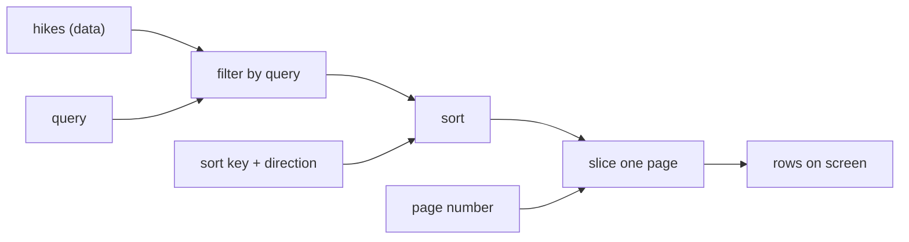
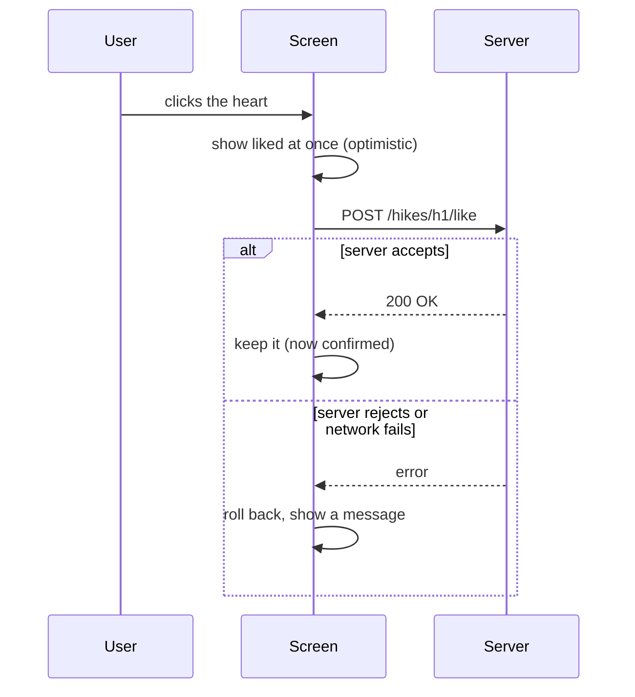

# Sorting, searching, pagination and optimistic updates

> **Before this lesson:** you need derived values from [State with useState](#/lesson/react/usestate), data fetching with race protection from [Fetching data: loading, errors and races](#/lesson/react/data-fetching), and reducers from [useReducer and impossible states](#/lesson/react/usereducer). From JavaScript: `Array.prototype.sort` with a comparison function.

## In plain words

A public library has more books than fit on one table. So it gives you three tools: a catalogue to **search** ("show me books about volcanoes"), an **ordering** (by author, by year), and shelves that you walk along one section at a time (**pagination**: splitting a long list into pages). Every list-heavy screen you will ever build, from an inbox to a product catalogue, is a variation on those three.

The fourth topic is about feeling fast. When you tap "like" in a well-made app, the heart turns red at once, before the server has answered. The app is being **optimistic**: it shows the result it expects and quietly corrects itself if the server says no. Done well, it makes an app feel instant. Done carelessly, it shows users things that never happened.

Tables with these features are bread-and-butter work in most front-end jobs and common take-home exercises.

## The one principle behind all of it

Store the **inputs**. Compute the **view**.

```jsx
const [hikes, setHikes] = useState(initialHikes);        // the data
const [query, setQuery] = useState("");                  // input: search text
const [sort, setSort] = useState({ key: null, dir: "asc" });   // input: ordering
const [page, setPage] = useState(1);                     // input: which page

const filtered = filterHikes(hikes, query);              // derived
const sorted = sortHikes(filtered, sort);                // derived
const { items: visible, totalPages } = paginate(sorted, page, PAGE_SIZE);   // derived
```

Never keep `filteredHikes` or `sortedHikes` in state. They would be copies that must be re-synchronised after every change to the data, the query or the sort, and one missed update shows stale rows. The order of the pipeline also matters:



Filter first (fewer items to sort), sort second, slice last. Slicing before sorting would sort only the ten rows that happened to be on the page.

## Searching (client side)

When the full list is already in the browser, searching is a `filter`:

```jsx
function filterHikes(hikes, query) {
  const q = query.trim().toLowerCase();
  if (q === "") return hikes;
  return hikes.filter((hike) => hike.name.toLowerCase().includes(q));
}
```

- `trim()` removes surrounding spaces, so `" ridge "` behaves like `"ridge"`.
- Lower-casing both sides makes the match ignore case.
- `includes` is a substring test. An empty query returns the same array, untouched.

The search box is a controlled input whose state is the `query` above. One wiring detail: when the query changes, go back to page 1. Otherwise a user on page 7 who types a search that has two pages of results sees an empty page.

```jsx
function handleQueryChange(event) {
  setQuery(event.target.value);
  setPage(1);
}
```

Both setters run in the same handler, so React batches them into one render.

## Sorting

`array.sort(compare)` orders an array using a **comparison function**: given two items `a` and `b`, return a negative number if `a` should come first, a positive number if `b` should, and zero if it does not matter. Two things to know:

- `sort` **mutates** the array it is called on. State and props must not be mutated, so sort a copy: `[...list].sort(...)` or the newer `list.toSorted(...)`.
- Modern JavaScript's sort is **stable**: items that compare as equal keep their original relative order.

```jsx
function sortHikes(hikes, sort) {
  if (sort.key === null) return hikes;
  const direction = sort.dir === "asc" ? 1 : -1;

  return [...hikes].sort((a, b) => {
    const x = a[sort.key];
    const y = b[sort.key];
    if (x == null && y == null) return 0;
    if (x == null) return 1;                    // missing values last, in both directions
    if (y == null) return -1;
    if (typeof x === "string") return direction * x.localeCompare(y, undefined, { sensitivity: "base" });
    return direction * (x - y);
  });
}
```

- `sort.key === null` means "unsorted": return the list as it is.
- `direction` is `1` or `-1`; multiplying the comparison by it flips the order.
- `x == null` (two equals signs) is true for both `null` and `undefined`. Handling missing values *before* applying the direction keeps them at the bottom whichever way the column is sorted.
- `localeCompare` compares strings the way a person would for the user's language; `sensitivity: "base"` ignores case and accents. Comparing strings with `<` instead sorts every capital letter before every lower-case one.
- `x - y` is the standard numeric comparison.

### Clickable headers

The sort *state* is small: which column, which direction. A common behaviour is a three-step cycle per column: ascending, descending, back to unsorted.

```jsx
function nextSort(current, key) {
  if (current.key !== key) return { key, dir: "asc" };
  if (current.dir === "asc") return { key, dir: "desc" };
  return { key: null, dir: "asc" };
}

<th aria-sort={sort.key === "km" ? (sort.dir === "asc" ? "ascending" : "descending") : "none"}>
  <button onClick={() => setSort((s) => nextSort(s, "km"))}>
    Distance {sort.key === "km" ? (sort.dir === "asc" ? "▲" : "▼") : ""}
  </button>
</th>
```

- `nextSort` is a pure function from the current sort state and the clicked column to the next state, easy to test.
- The header contains a real `<button>`, so it works with the keyboard.
- `aria-sort` tells screen readers how the column is sorted.

The problem *Sortable table: header clicks and stable order* asks for exactly this pair: the click cycle and a comparator with empty values last.

## Pagination (client side)

Given a page number and a page size, the slice starts at index `(page − 1) × pageSize`.

```jsx
function paginate(items, page, pageSize) {
  const totalPages = Math.max(1, Math.ceil(items.length / pageSize));
  const current = Math.min(Math.max(page, 1), totalPages);
  const start = (current - 1) * pageSize;
  return { items: items.slice(start, start + pageSize), page: current, totalPages };
}
```

- `Math.ceil(45 / 10)` is `5`: four full pages and one short one. `Math.max(1, ...)` gives an empty list one (empty) page.
- The middle line **clamps** the page into the valid range. If the user is on page 5 and a filter leaves two pages, they land on page 2 instead of nowhere.
- `slice` never fails on a short last page; it returns what exists.

The controls:

```jsx
<nav aria-label="Pagination">
  <button onClick={() => setPage(page - 1)} disabled={page <= 1}>Previous</button>
  <span>Page {page} of {totalPages}</span>
  <button onClick={() => setPage(page + 1)} disabled={page >= totalPages}>Next</button>
</nav>
```

Disable the buttons at the ends so the state can never leave the range. For many pages, show a window of page numbers with ellipses (`1 … 4 5 6 … 20`); the problem *Page buttons with ellipses* builds that, and *Pagination maths* the function above.

## When the server does it

Client-side processing needs the whole list in memory, which works for hundreds or a few thousand rows. Beyond that, the **server** filters, sorts and pages, and the browser asks for one page at a time. The inputs (`query`, `sort`, `page`) stay in your state. What changes is that they become parameters of a request and dependencies of the effect:

```jsx
useEffect(() => {
  const controller = new AbortController();
  const params = new URLSearchParams({ q: query, sort: sort.key ?? "", dir: sort.dir, page: String(page), limit: "20" });

  setStatus("loading");
  fetch(`/api/hikes?${params}`, { signal: controller.signal })
    .then((r) => (r.ok ? r.json() : Promise.reject(new Error(`Server replied ${r.status}`))))
    .then((data) => { setRows(data.items); setTotal(data.total); setStatus("success"); })
    .catch((err) => { if (err.name !== "AbortError") setStatus("error"); });

  return () => controller.abort();
}, [query, sort, page]);
```

- `URLSearchParams` builds the `?q=…&page=…` part of the address and escapes the values.
- The response carries the rows for this page and the `total` count, from which the client computes the number of pages.
- The abort in the cleanup discards outdated responses, as in the data-fetching lesson.
- Each keystroke would send a request, so the query is usually **debounced**: wait until typing pauses ([Interview builds](#/lesson/react/interview-builds) implements it).

Two server pagination styles exist. **Offset pagination** asks for "page 3, 20 per page" and can jump to any page, but repeats or skips rows if the data changes between requests. **Cursor pagination** asks for "20 rows after this last item I saw"; it is stable and fast on huge tables, supports "Load more" and infinite scrolling, and cannot jump to page 37. Firestore uses cursors ([Firestore and the Realtime Database](#/lesson/react/firestore-rtdb)).

For "Load more", append instead of replacing: `setRows((old) => [...old, ...data.items])`, and reset to an empty list when the query or sort changes.

A professional touch: keep `query`, `sort` and `page` in the URL's query string, so a filtered view can be bookmarked, shared and reached with the Back button. [Routing with React Router](#/lesson/react/routing) shows `useSearchParams` for that.

## Optimistic updates

The careful way to change data: send the request, show a spinner, and update the screen when the server confirms. Correct, and sluggish for small actions.

The optimistic way: update the screen immediately, send the request, and **roll back** (undo the change) if it fails.



A first version for a "favourite" toggle:

```jsx
async function toggleFavourite(id) {
  const previous = hikes;                                             // 1. remember
  setHikes(hikes.map((h) => (h.id === id ? { ...h, favourite: !h.favourite } : h)));   // 2. show at once

  try {
    await api.setFavourite(id);                                       // 3. tell the server
  } catch (err) {
    setHikes(previous);                                               // 4. roll back
    setMessage("Could not save. Please try again.");
  }
}
```

- `previous` keeps a reference to the old array (free, because updates are immutable).
- The screen changes in the same instant as the click.
- On failure the old array is restored and the user is told.

This is fine for a single isolated action. It has a flaw when actions overlap. Suppose the user favourites hike A, then hike B, and A's request fails. Restoring A's snapshot also wipes B's change, although B succeeded, because the snapshot predates it.

### The robust model: confirmed data plus pending operations

Keep two things apart:

- **confirmed**: what the server has acknowledged,
- **pending**: the list of operations sent but not yet answered.

What the user sees is derived: *confirmed, with every pending operation replayed on top*. A success moves the operation's effect into `confirmed`. A failure only removes the operation from the list. No snapshot, no special undo logic, and overlapping operations cannot damage each other.

```jsx
const view = pending.reduce(applyOperation, confirmed);
```

React 19 ships this model as a Hook:

```jsx
import { useOptimistic } from "react";

const [optimisticHikes, addOptimistic] = useOptimistic(
  hikes,
  (current, id) => current.map((h) => (h.id === id ? { ...h, favourite: !h.favourite } : h))
);

async function toggleFavouriteAction(id) {
  addOptimistic(id);                       // shown immediately
  const saved = await api.setFavourite(id);
  setHikes((list) => list.map((h) => (h.id === id ? saved : h)));   // the confirmed state
}
```

- `useOptimistic(realState, reducer)` returns the state to render and a function for adding an optimistic change.
- While the async action is running, `optimisticHikes` is the real state with the pending changes applied. When the action finishes, React discards the optimistic layer and renders the real state again, so a failure reverts by itself.
- It must be called inside an action or transition (a form `action`, or `startTransition`), which is how React knows when "pending" ends.

The problem *Optimistic updates with rollback* has you implement the confirmed-plus-pending model, including a failure in the middle of other operations.

### When to be optimistic

| Good candidates | Poor candidates |
|---|---|
| Likes, favourites, toggles | Payments, bookings with limited stock |
| Renaming, reordering, ticking a checkbox | Anything irreversible or legally significant |
| Adding a comment (with a temporary id) | Actions that often fail validation on the server |
| Failure is rare and harmless | The user would act on a result that may be undone |

An optimistic *create* needs care: the new item has no server id yet. Give it a temporary client id (`crypto.randomUUID()`), mark it as pending in the UI (greyed out), and replace it with the server's version when the response arrives.

> [!INTERVIEW]
> "What is an optimistic update and how do you handle failure?" *Apply the expected result to the UI immediately, send the request, and reconcile when it settles: on success keep or replace with the server's version, on failure roll back and tell the user. For overlapping operations I keep confirmed state separate from a queue of pending operations and derive the view, so rolling one back does not erase the others. React 19's `useOptimistic` implements that.*

## Run it: one table, four features

Everything on this page is derived from four pieces of state: the data (with a pending-operations list), the query, the sort and the page. The fake server takes a second and rejects favourites for any hike whose name contains "Marsh".

```html-run
<div id="root"></div>
<style>
  body { font-family: sans-serif; } table { border-collapse: collapse; margin: 6px 0; } td, th { border: 1px solid #ccc; padding: 3px 8px; }
  th button { border: 0; background: none; font-weight: bold; cursor: pointer; } .pending { opacity: 0.5; } .msg { color: #b3261e; min-height: 1.2em; }
</style>
<script>
  const names = ["Ridge Loop", "Fern Gully", "Salt Marsh", "Rim Trail", "River Bend", "Raven Peak", "Moss Steps", "Marsh Boardwalk", "Granite Stair", "Alder Flats", "Echo Lake", "Windy Gap", "Otter Creek"];
  let state = {
    confirmed: names.map((name, i) => ({ id: i + 1, name, km: i === 4 ? null : (i * 37) % 23 + 1, favourite: false })),
    pending: [],                                     // operations sent but not answered: { opId, id }
    query: "", sort: { key: null, dir: "asc" }, page: 1, message: "",
  };
  const PAGE_SIZE = 5;
  function setState(change) { state = { ...state, ...change }; draw(); }

  // ---------- pure helpers ----------
  const applyOp = (hikes, op) => hikes.map((h) => (h.id === op.id ? { ...h, favourite: !h.favourite, isPending: true } : h));
  function filterHikes(hikes, query) { const q = query.trim().toLowerCase(); return q ? hikes.filter((h) => h.name.toLowerCase().includes(q)) : hikes; }
  function sortHikes(hikes, sort) {
    if (sort.key === null) return hikes;
    const dir = sort.dir === "asc" ? 1 : -1;
    return [...hikes].sort((a, b) => {
      const x = a[sort.key], y = b[sort.key];
      if (x == null && y == null) return 0; if (x == null) return 1; if (y == null) return -1;
      return typeof x === "string" ? dir * x.localeCompare(y) : dir * (x - y);
    });
  }
  function paginate(items, page, size) {
    const totalPages = Math.max(1, Math.ceil(items.length / size)), current = Math.min(Math.max(page, 1), totalPages);
    return { items: items.slice((current - 1) * size, current * size), page: current, totalPages };
  }
  function nextSort(current, key) {
    if (current.key !== key) return { key, dir: "asc" };
    return current.dir === "asc" ? { key, dir: "desc" } : { key: null, dir: "asc" };
  }

  // ---------- actions ----------
  let opCounter = 0;
  function toggleFavourite(id) {
    const op = { opId: ++opCounter, id };
    setState({ pending: [...state.pending, op], message: "" });                 // optimistic: shown at once
    const hike = state.confirmed.find((h) => h.id === id);
    setTimeout(() => {                                                          // the fake server answers
      const pending = state.pending.filter((p) => p.opId !== op.opId);
      if (hike.name.includes("Marsh")) setState({ pending, message: `Could not save "${hike.name}". Rolled back.` });
      else setState({ pending, confirmed: state.confirmed.map((h) => (h.id === id ? { ...h, favourite: !h.favourite } : h)) });
    }, 1000);
  }

  // ---------- view ----------
  function draw() {
    const view = state.pending.reduce(applyOp, state.confirmed);               // confirmed + pending replayed
    const result = paginate(sortHikes(filterHikes(view, state.query), state.sort), state.page, PAGE_SIZE);
    const arrow = (key) => (state.sort.key === key ? (state.sort.dir === "asc" ? " ▲" : " ▼") : "");
    document.getElementById("root").innerHTML = `
      <label>Search: <input id="q" value="${state.query}" /></label>
      <table>
        <tr><th><button onclick="setState({ sort: nextSort(state.sort, 'name') })">Name${arrow("name")}</button></th>
            <th><button onclick="setState({ sort: nextSort(state.sort, 'km') })">km${arrow("km")}</button></th><th>Favourite</th></tr>
        ${result.items.map((h) => `<tr class="${h.isPending ? "pending" : ""}"><td>${h.name}</td><td>${h.km ?? "?"}</td>
            <td><button onclick="toggleFavourite(${h.id})">${h.favourite ? "★" : "☆"}</button></td></tr>`).join("") || "<tr><td colspan='3'>No hikes match.</td></tr>"}
      </table>
      <button onclick="setState({ page: ${result.page - 1} })" ${result.page <= 1 ? "disabled" : ""}>Previous</button>
      Page ${result.page} of ${result.totalPages}
      <button onclick="setState({ page: ${result.page + 1} })" ${result.page >= result.totalPages ? "disabled" : ""}>Next</button>
      <p class="msg">${state.message}</p>`;
    const input = document.getElementById("q");
    input.addEventListener("input", (e) => { setState({ query: e.target.value, page: 1 }); const again = document.getElementById("q"); again.focus(); again.setSelectionRange(again.value.length, again.value.length); });
  }
  draw();
</script>
```

Try: click **km** three times (ascending, descending, unsorted) and notice River Bend, whose distance is unknown, stays last both ways. Go to page 3, then search for `r`: you are returned to page 1. Click the stars on "Ridge Loop" and "Salt Marsh" quickly, one after the other: both turn on at once and look faded while pending; a second later Ridge Loop is confirmed and Salt Marsh rolls back with a message, without disturbing Ridge Loop.

## Pitfalls

> [!WARNING]
> **`hikes.sort(...)` on state or props.** `sort` reorders the original array in place. React may not re-render, other components holding the same array see it change, and the "unsorted" order is lost. Always sort a copy.

- **Storing the filtered or sorted list in state.** It goes stale. Derive it.
- **Slicing before filtering or sorting.** You process only the current page.
- **Not resetting the page when the filter changes,** and not clamping when the list shrinks.
- **Comparing strings with `<`** (capital letters first, accents wrong), or numbers stored as strings (`"10" < "9"`).
- **A comparator that returns a boolean** (`(a, b) => a.km > b.km`). It must return a negative, zero or positive number.
- **Index as key in a sortable list.** Rows keep the wrong state after reordering.
- **Server pagination without cancelling old requests.** Fast paging shows page 2's rows under "Page 3".
- **Optimistic updates with no failure path,** or with a single snapshot when actions can overlap.
- **Optimism for actions users must be able to trust,** such as payments.

> [!TIP]
> Put `filterHikes`, `sortHikes`, `paginate` and `nextSort` in a plain module with tests. The component then contains almost no logic: four pieces of state and one pipeline.

## Cheat sheet

| Feature | State (inputs) | Derived |
|---|---|---|
| Search | `query` | `list.filter(matches)` |
| Sort | `{ key, dir }` | `[...list].sort(compare)` |
| Pagination | `page` (and `pageSize`) | `list.slice(start, start + size)`, `totalPages` |
| Server-side | same three, as request parameters and effect dependencies | rows and total come from the response |
| Optimistic | `confirmed` + `pending[]` | `pending.reduce(apply, confirmed)` |

| Detail | Rule |
|---|---|
| Pipeline order | filter → sort → paginate |
| Filter changed | `setPage(1)` |
| List shrank | clamp `page` to `1..totalPages` |
| Empty values when sorting | handle before applying direction |
| Text comparison | `a.localeCompare(b, undefined, { sensitivity: "base" })` |
| Rollback | remove the pending operation; tell the user |

## Summary

- Keep the data and the user's choices (query, sort, page) in state, and derive the visible rows with a filter → sort → slice pipeline.
- Sort copies, never the original; use a numeric-returning comparator, locale-aware for text, with empty values last.
- Reset or clamp the page whenever the result set changes.
- For large data, send the same inputs to the server, cancel outdated requests and debounce typing.
- Optimistic updates show the expected result at once and reconcile later; model them as confirmed data plus pending operations so that failures and overlaps are handled cleanly.

## Glossary

- **Pagination**: dividing a long list into pages.
- **Comparison function (comparator)**: a function telling `sort` which of two items comes first.
- **Stable sort**: a sort that keeps equal items in their original order.
- **Clamp**: force a number into a range.
- **Offset pagination**: requesting by page number or row offset.
- **Cursor pagination**: requesting the items after a given last-seen item.
- **Debounce**: wait for a pause in input before acting.
- **Optimistic update**: showing an action's expected result before the server confirms it.
- **Rollback**: undoing an optimistic change after a failure.
- **Pending operation**: a change sent to the server and not yet answered.
- **Query string**: the `?key=value` part of a URL.

## Check yourself

```quiz
[
  {"q": "Which belongs in state for a searchable, sortable table?",
   "options": ["The filtered rows and the sorted rows", "The query text and the sort key/direction; the visible rows are computed from them", "Only the visible rows", "The HTML of the table"],
   "answer": 1,
   "explain": "Store inputs, derive outputs. Stored copies of derived lists go stale."},
  {"q": "What is wrong with const sorted = hikes.sort(byKm) where hikes is a prop?",
   "options": ["Nothing", "sort mutates the original array, changing the parent's data in place", "sort returns undefined", "Props cannot be sorted"],
   "answer": 1,
   "explain": "Copy first: [...hikes].sort(byKm) or hikes.toSorted(byKm)."},
  {"q": "45 items, page size 10. How many pages are there and how many items are on the last one?",
   "options": ["4 pages, 15 items", "5 pages, 5 items", "5 pages, 10 items", "4 pages, 5 items"],
   "answer": 1,
   "explain": "ceil(45 / 10) = 5 pages; the fifth holds items 41 to 45."},
  {"q": "A user is on page 4 of 6 and types a search that matches 8 items (page size 5). What should the page become?",
   "options": ["Stay on 4, showing an empty page", "1 (reset when the filter changes)", "6", "It does not matter"],
   "answer": 1,
   "explain": "The old page number refers to a different result set. Reset to the first page, or at least clamp to the new last page."},
  {"q": "Why handle null values before multiplying by the direction in a comparator?",
   "options": ["null cannot be multiplied", "So that rows with missing values stay at the bottom for both ascending and descending order", "It is faster", "To make the sort unstable"],
   "answer": 1,
   "explain": "If the direction were applied to them too, empty rows would jump to the top when descending."},
  {"q": "In which order should the pipeline run?",
   "options": ["paginate, sort, filter", "sort, paginate, filter", "filter, sort, paginate", "Any order gives the same rows"],
   "answer": 2,
   "explain": "Filtering first shrinks the work; slicing must come last or you only sort and filter one page."},
  {"q": "A user favourites hike A (request 1), then hike B (request 2). Request 1 fails. With the 'restore the snapshot taken before A' approach, what does the user see?",
   "options": ["A off, B on", "A off, B off: restoring the old snapshot also wipes B's change", "A on, B on", "An error page"],
   "answer": 1,
   "explain": "The snapshot predates B. Keeping confirmed data and a list of pending operations avoids this."},
  {"q": "Which action is a poor fit for an optimistic update?",
   "options": ["Toggling a favourite", "Ticking a to-do item", "Charging a credit card", "Renaming a list"],
   "answer": 2,
   "explain": "Users must not be shown a payment as complete when it may still fail. Wait for confirmation."}
]
```

> **Source:** Wieruch, *The Road to React*, "Real World React (Advanced)": Sorting, Reverse Sort, Remember Last Searches, Paginated Fetch. Documentation: https://react.dev/reference/react/useOptimistic, https://react.dev/learn/you-might-not-need-an-effect, https://developer.mozilla.org/en-US/docs/Web/JavaScript/Reference/Global_Objects/Array/sort
