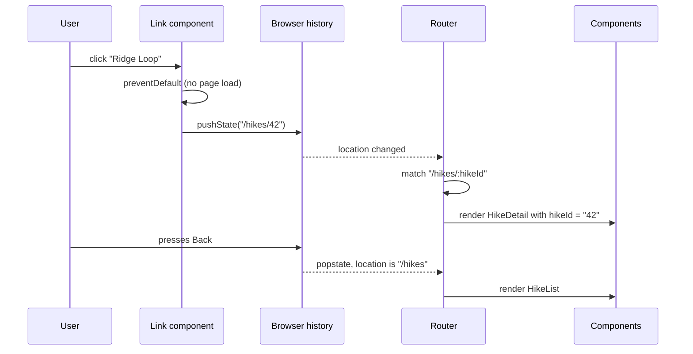
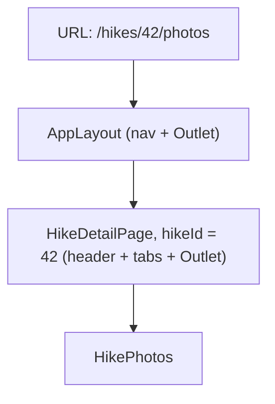

# Routing with React Router

> **Before this lesson:** you need components and composition ([Composition, children and conditional rendering](#/lesson/react/composition-conditional)), effects and data fetching ([Fetching data: loading, errors and races](#/lesson/react/data-fetching)), and a basic idea of what a URL is (the address in the browser's address bar).

## In plain words

A large museum has one entrance and many rooms. Signs on the walls say "Egypt: room 12" and the floor plan tells you which room is behind which door. You can also hand a friend a note saying "meet me in room 12" and they will find the same place.

A website's rooms are its screens, and the note is the **URL** (Uniform Resource Locator: the address shown in the browser, such as `https://example.com/hikes/42`). **Routing** is the floor plan: the rules that decide which screen to show for which URL.

A React application built with Vite is a **single-page application**: the browser loads one HTML file, once. So the usual mechanism, where each address is a separate page fetched from the server, is gone. A **client-side router** recreates it inside the browser: it watches the URL, shows the matching components, and changes the URL when the user navigates, all without reloading the page.

Any app with more than one screen needs this, and **React Router** is the most widely used library for it.

## Why a link cannot be a plain `<a>`

```jsx
<a href="/hikes">All hikes</a>
```

Clicking this makes the browser request `/hikes` from the server and load a whole new document. Your JavaScript restarts and every piece of state is lost. A client-side router avoids the reload using the browser's **History API**: `history.pushState()` changes the address bar and adds an entry to the Back/Forward history *without* contacting the server, and a `popstate` event fires when the user presses Back or Forward. The router listens, works out which components match the new address, and renders them.



## Setting up React Router

```bash
npm install react-router
```

In version 7 everything is imported from `react-router`. (Earlier versions used a separate `react-router-dom` package, which you will see in older projects; the components below have the same names there.)

Wrap the application in a router and declare the routes:

```jsx
// main.jsx
import { createRoot } from "react-dom/client";
import { BrowserRouter } from "react-router";
import App from "./App.jsx";

createRoot(document.getElementById("root")).render(
  <BrowserRouter>
    <App />
  </BrowserRouter>
);
```

```jsx
// App.jsx
import { Routes, Route } from "react-router";

function App() {
  return (
    <Routes>
      <Route path="/" element={<HomePage />} />
      <Route path="/hikes" element={<HikeListPage />} />
      <Route path="/hikes/:hikeId" element={<HikeDetailPage />} />
      <Route path="*" element={<NotFoundPage />} />
    </Routes>
  );
}
```

- `<BrowserRouter>` connects to the History API and makes the current location available to everything inside it.
- `<Routes>` looks at the current URL and renders the **one** `<Route>` that matches best.
- Each `<Route>` pairs a `path` pattern with the `element` to show.
- `:hikeId` is a **URL parameter**: a placeholder that matches any single segment, so `/hikes/42` and `/hikes/ridge-loop` both match.
- `path="*"` matches anything not matched elsewhere: your "page not found" screen.

React Router picks the most specific match, not the first one listed: `/hikes/new` beats `/hikes/:hikeId` because a literal segment is more specific than a placeholder. The problem *Route matcher with params* asks you to implement that ranking.

## Links and navigation

```jsx
import { Link, NavLink } from "react-router";

function MainNav() {
  return (
    <nav>
      <NavLink to="/" end>Home</NavLink>
      <NavLink to="/hikes" className={({ isActive }) => (isActive ? "nav-link active" : "nav-link")}>
        Hikes
      </NavLink>
    </nav>
  );
}

<Link to={`/hikes/${hike.id}`}>{hike.name}</Link>
```

- `<Link to="...">` renders a real `<a href>` (so right-click, "open in new tab" and screen readers all work) and intercepts ordinary clicks to navigate without a reload.
- `<NavLink>` is a `Link` that knows whether it points to the current page. Its `className` can be a function receiving `{ isActive }`, which is how you highlight the current menu item. It also sets `aria-current="page"` for assistive technology.
- `end` on the home link means "active only on exactly `/`"; without it `/` would count as active on every page, since every path starts with `/`.

To navigate from code, for example after saving a form, use the `useNavigate` Hook:

```jsx
import { useNavigate } from "react-router";

function NewHikeForm() {
  const navigate = useNavigate();

  async function handleSubmit(event) {
    event.preventDefault();
    const hike = await createHike(new FormData(event.currentTarget));
    navigate(`/hikes/${hike.id}`);
  }
  // ...
}
```

- `navigate("/path")` pushes a new history entry.
- `navigate("/path", { replace: true })` *replaces* the current entry, so Back does not return to it. Use that after sign-in or for redirects.
- `navigate(-1)` goes back one step.

Use `<Link>` for anything the user clicks to go somewhere, and `navigate` only for navigation that results from an action.

## Reading the URL

### Parameters

```jsx
import { useParams } from "react-router";

function HikeDetailPage() {
  const { hikeId } = useParams();
  const { status, data: hike } = useFetch(`/api/hikes/${hikeId}`);

  if (status === "loading") return <p>Loading…</p>;
  if (status === "error") return <p role="alert">Hike not found.</p>;
  return <h1>{hike.name}</h1>;
}
```

- `useParams()` returns an object with one key per placeholder in the matched path.
- Values are always **strings**. Convert with `Number(hikeId)` if you need a number.
- The parameter is a reactive value: when the user goes from `/hikes/42` to `/hikes/43`, the *same* component instance re-renders with a new `hikeId`, so it must be a dependency of any effect that fetches (here it is part of the URL passed to `useFetch`).

### Search parameters

The part of a URL after `?` is the **query string**: `/hikes?q=ridge&page=2`. It is the right home for state that should survive a reload and be shareable: search text, filters, sort order, page number.

```jsx
import { useSearchParams } from "react-router";

function HikeListPage() {
  const [searchParams, setSearchParams] = useSearchParams();
  const query = searchParams.get("q") ?? "";
  const page = Number(searchParams.get("page") ?? "1");

  function handleQueryChange(event) {
    setSearchParams({ q: event.target.value, page: "1" }, { replace: true });
  }

  return <input value={query} onChange={handleQueryChange} />;
}
```

- `useSearchParams()` works like `useState`, with the URL as the storage.
- `searchParams.get("q")` returns the value or `null`; `??` supplies the default.
- `setSearchParams({...})` updates the URL, and the component re-renders with the new values. `replace: true` avoids adding a history entry for every keystroke.

The URL has become the single source of truth for that state: no `useState` to keep in sync.

## Nested routes and layouts

Most apps have a frame that stays put (header, sidebar) while the inner content changes. Nested routes express that directly.

```jsx
import { Outlet } from "react-router";

function AppLayout() {
  return (
    <>
      <MainNav />
      <main>
        <Outlet />
      </main>
    </>
  );
}

<Routes>
  <Route element={<AppLayout />}>
    <Route index element={<HomePage />} />
    <Route path="hikes" element={<HikeListPage />} />
    <Route path="hikes/:hikeId" element={<HikeDetailPage />}>
      <Route index element={<HikeOverview />} />
      <Route path="photos" element={<HikePhotos />} />
    </Route>
  </Route>
  <Route path="*" element={<NotFoundPage />} />
</Routes>
```

- A `<Route>` with children renders its own `element`, and `<Outlet />` inside that element marks where the matching child route appears.
- The outer route has no `path`, so it adds no URL segment; it only supplies the layout.
- `index` marks the child shown when the parent's path matches exactly (`/` → `HomePage`; `/hikes/42` → `HikeOverview`).
- Child paths are relative: `photos` under `hikes/:hikeId` means `/hikes/42/photos`. `HikeDetailPage` must itself render an `<Outlet />` for its tabs.

When the user moves from `/hikes/42` to `/hikes/42/photos`, `AppLayout` and `HikeDetailPage` stay mounted with their state; only the innermost part changes.



## Redirects and guarding routes

`<Navigate>` is a component that navigates as soon as it renders, which makes redirects declarative:

```jsx
import { Navigate, Outlet, useLocation } from "react-router";

function RequireAuth() {
  const { status } = useAuth();
  const location = useLocation();

  if (status === "loading") return <p>Checking your session…</p>;
  if (status === "anonymous") {
    return <Navigate to="/signin" replace state={{ from: location.pathname }} />;
  }
  return <Outlet />;
}

<Route element={<RequireAuth />}>
  <Route path="/dashboard" element={<DashboardPage />} />
  <Route path="/settings" element={<SettingsPage />} />
</Route>
```

- `useLocation()` returns the current location object (`pathname`, `search`, and any `state` passed along).
- If nobody is signed in, redirect to the sign-in page and remember where the user was heading, so the sign-in page can send them back.
- Otherwise render the child routes through `<Outlet />`.

This protects the *screens*. It does not protect the *data*: anyone can call your API directly. [Sessions, protected routes and roles](#/lesson/react/sessions-roles) builds this guard with Firebase and explains where real enforcement lives.

## Data routers: loaders and actions

Fetching inside components causes **waterfalls**: the layout renders, then the page renders and starts its fetch, then a child renders and starts its own. React Router's **data router** lets each route declare the data it needs, and the router starts all of them as soon as navigation begins.

```jsx
import { createBrowserRouter, RouterProvider, useLoaderData } from "react-router";

const router = createBrowserRouter([
  {
    path: "/",
    element: <AppLayout />,
    errorElement: <ErrorPage />,
    children: [
      { index: true, element: <HomePage /> },
      {
        path: "hikes/:hikeId",
        element: <HikeDetailPage />,
        loader: async ({ params }) => {
          const response = await fetch(`/api/hikes/${params.hikeId}`);
          if (!response.ok) throw new Response("Not found", { status: 404 });
          return response.json();
        },
      },
    ],
  },
]);

function HikeDetailPage() {
  const hike = useLoaderData();
  return <h1>{hike.name}</h1>;
}

createRoot(document.getElementById("root")).render(<RouterProvider router={router} />);
```

- Routes are plain objects with the same ideas: `path`, `element`, `children`, `index`.
- A `loader` runs *before* the route renders and receives the URL `params`. Whatever it returns is available through `useLoaderData()`, so the component has no loading state of its own.
- Throwing inside a loader shows the nearest `errorElement`.
- An `action` is the counterpart for form submissions, used with the router's `<Form>` component; after it runs, the loaders re-run so the screen shows fresh data.

React Router 7 can also be used as a full framework (file-based routes, server rendering). The component-based `<Routes>` style at the top of this lesson remains supported and is the easiest place to start.

## Code splitting by route

Routes are natural seams for loading code on demand ([Project structure and performance profiling](#/lesson/react/structure-profiling)):

```jsx
const AdminPage = lazy(() => import("./features/admin/AdminPage"));

<Route path="/admin" element={<Suspense fallback={<p>Loading…</p>}><AdminPage /></Suspense>} />
```

## Deployment detail: the fallback rule

With `BrowserRouter`, a visitor who opens or refreshes `https://example.com/hikes/42` makes the *server* receive a request for `/hikes/42`. No such file exists; only `index.html` does. The host must be configured to answer every unknown path with `index.html` (a **rewrite** or "SPA fallback"), after which the router reads the URL and shows the right screen. Firebase Hosting's setting for this appears in [Hosting, app structure, and Firebase vs a custom backend](#/lesson/react/hosting-structure). Vite's development server does it automatically, which is why the problem often shows up only after deploying.

## Run it: a router in forty lines

The sandboxed frame cannot change its real address, so this miniature router keeps the "URL" in a variable and shows it in a fake address bar. The matching, parameters, links, active link and Back button work as described above.

```html-run
<div id="bar" style="font-family:monospace;background:#eee;padding:6px;border-radius:6px"></div>
<div id="root" style="font-family:sans-serif"></div>
<style>a { margin-right: 10px; } a.active { font-weight: bold; text-decoration: none; color: seagreen; }</style>
<script>
  const hikes = [{ id: "42", name: "Ridge Loop", km: 7.5 }, { id: "7", name: "Fern Gully", km: 3 }];

  // ---------- the route table: pattern -> page function ----------
  const routes = [
    { path: "/", page: () => `<h3>Home</h3><p>Welcome to Trail Log.</p>` },
    { path: "/hikes", page: () => `<h3>Hikes</h3><ul>${hikes.map((h) => `<li>${link("/hikes/" + h.id, h.name)}</li>`).join("")}</ul>${link("/hikes/new", "Add a hike")}` },
    { path: "/hikes/new", page: () => `<h3>New hike</h3><p>(a form would go here)</p>` },
    { path: "/hikes/:hikeId", page: ({ hikeId }) => {
        const hike = hikes.find((h) => h.id === hikeId);
        return hike ? `<h3>${hike.name}</h3><p>${hike.km} km. The parameter hikeId is the string "${hikeId}".</p>` : `<h3>No hike with id ${hikeId}</h3>`;
      } },
    { path: "*", page: () => `<h3>404</h3><p>Nothing here.</p>` },
  ];

  // ---------- matching: static segments beat params, params beat the catch-all ----------
  function match(pathname) {
    const parts = pathname.split("/").filter(Boolean);
    let best = null;
    for (const route of routes) {
      if (route.path === "*") { if (!best) best = { route, params: {}, score: -1 }; continue; }
      const segments = route.path.split("/").filter(Boolean);
      if (segments.length !== parts.length) continue;
      const params = {}; let score = 0; let ok = true;
      segments.forEach((seg, i) => {
        if (seg.startsWith(":")) { params[seg.slice(1)] = decodeURIComponent(parts[i]); score += 1; }
        else if (seg === parts[i]) score += 2;
        else ok = false;
      });
      if (ok && (!best || score > best.score)) best = { route, params, score };
    }
    return best;
  }

  // ---------- history: a stack of locations, like the browser's ----------
  const historyStack = ["/"]; let position = 0;
  function navigate(to) { historyStack.splice(position + 1); historyStack.push(to); position++; draw(); }   // pushState
  function back() { if (position > 0) { position--; draw(); } }                                            // popstate
  function link(to, text) {
    const active = historyStack[position] === to ? ' class="active"' : "";
    return `<a href="${to}"${active} data-link>${text}</a>`;
  }
  document.addEventListener("click", (event) => {
    const a = event.target.closest("a[data-link]");
    if (!a) return;
    event.preventDefault();                               // what <Link> does: no page load
    navigate(a.getAttribute("href"));
  });

  function draw() {
    const pathname = historyStack[position];
    const { route, params } = match(pathname);
    document.getElementById("bar").innerHTML = `<button onclick="back()" ${position === 0 ? "disabled" : ""}>Back</button> https://trail-log.example${pathname} <small>(matched ${route.path})</small>`;
    document.getElementById("root").innerHTML =
      `<nav>${link("/", "Home")}${link("/hikes", "Hikes")}${link("/hikes/999", "A hike that does not exist")}${link("/oops", "Broken link")}</nav>` + route.page(params);
  }
  draw();
</script>
```

Click through to a hike and watch the address bar and the matched pattern. Open "Add a hike": the URL `/hikes/new` fits both `/hikes/new` and `/hikes/:hikeId`, and the static pattern wins. Use the Back button to walk the history stack. Then reorder the route table so that `/hikes/:hikeId` comes before `/hikes/new`; the result does not change, because ranking, not order, decides.

## Pitfalls

> [!WARNING]
> **Using `<a href>` for internal links.** It works, with a full page reload each time: slow, and all in-memory state is lost. Use `<Link>`. (Plain `<a>` is correct for links to *other* sites.)

- **Calling `navigate()` during render.** It is a side effect; call it in handlers or effects, or render `<Navigate>`.
- **Treating `useParams` values as numbers.** They are strings: `"42" === 42` is false.
- **Not refetching when a parameter changes.** The component is reused; include the parameter in effect dependencies (or use a loader, or `key={hikeId}`).
- **Forgetting `<Outlet />`** in a layout route: child routes match and nothing appears.
- **No catch-all route.** Unknown URLs render a blank page.
- **Blank page after deployment on refresh:** the host lacks the fallback rewrite to `index.html`.
- **Duplicating URL state in `useState`.** Two sources of truth drift apart. Read from `useSearchParams`.
- **Believing a route guard secures data.** It only hides screens.
- **Using router Hooks outside the router.** `useNavigate` and friends throw unless the component is rendered inside `<BrowserRouter>` or `<RouterProvider>` (tests can wrap with `<MemoryRouter>`).

> [!TIP]
> Decide for each piece of UI state whether it belongs in the URL. A good test: "if the user copies the address and sends it to a colleague, should the colleague see the same thing?" If yes (selected tab, filters, page), put it in the URL.

> [!INTERVIEW]
> "How does client-side routing work?" *The app loads once. The router uses the History API to change the URL without a page load and listens for location changes, including Back and Forward. It matches the URL against route patterns, extracts parameters, and renders the matching component tree; nested routes render into outlets. Links are anchors whose default navigation is prevented. The server must return `index.html` for all app paths so deep links and refreshes work.*

## Cheat sheet

| Need | React Router |
|---|---|
| Enable routing | `<BrowserRouter>` around the app, or `createBrowserRouter` + `<RouterProvider>` |
| Route table | `<Routes><Route path="..." element={<X />} /></Routes>` |
| Parameter | `path="hikes/:hikeId"` → `const { hikeId } = useParams()` |
| Not found | `<Route path="*" element={<NotFound />} />` |
| Link | `<Link to="/hikes">` |
| Active link | `<NavLink to="/hikes" className={({ isActive }) => ...}>` |
| Navigate in code | `const navigate = useNavigate(); navigate("/x", { replace: true })` |
| Redirect by rendering | `<Navigate to="/signin" replace />` |
| Query string | `const [params, setParams] = useSearchParams()` |
| Layout with nested content | parent `<Route element={<Layout />}>` + `<Outlet />` |
| Default child | `<Route index element={...} />` |
| Current location | `useLocation()` |
| Data before render | `loader` + `useLoaderData()` |
| Lazy route | `lazy(() => import(...))` + `<Suspense>` |

## Summary

- A single-page app needs a client-side router to map URLs to screens without reloading.
- React Router matches the URL against route patterns, chooses the most specific, and passes parameters through `useParams`.
- `<Link>` and `<NavLink>` navigate without reloads; `useNavigate` and `<Navigate>` navigate from code.
- Nested routes with `<Outlet />` give persistent layouts.
- The query string, through `useSearchParams`, is the right place for shareable UI state.
- Data routers attach loaders and actions to routes to avoid request waterfalls.
- The host must serve `index.html` for all app paths, and route guards protect screens, not data.

## Glossary

- **URL**: the address of a page; made of path (`/hikes/42`), query string (`?q=x`) and optional hash.
- **Routing**: mapping URLs to what is displayed.
- **Client-side router**: routing done by JavaScript in the browser.
- **History API**: browser functions (`pushState`, `popstate`) for changing the URL without loading a page.
- **Route**: a pairing of a path pattern and an element.
- **URL parameter**: a `:name` placeholder segment in a path.
- **Query string / search parameters**: the `?key=value&…` part of a URL.
- **Nested route / layout route**: a route rendered inside its parent's `<Outlet />` / a parent that supplies shared UI.
- **Index route**: the default child of a parent route.
- **Redirect**: sending the user to a different URL automatically.
- **Loader / action**: route functions that load data before rendering / handle submissions.
- **Rewrite (SPA fallback)**: a host rule that serves `index.html` for any path.

## Check yourself

```quiz
[
  {"q": "What happens when a user clicks <a href=\"/hikes\"> inside a React single-page app?",
   "options": ["The router handles it without a reload", "The browser loads a whole new document from the server, restarting the app and losing in-memory state", "Nothing", "React throws an error"],
   "answer": 1,
   "explain": "Plain anchors trigger full navigation. Link prevents the default and uses the History API."},
  {"q": "Routes: /hikes/new and /hikes/:hikeId, declared in that order or the reverse. The URL is /hikes/new. Which element renders?",
   "options": ["Whichever is declared first", "The /hikes/new route, because a static segment is more specific than a parameter", "Both", "The catch-all"],
   "answer": 1,
   "explain": "React Router ranks matches by specificity, not declaration order."},
  {"q": "The URL is /hikes/42 and the route is hikes/:hikeId. What is typeof useParams().hikeId?",
   "options": ["number", "string", "object", "undefined"],
   "answer": 1,
   "explain": "URL parameters are always strings. Convert explicitly when you need a number."},
  {"q": "A layout route renders <MainNav /> but forgets <Outlet />. The user visits a child route. What appears?",
   "options": ["The child page only", "The navigation only; the child has nowhere to render", "A 404 page", "An infinite loop"],
   "answer": 1,
   "explain": "Outlet marks the place where the matched child route is rendered."},
  {"q": "The user navigates from /hikes/42 to /hikes/43. HikeDetailPage fetches in useEffect(() => {...}, []). What is shown?",
   "options": ["Hike 43", "Still hike 42: the same component instance is reused and the effect does not run again", "A blank page", "Both hikes"],
   "answer": 1,
   "explain": "The parameter changed but the component did not remount. Put hikeId in the dependency array."},
  {"q": "Where should a table's current filter and page number live if users need to share the exact view?",
   "options": ["useState", "A ref", "The URL query string via useSearchParams", "localStorage"],
   "answer": 2,
   "explain": "The URL is shareable and survives reloads, and Back/Forward work naturally."},
  {"q": "After deploying, opening the home page works but refreshing /hikes/42 shows the host's 404 page. Why?",
   "options": ["React Router is not installed", "The server has no file at /hikes/42 and is not configured to serve index.html for unknown paths", "The parameter must be a number", "Vite builds are broken"],
   "answer": 1,
   "explain": "Client-side routes exist only in JavaScript. The host needs an SPA fallback rewrite."},
  {"q": "What does navigate('/dashboard', { replace: true }) do differently from navigate('/dashboard')?",
   "options": ["It reloads the page", "It replaces the current history entry, so pressing Back does not return to the page you came from", "It opens a new tab", "It skips rendering"],
   "answer": 1,
   "explain": "Useful after sign-in or redirects, where returning to the previous entry would bounce the user forward again."}
]
```

> **Source:** Wieruch, *The Road to React with Firebase*, "React Router in React" (the book uses an older Router version; the API here follows the current documentation). Documentation: https://reactrouter.com/start/declarative/routing, https://reactrouter.com/start/data/routing, https://developer.mozilla.org/en-US/docs/Web/API/History_API
