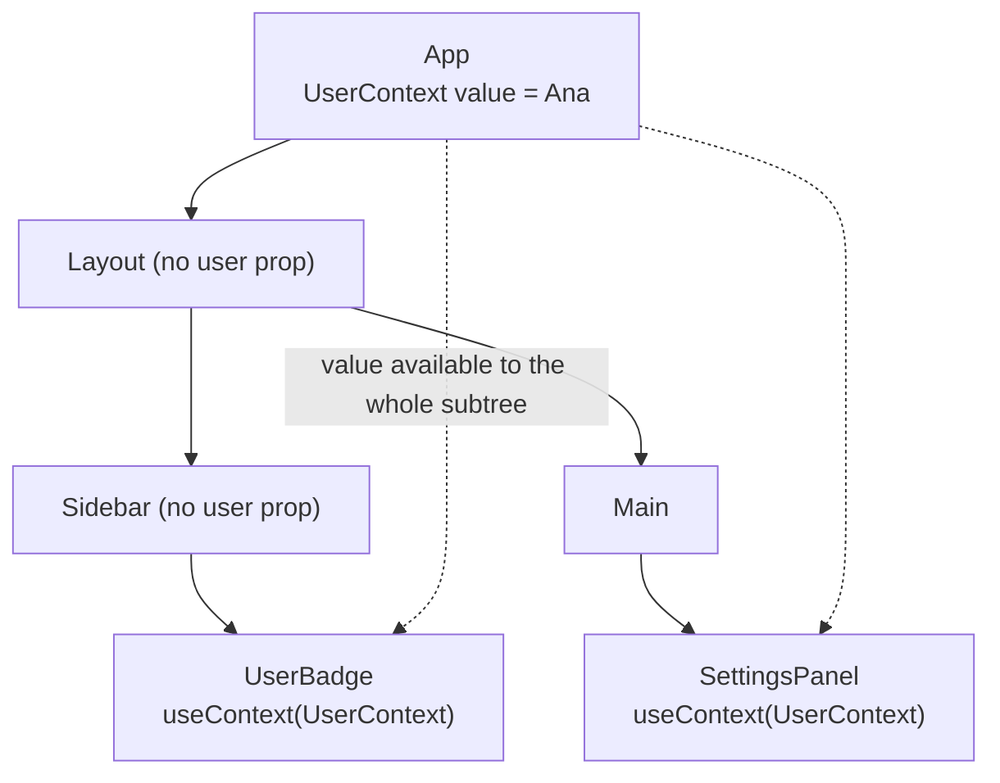
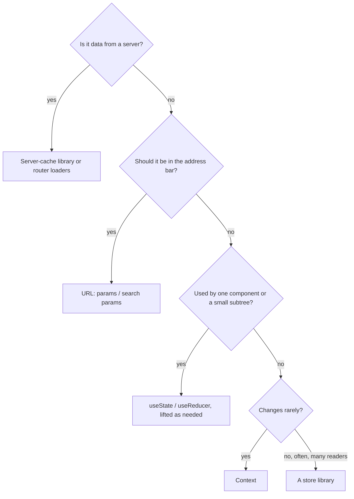

# Context and global state

> **Before this lesson:** you need lifting state and prop drilling ([Lifting state and controlled components](#/lesson/react/lifting-controlled)), composition ([Composition, children and conditional rendering](#/lesson/react/composition-conditional)), reducers ([useReducer and impossible states](#/lesson/react/usereducer)) and memoisation ([memo, useMemo and useCallback](#/lesson/react/memoization)).

## In plain words

An office building has a wifi network. Nobody carries the signal from desk to desk by hand. It is broadcast on a floor, and any laptop on that floor can connect. A different floor can run its own network, and a laptop connects to the nearest one.

Props are hand delivery: a parent gives a value to its child, who gives it to its child, and so on. That is clear and explicit, and tiresome when a value such as "who is signed in" is needed by fifty components at different depths.

**Context** is React's broadcast. A component near the top *provides* a value; any component below it, at any depth, can *read* it directly, with no props in between.

**Global state** is the wider question: where should data live that many distant parts of the app need? Context is one answer. Others are dedicated state libraries, the URL, and server-data caches. Choosing well among them is a favourite interview discussion ("do you need Redux?").

## The problem context solves

```jsx
function App() {
  const [user, setUser] = useState({ name: "Ana", units: "km" });
  return <Layout user={user} />;
}
function Layout({ user }) {
  return <Sidebar user={user} />;      // does not use user, only passes it on
}
function Sidebar({ user }) {
  return <UserBadge user={user} />;    // same
}
function UserBadge({ user }) {
  return <span>{user.name}</span>;     // the only real consumer
}
```

`Layout` and `Sidebar` handle `user` only to forward it. That is prop drilling. Before reaching for context, remember that composition often fixes it (create `<UserBadge user={user} />` in `App` and pass it down as an element). When many unrelated components need the value, context is the right tool.

## Context in three steps

**1. Create the context.**

```jsx
import { createContext } from "react";

export const UserContext = createContext(null);
```

- `createContext(defaultValue)` returns a context object. Think of it as the name of a broadcast channel.
- The default value (`null` here) is what a reader gets when there is **no** provider above it.

**2. Provide a value.**

```jsx
function App() {
  const [user, setUser] = useState({ name: "Ana", units: "km" });
  return (
    <UserContext value={user}>
      <Layout />
    </UserContext>
  );
}
```

- Rendering the context object as a component with a `value` prop broadcasts that value to everything inside it. This is called a **provider**.
- In React 18 and earlier the same thing is written `<UserContext.Provider value={user}>`; that form still works and is what you will see in most existing code.

**3. Read it where needed.**

```jsx
import { useContext } from "react";

function UserBadge() {
  const user = useContext(UserContext);
  return <span>{user.name}</span>;
}
```

- `useContext(UserContext)` returns the value from the **nearest** provider above this component.
- `Layout` and `Sidebar` no longer mention `user`.
- When the provider's value changes, every component that reads this context re-renders with the new value.



Providers can be nested. A reader gets the closest one above it, which lets a subtree override a value (a dark-themed sidebar inside a light page). The problem *Context: find the nearest provider* implements that lookup.

## Making it changeable: a provider component

A context value can be any JavaScript value, including an object that carries both data and functions to change it. The tidy pattern is a dedicated provider component plus a custom Hook.

```jsx
// features/auth/AuthContext.jsx
import { createContext, useContext, useMemo, useState } from "react";

const AuthContext = createContext(null);

export function AuthProvider({ children }) {
  const [user, setUser] = useState(null);

  const value = useMemo(
    () => ({
      user,
      signIn: (name) => setUser({ name }),
      signOut: () => setUser(null),
    }),
    [user]
  );

  return <AuthContext value={value}>{children}</AuthContext>;
}

export function useAuth() {
  const context = useContext(AuthContext);
  if (context === null) {
    throw new Error("useAuth must be used inside <AuthProvider>");
  }
  return context;
}
```

- `AuthProvider` owns the state. It is an ordinary component; the state lives there for the same reasons state lives anywhere.
- `value` bundles the data with the functions that change it.
- `useMemo(..., [user])` keeps the object identical between renders unless `user` changes. Without it, a new object would be created on every render of `AuthProvider`, and since context consumers re-render whenever the value's *identity* changes, they would all re-render for nothing.
- `{children}` lets the provider wrap any part of the app.
- `useAuth` hides the context object and turns the commonest mistake (using it outside the provider) into a clear error message instead of `Cannot read properties of null`.

Usage:

```jsx
// main.jsx
<AuthProvider>
  <App />
</AuthProvider>

// anywhere below
function SignOutButton() {
  const { user, signOut } = useAuth();
  if (!user) return null;
  return <button onClick={signOut}>Sign out {user.name}</button>;
}
```

You will use exactly this shape for Firebase authentication in [Sessions, protected routes and roles](#/lesson/react/sessions-roles).

### Context plus reducer

For state with several kinds of update, hold it in a reducer and broadcast both `state` and `dispatch`. Putting them in **two** contexts is a common refinement: `dispatch` never changes identity, so components that only send actions do not re-render when the state changes.

```jsx
const HikesContext = createContext(null);
const HikesDispatchContext = createContext(null);

export function HikesProvider({ children }) {
  const [hikes, dispatch] = useReducer(hikesReducer, []);
  return (
    <HikesContext value={hikes}>
      <HikesDispatchContext value={dispatch}>{children}</HikesDispatchContext>
    </HikesContext>
  );
}
```

## The cost of context

Context is a delivery mechanism, not a performance tool. Two facts to keep in mind:

1. **Every consumer re-renders when the value changes.** There is no built-in way to subscribe to "only `user.name`". If the value is `{ user, theme, cart }` and the cart changes, components that read only the theme re-render too. `memo` does not prevent it, because the context read happens inside the component.
2. **A provider's re-render is not automatically a problem.** If `AuthProvider` re-renders but passes the same `value` object and the same `children`, nothing below re-renders.

Guidelines that follow:

- Split by concern: `AuthContext`, `ThemeContext`, `CartContext`, not one `AppContext`.
- Memoise object values.
- Put providers as low as they can go. A context used only by the checkout flow should wrap only the checkout flow.
- Context suits values that change **rarely**: user, theme, language, feature flags. A value that changes on every keystroke or animation frame, read by many components, belongs elsewhere.

## Kinds of state and where each belongs

"Global state" covers several different things. Sorting them first usually makes the tool choice easy.

| Kind | Examples | Good home |
|---|---|---|
| **Local UI state** | is this dropdown open, text in this field | `useState` in the component |
| **Shared UI state** | selected item used by two panels | lifted `useState`/`useReducer` |
| **App-wide, rarely changing** | signed-in user, theme, language | context |
| **URL state** | current page, filters, selected tab | the router (`useParams`, `useSearchParams`) |
| **Server state** | lists and records fetched from an API | a server-cache library (TanStack Query, SWR), or loaders |
| **App-wide, frequently changing client state** | a drawing canvas, a complex editor, a large cart | a store library (Zustand, Redux Toolkit, Jotai) |

The biggest simplification in modern React apps is recognising **server state** as its own category. Data from a server is not really yours: it is a cached copy that can be out of date, shared by many screens, and needs refetching, deduplication and invalidation. A library such as TanStack Query handles that:

```jsx
const { data: hikes, isPending, error } = useQuery({
  queryKey: ["hikes", query],
  queryFn: () => fetchHikes(query),
});
```

Any component calling `useQuery` with the same key shares one request and one cached result. Once server data is out of your "global store", what remains is often small enough for context.

### Store libraries

A **store** is a container for state that lives outside the component tree. Components *subscribe* to the parts they need and re-render only when those parts change, which is the feature context lacks.

**Zustand** is a minimal one:

```jsx
import { create } from "zustand";

const useCartStore = create((set) => ({
  items: [],
  add: (item) => set((state) => ({ items: [...state.items, item] })),
  clear: () => set({ items: [] }),
}));

function CartCount() {
  const count = useCartStore((state) => state.items.length);
  return <span>{count}</span>;
}
```

- `create` defines the state and the functions that update it.
- `useCartStore(selector)` subscribes the component to the selected slice. `CartCount` re-renders only when `items.length` changes.
- No provider is needed.

**Redux Toolkit** is the established choice in large teams: one central store, changes expressed as actions handled by reducers (the same idea as `useReducer`, application-wide), with excellent debugging tools that record every action. It has more ceremony and more structure. **Jotai** and similar libraries model state as many small independent "atoms".



### A good shape for shared data: normalise it

When shared state holds related records (posts, authors, comments), nesting them duplicates data: the same author object appears inside twenty posts, and a rename must find all twenty. **Normalised** state stores each record once in a table keyed by id and links records by id:

```javascript
{
  users:    { byId: { u1: { id: "u1", name: "Ana" } }, allIds: ["u1"] },
  hikes:    { byId: { h1: { id: "h1", name: "Ridge Loop", authorId: "u1" } }, allIds: ["h1"] },
}
```

Updating one user is a single assignment, and every screen that looks the user up by id sees the change. The problem *Normalise nested data into an entity cache* practises the conversion.

> [!INTERVIEW]
> "Context vs Redux (or another store)?" *Context is dependency injection: it makes a value available to a subtree without props. It has no selectors, so every consumer re-renders when the value changes; it fits low-frequency values such as auth, theme and locale. A store library adds subscriptions with selectors, middleware and devtools, which suits frequently changing state shared across many components. Before either, I separate server state into a query library and URL state into the router, and keep the rest local.* That answer shows judgement instead of loyalty to a tool.

## Run it: providers, nearest-wins lookup and who re-renders

The miniature React below implements context with a stack: a provider pushes its value while its children are being rendered and pops it afterwards, so a reader always sees the nearest provider above it. Render counters show the effect of splitting a context.

```html-run
<div id="root"></div>
<style>
  body { font-family: sans-serif; } .box { border: 1px solid #bbb; border-radius: 6px; padding: 6px 10px; margin: 6px 0; }
  .dark { background: #223; color: #eef; } button { margin: 3px; } small { opacity: 0.7; }
</style>
<script>
  // ---------- tiny stand-in for React, with context ----------
  function h(type, props, ...children) { return { type, props: props || {}, children: children.flat() }; }
  function createContext(defaultValue) {
    const context = { stack: [], defaultValue };
    context.Provider = (props) => ({ provide: context, value: props.value, children: props.children });
    return context;
  }
  function useContext(context) {                         // nearest provider = top of the stack right now
    return context.stack.length ? context.stack[context.stack.length - 1] : context.defaultValue;
  }
  function toDom(node) {
    if (node === null || node === undefined || typeof node === "boolean") return document.createTextNode("");
    if (Array.isArray(node)) { const f = document.createDocumentFragment(); node.forEach((n) => f.appendChild(toDom(n))); return f; }
    if (typeof node !== "object") return document.createTextNode(String(node));
    if (node.provide) {                                  // a provider: push, render children, pop
      node.provide.stack.push(node.value);
      const result = toDom(node.children);
      node.provide.stack.pop();
      return result;
    }
    if (typeof node.type === "function") return toDom(node.type({ ...node.props, children: node.children }));
    const el = document.createElement(node.type);
    for (const [name, value] of Object.entries(node.props)) {
      if (name.startsWith("on")) el.addEventListener(name.slice(2).toLowerCase(), value);
      else if (name === "className") el.className = value;
      else el.setAttribute(name, value);
    }
    node.children.forEach((child) => el.appendChild(toDom(child)));
    return el;
  }

  // ---------- two separate contexts ----------
  const ThemeContext = createContext("light");
  const UserContext = createContext(null);

  let state = { theme: "light", user: { name: "Ana" } };
  const renders = { ThemedBox: 0, UserBadge: 0 };
  let lastReason = "first render";

  function ThemedBox({ label, children }) {              // reads only the theme
    const theme = useContext(ThemeContext);
    if (lastReason !== "user changed") renders.ThemedBox++;   // real React skips it: its context did not change
    return h("div", { className: "box " + theme }, label, " (theme: ", theme, ")", children);
  }
  function UserBadge() {                                 // reads only the user
    const user = useContext(UserContext);
    if (lastReason !== "theme changed") renders.UserBadge++;
    return h("p", null, user ? "Signed in as " + user.name : "Not signed in");
  }
  function App() {
    return h(ThemeContext.Provider, { value: state.theme },
      h(UserContext.Provider, { value: state.user },
        h(ThemedBox, { label: "Page" },
          h(UserBadge),
          h(ThemeContext.Provider, { value: "dark" },           // a nested provider overrides for its subtree
            h(ThemedBox, { label: "Sidebar, nested provider" })))),
      h("button", { onClick: () => update({ theme: state.theme === "light" ? "dark" : "light" }, "theme changed") }, "Toggle page theme"),
      h("button", { onClick: () => update({ user: state.user ? null : { name: "Ana" } }, "user changed") }, "Sign in / out"),
      h("p", null, h("small", null, "Re-renders so far (as real React would count them): ThemedBox ", renders.ThemedBox, ", UserBadge ", renders.UserBadge)));
  }
  function update(change, reason) { state = { ...state, ...change }; lastReason = reason; draw(); }
  function draw() { document.getElementById("root").replaceChildren(toDom(h(App))); }
  draw();
</script>
```

Things to see: the "Sidebar" box stays dark whatever the page theme is, because it reads the nearest provider. Toggling the theme increases only the `ThemedBox` count; signing out increases only the `UserBadge` count. Had both values been one object in one context, every consumer would count up on every change. (This toy redraws everything each time; the counters model which components real React would call again.)

## Pitfalls

> [!WARNING]
> **A new object as the provider value on every render:** `<AuthContext value={{ user, signOut }}>`. The object's identity changes each time the provider's component renders, so every consumer re-renders even when `user` did not change. Memoise the value, or provide state and functions through separate contexts.

- **Using context for everything.** Components become harder to reuse and test, because their inputs are hidden. Props are explicit; prefer them for local relationships.
- **One giant context.** Unrelated changes re-render unrelated consumers.
- **High-frequency values in context** (mouse position, input text read by many components).
- **Reading a context outside its provider** and getting the default (`null`) without noticing. Throw a clear error in the custom Hook.
- **Copying server data into context or a store by hand.** You then own caching, refetching and staleness. Use a query library.
- **Reaching for a store before the app needs one.** Lifting state and composition go a long way.
- **Mutating the context value** (`user.name = "x"`). Like all state, replace it through the setter.

> [!TIP]
> Export a custom Hook (`useAuth`, `useTheme`) and keep the context object private to its file. Consumers then depend on a small, named API, and you can change how the state is stored (a reducer, a store library, Firebase) without touching them.

## Cheat sheet

| Need | Code |
|---|---|
| Create | `const ThemeContext = createContext("light")` |
| Provide (React 19) | `<ThemeContext value={theme}>…</ThemeContext>` |
| Provide (React ≤ 18) | `<ThemeContext.Provider value={theme}>…</ThemeContext.Provider>` |
| Read | `const theme = useContext(ThemeContext)` |
| Provider component | `function XProvider({ children }) { state…; return <XContext value={value}>{children}</XContext>; }` |
| Stable object value | `useMemo(() => ({ user, signOut }), [user])` |
| Safe consumer Hook | `function useX() { const c = useContext(XContext); if (c === null) throw …; return c; }` |
| State + actions | `useReducer` + one context for state, one for `dispatch` |
| Server data | `useQuery({ queryKey, queryFn })` |
| Selective subscriptions | store with selectors: `useStore((s) => s.part)` |

## Summary

- Context makes a value available to a whole subtree without passing props through every level; readers get the nearest provider's value.
- The usual pattern is a provider component that owns state, a memoised value, and a custom Hook for consumers.
- All consumers of a context re-render when its value changes, so split contexts by concern and keep fast-changing data out.
- Classify state first: local, shared, URL, server, app-wide. Each has a natural home.
- Server data is best managed by a caching library; frequently changing shared client state by a store with selectors.
- Normalised state stores each entity once and links by id.

## Glossary

- **Context**: a React mechanism for making a value available to all components in a subtree.
- **Provider**: the component that supplies a context value to its descendants.
- **Consumer**: a component that reads a context.
- **Prop drilling**: passing props through components that do not use them.
- **Dependency injection**: supplying something a piece of code needs from outside, without it knowing where it comes from.
- **Global state**: state needed by many distant parts of an app.
- **Server state**: a client-side cached copy of data owned by a server.
- **Store**: an object holding state outside the component tree, with subscriptions.
- **Selector**: a function that picks the part of the state a component needs.
- **Normalised state**: data stored as tables keyed by id, with references by id instead of nesting.

## Check yourself

```quiz
[
  {"q": "What does useContext(ThemeContext) return when there is no ThemeContext provider above the component?",
   "options": ["undefined, always", "The default value passed to createContext", "It throws an error", "The value from the nearest provider below"],
   "answer": 1,
   "explain": "The argument of createContext is the fallback used when no provider is found."},
  {"q": "App provides theme 'light'. Inside, a Sidebar provides theme 'dark'. A Button inside Sidebar reads the context. What does it get?",
   "options": ["light", "dark", "Both, as an array", "The default value"],
   "answer": 1,
   "explain": "A consumer reads the nearest provider above it in the tree."},
  {"q": "A provider renders <AuthContext value={{ user, signOut }}> without useMemo. Its component re-renders 4 times for unrelated reasons while user stays the same. How many times do the 10 consumers re-render in total?",
   "options": ["0", "10", "40", "4"],
   "answer": 2,
   "explain": "Each render creates a new object, so each of the 10 consumers re-renders each of the 4 times."},
  {"q": "A component is wrapped in memo and reads CartContext with useContext. The cart value changes but its props do not. Does it re-render?",
   "options": ["No, memo prevents it", "Yes, a context change re-renders its consumers regardless of memo", "Only in development", "Only if it also has state"],
   "answer": 1,
   "explain": "memo compares props. Context changes reach the component from inside."},
  {"q": "Which value is the best fit for context?",
   "options": ["The text being typed in a search field", "The current mouse position", "The signed-in user", "A list of 10,000 rows from the server"],
   "answer": 2,
   "explain": "It is needed widely and changes rarely. The others change often or are server state."},
  {"q": "Where should the list of hikes fetched from an API usually be managed in a larger app?",
   "options": ["A context updated by hand in effects", "A server-state library (or router loaders) that handles caching and refetching", "localStorage", "A ref"],
   "answer": 1,
   "explain": "Server data needs caching, deduplication and invalidation, which query libraries provide."},
  {"q": "What do store libraries such as Zustand or Redux offer that plain context does not?",
   "options": ["The ability to hold objects", "Subscriptions through selectors, so a component re-renders only when the slice it selected changes", "Support for function components", "Automatic server rendering"],
   "answer": 1,
   "explain": "Context has no selector mechanism; every consumer re-renders on any change of the value."},
  {"q": "Why does the useAuth Hook throw when the context is null?",
   "options": ["To stop the app in production", "To turn 'used outside the provider' into an immediate, descriptive error instead of a confusing null access later", "Because null is not allowed in context", "To force a re-render"],
   "answer": 1,
   "explain": "A clear failure at the point of misuse saves debugging time."}
]
```

> **Source:** Wieruch, *The Road to React with Firebase*, "Firebase in React" and "Session Handling" (which provide Firebase and the authenticated user through React context); Wieruch, *The Road to React*, "Lifting State in React". Documentation: https://react.dev/learn/passing-data-deeply-with-context, https://react.dev/learn/scaling-up-with-reducer-and-context, https://react.dev/reference/react/createContext, https://tanstack.com/query/latest/docs/framework/react/overview
