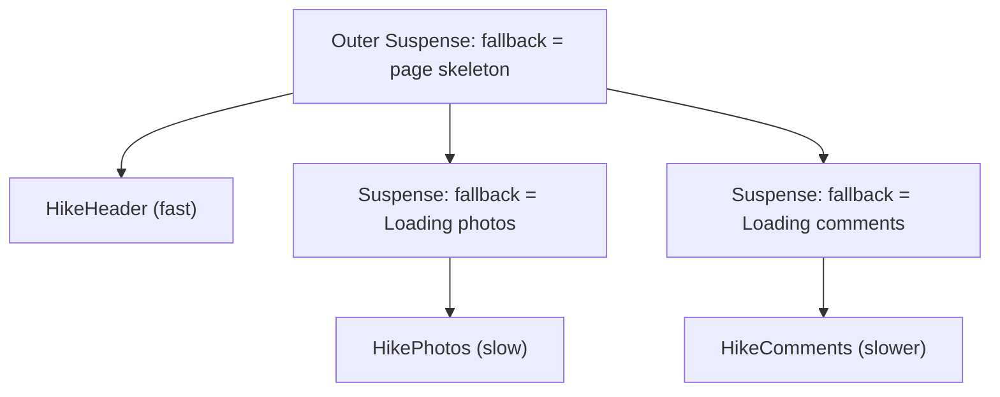
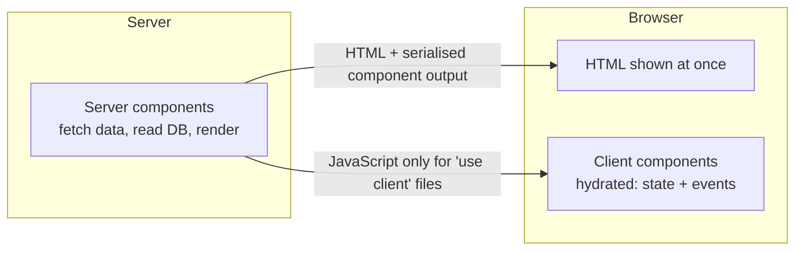

# Suspense, error boundaries and server components

> **Before this lesson:** you need data fetching with loading and error states ([Fetching data: loading, errors and races](#/lesson/react/data-fetching)), code splitting with `lazy` ([Project structure and performance profiling](#/lesson/react/structure-profiling)), and context ([Context and global state](#/lesson/react/context-global-state)). Knowing what a JavaScript `try`/`catch` does helps ([Exceptions and error handling](#/lesson/javascript/exceptions)).

## In plain words

Three ideas, three pictures.

**Suspense.** In a restaurant, when the kitchen needs ten more minutes, the waiter does not leave the table bare. They bring bread. The bread is a placeholder that says "something is coming". **Suspense** lets you mark a region of the screen and say: "while anything inside here is not ready yet, show this placeholder instead".

**Error boundaries.** A building's electrical panel has circuit breakers. A short circuit in the toaster trips one breaker, and the kitchen goes dark while the other rooms stay lit. Without breakers the whole house would lose power. An **error boundary** is a breaker for a part of your UI: when a component inside it crashes, the boundary shows a fallback for that part and the remainder of the page keeps working.

**Server components.** Some meals are fully cooked in the kitchen and arrive ready to eat. Others, like fondue, arrive with a burner so that you can interact at the table. **Server components** are the pre-cooked kind: they run on the server, and only their finished output is sent to the browser. **Client components** are the fondue: their code ships to the browser because they need to respond to the user.

These features define how modern React frameworks work, and they are increasingly common interview topics.

## Part 1: Suspense

### The idea

Until now each component managed its own waiting:

```jsx
if (status === "loading") return <Spinner />;
```

With many components this gives a page of independent spinners popping in and out. Suspense moves the decision "what do we show while waiting?" out of the waiting component and up to a boundary of your choosing:

```jsx
import { Suspense } from "react";

<Suspense fallback={<p>Loading hike…</p>}>
  <HikeDetails hikeId={id} />
</Suspense>
```

- `<Suspense>` is a built-in component, a **boundary**.
- If any component inside it is not ready to render, React shows the `fallback` in place of the *whole* contents of the boundary.
- When everything inside is ready, React swaps in the real content.

A component that is not ready is said to **suspend**. The component itself contains no loading code.

### What can suspend?

**1. Lazy-loaded components.** You met this already:

```jsx
const AdminPage = lazy(() => import("./AdminPage"));

<Suspense fallback={<p>Loading page…</p>}>
  <AdminPage />
</Suspense>
```

While the file for `AdminPage` is downloading, the component suspends and the fallback shows.

**2. Reading a promise with `use` (React 19).**

```jsx
import { use, Suspense } from "react";

function HikeDetails({ hikePromise }) {
  const hike = use(hikePromise);
  return <h2>{hike.name}</h2>;
}

function HikePage({ hikeId }) {
  const hikePromise = getHike(hikeId);
  return (
    <Suspense fallback={<p>Loading hike…</p>}>
      <HikeDetails hikePromise={hikePromise} />
    </Suspense>
  );
}
```

- `use(promise)` reads the result of a promise during render. If the promise has not finished, the component suspends; when it finishes, React renders the component again and `use` returns the value.
- `HikeDetails` reads as if the data were already there. No `useState`, no `useEffect`, no status variable.
- The promise must be **stable between renders**. Creating a new promise inside a client component on every render would restart the wait forever. In practice the promise comes from a cache, a framework, or a server component. `getHike` above is assumed to return the same cached promise for the same id.

**3. Data libraries and frameworks.** TanStack Query's `useSuspenseQuery`, React Router's loaders, Next.js and others integrate with Suspense, so you rarely call `use` on a hand-made promise.

Under the hood the mechanism is surprisingly plain: a suspending component *throws* the promise it is waiting for. React catches it at the nearest Suspense boundary, shows the fallback, and retries the render when the promise settles. The runnable example later builds that in a few lines.

### Placing boundaries

Boundaries are a design decision about what appears together.

```jsx
<Suspense fallback={<PageSkeleton />}>
  <HikeHeader />
  <Suspense fallback={<p>Loading photos…</p>}>
    <HikePhotos />
  </Suspense>
  <Suspense fallback={<p>Loading comments…</p>}>
    <HikeComments />
  </Suspense>
</Suspense>
```

- One boundary around everything: a single loading state, and all content appears at once.
- Nested boundaries: the header appears as soon as it is ready; photos and comments each fill in when their data arrives.



A **skeleton** (grey boxes in the shape of the coming content) is a better fallback than a spinner, because the layout does not jump when the content arrives.

### Transitions: do not hide what is already there

When content that is already visible suspends again (the user picks another tab and its data is not loaded), React would replace it with the fallback, which feels like a step backwards. Marking the update as a **transition** tells React it is not urgent: keep showing the old content until the new content is ready.

```jsx
import { useState, useTransition } from "react";

function HikeTabs() {
  const [tab, setTab] = useState("overview");
  const [isPending, startTransition] = useTransition();

  function selectTab(next) {
    startTransition(() => {
      setTab(next);
    });
  }

  return (
    <>
      <TabButtons current={tab} onSelect={selectTab} />
      <div style={{ opacity: isPending ? 0.6 : 1 }}>
        <Suspense fallback={<p>Loading…</p>}>
          <TabPanel tab={tab} />
        </Suspense>
      </div>
    </>
  );
}
```

- `useTransition()` returns a pending flag and a `startTransition` function.
- State updates inside `startTransition(...)` are low priority. If they cause a suspension, React keeps the current screen and sets `isPending` to `true` meanwhile.
- The dimmed `opacity` signals that something is happening without removing content.

Transitions also keep typing responsive when an update triggers a heavy render: urgent updates (the keystroke) interrupt non-urgent ones.

## Part 2: error boundaries

### What happens without one

If a component throws an error while rendering, React cannot know what the UI should look like, so it removes the **entire** application from the page. One broken widget produces a blank white screen.

### Catching render errors

An error boundary is a component that catches errors thrown while rendering anything below it and shows a fallback. For historical reasons it must be written as a **class component** (the older style of component, written with JavaScript's `class` syntax), because no Hook exists for this. You write it once and reuse it:

```jsx
import { Component } from "react";

class ErrorBoundary extends Component {
  state = { error: null };

  static getDerivedStateFromError(error) {
    return { error };
  }

  componentDidCatch(error, info) {
    console.error("Caught by boundary:", error, info.componentStack);
  }

  render() {
    if (this.state.error) {
      return this.props.fallback;
    }
    return this.props.children;
  }
}
```

- `state = { error: null }` is the class equivalent of `useState`.
- `static getDerivedStateFromError(error)` is called by React when a descendant throws during rendering. Its return value becomes the new state, so the next render shows the fallback.
- `componentDidCatch(error, info)` is the place for side effects such as sending the error to a logging service. `info.componentStack` says which components were involved.
- `render()` is the class equivalent of the function body: show the fallback if there is an error, the children otherwise.

Most teams skip writing this and install the small `react-error-boundary` package, which also offers a reset function:

```jsx
import { ErrorBoundary } from "react-error-boundary";

function ErrorFallback({ error, resetErrorBoundary }) {
  return (
    <div role="alert">
      <p>This section could not be shown: {error.message}</p>
      <button onClick={resetErrorBoundary}>Try again</button>
    </div>
  );
}

<ErrorBoundary FallbackComponent={ErrorFallback}>
  <HikeComments />
</ErrorBoundary>
```

`resetErrorBoundary` clears the error so the children render again, which gives the user a retry.

### What boundaries do not catch

Error boundaries catch errors thrown **during rendering** (and in the class lifecycle of their descendants). They do not catch:

- errors in **event handlers** (`onClick`): use `try`/`catch` inside the handler and put the failure in state;
- errors in **asynchronous code** such as `setTimeout` callbacks or a rejected `fetch` in an effect: catch and store them in state (or, with `use` and Suspense-enabled libraries, the rejection is re-thrown during render and *does* reach the boundary);
- errors in the boundary itself;
- errors during server rendering.

### Suspense and error boundaries together

Loading and failure are the two non-success outcomes of asynchronous UI. With both boundaries a data-reading component contains only the success path:

```jsx
<ErrorBoundary fallback={<p role="alert">Could not load comments.</p>}>
  <Suspense fallback={<p>Loading comments…</p>}>
    <HikeComments commentsPromise={commentsPromise} />
  </Suspense>
</ErrorBoundary>
```

If the promise is pending, Suspense shows its fallback. If it rejects, `use` throws the error and the error boundary shows its fallback. Place boundaries around independent regions (a sidebar, a comments panel, each route) plus one at the top as a last resort.

## Part 3: server components, at a high level

### The limits of browser-only rendering

A Vite app is rendered entirely in the browser: the server sends an almost empty HTML file and a JavaScript bundle; the browser downloads and runs it; components mount and *then* start fetching data. That means a blank first paint, a large bundle on slow phones, and request waterfalls. Two server-side techniques address this.

**Server-side rendering (SSR)** runs your components on the server for each request to produce real HTML, so the user sees content immediately. The browser then downloads the same components' JavaScript and attaches event handlers to the existing HTML, a step called **hydration**. With SSR alone, every component's code is still shipped to the browser.

**React Server Components (RSC)** go further by splitting components into two kinds.

| | Server component | Client component |
|---|---|---|
| Marked by | the default (in an RSC framework) | `"use client"` at the top of the file |
| Runs | on the server only (at request or build time) | on the server for the first HTML, then in the browser |
| Code sent to the browser | none | yes |
| Can be `async` and `await` data | yes | no |
| Can read databases, files, secrets | yes | no |
| `useState`, `useEffect`, event handlers | no | yes |
| Browser APIs (`window`, `localStorage`) | no | yes |

```jsx
// app/hikes/page.jsx — a server component (no directive)
import { db } from "@/lib/db";
import { FavouriteButton } from "./FavouriteButton";

export default async function HikesPage() {
  const hikes = await db.hikes.findMany();
  return (
    <ul>
      {hikes.map((hike) => (
        <li key={hike.id}>
          {hike.name} <FavouriteButton hikeId={hike.id} initial={hike.favourite} />
        </li>
      ))}
    </ul>
  );
}
```

```jsx
// app/hikes/FavouriteButton.jsx — a client component
"use client";
import { useState } from "react";

export function FavouriteButton({ hikeId, initial }) {
  const [on, setOn] = useState(initial);
  return <button onClick={() => setOn(!on)}>{on ? "★" : "☆"}</button>;
}
```

- `HikesPage` is an `async` function that queries the database directly. There is no API endpoint, no `useEffect`, no loading state in this file. The database library and this component's code never reach the browser.
- `"use client"` marks a file as the entry into client-side code. `FavouriteButton` needs state and a click handler, so it must be a client component.
- Props passed from a server component to a client component cross the network, so they must be **serialisable**: plain data such as strings, numbers, arrays and objects. Functions cannot be passed, except **Server Functions** (marked `"use server"`), which the client can call like a normal async function and which run on the server.



Suspense ties in here too: a server component that is still awaiting data can sit inside a `<Suspense>` boundary, and the server **streams** the page, sending the fallback first and the finished HTML for that region when it is ready.

### What this means for you

- Server components need a framework that implements them. **Next.js** (App Router) is the most widely used; React Router's framework mode and others also support server rendering. A plain Vite single-page app has only client components, which is everything this track has taught so far, and remains a perfectly good architecture for apps behind a login, dashboards, and apps with a separate back end such as Firebase.
- A useful mental model: push interactivity to the leaves. Pages and layouts fetch and arrange data on the server; small client components handle clicks and typing.
- `"use client"` does not mean "browser only": client components are still rendered on the server for the initial HTML, then hydrated. It means "this code is also needed in the browser".
- Hydration requires the server's HTML and the browser's first render to match. Output that differs (`Date.now()`, `Math.random()`, reading `window`) causes a **hydration mismatch** warning.

> [!INTERVIEW]
> "What are React Server Components?" *Components that run only on the server, can be async and access back-end resources directly, and send their rendered output, not their code, to the client. Interactive parts are client components marked with `"use client"`. Benefits: smaller bundles, no client–server waterfalls, direct data access. Constraints: no state, effects or browser APIs in server components, and props crossing the boundary must be serialisable. This differs from SSR, which renders client components to HTML on the server and still ships all their JavaScript for hydration.*

## Run it: Suspense and an error boundary built from throw and catch

React's implementation is sophisticated, but the control flow can be shown in a few lines of plain JavaScript: a component *throws a promise* to say "not ready" or *throws an error* to say "failed", and something above it catches and decides what to display.

```js-run
// ---------- a resource cache: read() returns the value, or throws ----------
function createResource(promise) {
  let status = "pending", result;
  const tracked = promise.then((value) => { status = "done"; result = value; },
                               (error) => { status = "failed"; result = error; });
  return {
    read() {
      if (status === "pending") throw tracked;      // "suspend": throw the promise
      if (status === "failed") throw result;        // rejected: throw the error
      return result;                                // ready: return the data
    },
  };
}

// ---------- components: only the success path ----------
const HikeDetails = (resource) => "<h2>" + resource.read().name + "</h2>";

// ---------- the boundaries ----------
async function renderWithBoundaries(label, component, resource) {
  for (;;) {
    try {
      console.log(label, "->", component(resource));
      return;
    } catch (thrown) {
      if (thrown instanceof Promise) {               // Suspense boundary
        console.log(label, "-> fallback: Loading…");
        await thrown;                                // wait, then retry the render
      } else {                                       // error boundary
        console.log(label, "-> error fallback:", thrown.message);
        return;
      }
    }
  }
}

const later = (ms, fn) => new Promise((resolve, reject) => setTimeout(() => fn(resolve, reject), ms));

const good = createResource(later(300, (resolve) => resolve({ name: "Ridge Loop" })));
const bad = createResource(later(500, (_, reject) => reject(new Error("Server replied 500"))));

renderWithBoundaries("A", HikeDetails, good);
renderWithBoundaries("B", HikeDetails, bad);
```

Output order: both regions print their loading fallback at once; A prints its content after 300 ms; B prints the error fallback after 500 ms. `HikeDetails` has no `if (loading)` and no `try`/`catch` of its own.

And the "circuit breaker" behaviour on a real page: three independent panels, one of which crashes.

```html-run
<div id="root"></div>
<label><input type="checkbox" id="use" checked /> wrap each panel in an error boundary</label>
<style>body { font-family: sans-serif; } .panel { border: 1px solid #bbb; border-radius: 6px; padding: 6px 10px; margin: 6px 0; } .err { background: #fde8e6; }</style>
<script>
  const panels = {
    Header: () => `<div class="panel"><b>Ridge Loop</b>, 7.5 km</div>`,
    Photos: () => { throw new Error("photo.url is undefined"); },           // a bug in one component
    Comments: () => `<div class="panel">2 comments</div>`,
  };
  function boundary(name, render) {                    // an error boundary around one panel
    try { return render(); }
    catch (error) { return `<div class="panel err" role="alert">${name} could not be shown (${error.message})</div>`; }
  }
  function draw() {
    const useBoundaries = document.getElementById("use").checked;
    const root = document.getElementById("root");
    try {
      root.innerHTML = Object.entries(panels).map(([name, render]) => (useBoundaries ? boundary(name, render) : render())).join("");
    } catch (error) {
      root.innerHTML = "";                             // what React does without a boundary: unmount everything
      console.error("Uncaught render error, whole app removed:", error.message);
    }
  }
  document.getElementById("use").addEventListener("change", draw);
  draw();
</script>
```

With the box ticked, the photos panel shows an error message and the header and comments are unaffected. Untick it: the whole area goes blank, which is what users see when an app has no error boundaries.

## Pitfalls

> [!WARNING]
> **Creating the promise during render in a client component:** `use(fetch(url))`. Each render makes a new promise, the component suspends again, and it never finishes. The promise must come from a cache, a parent that created it once, a framework or a server component.

- **One Suspense boundary around the whole app only.** Every wait blanks the page. Add boundaries around independent regions.
- **Fallbacks that change layout,** making content jump. Use skeletons sized like the real content.
- **Expecting an error boundary to catch handler or async errors.** Handle those with `try`/`catch` and state.
- **No top-level error boundary.** A single render error yields a white screen.
- **Swallowing errors silently.** Log them (`componentDidCatch`, `onError`) to a monitoring service.
- **`"use client"` at the top of every file** in an RSC framework. That discards the benefits. Mark only the interactive leaves.
- **Hooks or event handlers in a server component.** Not allowed; move them into a client component.
- **Passing functions or class instances as props from server to client.** They are not serialisable.
- **Secrets in client components.** Only server components and server functions may touch them.

> [!TIP]
> Design the "three states" for each region of a page before writing it: what does this region look like while loading, when it failed, and when it has data? With Suspense and error boundaries, those three answers become three separate pieces of JSX.

## Cheat sheet

| Need | Tool |
|---|---|
| Placeholder while something inside is not ready | `<Suspense fallback={...}>` |
| Load a component's code on demand | `lazy(() => import("./X"))` inside Suspense |
| Read a promise during render (React 19) | `const data = use(promise)` with a stable promise |
| Keep old content while new content loads | `const [isPending, startTransition] = useTransition()` |
| Survive a render error in one region | an error boundary (class, or `react-error-boundary`) |
| Retry after an error | reset the boundary (`resetErrorBoundary`) or change its `key` |
| Errors in handlers / async code | `try`/`catch` + state |
| Fetch on the server, send no JS | server component (`async function Page()`) in an RSC framework |
| Interactivity | client component: `"use client"` |
| Call server code from the client | Server Function: `"use server"` |

## Summary

- Suspense lets a boundary show a fallback while any component inside it is waiting, so components can be written for the success case only.
- `lazy`, the `use` Hook and Suspense-aware libraries are what make a component suspend; transitions keep existing content visible during updates.
- Error boundaries contain render errors to a region of the UI; they do not catch errors in event handlers or plain asynchronous callbacks.
- Combining the two gives declarative loading and error states per region.
- Server-side rendering produces HTML on the server and hydrates in the browser; server components run only on the server and ship no JavaScript, while client components handle interactivity.
- Server components require a framework; a client-only Vite app remains a valid choice.

## Glossary

- **Suspense**: a React component that shows a fallback while its contents are not ready.
- **Suspend**: a component signalling that it cannot render yet.
- **Fallback**: the placeholder UI shown by a Suspense or error boundary.
- **Skeleton**: a placeholder shaped like the content that will replace it.
- **Transition**: a state update marked as non-urgent.
- **Error boundary**: a component that catches render errors below it and shows a fallback.
- **Class component**: the older way to write components, using `class`.
- **Server-side rendering (SSR)**: rendering components to HTML on the server.
- **Hydration**: attaching React's event handlers and state to server-rendered HTML in the browser.
- **Server component**: a component that runs only on the server and sends its output, not its code.
- **Client component**: a component whose code also runs in the browser, marked `"use client"`.
- **Serialisable**: convertible to a transferable text form (plain data, not functions).
- **Streaming**: sending parts of a page as they become ready.

## Check yourself

```quiz
[
  {"q": "What does <Suspense fallback={<Spinner />}> do?",
   "options": ["Delays rendering by a fixed time", "Shows the fallback while any component inside it is suspended (not ready), then shows the real content", "Catches errors", "Makes components render on the server"],
   "answer": 1,
   "explain": "Suspense is about waiting. Errors are handled by error boundaries."},
  {"q": "A page has one outer Suspense containing a fast Header and a slow Comments, with no inner boundaries. What does the user see while Comments is loading?",
   "options": ["Header plus a spinner for comments", "Only the outer fallback; the Header is hidden too", "Nothing at all", "Comments with empty data"],
   "answer": 1,
   "explain": "A boundary replaces all of its contents with the fallback. Add an inner boundary around Comments to show the Header early."},
  {"q": "Which error does an error boundary catch?",
   "options": ["An exception thrown inside an onClick handler", "A rejected fetch inside a setTimeout callback", "An exception thrown while rendering a descendant component", "A syntax error in the boundary's own render"],
   "answer": 2,
   "explain": "Boundaries catch errors during rendering of the tree below them. Handlers and plain async code need try/catch."},
  {"q": "An app has no error boundary. One component throws during render. What does React do?",
   "options": ["Skips that component", "Removes the whole component tree from the page", "Shows a default error dialog in production", "Retries three times"],
   "answer": 1,
   "explain": "Without a boundary, React unmounts everything, leaving a blank page."},
  {"q": "Why is use(fetch(url)) inside a client component a bug?",
   "options": ["use cannot read promises", "A new promise is created on every render, so the component suspends again each time it retries", "fetch is not allowed in components", "It needs an error boundary"],
   "answer": 1,
   "explain": "The promise must be the same object across renders, for example cached or created by a parent or framework."},
  {"q": "Which statement about server components is true?",
   "options": ["They can use useState if marked async", "Their code is not sent to the browser, and they can await data directly", "They run in the browser after hydration", "They work in any Vite single-page app"],
   "answer": 1,
   "explain": "Server components run only on the server. State, effects and handlers belong to client components, and RSC needs a supporting framework."},
  {"q": "What does \"use client\" at the top of a file mean?",
   "options": ["The component renders only in the browser, never on the server", "The file's components are client components: their JavaScript is sent to the browser so they can use state and events", "The file is private", "The file cannot import other files"],
   "answer": 1,
   "explain": "Client components are still pre-rendered on the server for the first HTML, then hydrated."},
  {"q": "A tab switch causes the new tab's content to suspend, and the visible content is replaced by a spinner. Which tool keeps the old tab visible until the new one is ready?",
   "options": ["useMemo", "useTransition / startTransition", "useRef", "A second error boundary"],
   "answer": 1,
   "explain": "Updates inside a transition are non-urgent; React keeps the current UI and exposes isPending while preparing the new one."}
]
```

> **Source:** Wieruch, *The Road to React*, "Fundamentals of React": React Asynchronous Data, React Conditional Rendering, and "React's Legacy": React Class Components (the class syntax needed for error boundaries); these newer React features postdate the book's edition, so the API follows the current docs. Documentation: https://react.dev/reference/react/Suspense, https://react.dev/reference/react/use, https://react.dev/reference/react/Component#catching-rendering-errors-with-an-error-boundary, https://react.dev/reference/rsc/server-components
