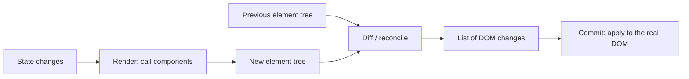

# The virtual DOM and reconciliation

> **Before this lesson:** you need React elements ([JSX, components and props](#/lesson/react/jsx-components-props)), keys ([Lists, keys and events](#/lesson/react/lists-keys-events)), and state ([State with useState](#/lesson/react/usestate)). The DOM itself is covered in [JavaScript in the browser and the DOM tree](#/lesson/javascript/browser-dom-tree).

## In plain words

An architect is asked to change a house: move one interior wall and add a window. Nobody demolishes the house and rebuilds it from the new plan. The builder lays the new blueprint over the old one, marks the differences in red, and does only that work.

React treats a web page the same way. Your components produce a blueprint of the UI as ordinary JavaScript objects. That blueprint is called the **virtual DOM**. When state changes, your components produce a new blueprint. React compares the new one with the previous one and works out the smallest set of real changes. That comparison is called **reconciliation**, and the comparing procedure is often called **diffing** (finding the differences).

Understanding this explains things that otherwise seem like arbitrary rules: why lists need keys, why state sometimes survives and sometimes resets, why defining a component inside another one breaks it. "Explain the virtual DOM" and "how does reconciliation work?" are among the most frequently asked React interview questions.

## Why not rebuild the page every time?

The simplest way to implement $\text{UI} = f(\text{state})$ would be to delete all DOM nodes and recreate them after every state change. Earlier lessons' live demos do exactly that, with `replaceChildren`. It has two serious problems:

1. **It destroys information stored in the DOM.** The text cursor in an input, the selection, scroll positions, a playing video, a CSS transition in progress: all gone on every keystroke.
2. **It is slow.** Creating DOM nodes and letting the browser recalculate layout and repaint is far more expensive than working with plain JavaScript objects.

React's answer: keep the old description, build the new description, compare the two in JavaScript (cheap), and apply only the differences to the real DOM (expensive, so minimal).



## The virtual DOM is plain objects

Recall that JSX compiles to calls that return objects:

```jsx
<ul className="hikes">
  <li>Ridge Loop</li>
  <li>Fern Gully</li>
</ul>
```

```javascript
{
  type: "ul",
  props: {
    className: "hikes",
    children: [
      { type: "li", props: { children: "Ridge Loop" } },
      { type: "li", props: { children: "Fern Gully" } },
    ],
  },
}
```

- `type` is a string for built-in tags, or a function for your components.
- `props` holds the attributes and the `children`.

Such a tree costs almost nothing to create and throw away. When `type` is a component function, React calls it with the props to obtain *that* component's elements, and continues until only built-in tags remain. The problems *createElement: build a virtual DOM tree* and *Render a virtual tree to an HTML string* have you build both steps.

A note on the term. "Virtual DOM" is a popular name, not an official API. The React documentation prefers to speak of the *render tree* and *UI tree*, and React's internal data structure is the fiber tree (next lesson). The idea is the same: a description in memory that is compared against the previous one.

## How the comparison works: two rules

Finding the truly minimal set of edits between two arbitrary trees is a known hard problem; the best general algorithms take time proportional to the cube of the number of nodes, hopeless for a page with thousands of elements. React instead uses a procedure that visits each node once (time proportional to the number of nodes), based on two assumptions that hold for nearly all real UIs.

### Rule 1: different type means a different tree

React compares the old and new element at the same position.

**If the `type` differs,** React does not look any further. It destroys the old subtree completely (removing DOM nodes and discarding the state of every component in it) and builds the new subtree from scratch.

```jsx
// before                         // after
<div>                             <section>
  <Counter />                       <Counter />
</div>                            </section>
```

`div` became `section`, so everything inside is rebuilt. The `Counter` is a brand-new instance: its count restarts.

**If the `type` is the same,** React keeps the existing DOM node or component instance and updates it.

- For a built-in element, it compares the props and changes only the attributes that differ:

```jsx
<p className="note" title="a">Hi</p>   →   <p className="note warning" title="a">Hi</p>
```

Only the `class` attribute is touched. The `<p>` node is the same node as before.

- For a component, the instance stays (state preserved), receives the new props, and re-renders; React then compares what it returned before with what it returns now.

Then React repeats the process for the children.

### Rule 2: children are matched by position, or by key

For a list of children, React walks the old and the new lists together, pairing the first with the first, the second with the second, and so on.

Appending at the end is handled perfectly:

```jsx
// before          // after
<li>Ridge</li>     <li>Ridge</li>      same
<li>Fern</li>      <li>Fern</li>       same
                   <li>Salt</li>       new: insert one node
```

Inserting at the **start** is not:

```jsx
// before          // after
<li>Ridge</li>     <li>Salt</li>       position 0: text differs → rewrite
<li>Fern</li>      <li>Ridge</li>      position 1: text differs → rewrite
                   <li>Fern</li>       position 2: new → insert
```

By position, every row appears to have changed. React rewrites the text of every existing row and adds one at the end: far more work than inserting one node, and any state tied to the rows (an input's text, a checkbox, a child component's state) stays with the *position*, so it ends up beside the wrong item.

**Keys** fix this by giving each child a stable identity:

```jsx
// before                 // after
<li key="r">Ridge</li>    <li key="s">Salt</li>     no old "s" → create
<li key="f">Fern</li>     <li key="r">Ridge</li>    old "r" exists → reuse, move
                          <li key="f">Fern</li>     old "f" exists → reuse, move
```

With keys React matches children by key instead of by index. It creates one node, keeps the other two, and each row keeps its state. The problem *Keyed list diff: which children move?* implements the single-pass strategy React uses to decide which reused children must be moved.

## Identity: where state lives

Put the two rules together and you get the precise rule for when a component keeps its state:

> React preserves a component's state as long as the **same component type** is rendered at the **same position** in the tree with the **same key**.

Three consequences that surprise people.

**Same type, same place: state is kept, even if props are completely different.**

```jsx
{isAna ? <Chat contact="Ana" /> : <Chat contact="Bo" />}
```

Both branches produce a `Chat` at the same position. Switching from Ana to Bo keeps the instance, including a half-typed draft.

**A different key forces a fresh instance.**

```jsx
<Chat key={contact} contact={contact} />
```

When `contact` changes, the key changes. React sees "a `Chat` with key Ana disappeared, a `Chat` with key Bo appeared", destroys one and creates the other. This is the standard way to reset a component.

**A component defined inside another component is a new type on every render.**

```jsx
function Page() {
  function Field() {                  // a NEW function object each time Page renders
    const [text, setText] = useState("");
    return <input value={text} onChange={(e) => setText(e.target.value)} />;
  }
  return <Field />;
}
```

On each render of `Page`, `Field` is a different function. Rule 1 says a different type means "destroy and rebuild". The input is recreated on every render, losing focus and text after each keystroke. Define components at the top level of a module.

## Diffing, step by step

Here is a compact diff for trees without keys, to make the two rules concrete. It returns a list of **patches**: instructions describing what must change.

```javascript
function diff(oldNode, newNode, path = [], patches = []) {
  if (typeof oldNode === "string" || typeof newNode === "string") {
    if (oldNode !== newNode) patches.push({ op: "REPLACE", path, node: newNode });
    return patches;
  }
  if (oldNode.type !== newNode.type) {
    patches.push({ op: "REPLACE", path, node: newNode });
    return patches;
  }
  for (const name of Object.keys(newNode.props)) {
    if (oldNode.props[name] !== newNode.props[name]) {
      patches.push({ op: "SET_PROP", path, name, value: newNode.props[name] });
    }
  }
  const common = Math.min(oldNode.children.length, newNode.children.length);
  for (let i = 0; i < common; i++) {
    diff(oldNode.children[i], newNode.children[i], [...path, i], patches);
  }
  for (let i = common; i < newNode.children.length; i++) {
    patches.push({ op: "APPEND", path, node: newNode.children[i] });
  }
  for (let i = oldNode.children.length - 1; i >= common; i--) {
    patches.push({ op: "REMOVE_CHILD", path, index: i });
  }
  return patches;
}
```

Reading it top to bottom:

- **Text nodes:** if either side is text and they differ, replace.
- **Rule 1:** different `type` → one `REPLACE` patch, and the function returns without visiting the children.
- **Same type:** emit a `SET_PROP` for each attribute whose value changed. (A full version also removes props that disappeared.)
- **Rule 2:** recurse into the children that exist on both sides, pairing by index; `path` records the position as a list of child indexes.
- Extra new children are appended; extra old children are removed, from the end so that earlier indexes stay valid.

The problem *Diff two virtual trees into patches* asks for the complete version with a precisely specified output order.

## Run it: diff two trees and count the work

```js-run
const h = (type, props, ...children) => ({ type, props: props || {}, children });

function diff(oldNode, newNode, path = [], patches = []) {
  if (typeof oldNode === "string" || typeof newNode === "string") {
    if (oldNode !== newNode) patches.push({ op: "REPLACE", path, node: newNode });
    return patches;
  }
  if (oldNode.type !== newNode.type) { patches.push({ op: "REPLACE", path, node: newNode }); return patches; }
  for (const name of Object.keys(newNode.props)) {
    if (oldNode.props[name] !== newNode.props[name]) patches.push({ op: "SET_PROP", path, name, value: newNode.props[name] });
  }
  const common = Math.min(oldNode.children.length, newNode.children.length);
  for (let i = 0; i < common; i++) diff(oldNode.children[i], newNode.children[i], [...path, i], patches);
  for (let i = common; i < newNode.children.length; i++) patches.push({ op: "APPEND", path, node: newNode.children[i] });
  for (let i = oldNode.children.length - 1; i >= common; i--) patches.push({ op: "REMOVE_CHILD", path, index: i });
  return patches;
}
const show = (title, patches) => {
  console.log(`${title}: ${patches.length} patch(es)`);
  patches.forEach((p) => console.log("   ", p.op, "at", JSON.stringify(p.path), p.name ? `${p.name}=${p.value}` : p.node !== undefined ? JSON.stringify(p.node).slice(0, 40) : `index ${p.index}`));
};

const list = (...names) => h("ul", { class: "hikes" }, ...names.map((n) => h("li", null, n)));

show("1. nothing changed", diff(list("Ridge", "Fern"), list("Ridge", "Fern")));
show("2. one attribute changed", diff(h("p", { class: "note" }, "Hi"), h("p", { class: "note warning" }, "Hi")));
show("3. append at the end", diff(list("Ridge", "Fern"), list("Ridge", "Fern", "Salt")));
show("4. insert at the START (no keys)", diff(list("Ridge", "Fern"), list("Salt", "Ridge", "Fern")));
show("5. type changed: div -> section", diff(h("div", null, list("Ridge", "Fern")), h("section", null, list("Ridge", "Fern"))));
```

Compare cases 3 and 4. Appending costs one patch. Inserting the same item at the top, without keys, costs three: two text rewrites and an append, because positions shifted. Case 5 is a single `REPLACE` of the root, which in a real DOM means recreating everything inside it.

Now the same contrast on a real page. Two lists receive the same "insert at the top" updates. The left one is updated by index, the right one by key. Each row has a text box so that you can see whose state goes where.

```html-run
<div style="display:flex;gap:24px;font-family:sans-serif">
  <div><b>By index (no keys)</b><ul id="byIndex"></ul><small id="statsIndex"></small></div>
  <div><b>By key</b><ul id="byKey"></ul><small id="statsKey"></small></div>
</div>
<button id="add">Insert a hike at the top</button>
<button id="shuffle">Reverse the order</button>
<p style="font-family:sans-serif">Type a note in a row first, then press a button.</p>
<script>
  let items = [{ id: "r", name: "Ridge Loop" }, { id: "f", name: "Fern Gully" }];
  let counter = 0;
  const stats = { byIndex: 0, byKey: 0 };
  const makeRow = (item) => {
    const li = document.createElement("li");
    li.innerHTML = `<span></span> <input size="12" placeholder="note" />`;
    li.querySelector("span").textContent = item.name;
    return li;
  };

  function patchByIndex(ul, list) {                      // rule 2 without keys: pair by position
    list.forEach((item, i) => {
      const li = ul.children[i];
      if (!li) { ul.appendChild(makeRow(item)); stats.byIndex++; }
      else if (li.querySelector("span").textContent !== item.name) { li.querySelector("span").textContent = item.name; stats.byIndex++; }
    });
    while (ul.children.length > list.length) { ul.lastChild.remove(); stats.byIndex++; }
  }

  function patchByKey(ul, list) {                        // rule 2 with keys: pair by identity
    const existing = new Map([...ul.children].map((li) => [li.dataset.key, li]));
    list.forEach((item, i) => {
      let li = existing.get(item.id);
      if (!li) { li = makeRow(item); li.dataset.key = item.id; stats.byKey++; }
      existing.delete(item.id);
      if (ul.children[i] !== li) ul.insertBefore(li, ul.children[i] || null);   // move or insert; the node itself is reused
    });
    existing.forEach((li) => { li.remove(); stats.byKey++; });
  }

  function update() {
    patchByIndex(document.getElementById("byIndex"), items);
    patchByKey(document.getElementById("byKey"), items);
    document.getElementById("statsIndex").textContent = `rows created, rewritten or removed so far: ${stats.byIndex}`;
    document.getElementById("statsKey").textContent = `rows created or removed so far: ${stats.byKey} (the others were moved, keeping their inputs)`;
  }
  document.getElementById("add").addEventListener("click", () => { counter++; items = [{ id: "n" + counter, name: "New trail " + counter }, ...items]; update(); });
  document.getElementById("shuffle").addEventListener("click", () => { items = [...items].reverse(); update(); });
  update();
</script>
```

Type "bring poles" next to Ridge Loop in both lists, then insert a hike at the top. On the left, the note now sits next to the new trail: the first row's DOM node was kept and its label rewritten. On the right, the note travelled with Ridge Loop. Press "Reverse the order" and watch the same thing happen. The left counter also grows much faster.

## Common questions

**Is the virtual DOM faster than the real DOM?** Not in an absolute sense: a hand-written, perfectly targeted DOM update is always at least as fast, because React must do that same update *plus* the comparison. The claim is different: the virtual DOM makes the declarative style (re-describe everything, let the library find the changes) *fast enough*, while sparing you from writing and maintaining the targeted updates by hand. Some newer frameworks (Svelte, Solid) reach the same goal by other means, working out at build time or through fine-grained subscriptions which DOM nodes depend on which state.

**Does a re-render mean the DOM changed?** No. Re-rendering is calling components and diffing. If the new tree equals the old one, the commit changes nothing.

**Does React re-render the whole app on every change?** No. Rendering starts at the component whose state changed and covers its subtree (unless parts are skipped through `memo`). Ancestors and siblings of that component are not rendered.

> [!INTERVIEW]
> "What is the virtual DOM and how does reconciliation work?" *The virtual DOM is an in-memory tree of plain objects describing the UI. On each update React renders a new tree, diffs it against the previous one, and commits the minimal DOM changes. The diff runs in linear time thanks to two heuristics: elements of different types produce different trees, so the old subtree is replaced; and children are matched by position unless they have keys, in which case they are matched by key, which lets React reuse and reorder nodes and preserve their state.* Add the identity rule (type + position + key) and the index-as-key failure for full marks.

## Pitfalls

> [!WARNING]
> **Changing the element type between renders without meaning to.** Wrapping content in a different tag depending on a condition (`isWide ? <div>…</div> : <section>…</section>`), or defining a component inside another, makes React destroy and rebuild that subtree on every switch, losing all state and focus inside it.

- **Index as key for a list that reorders, filters or prepends.** State sticks to positions.
- **Random keys generated during render.** Every child is "new" every time: the whole list is destroyed and rebuilt.
- **Duplicate keys among siblings.** React warns, and items may be duplicated or dropped.
- **Expecting a prop change alone to reset state.** Same type and position keeps the instance; use a `key`.
- **Unstable position.** `{showBanner && <Banner />}` before a list is fine (the empty slot still counts as a position), but restructuring the surrounding JSX between renders shifts positions and resets state below.
- **Editing the DOM behind React's back** (via refs or other libraries). React's next commit assumes the DOM matches its last description and may overwrite or break your changes.
- **Believing "virtual DOM" means "automatically fast".** Unnecessary re-renders of large trees still cost time; see the memoisation and profiling lessons.

> [!TIP]
> When state unexpectedly resets or unexpectedly survives, ask three questions about the component: did its **type** change, did its **position** in the parent change, did its **key** change? One of them always explains it.

## Cheat sheet

| Situation between two renders | What React does |
|---|---|
| Same tag, same position | keep the DOM node, update changed attributes |
| Different tag or component type | destroy old subtree, build new one (state lost) |
| Same component type, same position, same key | keep instance and state, re-render with new props |
| Same component type, different key | destroy and create (state reset) |
| Children without keys | match by index |
| Children with keys | match by key; reuse, move, create, remove |
| New tree identical to old | no DOM changes |

| Term | Meaning |
|---|---|
| Virtual DOM | tree of element objects describing the UI |
| Reconciliation | comparing new and old trees to decide changes |
| Diffing | the comparison procedure |
| Patch | one DOM change resulting from the diff |
| Commit | applying the changes to the real DOM |

## Summary

- The virtual DOM is a lightweight description of the UI in JavaScript objects; React keeps the previous one and compares.
- Reconciliation uses two heuristics to stay linear: a different type replaces the subtree; children are paired by position, or by key when keys are given.
- Keys give children identity, so inserts and reorders reuse existing nodes and keep state with the right item.
- A component's state is preserved while its type, position and key stay the same.
- Rendering and diffing happen in memory; only real differences reach the DOM.
- The virtual DOM does not beat hand-tuned DOM code; it makes declarative UI practical.

## Glossary

- **Virtual DOM**: an in-memory tree of plain objects describing what the UI should be.
- **React element**: one node of that tree (`type`, `props`, `key`).
- **Reconciliation**: the process of determining what changed between two trees.
- **Diffing**: comparing two trees node by node.
- **Heuristic**: a practical rule that works well in typical cases without being optimal in all.
- **Patch**: an instruction for one change to the DOM.
- **Key**: a child's stable identity among its siblings.
- **Identity**: what makes React consider a component "the same one" across renders: type, position and key.
- **Subtree**: a node together with everything below it.
- **Linear time**: work proportional to the number of items.

## Check yourself

```quiz
[
  {"q": "What is the virtual DOM?",
   "options": ["A hidden copy of the page kept by the browser", "A tree of plain JavaScript objects describing the UI, which React compares between renders", "A faster replacement for HTML", "A browser extension"],
   "answer": 1,
   "explain": "It is React's in-memory description of the UI, produced by rendering components."},
  {"q": "Between renders, <div><Counter /></div> becomes <section><Counter /></section>. Counter was showing 5. What does it show afterwards?",
   "options": ["5", "Its initial value: a different parent type means the old subtree is destroyed and rebuilt", "6", "An error"],
   "answer": 1,
   "explain": "Rule 1: different element types produce different trees; state inside the replaced subtree is lost."},
  {"q": "A list of 3 unkeyed <li> items gets a new item inserted at the top. How many of the 3 existing DOM rows have their content rewritten when matching by position?",
   "options": ["0", "1", "3", "It depends on the browser"],
   "answer": 2,
   "explain": "Each position now holds different content, so all three are rewritten and a fourth row is appended."},
  {"q": "Same scenario, but every item has a stable unique key. How many existing rows are rewritten?",
   "options": ["0: one new row is created and the existing rows are reused", "1", "3", "All rows are recreated"],
   "answer": 0,
   "explain": "Keys let React match old and new children by identity and insert only the new one."},
  {"q": "{tab === 1 ? <Editor file=\"a\" /> : <Editor file=\"b\" />} — the user types in the editor, then tab changes from 1 to 2. Is the typed (state-held) text kept?",
   "options": ["No, a new Editor is created", "Yes: same component type at the same position, so the instance and its state are kept", "Only in development", "Only if Editor is memoised"],
   "answer": 1,
   "explain": "Identity is type + position + key. Add key={file} to get separate state per tab."},
  {"q": "Why does defining a component inside another component's body cause its state to reset on every parent render?",
   "options": ["Inner functions cannot use Hooks", "Each render creates a new function, which React treats as a different component type and therefore remounts", "React forbids nesting", "Its props are frozen"],
   "answer": 1,
   "explain": "A new function identity is a new type, and rule 1 replaces the subtree."},
  {"q": "A component re-renders and returns exactly the same element tree as before. How many DOM operations does React perform for it?",
   "options": ["It recreates all its nodes", "None", "One per element", "One per prop"],
   "answer": 1,
   "explain": "The diff finds no differences, so the commit has nothing to apply."},
  {"q": "Which statement about performance is accurate?",
   "options": ["The virtual DOM is always faster than direct DOM manipulation", "Diffing has a cost; its value is making declarative updates efficient enough without hand-written DOM code", "The virtual DOM removes the need for keys", "React diffs in cubic time"],
   "answer": 1,
   "explain": "A perfectly targeted manual update is at least as fast. React trades a little overhead for a much simpler programming model, using linear-time heuristics."}
]
```

> **Source:** Wieruch, *The Road to React*, "Fundamentals of React": React DOM, Lists in React, React Component Instantiation; "React Maintenance": Performance in React. Documentation: https://react.dev/learn/preserving-and-resetting-state, https://react.dev/learn/render-and-commit, https://react.dev/learn/understanding-your-ui-as-a-tree, https://legacy.reactjs.org/docs/reconciliation.html
