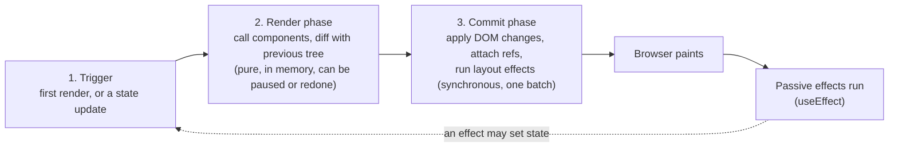
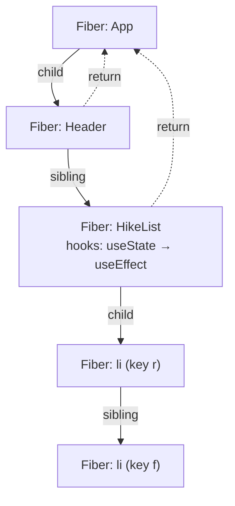

# Render, commit, batching and fibers

> **Before this lesson:** you need [The virtual DOM and reconciliation](#/lesson/react/virtual-dom), state snapshots and batching from [State with useState](#/lesson/react/usestate), and effect timing from [useEffect and its dependency rules](#/lesson/react/useeffect). The browser's event loop is explained in [The event loop, tasks and microtasks](#/lesson/javascript/event-loop-microtasks).

## In plain words

Think of a restaurant order. Three things happen, in order:

1. The waiter takes the order (something **triggers** the work).
2. The kitchen prepares the dishes (the cooks work out what goes on each plate).
3. The waiter carries the plates to the table (the result is delivered).

The kitchen can be interrupted: if a rush order arrives, a cook can put the slow stew aside and plate a salad first. Carrying plates to the table cannot be half-done: the guest should never see half a meal arrive.

React updates the screen in the same three steps. A **trigger** (a state change) starts the work. The **render phase** is the kitchen: React calls your components and works out what changed, entirely in memory. The **commit phase** is the delivery: React applies the changes to the real page in one go.

Knowing which of your code runs in which step answers a long list of practical questions: when is the DOM updated, when do effects run, why must rendering be pure, why does `console.log` in a component print twice. It is also what interviewers mean by "walk me through what happens when you call `setState`".

## The three steps



### Step 1: trigger

Only two things start a render:

- the **initial render**, when `createRoot(...).render(<App />)` is called, and
- a **state update** in a component (a setter from `useState`, a `dispatch` from `useReducer`), or a change in a context or external store that a component reads.

A setter does not render anything by itself. It places an update in a queue and asks React to *schedule* a render.

### Step 2: the render phase

React calls component functions to find out what the UI should look like.

- On the initial render it starts at the root component.
- On an update it starts at the component whose state changed and continues into its children, recursively. Ancestors and siblings are not called.
- For each component it calls the function with the current props and state, obtains the returned elements, and reconciles them with the previous ones (the diff from the last lesson), recording what needs to change. No DOM node is touched.

Because nothing outside React's memory is modified, the render phase can be **paused, restarted or thrown away** without any visible effect. React relies on that:

- **Strict Mode** calls each component function twice in development to expose accidental side effects.
- **Concurrent rendering** (next section) may start rendering an update, abandon it when something more urgent arrives, and begin again.

This is the real reason for the purity rule. Code in a component body may run more times than there are visible updates, and at times you do not control. So during render you must not change variables that existed before the call, start requests or timers, or write to the DOM. Reading props, state and context and computing new values is always safe.

### Step 3: the commit phase

Once the whole updated tree has been rendered, React applies the result. The commit is **synchronous and uninterruptible**: the user never sees a half-updated page. In order:

1. Cleanup functions of layout effects that need re-running (and of components being removed) run.
2. **DOM mutations**: nodes are created, moved and removed, and changed attributes and text are written.
3. **Refs** are attached: `ref.current` now points at the new DOM nodes (and is set to `null` for removed ones).
4. **Layout effects** (`useLayoutEffect`) run. The DOM is updated, the browser has not painted yet, so measurements taken here can still influence what is drawn.

After the commit, the browser **paints** (draws the pixels). Then React runs **passive effects**, the ordinary `useEffect` callbacks: first the cleanups of effects whose dependencies changed, then the new effects.

If the render phase finds that nothing differs from the previous tree, the commit has no DOM work to do.

### Order across parent and child

For a parent `P` with a child `C`:

- **Render** goes top-down: `P` is called, then `C`.
- **Effects** run bottom-up: `C`'s effect runs before `P`'s, because a child finishes before its parent does.
- On an update, all cleanups of the old effects run before any of the new effects.

The simulation at the end of the lesson prints this order.

## Where your code runs

| Your code | Phase | Consequences |
|---|---|---|
| Component function body, `useMemo` callback, reducer function, updater function `(prev) => next` | render | must be pure; may run twice or be discarded |
| DOM updates | commit | done by React |
| `ref.current` assignment for DOM refs | commit | do not read DOM refs during render |
| `useLayoutEffect` callback | commit, before paint | blocks painting; keep it short |
| `useEffect` callback and its cleanup | after paint | safe place for subscriptions and requests |
| Event handlers | outside rendering, when the event fires | side effects are fine here |

## Batching

Inside one event handler, several state updates lead to **one** render:

```jsx
function handleSubmit() {
  setStatus("submitting");
  setError(null);
  setAttempts((n) => n + 1);
  // one render after this function returns, not three
}
```

React collects the updates in a queue and processes it when the handler finishes. Each state variable has its own queue; React walks through it applying plain values and updater functions in order, as described in [State with useState](#/lesson/react/usestate).

Two reasons for batching: it avoids wasted renders, and it prevents the screen from ever showing an intermediate, inconsistent state (status "submitting" with the old error still visible).

**Automatic batching (React 18 and later).** Before version 18, React batched only inside its own event handlers. Updates made later, in a `setTimeout` callback, after an `await`, or in a native event listener, each caused their own render. Since React 18, with `createRoot`, updates are batched wherever they happen:

```jsx
async function handleLoad() {
  const data = await fetchHikes();
  setHikes(data);          // React 17: render
  setStatus("success");    // React 17: another render
  // React 18+: one render for both
}
```

Note the limit: updates on *different sides* of an `await` are in different tasks and are not batched together. Above, anything set before the `await` renders once, and the two setters after it render once more.

If you need the DOM updated immediately, for example to measure or scroll to a newly added element, `flushSync` forces React to render and commit right away:

```jsx
import { flushSync } from "react-dom";

function handleAdd() {
  flushSync(() => {
    setItems((list) => [...list, newItem]);
  });
  listRef.current.lastElementChild.scrollIntoView();   // the new row exists now
}
```

It is an escape hatch with a performance cost; reaching for it often is a sign that an effect would do the job.

**Bail-out.** If an update leaves the state identical (`Object.is`) to the current state, React skips rendering that component's children and committing. The problem *Batching and the update queue* models the queue, the single render and the bail-out.

## Fibers

So far "the tree React keeps" has been called the virtual DOM. React's actual internal structure is the **fiber tree**. A **fiber** is a JavaScript object representing one unit of work: one component instance or one DOM element. For each, the fiber records:

- its `type` (the function or tag) and `key`,
- its current props and its state. For a function component, the state is the **linked list of Hooks**: first `useState`, then the next Hook, and so on, which is why Hooks must be called in the same order every render,
- pointers to its parent, first child and next sibling,
- flags describing what has to be done to it at commit ("insert", "update", "delete", "run effect").



Why this shape? Before React 16, reconciliation was one recursive function call that walked the whole tree. Once started it could not stop until it finished, because the progress lived on the JavaScript call stack. A large update could block the browser for many frames: typing lagged, animations froze.

The fiber architecture replaced that recursion with a loop over these linked objects:

```javascript
// The idea, greatly simplified
function workLoop() {
  while (nextUnitOfWork !== null && !shouldYieldToBrowser()) {
    nextUnitOfWork = performUnitOfWork(nextUnitOfWork);   // render ONE fiber, return the next
  }
  if (nextUnitOfWork === null) commitRoot();              // everything rendered: commit in one go
  else scheduleCallback(workLoop);                        // out of time: continue later
}
```

- Each fiber is one small **unit of work**. After finishing one, React can check whether it should hand control back to the browser.
- Because the position in the tree is stored in ordinary objects (child, sibling, parent pointers), work can be paused and resumed later.
- React builds the updated tree as a separate **work-in-progress** tree beside the **current** tree (the one on screen). If the render is abandoned, the work-in-progress tree is discarded and nothing visible has changed. When it completes, the commit applies the flagged changes and the work-in-progress tree *becomes* the current tree. Two versions alternating like this is sometimes called double buffering.

### Concurrent rendering and priorities

Being able to pause is what enables **concurrent rendering**: React can work on an update in the background, keep the page responsive, and let more urgent updates jump the queue. Each update has a priority (React calls them *lanes*):

- urgent: typing, clicking, pressing: things the user expects to see instantly,
- non-urgent **transitions**: switching a view, filtering a large list, showing fetched results.

You choose with the APIs from [Suspense, error boundaries and server components](#/lesson/react/suspense-boundaries-rsc):

```jsx
function handleChange(event) {
  setQuery(event.target.value);                 // urgent: the input must follow the keyboard
  startTransition(() => {
    setFilterText(event.target.value);          // non-urgent: re-render the big list when there is time
  });
}
```

If the user types another letter while the list render is in progress, React abandons that render, handles the keystroke, and starts the list again with the newer text. `useDeferredValue(value)` gives a similar effect for a value you receive: it returns a version that lags behind during heavy renders.

Three things to remember: rendering can be interrupted, **committing never is**; an interrupted render has no visible effect because it only touched the work-in-progress tree; and all of this depends on your components being pure.

## Run it: watch the phases and the queue

The simulation logs the full sequence for a parent and a child: mount, then an update triggered by one click that calls two setters.

```js-run
const log = [];
const say = (line) => log.push(line);

// ---------- a miniature React with phases ----------
let state = { count: 0, label: "a" };
let queue = [];                       // pending updates
let previousEffects = [];

function setState(update) { queue.push(update); say(`   queue: ${update.name}`); }

function renderPhase() {
  say("RENDER phase (pure, in memory)");
  const next = queue.reduce((s, update) => update(s), state);       // process the whole queue at once
  queue = [];
  const effects = [];
  say(`   call Parent(count=${next.count}, label=${next.label})`);
  say(`   call Child(count=${next.count})`);
  effects.push({ name: "Child", deps: [next.count] });              // children complete first...
  effects.push({ name: "Parent", deps: [next.label] });             // ...then the parent
  return { next, effects };
}

function commitPhase({ next, effects }) {
  if (Object.is(next.count, state.count) && Object.is(next.label, state.label) && previousEffects.length) {
    say("COMMIT phase: nothing changed, no DOM work (bail-out)");
    return;
  }
  say("COMMIT phase (synchronous)");
  say("   DOM mutations applied");
  say("   refs attached");
  say("   layout effects run");
  say("BROWSER PAINTS");
  say("PASSIVE EFFECTS (useEffect)");
  const toRun = effects.filter((e, i) => !previousEffects[i] || e.deps.some((d, j) => !Object.is(d, previousEffects[i].deps[j])));
  toRun.forEach((e) => { if (previousEffects.length) say(`   cleanup ${e.name}`); });
  toRun.forEach((e) => say(`   effect  ${e.name}`));
  previousEffects = effects;
  state = next;
}

say("TRIGGER: initial render");
commitPhase(renderPhase());

say("\nTRIGGER: one click handler calls two setters");
setState(function incrementCount(s) { return { ...s, count: s.count + 1 }; });
setState(function incrementCount(s) { return { ...s, count: s.count + 1 }; });
say("   (handler returns; React now renders ONCE)");
commitPhase(renderPhase());

say("\nTRIGGER: a setter that leaves the state identical");
setState(function sameValue(s) { return s; });
commitPhase(renderPhase());

console.log(log.join("\n"));
```

Read the output with these questions: How many render phases did the click with two setters cause (one)? Which effect ran first after mount, the child's or the parent's (the child's)? After the click, which effects re-ran (only the child's, whose dependency `count` changed; the parent's depends on `label`) and what ran before them (the cleanup)? What happened for the identical state (no DOM work)?

The second example shows why interruptible work matters. Both buttons do the same heavy job. One runs it in a single long task, like the old recursive reconciler. The other splits it into small units and yields to the browser between them, like the fiber work loop. Start a job and type in the box.

```html-run
<p><input placeholder="type here while a job runs" size="30" /> <span id="spin" style="display:inline-block">⏳</span></p>
<button id="blocking">Heavy work in one piece</button>
<button id="sliced">Heavy work in small units</button>
<p id="out" style="font-family:monospace"></p>
<style>@keyframes turn { to { transform: rotate(360deg); } } #spin { animation: turn 1s linear infinite; }</style>
<script>
  const out = document.getElementById("out");
  const unit = () => { const end = performance.now() + 4; while (performance.now() < end) {} };   // one unit: about 4 ms of work
  const UNITS = 400;                                                                              // about 1.6 s in total

  document.getElementById("blocking").addEventListener("click", () => {
    out.textContent = "working… (the page is frozen: no typing, the hourglass stops)";
    setTimeout(() => {                                   // let the message paint first
      const start = performance.now();
      for (let i = 0; i < UNITS; i++) unit();            // cannot be interrupted
      out.textContent = `one piece: done in ${Math.round(performance.now() - start)} ms, and the page was blocked for all of it`;
    }, 30);
  });

  document.getElementById("sliced").addEventListener("click", () => {
    const start = performance.now();
    let done = 0;
    function workLoop() {
      const sliceEnd = performance.now() + 8;            // work for about 8 ms...
      while (done < UNITS && performance.now() < sliceEnd) { unit(); done++; }
      out.textContent = `small units: ${done} / ${UNITS}`;
      if (done < UNITS) setTimeout(workLoop, 0);         // ...then yield to the browser and continue later
      else out.textContent = `small units: done in ${Math.round(performance.now() - start)} ms, and the page stayed responsive`;
    }
    workLoop();
  });
</script>
```

The sliced version takes slightly longer in total and feels far better, because the browser gets a chance to handle input and repaint between units. That trade (a little overhead for responsiveness) is the motivation for fibers.

## Pitfalls

> [!WARNING]
> **Side effects in the render phase.** Writing to a ref, a module variable, `localStorage` or the DOM in a component body, or starting a request there, will run an unpredictable number of times: twice under Strict Mode, repeatedly under concurrent rendering, and possibly for a render that is later discarded. Move the work into an event handler or an effect.

- **Reading the DOM or a DOM ref during render.** The DOM for this render does not exist yet; it is created at commit.
- **Expecting state to be updated on the line after the setter.** The update is queued; the new value appears in the next render.
- **Expecting one render per setter.** Updates are batched, including across promises and timers since React 18 (but not across an `await`).
- **Using `useLayoutEffect` by default.** It runs before paint and delays it. Use it only to measure layout or prevent a visible flicker; otherwise `useEffect`.
- **Using `flushSync` routinely.** It defeats batching.
- **Assuming render order equals effect order.** Rendering is parent-first; effects are child-first.
- **Wrapping urgent updates in `startTransition`.** The input's own value must update urgently or typing will lag; only the expensive derived update belongs in the transition.
- **Thinking "re-render" means "DOM update".** Most re-renders commit little or nothing.

> [!TIP]
> To see the phases in a real app, add `console.log("render", name)` in a component body and `console.log("effect", name)` in a `useEffect`. The render logs print top-down (twice each under Strict Mode), the effect logs bottom-up, after the screen has updated.

> [!INTERVIEW]
> "What happens when you call `setState`?" *The setter enqueues an update and schedules a render; nothing changes immediately. React batches all updates from the same event. In the render phase it calls the component and its descendants with the new state and reconciles the result with the current fiber tree, building a work-in-progress tree and marking what changed; this phase is pure and can be interrupted. In the commit phase it applies the DOM mutations synchronously, attaches refs and runs layout effects. The browser paints, and then `useEffect` cleanups and callbacks run.* If asked about fibers: *a fiber is the unit of work and the per-instance record holding state and Hooks; the linked structure lets React pause, prioritise and resume rendering.*

## Cheat sheet

| Question | Answer |
|---|---|
| What starts a render? | initial `root.render`, or a state/context/store update |
| Where does rendering start on an update? | at the component whose state changed, then its subtree |
| Can rendering be interrupted? | yes (render phase only) |
| Can the commit be interrupted? | no |
| When is the DOM updated? | commit phase |
| When are refs set? | commit phase, after DOM mutations |
| `useLayoutEffect` runs | after DOM mutation, before paint |
| `useEffect` runs | after paint |
| Order of render | parent, then children |
| Order of effects | children, then parent; cleanups before new effects |
| Several setters in one handler | one render (batched) |
| Force an immediate commit | `flushSync(() => setX(...))` |
| Mark an update as non-urgent | `startTransition(() => setX(...))`, `useDeferredValue(x)` |
| Same state as before | bail-out: no commit |

## Summary

- Every update is trigger → render → commit. Setters only enqueue and schedule.
- The render phase calls components and diffs in memory. It must be pure because it may be repeated, paused or discarded.
- The commit phase applies DOM changes, attaches refs and runs layout effects in one uninterruptible step; `useEffect` runs after the browser paints.
- Updates are batched into one render per event, and since React 18 also in timers and promises.
- A fiber is React's per-instance unit of work; the fiber tree, with its current and work-in-progress versions, lets rendering be split into units, prioritised and resumed.
- Concurrent features (`startTransition`, `useDeferredValue`, Suspense) build on that interruptibility.

## Glossary

- **Trigger**: the event that causes React to schedule a render.
- **Render phase**: calling components and computing what changed, without touching the DOM.
- **Commit phase**: applying the computed changes to the DOM.
- **Paint**: the browser drawing pixels on the screen.
- **Layout effect / passive effect**: an effect run before paint (`useLayoutEffect`) / after paint (`useEffect`).
- **Batching**: processing several state updates in a single render.
- **Bail-out**: skipping work because the state did not change.
- **`flushSync`**: a function forcing an immediate synchronous render and commit.
- **Fiber**: an internal object representing one component instance or DOM element and the work to do on it.
- **Work-in-progress tree / current tree**: the tree being prepared / the tree on screen.
- **Unit of work**: the processing of one fiber.
- **Concurrent rendering**: React's ability to interrupt, prioritise and resume rendering.
- **Transition**: an update marked as non-urgent.

## Check yourself

```quiz
[
  {"q": "In which phase does React modify the real DOM?",
   "options": ["Trigger", "Render phase", "Commit phase", "Inside useEffect"],
   "answer": 2,
   "explain": "Rendering only computes. All DOM mutations are applied during the commit."},
  {"q": "A click handler runs setA(1); setB(2); setC(3); for three different state variables. How many times does the component render?",
   "options": ["3", "1", "0", "2"],
   "answer": 1,
   "explain": "Updates in the same event are batched into a single render."},
  {"q": "A parent and its child each log in their body ('render') and in a useEffect ('effect'). On mount outside Strict Mode, what is the order?",
   "options": ["render Parent, effect Parent, render Child, effect Child", "render Parent, render Child, effect Child, effect Parent", "render Child, render Parent, effect Parent, effect Child", "effect Child, effect Parent, render Parent, render Child"],
   "answer": 1,
   "explain": "Rendering is top-down; effects run bottom-up after the commit and paint."},
  {"q": "Why must the render phase be free of side effects?",
   "options": ["Side effects are slow", "React may call components more than once, pause a render or discard it, so side effects would run unpredictably", "JavaScript forbids it", "Effects cannot access props otherwise"],
   "answer": 1,
   "explain": "Strict Mode and concurrent rendering both rely on render being repeatable without consequences."},
  {"q": "In React 18+, inside an async handler: await fetch(...); setData(d); setStatus('done');  How many renders do the two setters cause?",
   "options": ["2", "1, thanks to automatic batching", "0", "It depends on the browser"],
   "answer": 1,
   "explain": "Automatic batching applies to updates in promises and timers too. Before React 18 this caused two renders."},
  {"q": "What is the difference between useLayoutEffect and useEffect timing?",
   "options": ["None", "useLayoutEffect runs after the DOM is updated but before the browser paints; useEffect runs after paint", "useLayoutEffect runs during render", "useEffect runs before the DOM is updated"],
   "answer": 1,
   "explain": "Layout effects can measure and adjust the DOM before the user sees the frame, at the cost of delaying paint."},
  {"q": "What problem did the fiber architecture solve?",
   "options": ["It made JSX possible", "Rendering as one uninterruptible recursive pass could block the browser; fibers split it into units that can be paused, prioritised and resumed", "It removed the need for keys", "It replaced the DOM"],
   "answer": 1,
   "explain": "Progress is stored in linked fiber objects instead of the call stack, so React can yield and continue later."},
  {"q": "React starts rendering a transition, and the user types before it finishes. What can React do?",
   "options": ["Nothing; it must finish and commit first", "Discard the in-progress render, handle the urgent update, then restart the transition; the half-done work was never visible", "Commit half of the tree", "Throw an error"],
   "answer": 1,
   "explain": "Only the work-in-progress tree was touched. Commits are atomic, so partial results never reach the screen."}
]
```

> **Source:** Wieruch, *The Road to React*, "Fundamentals of React": React DOM, React State, React Side-Effects; "React Maintenance": Performance in React (Advanced). Documentation: https://react.dev/learn/render-and-commit, https://react.dev/learn/queueing-a-series-of-state-updates, https://react.dev/reference/react-dom/flushSync, https://react.dev/reference/react/useTransition, https://react.dev/blog/2022/03/29/react-v18#new-feature-automatic-batching
