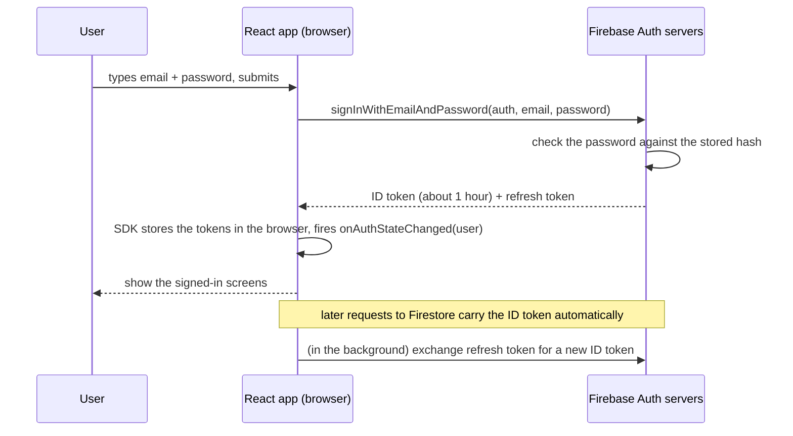

# Firebase setup and authentication flows

> **Before this lesson:** you need forms with a submit status ([Forms](#/lesson/react/forms)), effects with cleanup ([useEffect and its dependency rules](#/lesson/react/useeffect)), promises and `async`/`await`, and a Vite project ([Why React, and a first project with Vite](#/lesson/react/why-react-vite)). No back-end knowledge is assumed.

## In plain words

Your React app so far is like a beautifully fitted shop front with nothing behind the counter: no stockroom, no till, no record of who the customers are. Everything it knows disappears when the tab is closed. The part behind the counter is the **back end**: computers on the internet (servers) that store data permanently, check who users are, and enforce rules.

Building a back end yourself is a second job: a database, a server program, password storage, email sending, hosting, security updates. **Firebase**, a Google product, is a rented, ready-made back end. This kind of service is called **backend as a service** (BaaS). You talk to it directly from your React code through a library, and Google runs the servers.

This lesson sets Firebase up and covers the first thing nearly every app needs: **authentication**, meaning proving who a user is. Think of a hotel reception. You show your passport once (email and password); the hotel gives you a key card (a session); the card opens your door until it expires or you check out. Never handle passports yourself if you can help it: storing passwords safely is hard, and Firebase Authentication does it for you.

Sign-up and sign-in are in almost every product, so being able to wire them correctly is directly employable. The rest of this track builds a small app called **Potluck**, where friends plan a shared dinner and claim dishes.

## What Firebase offers

| Product | What it does | Covered in |
|---|---|---|
| Authentication | sign-up, sign-in, password reset, social login | this lesson and the next |
| Cloud Firestore | a document database with realtime updates | [Firestore and the Realtime Database](#/lesson/react/firestore-rtdb) |
| Realtime Database | an older, simpler JSON-tree database | same lesson |
| Security Rules | who may read and write which data | [Security rules](#/lesson/react/security-rules) |
| Hosting | serves your built app worldwide | [Hosting, app structure, and Firebase vs a custom backend](#/lesson/react/hosting-structure) |
| Cloud Functions, Storage | server-side code; file uploads | mentioned where relevant |

There is a free tier (the "Spark" plan) that is generous enough for learning and small projects.

## Creating a project and connecting the app

**1. Create a Firebase project.** In the Firebase console (console.firebase.google.com) choose "Add project" and give it a name. A project is a container for one app's users, data and settings. Create separate projects for development and production, so that experiments never touch real users.

**2. Register a web app.** In the project overview click the web icon (`</>`), name the app, and the console shows a configuration object.

**3. Install the library** (called an **SDK**, software development kit: a library for talking to a particular service):

```bash
npm install firebase
```

**4. Put the configuration in environment variables.** Create `.env.local` in the project root (this file is ignored by Git in the Vite template):

```text
VITE_FIREBASE_API_KEY=AIza...
VITE_FIREBASE_AUTH_DOMAIN=potluck-dev.firebaseapp.com
VITE_FIREBASE_PROJECT_ID=potluck-dev
VITE_FIREBASE_APP_ID=1:1234567890:web:abc123
```

**5. Initialise Firebase once,** in its own module:

```javascript
// src/lib/firebase.js
import { initializeApp } from "firebase/app";
import { getAuth } from "firebase/auth";
import { getFirestore } from "firebase/firestore";

const firebaseConfig = {
  apiKey: import.meta.env.VITE_FIREBASE_API_KEY,
  authDomain: import.meta.env.VITE_FIREBASE_AUTH_DOMAIN,
  projectId: import.meta.env.VITE_FIREBASE_PROJECT_ID,
  appId: import.meta.env.VITE_FIREBASE_APP_ID,
};

const app = initializeApp(firebaseConfig);

export const auth = getAuth(app);
export const db = getFirestore(app);
```

- `initializeApp(config)` creates the connection object for your project. Call it exactly once.
- `getAuth(app)` and `getFirestore(app)` return handles to two services. Every other file imports `auth` and `db` from here.
- `import.meta.env.VITE_…` reads the values from the `.env` file at build time.

This import style, where each feature is a separate function you import (`getAuth`, `signInWithEmailAndPassword`, …), is the **modular SDK**. It lets the build tool leave out everything you do not use (**tree shaking**), which keeps the bundle small. Older tutorials use a different, "namespaced" style, written `firebase.auth().signInWithEmailAndPassword(...)`. That style is legacy; if you see it, translate it: the method becomes a function and the service object becomes its first argument.

> [!NOTE]
> **Is the API key a secret?** No. The Firebase web configuration identifies your project; it does not grant access. It is shipped to every visitor's browser, like everything in a front end. What protects your data is Security Rules, and optionally App Check (which verifies that requests come from your real app). Keeping the config in `.env` files is for switching between development and production projects, not for secrecy.

**6. Enable sign-in methods.** In the console under Authentication → Sign-in method, switch on "Email/Password" (and later "Google").

## How Firebase Authentication works



A few terms:

- Firebase stores a **hash** of each password: a scrambled, one-way form from which the password cannot be recovered. Neither you nor Google staff can read users' passwords.
- After a successful sign-in the server issues an **ID token**: a signed piece of text stating "this is user `abc123`, verified until 14:05". It is a **JWT** (JSON Web Token). Other Firebase services trust it because they can verify the signature.
- The ID token lasts about an hour. A longer-lived **refresh token** lets the SDK obtain new ID tokens silently, which is how the user stays signed in for weeks.
- The signed-in user is represented in your code by a **User object** with `uid` (a unique, permanent id), `email`, `emailVerified`, `displayName`, `photoURL`.

You never handle tokens directly. You call a function and listen for changes.

## Sign up

```jsx
// src/features/auth/SignUpForm.jsx
import { useState } from "react";
import { createUserWithEmailAndPassword, updateProfile, sendEmailVerification } from "firebase/auth";
import { auth } from "../../lib/firebase";
import { messageForAuthError } from "./authErrors";

export function SignUpForm() {
  const [status, setStatus] = useState("editing");
  const [formError, setFormError] = useState(null);

  async function handleSubmit(event) {
    event.preventDefault();
    const data = new FormData(event.currentTarget);
    setStatus("submitting");
    setFormError(null);
    try {
      const credential = await createUserWithEmailAndPassword(auth, data.get("email"), data.get("password"));
      await updateProfile(credential.user, { displayName: data.get("name") });
      await sendEmailVerification(credential.user);
      setStatus("success");
    } catch (error) {
      setFormError(messageForAuthError(error.code));
      setStatus("editing");
    }
  }

  return (
    <form onSubmit={handleSubmit}>
      <label>Name <input name="name" required /></label>
      <label>Email <input name="email" type="email" autoComplete="email" required /></label>
      <label>Password <input name="password" type="password" autoComplete="new-password" minLength={8} required /></label>
      {formError && <p role="alert">{formError}</p>}
      <button disabled={status === "submitting"}>Create account</button>
    </form>
  );
}
```

- `createUserWithEmailAndPassword(auth, email, password)` creates the account on Firebase's servers **and signs the user in**. It returns a promise of a credential object whose `.user` is the new User.
- `updateProfile(user, { displayName })` stores the name on the account.
- `sendEmailVerification(user)` emails a confirmation link (more below).
- Any failure rejects the promise with an error that has a `code`, such as `auth/email-already-in-use` or `auth/weak-password`. The `catch` turns it into a readable message.
- `autoComplete="new-password"` and `"email"` help password managers do the right thing.
- The form uses the submit-status pattern from the Forms lesson: disabled while submitting, a form-level error on failure.

Map error codes to your own wording in one place:

```javascript
// src/features/auth/authErrors.js
const MESSAGES = {
  "auth/email-already-in-use": "An account with this email already exists. Try signing in.",
  "auth/weak-password": "Please choose a longer password.",
  "auth/invalid-email": "That email address does not look right.",
  "auth/invalid-credential": "Email or password is incorrect.",
  "auth/too-many-requests": "Too many attempts. Please wait a few minutes and try again.",
  "auth/network-request-failed": "No connection. Check your internet and try again.",
  "auth/popup-closed-by-user": "The sign-in window was closed before finishing.",
};

export function messageForAuthError(code) {
  return MESSAGES[code] ?? "Something went wrong. Please try again.";
}
```

Never show `error.message` from the SDK directly; it is written for developers.

## Sign in and sign out

```jsx
import { signInWithEmailAndPassword, signOut } from "firebase/auth";

async function handleSignIn(event) {
  event.preventDefault();
  const data = new FormData(event.currentTarget);
  try {
    await signInWithEmailAndPassword(auth, data.get("email"), data.get("password"));
  } catch (error) {
    setFormError(messageForAuthError(error.code));
  }
}

function SignOutButton() {
  return <button onClick={() => signOut(auth)}>Sign out</button>;
}
```

- `signInWithEmailAndPassword` resolves when the credentials are right and rejects otherwise.
- For a wrong email *or* a wrong password, show the same message ("Email or password is incorrect"). Saying "no account with that email" tells an attacker which addresses are registered. Current Firebase projects have **email enumeration protection** on by default and return the single code `auth/invalid-credential` for both cases.
- `signOut(auth)` deletes the stored tokens.

Notice that neither handler stores the user in React state. How does the app find out that someone signed in?

## Listening for the current user

The SDK is the source of truth for "who is signed in". You **subscribe** to it:

```jsx
import { onAuthStateChanged } from "firebase/auth";

useEffect(() => {
  const unsubscribe = onAuthStateChanged(auth, (user) => {
    console.log(user ? `signed in as ${user.email}` : "signed out");
  });
  return unsubscribe;
}, []);
```

- `onAuthStateChanged(auth, callback)` calls `callback` whenever the signed-in user changes: after sign-in, after sign-out, and once shortly after page load when the SDK has checked the browser for a saved session.
- `user` is the User object or `null`.
- It returns a function that stops the listening, which is exactly what an effect's cleanup needs, so the effect returns it.

This is an effect in the proper sense: synchronising React with an external system. [Sessions, protected routes and roles](#/lesson/react/sessions-roles) wraps it in a context provider so that every component can read the current user.

## Password reset and password change

Users forget passwords. The reset flow needs no signed-in user:

```jsx
import { sendPasswordResetEmail } from "firebase/auth";

async function handleReset(event) {
  event.preventDefault();
  const email = new FormData(event.currentTarget).get("email");
  try {
    await sendPasswordResetEmail(auth, email);
  } catch (error) {
    if (error.code !== "auth/user-not-found") { setFormError(messageForAuthError(error.code)); return; }
  }
  setMessage("If an account exists for that address, a reset link is on its way.");
}
```

- `sendPasswordResetEmail(auth, email)` makes Firebase send an email with a link to a page (hosted by Firebase, or your own) where the user chooses a new password.
- The confirmation message is deliberately the same whether or not the address is registered, again to avoid revealing who has an account.
- You can edit the wording and sender name of these emails in the console under Authentication → Templates.

Changing the password while signed in:

```jsx
import { updatePassword, reauthenticateWithCredential, EmailAuthProvider } from "firebase/auth";

async function changePassword(currentPassword, newPassword) {
  const user = auth.currentUser;
  const credential = EmailAuthProvider.credential(user.email, currentPassword);
  await reauthenticateWithCredential(user, credential);
  await updatePassword(user, newPassword);
}
```

- Sensitive operations (changing password or email, deleting the account) require a **recent** sign-in. If the session is old, Firebase rejects with `auth/requires-recent-login`.
- `reauthenticateWithCredential` proves again that the person at the keyboard knows the current password. Then `updatePassword` succeeds.

## Email verification

An email address typed into a form proves nothing: anyone can type anyone's address. **Email verification** confirms that the user can read mail sent there.

```jsx
import { sendEmailVerification } from "firebase/auth";

await sendEmailVerification(auth.currentUser);     // sends the link

// later, after the user clicked the link in another tab:
await auth.currentUser.reload();                   // fetch the fresh profile
console.log(auth.currentUser.emailVerified);       // true
```

- `user.emailVerified` is `false` until the link is clicked.
- The User object in memory does not change by itself when the link is clicked elsewhere. `reload()` fetches the current profile from the server; offer an "I have verified, continue" button that calls it.
- Verification is only meaningful if something *requires* it: a route guard for a good user experience, and a security rule (`request.auth.token.email_verified == true`) for real enforcement. Both appear in the coming lessons.

## Social login

Signing in with an existing Google, GitHub, Apple or Microsoft account spares users another password. Each of these is an **identity provider** (IdP): a service that vouches for who someone is. The protocol behind it is **OAuth**: the user approves on the provider's own page, and the provider tells Firebase "yes, this is that person". Your app never sees the Google password.

```jsx
import { GoogleAuthProvider, signInWithPopup } from "firebase/auth";

async function handleGoogleSignIn() {
  const provider = new GoogleAuthProvider();
  try {
    await signInWithPopup(auth, provider);
  } catch (error) {
    setFormError(messageForAuthError(error.code));
  }
}

<button type="button" onClick={handleGoogleSignIn}>Continue with Google</button>
```

- Enable the provider in the console first.
- `signInWithPopup` opens the provider's sign-in window. It must be called directly from a click handler, or the browser's pop-up blocker will stop it.
- If the person has no account in your project yet, one is created. There is no separate "sign up with Google" call.
- `signInWithRedirect` is the alternative that navigates the whole page to the provider and back; it suits mobile browsers but needs extra hosting configuration on some browsers, so popup is the simpler default for the web.
- The domain your app runs on must be listed under Authentication → Settings → Authorised domains (`localhost` is there by default).

**One person, several sign-in methods.** By default Firebase allows one account per email address. If someone who registered with a password later tries Google with the same email, the result depends on the project's settings and may be the error `auth/account-exists-with-different-credential`. The clean solution is **account linking**: while signed in, attach a second provider to the same account with `linkWithPopup(auth.currentUser, new GoogleAuthProvider())`. Afterwards either method signs in to the same `uid`.

## Developing without touching real accounts

The **Firebase Local Emulator Suite** runs fake versions of Auth and Firestore on your own machine. Connect to it in development only:

```javascript
import { connectAuthEmulator } from "firebase/auth";

if (import.meta.env.DEV) {
  connectAuthEmulator(auth, "http://127.0.0.1:9099");
}
```

`import.meta.env.DEV` is `true` under `npm run dev`. Tests can then create and delete users freely, offline, with no quota.

## Run it: the authentication flows against a fake service

There is no network in this page, so `fakeAuth` below imitates Firebase Authentication in memory: the same operations, the same error codes, and an `onAuthStateChanged` listener. The UI part is written the way your React code will be: it never stores the user itself; it re-draws when the listener fires.

```html-run
<div id="root"></div>
<pre id="log" style="background:#f4f4f4;padding:6px;max-height:120px;overflow:auto;font-size:12px"></pre>
<style>body { font-family: sans-serif; } input { margin: 3px; } button { margin: 3px; } .err { color: #b3261e; } .box { border: 1px solid #bbb; border-radius: 6px; padding: 8px; }</style>
<script>
  // ---------- a pretend Firebase Auth: same shape, in memory ----------
  const fakeAuth = (() => {
    const accounts = new Map();          // email -> { uid, email, passwordHash, emailVerified }
    const listeners = new Set();
    let currentUser = null, nextUid = 1;
    const hash = (password) => "hash(" + [...password].reverse().join("") + ")";       // stand-in for a real one-way hash
    const fail = (code) => Promise.reject(Object.assign(new Error(code), { code }));
    const later = (value) => new Promise((resolve) => setTimeout(() => resolve(value), 400));
    const notify = () => listeners.forEach((fn) => fn(currentUser));
    return {
      onAuthStateChanged(fn) { listeners.add(fn); setTimeout(() => fn(currentUser), 300); return () => listeners.delete(fn); },
      async createUser(email, password) {
        if (!/^\S+@\S+\.\S+$/.test(email)) return fail("auth/invalid-email");
        if (password.length < 6) return fail("auth/weak-password");
        if (accounts.has(email)) return fail("auth/email-already-in-use");
        const account = { uid: "u" + nextUid++, email, passwordHash: hash(password), emailVerified: false };
        accounts.set(email, account);
        currentUser = await later({ uid: account.uid, email, emailVerified: false });
        notify();
      },
      async signIn(email, password) {
        const account = accounts.get(email);
        if (!account || account.passwordHash !== hash(password)) { await later(); return fail("auth/invalid-credential"); }
        currentUser = await later({ uid: account.uid, email, emailVerified: account.emailVerified });
        notify();
      },
      async signOut() { currentUser = null; notify(); },
      async sendPasswordResetEmail(email) { await later(); log(accounts.has(email) ? `(email sent to ${email})` : "(no account: nothing sent, the UI must not reveal this)"); },
      async clickVerificationLink() { accounts.get(currentUser.email).emailVerified = true; },      // happens "in another tab"
      async reload() { const a = accounts.get(currentUser.email); currentUser = { ...currentUser, emailVerified: a.emailVerified }; notify(); },
    };
  })();

  // ---------- the app ----------
  const MESSAGES = { "auth/email-already-in-use": "An account with this email already exists.", "auth/weak-password": "Please choose a longer password.",
    "auth/invalid-email": "That email address does not look right.", "auth/invalid-credential": "Email or password is incorrect." };
  const log = (line) => { const el = document.getElementById("log"); el.textContent += line + "\n"; el.scrollTop = el.scrollHeight; };
  let ui = { session: "loading", user: null, error: "", info: "", busy: false };
  const setUi = (change) => { ui = { ...ui, ...change }; draw(); };

  fakeAuth.onAuthStateChanged((user) => {                    // the single source of truth for "who is signed in"
    log("onAuthStateChanged -> " + (user ? user.email + " (verified: " + user.emailVerified + ")" : "null"));
    setUi({ session: user ? "authenticated" : "anonymous", user, error: "", busy: false });
  });

  async function run(action) {
    setUi({ busy: true, error: "", info: "" });
    try { await action(); setUi({ busy: false }); }
    catch (error) { setUi({ busy: false, error: MESSAGES[error.code] || "Something went wrong." }); log("rejected with code " + error.code); }
  }
  const field = (id) => document.getElementById(id).value;

  function draw() {
    const root = document.getElementById("root");
    if (ui.session === "loading") { root.innerHTML = "<p>Checking for a saved session…</p>"; return; }
    if (ui.session === "authenticated") {
      root.innerHTML = `<div class="box"><p>Signed in as <b>${ui.user.email}</b>, uid ${ui.user.uid}. Email verified: <b>${ui.user.emailVerified}</b></p>
        <button onclick="fakeAuth.clickVerificationLink().then(() => log('(user clicked the link in their inbox)'))">Simulate clicking the email link</button>
        <button onclick="fakeAuth.reload()">I have verified, refresh</button>
        <button onclick="fakeAuth.signOut()">Sign out</button></div>`;
      return;
    }
    root.innerHTML = `<div class="box">
      <input id="email" placeholder="email" value="ana@example.com" /> <input id="password" type="password" placeholder="password" value="hunter22" /><br />
      <button ${ui.busy ? "disabled" : ""} onclick="run(() => fakeAuth.createUser(field('email'), field('password')))">Sign up</button>
      <button ${ui.busy ? "disabled" : ""} onclick="run(() => fakeAuth.signIn(field('email'), field('password')))">Sign in</button>
      <button ${ui.busy ? "disabled" : ""} onclick="run(async () => { await fakeAuth.sendPasswordResetEmail(field('email')); setUi({ info: 'If an account exists for that address, a reset link is on its way.' }); })">Forgot password</button>
      <p class="err">${ui.error}</p><p>${ui.info}</p></div>`;
  }
  draw();
</script>
```

Walk through it: press **Sign in** first (rejected with `auth/invalid-credential`, and the message does not say whether the account exists). Press **Sign up** (the listener fires and the screen switches without the button handler setting any user state). Simulate the verification link, then refresh. Sign out, then sign up again with the same email (`auth/email-already-in-use`), then try a wrong password. Try **Forgot password** with a registered and an unregistered address: the user-visible message is identical; only the developer log differs.

## Pitfalls

> [!WARNING]
> **Believing that front-end checks secure anything.** Hiding a button or redirecting a page only affects your UI. Anyone can call Firebase directly with your public config. Data is protected by Security Rules, which you must write; a database left in "test mode" is open to the whole internet.

- **Following namespaced (`firebase.auth()`) tutorials** with the current SDK. Use the modular functions.
- **Calling `initializeApp` in several files or inside a component.** Do it once in a module and import the handles.
- **Reading `auth.currentUser` right after page load.** It is `null` until the SDK has restored the session. Use `onAuthStateChanged`.
- **Forgetting to unsubscribe** the listener in the effect cleanup.
- **Showing raw SDK error text,** or different messages for "unknown email" and "wrong password".
- **Calling `signInWithPopup` after an `await`** or from an effect: the pop-up is blocked. Call it straight from the click.
- **Storing passwords, or copying them into your database.** Only Firebase Auth should ever see them.
- **Treating `emailVerified` as enforced** when no rule checks it.
- **Developing against the production project.** Use a separate project or the emulator.
- **Forgetting to add the deployed domain to "Authorised domains".** Social login fails with `auth/unauthorized-domain`.

> [!TIP]
> Keep every direct call to the Firebase SDK inside a few modules (`lib/firebase.js`, `features/auth/api.js`). Components then call `signIn(email, password)` and never import from `firebase/auth`. Tests can replace those modules with fakes like the one above, and a future change of back end touches a handful of files.

> [!INTERVIEW]
> "How does authentication work in a Firebase web app?" *The client sends credentials to Firebase Auth, which verifies them against a stored hash and returns a short-lived ID token (a JWT) and a refresh token. The SDK persists them, refreshes the ID token automatically, and exposes the current user through `onAuthStateChanged`. Requests to Firestore carry the ID token, and Security Rules use it (`request.auth.uid`) to decide access. The UI subscribes to the auth state and renders accordingly; real authorisation happens in rules or on a server, never in the client alone.*

## Cheat sheet

| Flow | Modular SDK call (`firebase/auth`) |
|---|---|
| Set up | `initializeApp(config)`, `getAuth(app)` |
| Sign up | `createUserWithEmailAndPassword(auth, email, password)` |
| Set display name | `updateProfile(user, { displayName })` |
| Sign in | `signInWithEmailAndPassword(auth, email, password)` |
| Sign out | `signOut(auth)` |
| Current user changes | `onAuthStateChanged(auth, (user) => …)` → returns `unsubscribe` |
| Forgot password | `sendPasswordResetEmail(auth, email)` |
| Change password | `reauthenticateWithCredential(user, cred)` then `updatePassword(user, newPassword)` |
| Verify email | `sendEmailVerification(user)`, later `user.reload()`, read `user.emailVerified` |
| Google sign-in | `signInWithPopup(auth, new GoogleAuthProvider())` |
| Link a second method | `linkWithPopup(auth.currentUser, provider)` |
| Local emulator | `connectAuthEmulator(auth, "http://127.0.0.1:9099")` |
| Errors | `catch (error)` → switch on `error.code` (`auth/...`) |

## Summary

- Firebase is a hosted back end that a React app calls directly; create a project, register a web app, install the SDK and initialise it once.
- Use the modular SDK: import functions and pass `auth` as the first argument.
- The web config is public; Security Rules are the protection.
- Authentication yields a short-lived ID token and a refresh token, managed by the SDK. Your UI subscribes with `onAuthStateChanged` and renders from that.
- Sign-up, sign-in, sign-out, password reset, email verification and social login are each one or two function calls plus careful error handling.
- Do not reveal whether an email is registered, map error codes to friendly messages, and use the emulator or a separate project for development.

## Glossary

- **Back end**: the server-side part of an application: data storage, authentication, rules.
- **Backend as a service (BaaS)**: a hosted back end you use through an SDK.
- **SDK**: a library for using a particular service.
- **Modular SDK**: Firebase's current function-based API that supports tree shaking.
- **Authentication**: verifying who a user is. (Authorisation, deciding what they may do, is the next lesson.)
- **Hash**: a one-way scrambled form of a password.
- **ID token / JWT**: a short-lived, signed statement of the user's identity.
- **Refresh token**: a long-lived token used to obtain new ID tokens.
- **Session**: the period during which a user stays signed in.
- **`uid`**: the permanent unique id of a Firebase user.
- **Identity provider / OAuth**: a service that vouches for identity (Google, GitHub) / the protocol used to do so.
- **Account linking**: attaching several sign-in methods to one account.
- **Emulator**: a local imitation of Firebase services for development and tests.

## Check yourself

```quiz
[
  {"q": "Your Firebase web config (apiKey, projectId, ...) is visible in the deployed JavaScript. Is that a security problem?",
   "options": ["Yes, the key must be hidden on a server", "No: it identifies the project and is public by design; Security Rules protect the data", "Only if the project is on the free plan", "Yes, unless it is in a .env file"],
   "answer": 1,
   "explain": "Everything in a front-end bundle is public. .env files help switch environments; they do not hide values from visitors."},
  {"q": "What does createUserWithEmailAndPassword do on success?",
   "options": ["Creates the account only; you must sign in separately", "Creates the account and signs the new user in", "Sends a verification email automatically", "Returns the password hash"],
   "answer": 1,
   "explain": "The new user is signed in immediately, and onAuthStateChanged fires. Sending the verification email is a separate call."},
  {"q": "A component reads auth.currentUser in its body on the first render after a page refresh. The user signed in yesterday. What does it get?",
   "options": ["The User object", "null, because the SDK has not finished restoring the session yet", "An error", "A promise"],
   "answer": 1,
   "explain": "Restoring the session is asynchronous. Subscribe with onAuthStateChanged and treat the time before its first call as 'loading'."},
  {"q": "Why should a sign-in form show the same message for an unknown email and a wrong password?",
   "options": ["To save translation work", "Different messages would let an attacker discover which email addresses have accounts", "Firebase requires it for billing", "Because passwords are case-insensitive"],
   "answer": 1,
   "explain": "This is called preventing user enumeration. Firebase's default returns the single code auth/invalid-credential."},
  {"q": "useEffect(() => { const unsubscribe = onAuthStateChanged(auth, setUser); return unsubscribe; }, []);  What is the purpose of returning unsubscribe?",
   "options": ["To sign the user out on unmount", "To stop listening when the component unmounts, avoiding leaks and duplicate listeners", "It is required by Firebase to start listening", "To refresh the token"],
   "answer": 1,
   "explain": "The function returned by onAuthStateChanged removes the listener, which is exactly an effect cleanup."},
  {"q": "The user clicks the verification link in their inbox, in another tab. In the original tab, user.emailVerified still reads false. Why?",
   "options": ["Verification takes 24 hours", "The in-memory User object is not updated until you call user.reload() (or the token refreshes)", "The link was invalid", "emailVerified is always false in development"],
   "answer": 1,
   "explain": "Fetch the fresh profile with reload() before reading the flag again."},
  {"q": "updatePassword rejects with auth/requires-recent-login. What should the app do?",
   "options": ["Retry in a loop", "Ask for the current password and call reauthenticateWithCredential, then try again", "Sign the user out permanently", "Ignore it"],
   "answer": 1,
   "explain": "Sensitive operations need a recent sign-in as proof that the person present is the account owner."},
  {"q": "Where must signInWithPopup be called from so the browser does not block the window?",
   "options": ["A useEffect on mount", "Directly inside a user-initiated event handler such as a button click", "A setTimeout callback", "The component body"],
   "answer": 1,
   "explain": "Pop-up blockers only allow windows opened as a direct result of a user gesture."}
]
```

> **Source:** Wieruch, *The Road to React with Firebase*: Firebase; Firebase in React; Firebase's Authentication API (Sign Up, Sign In, Sign Out); Password Management (Password Forget, Password Change); Social Logins; Email Verification. The book uses the older namespaced SDK; the calls here follow the current modular API. Documentation: https://firebase.google.com/docs/web/setup, https://firebase.google.com/docs/auth/web/start, https://firebase.google.com/docs/auth/web/password-auth, https://firebase.google.com/docs/auth/web/google-signin, https://firebase.google.com/docs/emulator-suite
