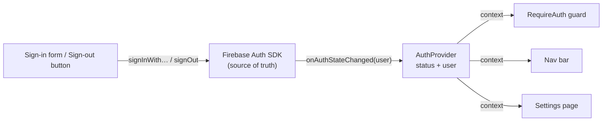
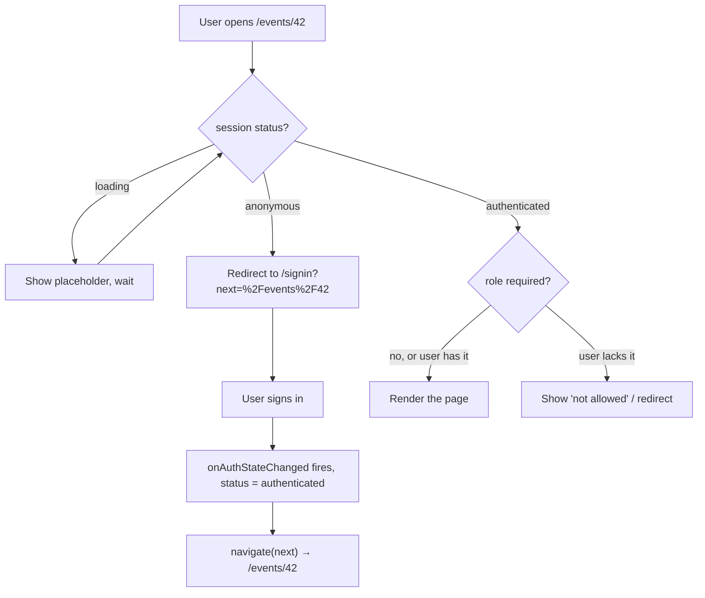

# Sessions, protected routes and roles

> **Before this lesson:** you need [Firebase setup and authentication flows](#/lesson/react/firebase-setup-auth) (especially `onAuthStateChanged`), context providers ([Context and global state](#/lesson/react/context-global-state)) and route guards ([Routing with React Router](#/lesson/react/routing)).

## In plain words

Picture an office building.

- At the front desk you prove who you are and receive a badge. That is **authentication**.
- The badge keeps working all day without your showing ID again. That ongoing validity is a **session**.
- The badge opens some doors and not others: staff can enter the offices, only managers can enter the server room. Deciding what a known person may do is **authorisation**. The label on the badge ("staff", "manager") is a **role**.

There is one more character: a sign on a door saying "Managers only". A sign stops polite people. It does not stop anyone determined; the lock does. In a web app, hiding a page or a button is the sign. The lock is on the server: in Firebase, the Security Rules.

This lesson builds the signs properly (a session provider, protected routes, role checks in the UI) and shows where the locks go. Mixing up authentication with authorisation, or signs with locks, is the source of most real-world security bugs in front-end code, and a reliable interview topic.

## The session has three states, not two

When the page loads, the Firebase SDK looks in the browser's storage for saved tokens and, if it finds them, validates and refreshes them. That takes a moment and is asynchronous. During that moment you do not know whether anyone is signed in.

| State | Meaning | What to show |
|---|---|---|
| `loading` | the SDK has not reported yet | a neutral placeholder |
| `authenticated` | a user is signed in | the app |
| `anonymous` | nobody is signed in | public pages, sign-in |

If you model this with a single `user` variable that starts as `null`, "not known yet" and "nobody" look the same. A signed-in user who refreshes a protected page is then bounced to the sign-in screen for a split second, and often stays there. This is the most common bug in Firebase React apps, and the cure is the explicit third state.

## An auth provider

Wrap the listener in a provider so the whole app can read the session:

```jsx
// src/features/auth/AuthContext.jsx
import { createContext, useContext, useEffect, useMemo, useState } from "react";
import { onAuthStateChanged } from "firebase/auth";
import { auth } from "../../lib/firebase";

const AuthContext = createContext(null);

export function AuthProvider({ children }) {
  const [session, setSession] = useState({ status: "loading", user: null });

  useEffect(() => {
    const unsubscribe = onAuthStateChanged(auth, (firebaseUser) => {
      setSession(
        firebaseUser
          ? { status: "authenticated", user: firebaseUser }
          : { status: "anonymous", user: null }
      );
    });
    return unsubscribe;
  }, []);

  const value = useMemo(() => session, [session]);
  return <AuthContext value={value}>{children}</AuthContext>;
}

export function useAuth() {
  const context = useContext(AuthContext);
  if (context === null) throw new Error("useAuth must be used inside <AuthProvider>");
  return context;
}
```

- The state starts as `{ status: "loading", user: null }`.
- The effect subscribes once. Firebase calls the callback after it has checked for a saved session, and again on every later sign-in or sign-out. The cleanup unsubscribes.
- `status` and `user` are stored together in one object, so they cannot contradict each other.
- `useAuth()` gives any component `{ status, user }`.

Sign-in and sign-out handlers elsewhere do **not** call `setSession`. They call the Firebase functions; Firebase notifies the listener; the provider updates; every consumer re-renders. One direction of flow, one source of truth.



## How long does a session last?

**Persistence** is where the SDK keeps the tokens, which decides when the user has to sign in again:

| Persistence | Stored in | Survives |
|---|---|---|
| `browserLocalPersistence` (web default) | the browser's persistent storage | closing the browser; ends on sign-out |
| `browserSessionPersistence` | per-tab session storage | reloads of that tab; ends when the tab closes |
| `inMemoryPersistence` | memory only | nothing; a reload signs out |

```jsx
import { setPersistence, browserSessionPersistence, signInWithEmailAndPassword } from "firebase/auth";

async function signIn(email, password, rememberMe) {
  if (!rememberMe) await setPersistence(auth, browserSessionPersistence);
  return signInWithEmailAndPassword(auth, email, password);
}
```

- `setPersistence(auth, kind)` applies to the next sign-in. A "Remember me" checkbox maps naturally onto local versus session persistence.
- On a shared or public computer, session persistence is the safer choice.

Facts worth knowing about Firebase sessions:

- The ID token expires after about an hour; the SDK renews it in the background using the refresh token. Users do not notice.
- Refresh tokens stay valid until the user signs out, the account is disabled or deleted, the password changes, or you revoke them from a server.
- Tabs of the same site share the session with local persistence: signing out in one tab fires `onAuthStateChanged(null)` in the others.
- Firebase web sessions live in browser storage, not in cookies. That avoids one class of attack (cross-site request forgery) and makes another more serious: any script running on your page could read the tokens. So protecting against **XSS** (cross-site scripting: an attacker getting their script to run in your page) matters. React's automatic escaping helps; avoid `dangerouslySetInnerHTML` with untrusted content.

## Protected routes

A **protected route** is a page that should only be shown to signed-in users. Build one guard component and use it as a layout route:

```jsx
// src/features/auth/RequireAuth.jsx
import { Navigate, Outlet, useLocation } from "react-router";
import { useAuth } from "./AuthContext";

export function RequireAuth() {
  const { status } = useAuth();
  const location = useLocation();

  if (status === "loading") {
    return <p>Checking your session…</p>;
  }
  if (status === "anonymous") {
    const next = encodeURIComponent(location.pathname + location.search);
    return <Navigate to={`/signin?next=${next}`} replace />;
  }
  return <Outlet />;
}
```

- **Loading:** render a placeholder. Do not redirect yet.
- **Anonymous:** redirect to the sign-in page, carrying the address the user wanted in a `next` query parameter. `encodeURIComponent` makes it safe to embed. `replace` keeps the protected URL out of the history, so Back does not loop.
- **Authenticated:** render the nested routes.

The mirror image keeps signed-in users away from the sign-in and sign-up pages:

```jsx
export function GuestOnly() {
  const { status } = useAuth();
  if (status === "loading") return <p>Checking your session…</p>;
  if (status === "authenticated") return <Navigate to="/" replace />;
  return <Outlet />;
}
```

The route table:

```jsx
<Routes>
  <Route path="/" element={<HomePage />} />

  <Route element={<GuestOnly />}>
    <Route path="/signin" element={<SignInPage />} />
    <Route path="/signup" element={<SignUpPage />} />
  </Route>

  <Route element={<RequireAuth />}>
    <Route path="/events" element={<EventsPage />} />
    <Route path="/events/:eventId" element={<EventPage />} />
    <Route element={<RequireRole roles={["admin"]} />}>
      <Route path="/admin" element={<AdminPage />} />
    </Route>
  </Route>
</Routes>
```

After a successful sign-in, send the user where they were going:

```jsx
const [searchParams] = useSearchParams();
const navigate = useNavigate();

async function handleSubmit(event) {
  event.preventDefault();
  await signIn(email, password, rememberMe);
  const next = searchParams.get("next");
  navigate(next && next.startsWith("/") && !next.startsWith("//") ? next : "/events", { replace: true });
}
```

The check on `next` is a security measure. If you navigated to whatever the parameter contains, an attacker could send a victim a link to *your* sign-in page with `next=https://evil.example`, and your site would forward them there after login. That is an **open redirect**. Accept only paths inside your own site: starting with a single `/`.



The problem *Role-based route guard* asks you to write this decision as a pure function, including the loading state and the encoded `next`.

## Authorisation with roles

Authentication answers "who is this?". Many apps then need "what may they do?": only organisers may edit an event, only admins may see the user list. The usual model is **role-based access control** (RBAC): each user has one or more roles, and each action requires a role.

Firebase Auth users have no built-in role field. There are two established ways to add one.

### Option A: a user document in the database

Keep a document per user, keyed by `uid`, holding profile data and roles:

```javascript
// Firestore: users/{uid}
{ displayName: "Ana", roles: ["member", "organiser"], createdAt: … }
```

Load it next to the auth user and merge the two into the session:

```jsx
import { doc, onSnapshot } from "firebase/firestore";
import { db } from "../../lib/firebase";

useEffect(() => {
  let unsubscribeProfile = () => {};

  const unsubscribeAuth = onAuthStateChanged(auth, (firebaseUser) => {
    unsubscribeProfile();
    if (!firebaseUser) {
      setSession({ status: "anonymous", user: null });
      return;
    }
    unsubscribeProfile = onSnapshot(doc(db, "users", firebaseUser.uid), (snapshot) => {
      const profile = snapshot.data() ?? {};
      setSession({
        status: "authenticated",
        user: {
          uid: firebaseUser.uid,
          email: firebaseUser.email,
          emailVerified: firebaseUser.emailVerified,
          displayName: profile.displayName ?? firebaseUser.displayName,
          roles: profile.roles ?? [],
        },
      });
    });
  });

  return () => {
    unsubscribeProfile();
    unsubscribeAuth();
  };
}, []);
```

- When a user signs in, start listening to their profile document (`onSnapshot` is Firestore's realtime listener, covered in the next lesson).
- Stay in `loading` until the profile has arrived, so guards never see a user without roles.
- Combine fields from both sources into one plain `user` object for the UI.
- When the user changes or signs out, stop the old profile listener first. The cleanup stops both.

Because the listener is live, changing someone's role in the database updates their screen within a second.

> [!WARNING]
> With this option the **rules must stop users from editing their own `roles` field**. If a user can write to their own user document without restriction, they can make themselves an admin from the browser console. The next lessons show the rule that prevents it.

### Option B: custom claims

A **custom claim** is extra data stored inside the user's ID token by trusted server code, for example `{ admin: true }` or `{ role: "organiser" }`. Only the **Admin SDK**, which runs on a server or in a Cloud Function with full privileges, can set claims:

```javascript
// Server-side code (Cloud Function or your own server). NOT in the React app.
import { getAuth } from "firebase-admin/auth";

await getAuth().setCustomUserClaims(uid, { role: "organiser" });
```

In the React app you read them from the token:

```jsx
const tokenResult = await firebaseUser.getIdTokenResult();
const role = tokenResult.claims.role ?? "member";
```

And in Security Rules they are available without any database read: `request.auth.token.role == "organiser"`.

| | User document (A) | Custom claims (B) |
|---|---|---|
| Who can set it | whoever the rules allow | only server code with the Admin SDK |
| Needs server code | no | yes |
| Cost in rules | one extra document read per check | free: it is in the token |
| Updates reach the client | immediately (realtime listener) | when the token refreshes (up to an hour, or force with `getIdToken(true)`) |
| Size | any | small (under 1000 bytes in total) |
| Good for | profiles, many or fine-grained permissions | a few coarse, security-critical roles |

Many apps use both: a claim for the critical "is admin" decision and a document for everything else.

### Role checks in the UI

```jsx
export function RequireRole({ roles }) {
  const { user } = useAuth();
  const allowed = roles.some((role) => user.roles.includes(role));
  return allowed ? <Outlet /> : <NotAllowedPage />;
}

function EventToolbar({ event }) {
  const { user } = useAuth();
  const canEdit = user.roles.includes("admin") || event.organiserId === user.uid;
  return canEdit ? <button>Edit event</button> : null;
}
```

- `RequireRole` sits inside `RequireAuth` in the route table, so `user` is guaranteed to exist there.
- `roles.some(...)` means "has at least one of the required roles".
- The toolbar shows a second kind of rule: **ownership** ("you may edit what you created"). Real apps combine roles and ownership.

### The sign and the lock

Everything in this section so far controls what is *shown*. The JavaScript runs on the user's machine, where it can be read, changed or bypassed: a curious user can call Firestore from the console with their valid token and ask for any document. So:

| Layer | Purpose | Trusted? |
|---|---|---|
| Route guards, hidden buttons | good user experience: do not show what would fail | no |
| Security Rules / server code | decide whether each read and write is allowed | yes |

Write every permission twice: once in the UI for experience, once in the rules for enforcement. [Security rules](#/lesson/react/security-rules) is where the second half lives.

## Requiring a verified email

```jsx
export function RequireVerifiedEmail() {
  const { user } = useAuth();
  if (!user.emailVerified) return <Navigate to="/verify-email" replace />;
  return <Outlet />;
}
```

Nest it inside `RequireAuth` around the routes that need it, and repeat the condition in rules with `request.auth.token.email_verified == true`.

## Run it: a session, a guard and roles

`fakeSession` imitates the SDK: it reports the saved session after a delay (the loading state), and lets you sign in as different users. The guard is a pure function in the style of the problem, and a "skip the loading state" switch reproduces the classic redirect bug.

```html-run
<div id="controls"></div>
<div id="bar" style="font-family:monospace;background:#eee;padding:6px;border-radius:6px;margin:6px 0"></div>
<div id="page" style="font-family:sans-serif;border:1px solid #bbb;border-radius:6px;padding:8px;min-height:70px"></div>
<pre id="log" style="background:#f4f4f4;padding:6px;max-height:110px;overflow:auto;font-size:12px"></pre>
<style>button { margin: 2px; } a { margin-right: 10px; cursor: pointer; color: #06c; text-decoration: underline; }</style>
<script>
  const routes = {
    "/": { public: true, title: "Home (public)" },
    "/signin": { guestOnly: true, title: "Sign in" },
    "/events": { title: "Your events (signed-in users)" },
    "/billing": { requireVerified: true, title: "Billing (verified email required)" },
    "/admin": { roles: ["admin"], title: "Admin (role: admin)" },
    "/forbidden": { public: true, title: "Not allowed" },
    "/verify-email": { public: true, title: "Please verify your email" },
  };
  const USERS = {
    ana: { uid: "u1", email: "ana@example.com", emailVerified: true, roles: ["member"] },
    bo: { uid: "u2", email: "bo@example.com", emailVerified: false, roles: ["member"] },
    root: { uid: "u3", email: "root@example.com", emailVerified: true, roles: ["member", "admin"] },
  };

  // ---------- the guard: a pure decision ----------
  function guardRoute(path, route, session) {
    if (route.public) return { action: "render" };
    if (session.status === "loading") return { action: "wait" };
    const signedIn = session.status === "authenticated";
    if (route.guestOnly) return signedIn ? { action: "redirect", to: "/" } : { action: "render" };
    if (!signedIn) return { action: "redirect", to: "/signin?next=" + encodeURIComponent(path) };
    if (route.requireVerified && !session.user.emailVerified) return { action: "redirect", to: "/verify-email" };
    if (route.roles && route.roles.length && !route.roles.some((r) => session.user.roles.includes(r))) return { action: "redirect", to: "/forbidden" };
    return { action: "render" };
  }

  // ---------- app state ----------
  let saved = "ana";                      // what is in "browser storage": survives the simulated reload
  let session = { status: "loading", user: null };
  let url = "/events";
  let skipLoading = false;
  const log = (line) => { const el = document.getElementById("log"); el.textContent += line + "\n"; el.scrollTop = el.scrollHeight; };

  function reload() {                     // a page refresh: the session must be restored asynchronously
    session = skipLoading ? { status: "anonymous", user: null } : { status: "loading", user: null };
    log(`--- page reload at ${url} (session starts as "${session.status}") ---`);
    draw();
    setTimeout(() => {                    // onAuthStateChanged fires a moment later
      session = saved ? { status: "authenticated", user: USERS[saved] } : { status: "anonymous", user: null };
      log(`onAuthStateChanged -> ${session.status}`);
      draw();
    }, 900);
  }
  function signIn(name) { saved = name; session = { status: "authenticated", user: USERS[name] }; log("signed in as " + name);
    const next = new URLSearchParams(url.split("?")[1] || "").get("next");
    if (url.startsWith("/signin")) url = next && next.startsWith("/") && !next.startsWith("//") ? next : "/events";
    draw(); }
  function signOut() { saved = null; session = { status: "anonymous", user: null }; log("signed out"); draw(); }
  function go(to) { url = to; draw(); }

  function draw() {
    const path = url.split("?")[0];
    const decision = guardRoute(path, routes[path], session);
    document.getElementById("controls").innerHTML =
      `Sign in as: <button onclick="signIn('ana')">Ana (member)</button><button onclick="signIn('bo')">Bo (unverified)</button><button onclick="signIn('root')">Root (admin)</button>
       <button onclick="signOut()">Sign out</button> <button onclick="reload()">Reload page</button>
       <label><input type="checkbox" ${skipLoading ? "checked" : ""} onchange="skipLoading = this.checked" /> treat "not known yet" as signed out (the bug)</label><br />
       ${Object.keys(routes).slice(0, 5).map((p) => `<a onclick="go('${p}')">${p}</a>`).join("")}`;
    document.getElementById("bar").textContent = `URL: ${url}   |   session: ${session.status}${session.user ? " (" + session.user.email + ", roles: " + session.user.roles.join(",") + ")" : ""}`;
    const page = document.getElementById("page");
    if (decision.action === "wait") page.textContent = "Checking your session…";
    else if (decision.action === "redirect") { log(`guard: ${path} -> redirect to ${decision.to}`); url = decision.to; draw(); }
    else page.innerHTML = `<b>${routes[path].title}</b>` + (path === "/signin" ? "<p>Use the buttons above to sign in.</p>" : "");
  }
  reload();
</script>
```

Experiments:

1. The page loads at `/events` with a saved session for Ana: a short "Checking your session…" and then the page. Press **Reload page** to see it again.
2. Tick the bug checkbox and reload: the guard sees "anonymous" for a moment and redirects to `/signin?next=%2Fevents`, although Ana is signed in. A moment later the session arrives, the guest-only rule moves her to `/`, and she has lost her place. Untick it.
3. Sign out, click `/admin`: you are redirected to sign-in with `next=%2Fadmin`. Sign in as Root: you land on `/admin`. Sign in as Ana and open `/admin`: "Not allowed".
4. As Bo, open `/billing`: redirected to verify the email.

## Pitfalls

> [!WARNING]
> **Treating client-side role checks as security.** Guards and hidden buttons only shape the UI. Without matching Security Rules, any signed-in user can read and write whatever the rules allow, straight from the browser console.

- **Two-state session** (`user` or `null`) causing the redirect flash on reload. Model `loading`.
- **Setting user state manually after sign-in** in addition to the listener. Two sources of truth drift; let `onAuthStateChanged` drive everything.
- **Not unsubscribing** the auth listener and the profile listener, or leaving the old profile listener running after the user changes.
- **Letting users write their own role field.**
- **Expecting custom-claim changes to appear instantly.** They arrive with the next token refresh; force one with `getIdToken(true)` when needed.
- **Redirecting to an unvalidated `next` parameter** (open redirect).
- **Forgetting `replace` on guard redirects.** Back returns to the protected page and bounces again.
- **Passing the raw Firebase `User` object deep into the app.** Map it to a small plain object with the fields you use; tests and a future change of provider become easier.
- **Storing sensitive data in `localStorage` yourself.** It has the same exposure to XSS as the tokens.

> [!TIP]
> Write permission logic as small pure functions (`canEditEvent(user, event)`, `guardRoute(route, session)`), use them in components, and unit-test them. Then mirror each one in a security rule, and test the rules with the emulator.

> [!INTERVIEW]
> "Authentication vs authorisation?" *Authentication establishes identity (who are you); authorisation decides permissions (what may you do).* "How do you protect a route in React?" *A guard component reads the session from context. While the session is loading it renders a placeholder; if anonymous it redirects to sign-in, remembering the target; otherwise it renders the nested routes, optionally checking roles. I stress that this is user experience only; access to data is enforced on the back end, with Firebase through Security Rules using `request.auth` and, for roles, custom claims or a protected user document.*

## Cheat sheet

| Need | Code |
|---|---|
| Session for the whole app | `AuthProvider` with `onAuthStateChanged` + `useAuth()` |
| Three states | `"loading" \| "authenticated" \| "anonymous"` |
| Remember me off | `setPersistence(auth, browserSessionPersistence)` before sign-in |
| Protect routes | `<Route element={<RequireAuth />}>…</Route>` with `<Outlet />` |
| Keep signed-in users off sign-in page | `<GuestOnly />` |
| Return after sign-in | `/signin?next=<encoded path>`; validate it starts with a single `/` |
| Roles in a document | `users/{uid}.roles`, merged into the session; locked by rules |
| Roles in the token | server: `setCustomUserClaims(uid, {...})`; client: `getIdTokenResult()`; rules: `request.auth.token.role` |
| Refresh claims now | `await user.getIdToken(true)` |
| Role check | `roles.some((r) => user.roles.includes(r))` |
| Ownership check | `resource.ownerId === user.uid` |
| Verified email | `user.emailVerified` (UI) and `request.auth.token.email_verified` (rules) |

## Summary

- A session has three states; treat "not known yet" separately from "signed out".
- One provider subscribes to `onAuthStateChanged` and exposes `{ status, user }` through context; sign-in and sign-out only call Firebase.
- Persistence decides how long the browser remembers the user; the SDK refreshes the hourly ID token automatically.
- Protected routes are guard components that wait, redirect or render; remember the intended destination and validate it.
- Roles come from a rules-protected user document, from custom claims set by server code, or both.
- UI checks are signs; Security Rules are the lock. Implement every permission in both.

## Glossary

- **Session**: the period during which a user stays signed in.
- **Persistence**: where and how long the SDK stores the session.
- **Authentication / authorisation**: verifying identity / deciding permissions.
- **Role**: a named set of permissions assigned to users.
- **RBAC**: role-based access control.
- **Ownership check**: a rule based on who created or owns a piece of data.
- **Protected route**: a page shown only to users who pass a guard.
- **Guard**: a component or function that decides whether to render, wait or redirect.
- **Custom claim**: data added to a user's ID token by trusted server code.
- **Admin SDK**: Firebase's privileged server-side library, which bypasses Security Rules.
- **Open redirect**: a flaw that lets an attacker make your site redirect users to another site.
- **XSS**: cross-site scripting; an attacker's script running in your page.

## Check yourself

```quiz
[
  {"q": "Why does the session need a 'loading' state in addition to signed in and signed out?",
   "options": ["To show an animation", "On page load the SDK restores the session asynchronously; until it reports, redirecting would wrongly kick out signed-in users", "Firebase requires three states", "To delay rendering for performance"],
   "answer": 1,
   "explain": "Without it, 'not known yet' is indistinguishable from 'nobody', and protected pages redirect on every refresh."},
  {"q": "A signed-in user refreshes /events. The guard treats the initial null user as anonymous. What sequence does the user see?",
   "options": ["The events page stays", "A redirect to the sign-in page (and then usually away from it once the session arrives), losing their place", "An error page", "A blank page forever"],
   "answer": 1,
   "explain": "The guard redirects before onAuthStateChanged has fired. The fix is to wait while status is loading."},
  {"q": "After a successful signInWithEmailAndPassword, what should update the React session state?",
   "options": ["The submit handler calling setSession directly", "The onAuthStateChanged listener in the provider", "A setTimeout", "Reloading the page"],
   "answer": 1,
   "explain": "Keep one source of truth. The SDK notifies the listener, which updates the context."},
  {"q": "The admin page is hidden by <RequireRole roles={['admin']}>, and there are no Security Rules restricting the admin data. Can a normal signed-in user read that data?",
   "options": ["No, the route is protected", "Yes: they can query the database directly with their valid token; only rules can prevent it", "Only in development", "Only with the Admin SDK"],
   "answer": 1,
   "explain": "Client-side guards control the UI. Enforcement must be on the server side, in rules."},
  {"q": "Roles are stored in users/{uid}.roles and the rules let each user write their whole own document. What is the problem?",
   "options": ["Reads become slow", "Any user can add 'admin' to their own roles", "Roles cannot be arrays", "Nothing"],
   "answer": 1,
   "explain": "The role field must be writable only by trusted parties, enforced in rules, or stored as a custom claim."},
  {"q": "Server code sets a custom claim { role: 'organiser' } for a user who is currently signed in. When does the client see it?",
   "options": ["Immediately", "After the ID token is refreshed: automatically within about an hour, or at once with getIdToken(true)", "Never", "Only after clearing cookies"],
   "answer": 1,
   "explain": "Claims live inside the ID token, so a new token must be issued."},
  {"q": "After sign-in the app runs navigate(searchParams.get('next')). An attacker shares the link /signin?next=https://evil.example. What is this vulnerability called and how is it prevented?",
   "options": ["XSS; escape the HTML", "Open redirect; only accept targets that are paths inside your own site", "CSRF; add a token", "SQL injection; use parameters"],
   "answer": 1,
   "explain": "Validate that next starts with a single slash (an internal path) before navigating."},
  {"q": "With the default browserLocalPersistence, the user closes the browser and opens the site the next day. What is their status after the SDK has initialised?",
   "options": ["anonymous", "authenticated, because the refresh token was stored persistently", "loading forever", "It depends on the time zone"],
   "answer": 1,
   "explain": "Local persistence survives browser restarts until sign-out or revocation. Session persistence would end with the tab."}
]
```

> **Source:** Wieruch, *The Road to React with Firebase*: Session Handling; Session Handling with Higher-Order Components; Authorization (1): General Authorization and Route Protection; Authorization (2): Roles and Permissions (Database Users with Roles; How to merge authenticated user with database user?; Authorize a Firebase User based on a Role); Session Persistence; Admin Dashboard. The book uses higher-order components and the namespaced SDK; this lesson uses Hooks, context and the modular API. Documentation: https://firebase.google.com/docs/auth/web/manage-users, https://firebase.google.com/docs/auth/web/auth-state-persistence, https://firebase.google.com/docs/auth/admin/custom-claims
