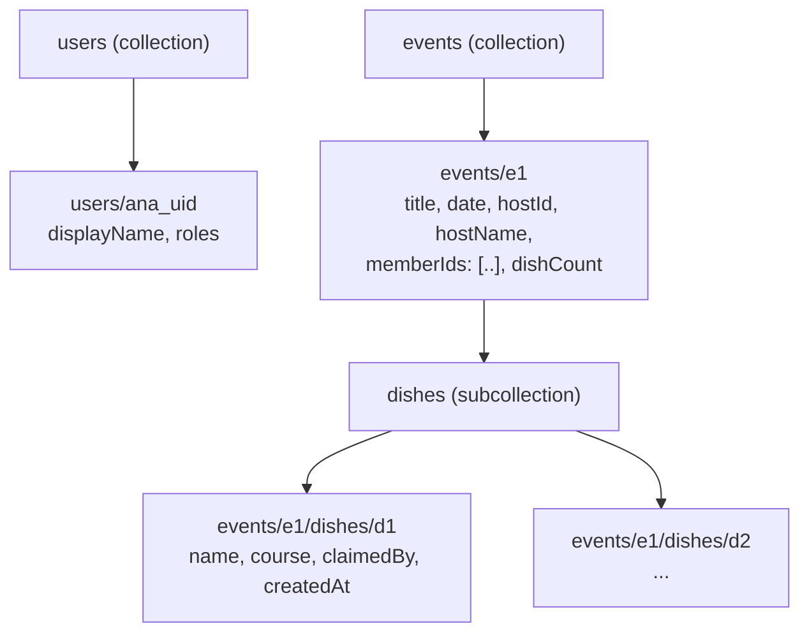
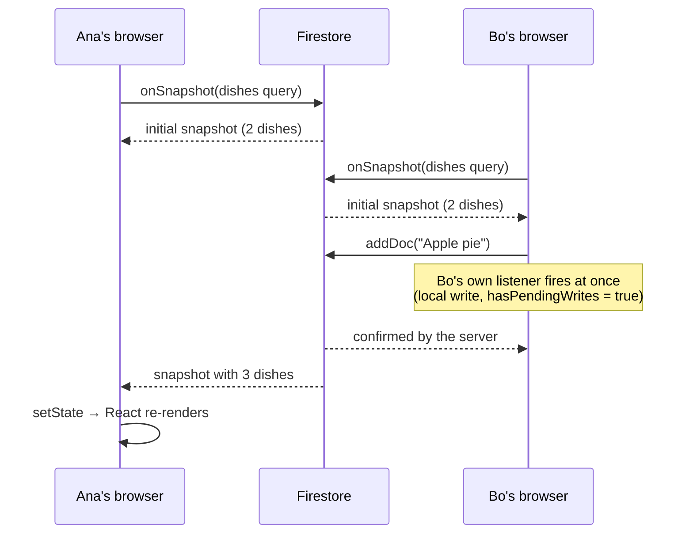

# Firestore and the Realtime Database

> **Before this lesson:** you need [Firebase setup and authentication flows](#/lesson/react/firebase-setup-auth) (the `db` handle and `uid`), effects with cleanup ([useEffect and its dependency rules](#/lesson/react/useeffect)), and loading/error states ([Fetching data: loading, errors and races](#/lesson/react/data-fetching)). No database knowledge is assumed; if you want the relational point of view for comparison, see the [SQL track](#/track/sql).

## In plain words

A **database** is a program that stores data permanently and lets many users read and change it at the same time. So far your app's data has lived in React state, which vanishes when the tab closes.

Firebase offers two databases. Picture each one:

- **Cloud Firestore** is a filing cabinet. Each drawer is a **collection** (all the events, all the users). Inside a drawer are folders called **documents**, one per thing (one event). A document holds labelled values (name, date, host). A folder can contain its own small drawers (**subcollections**), such as the dishes for that event.
- The **Realtime Database** is one enormous sheet of paper holding a single nested outline: everything hangs off one root, like a giant JSON object.

Both have a party trick that ordinary databases lack: you can **listen** to data. Instead of asking "what are the dishes?" once, you say "tell me the dishes now, and tell me again whenever they change". When a friend adds a dish on their phone, it appears on your screen within a moment. That is what "realtime" means here.

Reading and writing data is the core of nearly every application, and **data modelling** (deciding how to arrange it) is where experience shows. This lesson covers both for our Potluck app.

## Firestore or Realtime Database?

| | Cloud Firestore | Realtime Database |
|---|---|---|
| Shape | collections of documents | one JSON tree |
| Queries | several filters, sorting, limits, indexes | one sort/filter per query |
| Reading a parent | gets that document only (shallow) | gets everything beneath it (deep) |
| Billing | per document read, write, delete | per data downloaded and stored |
| Offline support on the web | yes (optional cache) | limited to the current session |
| Best at | most applications | very frequent tiny updates (presence, cursors, typing indicators), lowest latency |

Firestore is the newer product and Google's recommendation for most new projects. This lesson concentrates on it and then shows the Realtime Database equivalents, because older codebases and tutorials use it, and it remains good at a few jobs.

Both are **NoSQL** databases: they do not use tables with fixed columns and the SQL query language, and they cannot combine data from several places in one query the way SQL's `JOIN` does. That single limitation drives most modelling decisions below.

## Firestore's data model

- A **document** is a set of named **fields**: strings, numbers, booleans, timestamps, arrays, nested objects (called maps), `null`, and references. Maximum size 1 MiB.
- Every document lives in a **collection** and has an id that is unique within it.
- A document's address is a **path**: collection, document, collection, document, alternating: `events/abc123/dishes/d42`.
- There is no schema. Two documents in the same collection may have different fields. Consistency is your job (and your Security Rules' job).



## Writing data

```javascript
import { collection, doc, addDoc, setDoc, updateDoc, deleteDoc, serverTimestamp } from "firebase/firestore";
import { db } from "../../lib/firebase";

// Create with an automatic id
const ref = await addDoc(collection(db, "events", eventId, "dishes"), {
  name: "Lentil soup",
  course: "starter",
  claimedBy: null,
  createdBy: user.uid,
  createdAt: serverTimestamp(),
});
console.log(ref.id);

// Create or replace at an id you choose
await setDoc(doc(db, "users", user.uid), { displayName: "Ana", roles: ["member"] });

// Change some fields of an existing document
await updateDoc(doc(db, "events", eventId, "dishes", dishId), { claimedBy: user.uid });

// Delete
await deleteDoc(doc(db, "events", eventId, "dishes", dishId));
```

- `collection(db, ...path)` and `doc(db, ...path)` build **references**: addresses. They contact nothing; they are cheap to create.
- `addDoc(collectionRef, data)` creates a document with a generated id and resolves to its reference.
- `setDoc(docRef, data)` writes the whole document at a known id, replacing what was there. With `{ merge: true }` as a third argument it merges instead.
- `updateDoc(docRef, changes)` changes only the listed fields and fails if the document does not exist. Nested fields use dot notation: `{ "address.city": "Bergen" }`.
- `serverTimestamp()` is a placeholder that the server replaces with its own clock. Never trust the time on a user's device for ordering.

Special helpers change a field **atomically** (as one indivisible step on the server), so that two users acting at once do not overwrite each other:

```javascript
import { increment, arrayUnion, arrayRemove } from "firebase/firestore";

await updateDoc(doc(db, "events", eventId), {
  dishCount: increment(1),
  memberIds: arrayUnion(user.uid),
});
```

Reading `dishCount`, adding one in JavaScript and writing it back would lose an update whenever two people add a dish in the same moment. `increment(1)` tells the server "add one to whatever is there".

For several writes that must all succeed or all fail, use a **batch**; when a write depends on a value you must read first (claim a dish only if nobody has), use a **transaction**:

```javascript
import { writeBatch, runTransaction } from "firebase/firestore";

const batch = writeBatch(db);
batch.set(doc(collection(db, "events", eventId, "dishes")), newDish);
batch.update(doc(db, "events", eventId), { dishCount: increment(1) });
await batch.commit();

await runTransaction(db, async (transaction) => {
  const dishRef = doc(db, "events", eventId, "dishes", dishId);
  const snapshot = await transaction.get(dishRef);
  if (snapshot.data().claimedBy !== null) throw new Error("Already claimed");
  transaction.update(dishRef, { claimedBy: user.uid });
});
```

- A batch is all-or-nothing: the dish and the counter change together.
- A transaction reads, decides and writes. If the document changes between the read and the write, Firestore runs your function again with fresh data.

## Reading data once

```javascript
import { getDoc, getDocs, query, where, orderBy, limit } from "firebase/firestore";

const snapshot = await getDoc(doc(db, "events", eventId));
if (snapshot.exists()) {
  const event = { id: snapshot.id, ...snapshot.data() };
}

const q = query(
  collection(db, "events"),
  where("memberIds", "array-contains", user.uid),
  orderBy("date", "asc"),
  limit(20)
);
const querySnapshot = await getDocs(q);
const events = querySnapshot.docs.map((d) => ({ id: d.id, ...d.data() }));
```

- `getDoc` returns a **snapshot**: a picture of the document at that moment. `snapshot.exists()` tells whether it is there; `snapshot.data()` returns the fields. The id is not among the fields, so it is common to merge it in.
- `query(collectionRef, ...constraints)` describes a query. `where(field, operator, value)` filters; `orderBy` sorts; `limit` caps the result.
- `getDocs` runs it. `querySnapshot.docs` is an array of document snapshots.

### What queries can and cannot do

Operators: `==`, `!=`, `<`, `<=`, `>`, `>=`, `in` (field equals any of a list), `not-in`, `array-contains` (an array field contains the value), `array-contains-any`.

Rules of the road:

- **Every query is served by an index**, a pre-sorted lookup structure. Single-field indexes exist automatically. A query that combines filters and ordering on several fields usually needs a **composite index**; when one is missing, the error message in the console contains a link that creates it. Because of indexes, query speed depends on the size of the *result*, not of the collection.
- **A document that lacks a field is absent from that field's index,** so `orderBy("date")` silently leaves out documents with no `date`.
- **No joins.** One query reads from one collection (or one **collection group**: all subcollections with the same name, via `collectionGroup(db, "dishes")`).
- **No full-text search** ("find dishes containing 'soup'"). That needs an external search service.
- **A query is shallow.** Reading `events/e1` does not download its `dishes` subcollection.
- Results for equal sort values are ordered by document id, which makes cursor pagination stable.

**Pagination uses cursors:**

```javascript
import { startAfter } from "firebase/firestore";

const first = await getDocs(query(collection(db, "events"), orderBy("date"), limit(10)));
const lastVisible = first.docs[first.docs.length - 1];

const next = await getDocs(query(collection(db, "events"), orderBy("date"), startAfter(lastVisible), limit(10)));
```

`startAfter(lastVisible)` means "continue after this document". Keep the last snapshot of each page to request the following one. The problem *A Firestore-style query over an array* has you implement filtering, ordering with the id tiebreak, cursors and limits yourself.

## Listening in real time

Replace `getDoc`/`getDocs` with `onSnapshot` to receive the current data and every later change:

```javascript
import { onSnapshot } from "firebase/firestore";

const unsubscribe = onSnapshot(
  query(collection(db, "events", eventId, "dishes"), orderBy("createdAt")),
  (snapshot) => {
    const dishes = snapshot.docs.map((d) => ({ id: d.id, ...d.data() }));
    console.log(dishes);
  },
  (error) => {
    console.error(error.code);
  }
);
```

- The first callback runs once with the initial result and again after every change that affects the query.
- The second callback receives errors, most often `permission-denied` from Security Rules.
- The return value stops the listener. An open listener keeps a connection busy and costs document reads, so always stop it.

A listener is a subscription to an external system: a textbook effect. Wrapped as a custom Hook:

```jsx
// src/features/events/useDishes.js
import { useEffect, useState } from "react";
import { collection, onSnapshot, orderBy, query } from "firebase/firestore";
import { db } from "../../lib/firebase";

export function useDishes(eventId) {
  const [state, setState] = useState({ status: "loading", dishes: [], error: null });

  useEffect(() => {
    setState({ status: "loading", dishes: [], error: null });
    const q = query(collection(db, "events", eventId, "dishes"), orderBy("createdAt"));

    const unsubscribe = onSnapshot(
      q,
      (snapshot) => {
        setState({
          status: "success",
          dishes: snapshot.docs.map((d) => ({ id: d.id, ...d.data() })),
          error: null,
        });
      },
      (error) => setState({ status: "error", dishes: [], error: error.code })
    );

    return unsubscribe;
  }, [eventId]);

  return state;
}
```

- The query is built *inside* the effect, so the only dependency is the primitive `eventId`.
- When `eventId` changes, React runs the cleanup (unsubscribing from the old event) and subscribes to the new one. Race conditions cannot occur: the old listener is gone.
- The component gets `{ status, dishes, error }` and renders the usual four cases.



Two realtime features to know:

**Latency compensation.** When *you* write, your own listeners fire immediately with the new data, before the server confirms. That is a built-in optimistic update. `snapshot.metadata.hasPendingWrites` is `true` while the write is unconfirmed; if the server rejects it, the listener fires again with the write removed.

**Change details.** `snapshot.docChanges()` lists what changed since the previous snapshot as `added`, `modified` or `removed`, with old and new positions, useful for animations and for long lists where rebuilding everything is wasteful. The problem *Apply realtime snapshot changes* practises applying them.

## Data modelling

In SQL you normalise (store each fact once) and combine tables at query time. Firestore cannot join, and bills per document read. So the guiding rule is different:

> **Model your data around the screens that read it.** Each screen should get what it needs from one document or one query.

Three decisions come up again and again.

**1. Nested field, subcollection, or top-level collection?**

| Put it… | When | Example |
|---|---|---|
| inside the document (map or array) | small, bounded, always shown with the parent | an event's `location: { name, city }` |
| in a subcollection | many items, or loaded separately, or needing queries of their own | the dishes of an event |
| in a top-level collection | queried across parents, or shared by several | users |

An array that grows without limit (all comments in one array field) will eventually hit the 1 MiB document limit, and every tiny change rewrites and re-downloads the whole document.

**2. Duplicate what you display (denormalisation).** The event list shows each host's name. Fetching every host's user document would cost one extra read per row. Instead, copy the name into the event when creating it: `hostId` *and* `hostName`. The price is that when Ana changes her display name, old events show the old one unless you update them, typically from a Cloud Function. Duplicate data that changes rarely; reference by id what changes often.

**3. Store aggregates.** Firestore has no cheap "how many dishes?" for a list of events. Keep a `dishCount` field on the event and update it with `increment` in the same batch as the dish write. (For occasional totals, `getCountFromServer` runs a count query on demand.)

For "which events can this user see?", an array of member ids with `array-contains` works well up to a few hundred members:

```javascript
where("memberIds", "array-contains", user.uid)
```

That same field is what the Security Rules will check.

## The Realtime Database in brief

The same ideas with a different shape and API (`firebase/database`):

```javascript
import { getDatabase, ref, set, push, update, remove, onValue, query, orderByChild, limitToLast } from "firebase/database";

const rtdb = getDatabase(app);

await set(ref(rtdb, `users/${user.uid}`), { displayName: "Ana" });          // write (replace) at a path

const newDishRef = push(ref(rtdb, `dishes/${eventId}`));                     // generate a unique, time-ordered key
await set(newDishRef, { name: "Lentil soup", claimedBy: null });

await update(ref(rtdb), {                                                    // several paths at once, all-or-nothing
  [`dishes/${eventId}/${dishId}/claimedBy`]: user.uid,
  [`events/${eventId}/claimedCount`]: 3,
});

await remove(ref(rtdb, `dishes/${eventId}/${dishId}`));

const unsubscribe = onValue(
  query(ref(rtdb, `dishes/${eventId}`), orderByChild("name"), limitToLast(50)),
  (snapshot) => {
    const value = snapshot.val() ?? {};                                      // an object keyed by id, or null
    const dishes = Object.entries(value).map(([id, dish]) => ({ id, ...dish }));
  }
);
```

- Data is addressed by a **path** into one JSON tree; `ref(rtdb, path)` points at a location.
- `push` creates a child with a unique key that sorts by creation time.
- `onValue` is the realtime listener; `snapshot.val()` returns the JSON at that location, `null` if empty. Lists come back as *objects* keyed by id, so you convert them to arrays.
- A multi-path `update` is the equivalent of a batch.
- A query can order or filter by a single child field only.

The modelling rule is stricter than in Firestore because reads are **deep**: listening at `events/e1` downloads everything below it. So you keep the tree **flat**: instead of nesting dishes inside events, store `events/{eventId}` and, in a separate branch, `dishes/{eventId}/{dishId}`, and link through ids. To list "the events of this user" you keep an index branch such as `userEvents/{uid}/{eventId}: true`.

A typical division of labour in one app: Firestore for the main data, the Realtime Database for **presence** ("who is online"), because it has a server-side hook, `onDisconnect`, that writes a value when a client's connection drops.

## Run it: two clients and a realtime listener

`fakeDb` imitates the essential behaviour of a Firestore collection in memory: add, update, delete, and listeners that fire for every subscribed client. The two panels are two "browsers" watching the same list. A read counter shows what you would be billed for.

```html-run
<div style="display:flex;gap:16px;font-family:sans-serif">
  <div id="ana" style="flex:1;border:1px solid #bbb;border-radius:6px;padding:8px"></div>
  <div id="bo" style="flex:1;border:1px solid #bbb;border-radius:6px;padding:8px"></div>
</div>
<p style="font-family:sans-serif"><small id="reads"></small></p>
<style>button { margin: 2px; } li { margin: 3px 0; } .mine { color: seagreen; } .pending { opacity: 0.5; }</style>
<script>
  // ---------- a pretend Firestore collection ----------
  const fakeDb = (() => {
    let docs = [{ id: "d1", name: "Lentil soup", claimedBy: null, createdAt: 1 }, { id: "d2", name: "Flatbread", claimedBy: "bo", createdAt: 2 }];
    const listeners = new Set();
    let clock = 3, reads = 0;
    const snapshot = (docsNow) => ({ docs: docsNow.slice().sort((a, b) => a.createdAt - b.createdAt) });
    const notifyOthers = (except) => setTimeout(() => listeners.forEach((l) => { if (l !== except) { reads += 1; l.callback(snapshot(docs)); } }), 600);
    return {
      get reads() { return reads; },
      onSnapshot(callback) {
        const listener = { callback };
        listeners.add(listener);
        setTimeout(() => { reads += docs.length; callback(snapshot(docs)); }, 300);     // initial result: one read per document
        return Object.assign(() => listeners.delete(listener), { listener });
      },
      write(change, fromListener) {                       // apply, tell the writer at once (latency compensation), others after a delay
        docs = change(docs, clock++);
        if (fromListener) fromListener.callback(snapshot(docs));
        notifyOthers(fromListener);
      },
    };
  })();

  // ---------- one "browser" ----------
  function mountClient(elementId, uid) {
    let state = { status: "loading", dishes: [] };
    const el = document.getElementById(elementId);
    let unsubscribe = null;

    function draw() {
      const list = state.dishes.map((d) => `<li class="${d.claimedBy === uid ? "mine" : ""}">${d.name}
          — ${d.claimedBy ? "claimed by " + d.claimedBy : `<button data-claim="${d.id}">I'll bring it</button>`}
          ${d.claimedBy === uid ? `<button data-release="${d.id}">release</button>` : ""} <button data-remove="${d.id}">x</button></li>`).join("");
      el.innerHTML = `<b>${uid}'s browser</b> <button data-toggle>${unsubscribe ? "Stop listening" : "Start listening"}</button>
        <p>${state.status === "loading" ? "Loading…" : state.dishes.length === 0 ? "No dishes yet." : ""}</p><ul>${list}</ul>
        <input placeholder="new dish" size="12" /> <button data-add>Add</button>`;
    }
    function subscribe() {                                 // what the effect does
      state = { status: "loading", dishes: [] };
      unsubscribe = fakeDb.onSnapshot((snapshot) => { state = { status: "success", dishes: snapshot.docs }; draw(); showReads(); });
      draw();
    }
    el.addEventListener("click", (event) => {
      const t = event.target, me = unsubscribe && unsubscribe.listener;
      if (t.dataset.toggle !== undefined) { if (unsubscribe) { unsubscribe(); unsubscribe = null; draw(); } else subscribe(); }
      if (t.dataset.add !== undefined) { const name = el.querySelector("input").value.trim(); if (name) fakeDb.write((docs, now) => [...docs, { id: "d" + now, name, claimedBy: null, createdAt: now }], me); }
      if (t.dataset.claim) fakeDb.write((docs) => docs.map((d) => (d.id === t.dataset.claim && d.claimedBy === null ? { ...d, claimedBy: uid } : d)), me);
      if (t.dataset.release) fakeDb.write((docs) => docs.map((d) => (d.id === t.dataset.release ? { ...d, claimedBy: null } : d)), me);
      if (t.dataset.remove) fakeDb.write((docs) => docs.filter((d) => d.id !== t.dataset.remove), me);
    });
    subscribe();
  }
  const showReads = () => { document.getElementById("reads").textContent = `Document reads so far: ${fakeDb.reads} (each document delivered to a listener is billed as a read)`; };
  mountClient("ana", "ana");
  mountClient("bo", "bo");
</script>
```

Add a dish in Ana's panel: it appears there at once (latency compensation) and in Bo's panel about half a second later, without Bo doing anything. Claim a dish as Bo and watch Ana's button disappear. Press **Stop listening** in one panel, change data in the other, and see that the stopped panel goes stale: that is what a missing listener (or a `getDocs` call) gives you. Start listening again and watch the read counter jump by the size of the whole list.

## Pitfalls

> [!WARNING]
> **Leaving the database in test mode.** The console offers "test mode" rules that allow everyone to read and write everything for 30 days. Anyone who finds your project id can then download or delete all your data. Write real rules before real data goes in; see [Security rules](#/lesson/react/security-rules).

- **Not unsubscribing listeners.** They keep costing reads and may update state for a screen that is gone. Return `unsubscribe` from the effect.
- **Listening to more than the screen needs.** A listener on a whole collection re-downloads on every change. Filter and `limit`.
- **Read-modify-write for counters or claims.** Use `increment`, `arrayUnion` or a transaction.
- **Forgetting that `snapshot.data()` lacks the id,** and that `getDoc` succeeds for a missing document (`exists()` is false).
- **Unbounded arrays or deep nesting in one document.**
- **Expecting joins or text search.** Model for your queries or add a search service.
- **Client clocks for timestamps.** Use `serverTimestamp()`. Note that in a pending local snapshot a server timestamp field is `null` until confirmed.
- **Orderings that drop documents** because some lack the field.
- **Ignoring the cost model.** A list of 500 rows opened by 1,000 users is 500,000 reads. Paginate.
- **In the Realtime Database, nesting data** under a node that you also need to read on its own.
- **Deleting a Firestore document and assuming its subcollections are gone.** They are not; delete them separately (usually with a Cloud Function).

> [!TIP]
> Put every Firestore call for a feature in one module (`features/events/api.js`) that exports functions such as `watchDishes(eventId, onData, onError)`, `addDish(eventId, dish)` and `claimDish(eventId, dishId, uid)`. Hooks call those; components call hooks. Paths and field names then live in exactly one place.

> [!INTERVIEW]
> "How do you model data in Firestore compared with SQL?" *Firestore has no joins and bills per document read, so I model for the queries each screen makes: documents shaped like what is displayed, subcollections for large or separately loaded lists, denormalised copies of fields that are shown together and rarely change, and stored aggregates such as counters maintained with atomic increments. I reference by id where data changes often, and I check that every query can be backed by an index and by a security rule.* "Listener or one-time read?" *Listeners for collaborative or live data; one-time reads for static data, with attention to read costs.*

## Cheat sheet

| Task | Firestore (`firebase/firestore`) | Realtime Database (`firebase/database`) |
|---|---|---|
| Handle | `getFirestore(app)` | `getDatabase(app)` |
| Address | `doc(db, "events", id)`, `collection(db, "events")` | `ref(rtdb, "events/" + id)` |
| Create with new id | `addDoc(colRef, data)` | `push(ref)` then `set` |
| Write / replace | `setDoc(docRef, data)` | `set(ref, data)` |
| Partial update | `updateDoc(docRef, changes)` | `update(ref, changes)` |
| Delete | `deleteDoc(docRef)` | `remove(ref)` |
| Read once | `getDoc`, `getDocs` | `get(ref)` |
| Listen | `onSnapshot(refOrQuery, onData, onError)` | `onValue(refOrQuery, onData)` |
| Filter / sort / limit | `query(col, where(), orderBy(), limit())` | `query(ref, orderByChild(), equalTo(), limitToFirst())` |
| Next page | `startAfter(lastDocSnapshot)` | `startAfter(value)` |
| Server time | `serverTimestamp()` | `serverTimestamp()` |
| Atomic counter | `increment(1)` | `increment(1)` |
| All-or-nothing writes | `writeBatch(db)` | multi-path `update` |
| Read-then-write safely | `runTransaction(db, fn)` | `runTransaction(ref, fn)` |

## Summary

- Firestore stores documents in collections, addressed by alternating collection/document paths; the Realtime Database stores one JSON tree.
- Writes: `addDoc`, `setDoc`, `updateDoc`, `deleteDoc`, with atomic helpers, batches and transactions for correctness under concurrency.
- Reads are either one-time (`getDoc`, `getDocs`) or realtime (`onSnapshot`), and listeners belong in effects that return the unsubscribe function.
- Queries filter, sort and limit through indexes; there are no joins, and pagination uses cursors.
- Model data around your screens: subcollections for lists, duplicated display fields, stored counters, flat structures.
- You pay per document read, and nothing is protected until you write Security Rules.

## Glossary

- **Database**: software that stores data durably for many concurrent users.
- **NoSQL**: databases that do not use the relational table-and-SQL model.
- **Document / field**: one record / one named value in it.
- **Collection / subcollection**: a group of documents / a collection nested under a document.
- **Path / reference**: the address of a document or collection / an object holding that address.
- **Snapshot**: the data at one moment, as delivered by a read or a listener.
- **Query**: a description of which documents to fetch (filters, order, limit).
- **Index**: a pre-sorted structure that makes a query fast.
- **Listener**: a subscription that delivers the data now and on every change.
- **Latency compensation**: showing your own writes locally before the server confirms them.
- **Atomic**: happening completely or not at all, with no in-between state visible.
- **Batch / transaction**: several writes applied together / a read-decide-write sequence retried on conflict.
- **Denormalisation**: storing copies of data where it is read, to avoid extra lookups.
- **Cursor**: a marker for "continue after this item" in pagination.

## Check yourself

```quiz
[
  {"q": "What is the path of dish d7 belonging to event e3 when dishes are a subcollection of events?",
   "options": ["dishes/d7", "events/e3/d7", "events/e3/dishes/d7", "e3/dishes/d7"],
   "answer": 2,
   "explain": "Paths alternate collection, document, collection, document."},
  {"q": "You read the document events/e3 with getDoc. Does the result include the documents in events/e3/dishes?",
   "options": ["Yes, subcollections are embedded", "No, Firestore reads are shallow; subcollections need their own read or listener", "Only the first ten", "Only with merge: true"],
   "answer": 1,
   "explain": "A document read returns that document's fields only."},
  {"q": "Two users press 'add a dish' at the same instant. Each client reads dishCount (5), adds 1 and writes 6. What is the stored value, and what fixes it?",
   "options": ["7; nothing to fix", "6, one update is lost; use increment(1) or a transaction", "5; use setDoc", "An error is thrown; retry"],
   "answer": 1,
   "explain": "Read-modify-write on the client races. increment performs the addition atomically on the server."},
  {"q": "What does onSnapshot return, and what should a React effect do with it?",
   "options": ["A promise; await it", "The data; store it", "An unsubscribe function; return it as the effect's cleanup", "A reference; ignore it"],
   "answer": 2,
   "explain": "Stopping the listener on unmount or when the query's inputs change prevents leaks and wasted reads."},
  {"q": "A component uses useDishes(eventId). The route changes from event e1 to e2. How many listeners are active afterwards?",
   "options": ["2: one per event", "1: the cleanup unsubscribed from e1 before subscribing to e2", "0", "It depends on the network"],
   "answer": 1,
   "explain": "eventId is a dependency; React runs the cleanup of the old effect and then the new effect."},
  {"q": "A query uses orderBy('date'). 3 of the 10 matching documents have no date field. How many documents does the query return?",
   "options": ["10, with the 3 at the end", "7", "0", "An error"],
   "answer": 1,
   "explain": "Documents without the field are not in that field's index, so they are omitted."},
  {"q": "The event list shows each host's name. Which model avoids one extra read per row?",
   "options": ["Store only hostId and fetch each user document", "Store hostId and a copy of hostName on the event document", "Store the whole user document inside the event", "Use a join"],
   "answer": 1,
   "explain": "Denormalising a small, rarely changing display field makes the list a single query. Firestore has no joins."},
  {"q": "A user adds a dish while their own onSnapshot listener is active. When does their listener first fire with the new dish?",
   "options": ["Only after the server confirms", "Immediately, from the local write (latency compensation), and again when the server confirms", "Never; own writes are filtered out", "After a page reload"],
   "answer": 1,
   "explain": "Local writes are reflected at once with metadata.hasPendingWrites set to true."}
]
```

> **Source:** Wieruch, *The Road to React with Firebase*: Firebase Realtime Database (1): Basic (User Management with Firebase); Firebase Realtime Database (2): Advanced (Defining the API, How to fetch a List, Creating an Item in a List, Relationships, Removing an Item in a List, Editing an Item in a List, Ordering, Pagination). The book centres on the Realtime Database with the namespaced SDK; this lesson uses the modular API and adds Cloud Firestore from the current docs. Documentation: https://firebase.google.com/docs/firestore/data-model, https://firebase.google.com/docs/firestore/query-data/queries, https://firebase.google.com/docs/firestore/query-data/listen, https://firebase.google.com/docs/firestore/manage-data/structure-data, https://firebase.google.com/docs/database/web/structure-data, https://firebase.google.com/docs/database/rtdb-vs-firestore
