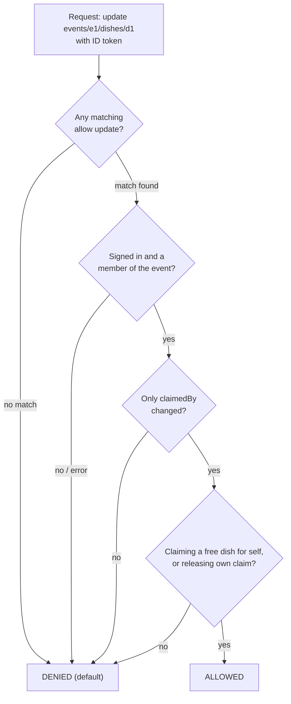

# Security rules

> **Before this lesson:** you need Firestore paths, documents and queries ([Firestore and the Realtime Database](#/lesson/react/firestore-rtdb)), ID tokens and `uid` ([Firebase setup and authentication flows](#/lesson/react/firebase-setup-auth)), and roles ([Sessions, protected routes and roles](#/lesson/react/sessions-roles)).

## In plain words

A nightclub has a bouncer at the door with a list of instructions: "Members may enter. Staff may enter the back room. Nobody takes drinks outside." The bouncer does not trust what guests *say* ("I am a VIP, honest"). They look at the wristband issued at the ticket desk, which cannot be faked, and at the instruction list.

With Firebase, your React app talks to the database directly; there is no server of yours in between. So the database itself needs a bouncer. **Security Rules** are the instruction list. For every single read and write, Firebase evaluates your rules using two things it can trust: the user's verified ID token (the wristband) and the data already stored. If no instruction allows the request, it is refused.

This is the part of a Firebase project that actually protects your users' data. Everything in the React app can be bypassed by anyone with a browser console; the rules cannot. Misconfigured rules are the classic Firebase security incident, which is why reviewers and interviewers ask about them.

## Why the client cannot be trusted

Your Firebase config is public, and your JavaScript runs on the user's machine. A user (or an attacker who has merely created an account) can open the console and run:

```javascript
getDocs(collection(db, "users"));                                   // try to read every user
updateDoc(doc(db, "users", myUid), { roles: ["admin"] });           // try to promote themselves
deleteDoc(doc(db, "events", someoneElsesEventId));                  // try to delete others' data
```

Route guards and hidden buttons do nothing against this. Only the rules decide whether each call succeeds. A useful habit: *assume every request was written by a hostile programmer who holds a valid account.*

## The shape of Firestore rules

Rules live in a file, usually `firestore.rules`, written in a small language of their own:

```javascript
rules_version = '2';

service cloud.firestore {
  match /databases/{database}/documents {

    match /events/{eventId} {
      allow read: if request.auth != null;
      allow write: if false;
    }

  }
}
```

- The first three lines are fixed boilerplate.
- `match /events/{eventId}` selects which documents the block applies to. `{eventId}` is a **wildcard**: it matches any one document id and makes that id available as the variable `eventId`.
- `allow <operations>: if <condition>;` grants the listed operations when the condition is `true`.
- `request.auth != null` means "the request carries a valid sign-in".
- `if false` never grants anything.

Three principles govern everything else.

**1. Deny by default.** A request is refused unless some `allow` statement grants it. A collection with no matching rule is closed.

**2. Rules only add.** If several `allow` statements match, access is granted when *any* of them is true. You cannot write a rule that takes away what another rule gave. One overly broad rule therefore opens everything it matches.

**3. Rules do not cascade.** A rule on `/events/{eventId}` does not apply to `/events/{eventId}/dishes/{dishId}`. Subcollections need their own `match`, which may be nested inside the parent's block. The recursive wildcard `{name=**}` matches a whole subtree; use it sparingly.

### Operations

| Client call | Rule operation |
|---|---|
| `getDoc`, a listener on one document | `get` |
| `getDocs`, a listener on a query | `list` |
| `addDoc`, `setDoc` on a new document | `create` |
| `updateDoc`, `setDoc` on an existing document | `update` |
| `deleteDoc` | `delete` |

`read` is shorthand for `get` + `list`; `write` for `create` + `update` + `delete`. Splitting them is often important: "anyone may create a sign-up, nobody may edit one".

### What a condition can look at

| Expression | Meaning |
|---|---|
| `request.auth` | `null` if not signed in; otherwise the verified token |
| `request.auth.uid` | the user's id |
| `request.auth.token.email_verified`, `request.auth.token.role` | built-in and custom claims |
| `resource.data` | the document **as currently stored** (for get, update, delete) |
| `request.resource.data` | the document **as it would be after this write** (for create, update) |
| `request.time` | the server's current time |
| `eventId` and other wildcards | pieces of the path |
| `get(/databases/$(database)/documents/users/$(request.auth.uid))` | another document, fetched during evaluation (counts as a billed read) |
| `exists(path)` | whether another document exists |

The distinction between `resource` (before) and `request.resource` (after) is the key to validating writes.

## Building Potluck's rules, one need at a time

### Users: each person owns their profile

```javascript
match /users/{userId} {
  allow get: if request.auth != null;
  allow create: if request.auth.uid == userId
                && request.resource.data.roles == ["member"];
  allow update: if request.auth.uid == userId
                && request.resource.data.roles == resource.data.roles;
}
```

- Any signed-in user may `get` a single profile (to show names). There is no `list`, so nobody can download the whole user table.
- `request.auth.uid == userId` is the **ownership** pattern: the id in the path must equal the id in the token. If nobody is signed in, `request.auth` is `null`, reading `.uid` on it is an error, and an error counts as "not allowed", so this condition also implies being signed in.
- On `create`, the new document must have exactly the default role.
- On `update`, the `roles` field after the write must equal the `roles` field before it. This is what stops self-promotion to admin. (Roles are then changed only by trusted server code with the Admin SDK, which bypasses rules, or kept in custom claims.)
- No `delete` rule: deleting is denied.

### Events: members read, the host manages

```javascript
function signedIn() {
  return request.auth != null;
}
function isMember(event) {
  return request.auth.uid in event.memberIds;
}

match /events/{eventId} {
  allow read: if signedIn() && isMember(resource.data);

  allow create: if signedIn()
                && request.resource.data.hostId == request.auth.uid
                && request.auth.uid in request.resource.data.memberIds
                && request.resource.data.title is string
                && request.resource.data.title.size() >= 3
                && request.resource.data.title.size() <= 80;

  allow update: if signedIn()
                && resource.data.hostId == request.auth.uid
                && request.resource.data.hostId == resource.data.hostId;

  allow delete: if signedIn() && resource.data.hostId == request.auth.uid;
}
```

- **Functions** give names to conditions and remove repetition. They can use `request` and take arguments.
- `read` checks the *stored* document: the requester's id must be in its `memberIds` array (`in` tests membership).
- `create` checks the *incoming* document: the creator must set themselves as host and member, and the title must be a string of sensible length. `is string` is a type check and `.size()` a length. This is **data validation**: since Firestore has no schema, the rules are where shape is enforced.
- `update` is allowed for the stored host only, and the write may not hand the event to someone else (`hostId` unchanged).

### Dishes: a subcollection with its own rules

```javascript
match /events/{eventId}/dishes/{dishId} {
  function event() {
    return get(/databases/$(database)/documents/events/$(eventId)).data;
  }

  allow read: if signedIn() && isMember(event());

  allow create: if signedIn() && isMember(event())
                && request.resource.data.createdBy == request.auth.uid
                && request.resource.data.claimedBy == null
                && request.resource.data.createdAt == request.time
                && request.resource.data.keys().hasOnly(["name", "course", "claimedBy", "createdBy", "createdAt"]);

  allow update: if signedIn() && isMember(event())
                && request.resource.data.diff(resource.data).affectedKeys().hasOnly(["claimedBy"])
                && (
                  (resource.data.claimedBy == null && request.resource.data.claimedBy == request.auth.uid)
                  || (resource.data.claimedBy == request.auth.uid && request.resource.data.claimedBy == null)
                );

  allow delete: if signedIn()
                && (resource.data.createdBy == request.auth.uid || event().hostId == request.auth.uid);
}
```

- `get(...)` fetches the parent event so the rule can check membership. `$(eventId)` inserts the wildcard value into the path. Each `get` in a rule is billed as a document read, and a request may perform only a limited number of them, so use them deliberately. Putting roles in custom claims avoids them.
- `createdAt == request.time` forces the client to use `serverTimestamp()`: a made-up time will not equal the server's.
- `keys().hasOnly([...])` rejects documents with unexpected extra fields.
- The `update` rule is the most instructive. `diff(resource.data).affectedKeys().hasOnly(["claimedBy"])` says "the only field this write changes is `claimedBy`". Then two transitions are allowed: claiming an unclaimed dish for *yourself*, or releasing a dish *you* claimed. You cannot claim on behalf of someone else, steal a claimed dish, or rename a dish through this rule.



## Rules are not filters

This catches almost everyone once. Rules evaluate whether a **query as written** could ever return a forbidden document. They do not quietly remove the forbidden documents from the results.

```javascript
// Rules: read allowed only if request.auth.uid in resource.data.memberIds

getDocs(collection(db, "events"));
// DENIED entirely: this query could return events the user is not a member of

getDocs(query(collection(db, "events"), where("memberIds", "array-contains", user.uid)));
// ALLOWED: the query's own constraint guarantees every result satisfies the rule
```

So queries and rules must be designed together: the query's `where` clauses have to prove what the rule demands.

## Roles in rules

With **custom claims** (set by server code, carried in the token):

```javascript
function isAdmin() {
  return request.auth != null && request.auth.token.admin == true;
}

match /{document=**} {
  allow read: if isAdmin();
}
```

With a **user document** (costs a read per evaluation):

```javascript
function hasRole(role) {
  return role in get(/databases/$(database)/documents/users/$(request.auth.uid)).data.roles;
}
```

Requiring a verified email: `request.auth.token.email_verified == true`.

## Realtime Database rules

The Realtime Database uses a different format: a JSON document mirroring the data tree, with JavaScript-like condition strings.

```json
{
  "rules": {
    "users": {
      "$uid": {
        ".read": "auth != null",
        ".write": "auth != null && auth.uid === $uid",
        "displayName": { ".validate": "newData.isString() && newData.val().length <= 40" }
      }
    },
    "dishes": {
      "$eventId": {
        ".read": "root.child('members').child($eventId).child(auth.uid).exists()",
        ".indexOn": ["createdAt"]
      }
    }
  }
}
```

- `$uid` is a wildcard for a path segment.
- `.read` and `.write` grant access; `.validate` checks the shape of written data; `.indexOn` declares fields to index for queries.
- `auth` is the token, `data` the existing value, `newData` the value after the write, `root` the top of the tree.

The big difference from Firestore: Realtime Database rules **cascade**. A `.read` or `.write` that is granted at a node applies to everything beneath it and cannot be revoked deeper down. Grant access as low in the tree as possible.

## Testing and deploying rules

Rules are code and deserve the same process as code.

- **Rules Playground** in the console simulates one request against your rules.
- The **Emulator Suite** runs Firestore locally with your rules, and the `@firebase/rules-unit-testing` package lets you write automated tests with Vitest:

```javascript
import { initializeTestEnvironment, assertFails, assertSucceeds } from "@firebase/rules-unit-testing";
import { doc, getDoc, updateDoc } from "firebase/firestore";

const env = await initializeTestEnvironment({ projectId: "potluck-test", firestore: { rules: rulesSource } });

const ana = env.authenticatedContext("ana").firestore();
const stranger = env.unauthenticatedContext().firestore();

await assertFails(getDoc(doc(stranger, "events/e1")));
await assertSucceeds(getDoc(doc(ana, "events/e1")));
await assertFails(updateDoc(doc(ana, "users/ana"), { roles: ["admin"] }));
```

- `authenticatedContext("ana")` gives a database handle that behaves as user `ana`.
- `assertFails` passes when the operation is denied. Tests for what must be **denied** are the most valuable ones.

Deploy with the Firebase command-line tool (set up in the next lesson): `firebase deploy --only firestore:rules`. Keep `firestore.rules` in version control so that changes are reviewed like any other code.

## Run it: a rules simulator

The page below evaluates Potluck-style rules, written as JavaScript functions with the same `request`/`resource` vocabulary, against requests you choose. It prints which condition decided the outcome. The problem *Evaluate security rules* asks you to build a complete evaluator for a small rule language.

```html-run
<div style="font-family:sans-serif">
  <label>Who: <select id="who"><option value="">nobody (signed out)</option><option value="ana">Ana (host, member)</option><option value="bo" selected>Bo (member)</option><option value="eve">Eve (signed in, not a member)</option></select></label>
  <label> Request: <select id="what"></select></label>
  <p id="verdict" style="font-size:1.1rem"></p>
  <pre id="trace" style="background:#f4f4f4;padding:8px"></pre>
</div>
<script>
  // ---------- stored data ----------
  const store = {
    "users/bo": { displayName: "Bo", roles: ["member"] },
    "events/e1": { title: "Spring potluck", hostId: "ana", memberIds: ["ana", "bo"] },
    "events/e1/dishes/soup": { name: "Lentil soup", claimedBy: null, createdBy: "ana" },
    "events/e1/dishes/bread": { name: "Flatbread", claimedBy: "ana", createdBy: "ana" },
  };

  // ---------- the rules: each returns [allowed, reason] ----------
  const check = (...steps) => { for (const [ok, reason] of steps) if (!ok) return [false, "failed: " + reason]; return [true, "all conditions true"]; };
  const changedKeys = (before, after) => Object.keys({ ...before, ...after }).filter((k) => JSON.stringify(before[k]) !== JSON.stringify(after[k]));
  const rules = [
    { match: /^users\/(\w+)$/, ops: ["update"], name: "users/{userId} update",
      test: (req, res, [userId]) => check([req.auth !== null, "request.auth != null"], [req.auth && req.auth.uid === userId, "request.auth.uid == userId"],
        [JSON.stringify(req.resource.roles) === JSON.stringify(res.roles), "roles unchanged"]) },
    { match: /^events\/(\w+)$/, ops: ["get"], name: "events/{eventId} read",
      test: (req, res) => check([req.auth !== null, "request.auth != null"], [req.auth && res.memberIds.includes(req.auth.uid), "request.auth.uid in resource.data.memberIds"]) },
    { match: /^events\/(\w+)$/, ops: ["delete"], name: "events/{eventId} delete",
      test: (req, res) => check([req.auth !== null, "request.auth != null"], [req.auth && res.hostId === req.auth.uid, "resource.data.hostId == request.auth.uid"]) },
    { match: /^events\/(\w+)\/dishes\/(\w+)$/, ops: ["update"], name: "dishes/{dishId} update",
      test: (req, res, [eventId]) => {
        const event = store["events/" + eventId], uid = req.auth && req.auth.uid;
        return check([req.auth !== null, "request.auth != null"], [uid && event.memberIds.includes(uid), "member of the event (get on the parent)"],
          [changedKeys(res, req.resource).every((k) => k === "claimedBy"), "only claimedBy may change"],
          [(res.claimedBy === null && req.resource.claimedBy === uid) || (res.claimedBy === uid && req.resource.claimedBy === null), "claim a free dish for yourself, or release your own"]);
      } },
  ];

  // ---------- requests to try ----------
  const requests = [
    { label: "read event e1", op: "get", path: "events/e1" },
    { label: "delete event e1", op: "delete", path: "events/e1" },
    { label: "claim the soup for myself", op: "update", path: "events/e1/dishes/soup", change: (uid) => ({ claimedBy: uid }) },
    { label: "claim the soup for Ana", op: "update", path: "events/e1/dishes/soup", change: () => ({ claimedBy: "ana" }) },
    { label: "take the bread Ana claimed", op: "update", path: "events/e1/dishes/bread", change: (uid) => ({ claimedBy: uid }) },
    { label: "rename the soup", op: "update", path: "events/e1/dishes/soup", change: () => ({ name: "Mystery stew" }) },
    { label: "edit Bo's display name", op: "update", path: "users/bo", change: () => ({ displayName: "Bo B." }) },
    { label: "give Bo the admin role", op: "update", path: "users/bo", change: () => ({ roles: ["member", "admin"] }) },
    { label: "read the invoices collection (no rule exists)", op: "get", path: "invoices/i1" },
  ];
  document.getElementById("what").innerHTML = requests.map((r, i) => `<option value="${i}">${r.label}</option>`).join("");

  function evaluate() {
    const uid = document.getElementById("who").value || null;
    const req = requests[Number(document.getElementById("what").value)];
    const resource = store[req.path] || null;
    const request = { auth: uid ? { uid } : null, resource: req.change ? { ...resource, ...req.change(uid) } : null };
    const lines = [`request: ${req.op} ${req.path} as ${uid || "anonymous"}`];
    let allowed = false;
    for (const rule of rules) {
      const m = rule.match.exec(req.path);
      if (!m || !rule.ops.includes(req.op)) continue;
      let result;
      try { result = rule.test(request, resource, m.slice(1)); } catch (error) { result = [false, "evaluation error (" + error.message + ") counts as deny"]; }
      lines.push(`rule "${rule.name}": ${result[0] ? "ALLOW" : "no"}  (${result[1]})`);
      if (result[0]) allowed = true;
    }
    if (lines.length === 1) lines.push("no rule matches this path and operation: denied by default");
    document.getElementById("verdict").textContent = allowed ? "✅ allowed" : "⛔ denied";
    document.getElementById("trace").textContent = lines.join("\n");
  }
  document.getElementById("who").addEventListener("change", evaluate);
  document.getElementById("what").addEventListener("change", evaluate);
  evaluate();
</script>
```

Go through the requests as Bo, then as Eve, then signed out. Things to confirm: Bo can claim the free soup for himself but not for Ana; nobody can take a dish someone else has claimed; Bo can change his display name but not his roles; Eve, a legitimate signed-in user who is not a member, is refused everything about the event; and the `invoices` path, which no rule mentions, is denied for everyone.

## Pitfalls

> [!WARNING]
> **`allow read, write: if true;`** (test mode) or **`if request.auth != null;`** on everything. The first opens your database to the internet. The second opens it to anyone who signs up, which on most apps is anyone at all. "Signed in" is not the same as "allowed".

- **Trusting client-supplied fields.** A rule such as `request.resource.data.isAdmin == true` trusts the very thing the attacker controls. Trust `request.auth` (the token) and `resource.data` (what is already stored).
- **Checking `resource.data` when you mean `request.resource.data`,** or the reverse. Before versus after.
- **Forgetting that subcollection rules do not inherit** in Firestore, and that Realtime Database rules *do* cascade.
- **Assuming rules filter query results.** A query that could include forbidden documents is rejected whole.
- **No validation on writes.** Without checks on types, sizes and allowed keys, a user can store megabytes of junk or fields your UI will choke on.
- **Letting `update` change ownership or role fields.** Compare before and after.
- **Using a broad recursive wildcard** (`/{document=**}`) with a permissive condition: since rules only add, it overrides every careful rule elsewhere.
- **Client timestamps.** Require `request.time`.
- **Never testing denials.** A rule set that passes all your "allowed" tests may still allow everything.
- **Editing rules only in the console.** They drift from the version in your repository. Deploy from the file.
- **Expecting rules to apply to the Admin SDK.** Server code with admin credentials bypasses rules entirely; secure it separately.

> [!TIP]
> Write rules from a table. List each collection, and for each of get, list, create, update, delete, write one sentence: "who, under which condition, with what constraints on the data". Translate each sentence into a condition and a pair of tests, one that should pass and one that should fail.

> [!INTERVIEW]
> "How do you secure data in a Firebase app?" *The client is untrusted, so access control lives in Security Rules, evaluated on Google's servers for every read and write. Rules are deny-by-default and additive. Conditions use the verified token (`request.auth`), the stored document (`resource.data`) and the incoming document (`request.resource.data`), so I can express ownership, membership, role checks from custom claims, and validation of types and allowed fields. Queries must be constrained to match the rules because rules are not filters. I keep rules in version control and test them, especially the denials, with the emulator.*

## Cheat sheet

| Need | Firestore rule |
|---|---|
| Signed in | `request.auth != null` |
| Owner by path | `request.auth.uid == userId` |
| Owner by field | `resource.data.ownerId == request.auth.uid` |
| Creator sets self as owner | `request.resource.data.ownerId == request.auth.uid` |
| Member of a list | `request.auth.uid in resource.data.memberIds` |
| Custom-claim role | `request.auth.token.role == "admin"` |
| Verified email | `request.auth.token.email_verified == true` |
| Field cannot change | `request.resource.data.x == resource.data.x` |
| Only some fields change | `request.resource.data.diff(resource.data).affectedKeys().hasOnly(["a", "b"])` |
| Only allowed fields exist | `request.resource.data.keys().hasOnly([...])` |
| Type and length | `x is string && x.size() <= 80` |
| Server timestamp | `request.resource.data.createdAt == request.time` |
| Look at another document | `get(/databases/$(database)/documents/col/$(id)).data` |
| Reusable condition | `function name(args) { return ...; }` |
| Deploy | `firebase deploy --only firestore:rules` |

| Property | Firestore | Realtime Database |
|---|---|---|
| Format | rules language (`match` / `allow`) | JSON with condition strings |
| Default | deny | deny |
| Inheritance to children | none (each path needs a match) | cascades downward, cannot be revoked |
| Validation | in `allow create/update` conditions | `.validate` |

## Summary

- With Firebase the browser talks to the database directly, so Security Rules are the only real access control.
- Firestore rules pair `match` path patterns with `allow` conditions; access is denied unless some rule grants it, rules only add, and they do not apply to subcollections automatically.
- Conditions use the trusted token (`request.auth`), the stored document (`resource`) and the proposed document (`request.resource`).
- Typical patterns: ownership, membership, roles from claims, immutable fields, restricting which keys may change, and validating types and sizes.
- Rules are not filters: queries must be written so that they can only return permitted documents.
- Treat rules as code: version them, test the denials with the emulator, deploy from files.

## Glossary

- **Security Rules**: server-evaluated conditions deciding whether each database request is allowed.
- **`match`**: the part of a rule selecting the document paths it covers.
- **Wildcard**: `{name}` in a path, matching one segment and binding its value.
- **Recursive wildcard**: `{name=**}`, matching all deeper paths.
- **`request.auth`**: the verified identity of the requester, or `null`.
- **`resource`**: the document as it exists before the request.
- **`request.resource`**: the document as it would be after the write.
- **Deny by default**: nothing is permitted unless explicitly allowed.
- **Ownership pattern**: granting access when the user's id matches an id in the path or data.
- **Data validation**: checking the shape and content of written data.
- **Custom claim**: trusted data inside the ID token, usable in rules.
- **Emulator**: a local Firebase used to test rules safely.

## Check yourself

```quiz
[
  {"q": "A Firestore collection has no rule matching it at all. What happens to a signed-in user's read?",
   "options": ["Allowed, since no rule forbids it", "Denied: access is refused unless some rule explicitly allows it", "Allowed for 30 days", "It depends on the SDK version"],
   "answer": 1,
   "explain": "Rules are deny-by-default."},
  {"q": "Rule: allow update: if request.auth.uid == userId;  on /users/{userId}, where documents hold a roles array. What can a user do?",
   "options": ["Only change their display name", "Change any field of their own document, including giving themselves the admin role", "Nothing", "Change other users' documents"],
   "answer": 1,
   "explain": "Ownership alone does not restrict which fields change. Add request.resource.data.roles == resource.data.roles."},
  {"q": "In an update rule, what do resource.data and request.resource.data refer to?",
   "options": ["Both are the incoming data", "resource.data is the stored document before the write; request.resource.data is the document as it would be after", "resource.data is the user document", "They are the same object"],
   "answer": 1,
   "explain": "Comparing the two is how you validate transitions and protect fields from change."},
  {"q": "Rules allow reading an event only to its members. The client runs getDocs(collection(db, 'events')) with no where clause. Result?",
   "options": ["Only the user's events are returned", "The whole query is denied, because it could include events the user may not read", "All events are returned", "An empty list"],
   "answer": 1,
   "explain": "Rules are not filters. Add where('memberIds', 'array-contains', uid) so the query matches the rule."},
  {"q": "There is a carefully restricted rule on /events/{eventId} and also: match /{document=**} { allow read: if request.auth != null; }. Who can read events?",
   "options": ["Only members, the specific rule wins", "Any signed-in user, because rules are additive and the broad rule grants access", "Nobody", "Only admins"],
   "answer": 1,
   "explain": "If any matching allow is true, access is granted. A broad rule cannot be overridden by a narrower one."},
  {"q": "Which condition should a rule NOT rely on to decide whether the requester is an admin?",
   "options": ["request.auth.token.admin == true", "A roles field in a user document that only server code can write", "request.resource.data.isAdmin == true", "A custom claim set with the Admin SDK"],
   "answer": 2,
   "explain": "request.resource.data is supplied by the client making the request; an attacker can put anything there."},
  {"q": "A rule on /events/{eventId} allows members to read. Does it let them read /events/{eventId}/dishes/{dishId} in Firestore?",
   "options": ["Yes, rules apply to subcollections", "No, Firestore rules do not cascade; the subcollection needs its own match", "Only for get, not list", "Only if the event is public"],
   "answer": 1,
   "explain": "In Firestore each path must be matched explicitly (unlike the Realtime Database, where rules cascade)."},
  {"q": "Why is `allow read, write: if request.auth != null;` on the whole database usually unsafe?",
   "options": ["It blocks anonymous users", "Anyone can create an account, so it effectively lets any person read and change all data", "It is slower", "It disables indexes"],
   "answer": 1,
   "explain": "Authentication proves identity, not permission. Rules must also check ownership, membership or roles."}
]
```

> **Source:** Wieruch, *The Road to React with Firebase*: Firebase Realtime Database (2): Advanced → Securing User Interactions; Authorization (1) and (2). The book handles authorisation mostly on the client and touches database rules briefly; the rules material here follows the current documentation. Documentation: https://firebase.google.com/docs/rules, https://firebase.google.com/docs/firestore/security/get-started, https://firebase.google.com/docs/firestore/security/rules-conditions, https://firebase.google.com/docs/firestore/security/rules-query, https://firebase.google.com/docs/database/security, https://firebase.google.com/docs/rules/unit-tests
