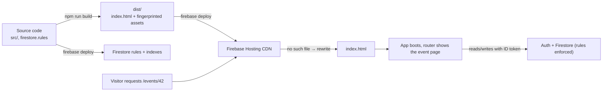
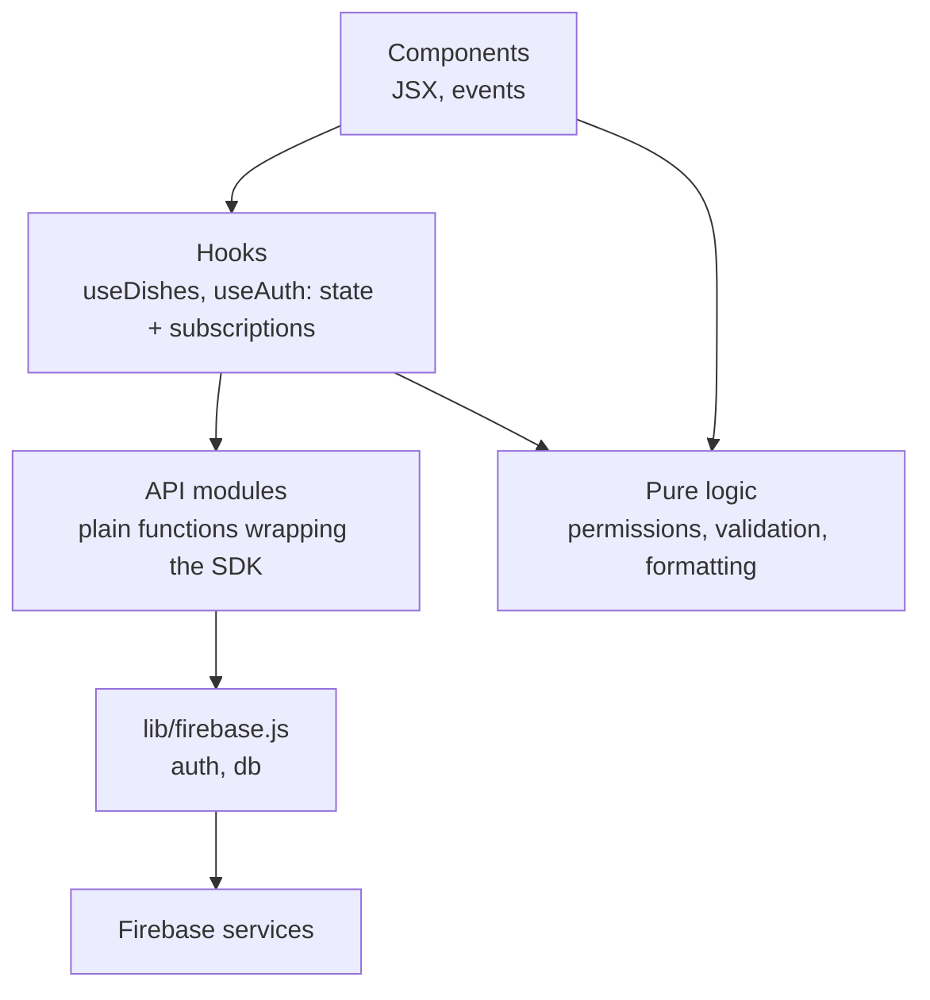
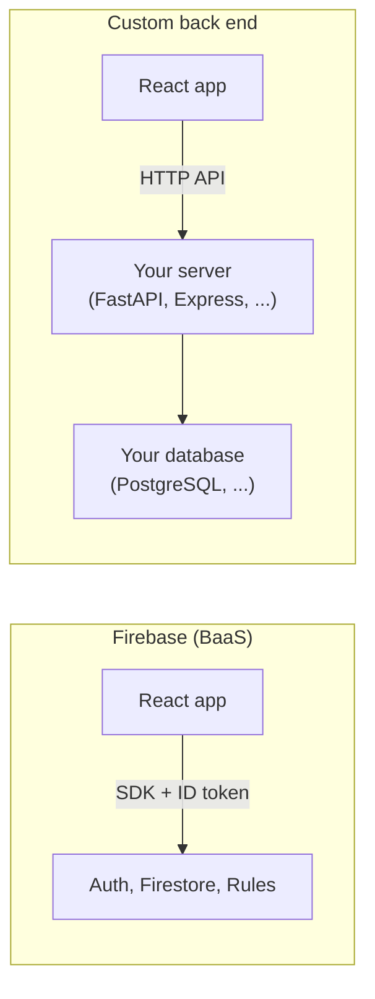

# Hosting, app structure, and Firebase vs a custom backend

> **Before this lesson:** you need the production build from [Why React, and a first project with Vite](#/lesson/react/why-react-vite), client-side routing and its fallback rule ([Routing with React Router](#/lesson/react/routing)), feature folders ([Project structure and performance profiling](#/lesson/react/structure-profiling)), and the Firebase lessons so far ([Firebase setup and authentication flows](#/lesson/react/firebase-setup-auth), [Firestore and the Realtime Database](#/lesson/react/firestore-rtdb), [Security rules](#/lesson/react/security-rules)).

## In plain words

Three questions remain before Potluck is a real product.

**Where does it live?** Right now the app runs on your laptop. To let friends use it, the files must sit on a computer that is always on and reachable from the internet. Putting them there is called **deployment**, and the service that keeps them available is a **host**. Think of moving a market stall from your garage to a pitch on the high street.

**How is the code organised?** A stall with stock piled in one heap works on day one. A shop needs shelves, a till area and a stockroom, or nobody can find anything. The React-plus-Firebase code needs the same: clear places for Firebase calls, for hooks, for screens.

**Was renting the right choice?** Firebase is a furnished flat: move in today, everything works, and the landlord fixes the boiler. A **custom back end** (your own server program and database) is building a house: slower and more work, and you decide where every wall goes. Neither is better in general. Knowing when each fits, and saying so calmly, is a sign of engineering maturity and a common interview discussion.

## Part 1: deploying to Firebase Hosting

**Firebase Hosting** serves static files (HTML, CSS, JavaScript, images) from a **CDN** (content delivery network: copies of your files on servers around the world, so each visitor is served from one nearby). It provides **HTTPS** (encrypted connections) automatically and a free address ending in `.web.app`.

### One-time setup

```bash
npm install -g firebase-tools
firebase login
firebase init hosting
```

- `firebase-tools` is the Firebase **CLI** (command-line interface: a program you drive by typing commands). `-g` installs it for the whole machine.
- `firebase login` opens a browser window to connect the tool to your Google account.
- `firebase init hosting` asks a few questions and writes two files. Answer:
  - *Which project?* → your Firebase project.
  - *Public directory?* → `dist` (where Vite puts the build; the default answer `public` is wrong for Vite).
  - *Configure as a single-page app (rewrite all URLs to /index.html)?* → **Yes**.
  - *Overwrite dist/index.html?* → No.

The first file, `.firebaserc`, records which project the folder deploys to. The second, `firebase.json`, is the hosting configuration:

```json
{
  "hosting": {
    "public": "dist",
    "ignore": ["firebase.json", "**/.*", "**/node_modules/**"],
    "rewrites": [{ "source": "**", "destination": "/index.html" }],
    "headers": [
      {
        "source": "/assets/**",
        "headers": [{ "key": "Cache-Control", "value": "public, max-age=31536000, immutable" }]
      },
      {
        "source": "/index.html",
        "headers": [{ "key": "Cache-Control", "value": "no-cache" }]
      }
    ]
  },
  "firestore": { "rules": "firestore.rules", "indexes": "firestore.indexes.json" }
}
```

- `"public": "dist"` is the folder to upload.
- `"rewrites"` is the SPA fallback from the routing lesson. Hosting first looks for a real file matching the requested path. If there is none, the rewrite serves `index.html`, the app starts, and React Router reads the URL. Without it, refreshing `/events/42` shows a 404 page.
- `"headers"` controls caching. Vite gives built files names containing a fingerprint of their contents (`assets/index-B7x2kQ.js`), so a changed file gets a new name. Those can be cached for a year (`max-age=31536000` seconds, `immutable`). `index.html` keeps its name and points at the current fingerprints, so browsers must always re-check it (`no-cache`). Get this wrong and users keep an old `index.html` that references files that no longer exist.
- The `"firestore"` entry makes the same tool deploy your rules and indexes from files in the repository.

### Build and deploy

```bash
npm run build
firebase deploy
```

- `npm run build` produces the optimised `dist` folder. Deploying without building first uploads the previous build.
- `firebase deploy` uploads hosting files, Firestore rules and indexes, and prints the live address. `firebase deploy --only hosting` or `--only firestore:rules` deploys one part.



### After the first deploy

- **Authorised domains.** Social sign-in works only on domains listed under Authentication → Settings. The default `.web.app` and `.firebaseapp.com` addresses are added for you; add any custom domain yourself.
- **Custom domain.** In the Hosting console choose "Add custom domain", prove ownership by adding the DNS records it shows, and Firebase issues the HTTPS certificate.
- **Rollback.** The console keeps previous releases; one click restores an earlier one.
- **Preview channels.** `firebase hosting:channel:deploy pr-42` publishes the build at a temporary address, so a change can be reviewed before going live. With the official GitHub Action this happens automatically for every pull request.

### Separate environments

Never test against the data your users rely on. Create two Firebase projects, for example `potluck-dev` and `potluck-prod`, and register both with the CLI:

```bash
firebase use --add          # choose potluck-dev,  alias: dev
firebase use --add          # choose potluck-prod, alias: prod
```

Vite picks the matching web config from environment files at build time:

```text
# .env.development        (used by `npm run dev`)
VITE_FIREBASE_PROJECT_ID=potluck-dev
...
# .env.production         (used by `npm run build`)
VITE_FIREBASE_PROJECT_ID=potluck-prod
...
```

```bash
npm run build && firebase deploy -P prod
```

`-P prod` selects the project by its alias. For day-to-day work the Emulator Suite (`firebase emulators:start`) runs Auth, Firestore and Hosting locally with no cloud project involved at all.

In a team, deployment is normally done by **CI/CD** (continuous integration and delivery: a service that runs your tests and deploys automatically when code is merged), not from a laptop. The [CI/CD track](#/track/cicd) covers that workflow.

Firebase Hosting is one option among several. Because the build is plain static files, Netlify, Vercel, Cloudflare Pages or GitHub Pages work too; each has an equivalent of the SPA rewrite. Firebase also offers a separate product, App Hosting, for server-rendered frameworks such as Next.js.

## Part 2: structuring a React + Firebase app

The goal is the same as in the project-structure lesson, with one addition: **keep Firebase at the edge**. Components should not import from `firebase/*`. That gives you one place to change paths and field names, components that can be tested without a database, and a back end that could be replaced without rewriting the UI.

```text
src/
  lib/
    firebase.js               initializeApp, exports auth + db, emulator connections
  app/
    App.jsx  routes.jsx  providers.jsx
  features/
    auth/
      api.js                  signUp, signIn, signOutUser, resetPassword   (the only file importing firebase/auth)
      AuthContext.jsx         AuthProvider + useAuth  (onAuthStateChanged)
      RequireAuth.jsx  RequireRole.jsx
      authErrors.js
      components/             SignInForm.jsx  SignUpForm.jsx
    events/
      api.js                  watchEvents, watchDishes, addDish, claimDish  (the only file importing firebase/firestore)
      converters.js           snapshot → plain object
      useEvents.js  useDishes.js
      permissions.js          canEditEvent(user, event) and similar pure functions
      components/             EventList.jsx  DishRow.jsx  AddDishForm.jsx
  shared/
    components/  hooks/  utils/
firestore.rules
firestore.indexes.json
firebase.json
```

The layers and who may call whom:



An API module is ordinary JavaScript:

```javascript
// src/features/events/api.js
import { addDoc, collection, doc, onSnapshot, orderBy, query, serverTimestamp, updateDoc } from "firebase/firestore";
import { db } from "../../lib/firebase";

const dishesRef = (eventId) => collection(db, "events", eventId, "dishes");
const toDish = (snapshot) => ({ id: snapshot.id, ...snapshot.data() });

export function watchDishes(eventId, onData, onError) {
  return onSnapshot(
    query(dishesRef(eventId), orderBy("createdAt")),
    (snapshot) => onData(snapshot.docs.map(toDish)),
    (error) => onError(error.code)
  );
}

export function addDish(eventId, { name, course }, uid) {
  return addDoc(dishesRef(eventId), { name, course, claimedBy: null, createdBy: uid, createdAt: serverTimestamp() });
}

export function claimDish(eventId, dishId, uid) {
  return updateDoc(doc(db, "events", eventId, "dishes", dishId), { claimedBy: uid });
}
```

- `watchDishes` returns the unsubscribe function, so a hook can use it directly as an effect cleanup.
- `toDish` converts a Firestore snapshot into a plain object in one place. The UI never sees SDK types.
- Collection names and field names appear only here (and in the rules).

The hook becomes three lines of wiring:

```jsx
// src/features/events/useDishes.js
export function useDishes(eventId) {
  const [state, setState] = useState({ status: "loading", dishes: [], error: null });
  useEffect(() => {
    setState({ status: "loading", dishes: [], error: null });
    return watchDishes(
      eventId,
      (dishes) => setState({ status: "success", dishes, error: null }),
      (error) => setState({ status: "error", dishes: [], error })
    );
  }, [eventId]);
  return state;
}
```

And a component reads like a description of the screen:

```jsx
function DishList({ eventId }) {
  const { user } = useAuth();
  const { status, dishes, error } = useDishes(eventId);

  if (status === "loading") return <p>Loading dishes…</p>;
  if (status === "error") return <p role="alert">Could not load dishes ({error}).</p>;
  if (dishes.length === 0) return <p>No dishes yet. Add the first one.</p>;
  return (
    <ul>
      {dishes.map((dish) => (
        <DishRow key={dish.id} dish={dish} canClaim={dish.claimedBy === null} onClaim={() => claimDish(eventId, dish.id, user.uid)} />
      ))}
    </ul>
  );
}
```

A checklist before calling a Firebase app production-ready:

- Security Rules written, tested for denials, deployed from the repository.
- Separate development and production projects; emulators for tests.
- Every listener unsubscribed; lists paginated or limited.
- Billing alerts set in the Google Cloud console (the free tier has hard limits; the paid "Blaze" plan charges for usage, and a bug that loops reads can be costly).
- Error handling on every write, with messages a user can act on.
- App Check considered, to reduce abuse from scripts that are not your app.
- Backups scheduled if the data matters.

## Part 3: when Firebase fits, and when a custom back end fits

A **custom back end** means a server application that you write and run (for example with FastAPI, Express, Django or Spring) in front of a database you choose (often PostgreSQL). The React app calls its HTTP API; the server holds the business logic and is the only thing that talks to the database. The [FastAPI track](#/track/fastapi) on this site teaches building one from scratch.



### Where Firebase is strong

- **Speed of getting started.** Authentication, a database, realtime sync, file storage and hosting in an afternoon, with no server to write or operate.
- **Realtime and offline** are built in. Building live sync yourself (WebSockets, conflict handling, reconnection) is real work.
- **No operations at small scale.** No machines to patch, scale or monitor; a generous free tier.
- **Good authentication out of the box,** including social providers and email flows.
- **A good fit for** prototypes and MVPs (minimum viable product: the smallest version worth releasing), hackathons, internal tools, collaborative and chat-style apps, mobile apps needing offline support, and solo developers or small teams without back-end capacity.

### Where it strains

- **Querying.** No joins, limited filter combinations, no full-text search, no ad-hoc aggregation ("total sales per region per month"). Data that is highly relational, or reporting-heavy products, fit SQL far better.
- **Business logic has no natural home.** Rules can validate a write; they cannot run a multi-step process, call a payment provider or send an email. That requires Cloud Functions, at which point you are writing a back end anyway, spread across functions.
- **Rules get complicated.** Fine-grained permissions expressed as rules plus denormalised data are harder to reason about, test and audit than a few lines of server code.
- **Cost at scale is usage-based and tied to your data model.** Per-read pricing rewards careful modelling and punishes chatty screens. A flat-priced server can be cheaper for read-heavy products. Estimate before committing (the script below does a rough one).
- **Vendor lock-in.** The data model, the rules and the SDK calls are specific to Firebase. Moving away later means rewriting the data layer and migrating data. Keeping Firebase at the edge of your code, as in Part 2, lowers that cost.
- **Constraints you cannot change:** document size limits, write-rate limits on a single document, where data is stored, what can be indexed.
- **Schema changes.** With no schema and no migration tooling, evolving the shape of existing documents is manual.

### A custom back end, fairly

| | Firebase | Custom back end |
|---|---|---|
| Time to first working version | hours | days to weeks |
| Who writes security | you, as rules | you, as server code |
| Data model | documents, denormalised | your choice; relational joins and constraints available |
| Complex queries and reports | weak | strong |
| Realtime sync | built in | you build or add it |
| Business logic | Cloud Functions | anywhere in your server |
| Operations | none to little | servers, deploys, monitoring, backups (less with managed platforms) |
| Cost model | pay per operation | pay for running servers |
| Portability | tied to the platform | standard technology, movable |
| Team skills needed | front end | front end and back end |

It also has real costs: more code, more to secure and operate, and slower first release. "Always build your own" is as wrong as "always use Firebase".

### Middle paths

- **Firebase plus Cloud Functions:** keep Auth and Firestore, move sensitive logic (payments, role assignment, emails) into functions.
- **Firebase Auth with your own API:** the React app signs in with Firebase, sends the ID token in an `Authorization` header, and your server verifies it with the Admin SDK before touching its own SQL database. You keep the excellent sign-in flows and get full control of data.
- **Other back-end-as-a-service products:** Supabase offers a similar experience on top of PostgreSQL, with SQL, joins and row-level security.
- **Start with Firebase, move later.** Legitimate for an MVP, provided the Firebase calls are isolated so the move is a rewrite of `api.js` files and not of every component.

### A decision aid

Ask, in order:

1. Is the data naturally documents and lists per user or group, or a web of relations with reporting needs? (Relations and reports point to SQL and a custom back end.)
2. Is realtime collaboration or offline use central? (Points to Firebase.)
3. Is there significant server-side logic or integration with other systems? (Points to custom, or functions.)
4. Who is on the team, and how soon must it ship?
5. What does a rough cost estimate say at the expected usage?
6. How costly would it be to be locked in?

> [!INTERVIEW]
> "When would you choose Firebase, and when a custom back end?" A balanced answer: *Firebase when speed matters most, the team is front-end heavy, the data is document-shaped, and realtime or offline is important: prototypes, MVPs, collaborative apps. A custom back end when the data is relational, queries and reporting are complex, there is substantial business logic or compliance needs, or cost and lock-in at scale are concerns. Hybrids are common: Firebase Auth in front of your own API, or Firestore with Cloud Functions for sensitive logic. Either way I isolate back-end calls behind a small API layer so the choice can be revisited.*

## Run it: how Hosting answers a request, and a rough cost estimate

First, the request-resolution logic behind the SPA rewrite: a real file wins, otherwise the first matching rewrite, otherwise 404.

```js-run
// What Firebase Hosting does for each request, simplified.
const deployedFiles = new Set(["/index.html", "/assets/index-B7x2kQ.js", "/assets/index-D4f9aZ.css", "/favicon.svg"]);

function resolve(path, rewrites) {
  const pathname = path.split("?")[0];
  if (pathname === "/") return { status: 200, serves: "/index.html", why: "root" };
  if (deployedFiles.has(pathname)) return { status: 200, serves: pathname, why: "exact file" };
  for (const rule of rewrites) {
    if (rule.source === "**") return { status: 200, serves: rule.destination, why: "rewrite " + rule.source };
  }
  return { status: 404, serves: "(404 page)", why: "no file, no rewrite" };
}

const requests = ["/", "/assets/index-B7x2kQ.js", "/events/42", "/signin?next=%2Fevents", "/assets/old-build.js"];

for (const [label, rewrites] of [["WITHOUT the SPA rewrite", []], ["WITH the SPA rewrite", [{ source: "**", destination: "/index.html" }]]]) {
  console.log(label);
  for (const path of requests) {
    const r = resolve(path, rewrites);
    console.log("  ", path.padEnd(26), r.status, r.serves.padEnd(26), "(" + r.why + ")");
  }
}
console.log("\nNote the last line with the rewrite: a missing asset returns index.html (HTML where JavaScript was expected).");
console.log("That is why index.html must not be cached for long while fingerprinted assets can be.");
```

Second, a back-of-the-envelope comparison of read costs for two ways of loading the same screen. The price is an illustrative placeholder; look up current pricing before making a real decision.

```js-run
// Rough monthly Firestore read volume for one screen: "list of events with host names".
function monthlyReads({ users, sessionsPerUserPerDay, eventsShown, design }) {
  const perView =
    design === "fetch host for each row" ? eventsShown + eventsShown      // 1 read per event + 1 read per host document
    : eventsShown;                                                        // host name is denormalised onto the event
  return users * sessionsPerUserPerDay * 30 * perView;
}

const PRICE_PER_100K_READS = 0.06;        // illustrative figure, NOT a quote: check the Firebase pricing page
const FREE_READS_PER_DAY = 50000;         // illustrative free allowance per day

for (const users of [200, 5000, 100000]) {
  console.log(`${users} daily users, 4 sessions each, 20 events per view`);
  for (const design of ["fetch host for each row", "denormalised host name"]) {
    const reads = monthlyReads({ users, sessionsPerUserPerDay: 4, eventsShown: 20, design });
    const billable = Math.max(0, reads - FREE_READS_PER_DAY * 30);
    console.log(`   ${design.padEnd(26)} ${String(reads).padStart(12)} reads/month  ~ $${((billable / 100000) * PRICE_PER_100K_READS).toFixed(2)}`);
  }
}
console.log("\nThe data model, not the user count alone, decides the bill. Try 100 events per view, or add a listener that re-reads on every change.");
```

At small scale both designs are free. At large scale the per-row lookup doubles the bill. Usage-based pricing makes data modelling a cost decision, which is one of the trade-offs to weigh against a fixed-price server.

## Pitfalls

> [!WARNING]
> **Deploying with open rules.** A deployed app is public. If Firestore is still in test mode, or the rules were only edited in the console of a different project, your users' data is exposed the moment the site goes live. Deploy rules from the repository together with the app, and test them first.

- **Public directory left as `public`** instead of `dist`: Firebase serves its placeholder page or nothing.
- **Forgetting `npm run build`** before `firebase deploy`: yesterday's version goes live.
- **No SPA rewrite:** deep links and refreshes return 404.
- **Caching `index.html` for a long time:** users get a stale shell pointing to deleted assets, and a white screen.
- **One Firebase project for development and production.**
- **Social login failing in production** because the domain is not authorised.
- **Firebase calls scattered through components.** Hard to test, hard to change, hard to leave.
- **No billing alert** on a pay-per-use plan.
- **Choosing a back end by fashion.** Decide from the data shape, team and requirements, and write the reasoning down.
- **Secrets in the front end** (payment keys, admin credentials). They belong in Cloud Functions or your server.

> [!TIP]
> Add scripts to `package.json` so nobody deploys by hand from memory: `"deploy:dev": "vite build --mode development && firebase deploy -P dev"` and `"deploy:prod": "vite build && firebase deploy -P prod"`. Better still, let CI run them.

## Cheat sheet

| Task | Command or setting |
|---|---|
| Install CLI | `npm install -g firebase-tools` |
| Sign in | `firebase login` |
| Set up hosting | `firebase init hosting` → public dir `dist`, SPA: yes |
| Build | `npm run build` |
| Deploy everything | `firebase deploy` |
| Deploy one part | `firebase deploy --only hosting` / `--only firestore:rules` |
| Preview a change | `firebase hosting:channel:deploy <name>` |
| Choose project | `firebase use <alias>` or `-P <alias>` |
| Local emulators | `firebase emulators:start` |
| SPA fallback | `"rewrites": [{ "source": "**", "destination": "/index.html" }]` |
| Asset caching | long `max-age` + `immutable` for `/assets/**`, `no-cache` for `index.html` |

| Layer | Contents | Imports Firebase? |
|---|---|---|
| `lib/firebase.js` | initialisation, `auth`, `db` | yes |
| `features/*/api.js` | functions wrapping SDK calls | yes |
| hooks | state + subscriptions via api functions | no |
| components | JSX, handlers | no |
| pure logic | permissions, validation | no |

## Summary

- A Vite build is static files; Firebase Hosting serves them from a CDN with HTTPS after `firebase init hosting` and `firebase deploy`.
- The SPA rewrite to `index.html` makes client-side routes work; cache fingerprinted assets for long and `index.html` not at all.
- Use separate projects for development and production, preview channels for review, and deploy rules and indexes from the repository.
- Structure the app so that only a few modules touch the Firebase SDK; hooks and components depend on those modules.
- Firebase excels at fast starts, realtime and offline features, and small teams; a custom back end excels at relational data, complex queries, substantial business logic, predictable costs and portability.
- Hybrids exist, and isolating back-end access keeps the decision reversible.

## Glossary

- **Deployment**: publishing a built application so users can reach it.
- **Host / hosting**: the service that stores and serves the application's files.
- **Static files**: files served as they are, with no per-request computation.
- **CDN**: a worldwide network of servers that deliver copies of files from a location near the visitor.
- **HTTPS**: encrypted HTTP; required by browsers for many features.
- **CLI**: a tool operated by typed commands.
- **Rewrite**: a hosting rule that serves one file for many URL paths.
- **Cache-Control**: the HTTP header telling browsers how long they may reuse a file.
- **Fingerprint (content hash)**: characters in a file name derived from its contents.
- **Preview channel**: a temporary deployment at its own URL.
- **CI/CD**: automated testing and deployment on every change.
- **Custom back end**: a server application and database that you build and operate.
- **Vendor lock-in**: dependence on one provider's proprietary features, making a move costly.
- **MVP**: minimum viable product.

## Check yourself

```quiz
[
  {"q": "During firebase init hosting for a Vite project, what should the public directory be?",
   "options": ["public", "src", "dist", "node_modules"],
   "answer": 2,
   "explain": "Vite writes the production build to dist. The public folder holds source assets that Vite copies into dist."},
  {"q": "The site is deployed without the rewrite to /index.html. A user opens the home page, clicks through to /events/42, then presses refresh. What happens?",
   "options": ["The event page reloads normally", "A 404 page: there is no file at /events/42 on the host", "The app shows the home page", "The browser logs them out"],
   "answer": 1,
   "explain": "Navigation inside the app worked because the router handled it. A refresh asks the server, which needs the SPA fallback."},
  {"q": "Why can files under /assets be cached for a year while index.html should not be?",
   "options": ["Assets are smaller", "Asset file names include a content fingerprint, so any change produces a new name; index.html keeps its name and must point to the newest assets", "Browsers ignore cache headers for HTML", "index.html never changes"],
   "answer": 1,
   "explain": "A stale cached index.html would reference asset files that a new deploy has replaced."},
  {"q": "You change a component and run firebase deploy without building. What is deployed?",
   "options": ["The new component", "Whatever was in dist from the last build", "Nothing, the command fails", "The src folder"],
   "answer": 1,
   "explain": "Deploy uploads the public directory as it is. Always build first, or script the two together."},
  {"q": "In the recommended structure, which files import from firebase/firestore?",
   "options": ["Every component that shows data", "Only lib/firebase.js and the features' api modules", "Only main.jsx", "The CSS modules"],
   "answer": 1,
   "explain": "Keeping the SDK at the edge centralises paths and makes hooks and components testable and portable."},
  {"q": "A product needs monthly sales reports grouped by region and product category across millions of orders, with many relations between tables. Which choice fits best?",
   "options": ["Firestore with listeners", "The Realtime Database", "A custom back end with a relational (SQL) database", "localStorage"],
   "answer": 2,
   "explain": "Joins, aggregation and ad-hoc reporting are relational strengths and Firestore weaknesses."},
  {"q": "A two-person team wants to release a collaborative shopping-list app with live updates and Google sign-in within two weeks. Which choice fits best?",
   "options": ["Write a custom server and WebSocket layer first", "Firebase: built-in auth, realtime sync and hosting match the need and the timeline", "No back end at all", "A data warehouse"],
   "answer": 1,
   "explain": "Speed, realtime and a small front-end team are exactly where a BaaS shines."},
  {"q": "A screen lists 20 events and reads each host's user document separately. With denormalised host names instead, how do the document reads per view change?",
   "options": ["40 becomes 20", "20 becomes 40", "No change", "40 becomes 1"],
   "answer": 0,
   "explain": "20 event reads plus 20 host reads becomes 20 event reads. With per-read billing the data model halves the cost of this screen."}
]
```

> **Source:** Wieruch, *The Road to React*, "Deploying a React Application": Build Process, Deploy to Firebase; Wieruch, *The Road to React with Firebase*: Application Setup, Firebase in React, Firebase Hosting, How to continue your Journey. Documentation: https://firebase.google.com/docs/hosting/quickstart, https://firebase.google.com/docs/hosting/full-config, https://firebase.google.com/docs/hosting/test-preview-deploy, https://firebase.google.com/docs/projects/multiprojects, https://vite.dev/guide/static-deploy, https://firebase.google.com/pricing
