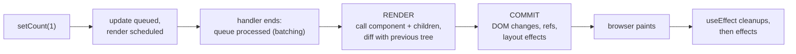
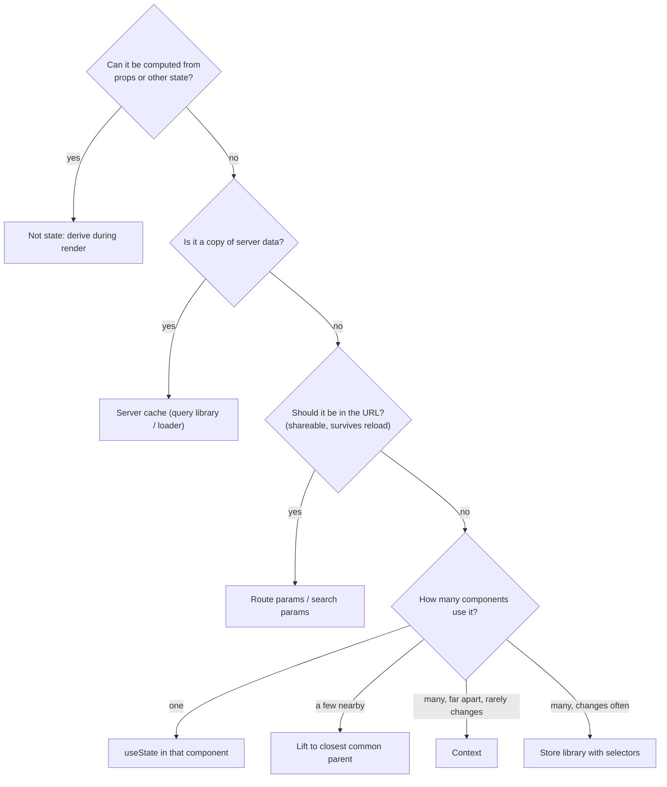

# Interview essentials: renders, keys, closures and effects

> **Before this lesson:** this is a review lesson. It assumes the whole track up to [Render, commit, batching and fibers](#/lesson/react/render-commit). Each question below links back to the lesson that teaches the topic from zero, so if an answer feels unfamiliar, follow the link first.

## In plain words

A job interview for a React role is not a quiz on trivia. The interviewer is trying to find out one thing: *do you have a correct picture in your head of how React behaves?* Someone with the right picture can predict what a piece of code will do, find a bug by reasoning, and explain their choices to a colleague. Someone who memorised recipes cannot.

Think of a driving test. The examiner does not ask you to recite the highway code. They watch whether you check the mirror before changing lanes. The questions in this lesson are the mirror checks of React: six ideas that come up again and again because getting them wrong causes real bugs.

For each one you get the question as it is usually asked, a **worked answer** you could say out loud, the reasoning behind it, the follow-up questions to expect, and a small piece of code to predict. Practise by covering the answer and speaking yours first. An answer has three parts: say what happens, say why, give a short example.

## 1. "Walk me through what happens when state changes"

**Worked answer.** "Calling the setter does not change the variable. It queues an update and schedules a render. When the current event handler has finished, React processes the queue; all updates from that handler are batched into one render. In the render phase React calls my component function with the new state, and then its children, and compares the returned elements with the previous tree. That phase is pure and happens in memory. In the commit phase React applies the differences to the DOM and attaches refs. After the browser paints, it runs effects: cleanups of the effects whose dependencies changed, then the new effects."



**Why interviewers ask.** The answer shows whether you separate *rendering* (calling functions) from *updating the DOM*, and whether you know that state is a snapshot.

**Predict the output.**

```jsx
function Counter() {
  const [count, setCount] = useState(0);
  console.log("render", count);

  useEffect(() => {
    console.log("effect", count);
    return () => console.log("cleanup", count);
  }, [count]);

  function handleClick() {
    setCount(count + 1);
    setCount(count + 1);
    console.log("handler", count);
  }

  return <button onClick={handleClick}>{count}</button>;
}
```

On mount (outside Strict Mode): `render 0`, then `effect 0`. After one click: `handler 0`, `render 1`, `cleanup 0`, `effect 1`.

- `handler 0`: the handler sees its render's snapshot. Setting state does not change `count` in this closure.
- One render, with `1`, not `2`: both calls computed `0 + 1`, and they were batched.
- `cleanup 0` before `effect 1`: the old effect is cleaned up, with the old value it closed over, before the new one runs.

**Follow-ups.** "How do you make it 2?" Use the updater form `setCount((c) => c + 1)` twice. "Why is `render` logged twice in development?" Strict Mode calls components twice to reveal impure rendering. "Does a re-render always change the DOM?" No; only differences are committed. (Lessons: [State with useState](#/lesson/react/usestate), [Render, commit, batching and fibers](#/lesson/react/render-commit).)

## 2. "Why do lists need keys? What is wrong with using the index?"

**Worked answer.** "When a list re-renders, React has to match each new element with an old one to decide what to keep. Without keys it matches by position. A key gives each item a stable identity, so React matches by identity instead: it can move existing DOM nodes and keep each row's component state with the right item. An index is a position, not an identity. If I insert at the top, delete from the middle or reorder, the item at index 0 is now a different item, yet React thinks it is the same row: it keeps that row's state, such as input text or a checked box, and only swaps the props. So state ends up attached to the wrong data, and React also does more DOM work than necessary. Index keys are acceptable only for a static list with no per-row state. Random keys are worse: every row is destroyed and recreated on each render."

**Predict the result.**

```jsx
function Row({ label }) {
  const [checked, setChecked] = useState(false);
  return (
    <li>
      <input type="checkbox" checked={checked} onChange={(e) => setChecked(e.target.checked)} /> {label}
    </li>
  );
}

// items starts as ["Tent", "Stove"]; the user ticks "Tent"; then "Map" is added at the FRONT.
{items.map((item, index) => <Row key={index} label={item} />)}
```

Which label has the tick? **"Map".** Key `0` still exists, so React keeps that `Row` instance and its `checked: true` state, and gives it the new label. With `key={item}` the tick stays with "Tent".

**The second use of keys.** A key also lets you *reset* a component on purpose: `<ProfileForm key={userId} />` gets a fresh instance, with fresh state, whenever `userId` changes. Mentioning this shows you understand that identity is type plus position plus key.

**Follow-ups.** "Where does the key go?" On the element returned from `map`, not inside the child. "Can a component read its own key?" No; pass the id as a separate prop. "Must keys be globally unique?" Only among siblings. (Lessons: [Lists, keys and events](#/lesson/react/lists-keys-events), [The virtual DOM and reconciliation](#/lesson/react/virtual-dom).)

## 3. "What is a stale closure?"

**Worked answer.** "Every render creates new functions, and each function closes over the props and state of the render that created it. A stale closure is a function that is still in use after later renders have happened, so it sees old values. It typically appears in callbacks that outlive a render: timers, subscriptions, event listeners added in an effect with an incomplete dependency array, or memoised callbacks with missing dependencies. The fixes are: declare the dependency so the function is recreated; use the updater form of the setter so the function does not need to read the state at all; or keep the latest value in a ref when I need a long-lived callback to read fresh data."

A **closure**, as a reminder, is a function together with the variables that were in scope when it was created.

**The classic example.**

```jsx
function Stopwatch() {
  const [seconds, setSeconds] = useState(0);

  useEffect(() => {
    const id = setInterval(() => {
      setSeconds(seconds + 1);
    }, 1000);
    return () => clearInterval(id);
  }, []);

  return <p>{seconds}</p>;
}
```

What does it display over time? `0`, then `1`, then `1` forever. The effect ran once, in the first render, where `seconds` was `0`. The interval callback keeps computing `0 + 1`.

**Three fixes, and when to use each.**

```jsx
// A. Do not read the stale variable: let React supply the latest value.
setInterval(() => setSeconds((s) => s + 1), 1000);              // deps: []

// B. Be honest about the dependency: the interval restarts each second.
useEffect(() => { ... setSeconds(seconds + 1) ... }, [seconds]);

// C. Read the latest value through a ref (for callbacks that must stay subscribed).
const latest = useRef(seconds);
useEffect(() => { latest.current = seconds; });
setInterval(() => console.log(latest.current), 1000);           // deps: []
```

A is best when you only need to *write* based on the previous state. B is correct and sometimes wasteful (tearing down and rebuilding a subscription). C is for *reading* current values inside something long-lived.

**A subtler version.** A handler that waits:

```jsx
function handleSend() {
  setTimeout(() => {
    alert("You wrote: " + message);
  }, 3000);
}
```

If the user edits `message` during the three seconds, the alert shows the **old** text: the value at the time of the click. Often that is exactly right (you want what was sent). Whether a closure is "stale" or "correctly capturing a snapshot" depends on intent, and saying so in an interview shows depth. The problem *Predict the stale closure* drills these cases.

**Follow-ups.** "How do you detect them?" The `react-hooks/exhaustive-deps` lint rule flags a value used in an effect or memoised callback and missing from its dependencies. "Why not put everything in refs?" Changing a ref does not re-render, so the screen would not update. (Lessons: [useEffect and its dependency rules](#/lesson/react/useeffect), [Custom hooks and useRef](#/lesson/react/custom-hooks-refs).)

## 4. "What are common useEffect mistakes?"

**Worked answer.** "I think of an effect as synchronising the component with something outside React, with a setup and a cleanup. The mistakes I watch for are: first, using an effect where none is needed, for derived data that could be computed during render, or for logic that belongs in an event handler. Second, wrong dependencies: a missing one gives stale values, and an object or function recreated every render makes the effect run every time, sometimes in an infinite loop if the effect sets state. Third, missing cleanup, which leaks timers and listeners and causes race conditions in data fetching. Fourth, treating the Strict Mode double run as a bug and suppressing it instead of fixing the cleanup."

**Spot the bugs.** Each snippet has one. Decide what goes wrong before reading on.

```jsx
// (a)
useEffect(() => {
  setFullName(first + " " + last);
}, [first, last]);

// (b)
useEffect(() => {
  fetch(`/api/hikes?q=${query}`).then((r) => r.json()).then(setHikes);
}, [query]);

// (c)
const options = { unit: "km" };
useEffect(() => {
  setStats(computeStats(hikes, options));
}, [hikes, options]);

// (d)
useEffect(async () => {
  const data = await load();
  setData(data);
}, []);

// (e)
useEffect(() => {
  window.addEventListener("resize", handleResize);
}, []);
```

- **(a) Unnecessary effect.** `fullName` is derived. Write `const fullName = first + " " + last;` and delete the state and the effect. The effect version renders twice and shows a stale name in between.
- **(b) Race condition.** Responses can arrive out of order, so an old query's results may overwrite a newer one's. Add an `ignore` flag or an `AbortController` in the cleanup. It also lacks error handling and an `ok` check.
- **(c) Infinite loop.** `options` is a new object each render, so the effect runs after every render; it sets state, which causes a render, which runs the effect again. Move `options` inside the effect or outside the component, and, better, compute `stats` during render.
- **(d) Async effect callback.** An `async` function returns a promise, but React expects a cleanup function or nothing. Define an async function inside and call it.
- **(e) Missing cleanup.** The listener is never removed; after unmount it still fires, and under Strict Mode (or on remount) there are two. Return `() => window.removeEventListener("resize", handleResize)`.

**Decision rule to quote.** "If something can be calculated from props and state, calculate it during render. If it happens because the user did something, put it in the handler. If it needs to happen because the component is *displayed*, it is an effect."

**Follow-ups.** "`useEffect` vs `useLayoutEffect`?" The first runs after paint; the second runs after the DOM update and before paint, for measuring layout without flicker. "How do you run an effect only once?" An empty dependency array, valid only if the effect reads no reactive values; and the effect must still survive Strict Mode's mount, unmount, mount. (Lessons: [useEffect and its dependency rules](#/lesson/react/useeffect), [Fetching data: loading, errors and races](#/lesson/react/data-fetching).)

## 5. "Controlled vs uncontrolled components?"

**Worked answer.** "It is about where a form field's value lives. In a controlled component, React state is the source of truth: I pass `value` and update state in `onChange`, so every keystroke goes through my code. That makes instant validation, formatting, dependent fields and programmatic resets natural, at the cost of a render per keystroke and a bit more code. In an uncontrolled component the DOM keeps the value: I give `defaultValue` and read the value when I need it, with a ref or `FormData` on submit. That is less code and fewer renders, and it suits submit-only forms; file inputs are always uncontrolled. I choose controlled when something on screen depends on the value while typing."

```jsx
// Controlled
const [email, setEmail] = useState("");
<input value={email} onChange={(e) => setEmail(e.target.value)} />

// Uncontrolled
<input name="email" defaultValue="" />
// on submit: new FormData(event.currentTarget).get("email")
```

**Predict the behaviour.**

```jsx
function Field() {
  const [text, setText] = useState("abc");
  return <input value={text} onChange={(e) => setText(e.target.value.slice(0, 5))} />;
}
```

Typing "defgh" after "abc" displays `abcde` and stops. The handler stores at most five characters, and the input shows state. Without `onChange` at all, the field would be frozen at `abc` and React would warn.

**Follow-ups.** "What causes the warning about changing an uncontrolled input to controlled?" `value` was `undefined` on one render and defined on a later one, usually state initialised as `undefined` or data not loaded yet; initialise with an empty string. "Is the concept limited to inputs?" No: any component can be controlled by its parent through a `value`/`onChange`-style pair of props (a tab bar's selected tab, an accordion's open panel), or keep its own state. (Lessons: [Lifting state and controlled components](#/lesson/react/lifting-controlled), [Forms](#/lesson/react/forms).)

## 6. "Where should state live?"

**Worked answer.** "As close as possible to where it is used; that is state colocation. I start with state in the component that needs it. If a sibling needs it too, I lift it to their closest common parent and pass it down. If components far apart need it and it changes rarely, like the current user or theme, I use context. Before any of that I ask whether it should be state at all: if it can be derived from props or other state, I compute it; if it should survive reload or be shareable, it belongs in the URL; if it is a copy of server data, it belongs in a server-cache library. Keeping state low keeps re-renders small, makes components reusable and makes the data flow easy to follow."



**Critique this code.**

```jsx
function App() {
  const [hikes, setHikes] = useState([]);
  const [filteredHikes, setFilteredHikes] = useState([]);
  const [query, setQuery] = useState("");
  const [isModalOpen, setIsModalOpen] = useState(false);
  const [hoveredRowId, setHoveredRowId] = useState(null);
  const [selectedHike, setSelectedHike] = useState(null);
  // ... passes all of this down through five levels
}
```

Points an interviewer hopes to hear:

- `filteredHikes` is derived from `hikes` and `query`. Remove it; compute it.
- `hoveredRowId` and `isModalOpen` are used deep in the tree. Kept at the top, each hover re-renders the entire app. Move them down to the table and to the component that owns the modal.
- `selectedHike` stores a *copy* of an object from the list. If that hike is edited, the copy is outdated. Store `selectedHikeId` and look the hike up.
- `hikes` is server data; in a real app it would live in a query cache.
- After those changes little remains to drill, and what remains might be passed with composition.

**Follow-ups.** "Is prop drilling always bad?" No. A few levels of explicit props are clear and easy to trace; the problem is long chains through components that do not care. "Context or a state library?" Context for low-frequency values; a store when many components need frequently changing state with selective subscriptions. (Lessons: [Lifting state and controlled components](#/lesson/react/lifting-controlled), [Context and global state](#/lesson/react/context-global-state).)

## Quick-fire round

Short answers worth having ready.

| Question | Answer in one or two sentences |
|---|---|
| Props vs state? | Props are inputs passed from the parent and are read-only. State is data the component owns and can change through a setter; changing it re-renders. |
| What triggers a re-render? | Own state change, a context it reads changing, or its parent re-rendering. |
| What are the Rules of Hooks? | Call Hooks only at the top level (not in conditions, loops or nested functions) and only from components or custom Hooks, because React identifies Hooks by call order. |
| `useMemo` vs `useCallback`? | `useMemo` caches a computed value; `useCallback` caches a function. Both keep references stable across renders while dependencies are unchanged. |
| When is `React.memo` useless? | When a prop is a new object or function on every render, since the shallow comparison always fails. |
| What is a custom Hook? | A function named `use…` that composes Hooks to reuse stateful logic. Each call has its own state. |
| `useRef` vs `useState`? | Both persist across renders; changing a ref does not re-render and is mutable immediately. Refs are for DOM nodes and values not shown on screen. |
| What is an error boundary? | A component that catches errors thrown while rendering its subtree and shows a fallback. It does not catch errors in event handlers or plain async code. |
| What does Suspense do? | Shows a fallback while something inside it (lazy code, data read with `use`) is not ready. |
| Why immutability? | React detects changes by comparing references. A mutated object has the same reference, so the change is missed. |
| What is hydration? | Attaching React's event handlers and state to HTML that was rendered on the server. |
| Is the virtual DOM faster than the DOM? | No. It makes re-describing the whole UI affordable by limiting real DOM work to the differences. |

## Run it: prove the predictions

The script reproduces sections 1 to 3 with a tiny hooks runtime, so you can check each claim by running code instead of trusting prose.

```js-run
// ---------- a minimal runtime for one component ----------
function mount(component) {
  const slots = []; let cursor = 0, dirty = false; const out = [];
  const log = (line) => out.push(line);
  const rt = {
    log,
    useState(initial) {
      const i = cursor++;
      if (!(i in slots)) slots[i] = initial;
      return [slots[i], (next) => { const v = typeof next === "function" ? next(slots[i]) : next; if (!Object.is(v, slots[i])) { slots[i] = v; dirty = true; } }];
    },
    useEffect(effect, deps) {
      const i = cursor++;
      const slot = slots[i] || (slots[i] = { deps: null, cleanup: null, first: true });
      if (slot.first || deps.some((d, j) => !Object.is(d, slot.deps[j]))) pending.push({ slot, effect });
      slot.first = false; slot.deps = deps;
    },
  };
  let pending = [], api;
  function render() {
    cursor = 0; pending = []; dirty = false;
    api = component(rt);
    pending.forEach(({ slot }) => { if (slot.cleanup) slot.cleanup(); });
    pending.forEach(({ slot, effect }) => { slot.cleanup = effect() || null; });
  }
  render();
  return { act(fn) { fn(api); if (dirty) render(); }, flushLog() { const text = out.join(" | "); out.length = 0; return text; } };
}

// ---------- 1. snapshot + batching + cleanup order ----------
const counter = mount((rt) => {
  const [count, setCount] = rt.useState(0);
  rt.log("render " + count);
  rt.useEffect(() => { rt.log("effect " + count); return () => rt.log("cleanup " + count); }, [count]);
  return { click() { setCount(count + 1); setCount(count + 1); rt.log("handler " + count); } };
});
console.log("mount:", counter.flushLog());
counter.act((api) => api.click());
console.log("click:", counter.flushLog());

// ---------- 2. index keys vs stable keys ----------
function reconcile(oldRows, items, keyOf) {
  const byKey = new Map(oldRows.map((row) => [row.key, row]));
  return items.map((item, index) => {
    const key = keyOf(item, index);
    const previous = byKey.get(key);
    return { key, label: item, checked: previous ? previous.checked : false };   // state stays with the KEY
  });
}
const describe = (rows) => rows.map((r) => (r.checked ? "[x] " : "[ ] ") + r.label).join(", ");
for (const [name, keyOf] of [["key={index}", (item, index) => index], ["key={item} ", (item) => item]]) {
  let rows = reconcile([], ["Tent", "Stove"], keyOf);
  rows[0].checked = true;                                   // the user ticks "Tent"
  rows = reconcile(rows, ["Map", "Tent", "Stove"], keyOf);  // "Map" is inserted at the front
  console.log(name, "->", describe(rows));
}

// ---------- 3. stale closure in an interval ----------
function runStopwatch(useUpdater) {
  let tick = null;
  const watch = mount((rt) => {
    const [seconds, setSeconds] = rt.useState(0);
    rt.useEffect(() => { tick = useUpdater ? () => setSeconds((s) => s + 1) : () => setSeconds(seconds + 1); }, []);   // runs once
    return { seconds };
  });
  const seen = [];
  for (let i = 0; i < 4; i++) watch.act((api) => { tick(); }), watch.act((api) => seen.push(api.seconds));
  return seen.join(", ");
}
console.log("interval with seconds + 1 :", runStopwatch(false));
console.log("interval with s => s + 1  :", runStopwatch(true));
```

Expected lines: the mount logs `render 0 | effect 0`; the click logs `handler 0 | render 1 | cleanup 0 | effect 1`; with index keys the tick lands on `Map`, with stable keys it stays on `Tent`; the stale interval prints `1, 1, 1, 1` and the updater version `1, 2, 3, 4`.

## Pitfalls

Mistakes in *answering*, as opposed to mistakes in code:

- **Reciting definitions without a consequence.** "Keys help React identify elements" is half an answer. Add what goes wrong without them.
- **Saying "setState is asynchronous" and stopping.** Explain the queue, batching and the snapshot.
- **Claiming the virtual DOM is "faster than the DOM".** It is not; say what it buys.
- **Presenting memoisation as a default.** Say "measure first".
- **Blaming Strict Mode.** The double invocation reveals a missing cleanup or an impure render.
- **Treating context as a state manager** without mentioning its re-render behaviour.
- **Guessing.** "I am not sure; here is how I would find out" (a tiny experiment, the docs, the Profiler) is a strong answer.

> [!TIP]
> When given code to predict, narrate the render cycle out loud: "First render: `count` is 0, the effect is scheduled. Click: the handler closes over 0…". Interviewers grade the reasoning more than the final answer, and narrating catches your own slips.

> [!WARNING]
> Many older interview guides focus on [class components and lifecycle methods](#/lesson/react/class-components) (`componentDidMount`, `shouldComponentUpdate`). You should recognise the names and be able to map them: mount and update work is `useEffect`, cleanup is the effect's return value, `shouldComponentUpdate` is roughly `memo`. Do not spend your preparation memorising class APIs unless the role maintains legacy code.

## Cheat sheet

| Topic | The one-line model | Classic trap |
|---|---|---|
| Render cycle | trigger → render (pure, in memory) → commit (DOM) → paint → effects | expecting state to change on the next line |
| Batching | all setters in one event → one render | `setX(x + 1)` twice adds 1, not 2 |
| Keys | identity among siblings | index or random keys with stateful rows |
| Identity | type + position + key | state survives when you expected a reset (or the reverse) |
| Closures | each render has its own props, state and functions | timers and listeners holding old values |
| Effects | synchronise with an outside system; setup + cleanup | derived state in effects; missing deps; no cleanup |
| Forms | controlled = state owns the value | `value` without `onChange`; `undefined` initial value |
| State location | lowest common owner; derive what you can | duplicated, mirrored or over-lifted state |

## Summary

- A state change queues an update; React batches, renders in memory, commits the differences, then runs effects. State is a snapshot per render.
- Keys are identity. Index keys attach state to positions; a changed key resets a component.
- A stale closure is a long-lived function reading values from an old render; fix with dependencies, updater functions or a ref.
- Effects are for synchronising with outside systems; most bugs come from unnecessary effects, wrong dependencies and missing cleanup.
- Controlled fields keep their value in React state, uncontrolled fields in the DOM; choose by whether the UI depends on the value while typing.
- Keep state as local as possible, derive what can be derived, and choose the right home for server, URL and shared state.
- In interviews, state the behaviour, the reason and a concrete example.

## Glossary

- **Snapshot**: the fixed props and state values seen by one render and the functions it creates.
- **Batching**: applying several state updates in one render.
- **Identity**: what makes React treat a component as the same instance across renders (type, position, key).
- **Closure**: a function plus the variables in scope where it was defined.
- **Stale closure**: a closure still in use that holds outdated values.
- **Updater function**: a function passed to a setter that receives the latest pending state.
- **Race condition**: a bug caused by asynchronous results arriving in an unexpected order.
- **Controlled / uncontrolled**: a field whose value lives in React state / in the DOM.
- **State colocation**: keeping state near the components that use it.
- **Derived state**: a value computable from existing props or state.
- **Strict Mode**: the development wrapper that double-invokes renders and effects to surface mistakes.

## Check yourself

```quiz
[
  {"q": "count is 0. A handler runs setCount(count + 1); setCount(c => c + 1); console.log(count).  What is logged, and what is count on the next render?",
   "options": ["Logs 2; next render 2", "Logs 0; next render 2", "Logs 0; next render 1", "Logs 1; next render 2"],
   "answer": 1,
   "explain": "The log sees the snapshot 0. The queue is: replace with 0 + 1 = 1, then apply the updater to get 2."},
  {"q": "A component logs 'render' in its body and has useEffect(() => { log('effect'); return () => log('cleanup'); }, [value]). value changes once after mount (no Strict Mode). What is the full log?",
   "options": ["render, effect, render, effect", "render, effect, render, cleanup, effect", "render, effect, cleanup, render, effect", "render, render, effect, cleanup"],
   "answer": 1,
   "explain": "The second render happens first; after commit the old effect's cleanup runs, then the new effect."},
  {"q": "Rows are rendered with key={index}; each row has its own checkbox state. The user ticks the first row and then deletes the first item from the data. What does the list show?",
   "options": ["No row is ticked", "The new first row (previously second) appears ticked", "The last row is ticked", "React throws a key error"],
   "answer": 1,
   "explain": "Key 0 still exists, so its component instance and state are kept and merely receive the next item's props."},
  {"q": "useEffect(() => { const id = setInterval(() => setN(n + 1), 1000); return () => clearInterval(id); }, []);  n starts at 0. What is displayed after 10 seconds?",
   "options": ["10", "1", "0", "It crashes"],
   "answer": 1,
   "explain": "The callback closed over n = 0 from the first render and keeps setting the state to 1."},
  {"q": "Which fix for the previous question keeps the dependency array empty AND correct?",
   "options": ["Disable the lint rule", "setN(prev => prev + 1)", "Add a second setInterval", "Use useLayoutEffect"],
   "answer": 1,
   "explain": "With the updater form the effect no longer reads n, so it truly has no dependencies."},
  {"q": "const style = { color: 'red' }; useEffect(() => { setCount(c => c + 1); }, [style]);  What happens?",
   "options": ["The effect runs once", "An infinite render loop: style is a new object each render, the effect runs every time and sets state", "Nothing, objects are ignored in dependencies", "A syntax error"],
   "answer": 1,
   "explain": "Dependencies are compared by identity. A fresh object differs every time, and the effect's state update triggers the next render."},
  {"q": "A parent holds `hoveredId` state at the top of a large page; only one small table uses it. What is the best improvement?",
   "options": ["Wrap every component in memo", "Move the state down into the table (colocation)", "Put it in context", "Store it in a ref and never render"],
   "answer": 1,
   "explain": "State should live where it is used. Moving it down shrinks what re-renders without any memoisation."},
  {"q": "<input value={name} /> with name = undefined on the first render and 'Ana' after data loads. What warning appears and how is it avoided?",
   "options": ["Missing key; add a key", "A component is changing an uncontrolled input to be controlled; initialise the state with an empty string", "Invalid hook call; move the Hook", "No warning"],
   "answer": 1,
   "explain": "value={undefined} makes the input uncontrolled. Starting with '' keeps it controlled from the first render."}
]
```

> **Source:** Wieruch, *The Road to React*, "Fundamentals of React": React State, Lists in React, React Side-Effects, React Controlled Components, Lifting State in React, Imperative React. Documentation: https://react.dev/learn/render-and-commit, https://react.dev/learn/state-as-a-snapshot, https://react.dev/learn/rendering-lists, https://react.dev/learn/removing-effect-dependencies, https://react.dev/learn/you-might-not-need-an-effect, https://react.dev/learn/choosing-the-state-structure
