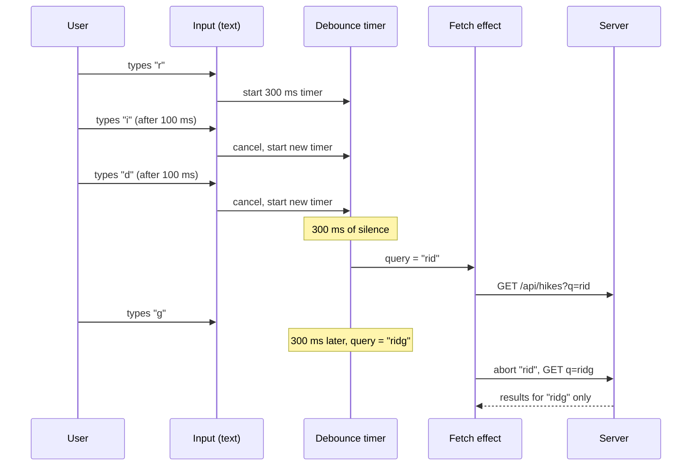
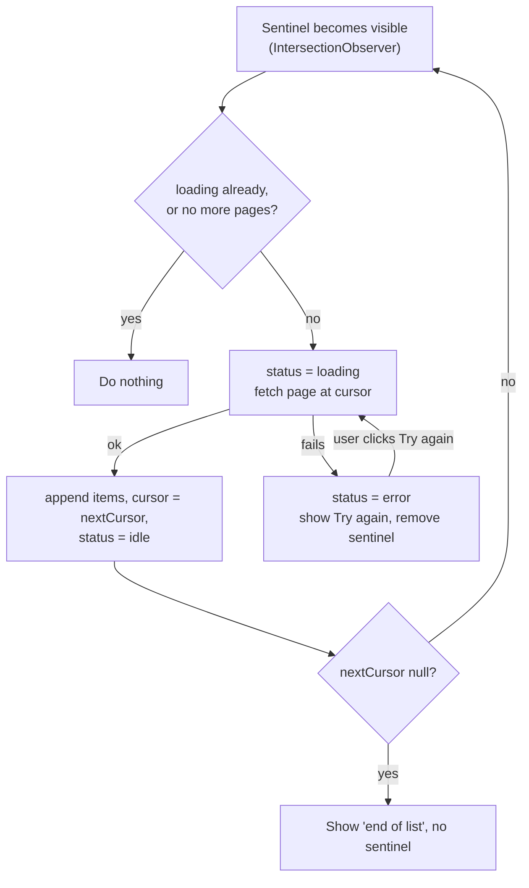

# Interview builds: debounced search, modal, infinite scroll

> **Before this lesson:** you need effects with cleanup ([useEffect and its dependency rules](#/lesson/react/useeffect)), custom hooks and refs ([Custom hooks and useRef](#/lesson/react/custom-hooks-refs)), data fetching with race protection ([Fetching data: loading, errors and races](#/lesson/react/data-fetching)), and the concepts reviewed in [Interview essentials: renders, keys, closures and effects](#/lesson/react/interview-concepts).

## In plain words

In a practical interview you are handed a small feature and asked to build it while explaining your thinking. Three requests come up constantly, because each one tests a different skill that everyday front-end work depends on:

- **A debounced search box.** Imagine a waiter who runs to the kitchen after every word you say: "I'd"… off he goes… "like"… off he goes. A good waiter waits until you stop talking, then takes the whole order. **Debouncing** is that patience: wait until the typing pauses, then send one request. It tests effects, cleanup and race conditions.
- **A modal dialog.** A **modal** is a window that appears on top of the page and must be dealt with before anything else, like a customs desk you cannot walk around. Building one that works for keyboard and screen-reader users tests your knowledge of **accessibility** (making interfaces usable by people with disabilities), focus and refs.
- **Infinite scroll.** Instead of "next page" buttons, more items load as you approach the bottom, like a paper towel roll that keeps unrolling. It tests pagination state, a browser API called `IntersectionObserver`, and guarding against duplicate requests.

For each build this lesson gives the requirements an interviewer has in mind, a worked solution in real React, the reasoning, and a live version you can run.

A general method that applies to all three: (1) restate the requirements and ask about edge cases, (2) say what state you need and where it lives, (3) build the simplest working version, (4) then handle loading, errors, cleanup and accessibility, narrating as you go.

## Build 1: debounced search

### Requirements

- An input. As the user types, show matching results from an API.
- Do not send a request for every keystroke: wait until typing has paused for about 300 ms.
- Show loading, error and "no results" states.
- Never show results for an older query than the one in the box.

### Step 1: debounce the value

There are two values to keep apart: the **text in the box**, which must update on every keystroke so that typing feels instant, and the **query to search for**, which should lag behind until typing pauses.

```jsx
function useDebouncedValue(value, delayMs) {
  const [debounced, setDebounced] = useState(value);

  useEffect(() => {
    const id = setTimeout(() => setDebounced(value), delayMs);
    return () => clearTimeout(id);
  }, [value, delayMs]);

  return debounced;
}
```

- `debounced` starts equal to `value`.
- Each time `value` changes, the effect starts a timer that will copy the new value into `debounced` after `delayMs`.
- The cleanup cancels that timer. React runs the cleanup before the next effect, so a new keystroke within the delay cancels the previous timer. Only the last timer, the one not followed by another keystroke, completes.
- On unmount the cleanup also runs, so no timer fires for a component that is gone.

That cleanup-cancels-the-previous-run behaviour is the whole trick. No library is needed.

### Step 2: fetch for the debounced value, safely

```jsx
function HikeSearch() {
  const [text, setText] = useState("");
  const query = useDebouncedValue(text.trim(), 300);
  const [state, setState] = useState({ status: "idle", results: [], error: null });

  useEffect(() => {
    if (query === "") {
      setState({ status: "idle", results: [], error: null });
      return;
    }

    const controller = new AbortController();
    setState((s) => ({ ...s, status: "loading", error: null }));

    fetch(`/api/hikes?q=${encodeURIComponent(query)}`, { signal: controller.signal })
      .then((response) => {
        if (!response.ok) throw new Error(`Server replied ${response.status}`);
        return response.json();
      })
      .then((results) => setState({ status: "success", results, error: null }))
      .catch((error) => {
        if (error.name !== "AbortError") setState({ status: "error", results: [], error: error.message });
      });

    return () => controller.abort();
  }, [query]);

  return (
    <div>
      <label htmlFor="hike-search">Search hikes</label>
      <input id="hike-search" type="search" value={text} onChange={(e) => setText(e.target.value)} />

      <div aria-live="polite">
        {state.status === "loading" && <p>Searching…</p>}
        {state.status === "error" && <p role="alert">Something went wrong: {state.error}</p>}
        {state.status === "success" && state.results.length === 0 && <p>No hikes match “{query}”.</p>}
      </div>

      <ul>
        {state.results.map((hike) => <li key={hike.id}>{hike.name}</li>)}
      </ul>
    </div>
  );
}
```

- `text` drives the input directly. `query` is the trimmed, debounced version.
- The fetch effect depends on `query` only, so it runs when the debounced value changes, not on every keystroke.
- An empty query resets to `idle` and sends nothing.
- `AbortController` cancels the previous request when `query` changes or the component unmounts. Debouncing reduces overlapping requests; it does not eliminate them (a slow response for "ri" can still be in flight when "ridge" is sent), so the race protection is still required.
- `status: "loading"` keeps the previous results on screen instead of clearing them, which avoids flicker.
- `aria-live="polite"` asks screen readers to announce changes in that region when they are not busy, so a blind user hears "Searching…" and "No hikes match".



### What to say out loud

- "I keep the input controlled and separate from the debounced query, so typing is never delayed."
- "The effect cleanup is what implements both the debounce and the request cancellation."
- "Debounce waits for a pause; **throttle** would instead allow at most one call per interval. Search wants debounce; scroll position tracking wants throttle."
- "In production I would likely use a data library with the debounced value as the query key, which adds caching for repeated queries."

**Follow-ups.** "Search immediately on Enter?" Wrap the input in a form and, on submit, set the query directly, bypassing the delay. "Minimum length?" Skip the request while `query.length < 2`. "Cache results?" A `Map` from query to results in a ref, or a query library. The problem *Debounced search controller* has you implement the timing logic with explicit timestamps.

## Build 2: an accessible modal dialog

### Requirements

A modal that looks right is easy. A modal that *works* must satisfy all of these:

1. It appears above the page; the page behind cannot be used while it is open.
2. When it opens, keyboard **focus** (which element receives typing and key presses) moves into it.
3. Pressing Tab cycles within the dialog and does not escape to the page behind. This is called a **focus trap**.
4. Pressing Escape closes it. Clicking the dark area around it (the **backdrop**) usually closes it too.
5. When it closes, focus returns to the element that opened it.
6. Screen readers are told that it is a dialog, what its title is, and that the content behind is inert.

Interviewers ask this precisely because most candidates stop after point 1.

### The modern solution: the native `<dialog>` element

Browsers have a built-in element that does almost all of it. Calling its `showModal()` method opens it in the **top layer** (above everything, no `z-index` battles), traps focus, makes everything outside inert, closes on Escape, and restores focus on close. Because opening is a *method call* on a DOM node, you need a ref and an effect to connect it to React state.

```jsx
import { useEffect, useRef } from "react";

function Modal({ isOpen, onClose, title, children }) {
  const dialogRef = useRef(null);

  useEffect(() => {
    const dialog = dialogRef.current;
    if (isOpen && !dialog.open) dialog.showModal();
    if (!isOpen && dialog.open) dialog.close();
  }, [isOpen]);

  function handleBackdropClick(event) {
    if (event.target === dialogRef.current) onClose();
  }

  return (
    <dialog ref={dialogRef} aria-labelledby="modal-title" onClose={onClose} onClick={handleBackdropClick}>
      <h2 id="modal-title">{title}</h2>
      {children}
      <button type="button" onClick={onClose}>Close</button>
    </dialog>
  );
}
```

- `isOpen` is owned by the parent: the modal is a controlled component.
- The effect synchronises React state with the DOM element: `showModal()` when it should be open, `close()` when it should not. This is a proper use of an effect: an external system (the browser's dialog machinery) kept in step with state.
- `onClose` is the dialog's native `close` event. It fires when the user presses Escape, so the parent's state is updated and stays in agreement with the DOM.
- `handleBackdropClick`: a click on the dimmed area lands on the `<dialog>` element itself, while a click on the content lands on a child. Comparing `event.target` with the dialog distinguishes them.
- `aria-labelledby="modal-title"` gives the dialog its accessible name: the heading's text.
- The close button has `type="button"` so it never submits a form placed inside.

Usage:

```jsx
function DeleteHikeButton({ hike, onDelete }) {
  const [isOpen, setIsOpen] = useState(false);
  return (
    <>
      <button onClick={() => setIsOpen(true)}>Delete</button>
      <Modal isOpen={isOpen} onClose={() => setIsOpen(false)} title="Delete this hike?">
        <p>“{hike.name}” will be removed permanently.</p>
        <button onClick={() => { onDelete(hike.id); setIsOpen(false); }}>Yes, delete</button>
      </Modal>
    </>
  );
}
```

Style the backdrop with the `::backdrop` pseudo-element: `dialog::backdrop { background: rgb(0 0 0 / 0.5); }`.

### If you are asked to build it without `<dialog>`

Some interviewers want to see the mechanics. Then you implement each requirement by hand:

```jsx
import { useEffect, useRef } from "react";
import { createPortal } from "react-dom";

function Modal({ isOpen, onClose, title, children }) {
  const panelRef = useRef(null);

  useEffect(() => {
    if (!isOpen) return;
    const previouslyFocused = document.activeElement;
    const panel = panelRef.current;
    const focusable = () => panel.querySelectorAll('a[href], button:not([disabled]), input, select, textarea, [tabindex]:not([tabindex="-1"])');
    (focusable()[0] ?? panel).focus();

    function handleKeyDown(event) {
      if (event.key === "Escape") onClose();
      if (event.key !== "Tab") return;
      const items = focusable();
      const first = items[0];
      const last = items[items.length - 1];
      if (event.shiftKey && document.activeElement === first) { event.preventDefault(); last.focus(); }
      else if (!event.shiftKey && document.activeElement === last) { event.preventDefault(); first.focus(); }
    }

    document.addEventListener("keydown", handleKeyDown);
    document.body.style.overflow = "hidden";
    return () => {
      document.removeEventListener("keydown", handleKeyDown);
      document.body.style.overflow = "";
      previouslyFocused?.focus();
    };
  }, [isOpen, onClose]);

  if (!isOpen) return null;

  return createPortal(
    <div className="backdrop" onClick={onClose}>
      <div ref={panelRef} role="dialog" aria-modal="true" aria-labelledby="modal-title" tabIndex={-1} onClick={(e) => e.stopPropagation()}>
        <h2 id="modal-title">{title}</h2>
        {children}
      </div>
    </div>,
    document.body
  );
}
```

- `createPortal(jsx, domNode)` renders the JSX into a different place in the DOM (here the end of `<body>`), escaping any ancestor with `overflow: hidden` or its own stacking order, while it remains a normal child in the React tree: context and event bubbling through React still work.
- On open: remember `document.activeElement` (the element that had focus), then move focus to the first focusable element in the panel.
- The key handler closes on Escape and implements the focus trap: Tab on the last element wraps to the first, Shift+Tab on the first wraps to the last.
- `document.body.style.overflow = "hidden"` stops the page behind from scrolling.
- The cleanup undoes all of it and gives focus back.
- `role="dialog"` and `aria-modal="true"` tell assistive technology what this is. `tabIndex={-1}` makes the panel focusable by script as a fallback.
- `e.stopPropagation()` on the panel prevents clicks inside from reaching the backdrop's close handler.

Then say: "In production I would use the native `<dialog>` or a well-tested library such as Radix UI or React Aria, because the edge cases (nested dialogs, screen-reader quirks, scroll locking on mobile) are numerous."

## Build 3: infinite scroll

### Requirements

- Show the first page of a long list.
- When the user scrolls near the end, load the next page and append it.
- Show a loading indicator while fetching, an error with a retry, and an end-of-list message.
- Never request the same page twice, and never request while a request is in flight.

### The tool: IntersectionObserver

Listening to `scroll` events and doing arithmetic with scroll positions fires dozens of times per second and is easy to get wrong. `IntersectionObserver` is a browser API that tells you when an element enters or leaves the visible area. The pattern: put an invisible **sentinel** element after the last item and load more when it becomes visible.

### State

| State | Why |
|---|---|
| `items` | everything loaded so far |
| `cursor` | where the next page starts (`null` when there is nothing more) |
| `status` | `"idle"`, `"loading"` or `"error"` |

`hasMore` is derived: `cursor !== null`.

```jsx
function HikeFeed() {
  const [items, setItems] = useState([]);
  const [cursor, setCursor] = useState(0);
  const [status, setStatus] = useState("idle");
  const sentinelRef = useRef(null);
  const hasMore = cursor !== null;

  const loadMore = useCallback(async () => {
    if (status === "loading" || !hasMore) return;
    setStatus("loading");
    try {
      const page = await fetchHikePage(cursor);
      setItems((previous) => [...previous, ...page.items]);
      setCursor(page.nextCursor);
      setStatus("idle");
    } catch {
      setStatus("error");
    }
  }, [status, hasMore, cursor]);

  useEffect(() => {
    const sentinel = sentinelRef.current;
    if (!sentinel || !hasMore) return;

    const observer = new IntersectionObserver(
      (entries) => {
        if (entries[0].isIntersecting) loadMore();
      },
      { rootMargin: "200px" }
    );
    observer.observe(sentinel);
    return () => observer.disconnect();
  }, [loadMore, hasMore]);

  return (
    <div>
      <ul>
        {items.map((hike) => <li key={hike.id}>{hike.name}</li>)}
      </ul>

      {status === "loading" && <p aria-live="polite">Loading more…</p>}
      {status === "error" && (
        <p role="alert">Could not load more. <button onClick={loadMore}>Try again</button></p>
      )}
      {!hasMore && <p>You have reached the end.</p>}

      {hasMore && status !== "error" && <div ref={sentinelRef} style={{ height: 1 }} />}
      {hasMore && status === "idle" && <button onClick={loadMore}>Load more</button>}
    </div>
  );
}
```

- `loadMore` begins with a **guard**: do nothing if a request is already running or there is nothing left. Without it, the observer firing twice in quick succession would request the same page twice.
- `setItems((previous) => [...previous, ...page.items])` appends with the updater form, so it never works from an outdated list.
- `page.nextCursor` comes from the server: where to continue, or `null` at the end. Cursor-based pagination is the right partner for infinite scroll, because items added at the top do not shift the pages ([Sorting, searching, pagination and optimistic updates](#/lesson/react/sort-search-paginate)).
- `useCallback` makes `loadMore` change only when `status`, `hasMore` or `cursor` change, so it can be an effect dependency without re-creating the observer on unrelated renders.
- The effect creates the observer, watches the sentinel and disconnects in the cleanup. `rootMargin: "200px"` extends the visible area by 200 pixels, so loading starts a little before the user reaches the end.
- When `status` flips back to `"idle"`, `loadMore` gets a new identity, the effect re-runs, and a fresh observer reports immediately whether the sentinel is (still) visible. That handles the case where a page was too short to push the sentinel off screen.
- The sentinel is removed in the error state, so a failing request is not retried in an endless loop; the user retries with the button.
- The visible "Load more" button is the keyboard- and assistive-technology-friendly path, and a fallback if the observer is unavailable.



### What to say out loud

- "The guard and the cursor together prevent duplicate and overlapping requests."
- "A list that grows without bound will eventually make the page heavy. For thousands of items I would add **virtualisation**: render only the rows near the viewport."
- "Infinite scroll has usability costs: the footer becomes unreachable, the Back button loses the position, and it is hard to return to 'the thing I saw earlier'. For search results or anything users compare, pagination is often better. I would raise that with the designer."
- "If the query can change (a filter), I reset `items` and `cursor` when it does, and ignore responses for the old query."

## Run it: all three, live

First, the debounced search against a fake API with a request log. Watch how many requests are sent as you type.

```html-run
<label for="q">Search hikes: </label><input id="q" type="search" autocomplete="off" />
<label><input type="checkbox" id="debounce" checked /> debounce 300 ms</label>
<p id="status" aria-live="polite"></p>
<ul id="results"></ul>
<p><small id="stats"></small></p>
<script>
  const HIKES = ["Ridge Loop", "Rim Trail", "River Bend", "Raven Peak", "Fern Gully", "Salt Marsh", "Granite Stair", "Windy Gap"];
  let requestsSent = 0, keystrokes = 0;
  function fakeApi(query, signal) {                     // answers after 200-700 ms, supports abort
    requestsSent++;
    return new Promise((resolve, reject) => {
      const id = setTimeout(() => resolve(HIKES.filter((n) => n.toLowerCase().includes(query.toLowerCase()))), 200 + Math.random() * 500);
      signal.addEventListener("abort", () => { clearTimeout(id); reject(Object.assign(new Error("aborted"), { name: "AbortError" })); });
    });
  }
  const show = (status, results) => {
    document.getElementById("status").textContent = status;
    if (results) document.getElementById("results").innerHTML = results.map((n) => `<li>${n}</li>`).join("");
    document.getElementById("stats").textContent = `keystrokes: ${keystrokes}, requests sent: ${requestsSent}`;
  };

  let timer = null, controller = null;                  // what the two effect cleanups manage
  function search(query) {
    if (controller) controller.abort();                 // cleanup of the previous fetch effect
    if (query === "") return show("", []);
    controller = new AbortController();
    show("Searching…");
    fakeApi(query, controller.signal).then(
      (results) => show(results.length ? "" : `No hikes match "${query}".`, results),
      (error) => { if (error.name !== "AbortError") show("Something went wrong."); });
  }
  document.getElementById("q").addEventListener("input", (event) => {
    keystrokes++;
    const query = event.target.value.trim();
    clearTimeout(timer);                                // cleanup of the previous debounce effect
    if (document.getElementById("debounce").checked) timer = setTimeout(() => search(query), 300);
    else search(query);
    show(document.getElementById("status").textContent);
  });
  show("", []);
</script>
```

Type `ridge` at normal speed with the box ticked: five keystrokes, one request. Untick it and type again: five requests, four of them aborted.

Second, the modal using the native `<dialog>`. Use only the keyboard: Tab to the button, Enter to open, Tab around inside, Escape to close, and notice where focus lands afterwards.

```html-run
<button id="open">Delete hike…</button>
<button>Another button on the page</button>
<p id="note" style="font-family:sans-serif"></p>
<dialog id="modal" aria-labelledby="modal-title">
  <h2 id="modal-title">Delete this hike?</h2>
  <p>“Ridge Loop” will be removed permanently.</p>
  <button id="confirm">Yes, delete</button>
  <button id="cancel">Cancel</button>
</dialog>
<style>
  dialog { border: 0; border-radius: 10px; padding: 16px 20px; font-family: sans-serif; max-width: 320px; }
  dialog::backdrop { background: rgb(0 0 0 / 0.5); }
  button { margin: 4px; padding: 6px 12px; }
</style>
<script>
  const dialog = document.getElementById("modal");
  const note = document.getElementById("note");
  let isOpen = false;                                    // the React state
  function setIsOpen(next, reason) {
    isOpen = next;
    if (isOpen && !dialog.open) dialog.showModal();      // the effect: keep the DOM in step with state
    if (!isOpen && dialog.open) dialog.close();
    if (reason) note.textContent = reason + " Focus is now on: " + (document.activeElement.textContent || document.activeElement.tagName);
  }
  document.getElementById("open").addEventListener("click", () => setIsOpen(true));
  document.getElementById("cancel").addEventListener("click", () => setIsOpen(false, "Closed with Cancel."));
  document.getElementById("confirm").addEventListener("click", () => setIsOpen(false, "Deleted."));
  dialog.addEventListener("close", () => { if (isOpen) setIsOpen(false, "Closed with Escape."); });      // onClose: sync state when the browser closes it
  dialog.addEventListener("click", (event) => { if (event.target === dialog) setIsOpen(false, "Closed by clicking the backdrop."); });
</script>
```

Third, infinite scroll in a small scrollable box, with a fake paged API that fails once on purpose.

```html-run
<div id="box" style="height:190px;overflow:auto;border:1px solid #bbb;border-radius:6px;font-family:sans-serif;padding:0 10px">
  <ul id="list" style="padding-left:18px"></ul>
  <p id="status" aria-live="polite"></p>
  <div id="sentinel" style="height:1px"></div>
</div>
<p><small id="stats" style="font-family:sans-serif"></small></p>
<script>
  const TOTAL = 43, PAGE = 10;
  let failNext = true, requests = 0;
  function fetchPage(cursor) {                           // fake cursor-paginated API
    requests++;
    return new Promise((resolve, reject) => setTimeout(() => {
      if (cursor === 20 && failNext) { failNext = false; return reject(new Error("network")); }
      const items = Array.from({ length: Math.min(PAGE, TOTAL - cursor) }, (_, i) => ({ id: cursor + i + 1, name: "Trail " + (cursor + i + 1) }));
      resolve({ items, nextCursor: cursor + items.length < TOTAL ? cursor + items.length : null });
    }, 500));
  }

  let state = { items: [], cursor: 0, status: "idle" };
  const sentinel = document.getElementById("sentinel");
  function draw() {
    const hasMore = state.cursor !== null;
    document.getElementById("list").innerHTML = state.items.map((item) => `<li>${item.name}</li>`).join("");
    document.getElementById("status").innerHTML =
      state.status === "loading" ? "Loading more…" :
      state.status === "error" ? `Could not load more. <button onclick="loadMore()">Try again</button>` :
      !hasMore ? "You have reached the end." : "";
    sentinel.style.display = hasMore && state.status !== "error" ? "block" : "none";
    document.getElementById("stats").textContent = `${state.items.length} of ${TOTAL} items loaded, ${requests} requests`;
  }
  async function loadMore() {
    if (state.status === "loading" || state.cursor === null) return;        // the guard
    state = { ...state, status: "loading" }; draw();
    try {
      const page = await fetchPage(state.cursor);
      state = { items: [...state.items, ...page.items], cursor: page.nextCursor, status: "idle" };
    } catch { state = { ...state, status: "error" }; }
    draw();
    observe();                                           // like the effect re-running: check the sentinel again
  }
  let observer = null;
  function observe() {
    if (observer) observer.disconnect();
    observer = new IntersectionObserver((entries) => { if (entries[0].isIntersecting) loadMore(); },
      { root: document.getElementById("box"), rootMargin: "60px" });
    observer.observe(sentinel);
  }
  draw();
  observe();
</script>
```

Scroll down inside the box. Pages of ten arrive as you near the bottom. The third page fails once: the sentinel disappears, a retry button is shown, and nothing loops. After the retry, loading resumes until "You have reached the end". The request counter never exceeds one per page plus the one failure.

## Pitfalls

> [!WARNING]
> **Building a "modal" from a `<div>` with a click handler and nothing else.** It traps mouse users visually while keyboard users tab into the page behind it, screen-reader users are not told a dialog opened, and Escape does nothing. If you take one thing from this lesson: a dialog must manage focus.

**Debounced search**

- Debouncing the input's own value, so typing lags. Debounce the derived query only.
- Creating the debounced function inside the component on every render (a new timer each time, nothing is cancelled). The effect-with-cleanup form avoids this.
- Assuming debounce removes the need for race protection.
- No handling for the empty query, errors or "no results".

**Modal**

- Not returning focus to the trigger on close.
- Closing only through the button, so the dialog's state and the DOM disagree after Escape.
- Rendering inside a container with `overflow: hidden` without a portal or `<dialog>`, so the modal is clipped.
- No accessible name (`aria-labelledby` or `aria-label`).

**Infinite scroll**

- No in-flight guard: duplicate pages and duplicate keys.
- Using `scroll` events without throttling.
- Not disconnecting the observer.
- Retrying automatically forever after an error.
- Using the array index as key while appending and, later, prepending items.
- No keyboard-accessible way to load more, and no end-of-list message.

> [!TIP]
> Before you start coding in an interview, write the requirements as a short checklist on screen and tick them off. It shows structure, protects you from forgetting the unglamorous parts (cleanup, error state, focus), and gives the interviewer an easy way to follow along.

> [!INTERVIEW]
> When you finish any build, volunteer a one-minute review: *what I would test* (the debounce with fake timers, the dialog with `userEvent.keyboard("{Escape}")`, the feed with a mocked observer), *what I would improve with more time* (caching, virtualisation, a library for the dialog), and *one trade-off I made*. Candidates who assess their own work stand out.

## Cheat sheet

| Build | Core idea | Key APIs | Must not forget |
|---|---|---|---|
| Debounced search | separate instant text from delayed query | `setTimeout` + cleanup, `AbortController` | race protection, empty/error/no-result states, `aria-live` |
| Modal | controlled `isOpen`, synced to a dialog | `<dialog>.showModal()`, `onClose`, ref; or portal + `role="dialog"` | focus in, focus trap, Escape, focus back, accessible name |
| Infinite scroll | sentinel + cursor + guard | `IntersectionObserver`, `useCallback`, updater setState | in-flight guard, disconnect, error retry, end state, load-more button |

| Term | Difference |
|---|---|
| Debounce | run once after activity stops for N ms |
| Throttle | run at most once every N ms during activity |

## Summary

- Debounced search: keep the input value immediate, derive a delayed query with a timer cancelled in the effect cleanup, and abort outdated requests.
- Accessible modal: prefer the native `<dialog>` with `showModal()`, synchronised with state in an effect; otherwise implement focus movement, focus trap, Escape, focus restoration and ARIA attributes by hand, in a portal.
- Infinite scroll: observe a sentinel with `IntersectionObserver`, load by cursor, guard against overlapping requests, and handle error and end-of-list states.
- In all three, the effect's cleanup function does the important work: cancelling timers, aborting requests, removing listeners and observers.
- Explain requirements, state, edge cases and trade-offs as you build.

## Glossary

- **Debounce**: delay an action until input has been quiet for a set time.
- **Throttle**: limit an action to at most once per time interval.
- **Modal dialog**: an overlay that blocks interaction with the page until dismissed.
- **Accessibility (a11y)**: usability for people with disabilities, including keyboard and screen-reader users.
- **Focus**: the element that currently receives keyboard input.
- **Focus trap**: keeping Tab navigation inside a region.
- **Backdrop**: the dimmed area behind a dialog.
- **Top layer**: a browser layer above all page content, used by modal dialogs.
- **Portal**: rendering React children into a different DOM node (`createPortal`).
- **ARIA**: attributes that describe roles and states to assistive technology.
- **`aria-live`**: marks a region whose changes should be announced.
- **IntersectionObserver**: a browser API reporting when an element enters or leaves the visible area.
- **Sentinel**: a marker element watched to detect reaching a position.
- **Cursor**: a marker for where the next page of data starts.

## Check yourself

```quiz
[
  {"q": "useDebouncedValue(text, 300): the user types 5 characters, 100 ms apart, then stops. How many times does the debounced value change?",
   "options": ["5", "1", "0", "2"],
   "answer": 1,
   "explain": "Each keystroke's cleanup cancels the previous timer. Only the final timer survives its 300 ms."},
  {"q": "In the debounced search, why is an AbortController (or ignore flag) still needed?",
   "options": ["It is not needed once you debounce", "A slow response for an earlier debounced query can still arrive after a newer one; debouncing reduces overlap but does not remove it", "To make typing faster", "Because setTimeout is unreliable"],
   "answer": 1,
   "explain": "Two debounced queries a second apart can both be in flight. Race protection is a separate concern."},
  {"q": "Which state should be tied directly to the input's value prop?",
   "options": ["The debounced query", "The immediate text, updated on every keystroke", "The results", "The status"],
   "answer": 1,
   "explain": "If the input showed the debounced value, typed characters would appear late."},
  {"q": "Which of these does dialog.showModal() NOT give you automatically?",
   "options": ["Focus moved into the dialog", "Closing on Escape", "Keeping your React isOpen state in sync when the user presses Escape", "Making the page behind inert"],
   "answer": 2,
   "explain": "The browser closes the dialog, but your state still says open until you handle the close event and update it."},
  {"q": "A custom div-based modal closes. Where should keyboard focus go?",
   "options": ["To the top of the page", "Back to the element that opened the modal", "Nowhere", "To the browser address bar"],
   "answer": 1,
   "explain": "Restoring focus lets keyboard and screen-reader users continue where they were."},
  {"q": "What does createPortal do?",
   "options": ["Opens a new browser window", "Renders children into a different DOM node while keeping them in the same React tree for context and events", "Fetches data from another origin", "Creates an iframe"],
   "answer": 1,
   "explain": "It solves clipping and stacking problems for overlays without breaking React's data flow."},
  {"q": "In the infinite scroll, the observer callback fires twice in quick succession while the first request is still running. With the guard in loadMore, how many requests are sent for that page?",
   "options": ["2", "1", "0", "It depends on the network"],
   "answer": 1,
   "explain": "The second call sees status === 'loading' and returns immediately."},
  {"q": "Why is the sentinel removed while the feed is in the error state?",
   "options": ["To save memory", "Otherwise it would still be visible and trigger automatic retries in a loop; the user should retry deliberately", "Because errors hide all elements", "IntersectionObserver cannot observe after an error"],
   "answer": 1,
   "explain": "A visible sentinel plus a failing endpoint would hammer the server. A retry button puts the user in control."}
]
```

> **Source:** Wieruch, *The Road to React*, "Fundamentals of React": React Side-Effects, React Custom Hooks (Advanced), Imperative React, Data Re-Fetching in React; "Real World React (Advanced)": Paginated Fetch. Documentation: https://react.dev/learn/synchronizing-with-effects, https://react.dev/reference/react-dom/createPortal, https://developer.mozilla.org/en-US/docs/Web/HTML/Element/dialog, https://developer.mozilla.org/en-US/docs/Web/API/Intersection_Observer_API, https://www.w3.org/WAI/ARIA/apg/patterns/dialog-modal/
