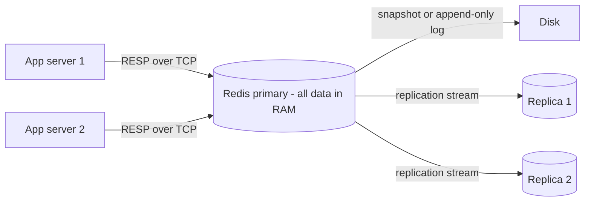

# What Redis is and the five core data structures

> **Before this lesson:** nothing is assumed. If you can open a terminal and have seen a little
> Python, you are ready. Every technical word is explained when it first appears, and collected in
> the glossary at the end.

## In plain words

A **database** is a program that stores information for other programs and hands it back on
request. Most databases keep their information on a disk, organised into tables with rows and
columns, and you ask questions in a language called SQL. They are built to be careful and general.

**Redis** is a different kind of store, built to be *fast*. It keeps everything in the computer's
working memory (**RAM**), which is thousands of times quicker to reach than a disk. And instead of
tables it gives you a few ready-made containers: a labelled box for one value, a queue, a bag of
unique items, a small record, and a ranking table.

An everyday picture: the main database is the filing room in the basement - complete, orderly, and a
walk away. Redis is the whiteboard and the sticky notes next to your desk: the things you need to
see or update many times a minute. You would not keep the company's legal archive on sticky notes,
and you would not walk to the basement to check who is next in the queue.

Each piece of information in Redis is stored under a name called a **key**, and what is stored is
its **value**. A program that talks to Redis is a **client**; Redis itself is the **server**; one
instruction sent to it, such as "set this key", is a **command**.

Why this matters for a job: Redis is among the most widely used pieces of backend software. It is
the usual answer for caching (keeping copies of slow results), login sessions, counters, rankings,
queues and rate limits, and questions about it are routine in backend interviews.

The examples below type commands into `redis-cli`, a small program shipped with Redis that sends
what you type to the server and prints the reply. The text before the `>` is its prompt.

## Why bother with another database?

Picture a small team that runs a ride-sharing dashboard. The relational database copes happily with trips,
invoices and driver records, yet three features keep hurting: the "drivers near you" counter that must
update many times per second, the login session that every single request has to look up, and the
"top earners this hour" board that needs a fresh ranking on each page view. None of these is hard to
*express* in SQL. They are hard to make *fast*, because each one is a tiny read or write that happens
thousands of times a second, and a disk-backed, query-planning, row-locking engine pays a fixed tax on
every one of them.

Redis exists for exactly that class of work. It is a server that keeps all of its data in RAM, speaks a
tiny text protocol, and instead of tables offers a handful of ready-made data structures - strings,
lists, sets, hashes and sorted sets, plus several newer ones - that you manipulate with single
commands. Because the structures live on the server, an operation such as "add this member to the set
and tell me whether it was new" is one network round trip, not a read-modify-write dance in your
application code.

This lesson gives you the mental model: what kind of system Redis is, how it compares with its
neighbours, what the five classic structures look like, and what each costs. Later modules go deep on
every one of these.

## The mental model in five sentences

1. **It is a remote data-structure server.** Each key names one value, and that value has a *type*:
   a string, a list, a set, a hash, a sorted set (and more recently a stream, a HyperLogLog, and so on).
2. **Everything lives in memory.** Reads and writes never wait for a disk seek, which is why a single
   instance comfortably serves on the order of a hundred thousand simple commands per second.
3. **Commands run one at a time.** A single thread executes commands, so each command is atomic with
   respect to every other command. There are no row locks because there is nothing to lock against.
4. **Durability is optional and tunable.** Redis can write point-in-time snapshots, an append-only log
   of every write, both, or neither.
5. **It replicates.** Any instance can feed copies of its data to replicas, which serve reads and act
   as standbys.



> [!NOTE]
> The name is a contraction of **RE**mote **DI**ctionary **S**erver. A dictionary whose values are
> themselves data structures is a fair one-line description of the whole product.

## Redis next to its neighbours

It helps to place Redis against tools you may already know.

| System | Where data lives | Data model | Query style | Typical job |
|---|---|---|---|---|
| Redis | RAM, optional disk persistence | key → typed structure | one command per operation, Lua scripts | caches, counters, queues, rankings, sessions |
| Memcached | RAM only | key → opaque blob | get / set / incr | plain cache |
| PostgreSQL, MySQL | disk, cached in RAM | tables and rows | SQL with joins | system of record |
| MongoDB | disk, cached in RAM | JSON-like documents | query documents | flexible records |
| Kafka | disk log | partitioned append-only log | consume by offset | event pipelines |

Two comparisons deserve a closer look.

**Redis versus Memcached.** Both are in-memory key-value servers. Memcached stores opaque byte strings
and is multi-threaded; that is essentially the whole feature list, and it does that one job extremely
well. Redis adds server-side structures, persistence, replication, transactions, scripting and
publish/subscribe. If you only ever `get` and `set` blobs, either works. The moment you want "the ten
highest scores" or "pop one job from the queue, atomically", Memcached forces you to fetch a blob,
decode it, change it and write it back while hoping nobody else did the same thing in between.

**Redis versus a relational database.** A relational engine gives you ad-hoc queries, joins,
constraints, and data sets far larger than RAM. Redis gives you none of that. There is no query
planner: you decide up front how you will read the data and you build the structure that makes that
read cheap. That is the central design skill this whole track teaches - *model the access pattern, not
the entity*.

> [!INTERVIEW]
> "Is Redis single-threaded?" The precise answer: command execution is single-threaded, so commands
> never interleave. Background threads handle slow chores such as closing files, lazy freeing of big
> values and fsync, and since version 6 optional I/O threads can read and write sockets in parallel.
> The data itself is still touched by one thread at a time.

## Keys, values and naming

A key is a binary-safe string. By convention people build keys from colon-separated parts that read
like a path: `driver:8841`, `driver:8841:trips`, `zone:downtown:waiting`. Redis attaches no meaning to
the colons; the convention only makes keys greppable and lets tools group them.

Good key design rules:

- Put the *kind of thing* first and the identifier after it (`trip:551`, not `551:trip`).
- Keep keys short but readable. A million keys with a 40-byte prefix is 40 MB of prefixes.
- Never build keys from unvalidated user input without a fixed prefix; you do not want a user naming
  a key that collides with your internal ones.

Every command names the key it operates on, and the type of the value decides which commands are
legal. Calling a list command on a set fails with a `WRONGTYPE` error rather than silently converting.

## Structure 1 - strings

A string value is a byte sequence up to 512 MB. It may hold text, a serialized object, a JPEG, or a
number written in decimal. When the bytes parse as an integer, counter commands work on it.

```bash
127.0.0.1:6379> SET zone:downtown:label "Downtown core"
OK
127.0.0.1:6379> GET zone:downtown:label
"Downtown core"
127.0.0.1:6379> INCR zone:downtown:requests
(integer) 1
127.0.0.1:6379> INCRBY zone:downtown:requests 4
(integer) 5
127.0.0.1:6379> GET no:such:key
(nil)
127.0.0.1:6379> DEL zone:downtown:label
(integer) 1
```

`INCR` on a missing key treats it as zero, so there is no "create the counter first" step. A missing
key returns `nil`, which redis-py turns into Python's `None`.

## Structure 2 - lists

A list is an ordered sequence of strings with cheap insertion and removal at both ends. Think
double-ended queue rather than array.

```bash
127.0.0.1:6379> RPUSH driver:8841:route "pickup:oak-st" "drop:pier-9"
(integer) 2
127.0.0.1:6379> LPUSH driver:8841:route "pickup:mill-rd"
(integer) 3
127.0.0.1:6379> LRANGE driver:8841:route 0 -1
1) "pickup:mill-rd"
2) "pickup:oak-st"
3) "drop:pier-9"
127.0.0.1:6379> LPOP driver:8841:route
"pickup:mill-rd"
127.0.0.1:6379> LINDEX driver:8841:route 0
"pickup:oak-st"
```

`RPUSH` appends on the right (tail), `LPUSH` on the left (head). Indices are zero-based and negative
indices count from the end, so `0 -1` means "everything". Lists are the natural home for queues,
recent-activity feeds and anything where arrival order matters.

## Structure 3 - sets

A set is an unordered collection of distinct strings. Membership tests are constant time and the
server can combine sets for you.

```bash
127.0.0.1:6379> SADD zone:downtown:online 8841 9002 7310
(integer) 3
127.0.0.1:6379> SADD zone:downtown:online 9002
(integer) 0
127.0.0.1:6379> SISMEMBER zone:downtown:online 7310
(integer) 1
127.0.0.1:6379> SADD drivers:xl 9002 5555
(integer) 2
127.0.0.1:6379> SINTER zone:downtown:online drivers:xl
1) "9002"
127.0.0.1:6379> SREM zone:downtown:online 8841
(integer) 1
```

The reply to `SADD` is the number of members that were *actually* added, which is how you learn in one
step whether something was already present. `SINTER` answered "which online downtown drivers have an
XL vehicle?" without shipping either set to the client.

## Structure 4 - hashes

A hash maps field names to string values inside a single key - a small record.

```bash
127.0.0.1:6379> HSET driver:8841 name "Imani" rating 4.92 trips 1204
(integer) 3
127.0.0.1:6379> HGET driver:8841 rating
"4.92"
127.0.0.1:6379> HINCRBY driver:8841 trips 1
(integer) 1205
127.0.0.1:6379> HGETALL driver:8841
1) "name"
2) "Imani"
3) "rating"
4) "4.92"
5) "trips"
6) "1205"
```

Compared with storing a JSON blob in a string, a hash lets you read or change one field without
rewriting the rest, and counters inside it stay atomic.

## Structure 5 - sorted sets

A sorted set (ZSET) is a set in which every member carries a floating-point **score**. Members are
unique; the collection is kept ordered by score, with ties broken by comparing the member bytes.
You can fetch by rank, by score range, or look up one member's score or rank directly.

```bash
127.0.0.1:6379> ZADD earnings:hour 182.5 8841 240 9002 97.25 7310
(integer) 3
127.0.0.1:6379> ZINCRBY earnings:hour 60 7310
"157.25"
127.0.0.1:6379> ZREVRANGE earnings:hour 0 1 WITHSCORES
1) "9002"
2) "240"
3) "8841"
4) "182.5"
127.0.0.1:6379> ZRANK earnings:hour 7310
(integer) 0
127.0.0.1:6379> ZRANGEBYSCORE earnings:hour 150 200
1) "7310"
2) "8841"
```

This single structure powers leaderboards, priority queues, time-ordered indexes (use a timestamp as
the score), rate limiters and autocomplete. If you remember one thing from this lesson, remember that
"keep things sorted and let me ask for a slice" is a one-command operation in Redis.

## The same tour from Python

The standard client is `redis-py`. Passing `decode_responses=True` makes replies come back as `str`
instead of `bytes`.

```python
import redis

r = redis.Redis(host="localhost", port=6379, decode_responses=True)

r.set("zone:downtown:label", "Downtown core")
print(r.get("zone:downtown:label"))            # Downtown core
print(r.incr("zone:downtown:requests"))        # 1

r.rpush("driver:8841:route", "pickup:oak-st", "drop:pier-9")
print(r.lrange("driver:8841:route", 0, -1))    # ['pickup:oak-st', 'drop:pier-9']

print(r.sadd("zone:downtown:online", 8841, 9002))   # 2  (both were new)
print(r.sismember("zone:downtown:online", 9002))    # True (1 on older client versions)

r.hset("driver:8841", mapping={"name": "Imani", "trips": 1204})
print(r.hgetall("driver:8841"))                # {'name': 'Imani', 'trips': '1204'}

r.zadd("earnings:hour", {"8841": 182.5, "9002": 240})
print(r.zrevrange("earnings:hour", 0, 0, withscores=True))   # [('9002', 240.0)]
```

Three details trip people up. First, numbers come back as strings (`'1204'`): Redis stores bytes, and
only commands like `INCR` interpret them. Second, `zadd` takes a `{member: score}` mapping, which is
the reverse of the wire order `score member`. Third, without `decode_responses=True` every reply is
`bytes`, and `b"9002" != "9002"` will quietly break your comparisons.

## A simulation you can run here

The browser cannot open a TCP connection to a Redis server, so throughout this track the runnable
blocks use a small pure-Python model of the server. The model below implements a slice of each of the
five types and enforces the same type rule that Redis does. Run it, then try calling a list command on
the key that holds a hash.

```python-run
import bisect

class WrongType(Exception):
    pass

class ZSet:
    def __init__(self): self.items, self.score = [], {}
    def add(self, score, member):
        new = member not in self.score
        if not new: self.items.remove((self.score[member], member))
        bisect.insort(self.items, (score, member)); self.score[member] = score
        return int(new)

class TinyRedis:
    """A teaching model of the five classic types (no networking, no expiry)."""
    def __init__(self):
        self.db = {}

    def _get(self, key, kind):
        if key not in self.db:
            self.db[key] = kind()
        if not isinstance(self.db[key], kind):
            raise WrongType("WRONGTYPE Operation against a key holding the wrong kind of value")
        return self.db[key]

    # strings
    def set(self, key, value): self.db[key] = str(value); return "OK"
    def get(self, key): return self.db.get(key)
    def incr(self, key, by=1):
        n = int(self.db.get(key, "0")) + by
        self.db[key] = str(n)
        return n
    # lists
    def rpush(self, key, *vals): l = self._get(key, list); l.extend(vals); return len(l)
    def lpush(self, key, *vals):
        l = self._get(key, list)
        for v in vals: l.insert(0, v)
        return len(l)
    def lrange(self, key, start, stop):
        l = self._get(key, list)
        stop = len(l) + stop if stop < 0 else stop
        return l[start:stop + 1]
    # sets
    def sadd(self, key, *members):
        s = self._get(key, set); before = len(s); s.update(members); return len(s) - before
    def sinter(self, a, b): return sorted(self._get(a, set) & self._get(b, set))
    # hashes
    def hset(self, key, field, value): self._get(key, dict)[field] = str(value)
    def hgetall(self, key): return dict(self._get(key, dict))
    # sorted sets: a sorted list of (score, member) pairs plus a member -> score dict
    def zadd(self, key, score, member): return self._get(key, ZSet).add(score, member)
    def zrevrange(self, key, start, stop):
        return [m for _, m in reversed(self._get(key, ZSet).items)][start:stop + 1]

r = TinyRedis()
print(r.incr("zone:downtown:requests"), r.incr("zone:downtown:requests", 4))
r.rpush("driver:8841:route", "pickup:oak-st", "drop:pier-9"); r.lpush("driver:8841:route", "pickup:mill-rd")
print(r.lrange("driver:8841:route", 0, -1))
print(r.sadd("online", "8841", "9002", "7310"), r.sadd("online", "9002"))
r.sadd("xl", "9002", "5555"); print(r.sinter("online", "xl"))
r.hset("driver:8841", "name", "Imani"); r.hset("driver:8841", "trips", 1204); print(r.hgetall("driver:8841"))
for score, who in [(182.5, "8841"), (240, "9002"), (97.25, "7310")]: r.zadd("earnings", score, who)
r.zadd("earnings", 300, "7310")          # re-adding a member only moves it
print(r.zrevrange("earnings", 0, 1))
try:
    r.rpush("driver:8841", "oops")
except WrongType as e:
    print("error:", e)
```

The output shows the counter reaching 5, the route in head-to-tail order, `3 0` for the two `SADD`
calls (three new members, then zero), the single common member, the hash as a dict, the two best
earners after the update, and finally the type error. The real server stores sorted sets in a skip
list paired with a hash table rather than a Python list, which is what makes its inserts logarithmic;
our list-based model is linear but behaves identically from the outside.

## Persistence and replication in one paragraph each

**Persistence.** With *snapshotting* (RDB) the server forks a child process that writes the whole data
set to a compact file; you lose whatever changed since the last snapshot if the machine dies. With the
*append-only file* (AOF) every write command is appended to a log that is replayed at start-up; how
often that log is forced to disk (`always`, `everysec`, `no`) decides how much you can lose. Many
deployments enable both. Module 4 covers the trade-offs in detail.

**Replication.** A replica connects to a primary, receives a full copy, then applies the stream of
write commands as they happen. Replication is asynchronous by default, so a replica may lag a few
milliseconds behind, and an acknowledged write can still be lost if the primary dies before forwarding
it. Replicas give you read capacity and a warm standby; they do not by themselves give you automatic
failover - that is the job of Sentinel or Redis Cluster, covered in the Modern Redis module.

## When Redis is the right tool - and when it is not

Good fits:

- **Caching** results that are expensive to compute and tolerable to lose.
- **Ephemeral state** with a natural lifetime: sessions, one-time codes, rate-limit windows.
- **Counters and rankings** that change on every request.
- **Coordination** between processes: queues, locks, pub/sub notifications.

Poor fits:

- Data much larger than the RAM you can afford.
- Workloads that need ad-hoc queries, joins or multi-row constraints.
- Records where losing the last second of writes is unacceptable and you are not prepared to configure
  and test persistence carefully.

> [!WARNING]
> Out of the box, Redis is tuned for speed, not for being your only copy of important data. If a key
> matters, decide deliberately how it is persisted and replicated; do not discover the default after an
> outage.

> [!TIP]
> Before choosing a structure, write down the questions you will ask of the data ("who is top ten?",
> "has this user seen this item?", "what arrived in the last minute?"). Then pick the structure whose
> native command answers that question directly.

## Pitfalls

- **Treating Redis as a relational store.** There are no secondary indexes unless you build and
  maintain them yourself as extra keys.
- **Running `KEYS *` in production.** It walks every key while blocking the single command thread.
  Use the incremental `SCAN` instead.
- **Forgetting that numbers are strings.** `r.get("counter") + 1` raises a `TypeError` in Python.
- **One giant value.** A list with fifty million elements makes `DEL` and replication painful. Prefer
  many moderately sized keys.
- **Assuming set order.** `SMEMBERS` returns members in no promised order; if you need order, use a
  list or a sorted set.
- **Ignoring memory limits.** With no `maxmemory` setting the process keeps growing until the operating
  system kills it.

## Command cheat sheet

`n` is the number of elements in the structure, `m` the number of elements touched or returned.

| Command | What it does | Time |
|---|---|---|
| `SET key value` / `GET key` | write / read a string | O(1) |
| `INCR key`, `INCRBY key n` | atomic integer increment | O(1) |
| `DEL key` | remove a key | O(1) for small values, O(n) for big collections |
| `LPUSH` / `RPUSH key v...` | push at head / tail | O(1) per element |
| `LPOP` / `RPOP key` | pop from head / tail | O(1) |
| `LRANGE key start stop` | slice of a list | O(s + m), s = distance to start |
| `SADD` / `SREM key member` | add / remove a member | O(1) per member |
| `SISMEMBER key member` | membership test | O(1) |
| `SINTER k1 k2` | intersection | O(smallest set × number of sets) |
| `HSET` / `HGET key field` | write / read one field | O(1) |
| `HGETALL key` | all fields and values | O(n) |
| `ZADD key score member` | insert or re-score | O(log n) |
| `ZRANGE key start stop` | slice by rank | O(log n + m) |
| `ZRANK key member` | position of a member | O(log n) |
| `ZSCORE key member` | score of a member | O(1) |

## Summary

- Redis is an in-memory server whose values are data structures; you program it one atomic command at
  a time.
- Strings hold bytes and counters, lists hold ordered sequences, sets hold unique members, hashes hold
  small records, sorted sets hold unique members ordered by a score.
- Speed comes from RAM plus a single command thread; durability and high availability are features you
  switch on and configure.
- Design in Redis starts from the questions you need answered, because there is no query planner to
  rescue a poor layout.

## Glossary

- **Database** - a program that stores data for other programs.
- **RAM (memory)** - a computer's fast working storage, emptied when the power goes off.
- **Disk** - slower storage that keeps its contents without power.
- **Key / value** - the name under which something is stored / the thing stored.
- **Client / server** - a program that sends requests / the program that answers them.
- **Command** - one instruction sent to Redis, such as `SET` or `GET`.
- **redis-cli** - the command-line client that ships with Redis.
- **Data structure** - a way of organising data, such as a list or a set.
- **String** - a sequence of bytes: text, a number or binary data.
- **List** - an ordered sequence with cheap access at both ends.
- **Set** - an unordered collection without duplicates.
- **Hash** - a small record of named fields inside one key.
- **Sorted set (ZSET)** - unique members kept in order of a numeric score.
- **Atomic** - happening completely, with no other command able to run in the middle.
- **Persistence** - saving in-memory data to disk so it survives a restart.
- **Replication / replica** - keeping a live copy of the data on another server / that copy.
- **Cache** - a fast store of copies of data that is slow to fetch or compute.
- **Time complexity (O-notation)** - how the cost of an operation grows with the amount of data:
  O(1) is constant, O(log n) grows very slowly, O(n) grows in proportion.

```quiz
[
  {"q": "Which statement best describes how Redis executes commands?",
   "options": ["Each client connection gets its own thread that locks the keys it touches", "A single thread runs commands one after another, so each command is atomic", "Commands are batched and run in parallel across CPU cores", "Commands are queued on disk and applied by a background writer"],
   "answer": 1,
   "explain": "Command execution is serialized on one thread. Extra threads exist only for background chores and, optionally, socket I/O."},
  {"q": "You call SADD tags:post:7 redis twice in a row. What are the two replies?",
   "options": ["1 then 1", "1 then 0", "OK then OK", "1 then an error"],
   "answer": 1,
   "explain": "SADD returns how many members were newly added. The second call adds nothing, so it returns 0."},
  {"q": "Which structure is the most direct fit for 'show the 10 players with the highest score, updated on every game'?",
   "options": ["A list that you sort in the application", "A hash of player to score", "A sorted set with the score as the ZSET score", "A set of player ids"],
   "answer": 2,
   "explain": "A sorted set keeps members ordered by score, so the top ten is a single range query costing O(log n + 10)."},
  {"q": "What happens when you run LPUSH against a key that currently holds a hash?",
   "options": ["The hash is converted to a list", "The key is overwritten with a new list", "Redis returns a WRONGTYPE error and changes nothing", "The value is appended as a new hash field"],
   "answer": 2,
   "explain": "Every key has a type and commands for another type are rejected. Only SET-style overwrites replace a value regardless of type."},
  {"q": "With redis-py and decode_responses=True, what does r.hget('driver:1', 'trips') return after HSET driver:1 trips 12?",
   "options": ["The integer 12", "The string '12'", "The bytes b'12'", "A float 12.0"],
   "answer": 1,
   "explain": "Values are stored as byte strings. The client decodes them to str; converting to int is your job."},
  {"q": "Why is KEYS * dangerous on a busy production instance?",
   "options": ["It deletes keys that have no expiry", "It scans the entire keyspace on the command thread, blocking every other client", "It disables persistence while it runs", "It only works on replicas"],
   "answer": 1,
   "explain": "KEYS is O(N) over all keys and nothing else runs meanwhile. SCAN iterates in small steps instead."},
  {"q": "Which need is a POOR fit for Redis as the only data store?",
   "options": ["A login session that expires after 30 minutes", "A per-minute request counter", "Ad-hoc reporting with joins across several entity types", "A queue of thumbnail jobs"],
   "answer": 2,
   "explain": "Redis has no joins or query planner; reporting across entities belongs in a relational or analytical database."},
  {"q": "Replication in Redis is asynchronous by default. What follows from that?",
   "options": ["Replicas can never serve reads", "A write acknowledged by the primary may be missing from a replica for a short time, or lost if the primary dies first", "Every write waits for all replicas", "Replicas must use AOF persistence"],
   "answer": 1,
   "explain": "The primary replies to the client before replicas confirm, so there is a window of lag and possible loss on failover."}
]
```

> **Source:** Carlson, *Redis in Action*, ch. 1 (sections 1.1-1.2), restated in original wording with new examples.
> Further reading: <https://redis.io/docs/latest/develop/data-types/>, <https://redis.io/docs/latest/develop/get-started/data-store/>, <https://redis.io/docs/latest/operate/oss_and_stack/management/persistence/>
