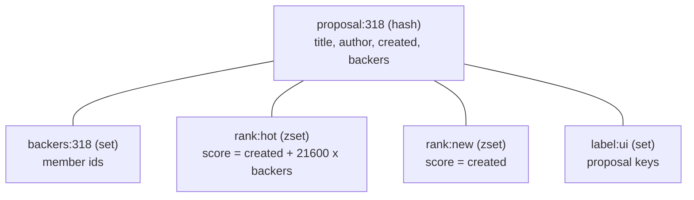

# A first application: a proposal board with backing and ranking

> **Before this lesson:** read [What Redis is](#/lesson/redis/what-is-redis) first. You should
> recognise the five basic types (string, list, set, hash, sorted set) and commands such as `INCR`,
> `HSET`, `SADD` and `ZADD`. Basic Python (functions, dictionaries) is used.

## In plain words

The best way to understand a toolbox is to build something with it. In this lesson we build
the core of a voting site: people post items, other people vote for the ones they like, and a front
page shows the most popular recent items first. Reddit, Hacker News and every "top ideas" board work
this way.

Think of a noticeboard in a community hall. Anyone may pin up a proposal. Each visitor may put one
sticker on a proposal they support - one sticker per person per proposal. The caretaker keeps
re-arranging the board so that well-supported, recent proposals sit at eye level. Our program is
the caretaker, and Redis is the board: it has to remember each proposal, who has already put a
sticker on it, and the current order.

Three ideas appear here that return throughout the track. A **record** (the facts about one thing)
is stored in a hash. An **index** is extra data kept only so that a question can be answered
quickly - here, "what is the current order?". And a **score** is the number a sorted set orders its
members by.

Why this matters for a job: ranking things by a mix of freshness and popularity is one of the most
common features in consumer software, and designing it is a classic interview exercise. The habit
this lesson teaches - start from the questions the application will ask, then choose the structure
that answers each one - is the core skill of working with Redis.

## Motivation

Reading command references only gets you so far. The quickest way to see why Redis structures matter
is to build something small where several of them cooperate. In this lesson we design **Greenlight**,
a board where members of an open-source project post proposals ("support dark mode", "drop Python 3.8")
and other members *back* the ones they care about. The front page shows proposals ranked so that
well-backed and recent ones float to the top, and a second view shows the newest first. Proposals can
carry labels such as `ui` or `breaking`, and each label has its own ranked page.

The feature list is deliberately familiar - it is the skeleton of every vote-driven site - but the
design below is ours, and every decision is explained so that you can change it.

Requirements:

1. Posting a proposal stores its title, author and creation time.
2. A member may back a proposal at most once.
3. Backing closes fourteen days after the proposal was posted.
4. The "hot" page ranks by a score mixing age and number of backers.
5. The "new" page ranks by creation time.
6. A member may withdraw their backing while the window is open.
7. Label pages show the same rankings restricted to one label.

## Choosing the structures

Start from the questions, not the entities.

| Question the app asks | Structure that answers it in one command |
|---|---|
| What are the title and author of proposal 318? | hash `proposal:318` |
| Has member 77 already backed proposal 318? | set `backers:318` |
| Which proposals are hottest right now? | sorted set `rank:hot` (member = proposal key, score = hotness) |
| Which proposals are newest? | sorted set `rank:new` (score = creation time) |
| Which proposals carry the label `ui`? | set `label:ui` |
| What id should the next proposal get? | string counter `proposal:next-id` |

Notice the duplication: the creation time lives both in the hash and as a score in `rank:new`. In a
relational design you would call that denormalisation and worry. In Redis it is the normal way to
work - an index is one more key that you keep in step with the record.



## Designing the hotness score

We want a single number per proposal such that sorting by it gives a sensible front page. Two forces
pull on it: newer should beat older, and more backers should beat fewer.

A neat trick is to make the score a *timestamp-like* quantity. Start every proposal at its creation
time in Unix seconds. Then decide how much "time" one backer is worth. If we say that one backer
compensates for being six hours older, each backing adds $6 \times 3600 = 21600$ to the score:

$$\text{hot} = t_{\text{created}} + 21600 \times \text{backers}$$

A proposal posted now with zero backers ties with one posted a day ago with four backers. Nothing ever
needs to be recomputed as the clock moves, because *everybody's* age grows at the same rate - only the
relative order matters, and that is fixed until someone backs something. That property is what makes
the scheme cheap: a backing is one `ZINCRBY`, and the front page is one range read.

> [!TIP]
> Whenever a ranking formula has the shape "base value plus a per-event bonus", you can maintain it
> incrementally with `ZINCRBY` and never run a batch job. Formulas that decay each item differently
> over time (such as dividing by age) cannot be maintained that way and need periodic recomputation.

The fourteen-day rule bounds the work: after the window closes the score is frozen, the `backers:<id>`
set is no longer needed for duplicate checks, and we can delete it to reclaim memory.

## Walking through it in redis-cli

Posting a proposal:

```bash
127.0.0.1:6379> INCR proposal:next-id
(integer) 318
127.0.0.1:6379> HSET proposal:318 title "Support dark mode" author member:77 created 1767225600 backers 1
(integer) 4
127.0.0.1:6379> SADD backers:318 member:77
(integer) 1
127.0.0.1:6379> EXPIRE backers:318 1209600
(integer) 1
127.0.0.1:6379> ZADD rank:new 1767225600 proposal:318
(integer) 1
127.0.0.1:6379> ZADD rank:hot 1767247200 proposal:318
(integer) 1
```

The author counts as the first backer, which is why the hot score starts at `created + 21600` and the
`backers` field starts at 1. `EXPIRE` with 1,209,600 seconds (fourteen days) lets Redis discard the
duplicate-check set by itself once backing closes.

Member 91 backs it:

```bash
127.0.0.1:6379> ZSCORE rank:new proposal:318
"1767225600"
127.0.0.1:6379> SADD backers:318 member:91
(integer) 1
127.0.0.1:6379> ZINCRBY rank:hot 21600 proposal:318
"1767268800"
127.0.0.1:6379> HINCRBY proposal:318 backers 1
(integer) 2
127.0.0.1:6379> SADD backers:318 member:91
(integer) 0
```

The first command fetches the creation time so the application can check the window. The `SADD` reply
of `1` proves the member is new, so we bump the score and the counter. The final `SADD` shows what a
repeat attempt looks like: reply `0`, and the application stops there.

Reading the front page:

```bash
127.0.0.1:6379> ZREVRANGE rank:hot 0 24
1) "proposal:318"
2) "proposal:301"
3) "proposal:317"
127.0.0.1:6379> HGETALL proposal:318
1) "title"
2) "Support dark mode"
3) "author"
4) "member:77"
5) "created"
6) "1767225600"
7) "backers"
8) "2"
```

`ZREVRANGE ... 0 24` returns the first page of twenty-five keys in descending score order. The
application then fetches each hash. That is 26 round trips for one page, which a later lesson reduces
to two with pipelining.

## The application in Python

```python
import time
import redis

r = redis.Redis(decode_responses=True)

WINDOW = 14 * 86400          # backing stays open for two weeks
BOOST = 6 * 3600             # one backer is worth six hours of freshness
PAGE = 25

def post_proposal(member, title, labels=()):
    pid = r.incr("proposal:next-id")
    key = f"proposal:{pid}"
    now = int(time.time())
    r.hset(key, mapping={"title": title, "author": member, "created": now, "backers": 1})
    r.sadd(f"backers:{pid}", member)
    r.expire(f"backers:{pid}", WINDOW)
    r.zadd("rank:new", {key: now})
    r.zadd("rank:hot", {key: now + BOOST})
    for label in labels:
        r.sadd(f"label:{label}", key)
    return pid

def back(member, pid):
    key = f"proposal:{pid}"
    created = r.zscore("rank:new", key)
    if created is None or time.time() - created > WINDOW:
        return False                         # unknown proposal or window closed
    if r.sadd(f"backers:{pid}", member) == 0:
        return False                         # already backed
    r.zincrby("rank:hot", BOOST, key)
    r.hincrby(key, "backers", 1)
    return True

def withdraw(member, pid):
    key = f"proposal:{pid}"
    created = r.zscore("rank:new", key)
    if created is None or time.time() - created > WINDOW:
        return False
    if r.srem(f"backers:{pid}", member) == 0:
        return False                         # was not a backer
    r.zincrby("rank:hot", -BOOST, key)
    r.hincrby(key, "backers", -1)
    return True

def page(order="rank:hot", number=1):
    start = (number - 1) * PAGE
    keys = r.zrevrange(order, start, start + PAGE - 1)
    out = []
    for key in keys:
        row = r.hgetall(key)
        row["key"] = key
        out.append(row)
    return out
```

Read `back` slowly, because its order of operations matters. The window check uses the creation time
from `rank:new`, a single `ZSCORE`, instead of loading the whole hash. Then `SADD` does double duty: it
both records the backing and reports whether it was new. Only when it reports `1` do we touch the
score and the counter. Had we written "check `SISMEMBER`, then `SADD`", two simultaneous requests from
the same member could both pass the check; letting the write itself be the test closes that gap.

> [!WARNING]
> `back` still issues three separate writes. If the process crashes after `SADD` but before `ZINCRBY`,
> the member is recorded as a backer yet the score never moved. For a hobby board that drift is
> tolerable; for anything that matters you wrap the three writes in a `MULTI`/`EXEC` transaction or a
> Lua script so they succeed or fail together. Modules 3, 4 and 11 show how.

## Label pages with ZINTERSTORE

A label is a plain set of proposal keys. To show the hot ranking for one label we need "members of
`label:ui`, ordered by their score in `rank:hot`". Sorted-set intersection does exactly that, and it
accepts ordinary sets as inputs, treating every member as having score 1.

```bash
127.0.0.1:6379> SADD label:ui proposal:318 proposal:301
(integer) 2
127.0.0.1:6379> ZINTERSTORE view:hot:ui 2 label:ui rank:hot AGGREGATE MAX
(integer) 2
127.0.0.1:6379> EXPIRE view:hot:ui 60
(integer) 1
127.0.0.1:6379> ZREVRANGE view:hot:ui 0 24
1) "proposal:318"
2) "proposal:301"
```

`ZINTERSTORE dest 2 a b` writes into `dest` the members present in both inputs. With `AGGREGATE MAX`
the stored score is the larger of the two input scores; since the set contributes 1 and the ranking
contributes a ten-digit timestamp, the ranking's score wins. The intersection costs work proportional
to the smaller input times the logarithm of the result, so we do not want to recompute it on every
page view. Giving the result a sixty-second expiry turns it into a short-lived cache: the first viewer
in any minute pays for the computation, everyone else reuses it.

```python
def label_page(label, order="rank:hot", number=1):
    view = f"view:{order.split(':')[1]}:{label}"
    if not r.exists(view):
        r.zinterstore(view, [f"label:{label}", order], aggregate="MAX")
        r.expire(view, 60)
    return page(view, number)
```

## Run the whole design in your browser

The simulation below re-implements enough of the server to run Greenlight with a controllable
clock. It posts three proposals at different times, lets members back them, and prints both rankings.
Change `BOOST` to see how the front page reshuffles.

```python-run
import bisect

class MiniRedis:
    def __init__(self):
        self.h, self.s, self.z, self.n = {}, {}, {}, {}
    def incr(self, k): self.n[k] = self.n.get(k, 0) + 1; return self.n[k]
    def hset(self, k, mapping): self.h.setdefault(k, {}).update(mapping)
    def hincrby(self, k, f, by): self.h[k][f] += by; return self.h[k][f]
    def hgetall(self, k): return dict(self.h.get(k, {}))
    def sadd(self, k, m):
        s = self.s.setdefault(k, set())
        if m in s: return 0
        s.add(m); return 1
    def srem(self, k, m):
        s = self.s.get(k, set())
        if m not in s: return 0
        s.remove(m); return 1
    def zadd(self, k, member, score): self.z.setdefault(k, {})[member] = score
    def zincrby(self, k, by, member): self.z[k][member] += by; return self.z[k][member]
    def zscore(self, k, member): return self.z.get(k, {}).get(member)
    def zrevrange(self, k, start, stop):
        ordered = sorted(self.z.get(k, {}).items(), key=lambda kv: (kv[1], kv[0]), reverse=True)
        return [m for m, _ in ordered[start:stop + 1]]
    def zinterstore(self, dest, set_key, zset_key):
        members = self.s.get(set_key, set())
        self.z[dest] = {m: sc for m, sc in self.z.get(zset_key, {}).items() if m in members}
        return len(self.z[dest])

r = MiniRedis()
WINDOW, BOOST = 14 * 86400, 6 * 3600
clock = [1_767_225_600]                      # a fake "now" we can move by hand

def post(member, title, labels=()):
    pid = r.incr("proposal:next-id"); key = f"proposal:{pid}"; now = clock[0]
    r.hset(key, {"title": title, "author": member, "created": now, "backers": 1})
    r.sadd(f"backers:{pid}", member)
    r.zadd("rank:new", key, now); r.zadd("rank:hot", key, now + BOOST)
    for lab in labels: r.sadd(f"label:{lab}", key)
    return pid

def back(member, pid):
    key = f"proposal:{pid}"; created = r.zscore("rank:new", key)
    if created is None or clock[0] - created > WINDOW: return False
    if r.sadd(f"backers:{pid}", member) == 0: return False
    r.zincrby("rank:hot", BOOST, key); r.hincrby(key, "backers", 1)
    return True

def show(order):
    for key in r.zrevrange(order, 0, 9):
        row = r.hgetall(key)
        print(f"  {key:12s} backers={row['backers']}  {row['title']}")

a = post("member:77", "Support dark mode", ["ui"])
clock[0] += 12 * 3600
b = post("member:12", "Drop Python 3.8", ["breaking"])
clock[0] += 12 * 3600
c = post("member:40", "Keyboard shortcuts", ["ui"])

print("first back by 91 :", back("member:91", a))
print("repeat by 91     :", back("member:91", a))
for m in ("member:5", "member:6", "member:8"):
    back(m, a)
back("member:5", b)
print("hot:"); show("rank:hot")
print("new:"); show("rank:new")
r.zinterstore("view:hot:ui", "label:ui", "rank:hot")
print("hot within label ui:"); show("view:hot:ui")
clock[0] += 15 * 86400
print("after the window :", back("member:99", a))
```

Trace the arithmetic for proposal 1. It was created at `t`, starts at `t + 21600`, and collects four
more backers, ending at `t + 5 × 21600 = t + 108000`, which is thirty hours of freshness. Proposal 3
was created 24 hours later with only its author behind it, giving `t + 86400 + 21600 = t + 108000` -
an exact tie. Sorted sets break ties by comparing members, and `ZREVRANGE` reverses that order, so
`proposal:3` is listed before `proposal:1`. Proposal 2, twelve hours old with two backers, sits at
`t + 43200 + 43200 = t + 86400` and comes third. On the "new" page the order is 3, 2, 1.

## What we have not solved yet

This first version is honest about being a first version.

- **Atomicity.** Each function issues several commands; a crash in the middle leaves the keys
  slightly inconsistent. Transactions fix that.
- **Round trips.** `page` performs one request per proposal. Pipelining batches them.
- **Unbounded growth.** `rank:hot` and `rank:new` keep every proposal for ever. A periodic
  `ZREMRANGEBYRANK` (keep the best ten thousand) or archiving old hashes to a cheaper store bounds it.
- **Memory per proposal.** One hash, up to one set, and two sorted-set entries. A million proposals fit
  easily in a few hundred megabytes, but the estimate is worth doing before launch, not after.
- **Trust.** Nothing prevents one person from creating many accounts. That is an application problem,
  not a storage one.

> [!INTERVIEW]
> A common whiteboard prompt is "design the ranking for a vote-based feed". A strong answer names the
> structures (hash per item, set per item for deduplication, sorted sets for each ordering), explains
> why the set's add operation is used as the duplicate test, gives the incremental score formula, and
> then volunteers the weaknesses: non-atomic multi-step writes, per-item fetches, unbounded indexes.

## Pitfalls

- **Check-then-act on membership.** `SISMEMBER` followed by `SADD` is a race. Use the reply of `SADD`.
- **Forgetting an index when deleting.** Removing `proposal:318` without removing it from `rank:hot`,
  `rank:new` and every `label:*` set leaves dangling members that render as empty rows.
- **Recomputing scores from the clock.** If the score depended on "now", every item would need
  rewriting as time passes. Keep age out of the stored score by expressing boosts in time units.
- **Float precision.** Scores are IEEE-754 doubles. Integers up to $2^{53}$ are exact, so second or
  millisecond timestamps plus modest boosts are safe; nanosecond timestamps are not.
- **Caching the intersection for too long.** A long expiry on `view:*` keys hides new backing; too
  short and you recompute constantly. Sixty seconds is a starting point to measure, not a law.
- **Storing the whole proposal in the sorted set member.** Members should be small stable identifiers.
  If you embed the title, editing the title creates a second member.

## Command cheat sheet

`n` is the size of the structure, `m` the number of returned elements.

| Command | Use in this app | Time |
|---|---|---|
| `INCR proposal:next-id` | allocate an id | O(1) |
| `HSET key f v ...` | store proposal fields | O(1) per field |
| `HINCRBY key backers 1` | bump the displayed count | O(1) |
| `HGETALL key` | load a proposal | O(fields) |
| `SADD backers:id member` | record a backer and detect repeats | O(1) |
| `SREM backers:id member` | withdraw | O(1) |
| `EXPIRE key seconds` | let the backer set vanish after the window | O(1) |
| `ZADD rank:new score member` | index by time | O(log n) |
| `ZINCRBY rank:hot 21600 member` | apply one backing | O(log n) |
| `ZSCORE rank:new member` | read creation time | O(1) |
| `ZREVRANGE key start stop` | one page, best first | O(log n + m) |
| `ZINTERSTORE dest 2 set zset` | ranking restricted to a label | O(k·s) + O(r log r), s = smallest input, k inputs, r results |
| `EXISTS key` | is the cached view still there? | O(1) |

## Summary

- Decide the structures by listing the questions the application asks; one key type per question.
- A set's add operation is an atomic "insert if absent" that reports what happened - ideal for
  one-vote-per-member rules.
- Expressing a popularity bonus in seconds lets a sorted set mix recency and popularity with a single
  `ZINCRBY` per event and no background recomputation.
- `ZINTERSTORE` joins a set of ids with a ranking; give the result a short expiry to reuse it.
- Multi-command functions are not atomic yet, and per-item fetches cost a round trip each - the next
  modules remove both weaknesses.

## Glossary

- **Record** - the stored facts about one thing (here, one proposal).
- **Index** - extra data maintained so that a particular lookup is fast.
- **Identifier (id)** - a unique number or name for a record.
- **Score** - the number by which a sorted set orders a member.
- **Unix time (timestamp)** - a moment expressed as seconds since 1 January 1970.
- **Denormalisation** - storing the same fact in more than one place to make reads cheap.
- **Counter** - a number increased atomically, for example with `INCR`.
- **Expiry (TTL)** - a time limit after which Redis deletes a key by itself.
- **Intersection** - the items present in every one of several collections.
- **Round trip** - one request to the server and its reply.
- **Race condition** - a bug that depends on the unlucky timing of two programs acting at once.
- **Atomic** - completed as one indivisible step.
- **Pagination** - returning results one page at a time.

```quiz
[
  {"q": "Why does back() rely on the return value of SADD instead of calling SISMEMBER first?",
   "options": ["SISMEMBER is O(n) and too slow", "SADD both records the member and reports atomically whether it was new, so two concurrent requests cannot both succeed", "SISMEMBER cannot be used on sets that have an expiry", "redis-py does not implement SISMEMBER"],
   "answer": 1,
   "explain": "Check-then-add leaves a gap between the two commands. A single SADD is atomic and its reply tells you whether the member was already there."},
  {"q": "With BOOST = 21600, proposal X was created at time t with 3 backers in total and proposal Y at t + 43200 with 1 backer. Which ranks higher on the hot page?",
   "options": ["X, because it has more backers", "Y, because it is newer", "They tie on score; the tie is broken by member name", "Neither appears until someone else backs them"],
   "answer": 2,
   "explain": "X scores t + 3*21600 = t + 64800. Y scores t + 43200 + 21600 = t + 64800. Equal scores are ordered by member."},
  {"q": "Why does the stored hot score never need recomputing as time passes?",
   "options": ["Redis automatically decays sorted-set scores", "Age affects every proposal equally, so relative order only changes when a backing arrives", "The scores are recalculated on every ZREVRANGE", "EXPIRE refreshes the scores"],
   "answer": 1,
   "explain": "The score is creation time plus bonuses. The passage of time shifts no proposal relative to another, so only backings change the order."},
  {"q": "What does ZINTERSTORE view 2 label:ui rank:hot AGGREGATE MAX store as each member's score?",
   "options": ["Always 1", "The sum of 1 and the hot score", "The hot score, because it is larger than the implicit score 1 of the set member", "The rank of the member"],
   "answer": 2,
   "explain": "Plain set members count as score 1. MAX keeps the larger input score, which is the ranking's timestamp-like value."},
  {"q": "A proposal hash is deleted but its key is left in rank:hot. What does the front page show?",
   "options": ["Redis removes the member automatically", "ZREVRANGE raises an error", "The key is still returned and HGETALL on it yields an empty result", "The whole sorted set is deleted"],
   "answer": 2,
   "explain": "Keys know nothing about each other. Indexes you build by hand must be cleaned by hand, otherwise they point at nothing."},
  {"q": "What is the purpose of EXPIRE backers:318 1209600 in post_proposal?",
   "options": ["It closes the proposal to reading after two weeks", "It frees the duplicate-check set once backing is closed and the set is no longer needed", "It resets the score every two weeks", "It prevents the author from backing twice"],
   "answer": 1,
   "explain": "After the window nobody may back or withdraw, so the set of backers is dead weight; an expiry reclaims the memory without a cleanup job."},
  {"q": "Which weakness of the first version is fixed by MULTI/EXEC or a Lua script?",
   "options": ["The page function making one request per proposal", "rank:hot growing without bound", "A crash between SADD and ZINCRBY leaving the backer recorded but the score unchanged", "Members creating several accounts"],
   "answer": 2,
   "explain": "Grouping the writes into one atomic unit removes the partially-applied state. Round trips are a pipelining matter; growth and trust are separate problems."}
]
```

> **Source:** Carlson, *Redis in Action*, ch. 1 (section 1.3 covers a vote-ranked site built from hashes, sets and sorted sets); the Greenlight design, formula constants and code here are original.
> Further reading: <https://redis.io/docs/latest/develop/data-types/sorted-sets/>, <https://redis.io/docs/latest/commands/zinterstore/>, <https://redis.io/docs/latest/commands/zincrby/>
