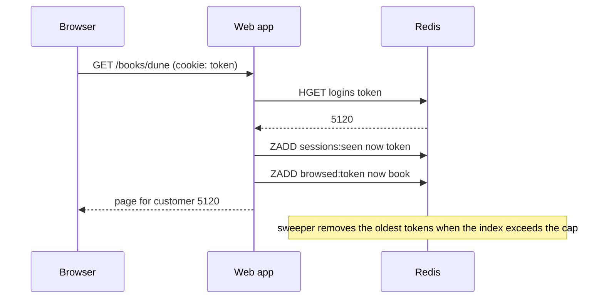

# Sessions, login cookies and shopping carts

> **Before this lesson:** you should know hashes and sorted sets from
> [What Redis is](#/lesson/redis/what-is-redis) and have seen records and indexes combined in
> [a first application](#/lesson/redis/first-app-voting). No web-development experience is assumed.

## In plain words

When you log in to a website, it remembers you as you click from page to page. That is odd
when you think about it, because the web's underlying protocol, **HTTP**, treats every page request
as a message from a stranger. The memory has to be added on top.

The usual trick works like a cloakroom. You hand over your coat and receive a numbered ticket. The
ticket says nothing about you; it is the attendant's rack that links number 4417 to your coat.
On a website the ticket is a **cookie** - a small piece of text the site asks your browser to send
back with every request - containing a long random code called a **token**. The site's rack is a
table that maps each token to "this is customer 5120". That table entry, with whatever else the
site remembers about your visit, is a **session**.

The rack is consulted on *every single request*, so it must be fast, and its contents are
short-lived: sessions end. Fast and short-lived is exactly what Redis is good at. The same goes for
a **shopping cart**: a small list of what you intend to buy, changed often, abandoned often.

Why this matters for a job: session storage is the single most common production use of Redis.
Getting it wrong has security consequences, so the lesson also covers how tokens must be generated
and how old sessions are removed.

## Motivation

HTTP forgets everything between requests. The server that checked your password has no idea, one
request later, that you are the same person - unless the browser sends something back that proves it.
That "something" is a cookie, and the work of turning a cookie into "this is customer 5120, their
basket holds two paperbacks" happens on *every single request*. It is the most frequently executed
lookup in most web applications, which makes it the first place a slow data store shows up on a graph.

In this lesson we follow **Fernwood Books**, an online bookshop whose relational database is starting
to creak. Session lookups and basket updates account for most of its writes, even though almost none
of that data needs to live for ever. We move both into Redis, look at two designs for expiring old
sessions, and learn where the sharp edges are.

## Two kinds of login cookie

There are two broad ways to make a cookie trustworthy.

**Signed cookies** carry the facts themselves - user id, expiry time - plus a cryptographic signature
computed with a secret only the server knows. The server verifies the signature and needs no storage
at all. The price is that you cannot easily revoke one cookie before it expires, anything you add
makes every request bigger, and a bug in signing or verification is a security hole.

**Token cookies** carry a long random string and nothing else. The server keeps a table mapping token
to session data. Revoking a session is deleting a row, the cookie stays small, and you can attach as
much server-side state as you like. The price is a lookup on every request - which is precisely the
job Redis is good at.

| | Signed cookie | Token cookie + Redis |
|---|---|---|
| Server storage | none | one small key per session |
| Revoke one session | hard (needs a deny-list) | `DEL` the key |
| Data visible to the client | yes, unless also encrypted | no, only a random token |
| Cost per request | signature check (CPU) | one sub-millisecond round trip |
| Attach more state later | cookie grows | cookie unchanged |

Fernwood chooses tokens.

> [!WARNING]
> A session token is a password that lasts as long as the session. Generate it with a cryptographically
> secure source - in Python `secrets.token_urlsafe(32)` - never with `random`, a timestamp or a counter.
> Send it only over HTTPS with the `Secure`, `HttpOnly` and `SameSite` cookie attributes, and issue a
> fresh token at login so that a token planted before authentication is useless afterwards.

## Design A - one key per session with a sliding expiry

The simplest layout gives every session its own hash and lets Redis delete it when it goes stale.

```bash
127.0.0.1:6379> HSET sess:Zk3vR9 customer 5120 created 1767225600 last_page /books/dune
(integer) 3
127.0.0.1:6379> EXPIRE sess:Zk3vR9 1800
(integer) 1
127.0.0.1:6379> TTL sess:Zk3vR9
(integer) 1800
127.0.0.1:6379> HGET sess:Zk3vR9 customer
"5120"
127.0.0.1:6379> EXPIRE sess:Zk3vR9 1800
(integer) 1
127.0.0.1:6379> TTL sess:nope
(integer) -2
```

Every authenticated request reads the session and then calls `EXPIRE` again, pushing the deadline
thirty minutes into the future. That is a **sliding expiration**: a session dies after thirty minutes
of *inactivity*, not thirty minutes after login. `TTL` reports the seconds remaining; `-2` means the
key does not exist and `-1` means it exists without an expiry.

```python
import secrets
import time
import redis

r = redis.Redis(decode_responses=True)
IDLE = 30 * 60

def log_in(customer_id):
    token = secrets.token_urlsafe(32)
    key = f"sess:{token}"
    pipe = r.pipeline()                       # send both commands together, atomically
    pipe.hset(key, mapping={"customer": customer_id, "created": int(time.time())})
    pipe.expire(key, IDLE)
    pipe.execute()
    return token                              # goes into the Set-Cookie header

def current_customer(token):
    key = f"sess:{token}"
    customer = r.hget(key, "customer")
    if customer is None:
        return None                           # expired, revoked or forged
    r.expire(key, IDLE)                       # slide the window
    return int(customer)

def log_out(token):
    r.delete(f"sess:{token}", f"cart:{token}")
```

`pipeline()` in redis-py queues commands and, by default, wraps them in `MULTI`/`EXEC`, so the hash is
never left without its expiry. Forgetting that pairing is the classic session leak: a crash between
`HSET` and `EXPIRE` creates an immortal session.

This design has no cleanup code at all. Its weakness is that you cannot easily answer "how many
sessions are live?" or "log out every session for customer 5120" without an extra index, and you
cannot cap the *number* of sessions - only their idle time.

## Design B - a central index of recent sessions

The second layout keeps session facts in shared structures and records activity in a sorted set whose
score is the time of the last request.

- hash `logins` : token → customer id
- sorted set `sessions:seen` : member = token, score = last-seen timestamp
- sorted set `browsed:<token>` : member = book id, score = time viewed (the "recently viewed" strip)
- hash `cart:<token>` : book id → quantity

```bash
127.0.0.1:6379> HSET logins Zk3vR9 5120
(integer) 1
127.0.0.1:6379> ZADD sessions:seen 1767225600 Zk3vR9
(integer) 1
127.0.0.1:6379> ZADD browsed:Zk3vR9 1767225600 book:9780441172719
(integer) 1
127.0.0.1:6379> ZREMRANGEBYRANK browsed:Zk3vR9 0 -21
(integer) 0
127.0.0.1:6379> ZCARD sessions:seen
(integer) 1
```

`ZREMRANGEBYRANK browsed:<token> 0 -21` deletes everything except the twenty highest-scored members:
rank 0 is the oldest view and rank -21 is the twenty-first from the newest end, so the command trims
the strip to the latest twenty books on every update.

Because nothing expires by itself here, a background worker trims the index. It can enforce a hard cap
("keep at most five million sessions") as well as an idle limit, which the per-key design cannot do.

```python
LIMIT = 5_000_000

def touch(token, customer_id, book_id=None):
    now = time.time()
    pipe = r.pipeline()
    pipe.hset("logins", token, customer_id)
    pipe.zadd("sessions:seen", {token: now})
    if book_id:
        pipe.zadd(f"browsed:{token}", {book_id: now})
        pipe.zremrangebyrank(f"browsed:{token}", 0, -21)
    pipe.execute()

def sweep_sessions(batch=200):
    """Run in a loop by a background worker."""
    excess = r.zcard("sessions:seen") - LIMIT
    if excess <= 0:
        return 0
    doomed = r.zrange("sessions:seen", 0, min(excess, batch) - 1)   # oldest first
    pipe = r.pipeline()
    pipe.delete(*[f"browsed:{t}" for t in doomed], *[f"cart:{t}" for t in doomed])
    pipe.hdel("logins", *doomed)
    pipe.zrem("sessions:seen", *doomed)
    pipe.execute()
    return len(doomed)
```

The sweeper removes the oldest sessions in small batches so that no single command blocks the server
for long. Deleting two hundred sessions touches at most six hundred keys, which finishes in well under
a millisecond.



### Which design should you pick?

| Need | Design A (key + TTL) | Design B (index + sweeper) |
|---|---|---|
| Least code | yes | no |
| Cap total number of sessions | no | yes |
| Count or list live sessions | needs `SCAN` | `ZCARD`, `ZRANGE` |
| Works unchanged on Redis Cluster | yes (each session is independent) | the shared keys all land on one node |
| Risk of a stuck cleanup worker | none | sessions pile up if the sweeper dies |

Modern deployments mostly use Design A and add a small per-customer set of tokens when they need
"log out everywhere". Design B is still worth understanding: the "sorted set of things by last
activity, trimmed by a worker" shape reappears in queues, rate limiters and caches throughout this
track.

> [!TIP]
> If a write happens on *every* request, ask whether it must. Updating the last-seen score at most once
> a minute per session (keep the last write time in the application's memory) cuts write volume
> dramatically and loses nothing a user could notice.

## Shopping carts

A basket is a tiny map from product to quantity that changes often and is abandoned more often than it
is bought. Storing it in the cookie bloats every request and trusts the client with prices or
quantities; storing it in the main database makes each click a durable write. A Redis hash per session
is the natural fit.

```bash
127.0.0.1:6379> HSET cart:Zk3vR9 book:9780441172719 1
(integer) 1
127.0.0.1:6379> HINCRBY cart:Zk3vR9 book:9780441172719 2
(integer) 3
127.0.0.1:6379> HSET cart:Zk3vR9 book:9780261103573 1
(integer) 1
127.0.0.1:6379> HGETALL cart:Zk3vR9
1) "book:9780441172719"
2) "3"
3) "book:9780261103573"
4) "1"
127.0.0.1:6379> HDEL cart:Zk3vR9 book:9780261103573
(integer) 1
127.0.0.1:6379> HLEN cart:Zk3vR9
(integer) 1
```

```python
def set_quantity(token, book_id, quantity):
    key = f"cart:{token}"
    if quantity <= 0:
        r.hdel(key, book_id)
    else:
        r.hset(key, book_id, quantity)
    r.expire(key, 7 * 86400)                  # abandoned baskets vanish after a week

def cart_lines(token):
    return {book: int(qty) for book, qty in r.hgetall(f"cart:{token}").items()}
```

Three design notes:

- **Store ids and quantities, never prices.** The price is looked up at checkout from the catalogue;
  a basket that stored yesterday's price would let it be honoured for ever.
- **A zero or negative quantity removes the line.** Leaving a `0` entry behind means every reader has
  to remember to filter it.
- **Baskets usually outlive sessions.** People expect a basket to be there tomorrow. Key the basket by
  customer id once the customer is known, and merge the anonymous basket into it at login.

At checkout the basket is copied into the relational database inside the order transaction - that is
the moment it becomes a record worth keeping - and the Redis key is deleted.

## Simulating a session store with a clock

The model below implements Design A with lazy expiry: keys carry a deadline and are discarded when
touched after it. It then replays a short visit to show the sliding window in action, and finishes
with Design B's trimming rule on a deliberately tiny cap.

```python-run
class SessionStore:
    """Design A: one record per token, expiry slides forward on every hit."""
    def __init__(self, idle):
        self.idle, self.data, self.deadline = idle, {}, {}

    def _alive(self, token, now):
        if token in self.data and self.deadline[token] <= now:
            del self.data[token], self.deadline[token]        # lazy expiry
        return token in self.data

    def log_in(self, token, customer, now):
        self.data[token] = {"customer": customer, "cart": {}}
        self.deadline[token] = now + self.idle

    def hit(self, token, now):
        if not self._alive(token, now):
            return None
        self.deadline[token] = now + self.idle                 # EXPIRE again
        return self.data[token]["customer"]

    def ttl(self, token, now):
        return self.deadline[token] - now if self._alive(token, now) else -2

    def add_to_cart(self, token, item, qty, now):
        if not self._alive(token, now): return None
        cart = self.data[token]["cart"]
        cart[item] = cart.get(item, 0) + qty
        if cart[item] <= 0: del cart[item]
        return dict(cart)

s = SessionStore(idle=1800)
s.log_in("Zk3vR9", 5120, now=0)
print("t=600   hit ->", s.hit("Zk3vR9", 600), " ttl:", s.ttl("Zk3vR9", 600))
print("t=2000  hit ->", s.hit("Zk3vR9", 2000), " ttl:", s.ttl("Zk3vR9", 2000))
print("cart    ->", s.add_to_cart("Zk3vR9", "dune", 3, 2100))
print("cart    ->", s.add_to_cart("Zk3vR9", "dune", -3, 2200))
print("t=4500  hit ->", s.hit("Zk3vR9", 4500), " ttl:", s.ttl("Zk3vR9", 4500))

# Design B: last-seen index with a hard cap, oldest trimmed first
LIMIT = 3
seen = {}
def touch(token, now):
    seen[token] = now
    doomed = sorted(seen, key=lambda t: (seen[t], t))[:max(0, len(seen) - LIMIT)]
    for t in doomed: del seen[t]
    return doomed
for now, tok in enumerate(["a", "b", "c", "a", "d", "e"]):
    gone = touch(tok, now)
    print(f"touch {tok} at {now}: live={sorted(seen)} evicted={gone}")
```

The hit at `t=2000` succeeds even though the session was created 2000 seconds ago with an 1800-second
limit, because the hit at `t=600` moved the deadline to 2400. The hit at 4500 fails: the last activity
was at 2200, so the deadline of 4000 has passed and `ttl` reports `-2`. In the second half, touching
`a` again at time 3 refreshes it, so when `d` arrives the victim is `b`, the least recently seen, and
then `c` goes when `e` arrives.

## How Redis actually expires keys

It is worth knowing what `EXPIRE` promises. Redis removes expired keys in two ways. **Lazily**: any
command that touches a key first checks its deadline and deletes it if it has passed, so you can never
read an expired value. **Actively**: several times a second a background cycle samples keys that have
deadlines and deletes the expired ones, repeating while a large share of the sample turns out to be
expired. The consequence is that expired keys nobody touches may linger in memory briefly, but they
are invisible to clients. Replicas do not expire keys on their own initiative; the primary sends an
explicit delete so that both stay in step.

Also remember what *clears* an expiry: overwriting a key with a plain `SET` removes its deadline,
whereas commands that modify a value in place (`HSET`, `INCR`, `LPUSH`) keep it. `PERSIST` removes a
deadline on purpose.

> [!INTERVIEW]
> "How would you store sessions for a site with 50 million users?" Outline: random token in a secure
> cookie; one small hash per session with a sliding `EXPIRE`; estimate memory (say 200 bytes each, so
> 5 million concurrent sessions is about 1 GB); replicate for availability and accept that a failover
> may log a few people out; shard by token if it outgrows one node. Then mention the alternative of
> signed stateless tokens and why revocation makes server-side sessions attractive.

## Pitfalls

- **`HSET` without `EXPIRE` in the same atomic unit.** A failure between the two leaks a key for ever.
  Pipeline them, or use a string with `SET key value EX 1800` when one value is enough.
- **Predictable tokens.** Anything derived from time, a counter or a non-cryptographic generator can be
  guessed.
- **Using the same token before and after login.** Rotate it at every privilege change.
- **One enormous `logins` hash on a cluster.** A single key lives on a single node, so a shared index
  cannot be spread across shards. Per-session keys can.
- **Trusting quantities blindly.** Validate that quantities are positive integers within stock limits
  before writing them.
- **Assuming logout is automatic.** Deleting the cookie in the browser does not delete the server-side
  session; call `DEL` as well.
- **Blocking cleanups.** Deleting a million keys in one command stalls every client. Batch, or use
  `UNLINK`, which frees memory in a background thread.

## Command cheat sheet

| Command | Purpose here | Time |
|---|---|---|
| `HSET key field value` | write session or basket fields | O(1) per field |
| `HGET key field` | read one field | O(1) |
| `HGETALL key` | whole basket | O(fields) |
| `HINCRBY key field n` | adjust a quantity | O(1) |
| `HDEL key field` | remove a basket line | O(1) |
| `EXPIRE key seconds` | set or slide the deadline | O(1) |
| `TTL key` | seconds left (-1 none, -2 missing) | O(1) |
| `PERSIST key` | remove the deadline | O(1) |
| `SET key value EX seconds` | value and expiry in one command | O(1) |
| `ZADD sessions:seen ts token` | record activity | O(log n) |
| `ZCARD key` | number of live sessions | O(1) |
| `ZRANGE key 0 k` | the k+1 oldest sessions | O(log n + k) |
| `ZREMRANGEBYRANK key 0 -21` | keep only the newest twenty | O(log n + removed) |
| `DEL k1 k2 ...` / `UNLINK` | drop keys now / free in background | O(keys) plus value size |

## Summary

- Token cookies turn authentication into a key lookup; Redis makes that lookup cheap enough to do on
  every request.
- Per-session keys with a sliding `EXPIRE` need no cleanup code. A last-seen sorted set plus a sweeper
  costs more code but can cap totals and list sessions.
- A basket is a hash of product id to quantity, kept in Redis until checkout turns it into a durable
  order.
- Always create a key and its expiry atomically, generate tokens from a secure source, and delete in
  batches.

## Glossary

- **HTTP** - the protocol browsers and web servers use to exchange requests and pages.
- **Cookie** - a small piece of text a site stores in the browser, sent back with each request.
- **Token** - a long random value that identifies a session.
- **Session** - what a site remembers about one visitor between requests.
- **Authentication** - checking who someone is (for example by password).
- **Signed cookie** - a cookie carrying data plus a cryptographic signature proving it is unaltered.
- **TTL (time to live)** - the seconds remaining before a key is deleted automatically.
- **Sliding expiration** - a deadline that is pushed forward on every use.
- **Lazy expiry / active expiry** - deleting an expired key when it is next touched / by periodic
  background sampling.
- **Pipeline** - several commands sent together in one round trip.
- **Sweeper (cleanup worker)** - a background program that removes old data.
- **Shopping cart** - the list of items and quantities a visitor intends to buy.
- **Cryptographically secure** - random in a way that cannot feasibly be predicted.

```quiz
[
  {"q": "What does 'sliding expiration' mean for a session key?",
   "options": ["The session ends a fixed time after login no matter what", "Each request resets the deadline, so the session ends only after a period of inactivity", "The TTL shrinks faster as the server gets busier", "Redis moves the key to a slower storage tier before deleting it"],
   "answer": 1,
   "explain": "Calling EXPIRE again on every hit pushes the deadline forward, so only idle sessions die."},
  {"q": "TTL sess:abc returns -1. What does that tell you?",
   "options": ["The key does not exist", "The key exists and has no expiry set", "The key expired one second ago", "The key is being deleted in the background"],
   "answer": 1,
   "explain": "-1 means present without a deadline; -2 means the key is missing."},
  {"q": "Why should HSET and EXPIRE for a new session be sent in one transaction or pipeline?",
   "options": ["EXPIRE fails unless it follows HSET within one millisecond", "If the client dies between the two commands the session would exist with no deadline", "Redis refuses HSET on keys without a TTL", "It halves the memory used by the hash"],
   "answer": 1,
   "explain": "Two separate commands leave a window in which only the first has happened, creating a key that never expires."},
  {"q": "In the last-seen design, what does ZREMRANGEBYRANK browsed:tok 0 -21 do?",
   "options": ["Deletes the 21 most recent views", "Keeps only the 20 highest-scored (most recent) members", "Deletes members with score below 21", "Removes the key if it has fewer than 21 members"],
   "answer": 1,
   "explain": "Ranks 0 through -21 cover everything except the last twenty elements in ascending score order."},
  {"q": "Which of these should NOT be stored in the basket hash?",
   "options": ["The product id", "The quantity", "The unit price at the time the item was added", "Nothing else is needed beyond id and quantity"],
   "answer": 2,
   "explain": "Prices belong to the catalogue and are read at checkout; caching them in the basket lets stale prices be honoured."},
  {"q": "An expired key that no client touches is still using memory a moment later. Why is that acceptable?",
   "options": ["It is a bug that requires a restart", "Expired keys are removed lazily on access and by periodic sampling, and are never visible to clients in the meantime", "Expired keys are only removed when memory is full", "Replicas delete them instead of the primary"],
   "answer": 1,
   "explain": "Redis combines lazy deletion on access with an active sampling cycle; correctness is preserved because reads check the deadline first."},
  {"q": "Which requirement pushes you toward the central last-seen index instead of per-session TTLs?",
   "options": ["You want the least code", "You need a hard cap on the total number of sessions kept", "You are running Redis Cluster", "You want sessions to expire without a worker"],
   "answer": 1,
   "explain": "A TTL bounds idle time, not count. A sorted set of sessions by activity lets a worker drop the oldest when a limit is exceeded."},
  {"q": "What is wrong with generating session tokens using str(time.time()) + str(user_id)?",
   "options": ["Nothing, it is unique", "Tokens would be too long for a cookie", "It is predictable, so an attacker can guess valid tokens", "Redis cannot store keys containing dots"],
   "answer": 2,
   "explain": "Uniqueness is not secrecy. Tokens must come from a cryptographically secure random source such as secrets.token_urlsafe."}
]
```

> **Source:** Carlson, *Redis in Action*, ch. 2 (sections 2.1-2.2 cover login cookies and carts); bookshop scenario, both designs and all code written fresh for this guide.
> Further reading: <https://redis.io/docs/latest/commands/expire/>, <https://redis.io/docs/latest/develop/data-types/hashes/>, <https://redis.io/docs/latest/commands/unlink/>
