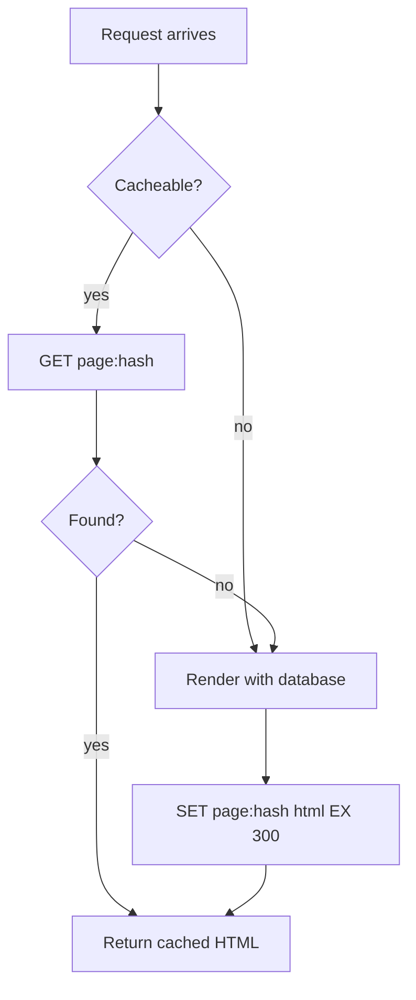

# Page caching, row caching and lightweight analytics

> **Before this lesson:** you should know strings with expiry (`SET ... EX`) and sorted sets
> ([What Redis is](#/lesson/redis/what-is-redis)), and have read
> [sessions and carts](#/lesson/redis/sessions-carts), which introduced the bookshop used here and
> the idea of a time to live (TTL).

## In plain words

A **cache** is a place where you keep a ready-made copy of something that is slow to
produce, so that next time you can hand over the copy instead of doing the work again.

A café does this every morning. Making each sandwich to order would be slow, so the popular ones
are made in advance and kept in the display case. Most customers are served in seconds from the
case; only an unusual order goes to the kitchen. The price is freshness: a sandwich in the case may
be an hour old. Decide how old is acceptable, and throw out anything older.

Websites have the same shape. Building a page may need a dozen questions to the database; most
visitors ask for the same pages; and a page that is a few minutes old is usually fine. So: build it
once, keep the result in Redis for a few minutes, and serve the copy.

Four words carry the whole topic. A **hit** is finding the copy; a **miss** is not finding it and
doing the real work. The **hit ratio** is the fraction of requests served from the copy. The **time
to live (TTL)** is how long a copy is kept - the maximum staleness you accept.

This lesson builds three things: a cache of whole pages, a cache of individual database rows that
refreshes itself on a schedule, and the small amount of **analytics** (measurements of what visitors
do) needed to decide which pages are worth caching at all.

Why this matters for a job: caching is the cheapest large performance improvement available to most
systems and the most common reason companies run Redis.

## Motivation

Fernwood Books renders most of its pages from templates plus a dozen database queries. Measure a
typical day and two facts jump out. First, the overwhelming majority of requests are for pages that
look identical to every visitor for minutes at a time: category listings, book detail pages, the
bestseller chart. Second, the handful of pages that are genuinely personal still read the same few
hundred "hot" rows - this week's promoted titles - over and over.

Regenerating identical output thousands of times is pure waste. A cache trades a little staleness for
a great deal of capacity: keep the finished result somewhere fast, serve it until it is too old, then
rebuild it. This lesson builds three layers on Redis - whole-page caching, a scheduled row cache, and
the tiny analytics needed to decide *what* is worth caching - and it introduces the vocabulary of hit
ratios and staleness that the final module of this track develops into full caching patterns.

## Layer 1 - caching whole rendered pages

The idea is a wrapper around the view function: compute a cache key from the request, try to fetch the
finished HTML, and only run the expensive view on a miss.



```bash
127.0.0.1:6379> GET page:8f14e45f
(nil)
127.0.0.1:6379> SET page:8f14e45f "<html>...Science fiction...</html>" EX 300
OK
127.0.0.1:6379> TTL page:8f14e45f
(integer) 300
127.0.0.1:6379> GET page:8f14e45f
"<html>...Science fiction...</html>"
```

`SET ... EX 300` stores the value and its five-minute lifetime in one atomic command. (The older
`SETEX key 300 value` does the same thing; `SET` with options is the modern spelling.)

```python
import hashlib
import redis

r = redis.Redis()            # bytes in, bytes out: HTML is stored exactly as produced

def page_key(request):
    # normalise so that /books?genre=sf&page=2 and /books?page=2&genre=sf share an entry
    query = "&".join(f"{k}={v}" for k, v in sorted(request.args.items()))
    raw = f"{request.path}?{query}".encode()
    return "page:" + hashlib.sha1(raw).hexdigest()

def cacheable(request):
    if request.method != "GET" or request.customer_id is not None:
        return False                        # never cache personalised responses
    return request.path.startswith(("/books", "/genres", "/charts"))

def cached_view(request, render):
    if not cacheable(request):
        return render(request)
    key = page_key(request)
    html = r.get(key)
    if html is None:
        html = render(request)
        r.set(key, html, ex=300)
    return html
```

Three decisions hide in those few lines.

**What goes into the key.** Everything that changes the output must be part of the key, and nothing
else. Leave out the language header on a bilingual site and French visitors receive English pages.
Include a tracking parameter that does not affect the output and every campaign link becomes its own
cache entry, destroying the hit ratio.

**Who may be served from cache.** The check on `customer_id` matters more than any other line. Caching
a page that contains one customer's name or basket and serving it to another is a privacy incident,
not a performance bug.

**How long entries live.** The time to live (TTL) is the maximum staleness you accept. Five minutes
for a category page is invisible; five minutes for a stock indicator may not be.

> [!WARNING]
> A full-page cache keyed only by URL will happily store a response that included a `Set-Cookie`
> header or a personalised greeting. Decide cacheability from an explicit allow-list of routes and from
> the *absence* of a session, and strip cookies from anything you store.

### How much does it buy?

If a fraction $h$ of requests are hits, the average cost per request is

$$\bar{t} = h \cdot t_{\text{hit}} + (1 - h) \cdot t_{\text{miss}}$$

With a 1 ms hit, an 80 ms render and a 95 % hit ratio, the average is $0.95 + 4 = 4.95$ ms - sixteen
times better than no cache. Push the ratio to 99 % and it drops to 1.79 ms. The lesson is that the
*miss* term dominates, so the last few percentage points of hit ratio are worth chasing.

## Layer 2 - a scheduled row cache

Some pages cannot be cached whole because parts differ per visitor, yet they still read the same
expensive rows - the book of the week with its live stock level and discount. For these rows we want a
cache that is refreshed *proactively* on a schedule we control per row: every five seconds for a
flash-sale title, every ten minutes for the back catalogue.

Two sorted sets drive a small worker:

- `refresh:due` - member = row id, score = the timestamp at which the row should next be rebuilt
- `refresh:every` - member = row id, score = the row's refresh interval in seconds

The cached row itself is a JSON string at `row:book:<id>`.

```bash
127.0.0.1:6379> ZADD refresh:every 5 book:4417
(integer) 1
127.0.0.1:6379> ZADD refresh:due 1767225600 book:4417
(integer) 1
127.0.0.1:6379> ZRANGE refresh:due 0 0 WITHSCORES
1) "book:4417"
2) "1767225600"
127.0.0.1:6379> SET row:book:4417 "{\"title\":\"Dune\",\"stock\":14,\"price\":\"9.99\"}"
OK
127.0.0.1:6379> ZADD refresh:due 1767225605 book:4417
(integer) 0
```

The worker repeatedly looks at the element with the *lowest* score in `refresh:due`. If its time has
not come, the worker sleeps briefly. Otherwise it reloads the row from the database, writes the JSON,
and re-schedules the row by adding the interval to the current time. `ZADD` on an existing member
returns `0` and only updates the score.

```python
import json
import time

def schedule_row(row_id, every_seconds):
    r.zadd("refresh:every", {row_id: every_seconds})
    r.zadd("refresh:due", {row_id: time.time()})          # due immediately

def unschedule_row(row_id):
    r.zrem("refresh:every", row_id)                       # the worker cleans up the rest

def refresh_worker(load_row):
    while True:
        head = r.zrange("refresh:due", 0, 0, withscores=True)
        now = time.time()
        if not head or head[0][1] > now:
            time.sleep(0.05)
            continue
        row_id = head[0][0].decode()
        every = r.zscore("refresh:every", row_id)
        if every is None:                                 # unscheduled: remove everything
            r.zrem("refresh:due", row_id)
            r.delete(f"row:{row_id}")
            continue
        r.set(f"row:{row_id}", json.dumps(load_row(row_id)))
        r.zadd("refresh:due", {row_id: now + every})
```

This is a priority queue ordered by time, and it is the first appearance of a pattern you will meet
again as the delayed task queue: *a sorted set whose score is "when", read from the low end*.
Request handlers never touch the database for these rows; they `GET row:book:4417` and parse it. The
data they read is at most one interval old.

> [!TIP]
> Proactive refresh ("the worker rebuilds it before anyone asks") and reactive caching ("rebuild on a
> miss") suit different rows. Refresh proactively when a row is certain to be read and expensive to
> build; cache reactively when most rows are never read at all.

## Layer 3 - analytics to decide what to cache

Fernwood lists two hundred thousand titles, and caching every detail page would waste memory on books
nobody opens. We want to cache only the most-viewed ten thousand. That needs a view counter per book
and a way to ask "is this book in the top ten thousand?".

A sorted set gives both. We store *negative* counts so that the most-viewed title has the lowest score
and therefore rank 0; `ZRANK` then answers the question directly.

```bash
127.0.0.1:6379> ZINCRBY views -1 book:4417
"-1"
127.0.0.1:6379> ZINCRBY views -1 book:4417
"-2"
127.0.0.1:6379> ZINCRBY views -1 book:0101
"-1"
127.0.0.1:6379> ZRANK views book:4417
(integer) 0
127.0.0.1:6379> ZRANK views book:0101
(integer) 1
127.0.0.1:6379> ZRANK views book:9999
(nil)
```

```python
def record_view(book_id):
    r.zincrby("views", -1, book_id)

def worth_caching(book_id, top=10_000):
    rank = r.zrank("views", book_id)
    return rank is not None and rank < top
```

Left alone, the counter set has two problems: it grows with every title ever viewed, and a book that
was popular last year keeps its lead for ever. A periodic maintenance job solves both.

```bash
127.0.0.1:6379> ZREMRANGEBYRANK views 20000 -1
(integer) 0
127.0.0.1:6379> ZUNIONSTORE views 1 views WEIGHTS 0.5
(integer) 2
127.0.0.1:6379> ZRANGE views 0 -1 WITHSCORES
1) "book:4417"
2) "-1"
3) "book:0101"
4) "-0.5"
```

`ZREMRANGEBYRANK views 20000 -1` discards everything beyond the best twenty thousand.
`ZUNIONSTORE views 1 views WEIGHTS 0.5` rewrites the set onto itself with every score multiplied by
one half. Run every five minutes, that halving is an **exponential decay**: a view from an hour ago has
been halved twelve times and counts for $2^{-12}$ of a fresh one, so the ranking tracks what is popular
*now* without storing any timestamps.

```python
def decay_views():
    pipe = r.pipeline()
    pipe.zremrangebyrank("views", 20_000, -1)
    pipe.zunionstore("views", {"views": 0.5})
    pipe.execute()
```

## A cache you can measure

The simulation models a TTL cache in front of a slow render function and replays a skewed workload in
which a few pages receive most of the traffic. It reports the hit ratio and the average latency, then
runs the decaying view counter.

```python-run
import random

class TTLCache:
    def __init__(self): self.store = {}
    def get(self, key, now):
        hit = self.store.get(key)
        if hit and hit[1] > now: return hit[0]
        self.store.pop(key, None)                 # lazy expiry
        return None
    def set(self, key, value, ttl, now): self.store[key] = (value, now + ttl)

def simulate(ttl, pages=2000, requests=40000, seed=7, hit_ms=1.0, miss_ms=80.0):
    rng = random.Random(seed)
    cache, hits, total_ms = TTLCache(), 0, 0.0
    weights = [1 / (rank + 1) for rank in range(pages)]      # Zipf-like popularity
    stream = rng.choices(range(pages), weights=weights, k=requests)
    for i, page in enumerate(stream):
        now = i * 0.05                                       # 20 requests per second
        if cache.get(page, now) is not None:
            hits += 1; total_ms += hit_ms
        else:
            cache.set(page, "html", ttl, now); total_ms += miss_ms
    return hits / requests, total_ms / requests

for ttl in (0, 10, 60, 300, 1800):
    ratio, avg = simulate(ttl)
    print(f"ttl={ttl:5d}s  hit ratio={ratio:6.1%}  mean latency={avg:6.2f} ms")

# decaying popularity counter: negative scores, halved at each maintenance tick
views = {}
def record(book): views[book] = views.get(book, 0) - 1
def decay():
    for b in views: views[b] *= 0.5
def rank(book):
    order = sorted(views, key=lambda b: (views[b], b))
    return order.index(book) if book in views else None

for _ in range(40): record("old-hit")
for tick in range(4):
    decay()
    for _ in range(6): record("new-hit")
    print(f"tick {tick}: old={views['old-hit']:7.2f} new={views['new-hit']:7.2f} "
          f"rank(new-hit)={rank('new-hit')}")
```

Read the first table from top to bottom. With no caching every request costs 80 ms. Even a ten-second
TTL captures a large share of traffic because popularity is skewed: the same few pages are requested
again before their entries expire. Longer TTLs keep helping, with diminishing returns, while staleness
grows linearly - which is why the right TTL is a business decision as much as a technical one. In the
second half, "old-hit" starts with forty views but receives none afterwards; after a few halvings the
steadily viewed "new-hit" overtakes it and takes rank 0.

## Invalidation: the hard part

A TTL bounds staleness but cannot make it zero. When a price changes and the old one must disappear
immediately, you have to **invalidate** - delete or overwrite the cached entry at the moment of the
write. For the row cache that is easy: after updating the database, set the row's `refresh:due` score
to "now", or run `DEL row:book:4417`. For page caches it is harder, because one row may appear on
many pages. Common approaches:

- **Short TTLs and patience.** Accept a few minutes of staleness. Simplest, and often good enough.
- **Versioned keys.** Include a version number in the key (`page:v37:<hash>`); bumping the version
  makes every old entry unreachable and they age out by TTL.
- **Dependency sets.** While rendering, record in `deps:book:4417` the keys of the pages that used the
  row; on update, delete those keys.

> [!INTERVIEW]
> When asked "how do you keep a cache consistent with the database?", avoid promising perfect
> consistency. State the staleness you accept, say whether you invalidate on write or rely on TTLs, and
> point out the race where a slow reader writes an old value into the cache after a newer write
> deleted it. The final module of this track works through that race and its fixes.

## Pitfalls

- **Caching personalised output.** Decide cacheability before looking in the cache, from an allow-list.
- **Keys that vary too much or too little.** Normalise query strings; include every input that changes
  the response.
- **No TTL at all.** Entries written without an expiry live until memory runs out. Give every cache
  entry a lifetime even when you also invalidate explicitly.
- **Everything expiring together.** If a deployment warms ten thousand entries in the same second with
  the same TTL, they all expire in the same second later. Add random jitter to TTLs.
- **Many simultaneous misses on one hot key.** When a popular entry expires, every concurrent request
  rebuilds it at once. This is the cache stampede, treated at length in the caching-patterns module.
- **Caching huge pages uncompressed.** A megabyte of HTML per entry adds up quickly; compress before
  storing or cache fragments instead.
- **Treating the cache as the source of truth.** A cache may be flushed at any time. The system must
  still be correct - only slower - when it is empty.

## Command cheat sheet

`n` is the size of the sorted set, `m` the number of elements returned or removed.

| Command | Purpose here | Time |
|---|---|---|
| `GET key` | fetch a cached page or row | O(1) |
| `SET key value EX seconds` | store with a lifetime | O(1) |
| `SETEX key seconds value` | older form of the same | O(1) |
| `TTL key` | remaining lifetime | O(1) |
| `DEL key` | invalidate now | O(1) |
| `ZADD refresh:due ts row` | schedule or reschedule a row | O(log n) |
| `ZRANGE key 0 0 WITHSCORES` | peek at the next row due | O(log n) |
| `ZSCORE refresh:every row` | look up a row's interval | O(1) |
| `ZREM key member` | unschedule | O(log n) |
| `ZINCRBY views -1 item` | count one view | O(log n) |
| `ZRANK views item` | is it in the top N? | O(log n) |
| `ZREMRANGEBYRANK views 20000 -1` | keep the top twenty thousand | O(log n + m) |
| `ZUNIONSTORE views 1 views WEIGHTS 0.5` | halve every score | O(n log n) |

## Summary

- A page cache is a wrapper: build a key from everything that affects the output, `GET`, and on a miss
  render and `SET ... EX`.
- The average latency formula shows that misses dominate; skewed traffic makes even short TTLs
  effective.
- A row cache driven by a "due time" sorted set refreshes hot rows proactively, each at its own pace.
- Negative-score counters plus periodic trimming and halving give a self-cleaning popularity ranking
  that decides what deserves caching.
- TTLs bound staleness; immediate correctness needs explicit invalidation, and that is where caching
  becomes difficult.

## Glossary

- **Cache** - a store of ready-made copies of results that are slow to produce.
- **Hit / miss** - finding / not finding a wanted item in the cache.
- **Hit ratio** - hits divided by all lookups.
- **TTL (time to live)** - how long an entry is kept before it expires.
- **Stale** - out of date compared with the original data.
- **Render** - produce the final page (HTML) from templates and data.
- **Cache key** - the name under which a cached result is stored; it must include everything that
  affects the result.
- **Latency** - how long one request takes.
- **Row** - one record in a database table.
- **Invalidation** - removing or replacing a cached copy because the original changed.
- **Jitter** - a small random variation, here added to TTLs.
- **Analytics** - measurements of how a system is used.
- **Exponential decay** - repeatedly multiplying by a fraction so that old contributions fade.
- **Cache stampede** - many requests rebuilding the same expired entry at the same time.

```quiz
[
  {"q": "A page takes 60 ms to render and 1 ms to serve from cache. With a 90% hit ratio, what is the mean latency?",
   "options": ["About 6.9 ms", "About 30 ms", "About 1.6 ms", "About 54 ms"],
   "answer": 0,
   "explain": "0.9 x 1 + 0.1 x 60 = 0.9 + 6 = 6.9 ms. The miss term dominates."},
  {"q": "Why does page_key sort the query parameters before hashing?",
   "options": ["Redis rejects unsorted keys", "So that equivalent URLs with parameters in a different order map to the same cache entry", "To make the key shorter", "To prevent SQL injection"],
   "answer": 1,
   "explain": "Normalisation avoids storing several copies of the same page and raises the hit ratio."},
  {"q": "In the row cache, what does the score in refresh:due represent?",
   "options": ["How many times the row was read", "The Unix time at which the row should next be rebuilt", "The row's size in bytes", "The refresh interval in seconds"],
   "answer": 1,
   "explain": "The worker reads the lowest score to find the row whose refresh time comes first; the interval lives in the other sorted set."},
  {"q": "Why are view counts stored as negative numbers in the views sorted set?",
   "options": ["Redis sorted sets cannot hold positive floats", "So the most-viewed item has the lowest score and ZRANK returns 0 for it", "To save memory", "Negative scores expire automatically"],
   "answer": 1,
   "explain": "ZRANK counts from the lowest score. Negating puts the most popular item first, so rank < N means 'in the top N'."},
  {"q": "What is the effect of running ZUNIONSTORE views 1 views WEIGHTS 0.5 every five minutes?",
   "options": ["It doubles the size of the set", "It halves every score, so old views fade exponentially and recent activity dominates", "It removes half of the members", "It converts the sorted set into a plain set"],
   "answer": 1,
   "explain": "Multiplying all scores by one half on a fixed schedule is exponential decay without storing timestamps."},
  {"q": "Which request must never be answered from a shared full-page cache?",
   "options": ["An anonymous GET of a category listing", "A GET of the bestseller chart", "A logged-in customer's order history page", "A GET of a book detail page with no session"],
   "answer": 2,
   "explain": "Personal pages keyed only by URL would leak one customer's data to another."},
  {"q": "Ten thousand cache entries are written in the same second with the same TTL. What problem follows, and what is the usual fix?",
   "options": ["They use too much memory; compress them", "They all expire together causing a burst of rebuilds; add random jitter to each TTL", "Redis merges them into one key; use hashes", "They can never be invalidated; use PERSIST"],
   "answer": 1,
   "explain": "Synchronized expiry produces a synchronized miss storm. Spreading TTLs spreads the rebuild load."},
  {"q": "After updating a book's price in the database, which action makes the cached row correct immediately in the scheduled row cache?",
   "options": ["Wait for the TTL", "Set the row's score in refresh:due to the current time (or delete the cached row)", "Run ZREMRANGEBYRANK on views", "Increase the interval in refresh:every"],
   "answer": 1,
   "explain": "Making the row due now causes the worker to rebuild it at once; deleting the key forces readers back to the source."}
]
```

> **Source:** Carlson, *Redis in Action*, ch. 2 (sections 2.3-2.5: page caching, row caching, page analytics); explanations, key names, formulas and simulation are original to this guide.
> Further reading: <https://redis.io/docs/latest/commands/set/>, <https://redis.io/docs/latest/commands/zunionstore/>, <https://redis.io/docs/latest/develop/use/client-side-caching/>
