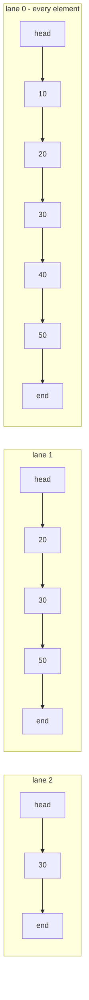

# Commands in depth: hashes and sorted sets

> **Before this lesson:** read [strings, lists and sets](#/lesson/redis/strings-lists-sets),
> which uses the same support-desk scenario, and [What Redis is](#/lesson/redis/what-is-redis) for
> the first look at hashes and sorted sets.

## In plain words

This lesson covers the two remaining classic containers.

A **hash** is a small record: one key holding several named **fields**, each with its own value.
Think of an index card for a support ticket with labelled lines - *subject*, *status*, *priority*.
You can read or change one line without rewriting the card.

A **sorted set** is a ranking table. Every **member** appears once and carries a number called its
**score**, and Redis keeps the members in order of score at all times. Think of a league table:
each team appears once, has a points total, and the table re-orders itself whenever a result comes
in. You can ask "who is in the top three?", "what position is this team in?" (its **rank**), or
"which teams have between 40 and 50 points?" - and each answer comes back almost instantly, however
long the table is.

The sorted set is the most versatile structure in Redis, because many problems are rankings in
disguise. Use a time as the score and you have a timeline, or a list of things due at a certain
moment. Use a priority and you have a priority queue. Use a count and you have a "most popular"
chart.

Why this matters for a job: hashes are how records are stored in Redis, and sorted sets are behind
leaderboards, feeds, schedulers, rate limiters and autocomplete - all of which appear later in this
track and regularly in interviews. How a sorted set achieves its speed (a structure called a skip
list) is itself a common interview question, explained in this lesson from the ground up.

## Motivation

Strings, lists and sets hold single values or flat collections. The two remaining classic types add
structure: a **hash** groups named fields under one key, and a **sorted set** keeps unique members in
order of a numeric score. Between them they cover most "record" and "index" needs, and the sorted set
in particular is the most versatile tool Redis has - once you see rankings, time lines, priority
queues and range lookups as the same structure, a surprising number of designs fall out for free.

We stay with Beacon Desk, the support tool from the previous lesson. Tickets become hashes; the queue
of what to work on next becomes a sorted set ordered by a service-level deadline.

## Hashes: small records under one key

```bash
127.0.0.1:6379> HSET ticket:501 subject "Cannot reset password" status open priority 2 replies 0
(integer) 4
127.0.0.1:6379> HGET ticket:501 status
"open"
127.0.0.1:6379> HMGET ticket:501 subject priority missing
1) "Cannot reset password"
2) "2"
3) (nil)
127.0.0.1:6379> HINCRBY ticket:501 replies 1
(integer) 1
127.0.0.1:6379> HSETNX ticket:501 first_reply_at 1767225900
(integer) 1
127.0.0.1:6379> HSETNX ticket:501 first_reply_at 1767229999
(integer) 0
127.0.0.1:6379> HEXISTS ticket:501 assignee
(integer) 0
127.0.0.1:6379> HDEL ticket:501 priority
(integer) 1
127.0.0.1:6379> HLEN ticket:501
(integer) 4
127.0.0.1:6379> HKEYS ticket:501
1) "subject"
2) "status"
3) "replies"
4) "first_reply_at"
```

What each reply means:

- `HSET` returns the number of fields **created**, not the number written. Updating an existing field
  returns 0 and is not an error.
- `HMGET` returns values in the order asked, with `nil` for absent fields.
- `HSETNX` writes a field only if it is absent. Here it records the time of the *first* reply; later
  replies cannot overwrite it.
- `HINCRBY` and `HINCRBYFLOAT` make any field an atomic counter.
- `HGETALL`, `HKEYS` and `HVALS` return everything and cost O(fields). On a hash with a few dozen fields
  that is nothing; on one with a million it blocks the server, so use `HSCAN` there.

### Hash, JSON string, or many keys?

| Layout | Read one attribute | Update one attribute | Per-attribute TTL | Memory |
|---|---|---|---|---|
| `SET ticket:501 '{json}'` | fetch and parse everything | rewrite the whole blob, with a race | no | compact |
| `HSET ticket:501 field value` | `HGET` | `HSET`, atomic per field | from 7.4 with `HEXPIRE` | very compact when small |
| `SET ticket:501:status open` ... | `GET` | `SET` | yes | highest: per-key overhead each time |

For records that are read and written a field at a time, the hash wins. Until Redis 7.4 an expiry
applied only to the whole key; version 7.4 added per-field expiry (`HEXPIRE key seconds FIELDS 1
field`, `HTTL`, `HPERSIST`), which removes the main reason people used to split records into many
string keys.

> [!TIP]
> Small hashes are stored in a compact array encoding (a *listpack*) rather than a real hash table,
> which makes a hash with a handful of short fields far cheaper than the same data in separate keys.
> The memory module of this track shows how to exploit that deliberately.

## Sorted sets: unique members ordered by score

A sorted set maps each member to a 64-bit floating-point score and keeps members ordered by
`(score, member)`. Members with equal scores are ordered by comparing their bytes, so the order is
always total and deterministic.

### Adding and updating

```bash
127.0.0.1:6379> ZADD sla:due 1767229200 ticket:501 1767232800 ticket:502 1767226500 ticket:507
(integer) 3
127.0.0.1:6379> ZADD sla:due 1767230000 ticket:501
(integer) 0
127.0.0.1:6379> ZADD sla:due NX 1 ticket:501
(integer) 0
127.0.0.1:6379> ZADD sla:due LT CH 1767228000 ticket:501
(integer) 1
127.0.0.1:6379> ZSCORE sla:due ticket:501
"1767228000"
127.0.0.1:6379> ZINCRBY sla:due 600 ticket:507
"1767227100"
127.0.0.1:6379> ZCARD sla:due
(integer) 3
```

`ZADD` returns the count of members **added**; re-scoring an existing member returns 0. Options refine
it:

| Option | Effect |
|---|---|
| `NX` | only add new members, never update |
| `XX` | only update existing members, never add |
| `GT` / `LT` | update only if the new score is greater / less than the current one (new members are still added) |
| `CH` | make the reply count members *changed* (added or re-scored) |
| `INCR` | behave like `ZINCRBY` for a single member |

`LT` above expresses "a deadline may only move earlier" without a read-then-write. `GT` is the usual
choice for "best score so far" leaderboards.

### Reading by rank

```bash
127.0.0.1:6379> ZRANGE sla:due 0 -1 WITHSCORES
1) "ticket:507"
2) "1767227100"
3) "ticket:501"
4) "1767228000"
5) "ticket:502"
6) "1767232800"
127.0.0.1:6379> ZRANGE sla:due 0 0 REV
1) "ticket:502"
127.0.0.1:6379> ZRANK sla:due ticket:501
(integer) 1
127.0.0.1:6379> ZREVRANK sla:due ticket:501
(integer) 1
127.0.0.1:6379> ZRANK sla:due ticket:999
(nil)
```

Ranks are zero-based positions in ascending score order. `REV` (or the older `ZREVRANGE`) reverses the
direction. `ZRANK` on a missing member returns `nil`, which is how you distinguish "last place" from
"not playing".

### Reading by score

```bash
127.0.0.1:6379> ZRANGEBYSCORE sla:due -inf 1767228000
1) "ticket:507"
2) "ticket:501"
127.0.0.1:6379> ZRANGEBYSCORE sla:due (1767227100 +inf LIMIT 0 1
1) "ticket:501"
127.0.0.1:6379> ZRANGE sla:due 1767227000 1767229000 BYSCORE
1) "ticket:507"
2) "ticket:501"
127.0.0.1:6379> ZCOUNT sla:due -inf 1767228000
(integer) 2
```

Score ranges are inclusive by default. A leading `(` makes a bound **exclusive**, and `-inf` / `+inf`
stand for the open ends. `LIMIT offset count` pages through the result. Since Redis 6.2 a single
`ZRANGE` command covers all variants through the `BYSCORE`, `BYLEX`, `REV` and `LIMIT` modifiers; the
older `ZRANGEBYSCORE`, `ZREVRANGE` and friends still work and you will meet them in existing code.

The query `ZRANGEBYSCORE sla:due -inf <now>` reads as "every ticket whose deadline has passed". With a
timestamp as the score, a sorted set is a time index.

### Removing and popping

```bash
127.0.0.1:6379> ZREM sla:due ticket:502
(integer) 1
127.0.0.1:6379> ZPOPMIN sla:due
1) "ticket:507"
2) "1767227100"
127.0.0.1:6379> ZREMRANGEBYSCORE sla:due -inf 1767000000
(integer) 0
127.0.0.1:6379> ZREMRANGEBYRANK sla:due 0 -101
(integer) 0
```

`ZPOPMIN` / `ZPOPMAX` atomically remove and return the lowest or highest member - a priority queue in
one command, with blocking forms `BZPOPMIN` / `BZPOPMAX`. `ZREMRANGEBYSCORE` drops everything in a
score window (expire old entries), `ZREMRANGEBYRANK` everything in a rank window (keep the top N).

### Combining sorted sets

```bash
127.0.0.1:6379> ZADD votes:week1 5 faq:reset 2 faq:invoice
(integer) 2
127.0.0.1:6379> ZADD votes:week2 1 faq:reset 4 faq:export
(integer) 2
127.0.0.1:6379> ZUNIONSTORE votes:total 2 votes:week1 votes:week2
(integer) 3
127.0.0.1:6379> ZRANGE votes:total 0 -1 WITHSCORES REV
1) "faq:reset"
2) "6"
3) "faq:export"
4) "4"
5) "faq:invoice"
6) "2"
127.0.0.1:6379> ZINTERSTORE votes:both 2 votes:week1 votes:week2 WEIGHTS 1 3 AGGREGATE SUM
(integer) 1
127.0.0.1:6379> ZSCORE votes:both faq:reset
"8"
```

`ZUNIONSTORE dest numkeys key...` merges inputs; `ZINTERSTORE` keeps only members present in every
input. Scores of the same member are combined by `AGGREGATE SUM` (default), `MIN` or `MAX` after being
multiplied by the per-input `WEIGHTS`. In the intersection above, `faq:reset` scores
$5 \times 1 + 1 \times 3 = 8$. Plain sets may be used as inputs and count as score 1. Non-storing
`ZUNION`, `ZINTER`, `ZDIFF` and `ZRANGESTORE` arrived in 6.2.

### Lexicographic ranges

When every member has the **same score**, ordering falls back to the member bytes, and you can query
by prefix:

```bash
127.0.0.1:6379> ZADD macros 0 refund 0 refund-partial 0 reset-link 0 reopen
(integer) 4
127.0.0.1:6379> ZRANGEBYLEX macros [ref (reg
1) "refund"
2) "refund-partial"
```

`[` marks an inclusive bound, `(` an exclusive one, and `-` / `+` the extremes. The range `[ref (reg`
captures everything starting with "ref". This is the basis of the autocomplete built in module 6.

## How a sorted set is stored

Large sorted sets are stored as two cooperating structures: a hash table from member to score, which
makes `ZSCORE` constant time, and a **skip list** ordered by score, which makes inserts, deletes and
rank queries logarithmic. A skip list is a linked list with extra "express lanes": each node is
promoted to a higher lane with some fixed probability, so a search can skip over long runs of nodes
and descend only when it would overshoot.



Redis additionally stores in each forward link the number of elements it skips (its *span*), so
summing spans along the search path yields a member's rank without counting node by node. Small
sorted sets skip all of this and live in a compact listpack that is scanned linearly.

## Working with redis-py

```python
import time
import redis

r = redis.Redis(decode_responses=True)

def open_ticket(ticket_id, subject, priority, sla_seconds):
    key = f"ticket:{ticket_id}"
    pipe = r.pipeline()
    pipe.hset(key, mapping={"subject": subject, "status": "open", "priority": priority, "replies": 0})
    pipe.zadd("sla:due", {key: time.time() + sla_seconds})
    pipe.execute()

def escalate(ticket_id, new_deadline):
    # a deadline may only move earlier; ch=True reports whether anything changed
    return r.zadd("sla:due", {f"ticket:{ticket_id}": new_deadline}, lt=True, ch=True)

def overdue(limit=20):
    return r.zrangebyscore("sla:due", "-inf", time.time(), start=0, num=limit, withscores=True)

def next_to_work_on():
    popped = r.zpopmin("sla:due")            # [(member, score)] or []
    return popped[0][0] if popped else None

def position_in_queue(ticket_id):
    rank = r.zrank("sla:due", f"ticket:{ticket_id}")
    return None if rank is None else rank + 1
```

Note the redis-py conventions: `zadd` takes `{member: score}`; `withscores=True` yields
`(member, float)` tuples; `zrangebyscore` pages with `start` and `num`; score bounds can be the strings
`"-inf"`, `"+inf"` or `"(5"`.

## Build a skip list and query it

The simulation implements a compact skip list with ordered insertion and range queries, then layers
the `ZADD` / `ZRANK` / `ZRANGEBYSCORE` semantics on top, including the tie-break by member.

```python-run
import random

class SkipList:
    MAX = 8
    def __init__(self, seed=1):
        self.rng = random.Random(seed)
        self.head = [None, [None] * self.MAX]            # [key, forward pointers]
        self.level = 1
    def _random_level(self):
        lvl = 1
        while lvl < self.MAX and self.rng.random() < 0.25:   # same promotion odds as Redis
            lvl += 1
        return lvl
    def _path(self, key):
        update, node = [self.head] * self.MAX, self.head
        for i in reversed(range(self.level)):
            while node[1][i] is not None and node[1][i][0] < key:
                node = node[1][i]
            update[i] = node
        return update
    def insert(self, key):
        update, lvl = self._path(key), self._random_level()
        self.level = max(self.level, lvl)
        node = [key, [None] * lvl]
        for i in range(lvl):
            node[1][i] = update[i][1][i]; update[i][1][i] = node
    def remove(self, key):
        update = self._path(key); target = update[0][1][0]
        if target is None or target[0] != key: return False
        for i in range(len(target[1])):
            if update[i][1][i] is target: update[i][1][i] = target[1][i]
        return True
    def __iter__(self):
        node = self.head[1][0]
        while node is not None:
            yield node[0]; node = node[1][0]
    def lanes(self):
        return [sum(1 for _ in self._lane(i)) for i in range(self.level)]
    def _lane(self, i):
        node = self.head[1][i]
        while node is not None:
            yield node; node = node[1][i]

class ZSet:
    def __init__(self): self.scores, self.order = {}, SkipList()
    def zadd(self, member, score):
        added = member not in self.scores
        if not added: self.order.remove((self.scores[member], member))
        self.scores[member] = score; self.order.insert((score, member))
        return int(added)
    def zrange(self, start, stop):
        items = [m for _, m in self.order]
        stop = len(items) + stop if stop < 0 else stop
        return items[start:stop + 1]
    def zrank(self, member):
        if member not in self.scores: return None
        return [m for _, m in self.order].index(member)
    def zrangebyscore(self, lo, hi):
        return [m for s, m in self.order if lo <= s <= hi]

z = ZSet()
for member, score in [("t507", 100), ("t501", 300), ("t502", 300), ("t510", 200), ("t499", 300)]:
    z.zadd(member, score)
print("order        ", z.zrange(0, -1))
print("re-add t501  ", z.zadd("t501", 50), "->", z.zrange(0, -1))
print("rank of t502 ", z.zrank("t502"), "| rank of missing:", z.zrank("nope"))
print("score 100-250", z.zrangebyscore(100, 250))

big = SkipList(seed=42)
for n in range(2000): big.insert(n)
print("nodes per lane (bottom to top):", big.lanes())
```

In the first line the three tickets with score 300 appear in member order (`t499`, `t501`, `t502`):
that is the tie-break rule. Re-adding `t501` with score 50 returns 0 - nothing was added - and moves it
to the front. The last line shows the lanes thinning by roughly a factor of four at each level, which
is why a search touches only a logarithmic number of nodes. (Our `zrank` counts linearly for brevity;
Redis gets the same answer from the stored spans.)

> [!INTERVIEW]
> "Why a skip list rather than a balanced tree?" The usual points: comparable O(log n) bounds, much
> simpler code, range scans that are plain pointer-following along the bottom lane, and easy
> augmentation with spans to answer rank queries. Add that the hash table alongside gives O(1) score
> lookups.

> [!WARNING]
> Scores are doubles. Integers are exact only up to $2^{53}$; beyond that, or when accumulating
> fractions with `ZINCRBY`, rounding can make two "equal" scores differ. Use integer units (cents,
> milliseconds) wherever exactness matters.

## Pitfalls

- **Misreading `HSET` and `ZADD` replies.** Both report *new* fields or members. A reply of 0 after an
  update is success. Add `CH` to `ZADD` if you need to know about changes.
- **`HGETALL` on large hashes.** Linear in the number of fields and delivered in one reply.
- **Off-by-one in rank ranges.** Ranks are inclusive at both ends: `ZRANGE k 0 9` is ten items.
- **Forgetting exclusive bounds when paging by score.** To continue after score `s`, use `(s`,
  otherwise the last item of one page repeats on the next - and note that with tied scores, paging by
  score alone can still skip or repeat members.
- **Mixed scores with `BYLEX`.** Lexicographic ranges are defined only when all members share one
  score.
- **`ZUNIONSTORE` onto a key that is also an input** is allowed, but the destination is overwritten,
  including its type and any expiry.
- **Using a list where you need "by score".** If elements must be removed from the middle or reordered,
  a sorted set is the right structure.

## Command cheat sheet

`n` = elements in the structure, `m` = elements returned or removed.

| Command | Meaning | Time |
|---|---|---|
| `HSET k f v ...` / `HGET k f` | write / read fields | O(1) per field |
| `HMGET k f1 f2` | read several fields | O(fields requested) |
| `HGETALL` / `HKEYS` / `HVALS` | everything | O(n) |
| `HINCRBY k f n` / `HINCRBYFLOAT` | atomic field counter | O(1) |
| `HSETNX k f v` | write field if absent | O(1) |
| `HDEL` / `HEXISTS` / `HLEN` | remove / test / count | O(1) |
| `HSCAN k cursor` | incremental iteration | O(1) per call |
| `HEXPIRE k s FIELDS 1 f` (7.4+) | per-field expiry | O(fields) |
| `ZADD k [NX\|XX] [GT\|LT] [CH] score member` | insert or re-score | O(log n) |
| `ZSCORE` / `ZMSCORE` | score lookup | O(1) per member |
| `ZINCRBY k delta member` | adjust a score | O(log n) |
| `ZRANK` / `ZREVRANK` | position | O(log n) |
| `ZRANGE k a b [REV] [BYSCORE\|BYLEX] [LIMIT o c]` | slice | O(log n + m) |
| `ZCOUNT k min max` | members in a score window | O(log n) |
| `ZPOPMIN` / `ZPOPMAX` / `BZPOPMIN` | pop lowest / highest | O(log n) |
| `ZREM k member` | remove | O(log n) |
| `ZREMRANGEBYSCORE` / `ZREMRANGEBYRANK` | bulk remove | O(log n + m) |
| `ZUNIONSTORE` / `ZINTERSTORE` | combine with weights | O(N) + O(M log M) |
| `ZCARD k` | size | O(1) |

## Summary

- Hashes store records with atomic per-field reads, writes and counters; keep them small or iterate
  with `HSCAN`.
- A sorted set orders unique members by `(score, member)` and supports lookups by member, by rank and
  by score range.
- `ZADD` options (`NX`, `XX`, `GT`, `LT`, `CH`) replace many read-then-write sequences.
- Timestamps as scores turn a sorted set into a time index; equal scores turn it into a sorted
  dictionary for prefix queries.
- A hash table plus a skip list with spans gives O(1) score lookups and O(log n) everything else.

## Glossary

- **Hash** - one key holding a small record of named fields.
- **Field** - one named entry inside a hash.
- **Sorted set (ZSET)** - unique members kept in order of a numeric score.
- **Member / score** - an item in a sorted set / the number it is ordered by.
- **Rank** - a member's position in the ordering, counted from 0.
- **Inclusive / exclusive bound** - a range end that includes / excludes the stated value.
- **Lexicographic order** - dictionary order, comparing byte by byte.
- **Aggregate** - how scores of the same member are combined (sum, minimum or maximum).
- **Weight** - a multiplier applied to an input's scores before combining.
- **Priority queue** - a queue from which the lowest (or highest) scored item is taken first.
- **Skip list** - a layered linked list that allows fast search in sorted data.
- **Hash table** - a structure that finds an entry directly from its key in constant time.
- **Listpack** - the compact encoding Redis uses for small collections.
- **Double (floating-point number)** - the number format of scores; exact for whole numbers up to
  2^53.

```quiz
[
  {"q": "HSET user:1 name Ana returns 1. Running the same command again with name Bea returns what?",
   "options": ["1, because one field was written", "0, because no new field was created", "An error, the field exists", "2, the total number of writes"],
   "answer": 1,
   "explain": "HSET reports how many fields were newly created; overwriting an existing field counts as 0."},
  {"q": "Members a, b and c all have score 7 in a sorted set. In what order does ZRANGE key 0 -1 return them?",
   "options": ["Insertion order", "Random order", "Lexicographic order of the members: a, b, c", "Reverse insertion order"],
   "answer": 2,
   "explain": "Ties on score are broken by comparing member bytes, so the order is always deterministic."},
  {"q": "Which command returns every member whose score is strictly greater than 10 and at most 20?",
   "options": ["ZRANGEBYSCORE k 10 20", "ZRANGEBYSCORE k (10 20", "ZRANGEBYSCORE k 10 (20", "ZRANGE k 10 20"],
   "answer": 1,
   "explain": "A leading parenthesis makes that bound exclusive; the other bound stays inclusive."},
  {"q": "A leaderboard must keep each player's best score only. Which ZADD form does that in one command?",
   "options": ["ZADD board NX score player", "ZADD board GT score player", "ZADD board XX score player", "ZADD board INCR score player"],
   "answer": 1,
   "explain": "GT updates an existing member only when the new score is higher, and still adds new members."},
  {"q": "ZINTERSTORE out 2 a b WEIGHTS 2 1 with member x scoring 3 in a and 4 in b gives x what score in out?",
   "options": ["7", "10", "12", "24"],
   "answer": 1,
   "explain": "Default aggregation is SUM of weighted scores: 3 x 2 + 4 x 1 = 10."},
  {"q": "Why does ZSCORE run in O(1) while ZRANK is O(log n)?",
   "options": ["ZSCORE is cached by the client", "A hash table maps member to score directly, whereas rank must be found by descending the skip list and summing spans", "ZRANK scans the whole set", "They are both O(1) in practice"],
   "answer": 1,
   "explain": "The two internal structures serve different queries: the dictionary for score, the skip list for order and rank."},
  {"q": "When do ZRANGEBYLEX queries give well-defined results?",
   "options": ["Always", "Only when all members have the same score", "Only on sets smaller than 128 members", "Only when scores are integers"],
   "answer": 1,
   "explain": "Lexicographic ordering is the tie-break rule; it describes the whole ordering only if every score is equal."},
  {"q": "What does ZREMRANGEBYRANK board 0 -101 accomplish?",
   "options": ["Removes the 100 highest scores", "Keeps only the 100 highest-scored members", "Removes members ranked exactly 101", "Empties the set"],
   "answer": 1,
   "explain": "Ranks 0 to -101 are everything except the last 100 in ascending order, so the top 100 remain."}
]
```

> **Source:** Carlson, *Redis in Action*, ch. 3 (sections 3.4-3.5: hashes and sorted sets); ZADD options, unified ZRANGE, ZPOPMIN and hash field expiry from redis.io. All examples are original.
> Further reading: <https://redis.io/docs/latest/develop/data-types/sorted-sets/>, <https://redis.io/docs/latest/commands/zadd/>, <https://redis.io/docs/latest/commands/zrange/>, <https://redis.io/docs/latest/commands/hexpire/>
