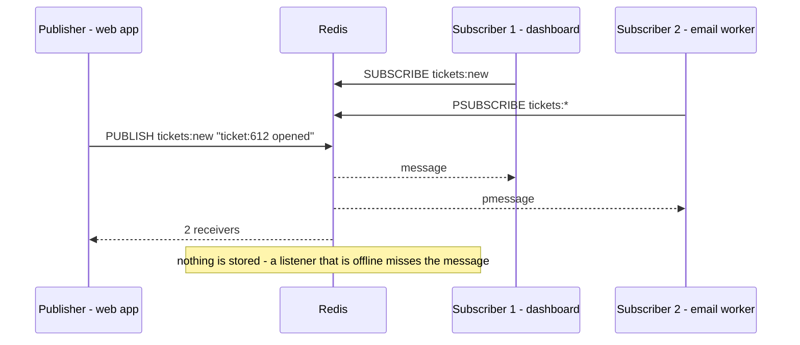

# Commands in depth: publish/subscribe, sorting, transactions and key expiry

> **Before this lesson:** you should be comfortable with the five basic data types and their everyday
> commands. If `LPUSH`, `SADD`, `HSET` or `ZADD` look unfamiliar, read
> [strings, lists and sets](#/lesson/redis/strings-lists-sets) and
> [hashes and sorted sets](#/lesson/redis/hashes-sorted-sets) first.

## In plain words

So far every command has been about *storing* something. This lesson covers four tools that are about
*behaviour* instead:

- **Publish/subscribe** (shortened to *pub/sub*) is a way for one program to broadcast a message to
  every program that is currently listening. Think of a radio station: the presenter talks into the
  microphone without knowing who is tuned in, and anyone whose radio is on that frequency hears it. If
  your radio is off, you miss the broadcast; nobody records it for you.
- **Sorting** asks the server to put the items of a collection in order before sending them back,
  the way a librarian might hand you a pile of books already arranged by title.
- A **transaction** is a group of commands that the server runs as one uninterrupted block. Imagine
  writing several instructions on one sheet of paper and handing over the whole sheet; the clerk does
  all of them before serving the next person in the queue.
- **Expiry** is a self-destruct timer on a piece of data: "delete this in ten minutes".

Why this matters at work: live notifications, chat, and cache invalidation all use pub/sub; any
operation that changes two things together (take money from one account, add it to another) needs a
transaction; and almost every cache entry, login session and one-time code relies on expiry so that
old data cleans itself up.

We continue with **Beacon Desk**, the customer-support tool from the previous two lessons.

## Part 1 - Publish/subscribe

### The idea, one step at a time

Three words first. A **channel** is a named topic, such as `tickets:new`; it is only a name, and it
does not need to be created in advance. A **publisher** is a program that sends a message to a
channel. A **subscriber** is a program that has told the server "send me everything published on this
channel".

The simplest possible example needs two terminal windows, each running `redis-cli` (the command-line
program that ships with Redis and lets you type commands by hand).

Window A subscribes:

```bash
127.0.0.1:6379> SUBSCRIBE tickets:new
1) "subscribe"
2) "tickets:new"
3) (integer) 1
```

The three-part reply confirms the subscription: the kind of reply (`subscribe`), the channel name, and
how many channels this connection is now listening to (1). Window A now waits.

Window B publishes:

```bash
127.0.0.1:6379> PUBLISH tickets:new "ticket:612 opened by ana@example.com"
(integer) 1
```

The reply `(integer) 1` is the number of subscribers that received the message. At the same moment,
window A prints:

```bash
1) "message"
2) "tickets:new"
3) "ticket:612 opened by ana@example.com"
```

Again three parts: the kind (`message`), the channel it arrived on, and the text.

Now the important experiment. Close window A, and publish again from window B:

```bash
127.0.0.1:6379> PUBLISH tickets:new "ticket:613 opened by raj@example.com"
(integer) 0
```

Zero receivers. The message is gone for ever. Redis did not store it, and a subscriber that connects
one second later will never see it. This is called **at-most-once delivery**: each message reaches a
listener once or not at all, never twice, and there is no retry.

### Listening to many channels with patterns

A **pattern** is a channel name containing wildcard characters, where `*` stands for "any text".
`PSUBSCRIBE` (pattern subscribe) listens to every channel whose name matches.

```bash
127.0.0.1:6379> PSUBSCRIBE tickets:*
1) "psubscribe"
2) "tickets:*"
3) (integer) 1
```

A publish to `tickets:closed` then arrives as a four-part `pmessage`: the kind, the pattern that
matched, the actual channel, and the text.

```bash
1) "pmessage"
2) "tickets:*"
3) "tickets:closed"
4) "ticket:612 resolved"
```

### How the pieces fit together



### Pub/sub from Python

`redis-py` is the standard Python library for talking to Redis. The code below is the subscriber
side; each line is explained underneath.

```python
import redis

r = redis.Redis(decode_responses=True)

p = r.pubsub()
p.subscribe("tickets:new")
p.psubscribe("alerts:*")

for item in p.listen():
    if item["type"] in ("message", "pmessage"):
        print(item["channel"], "->", item["data"])
```

- `redis.Redis(decode_responses=True)` opens a connection; the option makes replies arrive as normal
  Python text instead of raw bytes.
- `r.pubsub()` creates a separate object with its **own connection**. That matters: a connection that
  has subscribed is in a special listening mode and cannot run ordinary commands such as `GET`.
- `subscribe` and `psubscribe` register interest in one exact channel and one pattern.
- `p.listen()` is a loop that waits for the next item and hands it over as a dictionary. The first
  items are the confirmations (type `subscribe`), which is why the `if` keeps only real messages.

The publisher is one line anywhere else in the application:

```python
receivers = r.publish("tickets:new", "ticket:612 opened by ana@example.com")
print(receivers)        # 1 if the subscriber above is running, 0 if nobody is listening
```

### When pub/sub is the wrong tool

> [!WARNING]
> Pub/sub has **no memory**. If a subscriber is disconnected for even a moment - a restart, a network
> blip - every message published meanwhile is lost to it. Do not use it for anything that must not be
> missed, such as "charge this customer". For that, use a list-based queue (module 6) or a stream
> (the Modern Redis module), both of which keep messages until a worker confirms them.

Two more limits a newcomer should know about:

- **Slow subscribers.** The server holds outgoing messages for each connection in a memory area called
  an *output buffer*. If a subscriber reads more slowly than publishers write, that buffer grows; once
  it passes a configured limit (`client-output-buffer-limit pubsub`, by default 32 MB, or 8 MB
  sustained for 60 seconds) the server disconnects the subscriber to protect itself.
- **Scaling out.** In Redis Cluster (many servers sharing the data; covered later), a classic
  `PUBLISH` is forwarded to every server. Redis 7.0 added *sharded pub/sub* - `SSUBSCRIBE`,
  `SPUBLISH` - in which a channel lives on one server only, chosen the same way keys are.

Good uses: live dashboards, chat rooms where a missed message is acceptable, telling application
servers "your cached copy of X is out of date".

## Part 2 - Sorting with SORT

Lists and sets have no built-in order of value (a list keeps arrival order, a set keeps none). `SORT`
returns their elements in sorted order without changing the stored data.

Start with the smallest case, a list of numbers:

```bash
127.0.0.1:6379> RPUSH wait:minutes 42 7 19 3
(integer) 4
127.0.0.1:6379> SORT wait:minutes
1) "3"
2) "7"
3) "19"
4) "42"
127.0.0.1:6379> SORT wait:minutes DESC LIMIT 0 2
1) "42"
2) "19"
```

By default `SORT` treats elements as numbers and orders them ascending. `DESC` reverses the direction,
and `LIMIT 0 2` means "skip 0 results, then return 2".

One new idea: text. Numbers-only sorting fails on words, so `ALPHA` asks for alphabetical order.

```bash
127.0.0.1:6379> SADD agents lena omar bea
(integer) 3
127.0.0.1:6379> SORT agents ALPHA
1) "bea"
2) "lena"
3) "omar"
```

One more idea: sorting by something stored *elsewhere*. Suppose each ticket is a hash with a `priority`
field, and a list holds ticket numbers.

```bash
127.0.0.1:6379> HSET ticket:612 priority 3 subject "Refund not received"
(integer) 2
127.0.0.1:6379> HSET ticket:613 priority 1 subject "Site is down"
(integer) 2
127.0.0.1:6379> RPUSH inbox 612 613
(integer) 2
127.0.0.1:6379> SORT inbox BY ticket:*->priority GET # GET ticket:*->subject
1) "613"
2) "Site is down"
3) "612"
4) "Refund not received"
```

Read the last command piece by piece. `BY ticket:*->priority` says: for each element, replace the `*`
with the element (giving `ticket:612`), look up the hash field after the `->` arrow (`priority`), and
sort by that value. `GET #` returns the element itself and `GET ticket:*->subject` returns a field
from the matching hash. The result is a flat list: element, subject, element, subject. Adding
`STORE some-key` saves the result as a list instead of returning it.

`SORT` costs $O(n + m \log m)$ where $n$ is the collection size and $m$ the number of returned
elements, and the whole sort runs on the single command thread. For data that must be read in order
often, keeping it in a sorted set (ordered all the time) is the better design; `SORT` suits occasional
reports.

> [!TIP]
> If you find yourself calling `SORT ... BY` on every page view, that is a signal to maintain a sorted
> set with the sort field as the score. Pay a little on each write so that each read is cheap.

## Part 3 - Transactions with MULTI and EXEC

### The problem

Beacon Desk assigns a ticket in two steps: record the agent on the ticket, and add the ticket to the
agent's work list. If the application crashes between the steps, the ticket says "owned by Lena" but
Lena's list does not contain it. Two steps that belong together should happen together.

### The smallest transaction

`MULTI` tells the server "start collecting my commands". Each following command is not run; it is
placed in a queue and the server answers `QUEUED`. `EXEC` runs the whole queue, in order, with no
command from any other client in between, and returns all the replies at once.

```bash
127.0.0.1:6379> MULTI
OK
127.0.0.1:6379> HSET ticket:612 owner agent:lena
QUEUED
127.0.0.1:6379> RPUSH work:agent:lena ticket:612
QUEUED
127.0.0.1:6379> EXEC
1) (integer) 1
2) (integer) 1
```

The two numbers in the `EXEC` reply are the replies of the two queued commands. `DISCARD` instead of
`EXEC` throws the queue away.

A consequence worth pausing on: because commands are only queued, you **cannot read a value inside a
transaction and use it to decide the next command**. The reply to a queued `GET` is `QUEUED`; the real
value arrives only after `EXEC`, when it is too late to change the plan. Making decisions based on
current data needs `WATCH`, taught in [the lesson on WATCH and pipelining](#/lesson/redis/watch-pipelining-performance), or a script (module 11).

### What "atomic" does and does not mean here

A database term first: **rollback** means undoing the earlier steps of a transaction when a later step
fails. Relational databases do this. **Redis does not.** There are two kinds of failure, and they
behave differently.

A command that is malformed (wrong name, wrong number of arguments) is rejected at queue time, and then
`EXEC` refuses to run anything:

```bash
127.0.0.1:6379> MULTI
OK
127.0.0.1:6379> HSET ticket:612
(error) ERR wrong number of arguments for 'hset' command
127.0.0.1:6379> EXEC
(error) EXECABORT Transaction discarded because of previous errors.
```

A command that is well-formed but fails when it runs (for example a list command on a key holding a
string) does **not** stop the others:

```bash
127.0.0.1:6379> SET greeting hello
OK
127.0.0.1:6379> MULTI
OK
127.0.0.1:6379> INCR tickets:assigned
QUEUED
127.0.0.1:6379> LPUSH greeting oops
QUEUED
127.0.0.1:6379> INCR tickets:assigned
QUEUED
127.0.0.1:6379> EXEC
1) (integer) 1
2) (error) WRONGTYPE Operation against a key holding the wrong kind of value
3) (integer) 2
```

Both increments happened even though the middle command failed. So the guarantee is **isolation**
(nobody else's commands run in the middle) plus **all commands are attempted**, not "all succeed or
none do". The reasoning behind the design is that such runtime errors are programming mistakes, which
should be found in testing, and skipping rollback keeps the server fast and uncomplicated.

### Transactions in Python

```python
pipe = r.pipeline(transaction=True)
pipe.hset("ticket:612", "owner", "agent:lena")
pipe.rpush("work:agent:lena", "ticket:612")
results = pipe.execute()
print(results)          # [1, 1]
```

- `r.pipeline(transaction=True)` returns an object that remembers commands instead of sending them.
  `transaction=True` (the default) means it will wrap them in `MULTI` ... `EXEC`.
- The two method calls only add to the remembered list; nothing has reached the server yet.
- `pipe.execute()` sends everything in one network message and returns the list of replies.

A side benefit: all the commands travel in one network round trip instead of several, which is faster.

## Part 4 - Expiry: data that deletes itself

A **time to live** (TTL) is the number of seconds a key has left before the server removes it.

```bash
127.0.0.1:6379> SET reset-code:ana 481516 EX 600
OK
127.0.0.1:6379> TTL reset-code:ana
(integer) 600
127.0.0.1:6379> EXPIRE reset-code:ana 60
(integer) 1
127.0.0.1:6379> PTTL reset-code:ana
(integer) 59987
127.0.0.1:6379> PERSIST reset-code:ana
(integer) 1
127.0.0.1:6379> TTL reset-code:ana
(integer) -1
127.0.0.1:6379> TTL no-such-key
(integer) -2
```

Line by line: `SET ... EX 600` stores a password-reset code that lives ten minutes. `TTL` reports the
seconds remaining. `EXPIRE key 60` replaces the timer with 60 seconds; its reply `1` means the timer
was set (`0` would mean the key does not exist). `PTTL` is the same question answered in milliseconds.
`PERSIST` removes the timer, after which `TTL` answers `-1`, the code for "exists, no timer". A missing
key answers `-2`.

The family at a glance:

| Command | Meaning |
|---|---|
| `EXPIRE key seconds` / `PEXPIRE key ms` | delete after a duration |
| `EXPIREAT key unix-time` / `PEXPIREAT` | delete at a moment in time |
| `TTL` / `PTTL` | time left (-1 no timer, -2 no key) |
| `EXPIRETIME key` (7.0+) | the moment of deletion as a Unix timestamp |
| `PERSIST key` | cancel the timer |

Redis 7.0 added conditions to `EXPIRE`: `NX` (only if the key has no timer), `XX` (only if it has
one), `GT` (only if the new deadline is later), `LT` (only if it is earlier).

Rules that surprise newcomers:

1. A timer belongs to the **whole key**. You cannot expire one element of a list or set. (Hash fields
   gained their own timers in Redis 7.4; nothing else has them.)
2. Replacing a value with `SET` **removes** the timer. Changing a value in place - `INCR`, `HSET`,
   `LPUSH` - **keeps** it.
3. `RENAME` carries the timer to the new name.

### Housekeeping commands that travel with these

| Command | What it tells you |
|---|---|
| `EXISTS key` | 1 if the key is present, 0 if not |
| `TYPE key` | `string`, `list`, `set`, `zset`, `hash`, `stream` or `none` |
| `RENAME old new` | change a key's name (overwrites `new`) |
| `SCAN cursor MATCH pattern COUNT n` | walk the key names a few at a time |

`SCAN` deserves a sentence: it returns a batch of key names plus a number called a *cursor*; you pass
that cursor to the next call, and a returned cursor of `0` means you have seen everything. It replaces
`KEYS pattern`, which examines every key in one go and freezes the server while it does.

## Try it: a model of pub/sub, transactions and expiry

Your browser cannot connect to a Redis server, so the block below is a small imitation written in
plain Python. It reproduces the behaviours described above: messages reach only current subscribers,
queued commands run together and a failing one does not undo the rest, and timers are checked against
a clock we control by hand.

```python-run
import fnmatch

class MiniServer:
    def __init__(self):
        self.data, self.deadline = {}, {}
        self.channels, self.patterns = {}, {}      # name -> list of subscriber inboxes
        self.now = 0

    # ---------- pub/sub ----------
    def subscribe(self, inbox, channel): self.channels.setdefault(channel, []).append(inbox)
    def psubscribe(self, inbox, pattern): self.patterns.setdefault(pattern, []).append(inbox)
    def unsubscribe(self, inbox, channel): self.channels[channel].remove(inbox)
    def publish(self, channel, text):
        delivered = 0
        for inbox in self.channels.get(channel, []):
            inbox.append(("message", channel, text)); delivered += 1
        for pattern, inboxes in self.patterns.items():
            if fnmatch.fnmatchcase(channel, pattern):
                for inbox in inboxes:
                    inbox.append(("pmessage", pattern, channel, text)); delivered += 1
        return delivered

    # ---------- keys with expiry ----------
    def _live(self, key):
        if key in self.deadline and self.deadline[key] <= self.now:
            del self.data[key], self.deadline[key]          # the timer ran out
        return key in self.data
    def set(self, key, value, ex=None):
        self.data[key] = value
        self.deadline.pop(key, None)                        # SET clears any old timer
        if ex is not None: self.deadline[key] = self.now + ex
        return "OK"
    def incr(self, key):
        current = self.data[key] if self._live(key) else 0
        if not isinstance(current, int): raise TypeError("value is not an integer")
        self.data[key] = current + 1                        # in-place change keeps the timer
        return self.data[key]
    def ttl(self, key):
        if not self._live(key): return -2
        return self.deadline[key] - self.now if key in self.deadline else -1

    # ---------- MULTI / EXEC ----------
    def exec(self, queued):
        replies = []
        for name, args in queued:                           # nothing else can run in between
            try: replies.append(getattr(self, name)(*args))
            except Exception as e: replies.append("ERR " + str(e))
        return replies

s = MiniServer()
dashboard, mailer = [], []
s.subscribe(dashboard, "tickets:new"); s.psubscribe(mailer, "tickets:*")
print("receivers:", s.publish("tickets:new", "ticket:612 opened"))
s.unsubscribe(dashboard, "tickets:new")
print("receivers:", s.publish("tickets:new", "ticket:613 opened"))
print("dashboard saw", len(dashboard), "message(s); mailer saw", len(mailer))

s.set("greeting", "hello")
print("EXEC ->", s.exec([("incr", ("assigned",)), ("incr", ("greeting",)), ("incr", ("assigned",))]))

s.set("reset-code", 481516, ex=600)
s.now = 590; print("t=590 ttl:", s.ttl("reset-code"), "| incr:", s.incr("reset-code"), "| ttl:", s.ttl("reset-code"))
s.set("reset-code", 1); print("after plain SET ttl:", s.ttl("reset-code"))
s.set("reset-code", 1, ex=5); s.now = 596; print("t=596 ttl:", s.ttl("reset-code"))
```

What the output shows. The first publish reaches two receivers (one exact subscription, one pattern).
After the dashboard unsubscribes, the second publish reaches only one, and the dashboard's inbox still
holds a single message: it never learns about ticket 613. The `EXEC` line prints `[1, 'ERR ...', 2]`:
the failing middle command did not prevent the third. Finally, the timer survives `incr` (still 10
seconds left), disappears after a plain `set` (`-1`), and a key whose timer has run out reports `-2`.

## Pitfalls

- **Relying on pub/sub for delivery.** Offline subscribers miss messages and there is no replay.
- **Running ordinary commands on a subscribed connection.** Use one connection for listening and a
  different one for everything else.
- **Expecting rollback.** A runtime error inside `MULTI`/`EXEC` leaves the other commands applied.
- **Reading inside a transaction.** Replies are `QUEUED` until `EXEC`; you cannot branch on them.
- **Losing a timer with `SET`.** Re-specify `EX`, or use `KEEPTTL`, when overwriting a key that should
  keep expiring.
- **Trying to expire one member of a collection.** Timers are per key. Use one key per item, or a
  sorted set scored by deadline with a periodic `ZREMRANGEBYSCORE`.
- **`SORT` on large collections in the request path.** It blocks the command thread for the duration.
- **`KEYS *` in production.** Use `SCAN`.

## Command cheat sheet

`n` = size of the collection, `m` = number of elements returned.

| Command | Meaning | Time |
|---|---|---|
| `SUBSCRIBE ch` / `UNSUBSCRIBE ch` | start / stop listening to a channel | O(1) per channel |
| `PSUBSCRIBE pattern` | listen to channels matching a pattern | O(1) per pattern |
| `PUBLISH ch msg` | broadcast; replies with receiver count | O(subscribers + patterns) |
| `SSUBSCRIBE` / `SPUBLISH` (7.0+) | sharded pub/sub for clusters | as above |
| `SORT key [BY p] [LIMIT o c] [GET p] [ASC\|DESC] [ALPHA] [STORE dst]` | sorted copy of a list or set | O(n + m log m) |
| `MULTI` | start queueing | O(1) |
| `EXEC` | run the queue as one block | sum of the queued commands |
| `DISCARD` | drop the queue | O(queue length) |
| `EXPIRE` / `PEXPIRE` / `EXPIREAT` | set a timer | O(1) |
| `TTL` / `PTTL` / `EXPIRETIME` | read a timer | O(1) |
| `PERSIST key` | cancel a timer | O(1) |
| `EXISTS` / `TYPE` / `RENAME` | key housekeeping | O(1) |
| `SCAN cursor [MATCH p] [COUNT n]` | iterate key names safely | O(1) per call |

## Summary

- Pub/sub broadcasts to whoever is connected right now; it is fast, fan-out friendly and forgetful.
- `SORT` orders a list or set on demand and can sort by, and fetch, fields of related hashes; prefer a
  sorted set when the order is needed constantly.
- `MULTI`/`EXEC` runs queued commands as one isolated block with no rollback and no way to branch on
  intermediate results.
- Timers apply to whole keys, survive in-place updates, and are cleared by a plain `SET`.

> [!INTERVIEW]
> A frequent question is "are Redis transactions ACID?" A precise answer: they are *isolated* (no
> interleaving) and all queued commands are executed, but there is no rollback on runtime errors, so
> they are not atomic in the relational sense; durability depends on the persistence settings covered
> in the next module. Follow up by naming `WATCH` for check-and-set logic and Lua scripts for logic that
> must read and decide on the server.

## Glossary

- **Channel** - a named topic that messages are published to.
- **Publisher / subscriber** - the sender of a message / a program that has asked to receive messages
  on a channel.
- **Pattern subscription** - a subscription to every channel whose name matches a wildcard pattern.
- **At-most-once delivery** - a message is delivered once or not at all; nothing is retried.
- **Output buffer** - server memory holding replies that a client has not read yet.
- **Transaction** - a group of commands run as one uninterrupted block (`MULTI` ... `EXEC`).
- **Queued command** - a command remembered by the server during a transaction, not yet run.
- **Rollback** - undoing earlier steps when a later one fails; Redis does not do this.
- **Isolation** - the guarantee that no other client's commands run in the middle of yours.
- **TTL (time to live)** - seconds remaining before a key is deleted automatically.
- **Cursor** - a bookmark returned by `SCAN` that tells the next call where to continue.

```quiz
[
  {"q": "A subscriber disconnects for two seconds, during which three messages are published to its channel. What happens to those messages for that subscriber?",
   "options": ["They are delivered when it reconnects", "They are stored in a list with the channel's name", "They are lost; pub/sub keeps no history", "The publisher receives an error"],
   "answer": 2,
   "explain": "Pub/sub delivers only to connections subscribed at the moment of publishing. Nothing is stored or replayed."},
  {"q": "What does the integer reply of PUBLISH mean?",
   "options": ["The length of the message", "The number of subscribers that received the message", "The number of channels that exist", "1 for success, 0 for failure"],
   "answer": 1,
   "explain": "PUBLISH returns how many clients received it; 0 means nobody was listening."},
  {"q": "Inside MULTI, a client sends GET stock:7. What does it receive immediately?",
   "options": ["The current value", "QUEUED", "nil", "An error"],
   "answer": 1,
   "explain": "Commands are queued, not run, until EXEC. This is why you cannot branch on a value read inside the transaction."},
  {"q": "A transaction contains INCR a, then LPUSH on a key that holds a string, then INCR b. After EXEC, which is true?",
   "options": ["Nothing was applied because Redis rolled back", "Both INCRs were applied; only the LPUSH failed", "Only INCR a was applied", "The server disconnected the client"],
   "answer": 1,
   "explain": "Runtime errors do not stop or undo the other queued commands. Redis has no rollback."},
  {"q": "A key has 40 seconds left. The application runs INCR on it. What is its TTL afterwards?",
   "options": ["It has no TTL any more", "About 40 seconds, unchanged", "It is reset to the original duration", "-2"],
   "answer": 1,
   "explain": "Commands that modify a value in place keep the timer. Only replacing the value (plain SET) or PERSIST removes it."},
  {"q": "TTL returns -2. What does that mean?",
   "options": ["The key exists with no timer", "The key does not exist", "The key expires in 2 seconds", "The timer is paused"],
   "answer": 1,
   "explain": "-2 means missing key; -1 means the key exists without a timer."},
  {"q": "In SORT inbox BY ticket:*->priority GET ticket:*->subject, what does the asterisk stand for?",
   "options": ["Any key in the database", "Each element of the list being sorted, substituted into the key name", "A wildcard that matches all hash fields", "The number of results"],
   "answer": 1,
   "explain": "For each element the * is replaced by that element to form a key; the part after -> names a hash field in it."},
  {"q": "Why should SCAN be used instead of KEYS on a production server?",
   "options": ["SCAN returns keys in sorted order", "KEYS examines every key in one blocking command, while SCAN works in small steps using a cursor", "KEYS only works on strings", "SCAN deletes expired keys"],
   "answer": 1,
   "explain": "One long command stalls every other client because commands run on a single thread; SCAN spreads the work across many short calls."}
]
```

> **Source:** Carlson, *Redis in Action*, ch. 3 (sections 3.6-3.7: publish/subscribe, sorting, basic transactions, expiring keys); sharded pub/sub, EXPIRE conditions and EXPIRETIME from redis.io. Wording, scenario and code are original.
> Further reading: <https://redis.io/docs/latest/develop/pubsub/>, <https://redis.io/docs/latest/develop/using-commands/transactions/>, <https://redis.io/docs/latest/commands/sort/>, <https://redis.io/docs/latest/commands/expire/>
