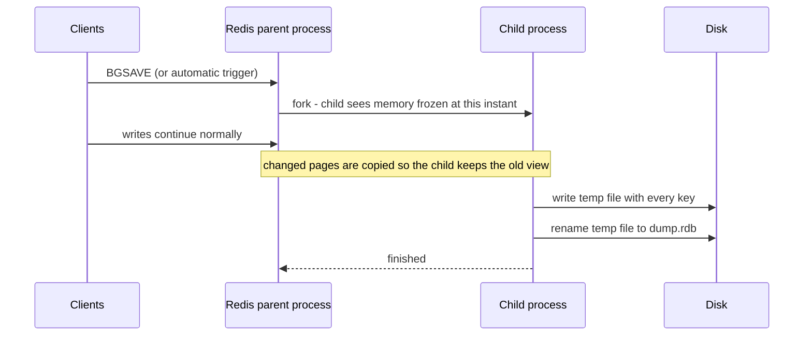

# Keeping data safe: snapshots and the append-only file

> **Before this lesson:** you should know what Redis is and that it keeps its data in memory
> ([What Redis is](#/lesson/redis/what-is-redis)), and what a transaction is
> ([pub/sub, transactions and expiry](#/lesson/redis/pubsub-transactions-expiry)). No knowledge of
> operating systems is assumed; the few ideas needed are explained here.

## In plain words

Redis keeps everything in **RAM** (random-access memory, the fast working memory of a computer).
RAM has one big drawback: when the power goes off or the program stops, its contents vanish. A disk
(a hard drive or solid-state drive) is slower but keeps its contents without power. **Persistence**
means copying data from memory to disk so that it survives a restart.

Redis offers two ways to do this, and an everyday comparison makes them easy to remember:

- A **snapshot** is like taking a photograph of a whiteboard every so often. A photo is quick to look
  at later and small to store, but anything written on the board after the last photo is lost if
  someone wipes it.
- The **append-only file** is like keeping a diary of every change made to the whiteboard: "wrote X
  at the top", "erased Y". To rebuild the board you start with an empty one and replay the diary.
  Almost nothing is lost, but the diary grows long and replaying it takes time.

Why this matters for a job: the day a server restarts unexpectedly, the settings described in this
lesson decide whether your users lose nothing, lose one second of work, or lose the last hour. People
who run Redis in production are expected to know which of those they have chosen.

## First, what can go wrong?

Three different events are worth separating, because they are survived by different things.

| Event | What is lost without persistence | What protects you |
|---|---|---|
| The Redis program crashes or is restarted | everything | any persistence to local disk |
| The machine loses power | everything, plus whatever the operating system had not yet written to disk | persistence with frequent *fsync* (explained below) |
| The disk itself dies, or the building burns | everything on that machine | a copy on another machine (replication, backups) |

This lesson handles the first two. The next lesson handles the third.

## Option 1 - RDB snapshots

**RDB** stands for *Redis Database*; it is the name of the snapshot file format. A snapshot is a
single compact file (by default called `dump.rdb`) containing every key and value as they were at one
moment.

### The simplest example

```bash
127.0.0.1:6379> SET visits 100
OK
127.0.0.1:6379> BGSAVE
Background saving started
127.0.0.1:6379> LASTSAVE
(integer) 1767225600
```

`BGSAVE` (background save) asks the server to write a snapshot without stopping work. `LASTSAVE`
returns the time of the most recent successful snapshot as a Unix timestamp (the number of seconds
since 1 January 1970). If the server now crashes and restarts, it finds `dump.rdb`, loads it, and
`visits` is 100 again.

Next experiment: change the value *after* the snapshot and then imagine a crash.

```bash
127.0.0.1:6379> INCRBY visits 50
(integer) 150
```

If the server dies now, it restarts with `visits = 100`. The 50 visits recorded after the photograph
are gone. That gap - from the last snapshot to the crash - is the price of snapshots.

### How a snapshot is taken without freezing the server

You might wonder how Redis can write out a consistent picture of data that keeps changing. The answer
uses an operating-system feature called **fork**: a running program asks the operating system to
create a copy of itself, called a *child process*. (A *process* is one running instance of a program.)
The child sees memory exactly as it was at the instant of the fork.

Copying gigabytes of memory would be slow, so the operating system cheats, using a technique called
**copy-on-write**: parent and child *share* the same memory pages (fixed-size blocks of memory,
typically 4 KB), and only when the parent changes a page is that one page copied first so the child
keeps the old version.



Two practical consequences follow.

1. The fork itself takes time proportional to the amount of memory in use (roughly 10-20 ms per GB on
   ordinary hardware, more on some virtual machines), and during that instant the server answers
   nobody.
2. While the child writes, every page the parent modifies is duplicated. On a write-heavy server a
   snapshot can temporarily use a great deal of extra memory - in the worst case nearly double.

The child writes to a temporary file and renames it at the end, so a crash in the middle of a snapshot
never damages the previous good file.

There is also `SAVE`, which writes the snapshot in the main process and blocks every client until it
finishes. It exists for shutdown scripts and emergencies; do not call it on a busy server.

### Automatic snapshots

In the configuration file (`redis.conf`), `save` lines say "snapshot when at least this many keys
changed within this many seconds":

```bash
save 3600 1
save 300 100
save 60 10000
dbfilename dump.rdb
dir /var/lib/redis
```

Read them as: after one hour if at least 1 key changed; after five minutes if at least 100 changed;
after one minute if at least 10,000 changed. A snapshot starts when *any* line is satisfied. These
three happen to be the defaults in current versions. Setting `save ""` turns automatic snapshots off.

A related setting, `stop-writes-on-bgsave-error yes` (the default), makes the server refuse writes if
the last snapshot failed, so that a full disk is noticed quickly instead of silently.

### When snapshots are the right choice

- Losing several minutes of data is acceptable (a cache, derived statistics).
- You want compact files for backups: copy `dump.rdb` to another machine every hour.
- You want fast restarts: loading a snapshot is much quicker than replaying a long log.

## Option 2 - the append-only file (AOF)

With the **append-only file** enabled, the server writes every command that changes data to the end of
a log file. "Append-only" means data is only ever added at the end, never edited in the middle. At
start-up, the server reads the log from the beginning and re-runs each command, which rebuilds the
same data.

### Turning it on

```bash
appendonly yes
appendfsync everysec
```

Or on a running server, without a restart:

```bash
127.0.0.1:6379> CONFIG SET appendonly yes
OK
```

The log stores commands in the same wire format clients use. After `SET visits 100` and
`INCRBY visits 50`, the tail of the file looks like this (each `*` line gives the number of parts,
each `$` line the length of the next part):

```bash
*3
$3
SET
$6
visits
$3
100
*3
$6
INCRBY
$6
visits
$2
50
```

### The word that decides how much you can lose: fsync

Writing to a file does not put data on the disk immediately. For speed, the operating system first
keeps written data in its own memory (the *page cache*) and moves it to the physical disk a little
later. If the machine loses power in between, that data is lost even though the program "wrote" it.
**fsync** is the request a program makes to say "push everything for this file to the physical disk
now, and do not return until it is there". It is safe and slow.

The `appendfsync` setting chooses how often Redis calls fsync on the log:

| `appendfsync` | When data reaches the disk | Worst-case loss on power failure | Speed |
|---|---|---|---|
| `always` | before each write command is acknowledged | none that was acknowledged | slowest: limited by the disk |
| `everysec` (default) | once per second, in a background thread | about one second of writes | close to no persistence |
| `no` | whenever the operating system decides (often up to 30 s) | whatever was not flushed yet | fastest |

Notice that a crash of the *Redis program alone* loses nothing under any of the three, because data
already handed to the operating system survives the program's death. The differences appear only when
the whole machine goes down.

> [!WARNING]
> `appendfsync always` on a spinning disk limits you to a few hundred writes per second, and on a
> solid-state drive it writes constantly, which wears the drive. Choose it only when losing a single
> acknowledged write is unacceptable, and measure the throughput before promising it.

### Keeping the diary short: rewriting

A counter incremented a million times produces a million log entries, yet its current state fits in
one `SET`. **Rewriting** (also called compaction) replaces the long history with the shortest set of
commands that recreates the current data.

```bash
127.0.0.1:6379> BGREWRITEAOF
Background append only file rewriting started
```

Like `BGSAVE`, this forks a child, which writes a fresh file from the in-memory data while the parent
keeps serving clients and keeps recording new commands. Rewrites also start automatically:

```bash
auto-aof-rewrite-percentage 100
auto-aof-rewrite-min-size 64mb
```

meaning "rewrite when the log has grown by 100 % (doubled) since the last rewrite, provided it is at
least 64 MB".

Two refinements in modern versions are worth knowing:

- With `aof-use-rdb-preamble yes` (the default), the rewritten file begins with a snapshot in the
  compact RDB format and continues with commands recorded afterwards. Loading is then nearly as fast
  as loading a snapshot.
- Since Redis 7.0 the AOF is no longer one file but a small directory (`appendonlydir`) holding a
  *base* file (the snapshot part), one or more *incremental* files (commands since then), and a
  *manifest* file listing them. A rewrite produces a new base and a new incremental file and updates
  the manifest in one step, which removed some memory and disk overhead that older versions paid
  during a rewrite.

### If the log is damaged

A power cut can leave a half-written command at the very end of the log. By default
(`aof-load-truncated yes`) the server ignores an incomplete final command and starts. If the damage is
in the middle, the server refuses to start; the bundled tool repairs it by cutting the file at the
first bad command:

```bash
$ redis-check-aof --fix appendonlydir/appendonly.aof.1.incr.aof
```

Make a copy of the file before running any repair tool, because everything after the cut is removed.

## Choosing: one, the other, or both

| Question | RDB snapshots | AOF |
|---|---|---|
| How much can be lost? | everything since the last snapshot (minutes) | about one second with `everysec` |
| File size | small | larger; shrinks at each rewrite |
| Restart time | fast | slower, though the RDB preamble closes most of the gap |
| Cost while running | periodic fork | constant small writes plus periodic fork for rewrites |
| Good for backups? | yes: one self-contained file | less convenient |

Common choices:

- **Pure cache:** no persistence, or occasional snapshots only so a restart is not completely cold.
- **Data you would rather not lose:** AOF with `everysec`, plus snapshots for backups. When both are
  enabled, the server loads the **AOF** at start-up, because it is the more complete record.
- **Data you must not lose:** AOF with `always`, plus replication, plus honest testing - and consider
  whether a database designed around durability should hold this data instead.

> [!TIP]
> A backup you have never restored is a hope, not a backup. Regularly copy the snapshot to another
> machine, load it into a scratch Redis instance, and check that a few known keys are present.

## Checking what the server is doing

```bash
127.0.0.1:6379> INFO persistence
# Persistence
loading:0
rdb_changes_since_last_save:42
rdb_bgsave_in_progress:0
rdb_last_save_time:1767225600
rdb_last_bgsave_status:ok
aof_enabled:1
aof_rewrite_in_progress:0
aof_last_write_status:ok
latest_fork_usec:8123
```

The fields a beginner should read first: `rdb_changes_since_last_save` (how many changes a crash right
now would lose under snapshots only), `rdb_last_bgsave_status` and `aof_last_write_status` (should be
`ok`), and `latest_fork_usec` (how long the last fork paused the server, in microseconds; 8123 is
about 8 ms).

The same from Python:

```python
import redis

r = redis.Redis(decode_responses=True)

info = r.info("persistence")
print(info["rdb_changes_since_last_save"])      # e.g. 42
print(info["aof_enabled"])                      # 1 when the AOF is on

r.bgsave()                                      # start a snapshot now
r.config_set("appendfsync", "everysec")         # change a setting without restarting
print(r.config_get("save"))                     # {'save': '3600 1 300 100 60 10000'}
```

- `r.info("persistence")` returns that section of `INFO` as a Python dictionary.
- `r.bgsave()` sends `BGSAVE`; it returns immediately while the child process works.
- `config_set` / `config_get` change and read settings on the live server. Changes made this way are
  lost at restart unless you also run `CONFIG REWRITE` or edit the configuration file.

## Try it: crash a pretend server and see what survives

The model below keeps data in a dictionary ("memory"), takes snapshots on request, and appends each
write to a log that reaches the "disk" according to the chosen fsync policy. Then we pull the plug at
a chosen moment and rebuild from what is on disk.

```python-run
import copy

class PretendRedis:
    def __init__(self, fsync="everysec"):
        self.fsync = fsync
        self.memory = {}
        self.snapshot_on_disk = {}        # what dump.rdb contains
        self.log_on_disk = []             # AOF entries the disk really holds
        self.log_in_os_cache = []         # written by Redis, not yet forced to disk
        self.last_fsync = 0

    def write(self, key, delta, now):
        self.memory[key] = self.memory.get(key, 0) + delta
        self.log_in_os_cache.append((key, delta))
        if self.fsync == "always" or (self.fsync == "everysec" and now - self.last_fsync >= 1):
            self.log_on_disk += self.log_in_os_cache; self.log_in_os_cache = []
            self.last_fsync = now

    def bgsave(self):
        self.snapshot_on_disk = copy.deepcopy(self.memory)    # the child's frozen view

    def rewrite_aof(self):
        before = len(self.log_on_disk) + len(self.log_in_os_cache)
        self.log_on_disk = [(k, v) for k, v in self.memory.items()]; self.log_in_os_cache = []
        return before, len(self.log_on_disk)

    def power_cut_and_recover(self, use_aof):
        if not use_aof:
            return dict(self.snapshot_on_disk)
        rebuilt = {}
        for key, delta in self.log_on_disk:                   # replay the diary
            rebuilt[key] = rebuilt.get(key, 0) + delta
        return rebuilt

def run(fsync):
    s = PretendRedis(fsync)
    for i in range(1, 118):                 # 117 page views, 20 per second
        now = i * 0.05
        s.write("visits", 1, now)
        if i == 60: s.bgsave()              # a snapshot after the 60th view
    return s

for policy in ("always", "everysec", "no"):
    s = run(policy)
    print(f"{policy:9s} memory={s.memory['visits']:3d}  "
          f"recovered from AOF={s.power_cut_and_recover(True).get('visits', 0):3d}  "
          f"recovered from RDB only={s.power_cut_and_recover(False).get('visits', 0):3d}")

s = run("always")
print("rewrite: entries before and after =", s.rewrite_aof(),
      "-> still recovers", s.power_cut_and_recover(True))
```

Reading the output: memory always holds 117 visits at the moment of the power cut. With `always`, the
log recovers all 117. With `everysec`, it recovers every write up to the last once-per-second flush
(the final few are lost - never more than a second's worth). With `no`, in this short run the
operating system never got round to flushing, so the log is empty: the extreme case, shown on
purpose. The snapshot alone always recovers exactly 60. The last line shows a rewrite shrinking 117
diary entries to a single one that still rebuilds the same value.

## Pitfalls

- **Assuming the default protects you.** Out of the box only snapshots are on; a crash can lose
  minutes. Turn on the AOF if that is too much.
- **Running `SAVE` on a live server.** It blocks every client until the file is written.
- **Too little spare memory.** Fork plus copy-on-write needs headroom. A server using 90 % of the
  machine's RAM can be killed by the operating system during a snapshot.
- **Linux refusing to fork.** With the kernel setting `vm.overcommit_memory = 0` a large fork may fail
  even though copy-on-write would have made it cheap; Redis logs a warning recommending the value 1.
- **Keeping snapshots only on the same disk.** That survives a crash, not a dead disk.
- **Never testing a restore.** Find out that the files load before the day you need them.
- **Thinking persistence equals availability.** A persisted server is still *down* while it restarts
  and reloads. Staying up needs replicas, the subject of the next lesson.
- **Editing settings with `CONFIG SET` and forgetting `CONFIG REWRITE`.** The change disappears at the
  next restart.

## Command cheat sheet

`N` is the total number of keys and values in the server.

| Command or setting | Meaning | Cost |
|---|---|---|
| `BGSAVE` | snapshot in a child process | fork pause, then O(N) in the child |
| `SAVE` | snapshot in the main process (blocks) | O(N), blocking |
| `LASTSAVE` | time of the last good snapshot | O(1) |
| `save <seconds> <changes>` | automatic snapshot rule | - |
| `appendonly yes` | enable the append-only file | - |
| `appendfsync always \| everysec \| no` | how often the log is forced to disk | per write / per second / never |
| `BGREWRITEAOF` | compact the log in a child process | fork pause, then O(N) in the child |
| `auto-aof-rewrite-percentage`, `-min-size` | automatic rewrite rule | - |
| `INFO persistence` | status of both mechanisms | O(1) |
| `CONFIG SET` / `CONFIG GET` / `CONFIG REWRITE` | change, read, save settings | O(1) |
| `redis-check-aof --fix`, `redis-check-rdb` | verify or repair files (run offline) | O(file size) |

## Summary

- Memory is fast and forgetful; persistence copies data to disk so a restart does not start empty.
- A snapshot is a compact point-in-time file made by a forked child using copy-on-write; you lose
  whatever changed since the last one.
- The append-only file records every write; the fsync policy sets the worst-case loss, and rewriting
  keeps the file from growing without limit.
- With both enabled the server restores from the AOF. Neither protects against losing the machine.

> [!INTERVIEW]
> "RDB or AOF?" Avoid answering with one word. State the acceptable data loss first, then pick:
> snapshots for caches and backups, AOF `everysec` for about one second of exposure, `always` when
> every acknowledged write must survive and the throughput cost is acceptable. Mention fork and
> copy-on-write memory overhead, that AOF wins at load time when both exist, and that replication is a
> separate question from persistence.

## Glossary

- **Persistence** - saving in-memory data to disk so it survives a restart.
- **RDB** - the snapshot file format (`dump.rdb`); a full copy of the data at one instant.
- **AOF (append-only file)** - a log of every write command, replayed at start-up.
- **Process** - one running instance of a program.
- **Fork** - an operating-system call that creates a child process as a copy of the current one.
- **Copy-on-write** - parent and child share memory pages until one of them changes a page, at which
  point only that page is copied.
- **Page cache** - operating-system memory holding file data not yet written to the physical disk.
- **fsync** - the request to push a file's buffered data to the physical disk before continuing.
- **Rewrite (compaction)** - replacing a long log with the shortest commands that rebuild the current
  data.
- **Durability** - the promise that data acknowledged as saved will still be there after a failure.

```quiz
[
  {"q": "A server uses only RDB snapshots. The last snapshot finished at 10:00 and the machine loses power at 10:04. What data is present after restart?",
   "options": ["Everything up to 10:04", "Everything up to 10:00; changes made after that are lost", "Nothing at all", "Everything except keys with a TTL"],
   "answer": 1,
   "explain": "A snapshot is a point-in-time copy. Changes after the last successful snapshot exist only in memory and vanish with it."},
  {"q": "What does fork with copy-on-write allow BGSAVE to do?",
   "options": ["Write the snapshot without using any CPU", "Give the child a frozen view of memory while the parent keeps accepting writes, copying only the pages that change", "Compress the data set to half its size", "Pause all clients until the file is written"],
   "answer": 1,
   "explain": "The child shares the parent's pages; a page is duplicated only when the parent modifies it, so the child's view stays consistent."},
  {"q": "With appendfsync everysec, roughly how much can be lost if the whole machine loses power?",
   "options": ["Nothing", "About one second of writes", "Everything since the last BGSAVE", "Up to 64 MB of commands"],
   "answer": 1,
   "explain": "The log is forced to disk once per second, so at most about a second of acknowledged writes may still be in operating-system memory."},
  {"q": "Only the Redis process crashes (the machine stays up). The AOF uses appendfsync no. What is lost?",
   "options": ["Up to 30 seconds of writes", "Everything since the last rewrite", "Nothing that was written to the log, because the operating system still holds and will flush that data", "The whole AOF"],
   "answer": 2,
   "explain": "Data handed to the operating system survives a process crash. The fsync policy matters when the machine itself goes down."},
  {"q": "Why does the AOF need periodic rewriting?",
   "options": ["Because commands in it expire after an hour", "Because it records every change, so it grows without bound unless replaced by a minimal set of commands for the current data", "Because Redis cannot read files larger than 64 MB", "To convert it to JSON"],
   "answer": 1,
   "explain": "A million increments are a million entries; a rewrite replaces them with one command that sets the final value."},
  {"q": "Both RDB and AOF are enabled. Which does the server load at start-up?",
   "options": ["The RDB file, because it is faster", "The AOF, because it is normally the more complete record", "Whichever file is newer", "Both, merging them"],
   "answer": 1,
   "explain": "The append-only file usually contains more recent writes than the last snapshot, so it takes precedence."},
  {"q": "A server uses 14 GB on a 16 GB machine and is write-heavy. Why is BGSAVE risky?",
   "options": ["The snapshot file will not fit in RAM", "Pages modified during the snapshot are duplicated by copy-on-write, so memory use can rise sharply and exhaust the machine", "BGSAVE deletes keys to make room", "Fork is not allowed above 8 GB"],
   "answer": 1,
   "explain": "Each page written by the parent while the child runs is copied. Under heavy writes that extra memory can approach the size of the data set."},
  {"q": "Which statement about persistence and availability is correct?",
   "options": ["With AOF always, the service never goes down", "Persistence lets data survive a restart, but the server is still unavailable while it restarts and reloads", "Snapshots make replicas unnecessary", "Persistence protects against the loss of the whole machine"],
   "answer": 1,
   "explain": "Durability and availability are different properties. Staying reachable through a failure needs another server ready to take over."}
]
```

> **Source:** Carlson, *Redis in Action*, ch. 4 (section 4.1: persistence options); current defaults, the RDB preamble and the Redis 7 multi-part AOF from redis.io. Explanations, analogies and simulation are original.
> Further reading: <https://redis.io/docs/latest/operate/oss_and_stack/management/persistence/>, <https://redis.io/docs/latest/commands/bgsave/>, <https://redis.io/docs/latest/commands/bgrewriteaof/>
