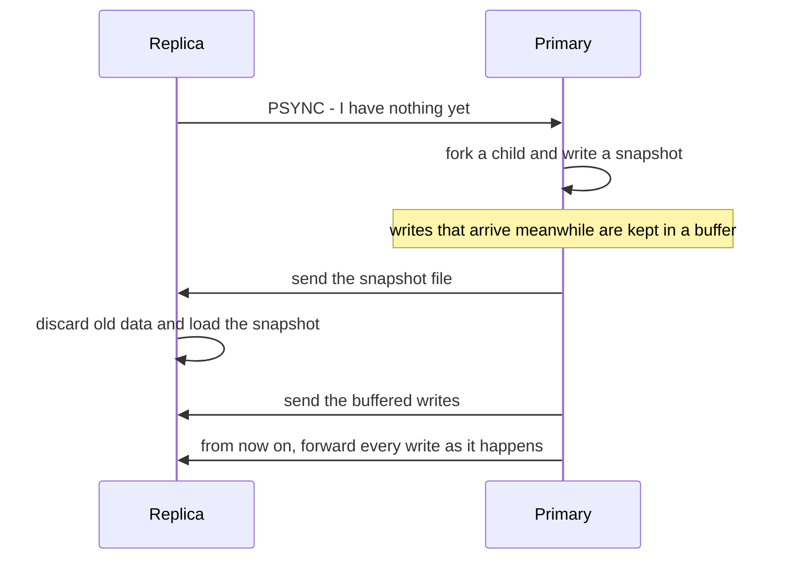
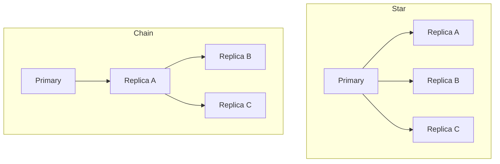

# Replication and handling failures

> **Before this lesson:** you should understand snapshots and the append-only file
> ([Keeping data safe](#/lesson/redis/persistence)). The words *fork*, *snapshot* and *fsync* are used
> here with the meanings given there.

## In plain words

Persistence protects data from a restart, but the data still lives on one machine. If that machine's
disk dies, or the machine becomes unreachable, the data is gone or out of reach. **Replication** means
keeping a continuously updated copy of the data on one or more other machines.

An everyday picture: a teacher writes on the board at the front of the class, and several students
copy every line into their notebooks as it is written. The teacher is the **primary** (the one server
that accepts changes). Each student is a **replica** (a server that holds a copy and follows along).
If the teacher's board is wiped by accident, any up-to-date notebook can be used to restore it - or a
student can step up and become the new teacher. Notice one weakness in the picture: a student is
always a moment behind, still writing the last sentence. That small delay is central to this lesson.

(Older books and tools say *master* and *slave* for primary and replica. Redis changed the vocabulary
in version 5; the old command `SLAVEOF` became `REPLICAOF`.)

Why it matters for a job: replication is how real systems survive hardware failure and how they serve
more read traffic than one server can handle. "What happens to writes during a failover?" is one of
the most common questions asked about any database.

## What replication gives you - and what it does not

| It gives you | It does not give you |
|---|---|
| a live copy on another machine | protection from mistakes: a `FLUSHALL` or a bad delete is copied too |
| extra servers to answer read commands | more capacity for writes (every write still goes through the one primary) |
| a standby ready to be promoted | automatic promotion - that needs Sentinel or Cluster, covered in [Cluster and Sentinel](#/lesson/redis/cluster-sentinel) |
| a place to run slow jobs (backups, big reads) away from the primary | a guarantee that no acknowledged write is ever lost |

## Step 1 - attach a replica

Assume two Redis servers are running: one on port 6379 (it will be the primary) and one on port 6380.
Connect to the second and tell it whom to follow.

```bash
127.0.0.1:6380> REPLICAOF 127.0.0.1 6379
OK
127.0.0.1:6380> INFO replication
# Replication
role:slave
master_host:127.0.0.1
master_port:6379
master_link_status:up
slave_repl_offset:1524
slave_read_only:1
```

`REPLICAOF host port` starts the process. In the `INFO replication` output (field names still use the
old vocabulary), `role:slave` confirms this server is now a replica, `master_link_status:up` says the
connection to the primary is healthy, and `slave_repl_offset` is a position counter explained shortly.

Now write on the primary and read on the replica:

```bash
127.0.0.1:6379> SET motd "maintenance at 22:00"
OK

127.0.0.1:6380> GET motd
"maintenance at 22:00"
127.0.0.1:6380> SET motd "hello"
(error) READONLY You can't write against a read only replica.
```

The value appeared on the replica without anyone copying it by hand, and the replica refused a write:
replicas are **read-only** by default, so that their data cannot drift away from the primary's.

To make the arrangement permanent, put `replicaof 127.0.0.1 6379` in the replica's configuration file.

## Step 2 - what happens when a replica first connects

A new replica has nothing, so it needs everything. This first transfer is called a **full
synchronisation** (full sync).



In words:

1. The replica sends `PSYNC` ("partial synchronisation, please") - with nothing to resume from, it
   becomes a full sync.
2. The primary takes a snapshot using the same fork mechanism as `BGSAVE`.
3. While the snapshot is produced and sent, new writes keep arriving; the primary stores them in a
   buffer for this replica.
4. The replica throws away whatever it had and loads the snapshot.
5. The primary sends the buffered writes, and from then on forwards each write command as it executes
   it. This endless flow is the **replication stream**.

Things a newcomer should take from this:

- A full sync costs the primary a fork and a snapshot. Attaching several replicas at once is cheaper
  than one after another, because one snapshot can serve them all.
- The replica's old data is **deleted** in step 4. Pointing the wrong server at a primary wipes it.
- By default the snapshot is written to the primary's disk and then sent. With
  `repl-diskless-sync yes` (the default since Redis 7) the child sends it directly over the network,
  which helps when the disk is slow.

## Step 3 - staying in step, and catching up after a hiccup

Each primary keeps a counter called the **replication offset**: the total number of bytes of write
commands it has produced. Each replica keeps the offset of what it has received. Comparing the two
tells you how far behind a replica is.

```bash
127.0.0.1:6379> INFO replication
# Replication
role:master
connected_slaves:1
slave0:ip=127.0.0.1,port=6380,state=online,offset=1782,lag=0
master_replid:8f6b0c7a1d3e4b5c9a0f2e1d4c3b6a5980717263
master_repl_offset:1782
repl_backlog_size:1048576
```

Here the primary is at offset 1782 and so is the replica (`slave0 ... offset=1782`): fully caught up.
`lag=0` is the number of seconds since the replica last reported in.

Networks hiccup. If the connection drops for a few seconds, repeating a full sync would be wasteful.
So the primary also keeps the most recent part of the stream in a fixed-size memory area, the
**replication backlog** (1 MB by default, set with `repl-backlog-size`). A reconnecting replica says
"I follow history `8f6b...` and I am at offset 1700". If that history identifier (`master_replid`)
matches and offset 1700 is still inside the backlog, the primary sends only the missing bytes - a
**partial resynchronisation**. If the replica has fallen too far behind, the bytes it needs have been
overwritten, and a full sync is the only option.

> [!TIP]
> One megabyte of backlog is small for a busy server. Estimate your write volume in bytes per second,
> multiply by the longest network interruption you want to ride out (say 60 seconds), and set
> `repl-backlog-size` to at least that. A larger backlog costs only that much memory once.

## Step 4 - the delay, and what it costs

Replication is **asynchronous**: the primary answers the client first and forwards the write to
replicas afterwards, without waiting for them. That keeps writes fast, and it has two visible effects.

**Stale reads.** A client that writes to the primary and immediately reads from a replica may see the
old value, because the write has not arrived yet. Usually the gap is under a millisecond; under load
or over a slow link it can be much longer.

**Lost writes on failure.** Suppose the primary acknowledges a write and crashes before forwarding it.
If a replica is then promoted to primary, that write does not exist anywhere. The client was told
"OK" and the data is gone.

Two tools shrink the second risk.

`WAIT numreplicas timeout-ms` blocks the calling client until the given number of replicas have
confirmed receiving everything up to this client's last write, or the timeout passes. It returns how
many replicas confirmed.

```bash
127.0.0.1:6379> SET order:9001 paid
OK
127.0.0.1:6379> WAIT 1 100
(integer) 1
```

A reply of `1` means at least one replica now has the write. A reply of `0` means none confirmed
within 100 ms; the write still exists on the primary, and the application must decide whether to carry
on or raise an alarm. `WAIT` improves safety but does not make Redis a strongly consistent system,
because a replica that confirmed could still lose a promotion race to one that did not.

The second tool is a pair of settings that make the primary refuse writes when it has too few healthy
replicas:

```bash
min-replicas-to-write 1
min-replicas-max-lag 10
```

"Accept writes only if at least 1 replica has reported in during the last 10 seconds." A primary cut
off from all its replicas then stops accepting writes after about ten seconds, which bounds how much
could be lost if it turns out a replica was promoted elsewhere.

## Step 5 - common layouts



A replica can have replicas of its own. In the chain layout the primary feeds one replica, which feeds
the others; this spares the primary the cost of many outgoing streams, at the price of extra delay for
the servers further down. Most deployments use the star with two or three replicas.

Persistence and replication interact in one dangerous way.

> [!WARNING]
> Never run a primary with persistence switched off *and* automatic restart switched on. If it crashes
> and comes back empty, its replicas will faithfully synchronise with the empty data set and wipe
> themselves. Either enable persistence on the primary or make sure a crashed primary stays down until
> a replica has been promoted.

## Step 6 - when the primary dies

There are three stages: notice, promote, repoint. Done by hand they look like this.

```bash
# on the replica chosen to take over
127.0.0.1:6380> REPLICAOF NO ONE
OK
127.0.0.1:6380> INFO replication
# Replication
role:master
connected_slaves:0

# on every other replica
127.0.0.1:6381> REPLICAOF 127.0.0.1 6380
OK
```

`REPLICAOF NO ONE` turns a replica into a primary; it keeps its data and starts accepting writes. The
other replicas are told to follow it, and the application must be reconfigured to send writes to the
new address. When choosing which replica to promote, pick the one with the highest replication offset,
since it has lost the least.

When the old primary returns, it must **not** be allowed to resume as a primary - two servers
accepting writes for the same data is called **split brain**, and their data sets diverge with no
automatic way to merge them. Bring it back as a replica of the new primary (it will discard its data
and resynchronise).

In practice nobody wants to do this by hand at three in the morning. **Redis Sentinel** is a
companion program that watches the servers, agrees with other Sentinels that the primary is really
down, promotes a replica and tells clients the new address. It is covered in the Modern Redis module;
here the goal is to understand what it automates.

### Checking and repairing files after a crash

Before restarting a crashed server it is worth verifying its files with the tools introduced in the
previous lesson: `redis-check-rdb dump.rdb` reports whether a snapshot is intact, and
`redis-check-aof` (with `--fix` on a copy) trims a damaged log. If a replica exists, promoting it is
usually faster and safer than repairing the old primary.

## Replication from Python

```python
import redis

primary = redis.Redis(host="10.0.0.5", port=6379, decode_responses=True)
replica = redis.Redis(host="10.0.0.6", port=6379, decode_responses=True)

primary.set("order:9001", "paid")
confirmed = primary.wait(1, 100)          # at least 1 replica, wait at most 100 ms
if confirmed < 1:
    print("warning: write not yet on any replica")

print(replica.get("order:9001"))          # 'paid' once the stream has delivered it

info = primary.info("replication")
print(info["role"], info["connected_slaves"])          # master 1
print(info["master_repl_offset"] - info["slave0"]["offset"])   # bytes the replica is behind
```

- Two separate client objects are created because the primary and the replica are two different
  servers with different addresses.
- `primary.wait(1, 100)` sends `WAIT 1 100` and returns the number of replicas that confirmed.
- `info("replication")` returns the section as a dictionary; redis-py turns the `slave0:` line into a
  nested dictionary, so `info["slave0"]["offset"]` is that replica's position. Subtracting it from the
  primary's offset gives the lag in bytes.

A common application pattern is to send writes, and reads that must be current, to the primary, and
to send reads that tolerate slight staleness (search pages, statistics) to replicas.

## Try it: lag, lost writes and WAIT

The model has one primary and one replica joined by a deliberately slow link. Each write is applied to
the primary at once and delivered to the replica a fixed time later. We then kill the primary and
promote the replica, with and without waiting for confirmation.

```python-run
class Server:
    def __init__(self): self.data, self.offset = {}, 0

class Pair:
    def __init__(self, delay):
        self.primary, self.replica, self.delay = Server(), Server(), delay
        self.in_flight = []                    # (arrival_time, key, value)
        self.now = 0.0

    def tick(self, to):
        self.now = to
        arrived = [w for w in self.in_flight if w[0] <= to]
        self.in_flight = [w for w in self.in_flight if w[0] > to]
        for _, key, value in arrived:
            self.replica.data[key] = value; self.replica.offset += 1

    def write(self, key, value):
        self.primary.data[key] = value; self.primary.offset += 1
        self.in_flight.append((self.now + self.delay, key, value))
        return "OK"                            # acknowledged before the replica has it

    def wait(self, timeout):
        target, deadline = self.primary.offset, self.now + timeout
        step = 0.001
        while self.replica.offset < target and self.now < deadline:
            self.tick(round(self.now + step, 6))
        return 1 if self.replica.offset >= target else 0

    def failover(self):
        lost = self.primary.offset - self.replica.offset
        self.in_flight = []                    # the dead primary sends nothing more
        return lost, dict(self.replica.data)

# 1) stale read
p = Pair(delay=0.020)
p.write("motd", "maintenance at 22:00")
print("read from replica right away :", p.replica.data.get("motd"))
p.tick(0.025)
print("read 25 ms later             :", p.replica.data.get("motd"))

# 2) failover without WAIT: the last writes vanish
p = Pair(delay=0.020)
for i in range(10):
    p.tick(i * 0.005); p.write(f"order:{i}", "paid")
lost, survivors = p.failover()
print(f"no WAIT   -> acknowledged=10 survived={len(survivors)} lost={lost}")

# 3) failover with WAIT after each write: nothing acknowledged-and-confirmed is lost
p = Pair(delay=0.020)
confirmed = 0
for i in range(10):
    p.write(f"order:{i}", "paid"); confirmed += p.wait(timeout=0.100)
lost, survivors = p.failover()
print(f"with WAIT -> confirmed={confirmed} survived={len(survivors)} lost={lost} "
      f"(took {p.now * 1000:.0f} ms instead of ~45 ms)")

# 4) WAIT with a timeout shorter than the link delay reports 0
p = Pair(delay=0.020); p.write("k", "v")
print("WAIT 1 with a 5 ms timeout   ->", p.wait(timeout=0.005))
```

What to notice. Part 1 prints `None` and then the value: the replica was briefly behind. In part 2,
ten writes are sent 5 ms apart over a link with 20 ms of delay; when the primary dies, the writes of
the last 20 ms are still in flight and are lost even though every one was acknowledged. In part 3 the
client waits after each write, so nothing is lost - and the run takes far longer, because each write
now pays the link delay. That is the trade: safety is bought with latency. Part 4 shows that `WAIT`
can time out and return 0, which the application must handle.

## Pitfalls

- **Reading your own write from a replica.** Send read-after-write requests to the primary, or accept
  staleness explicitly.
- **Treating a replica as a backup.** Deletions and corruption replicate. Keep dated snapshot copies
  as well.
- **A persistence-free primary that auto-restarts.** It returns empty and empties its replicas.
- **Backlog too small.** Every brief disconnect becomes a full sync, each one forking the primary.
- **Too little memory headroom on the primary.** A full sync forks, with the copy-on-write cost
  described in the persistence lesson.
- **Promoting the wrong replica.** Compare offsets and promote the most advanced one.
- **Letting the old primary rejoin as a primary.** That is split brain. Reattach it as a replica.
- **Assuming `WAIT` makes writes durable.** It confirms receipt by replicas, not that they have written
  to disk (`WAITAOF`, added in Redis 7.2, asks about fsync), and it does not survive every failover
  ordering.
- **Expired keys read from replicas.** Replicas wait for the primary to delete expired keys; modern
  versions hide logically expired keys from readers, very old ones did not.

## Command cheat sheet

| Command or setting | Meaning | Cost |
|---|---|---|
| `REPLICAOF host port` | become a replica of that server (discarding current data) | O(1) to issue; full sync is O(data) |
| `REPLICAOF NO ONE` | stop replicating and become a primary | O(1) |
| `INFO replication` | role, link status, offsets, connected replicas | O(1) |
| `WAIT n timeout-ms` | block until n replicas confirm the client's writes | O(1) plus waiting |
| `WAITAOF local replicas timeout` (7.2+) | block until writes are fsynced to AOF | O(1) plus waiting |
| `ROLE` | compact description of the server's role and offsets | O(1) |
| `replica-read-only yes` | replicas reject writes (default) | - |
| `repl-backlog-size 1mb` | history kept for partial resynchronisation | memory of that size |
| `repl-diskless-sync yes` | send the snapshot over the socket without touching disk | - |
| `min-replicas-to-write n`, `min-replicas-max-lag s` | refuse writes without enough fresh replicas | - |
| `FAILOVER` (6.2+) | coordinated hand-over from a primary to one of its replicas | O(1) plus waiting |

## Summary

- A replica copies a primary: first a full sync by snapshot, then a continuous stream of writes.
- Offsets measure progress; the backlog lets a briefly disconnected replica catch up without a new
  snapshot.
- Replication is asynchronous, so replicas can serve stale data and acknowledged writes can be lost in
  a failover. `WAIT` and `min-replicas-to-write` narrow that window at a cost in latency or
  availability.
- Failover is notice, promote (`REPLICAOF NO ONE`), repoint; never let two primaries accept writes.

> [!INTERVIEW]
> When asked "can Redis lose acknowledged writes?", say yes and explain when: asynchronous replication
> plus failover, and fsync policies weaker than `always`. Then show you know the mitigations - `WAIT`,
> `min-replicas-to-write`, AOF `everysec` or `always` - and that none of them turns Redis into a
> consensus-based store. Finish with what you would keep in Redis regardless (caches, sessions,
> rankings) and what you would keep in a database built for durability (payments, ledgers).

## Glossary

- **Replication** - keeping a live copy of one server's data on other servers.
- **Primary** - the server that accepts writes (formerly *master*).
- **Replica** - a server that copies a primary and serves reads (formerly *slave*).
- **Full synchronisation** - copying the entire data set to a replica by snapshot.
- **Replication stream** - the continuous flow of write commands from primary to replica.
- **Replication offset** - a byte counter marking a position in that stream.
- **Replication backlog** - a fixed-size buffer of recent stream bytes kept by the primary.
- **Partial resynchronisation** - sending a reconnecting replica only the bytes it missed.
- **Asynchronous** - the primary replies to the client without waiting for replicas.
- **Replication lag** - how far a replica is behind the primary.
- **Failover** - replacing a failed primary with a promoted replica.
- **Split brain** - two servers both acting as primary for the same data.

```quiz
[
  {"q": "A client writes a key on the primary and reads it from a replica one millisecond later, getting the old value. Why?",
   "options": ["The replica is broken", "Replication is asynchronous, so the write may not have reached the replica yet", "Replicas cache reads for one second", "The primary rejected the write"],
   "answer": 1,
   "explain": "The primary acknowledges first and forwards afterwards; a replica can be momentarily behind."},
  {"q": "What happens to a server's existing data when you run REPLICAOF against a primary?",
   "options": ["It is merged with the primary's data", "It is kept and only new keys are copied", "It is discarded and replaced by the primary's data set", "It is moved to database 1"],
   "answer": 2,
   "explain": "A full synchronisation loads the primary's snapshot after throwing away what the replica had."},
  {"q": "A replica reconnects after a three-second network drop. What decides whether it needs a full sync?",
   "options": ["Whether its offset is still covered by the primary's replication backlog (and the history id matches)", "Whether it has AOF enabled", "The number of keys it holds", "Whether the primary has other replicas"],
   "answer": 0,
   "explain": "If the missed bytes are still in the backlog the primary sends only those; otherwise a full sync is required."},
  {"q": "WAIT 2 50 returns 1. What does that tell the application?",
   "options": ["The write failed", "Only one replica confirmed the write within 50 ms; the write is still on the primary", "Two replicas have written it to disk", "The primary has one replica configured"],
   "answer": 1,
   "explain": "WAIT reports how many replicas acknowledged in time. Falling short does not undo the write."},
  {"q": "Why is a primary with no persistence and automatic restart dangerous?",
   "options": ["It restarts slowly", "After a crash it comes back empty and its replicas synchronise to the empty data set", "Replicas cannot connect to it", "It refuses all writes"],
   "answer": 1,
   "explain": "Replicas copy whatever the primary has, including nothing. The copies are wiped."},
  {"q": "Which command promotes a replica to a primary?",
   "options": ["PROMOTE", "REPLICAOF NO ONE", "CONFIG SET role master", "BGSAVE"],
   "answer": 1,
   "explain": "REPLICAOF NO ONE stops replication; the server keeps its data and accepts writes."},
  {"q": "What is split brain?",
   "options": ["A replica with half the keys", "Two servers both accepting writes as primary for the same data, so their contents diverge", "A snapshot stored in two files", "A client connected to two replicas"],
   "answer": 1,
   "explain": "With two primaries, writes go to different places and cannot be merged automatically."},
  {"q": "Adding three replicas to a primary increases which capacity?",
   "options": ["Write throughput", "Read throughput and resilience to machine failure", "Maximum data set size", "Both reads and writes equally"],
   "answer": 1,
   "explain": "Every write still passes through the single primary. Replicas add read capacity and standby copies."}
]
```

> **Source:** Carlson, *Redis in Action*, ch. 4 (sections 4.2-4.3: replication and handling system failures); PSYNC, backlog sizing, WAIT/WAITAOF, diskless sync and current terminology from redis.io. All wording and code are original.
> Further reading: <https://redis.io/docs/latest/operate/oss_and_stack/management/replication/>, <https://redis.io/docs/latest/commands/wait/>, <https://redis.io/docs/latest/commands/replicaof/>
