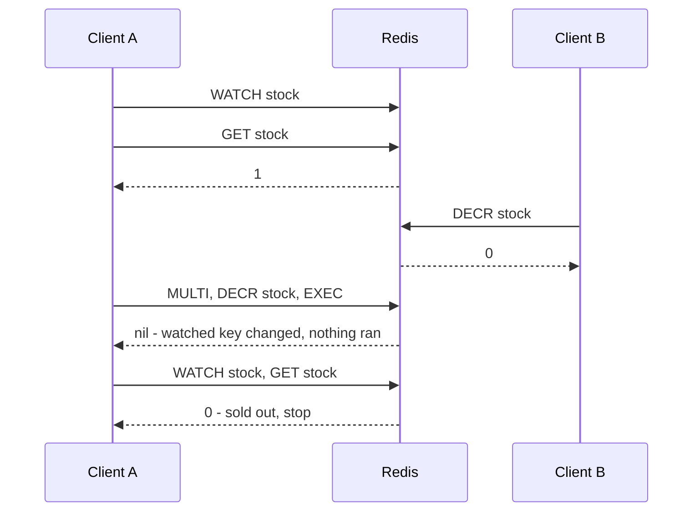

# Check-and-set with WATCH, pipelining, and measuring performance

> **Before this lesson:** you should know what `MULTI` and `EXEC` do and why you cannot read a value
> inside a transaction and act on it
> ([pub/sub, transactions and expiry](#/lesson/redis/pubsub-transactions-expiry)).
> Hashes and sorted sets are used in the examples
> ([hashes and sorted sets](#/lesson/redis/hashes-sorted-sets)).

## In plain words

This lesson answers three practical questions.

**How do I safely change data based on what it currently is?** Two shoppers look at the last copy of
a book at the same moment. Both see "1 in stock", both press *buy*. Without care, both succeed and the
shop has sold a book it does not have. Redis's answer is called `WATCH`, and it works like this: "I am
going to look at this shelf. If anyone touches it between my look and my purchase, cancel my purchase
and let me look again." Nobody is made to wait in a queue; the unlucky shopper retries.

**How do I avoid wasting time on the network?** Sending commands one at a time is like driving to the
supermarket once for milk, again for bread, and again for eggs. **Pipelining** is writing a shopping
list and making one trip.

**How do I know whether my Redis is fast or slow?** By measuring it with the built-in tools instead of
guessing.

Why it matters for a job: check-then-act bugs ("we oversold the stock", "the balance went negative")
are among the most common defects in real systems, and the single cheapest performance improvement in
most Redis-using applications is batching round trips.

## Part 1 - the lost-update problem

A few terms first. A **race condition** is a bug where the result depends on the unlucky timing of two
programs running at once. A **lost update** is the classic example: two programs read the same value,
each computes a new value from it, and the second write silently overwrites the first.

The smallest example: a counter of remaining stock, decremented by application code.

```python
stock = int(r.get("stock:book:42"))      # both clients read "1"
if stock > 0:
    r.set("stock:book:42", stock - 1)    # both clients write "0" - two sales, one book
```

Line 1 reads the value into the application. Line 2 decides. Line 3 writes. The gap between line 1 and
line 3 is where another client can slip in.

For this particular case a single atomic command would do (`DECR`, then check for a negative result).
But real operations touch several keys - take stock *and* take payment *and* record the order - and no
single command covers that. We need a general tool.

## Part 2 - WATCH: optimistic locking

There are two general strategies. **Pessimistic locking** assumes conflicts are likely: take a lock
first, so everyone else waits. **Optimistic locking** assumes conflicts are rare: do not block anyone,
but detect when a conflict happened and retry. Redis's built-in mechanism is the optimistic kind.

`WATCH key` tells the server: "remember that I am interested in this key. If any other client changes
it before my next `EXEC`, make that `EXEC` do nothing."

### One client, no conflict

```bash
127.0.0.1:6379> SET stock:book:42 1
OK
127.0.0.1:6379> WATCH stock:book:42
OK
127.0.0.1:6379> GET stock:book:42
"1"
127.0.0.1:6379> MULTI
OK
127.0.0.1:6379> DECR stock:book:42
QUEUED
127.0.0.1:6379> RPUSH orders "book:42 for customer 7"
QUEUED
127.0.0.1:6379> EXEC
1) (integer) 0
2) (integer) 1
```

The order of steps is the whole technique:

1. `WATCH` the keys the decision depends on.
2. Read them with ordinary commands (we are not inside `MULTI` yet, so real values come back).
3. Decide in the application. If the answer is "no" (no stock), run `UNWATCH` and stop.
4. `MULTI`, queue the writes, `EXEC`.

### Two clients, a conflict

Now interleave a second client between the read and the `EXEC`.

```bash
# client A
127.0.0.1:6379> WATCH stock:book:42
OK
127.0.0.1:6379> GET stock:book:42
"1"

# client B, meanwhile
127.0.0.1:6379> DECR stock:book:42
(integer) 0

# client A continues
127.0.0.1:6379> MULTI
OK
127.0.0.1:6379> DECR stock:book:42
QUEUED
127.0.0.1:6379> EXEC
(nil)
```

Client A's `EXEC` returned `nil` (nothing): the server noticed that the watched key changed and ran
**none** of the queued commands. Client A must start again from `WATCH`; on the second attempt it reads
`0` and correctly reports "sold out".



Rules worth memorising:

- `WATCH` must come **before** `MULTI`.
- `EXEC` and `DISCARD` both clear all watches; `UNWATCH` clears them without ending a transaction.
- A watched key counts as changed if it is modified, deleted, or expires.
- Watches belong to a connection. Two parts of a program sharing one connection would trample each
  other's watches, which is why client libraries give each transaction its own connection.

### The realistic version in Python

Fernwood Books sells a book only if it is in stock and the customer has enough store credit. Three
keys are involved: `stock:<book>` (a number), `credit:<customer>` (a number of cents) and `orders` (a
list).

```python
import redis

r = redis.Redis(decode_responses=True)

def buy(customer, book, price_cents, attempts=5):
    stock_key, credit_key = f"stock:{book}", f"credit:{customer}"
    with r.pipeline() as pipe:
        for _ in range(attempts):
            try:
                pipe.watch(stock_key, credit_key)
                stock = int(pipe.get(stock_key) or 0)
                credit = int(pipe.get(credit_key) or 0)
                if stock < 1 or credit < price_cents:
                    pipe.unwatch()
                    return False
                pipe.multi()
                pipe.decr(stock_key)
                pipe.decrby(credit_key, price_cents)
                pipe.rpush("orders", f"{book}:{customer}")
                pipe.execute()
                return True
            except redis.WatchError:
                continue
    return False
```

Line by line:

- `r.pipeline()` gives an object bound to one connection. The `with` block returns that connection to
  the pool at the end, whatever happens.
- `pipe.watch(...)` sends `WATCH` immediately. After it, the pipeline is in "immediate mode": commands
  such as `pipe.get` are sent at once and return real values.
- `or 0` turns a missing key (`None`) into zero.
- If the checks fail, `pipe.unwatch()` releases the watches and the function reports failure.
- `pipe.multi()` switches the pipeline back to queueing mode. The next three calls are queued.
- `pipe.execute()` sends `MULTI`, the queued commands and `EXEC`. If the server replies `nil` because
  a watched key changed, redis-py raises `redis.WatchError`.
- The `except` branch loops to try again. The `attempts` limit prevents retrying for ever under heavy
  contention.

redis-py also offers a helper that hides the loop: `r.transaction(func, *keys_to_watch)` calls
`func(pipe)` repeatedly until `EXEC` succeeds.

> [!WARNING]
> Optimistic locking behaves badly when many clients fight over the **same** key. Each success
> invalidates everyone else's attempt, so under heavy contention most work is thrown away and retried.
> If you expect that - a flash sale on one item - use a Lua script (module 11), which runs the whole
> check-and-update on the server in one step with no retries, or a lock
> ([module 6](#/lesson/redis/autocomplete-locks-semaphores)).

## Part 3 - pipelining: fewer round trips

A **round trip** is one request travelling to the server plus its reply travelling back. The time it
takes is the **network latency**. Inside one data centre a round trip takes roughly 0.2-1 ms, while
the server itself needs only a few microseconds per command. So for small commands, almost all the
waiting is network, not Redis.

**Pipelining** means sending many commands without waiting for each reply, then reading all the
replies together. No special server feature is involved: the client writes several commands into the
connection in one go.

If a page needs $n$ commands and one round trip costs $t$:

$$\text{one at a time} \approx n \times t \qquad \text{pipelined} \approx 1 \times t$$

For 50 commands at 0.5 ms each, that is 25 ms against about 0.5 ms.

```python
# 50 round trips
titles = [r.hget(f"book:{i}", "title") for i in range(50)]

# 1 round trip
pipe = r.pipeline(transaction=False)
for i in range(50):
    pipe.hget(f"book:{i}", "title")
titles = pipe.execute()
```

- `transaction=False` asks for a plain pipeline: batching only, with no `MULTI`/`EXEC` around it. Other
  clients' commands may run in between yours, which is fine for independent reads.
- Each `pipe.hget` call adds a command to a local list and returns the pipeline itself, not a value.
- `pipe.execute()` sends everything and returns the replies as a list in the same order.

Keeping the two ideas apart:

| | Plain pipeline (`transaction=False`) | Transactional pipeline (default) |
|---|---|---|
| Round trips saved | yes | yes |
| Other clients can interleave | yes | no |
| Sent as | the commands | `MULTI`, the commands, `EXEC` |
| Use for | bulk independent reads and writes | changes that belong together |

> [!TIP]
> Do not pipeline a million commands at once: the client buffers every command and the server buffers
> every reply. Send batches of a few hundred to a few thousand.

Some commands are already "pipelines in one command": `MGET`, `MSET`, `HMGET`, multi-member `SADD`
and `ZADD`. Prefer them when they fit.

## Part 4 - measuring performance

### The benchmark tool

`redis-benchmark` ships with Redis. It opens many connections and fires commands as fast as it can.

```bash
$ redis-benchmark -q -t set,get -n 200000 -c 50
SET: 142857.14 requests per second, p50=0.175 msec
GET: 147058.83 requests per second, p50=0.167 msec

$ redis-benchmark -q -t set,get -n 200000 -c 50 -P 16
SET: 1052631.62 requests per second, p50=0.631 msec
GET: 1250000.00 requests per second, p50=0.487 msec
```

Reading the options: `-q` quiet output, `-t` which commands to test, `-n` total requests, `-c` number
of simultaneous connections, `-P 16` pipeline sixteen commands per round trip. `p50` is the **median**
latency: half the requests were faster than this. (Your numbers will differ; these are illustrative.)
The second run is several times faster purely because of pipelining - evidence for Part 3.

A caution: a benchmark from the same machine using tiny values tells you the server's ceiling, not what
your application will see. Your application is usually limited by network round trips and by its own
code long before Redis runs out of capacity.

### Finding slow commands

Because commands run one at a time, one slow command delays everyone queued behind it. The **slow
log** records commands whose execution took longer than a threshold (10 ms by default, set in
microseconds by `slowlog-log-slower-than`).

```bash
127.0.0.1:6379> SLOWLOG GET 2
1) 1) (integer) 14
   2) (integer) 1767225600
   3) (integer) 48211
   4) 1) "KEYS"
      2) "session:*"
   5) "10.0.0.31:51844"
   6) "report-job"
127.0.0.1:6379> LATENCY DOCTOR
```

Each entry shows an id, when it happened, how long it ran in microseconds (48,211, about 48 ms), the
command, and who sent it. Here the culprit is `KEYS` with a pattern - a command that inspects every
key. `LATENCY DOCTOR` prints a plain-language analysis of recent latency spikes when latency
monitoring is enabled.

Other everyday tools:

```bash
$ redis-cli --latency
min: 0, max: 3, avg: 0.21 (1532 samples)
$ redis-cli --bigkeys
127.0.0.1:6379> INFO commandstats
cmdstat_get:calls=912345,usec=1368517,usec_per_call=1.50
127.0.0.1:6379> MEMORY USAGE cart:Zk3vR9
(integer) 184
```

`--latency` repeatedly measures a round trip from where you run it. `--bigkeys` samples the keyspace
and reports the largest key of each type. `INFO commandstats` shows, for each command, how often it
was called and the average microseconds per call. `MEMORY USAGE` reports the bytes one key occupies.

### A checklist when Redis "feels slow"

1. Is it the network? Compare `redis-cli --latency` from the application host with the per-call time in
   `INFO commandstats`.
2. Are there too many round trips? Count commands per request; pipeline them.
3. Is one command hogging the thread? Read `SLOWLOG GET`. Usual suspects: `KEYS`, `SMEMBERS` or
   `HGETALL` on huge keys, `SORT`, `DEL` of a huge key (use `UNLINK`), long Lua scripts.
4. Is the client reconnecting for every command? Use a **connection pool** - a set of open connections
   that are reused. redis-py does this by default as long as you create one `Redis` object and share it.
5. Is a fork in progress? Check `latest_fork_usec` and whether a snapshot or rewrite is running.
6. Is the machine out of memory and swapping to disk? Check `used_memory` against physical RAM.

## Try it: optimistic retries and the cost of round trips

The model gives every key a version number that increases on each write - that is how the server can
tell whether a watched key changed. Two buyers are deliberately interleaved so that one of them
conflicts and retries.

```python-run
class Store:
    def __init__(self): self.data, self.version = {}, {}
    def get(self, key): return self.data.get(key)
    def set(self, key, value):
        self.data[key] = value
        self.version[key] = self.version.get(key, 0) + 1

class Txn:
    """WATCH ... MULTI ... EXEC for one client."""
    def __init__(self, store): self.store, self.seen, self.queue = store, {}, []
    def watch(self, *keys):
        for k in keys: self.seen[k] = self.store.version.get(k, 0)
    def queue_set(self, key, value): self.queue.append((key, value))
    def exec(self):
        clean = all(self.store.version.get(k, 0) == v for k, v in self.seen.items())
        if clean:
            for key, value in self.queue: self.store.set(key, value)
        self.seen, self.queue = {}, []
        return clean                                   # False plays the role of a nil reply

def begin_purchase(store, who):
    t = Txn(store); t.watch("stock"); stock = store.get("stock")
    print(f"  {who} reads stock={stock}")
    if stock < 1: return None
    t.queue_set("stock", stock - 1); return t

store = Store(); store.set("stock", 1)
print("two buyers, one copy:")
a = begin_purchase(store, "A")            # A looks
b = begin_purchase(store, "B")            # B looks before A finishes
print("  B exec ->", b.exec())            # B gets there first
print("  A exec ->", a.exec())            # A is refused
a = begin_purchase(store, "A")            # A retries and now sees the truth
print("  A second attempt ->", "bought" if a else "sold out", "| final stock:", store.get("stock"))

# what happens WITHOUT watch: both succeed and the shop oversells
store = Store(); store.set("stock", 1)
seen_a, seen_b = store.get("stock"), store.get("stock")
if seen_a > 0: store.set("stock", seen_a - 1)
if seen_b > 0: store.set("stock", seen_b - 1)
print("without WATCH: two sales recorded, stock =", store.get("stock"), "(should be impossible)")

# round-trip arithmetic
def page_time_ms(commands, round_trip_ms, server_us=3, batch=1):
    trips = -(-commands // batch)                      # ceiling division
    return trips * round_trip_ms + commands * server_us / 1000
for batch in (1, 10, 50):
    print(f"50 commands, 0.5 ms per trip, batch={batch:2d}: {page_time_ms(50, 0.5, batch=batch):6.2f} ms")
```

In the first block B's `exec` returns `True` and A's returns `False`; on retry A reads zero and stops,
so exactly one sale happens. The second block shows the bug `WATCH` prevents: both buyers "succeed"
and the stock ends at 0 after two sales. The last three lines put numbers on pipelining: the same fifty
commands cost about 25 ms one at a time and well under 1 ms in a single batch.

## Pitfalls

- **`WATCH` after `MULTI`.** It is an error; watch first.
- **Reading inside `MULTI`.** You get `QUEUED`. Read between `WATCH` and `MULTI`.
- **No retry limit.** Under contention an unbounded loop spins. Cap attempts and report failure.
- **Forgetting `UNWATCH` on the early-exit path.** A pooled connection would carry stale watches into
  its next use. (Using `with r.pipeline()` resets it for you.)
- **Watching a hot key.** Every unrelated change to it aborts your transaction. Watch the narrowest
  keys that your decision truly depends on.
- **Confusing pipelining with atomicity.** A plain pipeline only saves round trips.
- **Depending on an earlier reply inside one pipeline.** Replies arrive only at `execute()`. If command
  2 needs the result of command 1, use two round trips or a Lua script.
- **Benchmarks that flatter.** Local, tiny-value benchmarks measure the server, not your system.

## Command cheat sheet

| Command | Meaning | Time |
|---|---|---|
| `WATCH key [key ...]` | abort the next `EXEC` if any of these keys change | O(1) per key |
| `UNWATCH` | forget all watched keys | O(1) |
| `MULTI` / `EXEC` / `DISCARD` | queue, run, or drop a transaction | O(1) / sum of commands / O(queue) |
| `MGET`, `MSET`, `HMGET` | many values in one command | O(number of keys or fields) |
| `SLOWLOG GET [n]` / `SLOWLOG RESET` | read or clear the slow-command log | O(n) |
| `INFO commandstats` | calls and average time per command | O(commands) |
| `LATENCY DOCTOR` / `LATENCY LATEST` | latency-spike analysis | O(1) |
| `MEMORY USAGE key` | bytes used by one key | O(samples) |
| `redis-benchmark -t cmd -n N -c C -P p` | load generator | - |
| `redis-cli --latency` / `--bigkeys` | round-trip timing / largest keys | - |

## Summary

- Read-decide-write sequences in application code are open to lost updates.
- `WATCH` plus `MULTI`/`EXEC` is optimistic locking: no waiting, but `EXEC` does nothing if a watched
  key changed, and the client retries.
- Pipelining removes round trips, which usually dominate the cost of small commands; make it
  transactional only when the commands must not be interleaved.
- Measure before tuning: benchmark, slow log, command statistics, latency tools.

> [!INTERVIEW]
> "How do you implement a safe 'decrement stock if available' in Redis?" Offer three levels: a single
> `DECR` with a check for a negative result when one key is enough; `WATCH`/`MULTI`/`EXEC` with a
> bounded retry loop when several keys are involved and contention is low; a Lua script when
> contention is high. Explain the trade-off between optimistic retries and server-side scripting.

## Glossary

- **Race condition** - a bug that depends on the timing of concurrent programs.
- **Lost update** - one writer silently overwriting another's change.
- **Pessimistic locking** - take a lock first so others wait.
- **Optimistic locking** - do not block; detect a conflict at commit time and retry.
- **WATCH** - the command that marks keys so a later `EXEC` is cancelled if they change.
- **Contention** - several clients competing to change the same data.
- **Round trip** - a request to the server and its reply.
- **Latency** - the time one operation takes, usually dominated by the network.
- **Pipelining** - sending several commands before reading any replies.
- **Connection pool** - a set of open connections kept for reuse.
- **Slow log** - the server's record of commands that exceeded a time threshold.
- **Median (p50)** - the value that half of the measurements fall below.

```quiz
[
  {"q": "Client A runs WATCH k, reads k, then MULTI, SET k 5, EXEC. Between A's read and A's EXEC, client B runs SET k 9. What does A's EXEC return and what is k?",
   "options": ["OK, and k is 5", "nil, and k is 9", "An error, and k is unset", "OK, and k is 9"],
   "answer": 1,
   "explain": "The watched key changed, so EXEC runs nothing and replies nil. B's value stands and A must retry."},
  {"q": "Why must the reads happen after WATCH but before MULTI?",
   "options": ["Reads are forbidden after EXEC", "After MULTI commands are only queued and return QUEUED, so you could not use their values to decide", "WATCH only works on keys that were never read", "MULTI clears the watch list"],
   "answer": 1,
   "explain": "You need real values to make the decision, and the watch must already be active so that any change after your read is detected."},
  {"q": "What does optimistic locking assume?",
   "options": ["Conflicts are frequent, so everyone must queue for a lock", "Conflicts are rare, so proceed without blocking and retry on the occasions a conflict is detected", "Only one client is ever connected", "The server rolls back failed commands"],
   "answer": 1,
   "explain": "It trades waiting for occasional retries, which is efficient when contention is low."},
  {"q": "A page issues 80 small commands; each round trip takes 0.4 ms and server time is negligible. Roughly how long one at a time versus one pipeline?",
   "options": ["32 ms versus 0.4 ms", "0.4 ms versus 32 ms", "80 ms versus 40 ms", "They take the same time"],
   "answer": 0,
   "explain": "80 x 0.4 = 32 ms for separate round trips; a single pipeline needs about one round trip."},
  {"q": "What is the difference between r.pipeline(transaction=False) and the default pipeline in redis-py?",
   "options": ["The first is slower", "The first only batches commands; the default also wraps them in MULTI/EXEC so no other client's commands run in between", "The default cannot use WATCH", "There is no difference"],
   "answer": 1,
   "explain": "Batching and isolation are separate features. Use the plain form for independent bulk work."},
  {"q": "SLOWLOG GET shows KEYS session:* taking 48 ms. Why does that hurt other clients?",
   "options": ["It uses a lot of network bandwidth", "Commands run one at a time, so every other client waits while this command scans all keys", "It deletes sessions", "It disables replication"],
   "answer": 1,
   "explain": "A long command occupies the single command thread; everything else queues behind it."},
  {"q": "A thousand clients try to buy the same limited item using WATCH-based code. What is the likely behaviour?",
   "options": ["All succeed at once", "Most EXECs are aborted and retried because each success changes the watched key", "The server deadlocks", "WATCH queues them in order"],
   "answer": 1,
   "explain": "High contention makes optimistic locking wasteful. A server-side script or a lock is a better fit there."},
  {"q": "Inside one pipeline you queue GET a and then want to SET b to that value plus one. Why can this not work as written?",
   "options": ["SET is not allowed in pipelines", "Replies are only available after execute(), so the value of a is unknown when the SET is queued", "Pipelines can hold one command only", "GET returns bytes"],
   "answer": 1,
   "explain": "A pipeline sends everything before reading anything. Dependent steps need two round trips, WATCH, or a script."}
]
```

> **Source:** Carlson, *Redis in Action*, ch. 4 (sections 4.4-4.6: WATCH-based transactions, non-transactional pipelines, performance considerations); the bookshop example, simulation and checklist are original. Tools and options checked against redis.io.
> Further reading: <https://redis.io/docs/latest/develop/using-commands/transactions/>, <https://redis.io/docs/latest/develop/using-commands/pipelining/>, <https://redis.io/docs/latest/operate/oss_and_stack/management/optimization/benchmarks/>, <https://redis.io/docs/latest/commands/slowlog-get/>
