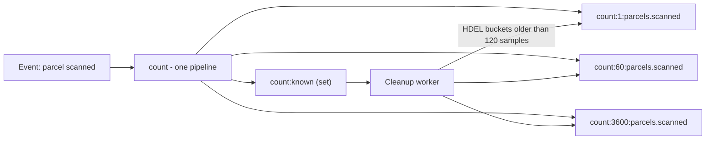

# Application support: logging, counters and statistics

> **Before this lesson:** you should know lists, hashes and sorted sets
> ([strings, lists and sets](#/lesson/redis/strings-lists-sets),
> [hashes and sorted sets](#/lesson/redis/hashes-sorted-sets)), key expiry
> ([pub/sub, transactions and expiry](#/lesson/redis/pubsub-transactions-expiry)) and pipelines
> ([WATCH and pipelining](#/lesson/redis/watch-pipelining-performance)).

## In plain words

Every running system needs to answer questions about itself: *What went wrong a minute ago? How many
orders did we take this hour? How long do pages take to load, and is that getting worse?* The data
that answers these questions is called **telemetry** - measurements a system reports about its own
behaviour.

Think of the dashboard of a car. The speedometer is a number that changes constantly (a *counter*
turned into a rate), the warning lights are recent events (a *log*), and the trip computer's "average
fuel use" is a *statistic* computed from many readings. None of it is the journey itself, yet you
would not want to drive without it.

Redis suits this work because the operations are tiny and extremely frequent - "add one to this
number", "remember this line, forget the oldest" - and because the data is useful when fresh and
worthless when old, so it can be trimmed aggressively.

Why it matters for a job: when something breaks, the first thing anyone asks is "what do the numbers
say?". Being able to build small, cheap, self-cleaning counters and logs is a routine backend task,
and it exercises almost every structure you have learned.

Our scenario for this module is **Parcelwise**, a delivery company running several services
(*service* here means one program in a larger system): `dispatch`, `tracking` and `billing`.

## Part 1 - recent log lines

A **log** is a list of messages a program writes about what it is doing, each usually tagged with a
**severity level** such as `info`, `warning` or `error`.

Programs normally write logs to files. Files are fine for history, but awkward when you have twenty
servers and want to see "the last hundred errors anywhere, right now". A capped Redis list gives
exactly that.

### The smallest version

```bash
127.0.0.1:6379> LPUSH log:recent:dispatch:error "10:42:07 no driver available for zone 4"
(integer) 1
127.0.0.1:6379> LTRIM log:recent:dispatch:error 0 99
OK
127.0.0.1:6379> LRANGE log:recent:dispatch:error 0 4
1) "10:42:07 no driver available for zone 4"
```

Three commands, each with one job. `LPUSH` puts the newest message at the head (the left end) of the
list. `LTRIM ... 0 99` keeps positions 0 to 99 and discards the rest, so the list never holds more
than one hundred messages. `LRANGE ... 0 4` reads the five newest.

### In Python, with one round trip

```python
import time
import redis

r = redis.Redis(decode_responses=True)

def log_recent(service, level, message, keep=100):
    key = f"log:recent:{service}:{level}"
    line = time.strftime("%H:%M:%S ") + message
    pipe = r.pipeline()
    pipe.lpush(key, line)
    pipe.ltrim(key, 0, keep - 1)
    pipe.execute()
```

- `time.strftime("%H:%M:%S ")` produces the current time as text, for example `10:42:07 `.
- The two commands are queued on a pipeline and sent together by `execute()`. Sending them as one
  transaction means no reader can ever see the list with 101 entries.

## Part 2 - which messages are most common?

A hundred recent lines do not tell you that one particular error happened four thousand times this
hour. For that we count how often each distinct message occurs. A sorted set is the natural tool: the
member is the message text, the score is the count.

```bash
127.0.0.1:6379> ZINCRBY log:freq:dispatch:error:2026010110 1 "no driver available"
"1"
127.0.0.1:6379> ZINCRBY log:freq:dispatch:error:2026010110 1 "no driver available"
"2"
127.0.0.1:6379> ZINCRBY log:freq:dispatch:error:2026010110 1 "address not found"
"1"
127.0.0.1:6379> EXPIRE log:freq:dispatch:error:2026010110 172800
(integer) 1
127.0.0.1:6379> ZRANGE log:freq:dispatch:error:2026010110 0 2 REV WITHSCORES
1) "no driver available"
2) "2"
3) "address not found"
4) "1"
```

`ZINCRBY key 1 member` adds 1 to the member's score, creating it at 1 if needed. The key name ends in
`2026010110`, the year, month, day and hour: every hour gets its own key. That makes "what was common
*this* hour" and "what was common *last* hour" two ordinary reads, and the `EXPIRE` of 172,800 seconds
(two days) removes old hours without any cleanup program. `ZRANGE ... REV` reads the highest counts
first.

```python
def log_common(service, level, message):
    hour = time.strftime("%Y%m%d%H")
    key = f"log:freq:{service}:{level}:{hour}"
    pipe = r.pipeline()
    pipe.zincrby(key, 1, message)
    pipe.expire(key, 2 * 86400)
    pipe.execute()
    log_recent(service, level, message)

def top_messages(service, level, hour, n=10):
    return r.zrange(f"log:freq:{service}:{level}:{hour}", 0, n - 1, desc=True, withscores=True)
```

> [!WARNING]
> Count message *templates*, not messages with variable parts. "no driver available for zone 4" and
> "... for zone 7" would become different members, and a message containing a unique order number
> would create a new member on every call, growing the set without limit. Strip the variable parts
> before counting.

## Part 3 - counters over time

"How many parcels were scanned?" is a single number. "How many per minute over the last two hours?"
is a **time series**: a sequence of values, each attached to a time interval. The standard trick is to
divide time into equal-width **buckets** and keep one counter per bucket.

### Finding the bucket

If buckets are 60 seconds wide, the bucket that contains time `t` starts at

$$\text{bucket} = \left\lfloor \frac{t}{60} \right\rfloor \times 60$$

where $\lfloor x \rfloor$ means "round down to a whole number". For `t = 1767225695` that is
`1767225660`: every timestamp within the same minute maps to the same number, which becomes the name
of the counter.

### Storing the buckets

For each metric and each bucket width (the **precision**) we keep one hash. The field is the bucket's
start time and the value is the count.

```bash
127.0.0.1:6379> HINCRBY count:60:parcels.scanned 1767225660 1
(integer) 1
127.0.0.1:6379> HINCRBY count:60:parcels.scanned 1767225660 1
(integer) 2
127.0.0.1:6379> HINCRBY count:60:parcels.scanned 1767225720 1
(integer) 1
127.0.0.1:6379> HINCRBY count:3600:parcels.scanned 1767225600 3
(integer) 3
127.0.0.1:6379> HGETALL count:60:parcels.scanned
1) "1767225660"
2) "2"
3) "1767225720"
4) "1"
127.0.0.1:6379> SADD count:known 60:parcels.scanned 3600:parcels.scanned
(integer) 2
```

`HINCRBY key field 1` adds one to a field, creating it if absent. The key `count:60:...` holds
one-minute buckets and `count:3600:...` holds one-hour buckets; recording an event updates both. The
set `count:known` remembers which counter hashes exist, so that a cleanup job can find them without
scanning every key.

```python
PRECISIONS = [1, 60, 3600, 86400]          # second, minute, hour, day

def count(name, amount=1, now=None):
    now = now or time.time()
    pipe = r.pipeline()
    for precision in PRECISIONS:
        bucket = int(now // precision) * precision
        pipe.hincrby(f"count:{precision}:{name}", bucket, amount)
        pipe.sadd("count:known", f"{precision}:{name}")
    pipe.execute()

def series(name, precision):
    raw = r.hgetall(f"count:{precision}:{name}")
    return sorted((int(bucket), int(value)) for bucket, value in raw.items())
```

- `now // precision` is whole-number division (rounding down); multiplying back gives the bucket
  start.
- One pipeline carries eight commands (two for each of four precisions) in one round trip.
- `series` converts the hash, whose fields come back in no particular order, into a list of
  `(bucket, value)` pairs sorted by time.

### Throwing old buckets away

Left alone, the one-second hash gains 86,400 fields a day. A cleanup worker keeps only the newest
samples of each hash - say 120 of them.

```python
KEEP = 120

def clean_counters():
    for entry in r.smembers("count:known"):
        precision, name = entry.split(":", 1)
        key = f"count:{precision}:{name}"
        cutoff = (int(time.time() // int(precision)) - KEEP) * int(precision)
        stale = [f for f in r.hkeys(key) if int(f) < cutoff]
        if stale:
            r.hdel(key, *stale)
        if r.hlen(key) == 0:
            r.srem("count:known", entry)
```

For each known counter it computes the start time of the oldest bucket worth keeping (`cutoff`),
collects the fields older than that, and deletes them with one `HDEL`. A hash that ends up empty is
removed from the registry. With 120 samples per precision, a metric costs at most 480 small hash
fields no matter how long the system runs.



> [!TIP]
> There is a second, cleanup-free layout: one *string key per bucket*
> (`count:60:parcels.scanned:1767225660`) incremented with `INCR` and given an `EXPIRE` of
> `KEEP × precision` seconds. Redis deletes old buckets by itself. It costs more memory per bucket and
> reading a range needs `MGET` over computed key names, but there is no worker to forget about. For
> heavy time-series use, the RedisTimeSeries module (bundled with Redis 8) provides purpose-built
> commands such as `TS.ADD` and `TS.RANGE` with automatic downsampling.

## Part 4 - statistics without storing every reading

Suppose we want the average, minimum, maximum and spread of page load times. Storing every single
measurement would be wasteful. It turns out five running numbers are enough:

| Running value | Meaning | How it updates for a new reading $x$ |
|---|---|---|
| `count` | number of readings, $n$ | add 1 |
| `sum` | total of readings, $\sum x$ | add $x$ |
| `sumsq` | total of squared readings, $\sum x^2$ | add $x^2$ |
| `min` | smallest reading | keep the smaller |
| `max` | largest reading | keep the larger |

From these:

$$\text{mean} = \frac{\sum x}{n} \qquad
\text{standard deviation} = \sqrt{\frac{\sum x^2 - \frac{(\sum x)^2}{n}}{n - 1}}$$

The **mean** is the ordinary average. The **standard deviation** measures how spread out the readings
are: small when they cluster near the mean, large when they vary widely.

We keep the five values as members of one sorted set, because `ZADD` has options that update a
minimum and a maximum in a single command.

```bash
127.0.0.1:6379> ZADD stats:tracking:load_ms LT min 180
(integer) 1
127.0.0.1:6379> ZADD stats:tracking:load_ms GT max 180
(integer) 1
127.0.0.1:6379> ZINCRBY stats:tracking:load_ms 1 count
"1"
127.0.0.1:6379> ZINCRBY stats:tracking:load_ms 180 sum
"180"
127.0.0.1:6379> ZINCRBY stats:tracking:load_ms 32400 sumsq
"32400"
127.0.0.1:6379> ZADD stats:tracking:load_ms LT min 240
(integer) 0
127.0.0.1:6379> ZADD stats:tracking:load_ms GT max 240
(integer) 0
127.0.0.1:6379> ZRANGE stats:tracking:load_ms 0 -1 WITHSCORES
 1) "count"
 2) "1"
 3) "min"
 4) "180"
 5) "sum"
 6) "180"
 7) "max"
 8) "240"
 9) "sumsq"
10) "32400"
```

`ZADD key LT min 180` means "set the member `min` to 180, but if it already exists, only when 180 is
*less than* its current score". `GT` is the mirror image for `max`. So the second pair of commands,
with the reading 240, leaves `min` at 180 and raises `max` to 240. (For brevity the session above
omits the `ZINCRBY` calls for the second reading.)

```python
import math

def record(context, kind, value):
    key = f"stats:{context}:{kind}"
    pipe = r.pipeline()
    pipe.zadd(key, {"min": value}, lt=True)
    pipe.zadd(key, {"max": value}, gt=True)
    pipe.zincrby(key, 1, "count")
    pipe.zincrby(key, value, "sum")
    pipe.zincrby(key, value * value, "sumsq")
    pipe.execute()

def summary(context, kind):
    s = dict(r.zrange(f"stats:{context}:{kind}", 0, -1, withscores=True))
    n = s.get("count", 0)
    if n == 0:
        return None
    mean = s["sum"] / n
    var = (s["sumsq"] - s["sum"] ** 2 / n) / (n - 1) if n > 1 else 0.0
    return {"count": int(n), "min": s["min"], "max": s["max"],
            "mean": mean, "stddev": math.sqrt(max(var, 0.0))}
```

- `record` sends five commands in one transaction, so a reader never sees a count that includes a
  reading whose sum has not been added yet.
- `summary` turns the `(member, score)` pairs into a dictionary and applies the formulas. `max(var, 0.0)`
  guards against a tiny negative number caused by floating-point rounding, which would make the square
  root fail.

### Timing a block of code

To feed real measurements in, wrap the code being measured:

```python
import contextlib

@contextlib.contextmanager
def timed(context, kind):
    start = time.perf_counter()
    try:
        yield
    finally:
        elapsed_ms = (time.perf_counter() - start) * 1000
        record(context, kind, elapsed_ms)
        r.zadd("stats:slowest", {context: elapsed_ms}, gt=True)

with timed("tracking:/parcel/status", "load_ms"):
    render_status_page()
```

A **context manager** is a Python object used with the `with` statement to run code before and after
a block. Here it notes the time before the block, lets the block run at `yield`, and afterwards -
even if the block raised an error, thanks to `finally` - records the elapsed time. The last line
inside also maintains `stats:slowest`, a sorted set of each page's worst time, so the slowest pages
are one `ZRANGE ... REV` away.

> [!INTERVIEW]
> Averages hide outliers: a page that takes 100 ms for 99 visitors and 10 seconds for one has a mean
> of about 200 ms. Interviewers like to hear that you would track **percentiles** as well (the value
> below which, say, 99 % of readings fall). Exact percentiles need the individual readings; common
> approximations are histogram buckets (one counter per latency range) or sketches such as t-digest,
> which Redis offers through `TDIGEST.ADD` / `TDIGEST.QUANTILE`.

## Try it: buckets, trimming and running statistics

The block below is a plain-Python imitation of the counter hashes and the five-number statistics, with
a clock we set by hand. It records a burst of events, shows the per-minute series, trims old buckets
and summarises some load times.

```python-run
import math

class Telemetry:
    def __init__(self, precisions=(1, 60, 3600), keep=3):
        self.precisions, self.keep = precisions, keep
        self.counts = {}            # (precision, name) -> {bucket_start: count}
        self.stats = {}             # name -> five running numbers

    def count(self, name, now, amount=1):
        for p in self.precisions:
            bucket = (now // p) * p
            h = self.counts.setdefault((p, name), {})
            h[bucket] = h.get(bucket, 0) + amount

    def series(self, name, precision):
        return sorted(self.counts.get((precision, name), {}).items())

    def clean(self, now):
        removed = 0
        for (p, name), h in self.counts.items():
            cutoff = (now // p - self.keep) * p
            for bucket in [b for b in h if b < cutoff]:
                del h[bucket]; removed += 1
        return removed

    def record(self, name, x):
        s = self.stats.setdefault(name, {"count": 0, "sum": 0.0, "sumsq": 0.0, "min": x, "max": x})
        s["count"] += 1; s["sum"] += x; s["sumsq"] += x * x
        s["min"] = min(s["min"], x); s["max"] = max(s["max"], x)       # ZADD LT / GT

    def summary(self, name):
        s = self.stats[name]; n = s["count"]
        mean = s["sum"] / n
        var = (s["sumsq"] - s["sum"] ** 2 / n) / (n - 1) if n > 1 else 0.0
        return {"count": n, "min": s["min"], "max": s["max"],
                "mean": round(mean, 2), "stddev": round(math.sqrt(max(var, 0.0)), 2)}

t = Telemetry()
# parcels scanned at these seconds: three in minute 0, one in minute 1, four in minute 5
for second in [5, 20, 59, 61, 300, 301, 301, 359]:
    t.count("parcels.scanned", second)
print("per minute :", t.series("parcels.scanned", 60))
print("per hour   :", t.series("parcels.scanned", 3600))
print("per second (last 3):", t.series("parcels.scanned", 1)[-3:])
print("buckets removed by cleanup at t=360:", t.clean(360))
print("per minute after cleanup:", t.series("parcels.scanned", 60))

for ms in [180, 240, 210, 195, 2600]:
    t.record("load_ms", ms)
print("load time summary:", t.summary("load_ms"))
```

What to look for. The per-minute series shows `(0, 3)`, `(60, 1)` and `(300, 4)`: eight events fell
into three buckets. Two events in the same second (301) share one per-second bucket with value 2.
Cleanup at second 360 with `keep=3` removes minute buckets older than minute 3 and all the old
per-second buckets, leaving only recent data. In the summary, one slow reading of 2600 ms drags the
mean up to 685 ms although four of five loads were near 200 ms - the standard deviation of more than
a thousand is the hint that the average is not telling the whole story.

## Pitfalls

- **Unbounded members.** Counting raw messages or URLs with unique parts creates endless members.
  Normalise first, and trim sorted sets with `ZREMRANGEBYRANK`.
- **No cleanup, or a dead cleanup worker.** Hash-per-metric counters grow for ever without trimming.
  Monitor the worker, or use per-bucket keys with `EXPIRE`.
- **Clock differences between servers.** Buckets are computed from each application server's clock. If
  clocks disagree by more than the bucket width, events land in the wrong bucket. Keep clocks
  synchronised, or use the Redis server's own time (`TIME` command).
- **Non-atomic statistics updates.** Updating `count` and `sum` in separate round trips lets a reader
  compute a wrong mean in between. Send them in one transaction.
- **Precision loss in `sumsq`.** Squares grow quickly; with huge values or billions of readings the
  subtraction in the variance formula loses accuracy. Reset statistics periodically (per-hour keys).
- **Logging synchronously in the request path.** Each log call is a network round trip. Batch with a
  pipeline, or hand log lines to a background thread.
- **Treating Redis as the long-term log archive.** It is for the recent, fast view. Ship full logs to
  a system built for storage and search.

## Command cheat sheet

`n` = size of the structure, `m` = elements returned or removed.

| Command | Use here | Time |
|---|---|---|
| `LPUSH key line` + `LTRIM key 0 99` | capped recent log | O(1) + O(removed) |
| `LRANGE key 0 k` | newest k+1 lines | O(k) |
| `ZINCRBY key 1 message` | count an occurrence | O(log n) |
| `ZRANGE key 0 9 REV WITHSCORES` | ten most common | O(log n + m) |
| `EXPIRE key seconds` | drop an old hourly key | O(1) |
| `HINCRBY key bucket 1` | count into a time bucket | O(1) |
| `HGETALL key` / `HKEYS key` | read a series / list buckets | O(n) |
| `HDEL key f1 f2 ...` | trim old buckets | O(fields removed) |
| `SADD` / `SMEMBERS` / `SREM count:known` | registry of counters | O(1) / O(n) / O(1) |
| `ZADD key LT min x` / `ZADD key GT max x` | running minimum / maximum | O(log n) |
| `ZINCRBY key x sum` | running totals | O(log n) |
| `TIME` | the server's clock | O(1) |

## Summary

- A capped list (`LPUSH` + `LTRIM`) is a recent-events log; a sorted set of counts per hour shows
  which events dominate.
- Time-series counters divide time into buckets; one hash per metric and precision, incremented with
  `HINCRBY`, with a worker (or key expiry) discarding old buckets.
- Count, sum, sum of squares, minimum and maximum are enough to compute mean and standard deviation
  without storing readings.
- Everything here is designed to stay bounded: fixed list lengths, expiring keys, trimmed hashes.

## Glossary

- **Telemetry** - measurements a system reports about itself.
- **Log / severity level** - a stream of messages from a program / the importance tag on each.
- **Time series** - values indexed by time interval.
- **Bucket** - one fixed-width interval of time with its own counter.
- **Precision** - the width of a bucket (one second, one minute, ...).
- **Retention** - how long, or how many samples, are kept before deletion.
- **Mean** - the sum of readings divided by their number.
- **Standard deviation** - a measure of how far readings typically lie from the mean.
- **Percentile** - the value below which a given percentage of readings fall.
- **Context manager** - a Python construct (`with`) that runs set-up and tear-down code around a block.

```quiz
[
  {"q": "What do LPUSH log line followed by LTRIM log 0 99 achieve together?",
   "options": ["They sort the log alphabetically", "They keep only the 100 newest lines, newest first", "They keep the 100 oldest lines", "They delete the list after 99 seconds"],
   "answer": 1,
   "explain": "New lines enter at the head and the trim keeps positions 0 to 99, discarding older ones."},
  {"q": "With 60-second buckets, which bucket does the timestamp 1000 fall into?",
   "options": ["1000", "960", "1020", "16"],
   "answer": 1,
   "explain": "floor(1000 / 60) = 16 and 16 x 60 = 960, the start of the bucket containing 1000."},
  {"q": "Why does the count() function update several hashes for one event?",
   "options": ["To replicate the data", "Each hash holds buckets of a different width, so the same event is visible per second, per minute, per hour and per day", "Because hashes can hold only one field", "To avoid using a pipeline"],
   "answer": 1,
   "explain": "One hash per precision lets you read fine detail for recent time and coarse totals for long ranges."},
  {"q": "What is the role of the count:known set?",
   "options": ["It stores the counts themselves", "It lists which counter hashes exist so the cleanup worker can find them without scanning all keys", "It prevents double counting", "It holds the server time"],
   "answer": 1,
   "explain": "A registry of counters avoids KEYS or SCAN over the whole keyspace during cleanup."},
  {"q": "The current minimum is 180. What does ZADD stats LT min 240 do?",
   "options": ["Sets min to 240", "Leaves min at 180 because 240 is not less than the current score", "Deletes min", "Adds a second member called min"],
   "answer": 1,
   "explain": "LT updates an existing member only when the new score is lower."},
  {"q": "Readings are 2, 4 and 6. Which running values are stored?",
   "options": ["count=3, sum=12, sumsq=56, min=2, max=6", "count=3, sum=12, sumsq=144, min=2, max=6", "The three readings themselves", "count=3, mean=4 only"],
   "answer": 0,
   "explain": "Sum of squares is 4 + 16 + 36 = 56. The five running numbers replace the raw readings."},
  {"q": "Why should variable parts such as order numbers be removed before counting common log messages?",
   "options": ["Redis cannot store digits in members", "Every unique message would become its own member with count 1, so the set grows without limit and nothing ranks as common", "It makes the messages shorter to type", "ZINCRBY only accepts lowercase"],
   "answer": 1,
   "explain": "Counting works on identical members. Unique text defeats both the ranking and the memory bound."},
  {"q": "Five page loads take 200, 200, 200, 200 and 3200 ms. What is the mean, and what does it hide?",
   "options": ["200 ms; nothing", "800 ms; that most loads were fast and one was very slow", "3200 ms; the fast loads", "640 ms; the number of loads"],
   "answer": 1,
   "explain": "The total is 4000 ms over five loads, so 800 ms. A mean blends an outlier into every reading, which is why percentiles are tracked too."}
]
```

> **Source:** Carlson, *Redis in Action*, ch. 5 (sections 5.1-5.2: logging to Redis, counters and statistics); per-hour keys, ZADD LT/GT statistics, the cleanup design and simulation are original to this guide.
> Further reading: <https://redis.io/docs/latest/commands/hincrby/>, <https://redis.io/docs/latest/commands/zadd/>, <https://redis.io/docs/latest/develop/data-types/timeseries/>, <https://redis.io/docs/latest/develop/data-types/probabilistic/t-digest/>
