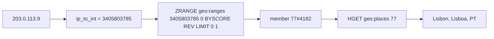

# Application support: range lookups, service discovery and configuration

> **Before this lesson:** you should know sorted sets and score-range queries
> ([hashes and sorted sets](#/lesson/redis/hashes-sorted-sets)), key expiry and pub/sub
> ([pub/sub, transactions and expiry](#/lesson/redis/pubsub-transactions-expiry)).
> The previous lesson ([logging, counters and statistics](#/lesson/redis/logging-counters-stats))
> introduced the Parcelwise delivery company used again here.

## In plain words

This lesson covers three small jobs that almost every backend ends up needing.

**Range lookup.** Given a number, find which range it belongs to. A post office does this all day:
"postcodes 2000 to 2999 go to the northern depot, 3000 to 3999 to the eastern depot". The best-known
computing version is turning a visitor's **IP address** (the numeric address every device on the
internet has) into a rough location such as a city, so a website can show the nearest depot or the
right language.

**Service discovery.** A large system is made of many programs, and they need to find each other:
"where is the billing service running right now?". It is like the staff noticeboard that lists who is
on duty today and at which desk - except that it must update itself when someone goes home.

**Configuration.** Settings that programs read: which database to use, whether a feature is switched
on, whether the site is in maintenance mode. Keeping them in one shared place means you can change a
setting once and every program picks it up, without editing files on twenty machines and restarting.

Why it matters for a job: these are unglamorous pieces of plumbing that you will be asked to build or
maintain in almost any team, and each one is a direct application of a structure you already know.

## Part 1 - "which range contains this number?"

### The idea with tiny numbers

Suppose depots serve these postcode ranges:

| Range starts at | Depot |
|---|---|
| 1000 | north |
| 2500 | east |
| 4000 | south |

Each range runs from its start up to the next start. To find the depot for postcode 3120 you ask:
*which is the largest start value that is not greater than 3120?* The answer is 2500, so "east".

That question is exactly one sorted-set query. Store each range's **start** as the score and its
label as the member:

```bash
127.0.0.1:6379> ZADD depot:ranges 1000 north 2500 east 4000 south
(integer) 3
127.0.0.1:6379> ZRANGE depot:ranges 3120 0 BYSCORE REV LIMIT 0 1
1) "east"
127.0.0.1:6379> ZRANGE depot:ranges 999 0 BYSCORE REV LIMIT 0 1
(empty array)
```

Read the query from left to right. `BYSCORE` means the two numbers are scores, not positions. `REV`
means "walk downwards from high scores to low", and with `REV` the first number is the upper end:
start at 3120 and go down towards 0. `LIMIT 0 1` means "skip none, return one". So the server finds
the first member at or below 3120 - `east`. The second query shows what happens below the lowest
range: nothing is found, and the application treats that as "unknown". (Older code spells the same
query `ZREVRANGEBYSCORE depot:ranges 3120 0 LIMIT 0 1`.)

The cost is $O(\log n)$: the server uses the sorted order to jump straight to the right place, whether
there are three ranges or three million.

### From postcodes to IP addresses

An **IPv4 address** is written as four numbers from 0 to 255 separated by dots, such as
`203.0.113.9`. Underneath it is one 32-bit whole number; the dotted form is only a readable spelling.
To convert, treat the four parts as digits in base 256:

$$203 \times 256^3 + 0 \times 256^2 + 113 \times 256 + 9 = 3{,}405{,}803{,}785$$

Location databases are published as tables of "addresses from this number onward belong to this
place". Loading one is the postcode example at a larger scale.

```python
import json
import redis

r = redis.Redis(decode_responses=True)

def ip_to_int(ip):
    a, b, c, d = (int(part) for part in ip.split("."))
    return a * 256**3 + b * 256**2 + c * 256 + d

def load_ranges(rows):
    """rows: iterable of (first_ip_text, place_id)."""
    pipe = r.pipeline(transaction=False)
    for n, (first_ip, place_id) in enumerate(rows):
        pipe.zadd("geo:ranges", {f"{place_id}#{n}": ip_to_int(first_ip)})
        if n % 1000 == 999:
            pipe.execute()
    pipe.execute()

def load_places(places):
    """places: iterable of (place_id, city, region, country)."""
    pipe = r.pipeline(transaction=False)
    for place_id, city, region, country in places:
        pipe.hset("geo:places", place_id, json.dumps([city, region, country]))
    pipe.execute()

def locate(ip):
    hit = r.zrange("geo:ranges", ip_to_int(ip), 0, byscore=True, desc=True, offset=0, num=1)
    if not hit:
        return None
    place_id = hit[0].split("#")[0]
    return json.loads(r.hget("geo:places", place_id))
```

Step by step:

- `ip_to_int` splits the text at the dots, converts each piece to a number, and combines them with
  the base-256 formula.
- `load_ranges` adds one sorted-set member per range. The member is `place_id#n`, where `n` is the row
  number. Why the suffix? Members of a sorted set must be unique, and one city usually owns *many*
  separate address ranges. Without the suffix, the second range for city 77 would overwrite the first.
- The pipeline is flushed every thousand rows, so neither the client nor the server has to hold
  millions of pending commands at once.
- `load_places` stores the readable details of each place once, in a hash, as a JSON string (JSON is a
  common text format for structured data).
- `locate` runs the range query, strips the `#n` suffix to recover the place id, and looks up the
  details. Two commands per lookup.



> [!WARNING]
> This layout stores only where each range **starts**. An address in a gap between two published
> ranges is attributed to the range before it. If your data has gaps, also store each range's end and
> compare after the lookup, returning "unknown" when the address lies beyond it.

### What about IPv6?

**IPv6** addresses are 128 bits long. Sorted-set scores are floating-point numbers that represent
whole numbers exactly only up to $2^{53}$, so an IPv6 address cannot be a score. The workaround uses
the sorted set's other ordering: give every member the *same* score (0) and make the member a
fixed-width hexadecimal string of the address. Equal scores are ordered alphabetically, fixed-width
hexadecimal sorts in numeric order, and `ZRANGE key [<address> - BYLEX REV LIMIT 0 1` performs the
same "largest value not above this one" search on text.

The technique generalises to any "find the bracket" problem: tax bands, shipping-price tiers by
weight, version ranges, time-zone rule changes.

## Part 2 - service discovery with heartbeats

Parcelwise runs several copies of its tracking service on different machines, and copies come and go
as load changes. Other programs need the current list of working copies. Each running copy is called
an **instance**.

The standard approach is a **heartbeat**: every instance announces "I am alive" every few seconds. An
instance whose last announcement is too old is assumed dead. A sorted set whose score is the time of
the last heartbeat holds all of this in one key.

```bash
127.0.0.1:6379> ZADD services:tracking 1767225600 10.0.3.11:8080
(integer) 1
127.0.0.1:6379> ZADD services:tracking 1767225603 10.0.3.12:8080
(integer) 1
127.0.0.1:6379> ZADD services:tracking 1767225605 10.0.3.11:8080
(integer) 0
127.0.0.1:6379> ZRANGE services:tracking 1767225595 +inf BYSCORE
1) "10.0.3.12:8080"
2) "10.0.3.11:8080"
127.0.0.1:6379> ZREMRANGEBYSCORE services:tracking -inf 1767225000
(integer) 0
```

Each `ZADD` records "this address was alive at this moment"; a repeat for the same address updates
its score (reply 0, because no new member was added). The `ZRANGE ... BYSCORE` query asks for every
instance heard from since ten seconds before now. `ZREMRANGEBYSCORE` deletes entries that have been
silent for a long time, keeping the set small.

```python
import time

ALIVE_WINDOW = 10          # seconds without a heartbeat before an instance is ignored

def heartbeat(service, address):
    r.zadd(f"services:{service}", {address: time.time()})

def instances(service):
    now = time.time()
    return r.zrange(f"services:{service}", now - ALIVE_WINDOW, "+inf", byscore=True)

def deregister(service, address):
    r.zrem(f"services:{service}", address)

def prune(service, older_than=600):
    r.zremrangebyscore(f"services:{service}", "-inf", time.time() - older_than)
```

Each instance calls `heartbeat` every three seconds or so from a background thread, and calls
`deregister` when it shuts down politely. A crashed instance cannot say goodbye; it disappears from
`instances()` once its last heartbeat is more than ten seconds old. A caller picks one of the returned
addresses, usually at random, which spreads requests across instances.

The window is a trade-off. A short window removes dead instances quickly but may wrongly drop a
healthy one that paused briefly; a long window does the reverse. A common rule is three times the
heartbeat interval, so that two missed beats are tolerated.

> [!TIP]
> An even smaller design uses one key per instance with an expiry:
> `SET svc:tracking:10.0.3.11:8080 1 EX 10`, refreshed by each heartbeat. Dead instances vanish by
> themselves. The cost is that listing instances needs `SCAN` over a key pattern, whereas the sorted
> set answers with one command.

## Part 3 - shared configuration

### A single switch

The smallest useful configuration is one flag. Suppose operators want to put the public site into
maintenance mode instantly.

```bash
127.0.0.1:6379> SET flag:maintenance on
OK
127.0.0.1:6379> GET flag:maintenance
"on"
127.0.0.1:6379> DEL flag:maintenance
(integer) 1
```

Every web request would check the flag. One extra round trip per request is not ruinous, but it is
wasteful for a value that changes perhaps twice a year. So each program remembers the answer for a
short time - a **local cache**, meaning a copy kept in the program's own memory.

```python
_flag = {"value": False, "checked": 0.0}

def in_maintenance(max_age=1.0):
    now = time.time()
    if now - _flag["checked"] > max_age:
        _flag["value"] = r.get("flag:maintenance") == "on"
        _flag["checked"] = now
    return _flag["value"]
```

- `_flag` is an ordinary dictionary living in the program: the last known value and when it was
  fetched.
- If the stored answer is older than `max_age` seconds, the function asks Redis and remembers the new
  answer and the time.
- Otherwise it returns the remembered value without touching the network.

A site handling 5,000 requests per second now makes one Redis call per second per program instead of
5,000, and a change to the flag takes effect everywhere within one second.

### Structured settings

Real configuration is more than a flag: connection addresses, limits, feature lists. Store each
component's settings as a JSON document under a predictable name.

```bash
127.0.0.1:6379> SET config:prod:tracking:database "{\"host\":\"10.0.9.4\",\"port\":5432,\"pool\":20}"
OK
127.0.0.1:6379> INCR config:prod:tracking:database:version
(integer) 1
127.0.0.1:6379> PUBLISH config:changed prod:tracking:database
(integer) 3
```

The key name has four parts: the word `config`, the **environment** (`prod` for production, the live
system, as opposed to `staging` or `test`), the service, and the component. A version counter beside
it is incremented on every change, and a message on the `config:changed` channel tells running
programs that something is new; the reply `3` says three programs heard it.

```python
_cache = {}                       # name -> (fetched_at, settings)

def set_config(env, service, component, settings):
    name = f"{env}:{service}:{component}"
    pipe = r.pipeline()
    pipe.set(f"config:{name}", json.dumps(settings))
    pipe.incr(f"config:{name}:version")
    pipe.publish("config:changed", name)
    pipe.execute()

def get_config(env, service, component, max_age=10.0):
    name = f"{env}:{service}:{component}"
    cached = _cache.get(name)
    if cached and time.time() - cached[0] < max_age:
        return cached[1]
    raw = r.get(f"config:{name}")
    settings = json.loads(raw) if raw else {}
    _cache[name] = (time.time(), settings)
    return settings

def listen_for_changes():
    p = r.pubsub()
    p.subscribe("config:changed")
    for item in p.listen():
        if item["type"] == "message":
            _cache.pop(item["data"], None)       # forget it; the next read fetches fresh settings
```

`get_config` is the flag cache generalised to any name. `listen_for_changes` runs in a background
thread: whenever a change is announced, it removes that entry from the local cache so the next read
fetches the new value at once. Because pub/sub can miss messages (a program that was briefly
disconnected hears nothing), the `max_age` limit stays in place as a safety net: at worst a program
runs with old settings for ten seconds.

This "cache locally, expire by age, and also invalidate on a notification" shape is common enough that
Redis 6 built it into the server as **client-side caching**, covered in the Modern Redis module.

> [!INTERVIEW]
> Asked "how do services find each other?", describe the registry pattern: instances register with
> heartbeats, entries expire when heartbeats stop, clients query the registry and cache the answer
> briefly. Mention the window trade-off and what happens when the registry itself is unavailable
> (clients should keep using their last known list). Purpose-built tools such as Consul, etcd or
> Kubernetes Services add health checks and consensus; a Redis sorted set is the lightweight version.

## Try it: range lookup, heartbeats and a config cache

The block imitates all three parts with ordinary Python data structures and a clock we control. The
range lookup uses `bisect`, a standard-library module that searches a sorted list in the same
logarithmic way a sorted set does.

```python-run
import bisect, json

def ip_to_int(ip):
    a, b, c, d = (int(p) for p in ip.split("."))
    return a * 256**3 + b * 256**2 + c * 256 + d

class RangeIndex:
    """ZADD by range start; lookup = greatest start <= value."""
    def __init__(self): self.starts, self.labels = [], []
    def add(self, start, label):
        i = bisect.bisect_left(self.starts, start)
        self.starts.insert(i, start); self.labels.insert(i, label)
    def lookup(self, value):
        i = bisect.bisect_right(self.starts, value) - 1
        return self.labels[i] if i >= 0 else None

idx = RangeIndex()
for first_ip, place in [("198.51.100.0", "Nairobi"), ("203.0.113.0", "Lisbon"), ("203.0.113.128", "Porto")]:
    idx.add(ip_to_int(first_ip), place)
print("203.0.113.9   ->", ip_to_int("203.0.113.9"), idx.lookup(ip_to_int("203.0.113.9")))
print("203.0.113.200 ->", idx.lookup(ip_to_int("203.0.113.200")))
print("198.51.100.77 ->", idx.lookup(ip_to_int("198.51.100.77")))
print("10.0.0.1      ->", idx.lookup(ip_to_int("10.0.0.1")))

# ---- heartbeats ----
last_seen, WINDOW = {}, 10
def heartbeat(addr, now): last_seen[addr] = now
def instances(now): return sorted(a for a, t in last_seen.items() if t >= now - WINDOW)
for t in range(0, 31, 3):
    heartbeat("10.0.3.11:8080", t)
    if t <= 12: heartbeat("10.0.3.12:8080", t)       # this one crashes after t=12
for now in (12, 20, 23):
    print(f"t={now:2d} alive:", instances(now))

# ---- config cache ----
server = {"config:db": json.dumps({"pool": 20})}
calls = {"n": 0}
cache = {}
def get_config(name, now, max_age=10):
    hit = cache.get(name)
    if hit and now - hit[0] < max_age: return hit[1]
    calls["n"] += 1
    cache[name] = (now, json.loads(server["config:" + name]))
    return cache[name][1]
for now in range(0, 8): get_config("db", now)
server["config:db"] = json.dumps({"pool": 50})             # operator changes the setting at t=8
print("t=8  without notification:", get_config("db", 8))
cache.pop("db", None)                                     # the config:changed message arrives
print("t=9  after invalidation  :", get_config("db", 9), "| trips to the server so far:", calls["n"])
```

The first four lines show the base-256 conversion and three lookups landing in the right ranges, plus
`None` for an address below every known range. In the heartbeat section the second instance stops
beating at second 12; it is still listed at second 20 (its last beat is 8 seconds old) and gone at
second 23 (11 seconds old). In the last section, eight reads cost a single trip to the server; right
after the operator's change the cache still returns the old value, and once the notification removes
the entry the next read returns the new one - two trips in total.

## Pitfalls

- **Non-unique members in the range index.** Two ranges for the same place need distinct members, hence
  the `#n` suffix.
- **Ignoring gaps and the low end.** A lookup below the first range returns nothing; one in a gap
  returns the previous range unless you also check an end value.
- **Using the score for values beyond $2^{53}$.** Use equal scores and `BYLEX` on fixed-width strings.
- **Heartbeat window too tight.** A short pause (a slow disk, a busy processor) makes a healthy
  instance vanish. Allow at least two missed beats.
- **Clocks that disagree.** Heartbeat scores come from each instance's own clock. If one machine's
  clock is a minute slow, it looks permanently dead. Synchronise clocks, or let a server-side script
  stamp heartbeats with the Redis server's time.
- **Never pruning the registry.** Long-gone addresses pile up; remove them periodically.
- **Storing secrets in plain configuration keys.** Anyone who can read Redis can read them. Keep
  passwords and keys in a secrets manager and store only references here.
- **Relying on the notification alone.** Pub/sub can drop messages; keep an age limit on cached
  settings as well.
- **Redis as the only source of configuration.** If Redis is unreachable at start-up, programs need
  sensible defaults or a last-known-good copy on disk.

## Command cheat sheet

`n` = members in the sorted set, `m` = members returned.

| Command | Use here | Time |
|---|---|---|
| `ZADD key start label` | add a range by its start | O(log n) |
| `ZRANGE key v 0 BYSCORE REV LIMIT 0 1` | greatest start not above v | O(log n) |
| `ZRANGE key [text - BYLEX REV LIMIT 0 1` | the same for fixed-width text keys | O(log n) |
| `HSET` / `HGET geo:places id` | details for a range's label | O(1) |
| `ZADD services:name now address` | heartbeat | O(log n) |
| `ZRANGE key (now-10) +inf BYSCORE` | instances alive recently | O(log n + m) |
| `ZREM key address` | polite deregistration | O(log n) |
| `ZREMRANGEBYSCORE key -inf t` | prune long-dead entries | O(log n + m) |
| `SET` / `GET config:...` | write / read settings | O(1) |
| `INCR config:...:version` | change counter | O(1) |
| `PUBLISH config:changed name` | announce a change | O(subscribers) |
| `SET key 1 EX 10` | per-instance key that expires by itself | O(1) |

## Summary

- "Which range holds this value?" is one reverse score-range query with `LIMIT 0 1` on a sorted set of
  range starts.
- An IPv4 address is a 32-bit number in disguise; IPv6 needs the lexicographic variant.
- A service registry is a sorted set of addresses scored by last heartbeat; recent scores mean alive.
- Shared configuration lives in plain keys; programs cache it locally for a bounded time and drop the
  cached copy when a change is announced.

## Glossary

- **IP address** - the numeric address of a device on a network (IPv4: 32 bits; IPv6: 128 bits).
- **Range lookup** - finding the interval that contains a given value.
- **Service** - one program playing a defined role in a larger system.
- **Instance** - one running copy of a service.
- **Service discovery** - how programs find the current addresses of the services they call.
- **Heartbeat** - a periodic "I am alive" signal.
- **Registry** - the shared list of instances and when each was last heard from.
- **Configuration** - settings a program reads to decide how to behave.
- **Environment** - a separate copy of a system, such as test, staging or production.
- **Local cache** - a copy of data kept in a program's own memory to avoid repeated fetches.
- **Invalidation** - discarding a cached copy because the original changed.
- **JSON** - a widely used text format for structured data.

```quiz
[
  {"q": "Ranges start at 100, 500 and 900. Which range does the value 750 belong to under the 'greatest start not above the value' rule?",
   "options": ["The one starting at 100", "The one starting at 500", "The one starting at 900", "None"],
   "answer": 1,
   "explain": "500 is the largest start that does not exceed 750, so 750 falls in the range that begins at 500."},
  {"q": "What integer does the IPv4 address 1.2.3.4 correspond to?",
   "options": ["1234", "16909060", "67305985", "4321"],
   "answer": 1,
   "explain": "1 x 16777216 + 2 x 65536 + 3 x 256 + 4 = 16777216 + 131072 + 768 + 4 = 16909060."},
  {"q": "Why are range members stored as place_id#n and not plain place_id?",
   "options": ["To sort them alphabetically", "Members must be unique, and one place can own many ranges; the suffix keeps each range as its own member", "Redis requires a # in members", "To save memory"],
   "answer": 1,
   "explain": "Adding an existing member only changes its score, so a second range for the same place would replace the first."},
  {"q": "Why can an IPv6 address not be used directly as a sorted-set score?",
   "options": ["Scores must be negative", "Scores are doubles that represent integers exactly only up to 2^53, far less than 128 bits", "IPv6 addresses contain letters", "ZADD accepts at most 32-bit scores"],
   "answer": 1,
   "explain": "Precision would be lost, so different addresses could collapse to the same score. Fixed-width strings with BYLEX avoid this."},
  {"q": "Instances send heartbeats every 3 seconds and the alive window is 10 seconds. An instance crashes right after a heartbeat. For roughly how long is it still listed?",
   "options": ["0 seconds", "About 3 seconds", "About 10 seconds", "For ever"],
   "answer": 2,
   "explain": "It remains in query results until its last heartbeat is older than the window."},
  {"q": "What is the main benefit of caching the maintenance flag in each program for one second?",
   "options": ["The flag becomes more secure", "Thousands of requests per second cause one Redis read per second per program instead of one per request", "The flag can no longer be changed", "It makes Redis persistent"],
   "answer": 1,
   "explain": "A rarely changing value does not need a network round trip on every request; a brief local copy removes almost all of them."},
  {"q": "Why keep a max_age on locally cached configuration even though changes are announced with PUBLISH?",
   "options": ["PUBLISH is slow", "Pub/sub does not store messages, so a briefly disconnected program could miss the announcement and keep stale settings indefinitely", "Redis deletes config keys after ten seconds", "JSON expires"],
   "answer": 1,
   "explain": "Notifications make updates fast; the age limit guarantees an upper bound on staleness when a notification is lost."},
  {"q": "A machine's clock is two minutes behind. With client-stamped heartbeats and a 10-second window, how does its instance appear?",
   "options": ["Always alive", "Permanently dead, because its heartbeat scores are always too old", "Alive twice", "It cannot connect"],
   "answer": 1,
   "explain": "Scores come from the sender's clock. A slow clock produces timestamps that already look stale to everyone else."}
]
```

> **Source:** Carlson, *Redis in Action*, ch. 5 (sections 5.3-5.4: IP-to-location lookup, service discovery and configuration); the depot example, heartbeat registry, change notifications and simulation are original. ZRANGE BYSCORE/BYLEX syntax from redis.io.
> Further reading: <https://redis.io/docs/latest/commands/zrange/>, <https://redis.io/docs/latest/develop/data-types/sorted-sets/>, <https://redis.io/docs/latest/develop/use/client-side-caching/>
