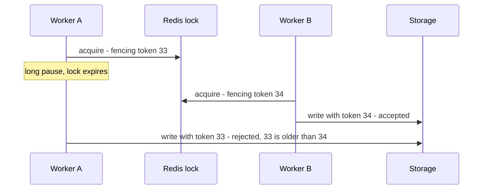

# Application components: autocomplete, distributed locks and counting semaphores

> **Before this lesson:** you should know lists and sorted sets, including lexicographic ranges
> ([strings, lists and sets](#/lesson/redis/strings-lists-sets),
> [hashes and sorted sets](#/lesson/redis/hashes-sorted-sets)), the `SET ... NX EX` form and key
> expiry, and optimistic locking with `WATCH`
> ([WATCH and pipelining](#/lesson/redis/watch-pipelining-performance)).

## In plain words

This lesson builds three reusable parts that show up inside many larger systems.

**Autocomplete** is the list of suggestions that appears while you type: enter "man" into a
journey planner and it offers "Manchester", "Mannheim", "Mantua". Behind it is a question asked
dozens of times per second per user: *which stored names begin with these letters?*

A **lock** is a way of making sure only one worker does a particular job at a time. Think of the
single key to a meeting room hanging on a hook: whoever holds the key may use the room, everyone else
waits until it is back on the hook. A **distributed lock** is the same idea when the "people" are
programs running on different computers, so the hook has to be somewhere they can all reach - here, a
key in Redis.

A **counting semaphore** is a lock that admits several holders up to a fixed limit, like a car park
with thirty spaces and a barrier that opens only while a space is free.

Why this matters for a job: suggestion boxes are everywhere in user interfaces; "make sure two workers
do not process the same order" is one of the most common requirements in backend work; and "at most
five simultaneous calls to this slow partner API" is the semaphore in disguise. Distributed locking is
also a favourite interview topic because it is easy to get subtly wrong.

The scenario for this module is **Linea**, a public-transport journey planner.

## Part 1 - autocomplete

### Version A: a short "recently used" list

The first suggestions most apps show are the user's own recent choices. That is a tiny list per user,
and the requirements are: newest first, no duplicates, at most fifty entries.

```bash
127.0.0.1:6379> LREM recent:user:88 0 "Manchester Piccadilly"
(integer) 0
127.0.0.1:6379> LPUSH recent:user:88 "Manchester Piccadilly"
(integer) 1
127.0.0.1:6379> LTRIM recent:user:88 0 49
OK
127.0.0.1:6379> LRANGE recent:user:88 0 -1
1) "Manchester Piccadilly"
```

Three steps: `LREM key 0 value` removes every existing copy of the station (count `0` means "all"),
so it cannot appear twice; `LPUSH` puts it at the front; `LTRIM` keeps the first fifty. To suggest,
the application fetches the whole list (fifty short strings) and keeps the entries that start with
what the user typed. Filtering fifty items in the application is cheaper than anything cleverer.

```python
import redis

r = redis.Redis(decode_responses=True)

def remember(user, station):
    key = f"recent:user:{user}"
    pipe = r.pipeline()
    pipe.lrem(key, 0, station)
    pipe.lpush(key, station)
    pipe.ltrim(key, 0, 49)
    pipe.execute()

def suggest_recent(user, typed):
    typed = typed.lower()
    return [s for s in r.lrange(f"recent:user:{user}", 0, -1) if s.lower().startswith(typed)]
```

The pipeline makes the three commands one transaction, so no reader sees the list between the removal
and the re-insertion. The last line is a Python *list comprehension*: it builds a list of the stations
whose lower-case form starts with the typed text.

### Version B: prefix search over many names

Linea knows forty thousand stations. Fetching them all for each keystroke is out of the question. We
need the server to return only names that begin with the typed **prefix** (the first few letters).

Recall from the sorted-set lesson: when all members have the *same score*, a sorted set orders them
alphabetically, and `BYLEX` queries select an alphabetical range. Names that share a prefix sit next
to each other in alphabetical order, so "everything starting with `man`" is the range from `man`
(inclusive) up to, but not including, the first string that is *past* all words starting with `man`.

A neat way to write that upper bound is the prefix followed by the highest possible byte, written
`\xff` (the byte with value 255).

```bash
127.0.0.1:6379> ZADD stations 0 manchester 0 mannheim 0 mantua 0 madrid 0 marseille 0 milan
(integer) 6
127.0.0.1:6379> ZRANGE stations "[man" "(man\xff" BYLEX LIMIT 0 5
1) "manchester"
2) "mannheim"
3) "mantua"
127.0.0.1:6379> ZRANGE stations "[ma" "(ma\xff" BYLEX LIMIT 0 5
1) "madrid"
2) "manchester"
3) "mannheim"
4) "mantua"
5) "marseille"
```

In `BYLEX` ranges every bound begins with `[` (include this value) or `(` (exclude it). `LIMIT 0 5`
caps the reply at five suggestions. The cost is $O(\log n + m)$ for $n$ stored names and $m$ results:
the server jumps to the start of the range and reads forward.

Two details make this usable in practice. Store names in a **normalised** form - lower case, accents
removed - so that "Man", "man" and "MAN" all find the same entries. And since users want to see the
proper spelling, keep it alongside: store the member as `normalised|Display Name` and split on the
separator after reading.

```python
def add_station(name):
    r.zadd("stations", {f"{name.lower()}|{name}": 0})

def suggest(typed, limit=5):
    prefix = typed.lower()
    hits = r.zrange("stations", f"[{prefix}", f"({prefix}\xff", bylex=True, offset=0, num=limit)
    return [h.split("|", 1)[1] for h in hits]
```

> [!TIP]
> Alphabetical order is rarely what users want; they want the *most likely* station first. A common
> upgrade keeps one small sorted set per prefix (`ac:m`, `ac:ma`, `ac:man`), scored by popularity, and
> answers each keystroke with `ZRANGE ac:<prefix> 0 4 REV`. It uses more memory - each name appears
> under every one of its prefixes - so limit prefixes to a few characters and names to the popular
> ones, falling back to the alphabetical index for the rest.

## Part 2 - distributed locks

### Why not WATCH?

The previous module showed `WATCH`, which retries when a key changes. That works when conflicts are
rare. When many workers want the *same* thing - one popular timetable to regenerate - most attempts
fail and are redone, wasting work. A lock makes the others wait (or give up) instead.

### The smallest lock

```bash
127.0.0.1:6379> SET lock:timetable:line7 worker-a NX EX 30
OK
127.0.0.1:6379> SET lock:timetable:line7 worker-b NX EX 30
(nil)
127.0.0.1:6379> DEL lock:timetable:line7
(integer) 1
127.0.0.1:6379> SET lock:timetable:line7 worker-b NX EX 30
OK
```

`NX` means "only if the key does not exist", so the first `SET` wins and the second gets `nil`: the
lock is taken. `DEL` releases it and worker B can then acquire it. `EX 30` gives the lock a 30-second
lifetime, so that if worker A crashes without releasing, the lock frees itself and the system does not
stall for ever. A lock that can never be released because its holder died is called a **deadlock**;
the expiry is the protection against it.

### The bug in the smallest lock

Follow this timeline carefully. It is the mistake almost everyone makes first.

1. Worker A acquires the lock with a 30-second lifetime.
2. A's job takes 40 seconds (a slow database, a long pause). At second 30 the lock expires.
3. Worker B acquires the lock - correctly, since it is free.
4. At second 40, A finishes and runs `DEL lock:...`. **A has deleted B's lock.**
5. Worker C acquires the lock while B is still working. Two workers now run at once.

The cure for step 4: each holder stores a unique random value - a **token** - in the lock, and release
means "delete the key *only if it still contains my token*".

```python
import time
import uuid

RELEASE = r.register_script("""
if redis.call('GET', KEYS[1]) == ARGV[1] then
    return redis.call('DEL', KEYS[1])
end
return 0
""")

def acquire(name, hold_seconds=30, wait_seconds=10):
    token = str(uuid.uuid4())
    deadline = time.time() + wait_seconds
    while time.time() < deadline:
        if r.set(f"lock:{name}", token, nx=True, ex=hold_seconds):
            return token
        time.sleep(0.05)
    return None

def release(name, token):
    return RELEASE(keys=[f"lock:{name}"], args=[token]) == 1
```

Line by line:

- `uuid.uuid4()` generates a random identifier that will not, in practice, repeat. It is this
  holder's token.
- `acquire` tries `SET ... NX EX`; on failure it sleeps 50 ms and tries again until `wait_seconds`
  have passed, then gives up and returns `None`.
- Release must do two things atomically: compare the stored value with our token, and delete if they
  match. If they were two separate commands, the lock could expire and be re-acquired by someone else
  in between. The small program inside `register_script` is written in Lua, a scripting language that
  Redis can run on the server as a single uninterrupted step; module 11 covers scripts properly. For
  now read it as: "if the key holds my token, delete it and return 1; otherwise return 0".

Usage:

```python
token = acquire("timetable:line7")
if token:
    try:
        rebuild_timetable("line7")
    finally:
        release("timetable:line7", token)
```

The `try` / `finally` pair guarantees the release runs even if the work raises an error.

redis-py ships this pattern ready-made: `with r.lock("timetable:line7", timeout=30, blocking_timeout=10):`
acquires, runs the block and releases with a token check.

### The bug that remains: the lock can expire under you

The token fixed step 4. Steps 2-3 still happened: A kept working after its lock had expired, so A and
B were both inside the protected section. A program cannot reliably notice this, because the pause may
occur *between* checking the clock and doing the work.



The robust answer is a **fencing token**: a number that increases every time the lock is granted
(a Redis `INCR` provides one). The holder sends its number with every write to the protected resource,
and the resource rejects any write carrying a number lower than one it has already seen. Worker A's
late write arrives with 33 after 34 was seen, and is refused. The lock then only needs to be *mostly*
right; the resource enforces correctness.

> [!WARNING]
> A Redis lock is an efficiency tool ("avoid doing the same work twice"), not a safety guarantee
> ("two writers must never overlap"). Expiry, process pauses, clock jumps and a failover that loses the
> lock key can each let two holders coexist briefly. If overlap would corrupt data, add fencing tokens
> at the resource or use a system built on consensus, such as ZooKeeper or etcd.

A note on **Redlock**: this is an algorithm published by Redis's author that acquires the same lock on
a majority of several independent Redis servers, to survive one server failing. It reduces the
failover problem but still depends on timing assumptions, and it has been publicly criticised for
that; fencing tokens remain the recommended defence when correctness matters.

### Choosing the lifetime

- Too short, and the lock expires during normal work.
- Too long, and a crashed holder blocks everyone for that long.

Pick a lifetime comfortably above the slowest normal run, and for long jobs **extend** the lock
periodically from a background thread (compare the token, then set a new expiry - again atomically).
redis-py's lock has `extend()` and `reacquire()` for this.

## Part 3 - counting semaphores

Linea calls a partner's live-departures service that allows only three simultaneous requests per
customer. We need a lock with three slots.

### A basic semaphore from a sorted set

Each holder is a member of a sorted set; the score is the time it entered. To acquire:

1. Remove holders whose entry time is older than the timeout (they crashed or forgot to release).
2. Add yourself with the current time.
3. Check your rank. If you are among the first `limit` members, you hold a slot. Otherwise remove
   yourself and report failure.

```bash
127.0.0.1:6379> ZREMRANGEBYSCORE sem:departures -inf 1767225590
(integer) 0
127.0.0.1:6379> ZADD sem:departures 1767225600 holder-a
(integer) 1
127.0.0.1:6379> ZRANK sem:departures holder-a
(integer) 0
127.0.0.1:6379> ZADD sem:departures 1767225601 holder-b 1767225602 holder-c 1767225603 holder-d
(integer) 3
127.0.0.1:6379> ZRANK sem:departures holder-d
(integer) 3
127.0.0.1:6379> ZREM sem:departures holder-d
(integer) 1
```

With a limit of three, ranks 0, 1 and 2 are slots. `holder-d` has rank 3, so it is over the limit and
removes itself. Releasing a slot is `ZREM`.

```python
def acquire_slot(name, limit, timeout=10):
    holder = str(uuid.uuid4())
    now = time.time()
    key = f"sem:{name}"
    pipe = r.pipeline()
    pipe.zremrangebyscore(key, "-inf", now - timeout)
    pipe.zadd(key, {holder: now})
    pipe.zrank(key, holder)
    rank = pipe.execute()[-1]
    if rank < limit:
        return holder
    r.zrem(key, holder)
    return None

def release_slot(name, holder):
    return r.zrem(f"sem:{name}", holder) == 1
```

`pipe.execute()` returns the three replies as a list; `[-1]` takes the last one, the rank.

### Why "basic" is not "fair"

Scores come from each client's own clock. If one machine's clock runs a second behind, its holders
enter with lower scores, get better ranks, and can push out a holder that legitimately arrived first.
A semaphore that grants slots in true arrival order is called **fair**.

The fair version stops trusting client clocks for *ordering*. It keeps a counter in Redis (`INCR`
gives each arrival a strictly increasing number) and a second sorted set scored by that number; rank
is decided by the counter, while the time-scored set is used only to expire stale holders. Even then,
two clients can race between adding themselves and checking rank, so robust implementations run the
whole acquire step as one script. Module 11 rewrites both the lock and the semaphore that way, where
they become short and exact.

> [!INTERVIEW]
> A complete answer to "implement a distributed lock with Redis" has five parts: `SET key token NX PX
> ttl` to acquire; a unique token per holder; compare-and-delete in a script to release; a statement
> of what goes wrong when the lock expires early; and fencing tokens (or a consensus system) as the
> remedy when correctness matters. Mention Redlock and its controversy if asked about multi-node
> setups.

## Try it: prefix search, a lock with tokens, and a semaphore

The block imitates the three components with a hand-controlled clock. Watch the lock section replay
the exact failure timeline described above, first without tokens and then with them.

```python-run
import bisect, itertools

# ---------- autocomplete by prefix ----------
names = sorted(["manchester", "mannheim", "mantua", "madrid", "marseille", "milan"])
def suggest(prefix, limit=5):
    lo = bisect.bisect_left(names, prefix)                 # "[prefix"
    hi = bisect.bisect_left(names, prefix + "\xff")        # "(prefix\xff"
    return names[lo:hi][:limit]
for p in ("man", "ma", "mi", "z"):
    print(f"{p!r:6} -> {suggest(p)}")

# ---------- lock with expiry, tokens and fencing ----------
class LockServer:
    def __init__(self): self.owner, self.expires, self.now, self.fence = None, 0, 0, itertools.count(33)
    def acquire(self, token, ttl):
        if self.owner is not None and self.expires > self.now: return None
        self.owner, self.expires = token, self.now + ttl
        return next(self.fence)                            # fencing number for this grant
    def release_naive(self): self.owner = None; return True
    def release(self, token):
        if self.owner == token and self.expires > self.now:
            self.owner = None; return True
        return False
    def holder(self): return self.owner if self.expires > self.now else None

def timeline(safe):
    s = LockServer()
    s.acquire("A", ttl=30)
    s.now = 35; s.acquire("B", ttl=30)                     # A overran; B legitimately takes over
    s.now = 40
    freed = s.release("A") if safe else s.release_naive()  # A finishes and "releases"
    got_c = s.acquire("C", ttl=30) is not None
    return freed, got_c, s.holder()
print("naive release  : A freed something=%s, C got in=%s, holder=%s" % timeline(False))
print("token release  : A freed something=%s, C got in=%s, holder=%s" % timeline(True))

s = LockServer(); storage = {"highest_seen": 0, "value": None}
def write(fence, value):
    if fence < storage["highest_seen"]: return "rejected"
    storage["highest_seen"], storage["value"] = fence, value; return "accepted"
fa = s.acquire("A", 30); s.now = 35; fb = s.acquire("B", 30)
print("B writes with", fb, "->", write(fb, "from B"), "| late A writes with", fa, "->", write(fa, "from A"))

# ---------- counting semaphore ----------
class Semaphore:
    def __init__(self, limit, timeout): self.limit, self.timeout, self.holders = limit, timeout, {}
    def acquire(self, who, now):
        self.holders = {h: t for h, t in self.holders.items() if t > now - self.timeout}
        self.holders[who] = now
        rank = sorted(self.holders, key=lambda h: (self.holders[h], h)).index(who)
        if rank < self.limit: return True
        del self.holders[who]; return False
    def release(self, who): return self.holders.pop(who, None) is not None
sem = Semaphore(limit=3, timeout=10)
print("acquire a-d at t=0..3:", [sem.acquire(w, t) for t, w in enumerate("abcd")])
print("release b:", sem.release("b"), "| d retries at t=4:", sem.acquire("d", 4))
print("e at t=5:", sem.acquire("e", 5), "| e at t=12 (a and c timed out):", sem.acquire("e", 12))
```

Reading the output. The prefix searches return three, five, one and zero names. In the lock timeline
with the naive release, A "frees" the lock that B holds and C walks in - `holder=C` while B is still
working. With the token check, A's release is refused, C is turned away, and B remains the holder.
The fencing line shows B's write (number 34) accepted and A's late write (number 33) rejected. In the
semaphore, the fourth arrival is refused, gets in after a release, and a later arrival succeeds once
stale holders have timed out.

## Pitfalls

- **`SETNX` then `EXPIRE` as two commands.** A crash in between leaves a lock that never expires. Use
  one `SET ... NX EX`.
- **Releasing with a bare `DEL`.** You may delete someone else's lock. Compare your token first, in a
  script.
- **Comparing and deleting in two round trips.** The lock can change hands in between. It must be one
  atomic step.
- **Assuming the lock is still held after a long operation.** Check elapsed time, extend the lock, and
  protect the resource with fencing tokens when overlap would do damage.
- **Sleeping without limit while waiting.** Always bound the wait and handle "could not acquire".
- **Semaphores with client clocks.** Skewed clocks make a basic semaphore unfair and can let more than
  `limit` holders in. Use a server-side counter and a script.
- **Unnormalised autocomplete entries.** Mixed case and accents scatter names across the alphabetical
  order, so prefixes miss them.
- **Mixed scores in a `BYLEX` index.** Lexicographic ranges are defined only when all scores are equal.

## Command cheat sheet

`n` = elements in the structure, `m` = elements returned.

| Command | Use here | Time |
|---|---|---|
| `LREM key 0 value` | remove existing copies before re-adding | O(n) |
| `LPUSH` + `LTRIM key 0 49` | newest first, capped | O(1) + O(removed) |
| `ZADD key 0 name` | add a name to the prefix index | O(log n) |
| `ZRANGE key [p (p\xff BYLEX LIMIT 0 k` | names starting with p | O(log n + m) |
| `SET lock token NX EX ttl` | acquire a lock | O(1) |
| script: `GET` equals token, then `DEL` | release only your own lock | O(1) |
| `PEXPIRE lock ms` (after token check) | extend a held lock | O(1) |
| `INCR lock:fence` | next fencing number | O(1) |
| `ZREMRANGEBYSCORE sem -inf (now - timeout)` | drop stale holders | O(log n + m) |
| `ZADD sem now holder` / `ZRANK sem holder` | enter and check position | O(log n) |
| `ZREM sem holder` | release a slot | O(log n) |

## Summary

- Small per-user suggestion lists are capped lists filtered in the application; large shared ones are
  equal-score sorted sets queried with `BYLEX` prefix ranges.
- A lock is `SET key token NX EX ttl`; the expiry prevents deadlock and the token prevents releasing a
  lock you no longer own.
- Expiry means a lock can be lost while its holder still believes in it; fencing tokens at the
  resource make that harmless.
- A counting semaphore is a sorted set of holders: trim the stale ones, add yourself, check your rank.

## Glossary

- **Prefix** - the first characters of a string.
- **Normalisation** - converting text to one standard form (for example lower case) before storing or
  comparing.
- **Lock** - a mechanism allowing only one holder at a time.
- **Distributed lock** - a lock shared by programs on different machines.
- **Deadlock** - a state where work can never proceed because a lock is never released.
- **Token** - a unique random value identifying the current holder of a lock.
- **Fencing token** - a strictly increasing number issued with each lock grant, checked by the
  protected resource.
- **Critical section** - the part of a program that must not run in two places at once.
- **Counting semaphore** - a lock that allows up to a fixed number of simultaneous holders.
- **Fair** - granting access strictly in order of arrival.
- **Redlock** - an algorithm that takes the same lock on a majority of independent Redis servers.

```quiz
[
  {"q": "All members of a sorted set have score 0. What does ZRANGE names \"[ca\" \"(ca\\xff\" BYLEX return?",
   "options": ["All members", "Members that contain the letters ca anywhere", "Members that start with ca", "Members alphabetically before ca"],
   "answer": 2,
   "explain": "The range starts at ca (inclusive) and ends before the first string beyond every word with that prefix."},
  {"q": "Why does the lock use SET key token NX EX 30 and not SETNX followed by EXPIRE?",
   "options": ["SETNX is slower", "The single command sets the value and the expiry atomically, so a crash cannot leave a lock without an expiry", "EXPIRE does not work on strings", "NX is required for replication"],
   "answer": 1,
   "explain": "Two commands leave a gap; if the client dies in it, the lock lives for ever and blocks everyone."},
  {"q": "Worker A's lock expired and worker B acquired it. A now calls DEL on the lock key. What goes wrong?",
   "options": ["Nothing, DEL fails for non-owners", "A deletes B's lock, so a third worker can enter while B is still working", "A reacquires the lock", "Redis raises a WRONGTYPE error"],
   "answer": 1,
   "explain": "Redis keys have no notion of ownership. Without a token check, anyone can delete the key."},
  {"q": "Why must the release compare the token and delete the key in a single script?",
   "options": ["Scripts are faster than commands", "Between a separate GET and DEL the lock could expire and be taken by another worker, whose lock would then be deleted", "DEL cannot be sent through a pipeline", "GET is not allowed on lock keys"],
   "answer": 1,
   "explain": "Check-then-act across two round trips is a race. Running both steps atomically on the server closes it."},
  {"q": "What problem do fencing tokens solve that random lock tokens do not?",
   "options": ["Releasing someone else's lock", "A holder that keeps working after its lock expired: the resource rejects writes carrying an older number", "Choosing the lock's lifetime", "Making the lock fair"],
   "answer": 1,
   "explain": "The protected resource remembers the highest number seen and refuses anything lower, so a stale holder cannot overwrite newer work."},
  {"q": "A semaphore with limit 3 holds members with ranks 0, 1 and 2. A new holder adds itself and gets rank 3. What should it do?",
   "options": ["Proceed, it has a slot", "Remove itself and report that no slot is available", "Delete the member with rank 0", "Increase the limit"],
   "answer": 1,
   "explain": "Only ranks below the limit hold slots. The newcomer withdraws and may retry later."},
  {"q": "Why can a semaphore that scores holders by each client's clock be unfair?",
   "options": ["Sorted sets cannot store timestamps", "A machine whose clock is behind gets lower scores and better ranks, jumping ahead of earlier arrivals", "ZRANK is random", "Clients share one clock"],
   "answer": 1,
   "explain": "Ordering by untrusted clocks lets skew reorder arrivals. A server-side counter gives a trustworthy order."},
  {"q": "Which statement about Redis-based locks is the most accurate?",
   "options": ["They guarantee mutual exclusion under all failures", "They are a good way to avoid duplicate work, but expiry and failover mean they should not be the only protection where overlap corrupts data", "They require three servers to work at all", "They block the Redis server while held"],
   "answer": 1,
   "explain": "Treat them as an efficiency optimisation; enforce correctness at the resource with fencing or use a consensus-based system."}
]
```

> **Source:** Carlson, *Redis in Action*, ch. 6 (sections 6.1-6.3: autocomplete, distributed locking, counting semaphores); BYLEX prefix search, fencing discussion, examples and simulation are original. Lock guidance cross-checked with redis.io.
> Further reading: <https://redis.io/docs/latest/develop/clients/patterns/distributed-locks/>, <https://redis.io/docs/latest/commands/set/>, <https://redis.io/docs/latest/commands/zrangebylex/>
