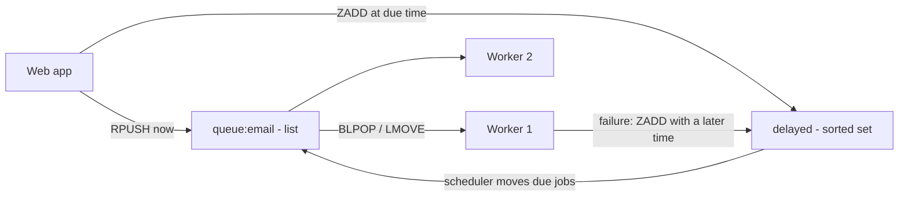

# Application components: task queues, pull messaging and file distribution

> **Before this lesson:** you should know list commands including blocking pops and `LMOVE`
> ([strings, lists and sets](#/lesson/redis/strings-lists-sets)), sorted sets
> ([hashes and sorted sets](#/lesson/redis/hashes-sorted-sets)), why pub/sub loses messages
> ([pub/sub, transactions and expiry](#/lesson/redis/pubsub-transactions-expiry)) and locks
> ([autocomplete, locks and semaphores](#/lesson/redis/autocomplete-locks-semaphores)).

## In plain words

Some work should not happen while a user is waiting. When you order a train ticket, the website
should answer "booked!" straight away; sending the confirmation email, producing the PDF and updating
the statistics can happen a few seconds later. The standard way to arrange that is a **task queue**:
the website writes a short note describing the job and drops it in a tray; separate programs called
**workers** take notes from the tray one by one and do the jobs.

A restaurant works the same way. The waiter does not cook. The waiter writes an order slip and
clips it to the rail; cooks take slips in order. If the kitchen is busy, slips wait on the rail - the
waiter is free to serve the next table.

**Pull messaging** is the related idea for messages between programs or people: instead of being
handed each message the instant it is sent (and missing it if you were away), each recipient has a
mailbox and collects what is waiting whenever it is ready.

**File distribution** is about getting the same file to many machines, using Redis as the meeting
point.

Why this matters for a job: nearly every production system has background jobs, and "what happens to
a job if the worker crashes halfway?" is a question you will be expected to answer. The patterns in
this lesson - queue, delayed queue, acknowledgement, retry - apply far beyond Redis.

We continue with **Linea**, the journey planner.

## Part 1 - a first-in, first-out queue

A **producer** is a program that creates jobs; a **consumer** (the worker) is a program that takes
and performs them. **FIFO** stands for "first in, first out": jobs are handled in arrival order.

A Redis list is already a queue: push at one end, pop from the other.

```bash
127.0.0.1:6379> RPUSH queue:email "{\"to\":\"ana@example.com\",\"template\":\"ticket\",\"booking\":7001}"
(integer) 1
127.0.0.1:6379> RPUSH queue:email "{\"to\":\"raj@example.com\",\"template\":\"refund\",\"booking\":6950}"
(integer) 2
127.0.0.1:6379> BLPOP queue:email 30
1) "queue:email"
2) "{\"to\":\"ana@example.com\",\"template\":\"ticket\",\"booking\":7001}"
```

`RPUSH` adds a job at the tail (the right end). The job is written as JSON text, because a list
element is a single string and the job has several parts. `BLPOP queue:email 30` removes and returns
the job at the head (the left end); if the list is empty it *waits* up to 30 seconds for one to arrive
- that is what the `B`, for "blocking", means. The reply names the list the job came from and then the
job itself.

```python
import json
import redis

r = redis.Redis(decode_responses=True)

def enqueue(queue, kind, **details):
    r.rpush(f"queue:{queue}", json.dumps({"kind": kind, **details}))

HANDLERS = {}                                    # kind -> function

def worker(queue):
    while True:
        popped = r.blpop(f"queue:{queue}", timeout=30)
        if popped is None:
            continue                             # nothing arrived in 30 s; wait again
        _, raw = popped
        job = json.loads(raw)
        HANDLERS[job["kind"]](job)
```

- `enqueue` packs a job into a dictionary, converts it to JSON with `json.dumps`, and pushes it.
  `**details` collects any extra named arguments, so `enqueue("email", "ticket", to="ana@example.com")`
  works.
- `worker` loops for ever. `blpop` returns `None` on timeout, otherwise a pair `(list name, element)`;
  the underscore is a Python convention for "a value I do not need".
- `HANDLERS` maps the kind of job to the function that knows how to do it.

Run three copies of `worker` and you have three cooks: Redis hands each job to exactly one of them,
because a pop is atomic.

### Priorities

`BLPOP` accepts several lists and checks them in the order given, so priorities need no new code:

```python
popped = r.blpop(["queue:high", "queue:normal", "queue:low"], timeout=30)
```

Anything in `queue:high` is always taken before `queue:normal`. One warning: if high-priority jobs
never stop arriving, low-priority ones never run. That situation is called **starvation**.

## Part 2 - jobs that must run later

"Send a reminder one hour before departure" and "retry this failed payment in five minutes" are
**delayed tasks**. A list cannot say "not yet". A sorted set can: use the time the job becomes due as
the score.

```bash
127.0.0.1:6379> ZADD delayed 1767229200 "{\"id\":\"j-81\",\"queue\":\"email\",\"kind\":\"reminder\",\"booking\":7001}"
(integer) 1
127.0.0.1:6379> ZRANGE delayed 0 0 WITHSCORES
1) "{\"id\":\"j-81\",\"queue\":\"email\",\"kind\":\"reminder\",\"booking\":7001}"
2) "1767229200"
```

A small program, the **scheduler**, repeatedly looks at the member with the *lowest* score - the job
due soonest. If its time has not come, the scheduler sleeps briefly. If it has, the scheduler moves
the job into the ordinary queue, where the usual workers pick it up.

```python
import time
import uuid

def enqueue_later(queue, kind, delay_seconds, **details):
    job = {"id": str(uuid.uuid4()), "queue": queue, "kind": kind, **details}
    r.zadd("delayed", {json.dumps(job): time.time() + delay_seconds})

MOVE_DUE = r.register_script("""
local due = redis.call('ZRANGE', KEYS[1], '-inf', ARGV[1], 'BYSCORE', 'LIMIT', 0, 1)
if #due == 0 then return nil end
redis.call('ZREM', KEYS[1], due[1])
local job = cjson.decode(due[1])
redis.call('RPUSH', 'queue:' .. job['queue'], due[1])
return due[1]
""")

def scheduler():
    while True:
        moved = MOVE_DUE(keys=["delayed"], args=[time.time()])
        if moved is None:
            time.sleep(0.05)
```

- Each delayed job carries a unique `id`. Without it, two identical reminders would be the *same*
  sorted-set member, and the second would overwrite the first.
- "Find the first due job, remove it from the sorted set, push it onto its list" is three steps that
  must happen together: if two schedulers ran them separately, both could move the same job, and it
  would run twice. The short server-side script (in Lua; scripts are the subject of module 11) performs
  all three as one atomic step. Read it as: look for one member with a score up to now; if there is
  none, stop; otherwise remove it, decode it to find its queue name, and push it there.



The same sorted set gives **retries with backoff** for free: when a job fails, put it back in
`delayed` with a due time a little further in the future each attempt (say 10 s, 20 s, 40 s, ...).
Doubling the wait each time is called **exponential backoff**; it avoids hammering a service that is
already struggling.

## Part 3 - what if a worker crashes mid-job?

With plain `BLPOP`, the moment a job is popped it exists only in the worker's memory. If the worker
crashes before finishing, the job is gone. The guarantee you get is **at-most-once**: each job runs
once or not at all.

For anything important you want **at-least-once**: every job is completed, even if that sometimes
means running it twice. The recipe:

1. Move the job from the queue to a per-worker "in progress" list, atomically.
2. Do the work.
3. Remove the job from the in-progress list. This step is the **acknowledgement** ("ack"): the worker
   confirming the job is done.
4. A supervisor periodically puts back jobs that have sat in an in-progress list for too long.

```bash
127.0.0.1:6379> BLMOVE queue:email processing:worker-1 LEFT RIGHT 30
"{\"to\":\"raj@example.com\",\"template\":\"refund\",\"booking\":6950}"
127.0.0.1:6379> LRANGE processing:worker-1 0 -1
1) "{\"to\":\"raj@example.com\",\"template\":\"refund\",\"booking\":6950}"
127.0.0.1:6379> LREM processing:worker-1 1 "{\"to\":\"raj@example.com\",\"template\":\"refund\",\"booking\":6950}"
(integer) 1
```

`BLMOVE source destination LEFT RIGHT 30` pops from the left of the source and pushes onto the right
of the destination in a single step, waiting up to 30 seconds if the source is empty. At no moment is
the job in neither list. `LREM key 1 value` removes one copy of the job after the work succeeds.

```python
def reliable_worker(queue, name):
    source, mine = f"queue:{queue}", f"processing:{name}"
    while True:
        raw = r.blmove(source, mine, 30, "LEFT", "RIGHT")
        if raw is None:
            continue
        job = json.loads(raw)
        try:
            HANDLERS[job["kind"]](job)
        finally:
            r.lrem(mine, 1, raw)              # acknowledge (see the note on failures below)

def requeue_abandoned(queue, name):
    """Run by a supervisor when worker `name` is known to be dead."""
    while r.lmove(f"processing:{name}", f"queue:{queue}", "LEFT", "RIGHT"):
        pass
```

In a production version the `finally` branch would distinguish success (acknowledge) from failure
(re-schedule with backoff, and after too many attempts move the job to a **dead-letter queue** - a
list of jobs set aside for a human to inspect).

> [!WARNING]
> At-least-once means a job **can run twice**: a worker may finish the work and crash a millisecond
> before acknowledging. Design handlers to be **idempotent** - running them twice has the same effect
> as running them once. "Set the booking's status to confirmed" is idempotent; "add 10 points to the
> account" is not, unless you first record the job id and skip ids already seen
> (`SET done:<job id> 1 NX EX 86400` is the usual guard).

> [!TIP]
> Redis streams, covered in the Modern Redis module, provide this whole pattern - per-consumer pending
> lists, acknowledgements, claiming a dead consumer's jobs - as built-in commands. Lists remain a fine
> choice for small queues; reach for streams when you need several independent groups of consumers or
> a replayable history.

## Part 4 - pull messaging: mailboxes

Pub/sub delivers a message only to programs connected at that instant. For chat-like features people
expect to receive what was sent while they were offline. The fix is to *store* messages and let each
recipient **pull** (fetch) what it has not yet seen.

### One recipient: a mailbox list

For messages addressed to a single recipient, a list per recipient is enough: senders `RPUSH
inbox:<user>`, the recipient reads with `LRANGE` and removes what it has processed with `LTRIM`. It is
the task queue again, with one consumer.

### Many recipients: a shared log and personal bookmarks

For a group conversation, copying every message into every member's mailbox wastes memory. Store each
message once, give messages increasing numbers, and remember for each member the number of the last
message they have read - a bookmark.

- `chat:<id>:msgs` - sorted set: member = message JSON, score = message number
- `chat:<id>:next` - string counter producing message numbers
- `chat:<id>:read` - sorted set: member = user, score = the last message number that user has seen

```bash
127.0.0.1:6379> INCR chat:55:next
(integer) 1
127.0.0.1:6379> ZADD chat:55:msgs 1 "{\"n\":1,\"from\":\"ana\",\"text\":\"Platform changed to 4\"}"
(integer) 1
127.0.0.1:6379> INCR chat:55:next
(integer) 2
127.0.0.1:6379> ZADD chat:55:msgs 2 "{\"n\":2,\"from\":\"raj\",\"text\":\"Thanks, on my way\"}"
(integer) 1
127.0.0.1:6379> ZADD chat:55:read 0 ana 0 raj 0 mei
(integer) 3
127.0.0.1:6379> ZRANGE chat:55:msgs (0 +inf BYSCORE
1) "{\"n\":1,\"from\":\"ana\",\"text\":\"Platform changed to 4\"}"
2) "{\"n\":2,\"from\":\"raj\",\"text\":\"Thanks, on my way\"}"
127.0.0.1:6379> ZADD chat:55:read 2 mei
(integer) 0
127.0.0.1:6379> ZRANGE chat:55:read 0 0 WITHSCORES
1) "ana"
2) "0"
127.0.0.1:6379> ZREMRANGEBYSCORE chat:55:msgs -inf 0
(integer) 0
```

Step by step: `INCR` hands out the next message number; the message is stored with that number as
its score. Mei fetches unread messages with a score range starting *after* her bookmark - `(0` means
"greater than 0, not including it" - and then moves her bookmark to 2. The lowest bookmark in
`chat:55:read` (here 0, belonging to Ana) tells us which messages *everyone* has seen; anything at or
below it can be deleted with `ZREMRANGEBYSCORE`, so the conversation's stored history stays as short
as its slowest reader allows.

```python
def send(chat, sender, text):
    n = r.incr(f"chat:{chat}:next")
    r.zadd(f"chat:{chat}:msgs", {json.dumps({"n": n, "from": sender, "text": text}): n})
    return n

def fetch_unread(chat, user):
    seen = r.zscore(f"chat:{chat}:read", user) or 0
    raw = r.zrange(f"chat:{chat}:msgs", f"({seen}", "+inf", byscore=True)
    messages = [json.loads(m) for m in raw]
    if messages:
        r.zadd(f"chat:{chat}:read", {user: messages[-1]["n"]})
        oldest_bookmark = r.zrange(f"chat:{chat}:read", 0, 0, withscores=True)[0][1]
        r.zremrangebyscore(f"chat:{chat}:msgs", "-inf", oldest_bookmark)
    return messages
```

One subtlety: in `send`, the `INCR` and the `ZADD` are two commands. If two senders interleave so
that message 4 is stored before message 3, a reader who fetches in between sees 4, bookmarks 4, and
never sees 3. The remedy is to hold a short lock on the chat while sending, or to do both steps in one
script.

## Part 5 - distributing files

Suppose forty application servers each need the same 30 MB route-data file, refreshed every night
and produced by one machine. Redis can act as the drop-off point.

The mechanics use string commands you already know. The producer uploads the file in pieces, called
**chunks**, with `APPEND`, so that no single command carries the whole file:

```bash
127.0.0.1:6379> APPEND file:routes-0101 "<first chunk of bytes>"
(integer) 65536
127.0.0.1:6379> APPEND file:routes-0101 "<second chunk of bytes>"
(integer) 131072
127.0.0.1:6379> SET file:routes-0101:size 31457280
OK
127.0.0.1:6379> GETRANGE file:routes-0101 0 65535
"<first chunk of bytes>"
127.0.0.1:6379> PUBLISH files:ready routes-0101
(integer) 40
```

`APPEND` replies with the new total length. A separate key records the final size so that consumers
know when they have everything, and a pub/sub message announces that the file is ready. Each consumer
downloads with `GETRANGE key start end` (byte positions, both inclusive), a chunk at a time, and
writes to its local disk. A counter of finished consumers, or a per-file expiry, tells the producer
when the key can be deleted.

A few honest remarks. The whole file sits in RAM while it is being distributed, single strings are
limited to 512 MB, and very large values make snapshots and replication heavier. This technique suits
modest files shared by machines that already talk to Redis. For large or long-lived files, store them
in object storage (a service made for files) and use Redis only to announce "a new file is at this
location".

> [!INTERVIEW]
> "Design a job queue" answers are judged on failure handling. Cover: how jobs are enqueued; blocking
> consumption; what happens if a worker dies (in-progress list or stream pending list, plus a reaper);
> retries with exponential backoff and a dead-letter queue; idempotent handlers because delivery is
> at-least-once; delayed jobs via a time-scored sorted set; and how you would monitor queue length and
> job age.

## Try it: delayed jobs, acknowledgements and a crash

The block imitates the queue, the delayed set, per-worker processing lists and a supervisor, with a
clock we advance by hand. One worker "crashes" after taking a job, and the supervisor recovers it.

```python-run
import heapq, json

class JobSystem:
    def __init__(self):
        self.queue, self.delayed, self.processing = [], [], {}
        self.done, self.attempts, self.now, self.seq = [], {}, 0, 0

    def enqueue(self, job): self.queue.append(job)
    def enqueue_later(self, job, delay):
        self.seq += 1
        heapq.heappush(self.delayed, (self.now + delay, self.seq, job))     # ZADD delayed
    def run_scheduler(self):
        moved = 0
        while self.delayed and self.delayed[0][0] <= self.now:              # due?
            self.queue.append(heapq.heappop(self.delayed)[2]); moved += 1
        return moved
    def take(self, worker):                                                 # BLMOVE queue -> processing
        if not self.queue: return None
        job = self.queue.pop(0)
        self.processing.setdefault(worker, []).append(job)
        return job
    def ack(self, worker, job):                                             # LREM processing
        self.processing[worker].remove(job); self.done.append(job)
    def fail(self, worker, job, max_attempts=3):
        self.processing[worker].remove(job)
        n = self.attempts[job] = self.attempts.get(job, 0) + 1
        if n >= max_attempts: return "dead-letter"
        delay = 10 * 2 ** (n - 1)                                           # 10, 20, 40 ...
        self.enqueue_later(job, delay); return f"retry in {delay}s"
    def requeue_abandoned(self, worker):
        jobs = self.processing.pop(worker, [])
        self.queue[:0] = jobs                                               # back to the front
        return jobs

s = JobSystem()
s.enqueue("email:ticket:7001"); s.enqueue("pdf:7001")
s.enqueue_later("email:reminder:7001", delay=3600)

job = s.take("w1"); s.ack("w1", job)
print("w1 finished:", job, "| queue:", s.queue)

job = s.take("w2")
print("w2 took", job, "and crashed | queue:", s.queue, "| processing:", s.processing)
print("supervisor requeues:", s.requeue_abandoned("w2"), "| queue:", s.queue)

job = s.take("w1")
print("w1 fails it:", s.fail("w1", job))
s.now = 10; print("t=10 scheduler moved", s.run_scheduler(), "job(s) | queue:", s.queue)
job = s.take("w1"); print("second failure:", s.fail("w1", job))
s.now = 30; s.run_scheduler(); job = s.take("w1"); print("third failure:", s.fail("w1", job))

s.now = 3599; print("t=3599 scheduler moved", s.run_scheduler())
s.now = 3600; print("t=3600 scheduler moved", s.run_scheduler(), "| queue:", s.queue)
print("completed jobs:", s.done)
```

Follow the story in the output. Worker 1 completes the first job. Worker 2 takes the PDF job and
crashes: the queue is empty, but the job is not lost - it is sitting in `processing` under `w2`, and
the supervisor puts it back. Worker 1 then fails it three times; the first two failures schedule
retries 10 and then 20 seconds later, and the third sends it to the dead-letter path. Finally, the
reminder scheduled an hour ahead stays put at second 3599 and moves into the queue at second 3600.

## Pitfalls

- **Popping without a safety net.** `BLPOP` alone loses the job if the worker dies. Use `BLMOVE` to an
  in-progress list, or streams.
- **Handlers that are not idempotent.** With at-least-once delivery, duplicates will eventually happen.
- **No supervisor for in-progress lists.** Jobs taken by a dead worker stay there for ever unless
  something returns them.
- **Infinite retries.** A job that can never succeed (bad data) loops for ever. Cap attempts and park
  failures in a dead-letter queue.
- **Identical delayed jobs collapsing.** Sorted-set members are unique; include an id in each job.
- **Non-atomic "move due job".** Two schedulers reading then removing can both enqueue the same job.
  Do it in one script.
- **Unbounded queues.** If producers outpace workers, the list grows until memory runs out. Monitor
  `LLEN` and the age of the oldest job; slow producers down or add workers.
- **Huge payloads in jobs.** Put large data elsewhere and enqueue a reference to it.
- **Blocking on a shared connection.** A connection waiting in `BLPOP` cannot do anything else; give
  each worker its own.

## Command cheat sheet

`n` = elements in the structure, `m` = elements returned or removed.

| Command | Use here | Time |
|---|---|---|
| `RPUSH queue job` | enqueue | O(1) |
| `BLPOP q1 q2 timeout` | blocking dequeue with priority order | O(number of keys) |
| `BLMOVE src dst LEFT RIGHT timeout` | dequeue into an in-progress list | O(1) |
| `LREM processing 1 job` | acknowledge | O(n) |
| `LLEN queue` | queue depth for monitoring | O(1) |
| `ZADD delayed due-time job` | schedule for later | O(log n) |
| `ZRANGE delayed -inf now BYSCORE LIMIT 0 1` | next due job | O(log n) |
| `ZREM delayed job` | take it off the schedule | O(log n) |
| `SET done:id 1 NX EX 86400` | idempotency guard | O(1) |
| `INCR chat:id:next` | next message number | O(1) |
| `ZRANGE msgs (seen +inf BYSCORE` | unread messages | O(log n + m) |
| `ZREMRANGEBYSCORE msgs -inf lowest` | drop messages everyone has read | O(log n + m) |
| `APPEND key chunk` / `GETRANGE key a b` | upload / download a file in pieces | O(1) amortised / O(m) |

## Summary

- A list with `RPUSH` and `BLPOP` is a FIFO queue; listing several keys gives priorities.
- A sorted set scored by due time holds delayed jobs and retries; a scheduler moves due ones atomically.
- `BLMOVE` into an in-progress list plus an acknowledgement gives at-least-once delivery, which
  requires idempotent handlers.
- Pull messaging stores messages once and keeps a per-reader bookmark; history is trimmed up to the
  slowest reader.
- Files can pass through Redis in chunks, but large or durable files belong in object storage.

## Glossary

- **Task queue** - a list of jobs waiting to be performed in the background.
- **Producer / consumer (worker)** - the program that creates jobs / the program that performs them.
- **FIFO** - first in, first out: handled in arrival order.
- **Blocking** - waiting on the server until data arrives or a timeout passes.
- **Starvation** - low-priority work never running because higher-priority work keeps arriving.
- **Delayed task** - a job that must not run before a given time.
- **Scheduler** - the program that moves due delayed jobs into the working queue.
- **Exponential backoff** - doubling the wait between successive retries.
- **Acknowledgement (ack)** - a worker's confirmation that a job is finished.
- **At-most-once / at-least-once** - delivery that may lose but never repeats / may repeat but never
  loses.
- **Idempotent** - having the same effect whether performed once or several times.
- **Dead-letter queue** - where jobs go after repeated failure, for inspection.
- **Chunk** - one piece of a file sent or read separately.

```quiz
[
  {"q": "Three workers run BLPOP on the same list and one job is pushed. How many workers receive it?",
   "options": ["All three", "Exactly one", "None until another job arrives", "Two, for redundancy"],
   "answer": 1,
   "explain": "A pop removes the element atomically, so only one waiting client gets it. That is what distinguishes a queue from pub/sub."},
  {"q": "A worker using plain BLPOP crashes after popping a job but before finishing it. What happens to the job?",
   "options": ["It returns to the queue automatically", "It is lost, because it existed only in the worker's memory", "Another worker receives a copy", "Redis stores it in a dead-letter queue"],
   "answer": 1,
   "explain": "Once popped, nothing in Redis remembers the job. That is at-most-once delivery."},
  {"q": "What does BLMOVE queue processing:w1 LEFT RIGHT 30 guarantee?",
   "options": ["The job is copied to both lists", "The job is always in exactly one of the two lists, never in neither", "The job is deleted after 30 seconds", "The job is processed within 30 seconds"],
   "answer": 1,
   "explain": "The pop and push are one atomic command, so a crash cannot make the job vanish between them."},
  {"q": "Why must handlers be idempotent under at-least-once delivery?",
   "options": ["Because jobs are encrypted", "Because a job may be delivered and executed more than once, for example when a worker crashes after doing the work but before acknowledging", "Because Redis reorders jobs", "Because JSON cannot store numbers"],
   "answer": 1,
   "explain": "Recovery re-delivers unacknowledged jobs, including ones that had in fact finished. Repeating them must be harmless."},
  {"q": "In the delayed queue, what does the sorted-set score represent?",
   "options": ["The job's priority", "The time at which the job becomes due", "The number of retries", "The size of the job"],
   "answer": 1,
   "explain": "The scheduler reads the lowest score to find the job due soonest and moves it when its time has come."},
  {"q": "Why does each delayed job include a unique id?",
   "options": ["To make the JSON longer", "Sorted-set members are unique, so two identical jobs would otherwise be one member and one would be lost", "Redis requires ids", "To sort jobs alphabetically"],
   "answer": 1,
   "explain": "Adding an existing member only updates its score. Distinct ids make otherwise identical jobs distinct members."},
  {"q": "In the group-chat design, how are fully read messages identified for deletion?",
   "options": ["By their age in seconds", "By the lowest bookmark among all members: messages numbered at or below it have been seen by everyone", "By the highest bookmark", "They are never deleted"],
   "answer": 1,
   "explain": "The slowest reader's position is the safe trimming point."},
  {"q": "A failing job is retried after 10 s, then 20 s, then 40 s. What is this called and why use it?",
   "options": ["Round robin; to balance workers", "Exponential backoff; to avoid overwhelming a struggling dependency with rapid retries", "Starvation; to save memory", "Fencing; to prevent duplicates"],
   "answer": 1,
   "explain": "Doubling the delay gives a failing service time to recover while still retrying."}
]
```

> **Source:** Carlson, *Redis in Action*, ch. 6 (sections 6.4-6.6: task queues, pull messaging, distributing files); BLMOVE-based reliable queue, scripted scheduler, backoff and simulation are original. Command behaviour verified on redis.io.
> Further reading: <https://redis.io/docs/latest/commands/blmove/>, <https://redis.io/docs/latest/develop/data-types/lists/>, <https://redis.io/docs/latest/develop/data-types/streams/>
