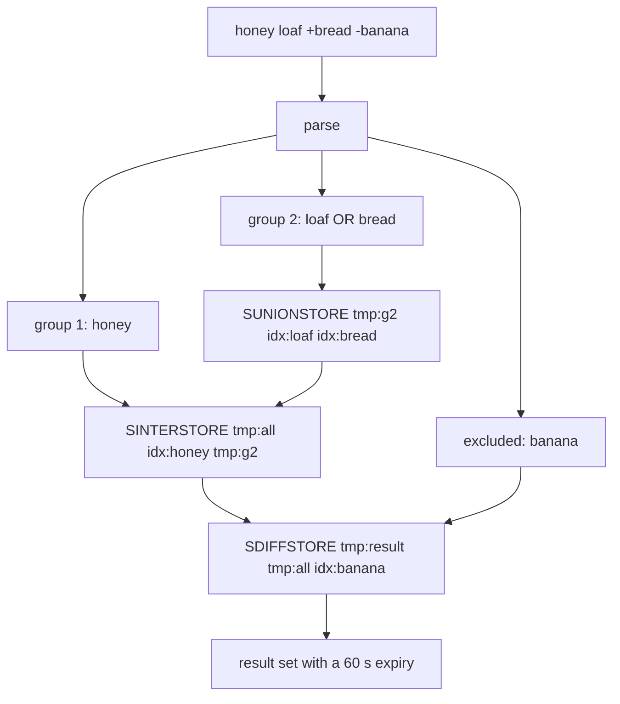

# Search with Redis: inverted indexes and sorted results

> **Before this lesson:** you should know set commands including `SINTER`, `SUNION` and `SDIFF`
> ([strings, lists and sets](#/lesson/redis/strings-lists-sets)), sorted sets and `ZINTERSTORE`
> ([hashes and sorted sets](#/lesson/redis/hashes-sorted-sets)), and `SORT` with key expiry
> ([pub/sub, transactions and expiry](#/lesson/redis/pubsub-transactions-expiry)).

## In plain words

When you type words into a search box, the system does not read every document looking for them -
with a million documents that would take far too long. It consults an **index** prepared in advance.

The index at the back of a textbook is the perfect picture. It lists words in order, and next to each
word the pages where it appears: *"yeast: 12, 48, 51"*. To find pages that mention both yeast and
rye, you look up the two entries and keep the page numbers that appear in both lists. You never open
the pages themselves until you know which ones you want.

That structure - *from each word to the documents containing it* - is called an **inverted index**.
("Inverted" because a document naturally maps to its words; the index turns that around.) Redis sets
are a direct fit: one set per word, holding document identifiers. Finding documents that contain
several words is a set intersection, which Redis performs on the server.

Why it matters for a job: search is a feature of almost every product, and the inverted index is the
idea underneath every search engine, from a small site search to the largest web search. Even if you
later use a dedicated engine, understanding this lesson explains what that engine is doing.

Our scenario is **Larder**, a recipe website with a search box.

## Part 1 - from text to words

A few terms. A **document** is one searchable item - here, a recipe. A **token** is one unit of text
after splitting, normally a word. **Tokenisation** is the splitting itself. **Stop words** are words
so common that they carry no information for search ("the", "and", "of"); indexing them wastes memory
and makes every query slower, so they are dropped.

Take this recipe title and description:

> *Slow Rye Bread - a dark loaf with rye flour and a little honey.*

Tokenising in three steps:

1. Lower-case everything, so "Rye" and "rye" are the same word.
2. Pull out runs of letters: `slow, rye, bread, a, dark, loaf, with, rye, flour, and, a, little, honey`.
3. Drop stop words and very short words, and remove duplicates: `slow, rye, bread, dark, loaf, flour,
   little, honey`.

```python
import re

STOP_WORDS = set("a an and are as at be but by for if in into is it no not of on or such that the "
                 "their then there these they this to was will with".split())

def tokenize(text):
    words = re.findall(r"[a-z']+", text.lower())
    return {w.strip("'") for w in words if len(w.strip("'")) >= 3 and w not in STOP_WORDS}
```

- `text.lower()` converts to lower case.
- `re.findall(r"[a-z']+", ...)` uses a *regular expression* (a pattern for matching text) to return
  every run of letters or apostrophes.
- The part in curly braces builds a Python `set`, which removes duplicates automatically, keeping
  words of at least three letters that are not stop words.

## Part 2 - building the index

For each remaining word, add the recipe's identifier to that word's set.

```bash
127.0.0.1:6379> SADD idx:rye recipe:101
(integer) 1
127.0.0.1:6379> SADD idx:bread recipe:101
(integer) 1
127.0.0.1:6379> SADD idx:honey recipe:101
(integer) 1
127.0.0.1:6379> SADD idx:bread recipe:102
(integer) 1
127.0.0.1:6379> SADD idx:banana recipe:102
(integer) 1
127.0.0.1:6379> SADD idx:honey recipe:103
(integer) 1
127.0.0.1:6379> SADD idx:cake recipe:103
(integer) 1
127.0.0.1:6379> SMEMBERS idx:bread
1) "recipe:101"
2) "recipe:102"
```

Recipe 101 is the rye bread, 102 a banana bread, 103 a honey cake. The set `idx:bread` now answers
"which recipes mention bread?" in one command.

```python
import redis

r = redis.Redis(decode_responses=True)

def index_recipe(recipe_id, text):
    words = tokenize(text)
    pipe = r.pipeline()
    for word in words:
        pipe.sadd(f"idx:{word}", recipe_id)
    pipe.sadd(f"words:{recipe_id}", *words)        # remember what we indexed, for removal later
    pipe.execute()
    return len(words)

def unindex_recipe(recipe_id):
    words = r.smembers(f"words:{recipe_id}")
    pipe = r.pipeline()
    for word in words:
        pipe.srem(f"idx:{word}", recipe_id)
    pipe.delete(f"words:{recipe_id}")
    pipe.execute()
```

The extra set `words:<recipe>` records which words a recipe was filed under. Without it, removing or
re-indexing an edited recipe would require searching every word set for its id. To update a recipe,
un-index the old text and index the new.

## Part 3 - searching: AND, OR, NOT

The three basic ways of combining search words map onto the three set operations.

| The user means | Set operation | Command |
|---|---|---|
| contains **all** of these words (AND) | intersection | `SINTER` |
| contains **any** of these words (OR) | union | `SUNION` |
| contains this but **not** that (NOT) | difference | `SDIFF` |

```bash
127.0.0.1:6379> SINTER idx:bread idx:honey
1) "recipe:101"
127.0.0.1:6379> SUNION idx:bread idx:honey
1) "recipe:101"
2) "recipe:102"
3) "recipe:103"
127.0.0.1:6379> SDIFF idx:bread idx:banana
1) "recipe:101"
```

"bread AND honey" finds only the rye bread. "bread OR honey" finds all three. "bread NOT banana"
removes the banana bread.

### A slightly richer query language

Real users want to combine these. A small, common convention:

- plain words must all be present: `rye bread`
- `+word` right after a word marks a **synonym** - an alternative that counts as the same thing:
  `loaf +bread` means "loaf or bread"
- `-word` excludes: `-banana`

So `honey loaf +bread -banana` means: (honey) AND (loaf OR bread) AND NOT (banana).

The evaluation plan follows the brackets: union each group of synonyms, intersect the groups, then
subtract the excluded words. Intermediate results are stored in temporary keys so the next command
can use them.

```bash
127.0.0.1:6379> SUNIONSTORE tmp:q1:g2 idx:loaf idx:bread
(integer) 2
127.0.0.1:6379> SINTERSTORE tmp:q1:all idx:honey tmp:q1:g2
(integer) 1
127.0.0.1:6379> SDIFFSTORE tmp:q1:result tmp:q1:all idx:banana
(integer) 1
127.0.0.1:6379> EXPIRE tmp:q1:result 60
(integer) 1
127.0.0.1:6379> SMEMBERS tmp:q1:result
1) "recipe:101"
```

The `...STORE` forms write their result into a new key and reply with its size. Giving the final key
a short expiry means it cleans itself up - and, as a bonus, an identical query arriving within the
minute can reuse it.

```python
import uuid

def parse(query):
    """Return (groups, excluded): groups is a list of synonym lists."""
    groups, excluded = [], []
    for raw in query.lower().split():
        word = raw.lstrip("+-")
        if len(word) < 3 or word in STOP_WORDS:
            continue
        if raw.startswith("-"):
            excluded.append(word)
        elif raw.startswith("+") and groups:
            groups[-1].append(word)
        else:
            groups.append([word])
    return groups, excluded

def search(query, ttl=60):
    groups, excluded = parse(query)
    if not groups:
        return None
    qid = uuid.uuid4().hex[:8]
    pipe = r.pipeline()
    parts = []
    for i, group in enumerate(groups):
        if len(group) == 1:
            parts.append(f"idx:{group[0]}")
        else:
            key = f"tmp:{qid}:g{i}"
            pipe.sunionstore(key, [f"idx:{w}" for w in group])
            pipe.expire(key, ttl)
            parts.append(key)
    result = f"tmp:{qid}:result"
    pipe.sinterstore(result, parts)
    if excluded:
        pipe.sdiffstore(result, [result] + [f"idx:{w}" for w in excluded])
    pipe.expire(result, ttl)
    pipe.execute()
    return result
```

- `parse` walks through the words. A leading `-` puts the word in the excluded list; a leading `+`
  attaches it to the previous group as a synonym; anything else starts a new group.
- `search` gives the query a short random id for its temporary key names, queues one union per
  multi-word group, then the intersection, then the difference, and sends everything in one round
  trip. It returns the *name* of the result key, not the members, because the next step - ordering and
  paging - also happens on the server.



> [!TIP]
> Intersection cost is driven by the **smallest** input set, because Redis walks it and tests each
> member against the others. Rare words are therefore cheap, and a query of very common words is the
> expensive case - one more reason to drop stop words.

## Part 4 - putting results in order

A set has no order, and nobody wants search results in random order. Two approaches.

### Ordering by a stored field with SORT

If each recipe is a hash with fields such as `updated` and `title`, `SORT` can order the result set
by one of them and return a page.

```bash
127.0.0.1:6379> HSET recipe:101 title "Slow rye bread" updated 1767000000 rating 4.6
(integer) 3
127.0.0.1:6379> HSET recipe:102 title "Banana bread" updated 1766000000 rating 4.9
(integer) 3
127.0.0.1:6379> SORT idx:bread BY *->updated DESC LIMIT 0 10
1) "recipe:101"
2) "recipe:102"
127.0.0.1:6379> SORT idx:bread BY *->title ALPHA LIMIT 0 10
1) "recipe:102"
2) "recipe:101"
```

In `BY *->updated`, the `*` is replaced by each member (the members are already full key names such as
`recipe:101`) and the part after `->` names the hash field to sort by. `DESC` gives newest first;
`ALPHA` sorts text alphabetically.

### Ordering by a blend of signals with sorted sets

Often the best order mixes several things: how recent a recipe is and how well it is rated. Keep one
sorted set per signal, each scoring every recipe:

- `rank:updated` - score = last-updated timestamp
- `rank:rating` - score = average rating

`ZINTERSTORE` then does two jobs at once. It intersects the result set with the ranking sets (so only
matching recipes survive), and it combines their scores with weights you choose.

```bash
127.0.0.1:6379> ZADD rank:updated 1767000000 recipe:101 1766000000 recipe:102 1765000000 recipe:103
(integer) 3
127.0.0.1:6379> ZADD rank:rating 4.6 recipe:101 4.9 recipe:102 4.2 recipe:103
(integer) 3
127.0.0.1:6379> ZINTERSTORE tmp:q2:ranked 3 idx:bread rank:updated rank:rating WEIGHTS 0 0.000001 100
(integer) 2
127.0.0.1:6379> ZRANGE tmp:q2:ranked 0 9 REV WITHSCORES
1) "recipe:102"
2) "2256"
3) "recipe:101"
4) "2227"
```

Where do those scores come from? The `3` after the destination says three input keys follow, and
`WEIGHTS` gives one multiplier per input, in the same order: 0 for the plain set (it only filters and
contributes nothing), 0.000001 for the timestamp and 100 for the rating. Check the arithmetic by hand:

$$\text{recipe:101} = 1767000000 \times 0.000001 + 4.6 \times 100 = 1767 + 460 = 2227$$
$$\text{recipe:102} = 1766000000 \times 0.000001 + 4.9 \times 100 = 1766 + 490 = 2256$$

Recipe 102 has the higher score, so with `REV` (highest first) it is listed first, even though
recipe 101 is newer: its better rating outweighs the difference in age. Working one example through by
hand like this is the only reliable way to choose weights: here one rating point is worth 100 units while a million seconds
of freshness (about eleven and a half days) is worth 1 unit.

```python
def ranked(result_key, weights, start=0, num=10, ttl=60):
    """weights: {"rank:updated": 0.000001, "rank:rating": 100}"""
    out = result_key + ":ranked"
    keys = {result_key: 0, **weights}
    pipe = r.pipeline()
    pipe.zinterstore(out, keys)
    pipe.expire(out, ttl)
    pipe.zcard(out)
    pipe.zrange(out, start, start + num - 1, desc=True)
    _, _, total, page = pipe.execute()
    return total, page
```

`zinterstore` accepts a dictionary of key to weight. The function returns the total number of matches
(for "showing 1-10 of 37") and one page of ids. Paging is a matter of changing `start`, and because
the ranked result has a 60-second expiry, pages two and three of the same search reuse it without
recomputing.

## Part 5 - limits, and what dedicated engines add

The set-based index answers "which documents contain these exact words". It does not:

- rank by **relevance** - how well a document matches (a recipe that says "rye" nine times is probably
  more about rye than one that mentions it once);
- handle **stemming**, treating "bake", "baking" and "baked" as the same word;
- tolerate typing mistakes, match phrases in order, or highlight the matching text.

You can approximate some of these yourself (store word counts as sorted-set scores, index stems
instead of words), which is how search engines began. Today Redis also ships a full search engine:
the **Redis Query Engine** (formerly the RediSearch module, bundled with Redis 8). You declare an
index over hashes or JSON documents and query it:

```bash
127.0.0.1:6379> FT.CREATE idx:recipes ON HASH PREFIX 1 recipe: SCHEMA title TEXT WEIGHT 2 body TEXT rating NUMERIC SORTABLE
OK
127.0.0.1:6379> FT.SEARCH idx:recipes "honey (loaf|bread) -banana" SORTBY rating DESC LIMIT 0 10
```

It maintains the inverted index automatically as hashes change, and supports stemming, relevance
scoring, numeric and geographic filters, and vector similarity. Use it when you need real search;
build the set-based version when your needs are small or when you want to understand what is going on.

> [!WARNING]
> Never build key names straight from raw user input. The tokeniser above keeps only letters, which
> also keeps keys well-formed. Cap the number of words per query too: an intersection of thirty sets
> is thirty times the work, and an attacker can send such queries all day.

> [!INTERVIEW]
> "How does full-text search work?" Explain tokenisation and stop words, the inverted index from term
> to document list, AND as intersection and OR as union, why intersections start from the rarest term,
> and how ranking is layered on top (term frequency, freshness, popularity). Then mention that
> production systems use engines such as Elasticsearch, OpenSearch or the Redis Query Engine, which
> add stemming, relevance scoring such as BM25, and fuzzy matching.

## Try it: index three recipes and query them

The block is a plain-Python version of the whole pipeline: tokenise, index, parse a query with
synonyms and exclusions, combine sets, and rank with weights. Add your own recipe and query.

```python-run
import re

STOP = set("a an and are as at be but by for if in into is it no not of on or the to with".split())
def tokenize(text):
    return {w for w in re.findall(r"[a-z]+", text.lower()) if len(w) >= 3 and w not in STOP}

index, updated, rating, titles = {}, {}, {}, {}
def add(doc, title, body, when, stars):
    titles[doc], updated[doc], rating[doc] = title, when, stars
    for word in tokenize(title + " " + body):
        index.setdefault(word, set()).add(doc)                   # SADD idx:word doc

add("r101", "Slow rye bread", "A dark loaf with rye flour and a little honey.", 1_767_000_000, 4.6)
add("r102", "Banana bread", "Soft sweet bread with ripe banana and walnuts.", 1_766_000_000, 4.9)
add("r103", "Honey cake", "A spiced cake made with honey and strong tea.", 1_765_000_000, 4.2)
add("r104", "Seeded loaf", "A wholemeal loaf with honey, sunflower and pumpkin seeds.", 1_767_500_000, 4.4)

print("idx:bread =", sorted(index["bread"]), "| idx:honey =", sorted(index["honey"]))

def parse(query):
    groups, excluded = [], []
    for raw in query.lower().split():
        word = raw.lstrip("+-")
        if raw.startswith("-"): excluded.append(word)
        elif raw.startswith("+") and groups: groups[-1].append(word)
        else: groups.append([word])
    return groups, excluded

def search(query):
    groups, excluded = parse(query)
    result = None
    for group in groups:
        union = set().union(*[index.get(w, set()) for w in group])    # SUNIONSTORE
        result = union if result is None else result & union          # SINTERSTORE
    for word in excluded:
        result = result - index.get(word, set())                      # SDIFFSTORE
    return result or set()

def ranked(docs, w_time=0.000001, w_rating=100):
    scored = {d: updated[d] * w_time + rating[d] * w_rating for d in docs}   # ZINTERSTORE WEIGHTS
    return sorted(scored.items(), key=lambda kv: (-kv[1], kv[0]))

for q in ["bread honey", "honey loaf +bread", "honey loaf +bread -banana", "bread -rye", "quinoa"]:
    print(f"{q!r:30} -> {sorted(search(q))}")

print("ranked 'honey':")
for doc, score in ranked(search("honey")):
    print(f"   {score:8.1f}  {doc}  {titles[doc]}")
print("ranked by rating only:", [d for d, _ in ranked(search("honey"), w_time=0)])
```

Check the results against what you expect. "bread honey" matches only the rye bread (the one recipe
with both words). Adding the synonym in "honey loaf +bread" brings in the seeded loaf, which says
"loaf" where the first says "bread". Excluding banana changes nothing there, since no banana recipe
had honey; "bread -rye" leaves the banana bread; and an unknown word returns nothing. In the ranked
list for "honey", scores are a few thousand, and the order follows the weighted sum computed for each
recipe; with the time weight set to zero, the order becomes purely by rating.

## Pitfalls

- **Indexing without normalising.** "Rye" and "rye" would be separate words. Lower-case at both
  indexing and query time, with the same tokeniser.
- **Forgetting to un-index.** Deleting a recipe without removing its id from every word set leaves
  results that point at nothing. Keep the per-document word set.
- **Temporary keys without expiry.** Every search would leave permanent keys behind. Always `EXPIRE`
  them.
- **Fetching the whole result to the client to sort it.** Let the server sort and page; transfer only
  the page.
- **Weights chosen by guesswork.** A weight that is off by a factor of a thousand makes one signal
  irrelevant. Compute an example by hand.
- **Unbounded queries.** Limit word count and length.
- **Cluster deployments.** Multi-key set operations require all keys on the same server; a word-per-key
  index spread across a cluster cannot be intersected directly. The scaling module discusses the
  options.
- **Expecting relevance ranking.** Plain sets record presence, not importance.

## Command cheat sheet

`N` = total members across the inputs, `M` = size of the result.

| Command | Use here | Time |
|---|---|---|
| `SADD idx:word doc` | add a document to a word's set | O(1) |
| `SREM idx:word doc` | remove it | O(1) |
| `SINTER k1 k2 ...` / `SINTERSTORE dst ...` | AND | O(smallest set × number of sets) |
| `SUNION` / `SUNIONSTORE dst ...` | OR, synonyms | O(N) |
| `SDIFF` / `SDIFFSTORE dst ...` | NOT | O(N) |
| `EXPIRE tmp:key 60` | clean up and reuse results | O(1) |
| `SORT key BY *->field [ALPHA] [DESC] LIMIT o c` | order by a hash field | O(N + M log M) |
| `ZINTERSTORE dst n k1 ... WEIGHTS w1 ...` | filter and blend scores | O(N·K) + O(M log M) |
| `ZRANGE dst a b REV` | one page, best first | O(log M + page) |
| `ZCARD dst` | total matches | O(1) |
| `FT.CREATE` / `FT.SEARCH` | Redis Query Engine | index-dependent |

## Summary

- An inverted index maps each word to the set of documents containing it.
- Text is tokenised and stripped of stop words identically at indexing and at query time.
- AND, OR and NOT are set intersection, union and difference, executed on the server and stored in
  short-lived temporary keys.
- Results are ordered either by `SORT ... BY` on a hash field or by `ZINTERSTORE` with weights across
  ranking sorted sets, then paged with a range read.
- For stemming, relevance and fuzzy matching, use a dedicated engine such as the Redis Query Engine.

## Glossary

- **Document** - one searchable item.
- **Token / tokenisation** - a unit of text (usually a word) / splitting text into such units.
- **Stop word** - a very common word excluded from the index.
- **Inverted index** - a mapping from each word to the documents that contain it.
- **Intersection / union / difference** - members in all sets / in any set / in the first but not the
  others.
- **Synonym** - an alternative word treated as equivalent in a query.
- **Relevance** - how well a document matches a query.
- **Stemming** - reducing words to a common root form.
- **Weight** - the multiplier applied to one ranking signal when scores are combined.
- **Pagination** - returning results one page at a time.
- **Regular expression** - a pattern language for matching text.

```quiz
[
  {"q": "What does an inverted index map?",
   "options": ["Each document to its list of words", "Each word to the set of documents that contain it", "Each user to their search history", "Each key to its expiry time"],
   "answer": 1,
   "explain": "It inverts the natural document-to-words relation so that a word lookup returns matching documents directly."},
  {"q": "idx:tea = {r1, r3}, idx:lemon = {r3, r5}. Which recipes match the query 'tea lemon' (all words required)?",
   "options": ["r1, r3, r5", "r3", "r1, r5", "None"],
   "answer": 1,
   "explain": "All-words means intersection, and only r3 is in both sets."},
  {"q": "Why are stop words removed before indexing?",
   "options": ["They are offensive", "They occur in almost every document, so their sets would be huge and add no discriminating power", "Redis cannot store short strings", "They break JSON"],
   "answer": 1,
   "explain": "A set containing nearly all documents costs memory and slows intersections without narrowing results."},
  {"q": "For the query 'soup +stew -beef', which plan is correct?",
   "options": ["SINTER soup stew, then SUNION with beef", "SUNION soup stew, then SDIFF beef", "SDIFF soup stew beef", "SINTER soup stew beef"],
   "answer": 1,
   "explain": "stew is a synonym of soup (union), and beef is excluded (difference)."},
  {"q": "Why does index_recipe also store words:<recipe>?",
   "options": ["To speed up tokenising", "So that removing or re-indexing a recipe knows exactly which word sets contain its id", "Because sets need a backup", "To rank results"],
   "answer": 1,
   "explain": "Without the list of indexed words you would have to scan every word set to remove a document."},
  {"q": "ZINTERSTORE out 3 result rank:updated rank:rating WEIGHTS 0 0.001 10. A recipe has updated score 5000 and rating 4. What is its score in out?",
   "options": ["45", "5004", "9", "5040"],
   "answer": 0,
   "explain": "0 x 1 + 5000 x 0.001 + 4 x 10 = 0 + 5 + 40 = 45."},
  {"q": "Why is the temporary result key given a short expiry instead of being deleted immediately?",
   "options": ["DEL is slower than EXPIRE", "It cleans itself up and lets later pages of the same search reuse the stored result", "Redis forbids deleting sets", "Expiry sorts the members"],
   "answer": 1,
   "explain": "The expiry bounds memory use while acting as a small cache for follow-up requests."},
  {"q": "Which capability does the plain set-based index lack?",
   "options": ["Finding documents containing all query words", "Excluding documents containing a word", "Treating 'baking' and 'baked' as the same word and ranking by relevance", "Returning the number of matches"],
   "answer": 2,
   "explain": "Stemming and relevance scoring need extra machinery, which dedicated search engines provide."}
]
```

> **Source:** Carlson, *Redis in Action*, ch. 7 (sections 7.1-7.2: inverted indexes and sorted search results); recipe scenario, parser, weight walkthrough and simulation are original. Redis Query Engine syntax from redis.io.
> Further reading: <https://redis.io/docs/latest/commands/sinterstore/>, <https://redis.io/docs/latest/commands/zinterstore/>, <https://redis.io/docs/latest/develop/ai/search-and-query/>
