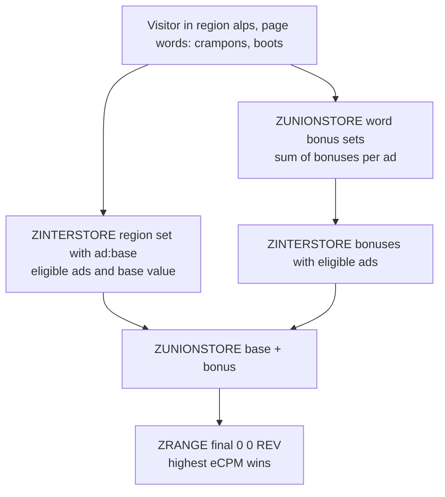

# Search with Redis: ad targeting and skill matching

> **Before this lesson:** you should understand inverted indexes built from sets and how
> `ZINTERSTORE` / `ZUNIONSTORE` combine scores with weights
> ([inverted indexes and sorted results](#/lesson/redis/inverted-index-search),
> [hashes and sorted sets](#/lesson/redis/hashes-sorted-sets)).

## In plain words

The previous lesson searched for documents containing certain words. This lesson reuses the same
machinery for two problems that do not look like "search" at first.

**Ad targeting** means choosing which advertisement to show to a particular visitor on a particular
page. Picture a market with one stall position free and several traders who would like it. The market
manager wants the trader who will earn the market the most money in that spot - which depends both on
how much each trader pays and on how likely passers-by in *that* spot are to buy from them. Choosing
an ad is that decision, made in a few milliseconds, millions of times a day.

**Skill matching** means finding the jobs a person is qualified for: every skill the job requires
must be among the skills the person has. It is like checking which recipes you can cook with what is
already in your kitchen - a recipe qualifies only if you have *all* its ingredients.

Both turn out to be set and sorted-set arithmetic. Why it matters for a job: these are textbook
examples of "find the best match under constraints", a shape that covers recommendations, eligibility
checks, promotions and matching marketplaces. The trick in the second half - turning "contains all
of" into a subtraction that ends at zero - is a neat pattern to have in your toolbox.

The scenario: **Trailhead**, a marketplace for outdoor gear that shows sponsored listings (ads), and
its volunteer programme, which matches helpers to tasks.

## Part 1 - how ads are priced, in one common unit

Advertisers pay in different ways, and to compare ads we must convert them to a single measure.

- **CPM** - *cost per mille*: the advertiser pays a fixed amount per thousand times the ad is shown
  (*mille* is Latin for thousand). Each showing is called an **impression**.
- **CPC** - *cost per click*: the advertiser pays only when someone clicks.
- **CPA** - *cost per action*: the advertiser pays only when a click leads to a purchase or sign-up.

The common measure is **eCPM**, *effective* CPM: how much we expect to earn per thousand impressions.
To compute it we need rates measured from history:

- **CTR**, the *click-through rate*: clicks divided by impressions.
- The *action rate*: actions divided by impressions.

$$\text{eCPM}_{\text{CPM}} = \text{price} \qquad
\text{eCPM}_{\text{CPC}} = 1000 \times \text{CTR} \times \text{price per click} \qquad
\text{eCPM}_{\text{CPA}} = 1000 \times \text{action rate} \times \text{price per action}$$

A worked example. Ad A pays 0.40 per click and is clicked on 1.5 % of impressions; ad B pays a flat
4.50 CPM.

$$\text{eCPM}_A = 1000 \times 0.015 \times 0.40 = 6.00 \qquad \text{eCPM}_B = 4.50$$

Ad A is worth more per thousand showings even though B's price looks larger. The whole targeting
engine exists to find the ad with the highest eCPM *for this page view*.

```python
def ecpm(kind, price, impressions, events):
    """events = clicks for 'cpc', actions for 'cpa'."""
    if kind == "cpm":
        return price
    rate = events / impressions if impressions else 0.0
    return 1000.0 * rate * price
```

For a brand-new ad there is no history, so systems start with an average rate for that type of ad and
replace it with measured numbers as impressions accumulate.

## Part 2 - indexing ads

Each ad says where it should be shown and which words on a page suit it. We file it in several
structures:

| Key | Type | Contents |
|---|---|---|
| `ad:region:<region>` | set | ids of ads that target this region |
| `ad:base` | sorted set | ad id → its base eCPM |
| `ad:kind` | hash | ad id → `cpm`, `cpc` or `cpa` |
| `ad:price` | hash | ad id → the advertiser's price |
| `ad:word:<word>` | sorted set | ad id → *bonus* eCPM when this word is on the page |
| `ad:words:<id>` | set | the words this ad was indexed under |

```bash
127.0.0.1:6379> SADD ad:region:alps ad:1 ad:2
(integer) 2
127.0.0.1:6379> SADD ad:region:coast ad:3
(integer) 1
127.0.0.1:6379> ZADD ad:base 6.0 ad:1 4.5 ad:2 7.0 ad:3
(integer) 3
127.0.0.1:6379> ZADD ad:word:crampons 2.5 ad:2
(integer) 1
127.0.0.1:6379> ZADD ad:word:boots 1.0 ad:1 0.5 ad:2
(integer) 2
```

Read it as: ads 1 and 2 target visitors in the Alps, ad 3 the coast. Base values are 6.0, 4.5 and
7.0. Ad 2 (ice equipment) earns a bonus of 2.5 when the page mentions "crampons"; both Alpine ads
earn a small bonus on pages about "boots". The bonus expresses a measured fact: this ad is clicked
more often when that word is on the page.

## Part 3 - choosing an ad for a page view

A visitor in the Alps opens a page whose text contains "crampons" and "boots". Three steps.

**Step 1 - who is eligible?** Ads targeting the visitor's region (if a visitor matches several
regions, union the sets).

**Step 2 - what is each eligible ad worth here?** Its base value plus its bonuses for words on this
page.

**Step 3 - pick the highest.**

```bash
127.0.0.1:6379> ZINTERSTORE tmp:t1:base 2 ad:region:alps ad:base WEIGHTS 0 1
(integer) 2
127.0.0.1:6379> ZUNIONSTORE tmp:t1:bonus 2 ad:word:crampons ad:word:boots
(integer) 2
127.0.0.1:6379> ZINTERSTORE tmp:t1:bonus 2 tmp:t1:bonus tmp:t1:base WEIGHTS 1 0
(integer) 2
127.0.0.1:6379> ZUNIONSTORE tmp:t1:final 2 tmp:t1:base tmp:t1:bonus
(integer) 2
127.0.0.1:6379> ZRANGE tmp:t1:final 0 0 REV WITHSCORES
1) "ad:2"
2) "7.5"
```

Line by line:

1. Intersect the region set with the base values. Weight 0 on the set means it only filters; weight 1
   keeps the base eCPM. Result: `ad:1 → 6.0`, `ad:2 → 4.5`. Ad 3 is gone - wrong region.
2. Union the bonus sets of the page's words, summing scores: `ad:1 → 1.0`, `ad:2 → 2.5 + 0.5 = 3.0`.
3. Intersect the bonuses with the eligible ads so that an ad from another region cannot sneak back in
   through a word match. Weight 0 on the second input keeps only the bonus score.
4. Add base and bonus: `ad:1 → 7.0`, `ad:2 → 7.5`.
5. Read the top entry: ad 2 wins with 7.5, although its base value was the lowest of the two.



```python
import uuid
import redis

r = redis.Redis(decode_responses=True)

def choose_ad(regions, page_words, ttl=30):
    t = f"tmp:{uuid.uuid4().hex[:8]}"
    pipe = r.pipeline()
    pipe.sunionstore(f"{t}:regions", [f"ad:region:{x}" for x in regions])
    pipe.zinterstore(f"{t}:base", {f"{t}:regions": 0, "ad:base": 1})
    pipe.zunionstore(f"{t}:bonus", [f"ad:word:{w}" for w in page_words] or [f"{t}:none"])
    pipe.zinterstore(f"{t}:bonus", {f"{t}:bonus": 1, f"{t}:base": 0})
    pipe.zunionstore(f"{t}:final", [f"{t}:base", f"{t}:bonus"])
    pipe.zrange(f"{t}:final", 0, 0, desc=True, withscores=True)
    for suffix in ("regions", "base", "bonus", "final"):
        pipe.expire(f"{t}:{suffix}", ttl)
    best = pipe.execute()[5]
    return best[0] if best else None
```

- `t` is a random prefix for this request's temporary keys.
- Passing a dictionary to `zinterstore` sets a weight per input key.
- `or [f"{t}:none"]` handles a page with no indexed words by unioning a key that does not exist, which
  Redis treats as an empty set.
- `pipe.execute()[5]` picks the sixth reply, the `ZRANGE`. Everything travelled in a single round
  trip.

> [!TIP]
> Summing bonuses is the simplest way to combine words, and it over-rewards ads that match many
> words. Real systems often take the average or the maximum (`AGGREGATE MAX` on the union) so that one
> strongly matching word counts for more than many weak ones.

## Part 4 - learning from what happens

The base values and bonuses are only as good as the rates behind them, so every impression and click
is recorded and the numbers are refreshed.

```bash
127.0.0.1:6379> HINCRBY ad:2:views total 1
(integer) 1041
127.0.0.1:6379> HINCRBY ad:2:views crampons 1
(integer) 212
127.0.0.1:6379> HINCRBY ad:2:clicks total 1
(integer) 27
127.0.0.1:6379> HINCRBY ad:2:clicks crampons 1
(integer) 11
```

Two hashes per ad count impressions and clicks, overall and per page word that was present. From
them:

$$\text{CTR}_{\text{overall}} = \frac{27}{1041} \approx 2.6\,\% \qquad
\text{CTR}_{\text{crampons}} = \frac{11}{212} \approx 5.2\,\%$$

The ad is clicked twice as often on pages mentioning crampons. With a click price of 0.30, the base
eCPM is $1000 \times 0.026 \times 0.30 \approx 7.8$, the eCPM on crampon pages is
$1000 \times 0.052 \times 0.30 \approx 15.6$, and so the *bonus* stored in `ad:word:crampons` is the
difference, about 7.8. A background job recomputes these every hundred impressions or so and writes
them back with `ZADD`.

```python
def record_view(ad, page_words):
    pipe = r.pipeline()
    pipe.hincrby(f"{ad}:views", "total", 1)
    for w in page_words:
        pipe.hincrby(f"{ad}:views", w, 1)
    pipe.execute()

def refresh(ad, price):
    views, clicks = r.hgetall(f"{ad}:views"), r.hgetall(f"{ad}:clicks")
    total_views = int(views.get("total", 0))
    if total_views < 100:
        return                                         # too little data to trust
    base = 1000.0 * int(clicks.get("total", 0)) / total_views * price
    pipe = r.pipeline()
    pipe.zadd("ad:base", {ad: base})
    for word, v in views.items():
        if word != "total" and int(v) >= 50:
            word_ecpm = 1000.0 * int(clicks.get(word, 0)) / int(v) * price
            pipe.zadd(f"ad:word:{word}", {ad: word_ecpm - base})
    pipe.execute()
```

The thresholds (100 impressions overall, 50 per word) exist because rates computed from a handful of
events are mostly noise: one click in three impressions is not a 33 % click-through rate.

> [!WARNING]
> Always showing the current best ad means a new ad with no history never gets shown and so never
> earns a history. This is the **exploration versus exploitation** problem. Practical systems reserve
> a small share of impressions for under-tested ads, or add an optimism bonus that shrinks as data
> arrives.

## Part 5 - matching people to tasks by skills

Trailhead's volunteer programme lists tasks, each requiring certain certifications:

| Task | Requires |
|---|---|
| `task:trail-repair` | first-aid, chainsaw |
| `task:kids-hike` | first-aid, child-safety |
| `task:info-desk` | (nothing beyond signing up: we will give it one skill, `orientation`) |

A volunteer holds some certifications. Which tasks can they do? The condition is "every required
skill is held" - the task's skill set must be a **subset** of the volunteer's.

### The obvious approach and why it does not scale

Store each task's skills in a set and, for each task, run `SDIFF task-skills volunteer-skills`; an
empty result means qualified. That is one command *per task*, so ten thousand tasks cost ten thousand
commands per search.

### The counting trick

Turn the question around with an inverted index and count.

- For each skill, a set of the tasks that require it: `skill:<name>`.
- One sorted set, `task:needs`, giving for each task the **number** of skills it requires.

Then:

1. Union the skill sets for the skills the volunteer *has*, as a sorted set. Each task's score in the
   union is how many of the volunteer's skills it uses - that is, how many of its requirements are
   met.
2. Subtract that from the number required. A result of **zero** means every requirement is met.

```bash
127.0.0.1:6379> SADD skill:first-aid task:trail-repair task:kids-hike
(integer) 2
127.0.0.1:6379> SADD skill:chainsaw task:trail-repair
(integer) 1
127.0.0.1:6379> SADD skill:child-safety task:kids-hike
(integer) 1
127.0.0.1:6379> SADD skill:orientation task:info-desk
(integer) 1
127.0.0.1:6379> ZADD task:needs 2 task:trail-repair 2 task:kids-hike 1 task:info-desk
(integer) 3
127.0.0.1:6379> ZUNIONSTORE tmp:v9:met 3 skill:first-aid skill:chainsaw skill:orientation
(integer) 3
127.0.0.1:6379> ZINTERSTORE tmp:v9:missing 2 tmp:v9:met task:needs WEIGHTS -1 1
(integer) 3
127.0.0.1:6379> ZRANGE tmp:v9:missing 0 -1 WITHSCORES
1) "task:info-desk"
2) "0"
3) "task:trail-repair"
4) "0"
5) "task:kids-hike"
6) "1"
127.0.0.1:6379> ZRANGE tmp:v9:missing 0 0 BYSCORE
1) "task:info-desk"
2) "task:trail-repair"
```

The volunteer holds first-aid, chainsaw and orientation. The union counts met requirements:
trail-repair 2, kids-hike 1, info-desk 1. The intersection with weights -1 and 1 computes
`required - met` for each task: trail-repair $2 - 2 = 0$, kids-hike $2 - 1 = 1$, info-desk
$1 - 1 = 0$. The final range query, score from 0 to 0, returns the tasks with nothing missing. The
score of the others is useful too: kids-hike is *one* certification away, which the site can show as
"almost qualified - you need child-safety".

Two commands answer the question no matter how many tasks exist, and the work is proportional to the
number of tasks that use at least one of the volunteer's skills.

```python
def add_task(task, skills):
    pipe = r.pipeline()
    for s in skills:
        pipe.sadd(f"skill:{s}", task)
    pipe.zadd("task:needs", {task: len(skills)})
    pipe.execute()

def tasks_for(volunteer_skills, ttl=30):
    t = f"tmp:{uuid.uuid4().hex[:8]}"
    pipe = r.pipeline()
    pipe.zunionstore(f"{t}:met", [f"skill:{s}" for s in volunteer_skills])
    pipe.zinterstore(f"{t}:missing", {f"{t}:met": -1, "task:needs": 1})
    pipe.zrange(f"{t}:missing", 0, 0, byscore=True)
    pipe.expire(f"{t}:met", ttl)
    pipe.expire(f"{t}:missing", ttl)
    return pipe.execute()[2]
```

Why does a task that shares *no* skill with the volunteer not appear, even though it is clearly not
qualified? Because `ZINTERSTORE` keeps only members present in both inputs, and such a task is absent
from the union. That is the right answer for every task that requires at least one skill. A task that
requires nothing at all would also be absent, which is why the table above gave the info desk a
nominal `orientation` skill that every volunteer receives.

> [!INTERVIEW]
> The "all required items present" test appears in many disguises: coupon eligibility, feature
> entitlements, recipe-from-ingredients. If asked to do it at scale, describe the inverted index from
> item to candidates, counting matches with a union, and comparing the count with the number required.
> Mention the edge case of candidates requiring zero items.

## Try it: pick an ad and match a volunteer

The block reproduces both halves in plain Python. Change the page words and watch the winning ad
change; change the volunteer's skills and watch the missing counts.

```python-run
# ---------------- ad targeting ----------------
region = {"alps": {"ad:1", "ad:2"}, "coast": {"ad:3"}}
base = {"ad:1": 6.0, "ad:2": 4.5, "ad:3": 7.0}
word_bonus = {"crampons": {"ad:2": 2.5}, "boots": {"ad:1": 1.0, "ad:2": 0.5}, "kayak": {"ad:3": 3.0}}

def choose_ad(regions, page_words):
    eligible = set().union(*[region.get(x, set()) for x in regions])        # SUNIONSTORE
    value = {ad: base[ad] for ad in eligible}                                # ZINTERSTORE weights 0 1
    for w in page_words:                                                     # ZUNIONSTORE bonuses
        for ad, bonus in word_bonus.get(w, {}).items():
            if ad in value: value[ad] += bonus                               # only eligible ads
    ranked = sorted(value.items(), key=lambda kv: (-kv[1], kv[0]))
    return ranked

for words in (["crampons", "boots"], ["boots"], [], ["kayak"]):
    print(f"alps, page words {words!s:24} ->", choose_ad(["alps"], words))
print("coast, page words ['kayak']        ->", choose_ad(["coast"], ["kayak"]))

def ecpm(kind, price, impressions, events):
    return price if kind == "cpm" else 1000.0 * events / impressions * price
print("eCPM: cpc 0.40 at 15 clicks per 1000 =", ecpm("cpc", 0.40, 1000, 15), "| flat cpm =", ecpm("cpm", 4.5, 0, 0))
print("eCPM for ad:2 overall  :", round(ecpm("cpc", 0.30, 1041, 27), 2))
print("eCPM on crampons pages :", round(ecpm("cpc", 0.30, 212, 11), 2))

# ---------------- skill matching ----------------
tasks = {"trail-repair": {"first-aid", "chainsaw"}, "kids-hike": {"first-aid", "child-safety"},
         "info-desk": {"orientation"}, "rope-team": {"first-aid", "climbing", "chainsaw"}}
by_skill, needs = {}, {}
for task, skills in tasks.items():
    needs[task] = len(skills)                                                # ZADD task:needs
    for s in skills: by_skill.setdefault(s, set()).add(task)                 # SADD skill:s task

def match(have):
    met = {}
    for s in have:                                                           # ZUNIONSTORE
        for task in by_skill.get(s, ()): met[task] = met.get(task, 0) + 1
    missing = {task: needs[task] - n for task, n in met.items()}             # ZINTERSTORE weights -1 1
    return sorted(missing.items(), key=lambda kv: (kv[1], kv[0]))

for have in (["first-aid", "chainsaw", "orientation"], ["first-aid"], ["juggling"]):
    result = match(have)
    print(f"skills {have}:")
    print("   qualified:", [t for t, m in result if m == 0], "| missing counts:", result)
```

In the ad section, the Alpine page mentioning crampons and boots is won by ad 2 with 7.5; with only
"boots", ad 1 leads at 7.0; with no matching words the base values decide; and "kayak" on an Alpine
page changes nothing because ad 3 targets the coast. The eCPM lines reproduce the calculations from
the text (6.0 against 4.5, then about 7.78 overall and 15.57 on crampon pages). In the matching
section, the first volunteer qualifies for the info desk and trail repair, is one skill short for the
kids' hike and the rope team; a volunteer with only first aid qualifies for nothing but is one or two
skills away from three tasks; and unknown skills match no task at all.

## Pitfalls

- **Comparing raw prices across pricing models.** Convert everything to eCPM first.
- **Trusting rates from tiny samples.** Require a minimum number of impressions before updating.
- **Bonuses leaking across targeting.** Intersect word bonuses with the eligible set, or an ad for
  another region can win.
- **Never exploring.** A new ad needs impressions before its rates mean anything.
- **Temporary keys left behind.** Each request creates several; expire them all.
- **Many set operations per page view.** Each targeting call is real server work. Cache per
  (region, page) for a few seconds when traffic is high.
- **Tasks requiring zero skills.** They vanish from the intersection; give them a universal skill.
- **Skill names that vary.** "First Aid", "first-aid" and "firstaid" must be normalised to one form,
  exactly as with search tokens.
- **Stale `task:needs` counts.** When a task's requirements change, update the skill sets and the
  count together in one transaction.

## Command cheat sheet

`N` = total members across inputs, `K` = number of inputs, `M` = size of the result.

| Command | Use here | Time |
|---|---|---|
| `SADD ad:region:x ad` | targeting index | O(1) |
| `ZADD ad:base ecpm ad` | base value | O(log n) |
| `ZADD ad:word:w bonus ad` | per-word bonus | O(log n) |
| `SUNIONSTORE dst regions...` | all eligible ads | O(N) |
| `ZINTERSTORE dst 2 set zset WEIGHTS 0 1` | filter a ranking by a set | O(N·K) + O(M log M) |
| `ZUNIONSTORE dst k zsets...` | sum bonuses / count matches | O(N) + O(M log M) |
| `ZINTERSTORE dst 2 met needs WEIGHTS -1 1` | required minus met | O(N·K) + O(M log M) |
| `ZRANGE dst 0 0 REV WITHSCORES` | the best ad | O(log M) |
| `ZRANGE dst 0 0 BYSCORE` | tasks with nothing missing | O(log M + results) |
| `HINCRBY ad:id:views word 1` | record impressions and clicks | O(1) |
| `EXPIRE tmp:key 30` | clean up | O(1) |

## Summary

- Convert every pricing model to eCPM so ads can be compared: expected earnings per thousand
  impressions.
- Targeting is set algebra: eligible ads by region, base value plus word bonuses, highest wins.
- Impressions and clicks are counted continuously and fed back into the stored values, with minimum
  sample sizes and some exploration.
- "Has all required skills" becomes: count the requirements met with a union, subtract from the number
  required with a weighted intersection, and select score zero.

## Glossary

- **Impression** - one showing of an ad.
- **CPM / CPC / CPA** - pricing per thousand impressions / per click / per completed action.
- **CTR (click-through rate)** - clicks divided by impressions.
- **eCPM** - expected earnings per thousand impressions, the common unit for comparing ads.
- **Targeting** - the rules deciding which visitors an ad may be shown to.
- **Bonus** - extra expected value when a particular word appears on the page.
- **Exploration versus exploitation** - the balance between testing uncertain options and using the
  best known one.
- **Subset** - a set all of whose members belong to another set.
- **Weighted intersection** - `ZINTERSTORE` with `WEIGHTS`, combining scores with multipliers.

```quiz
[
  {"q": "An ad pays 0.50 per click and is clicked 20 times per 1000 impressions. What is its eCPM?",
   "options": ["0.50", "10.00", "20.00", "25.00"],
   "answer": 1,
   "explain": "eCPM = 1000 x CTR x price = 1000 x 0.02 x 0.50 = 10."},
  {"q": "Why are all ads converted to eCPM before choosing one?",
   "options": ["Redis can only store numbers below 100", "Different pricing models are not directly comparable; eCPM expresses each as expected earnings per thousand impressions", "It hides prices from advertisers", "CPM ads are always best"],
   "answer": 1,
   "explain": "A per-click price and a per-thousand price measure different things until click-through rate is factored in."},
  {"q": "In ZINTERSTORE tmp:base 2 ad:region:alps ad:base WEIGHTS 0 1, what does weight 0 on the region set achieve?",
   "options": ["It removes the region filter", "The set still filters which ads survive but contributes nothing to their score", "It sets every score to zero", "It reverses the order"],
   "answer": 1,
   "explain": "Intersection requires membership in both inputs; multiplying the set's implicit score by 0 leaves only the base value."},
  {"q": "Why are word bonuses intersected with the eligible set before being added?",
   "options": ["To make them larger", "So that an ad targeting another region cannot re-enter the result through a word match", "Because unions cannot be stored", "To sort them alphabetically"],
   "answer": 1,
   "explain": "A union would otherwise include any ad with a bonus for the page's words, regardless of targeting."},
  {"q": "An ad has 2 clicks from 4 impressions. Why should its stored eCPM not be updated yet?",
   "options": ["Because 50% is the maximum allowed", "The sample is far too small for the rate to be meaningful", "Because clicks must be even numbers", "Because CPC ads cannot be updated"],
   "answer": 1,
   "explain": "Rates from a handful of events are dominated by chance; require a minimum sample size."},
  {"q": "A task requires 3 skills. The volunteer holds 2 of them plus 4 unrelated skills. What is the task's score after ZINTERSTORE ... WEIGHTS -1 1?",
   "options": ["0", "1", "-1", "5"],
   "answer": 1,
   "explain": "Required minus met = 3 - 2 = 1. Unrelated skills do not count because the task is not in their sets."},
  {"q": "Why is the counting approach better than running SDIFF once per task?",
   "options": ["SDIFF is not atomic", "It answers with two commands regardless of how many tasks exist, touching only tasks that share a skill with the volunteer", "SDIFF cannot compare sets of different sizes", "It uses no memory"],
   "answer": 1,
   "explain": "One command per task grows linearly with the catalogue; the inverted-index count does the work on the server in bulk."},
  {"q": "A task that requires no skills at all never appears in the match results. Why?",
   "options": ["Redis deletes empty sets, and the task is in no skill set, so it is absent from the union and therefore from the intersection", "Its score is negative", "ZRANGE skips score 0", "It has expired"],
   "answer": 0,
   "explain": "The intersection keeps only members present in both inputs. Giving such tasks a universal skill fixes it."}
]
```

> **Source:** Carlson, *Redis in Action*, ch. 7 (sections 7.3-7.4: ad targeting and job search); the marketplace and volunteer scenarios, formulas walkthrough and simulation are original.
> Further reading: <https://redis.io/docs/latest/commands/zunionstore/>, <https://redis.io/docs/latest/commands/zinterstore/>, <https://redis.io/docs/latest/develop/data-types/sorted-sets/>
