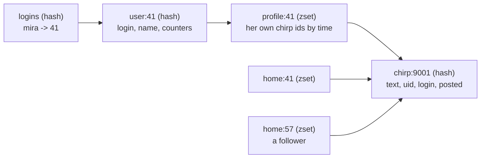

# Building a social network: users, posts and timelines

> **Before this lesson:** you should know hashes and sorted sets
> ([hashes and sorted sets](#/lesson/redis/hashes-sorted-sets)), counters with `INCR`
> ([strings, lists and sets](#/lesson/redis/strings-lists-sets)), pipelines and transactions
> ([WATCH and pipelining](#/lesson/redis/watch-pipelining-performance)). The first application in this
> track ([a proposal board](#/lesson/redis/first-app-voting)) used the same "record plus index" style
> on a smaller scale.

## In plain words

A social network such as a microblogging site looks complicated, but its heart is three questions:

1. *Who is this person?* - a profile.
2. *What have they posted?* - a list of their own posts, newest first.
3. *What should they see when they open the app?* - the recent posts of everyone they follow, mixed
   together and ordered by time. This mixed list is called the **home timeline** (or feed).

A helpful picture is a block of flats with letterboxes. Each resident has a noticeboard on their own
door where they pin their notes (their posts). Each resident also has a letterbox. Whenever someone
pins a new note, a copy of it is slipped into the letterbox of everyone who follows them. Opening the
app is opening your letterbox: the notes are already there, in order, and nobody has to walk round
the building collecting them.

That design choice - do the delivery work when a note is *written*, so that *reading* is instant - is
the most important idea in this module. People read their feed far more often than they post, so it
pays to make reading cheap.

Why it matters for a job: "design a news feed" is one of the most frequently asked system-design
interview questions, and the same structure appears in activity feeds, notification centres and
dashboards inside ordinary business software.

We will build **Chirrup**, a small microblogging service, in this lesson and the next. This lesson
covers users, posts and reading timelines; the next covers following, delivering posts to followers,
deletion and live streams.

## Part 1 - users

### What we store

A user is a small record: a login name, a display name, the time they signed up, and three counters.
A hash is the natural container.

```bash
127.0.0.1:6379> INCR user:next-id
(integer) 41
127.0.0.1:6379> HSET user:41 login mira name "Mira Okafor" joined 1767225600 followers 0 following 0 posts 0
(integer) 6
127.0.0.1:6379> HGETALL user:41
 1) "login"
 2) "mira"
 3) "name"
 4) "Mira Okafor"
 5) "joined"
 6) "1767225600"
 7) "followers"
 8) "0"
 9) "following"
10) "0"
11) "posts"
12) "0"
```

`INCR user:next-id` hands out identifiers: each call returns the next whole number, and because the
command is atomic, two sign-ups at the same instant can never receive the same one. The user's data
then lives in `user:41`.

Why a number, when the login `mira` is already unique? Because people change their login names. The
number is a permanent **identifier** (id) that every other structure refers to; the login is a
changeable label.

### Looking a user up by login

People type login names, not numbers, so we need to get from `mira` to `41`. That is a second
structure: one hash named `logins` that maps each lower-cased login to its id.

```bash
127.0.0.1:6379> HSET logins mira 41
(integer) 1
127.0.0.1:6379> HGET logins mira
"41"
```

This is an **index**: extra data kept purely so that a lookup is fast. Redis does not maintain
indexes for you; whenever you create or rename a user, your code must update `logins` too.

### Making sign-up safe

Two people try to register `mira` at the same moment. A careless implementation checks "is `mira`
taken?", sees "no" for both, and creates two users. The check and the claim have to be one atomic
step.

`HSETNX` ("hash set if not exists") provides it: it writes the field only if the field is absent,
and replies 1 if it wrote and 0 if the field was already there.

```bash
127.0.0.1:6379> HSETNX logins mira pending
(integer) 1
127.0.0.1:6379> HSETNX logins mira pending
(integer) 0
```

The first caller wins the name; the second is told it is taken. The winner then allocates an id,
creates the user hash and replaces `pending` with the real id.

```python
import time
import redis

r = redis.Redis(decode_responses=True)

def create_user(login, name):
    key = login.lower()
    if not r.hsetnx("logins", key, "pending"):
        return None                                # the name is taken
    uid = r.incr("user:next-id")
    pipe = r.pipeline()
    pipe.hset(f"user:{uid}", mapping={
        "login": login, "name": name, "joined": int(time.time()),
        "followers": 0, "following": 0, "posts": 0,
    })
    pipe.hset("logins", key, uid)
    pipe.execute()
    return uid

def user_id(login):
    uid = r.hget("logins", login.lower())
    return int(uid) if uid and uid != "pending" else None
```

Line by line:

- `login.lower()` makes `Mira` and `mira` the same name.
- `hsetnx` claims the name. A falsy reply means someone else has it, and the function stops.
- `incr` allocates the id.
- The pipeline creates the user hash and replaces the placeholder with the id, as one transaction.
- `user_id` treats the placeholder as "not found", so a half-created user is invisible.

If the program crashes between claiming the name and finishing, the name stays `pending`. A periodic
clean-up that removes old placeholders (or a script that performs the whole sign-up in one step)
closes that gap.

## Part 2 - posts

Each post - Chirrup calls them *chirps* - is also a hash with its own id.

```bash
127.0.0.1:6379> INCR chirp:next-id
(integer) 9001
127.0.0.1:6379> HSET chirp:9001 text "First frost on the allotment." uid 41 login mira posted 1767225700
(integer) 4
127.0.0.1:6379> HINCRBY user:41 posts 1
(integer) 1
```

The post stores the author's id *and* a copy of their login. Storing the login again is deliberate
duplication: showing a timeline of fifty posts would otherwise need fifty extra lookups to turn author
ids into names. The cost is that a login change must update, or tolerate, old copies. Trading extra
storage and some staleness for fewer lookups is called **denormalisation**, and it is the normal way
of working in Redis.

## Part 3 - two timelines per user

A **timeline** is an ordered list of post ids. Each user has two:

- the **profile timeline**, `profile:<uid>` - only that user's own posts (what you see on their page);
- the **home timeline**, `home:<uid>` - posts by the people they follow, plus their own.

Both are sorted sets: the member is the post id and the score is the time it was posted. A sorted set
(not a list) is used for three reasons: reading newest-first is a reverse range; removing one post
from the middle is cheap (`ZREM`); and merging in someone's older posts when you start following them
keeps everything in time order automatically.

```bash
127.0.0.1:6379> ZADD profile:41 1767225700 9001
(integer) 1
127.0.0.1:6379> ZADD home:41 1767225700 9001
(integer) 1
127.0.0.1:6379> ZADD home:57 1767225700 9001
(integer) 1
```

User 57 follows Mira, so the post id is also added to `home:57`: the note slipped into a follower's
letterbox. Only the *id* is copied, a few bytes, never the post itself.



### Posting

```python
def post_chirp(uid, text):
    login = r.hget(f"user:{uid}", "login")
    if login is None:
        return None
    cid = r.incr("chirp:next-id")
    now = time.time()
    pipe = r.pipeline()
    pipe.hset(f"chirp:{cid}", mapping={"text": text, "uid": uid, "login": login, "posted": now})
    pipe.hincrby(f"user:{uid}", "posts", 1)
    pipe.zadd(f"profile:{uid}", {cid: now})
    pipe.zadd(f"home:{uid}", {cid: now})
    pipe.execute()
    return cid
```

The function looks up the author's login (also confirming the user exists), allocates a post id, and
in one transaction stores the post, bumps the author's post counter and adds the id to the author's
own two timelines. Delivering the id to followers is the subject of the next lesson.

### Reading a timeline

Reading has two stages: fetch a page of ids, then fetch the posts those ids refer to.

```bash
127.0.0.1:6379> ZRANGE home:57 0 29 REV
1) "9001"
127.0.0.1:6379> HGETALL chirp:9001
1) "text"
2) "First frost on the allotment."
3) "uid"
4) "41"
5) "login"
6) "mira"
7) "posted"
8) "1767225700"
```

`ZRANGE ... 0 29 REV` returns up to thirty ids, highest score (newest) first. Fetching thirty hashes
one at a time would be thirty round trips, so they go in a pipeline:

```python
def timeline(uid, kind="home", page=1, per_page=30):
    start = (page - 1) * per_page
    ids = r.zrange(f"{kind}:{uid}", start, start + per_page - 1, desc=True)
    pipe = r.pipeline(transaction=False)
    for cid in ids:
        pipe.hgetall(f"chirp:{cid}")
    return [post for post in pipe.execute() if post]
```

- `start` is the position of the first item on the requested page.
- `transaction=False` makes a plain pipeline: we only want to save round trips, and the reads do not
  need to be isolated from other clients.
- `if post` drops empty results. `HGETALL` on a key that does not exist returns an empty dictionary,
  which happens when a post was deleted after its id was delivered. Filtering here means deletion does
  not have to track down every letterbox immediately.

The whole feed costs two round trips, however many people the user follows.

### Paging without surprises

Paging by position (`0-29`, then `30-59`) has a flaw on a busy feed: if three new posts arrive while
the user is reading page one, everything shifts down by three, and page two repeats three posts.
**Cursor-based** paging avoids this: remember the score of the last post shown and ask for posts
*older than that*.

```bash
127.0.0.1:6379> ZRANGE home:57 (1767225700 -inf BYSCORE REV LIMIT 0 30
(empty array)
```

`(1767225700` means "strictly less than this score" (with `REV` the range runs downwards from the
first value). New posts at the top no longer disturb what comes next.

> [!TIP]
> A home timeline does not need to hold everything for ever. Capping each one at the newest thousand
> ids (`ZREMRANGEBYRANK home:57 0 -1001`) keeps memory bounded. The rare user who scrolls further back
> can be served by a slower path that merges profile timelines on demand.

## Part 4 - how much memory is this?

A quick estimate is a habit worth forming. Suppose Chirrup has one million users, each home timeline
is capped at 1,000 ids, and a sorted-set entry for a numeric id costs roughly 60-70 bytes once
structure overhead is included.

$$10^6 \text{ users} \times 1000 \text{ entries} \times 65 \text{ bytes} \approx 65 \text{ GB}$$

That is a lot of RAM for letterboxes, and it tells you two things. First, the cap matters: at 200
entries it would be 13 GB. Second, most users of any real service are inactive; building home
timelines only for users who have been active recently, and rebuilding one on demand when a dormant
user returns, cuts the total dramatically. Real feed systems do exactly this.

## Try it: sign up, post and read

The block below models the keys of this lesson with Python dictionaries: the `logins` index with its
set-if-absent rule, user and post hashes, and the two timelines per user. It registers users
(including a duplicate attempt), posts, delivers by hand to one follower, and reads pages.

```python-run
class Chirrup:
    def __init__(self):
        self.logins, self.users, self.chirps = {}, {}, {}
        self.profile, self.home = {}, {}
        self.next_user, self.next_chirp, self.clock = 40, 9000, 1_767_225_600

    def create_user(self, login, name):
        key = login.lower()
        if key in self.logins: return None                      # HSETNX replied 0
        self.logins[key] = "pending"
        self.next_user += 1; uid = self.next_user               # INCR user:next-id
        self.users[uid] = {"login": login, "name": name, "posts": 0}
        self.logins[key] = uid
        return uid

    def post(self, uid, text, deliver_to=()):
        self.next_chirp += 1; cid = self.next_chirp; self.clock += 60
        self.chirps[cid] = {"text": text, "uid": uid, "login": self.users[uid]["login"], "posted": self.clock}
        self.users[uid]["posts"] += 1
        for owner in (uid, *deliver_to):                        # ZADD home:<owner>
            self.home.setdefault(owner, {})[cid] = self.clock
        self.profile.setdefault(uid, {})[cid] = self.clock      # ZADD profile:<uid>
        return cid

    def timeline(self, uid, kind="home", page=1, per_page=3):
        zset = getattr(self, kind).get(uid, {})
        ids = sorted(zset, key=lambda c: (zset[c], c), reverse=True)      # ZRANGE ... REV
        ids = ids[(page - 1) * per_page: page * per_page]
        return [(c, self.chirps[c]["login"], self.chirps[c]["text"]) for c in ids if c in self.chirps]

    def older_than(self, uid, score, n=3):
        zset = self.home.get(uid, {})
        ids = sorted((c for c in zset if zset[c] < score), key=lambda c: zset[c], reverse=True)[:n]
        return [(c, self.chirps[c]["text"]) for c in ids if c in self.chirps]

app = Chirrup()
mira = app.create_user("Mira", "Mira Okafor")
print("mira ->", mira, "| second attempt at the same login ->", app.create_user("MIRA", "Impostor"))
tomas = app.create_user("tomas", "Tomas Lind")

for text in ["First frost on the allotment.", "Leeks survived.", "Ordering seed potatoes.", "Greenhouse door fixed."]:
    app.post(mira, text, deliver_to=[tomas])                    # tomas follows mira
app.post(tomas, "Rain all week.")

print("mira's profile  :", app.timeline(mira, "profile"))
print("tomas home p.1  :", app.timeline(tomas, "home", page=1))
print("tomas home p.2  :", app.timeline(tomas, "home", page=2))

del app.chirps[9002]                                            # a chirp is deleted; ids remain in timelines
print("after a delete  :", app.timeline(tomas, "home", page=2))

last_score = app.chirps[9004]["posted"]
print("older than 9004 :", app.older_than(tomas, last_score))
print("mira's counters :", app.users[mira])
```

Things to check in the output. The second sign-up with the same name in different capitals returns
`None`: the name was already claimed. Mira's profile shows only her posts, newest first. Tomas's home
timeline mixes Mira's delivered posts with his own, three per page. After post 9002 is deleted, page
two is one item shorter - the id is still in the sorted set, but the reader filtered out the missing
post. The cursor query lists the posts strictly older than post 9004, regardless of anything added
above it.

## Pitfalls

- **Check-then-create for unique names.** Two requests can both pass a separate check. Claim the name
  with `HSETNX` (or `SET ... NX`), which checks and writes in one step.
- **Forgetting to maintain an index.** `logins` must change whenever a login is created, renamed or
  removed.
- **Using the login as the permanent key.** Renames would then require rewriting every structure that
  mentions the user.
- **Copying posts into timelines.** Store ids only; the post lives in one place.
- **Unbounded timelines.** Cap them, or memory grows with every post ever delivered.
- **One round trip per post when reading.** Pipeline the `HGETALL` calls.
- **Paging by position on a moving feed.** Use the score of the last item as a cursor.
- **Counters drifting from reality.** `followers`, `following` and `posts` are denormalised copies;
  update them in the same transaction as the structures they summarise.
- **Enormous shared hashes.** A single `logins` hash with a hundred million fields is one giant key on
  one server. Later lessons on memory and scaling show how to split such structures.

## Command cheat sheet

`n` = entries in the structure, `m` = entries returned or removed.

| Command | Use here | Time |
|---|---|---|
| `INCR user:next-id` | allocate a unique id | O(1) |
| `HSETNX logins name value` | claim a unique login atomically | O(1) |
| `HSET user:id field value ...` | store a profile or a post | O(1) per field |
| `HGET logins name` | login to id | O(1) |
| `HINCRBY user:id posts 1` | maintain a counter | O(1) |
| `ZADD profile:id time chirp` | add to a timeline | O(log n) |
| `ZRANGE home:id 0 29 REV` | newest page by position | O(log n + m) |
| `ZRANGE home:id (score -inf BYSCORE REV LIMIT 0 30` | next page by cursor | O(log n + m) |
| `HGETALL chirp:id` (pipelined) | load the posts of a page | O(fields) each |
| `ZREM home:id chirp` | remove one entry | O(log n) |
| `ZREMRANGEBYRANK home:id 0 -1001` | keep the newest thousand | O(log n + m) |

## Summary

- Users and posts are hashes with numeric ids from `INCR`; a `logins` hash is the index from name to
  id, claimed atomically with `HSETNX`.
- Each user has a profile timeline and a home timeline, both sorted sets of post ids scored by time.
- Posting writes the post once and adds its id to timelines; reading is one range query plus one
  pipelined batch of hash reads.
- Deleted posts are filtered at read time; timelines are capped; cursors make paging stable.

> [!INTERVIEW]
> In a feed-design interview, start exactly here: the entities (user, post), the two timelines, and the
> statement "reads vastly outnumber writes, so I precompute each user's home timeline as a sorted set
> of post ids". Give the memory estimate and the cap. The follow-up questions - how posts reach
> followers, and what to do about accounts with millions of followers - are the next lesson.

> [!WARNING]
> Everything in this lesson assumes the data fits in memory and that losing a few seconds of writes on
> a crash is tolerable. A real service keeps users and posts in a durable database as the system of
> record and treats the Redis timelines as a rebuildable cache.

## Glossary

- **Profile** - the stored facts about a user.
- **Identifier (id)** - a permanent unique number naming a user or post.
- **Index** - extra data kept so a lookup is fast (here, login to id).
- **Timeline / feed** - an ordered list of post ids.
- **Profile timeline** - one user's own posts.
- **Home timeline** - posts from everyone a user follows, merged by time.
- **Denormalisation** - storing a copy of data where it is read, to avoid extra lookups.
- **Atomic** - happening completely or not at all, with nothing able to interleave.
- **Pagination** - returning results one page at a time.
- **Cursor** - a marker (here, a score) recording where the previous page ended.
- **System of record** - the store that holds the authoritative copy of data.

```quiz
[
  {"q": "Why does each user get a numeric id instead of using the login as the key everywhere?",
   "options": ["Numbers sort faster", "The login can change, while the id stays fixed, so other structures never need rewriting", "Redis keys cannot contain letters", "Ids use less network bandwidth"],
   "answer": 1,
   "explain": "A permanent identifier decouples every reference from a label that users may rename."},
  {"q": "Two requests try to register the login 'sam' at the same instant using HSETNX logins sam pending. What are the replies?",
   "options": ["1 and 1", "1 and 0", "0 and 0", "OK and an error"],
   "answer": 1,
   "explain": "HSETNX writes only if the field is absent. Exactly one caller creates it and gets 1; the other gets 0."},
  {"q": "What is stored in a home timeline sorted set?",
   "options": ["Full copies of each post", "Post ids as members with the posting time as score", "User ids of followers", "Login names"],
   "answer": 1,
   "explain": "Only ids are delivered; the post body lives once in its own hash."},
  {"q": "Why is a sorted set preferred to a list for timelines?",
   "options": ["Lists cannot hold numbers", "It supports cheap removal of one post, automatic time ordering when older posts are merged in, and range reads by score", "Sorted sets use less memory than lists", "Lists cannot be paged"],
   "answer": 1,
   "explain": "Deleting from the middle of a list is linear and merging keeps no order; a sorted set handles both in O(log n)."},
  {"q": "Reading a 30-post page uses ZRANGE followed by 30 pipelined HGETALL calls. How many network round trips is that?",
   "options": ["31", "30", "2", "1"],
   "answer": 2,
   "explain": "One for the ids and one for the batch of hash reads."},
  {"q": "A post was deleted but its id remains in some home timelines. What does the reader do?",
   "options": ["It crashes", "HGETALL returns an empty result and the reader filters it out", "Redis removes the id automatically", "It shows an error to the user"],
   "answer": 1,
   "explain": "Filtering empty results at read time lets deletion avoid visiting every follower's timeline immediately."},
  {"q": "Why can paging by position (0-29, then 30-59) show duplicates on a busy feed?",
   "options": ["Sorted sets reorder randomly", "New posts arriving at the top shift everything down, so the next position range overlaps what was already shown", "ZRANGE returns duplicates by design", "Scores are rounded"],
   "answer": 1,
   "explain": "Positions are relative to the current top. A score cursor ('older than the last one I saw') is stable."},
  {"q": "One million users each have a home timeline capped at 500 ids at about 65 bytes per entry. Roughly how much memory is that?",
   "options": ["About 325 MB", "About 3.25 GB", "About 32.5 GB", "About 325 GB"],
   "answer": 2,
   "explain": "1,000,000 x 500 x 65 bytes = 32.5 billion bytes, about 32.5 GB."}
]
```

> **Source:** Carlson, *Redis in Action*, ch. 8 (sections 8.1-8.2: users and statuses, home timeline); the Chirrup design, HSETNX sign-up, cursor paging, memory estimate and simulation are original.
> Further reading: <https://redis.io/docs/latest/commands/hsetnx/>, <https://redis.io/docs/latest/commands/zrange/>, <https://redis.io/docs/latest/develop/data-types/sorted-sets/>
