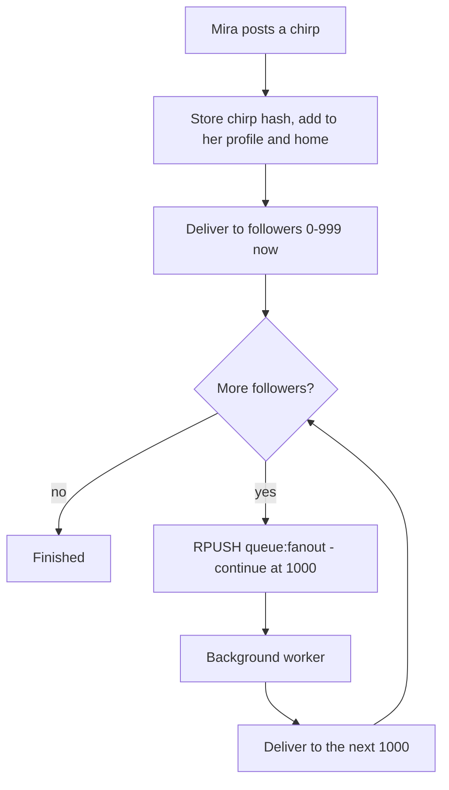

# Building a social network: following, fan-out, deletion and live streams

> **Before this lesson:** read [users, posts and timelines](#/lesson/redis/users-timelines) first -
> this lesson continues the same Chirrup application and reuses its keys (`user:<id>`, `chirp:<id>`,
> `profile:<id>`, `home:<id>`). You should also know task queues
> ([queues, messaging and files](#/lesson/redis/queues-messaging-files)) and pub/sub
> ([pub/sub, transactions and expiry](#/lesson/redis/pubsub-transactions-expiry)).

## In plain words

In the previous lesson every resident of our block of flats had a noticeboard (their own posts) and a
letterbox (their home timeline). What we skipped is the postal round: when someone pins a new note,
*who* gets a copy, and who does the delivering?

Copying one new post into the timelines of all the author's followers is called **fan-out**, because
a single write spreads out like the ribs of a fan. For someone with forty followers it is forty tiny
writes - nothing. For a celebrity with thirty million followers it is thirty million writes for one
post, and that single fact shapes the design of every large social network.

This lesson covers four things: recording who follows whom, delivering posts (including the celebrity
problem), deleting posts, and pushing new posts to connected clients the moment they are written.

Why it matters for a job: "how does a post reach followers' feeds, and what about users with millions
of followers?" is the core of the classic feed-design interview. The underlying trade-off - do the
work when data is written, or when it is read - appears in every caching and reporting system.

## Part 1 - who follows whom

"Follow" is a one-way relationship: Tomas may follow Mira without Mira following Tomas. For each user
we keep two sorted sets:

- `followers:<uid>` - the users who follow this user
- `following:<uid>` - the users this user follows

In both, the member is a user id and the score is the time the follow happened. Why two structures
for one fact? Because the application asks both questions - "who should receive Mira's posts?" and
"whom does Tomas follow?" - and each must be answerable with one command.

```bash
127.0.0.1:6379> ZADD following:57 1767226000 41
(integer) 1
127.0.0.1:6379> ZADD followers:41 1767226000 57
(integer) 1
127.0.0.1:6379> HINCRBY user:57 following 1
(integer) 1
127.0.0.1:6379> HINCRBY user:41 followers 1
(integer) 1
127.0.0.1:6379> ZSCORE following:57 41
"1767226000"
127.0.0.1:6379> ZCARD followers:41
(integer) 1
```

User 57 (Tomas) follows user 41 (Mira): one entry in each sorted set, and each profile's counter goes
up by one. `ZSCORE following:57 41` answers "does 57 follow 41?" - a number means yes, `nil` means no.

### Following also fills the letterbox

A new follower expects to see some of the followed person's recent posts straight away, not an empty
gap until their next post. So following copies the most recent entries of the followed user's profile
timeline into the follower's home timeline.

```python
import time
import redis

r = redis.Redis(decode_responses=True)

HOME_CAP = 1000
BACKFILL = 100

def follow(uid, other):
    if uid == other or r.zscore(f"following:{uid}", other) is not None:
        return False
    now = time.time()
    recent = r.zrange(f"profile:{other}", 0, BACKFILL - 1, desc=True, withscores=True)
    pipe = r.pipeline()
    pipe.zadd(f"following:{uid}", {other: now})
    pipe.zadd(f"followers:{other}", {uid: now})
    pipe.hincrby(f"user:{uid}", "following", 1)
    pipe.hincrby(f"user:{other}", "followers", 1)
    if recent:
        pipe.zadd(f"home:{uid}", dict(recent))
    pipe.zremrangebyrank(f"home:{uid}", 0, -HOME_CAP - 1)
    pipe.execute()
    return True
```

- The first line refuses to follow yourself or to follow twice.
- `recent` fetches up to one hundred of the other user's newest post ids *with their scores*;
  `withscores=True` returns `(id, time)` pairs.
- `dict(recent)` turns those pairs into the `{member: score}` mapping that `zadd` expects, so the
  posts enter the follower's home timeline at their original times and slot into the right places.
- `zremrangebyrank(..., 0, -HOME_CAP - 1)` trims the home timeline to its newest thousand entries.
- All six commands run as one transaction.

Unfollowing is the mirror image: remove both entries, decrement both counters, and remove that user's
posts from the home timeline.

```python
def unfollow(uid, other):
    if r.zscore(f"following:{uid}", other) is None:
        return False
    theirs = r.zrange(f"profile:{other}", 0, HOME_CAP - 1, desc=True)
    pipe = r.pipeline()
    pipe.zrem(f"following:{uid}", other)
    pipe.zrem(f"followers:{other}", uid)
    pipe.hincrby(f"user:{uid}", "following", -1)
    pipe.hincrby(f"user:{other}", "followers", -1)
    if theirs:
        pipe.zrem(f"home:{uid}", *theirs)
    pipe.execute()
    return True
```

> [!WARNING]
> Both functions read first and write afterwards, so two simultaneous clicks on "follow" could both
> pass the check and count the follow twice. Guard the pair with `WATCH` on `following:<uid>`, or -
> simpler - use the reply of `ZADD` (1 means newly added, 0 means already present) to decide whether
> to touch the counters, or run the whole thing as a server-side script (module 11).

## Part 2 - fan-out on write

When Mira posts, her post id must be added to the home timeline of each follower.

```python
import json

IMMEDIATE = 1000

def post_chirp(uid, text):
    login = r.hget(f"user:{uid}", "login")
    cid = r.incr("chirp:next-id")
    now = time.time()
    pipe = r.pipeline()
    pipe.hset(f"chirp:{cid}", mapping={"text": text, "uid": uid, "login": login, "posted": now})
    pipe.hincrby(f"user:{uid}", "posts", 1)
    pipe.zadd(f"profile:{uid}", {cid: now})
    pipe.zadd(f"home:{uid}", {cid: now})
    pipe.execute()
    deliver(uid, cid, now, start=0)
    return cid

def deliver(uid, cid, posted, start):
    batch = r.zrange(f"followers:{uid}", start, start + IMMEDIATE - 1)
    pipe = r.pipeline(transaction=False)
    for follower in batch:
        pipe.zadd(f"home:{follower}", {cid: posted})
        pipe.zremrangebyrank(f"home:{follower}", 0, -HOME_CAP - 1)
    pipe.execute()
    if len(batch) == IMMEDIATE:
        r.rpush("queue:fanout", json.dumps({"uid": uid, "cid": cid, "posted": posted,
                                            "start": start + IMMEDIATE}))
```

Step by step:

- `post_chirp` stores the post exactly as in the previous lesson, then calls `deliver`.
- `deliver` reads one batch of up to a thousand follower ids, by position in the `followers` sorted
  set, and in one pipeline adds the post id to each follower's home timeline and trims it.
- If the batch was full, there may be more followers. The function does **not** loop; it pushes a job
  onto a task queue saying "continue delivering this post from position 1000". A background worker
  takes the job, calls `deliver(..., start=1000)`, which handles the next thousand and, if necessary,
  enqueues another job.

The effect: the author's request returns after at most a thousand deliveries. Further followers
receive the post a moment later, delivered by workers, in batches small enough never to block Redis
for long.



### The celebrity problem

Count the writes. A user with 200 followers who posts five times a day causes 1,000 timeline writes a
day. An account with 30 million followers posting five times a day causes 150 million, and each post
takes many seconds or minutes to finish fanning out. Worse, most of those followers will not open the
app before the post is old news.

The alternative is **fan-out on read**: deliver nothing at posting time, and when a user opens their
feed, fetch the recent posts of each account they follow and merge them. Writes become trivial; reads
become expensive - a user following 2,000 accounts needs 2,000 lookups per refresh.

| | Fan-out on write (push) | Fan-out on read (pull) |
|---|---|---|
| Work when posting | one write per follower | one write in total |
| Work when reading | one range query | one query per followed account, then a merge |
| Feed latency | very low | higher, grows with accounts followed |
| Weak spot | accounts with huge follower counts | users who follow many accounts |
| Storage | a timeline per user | none beyond the posts |

Large services combine them, a **hybrid**: ordinary accounts fan out on write, while a small list of
very large accounts is excluded. When a user reads their feed, the precomputed timeline is merged
with the latest posts from the few celebrities they follow.

```python
CELEBRITY = 100_000          # follower count above which we stop fanning out

def home_timeline(uid, n=30):
    ids = r.zrange(f"home:{uid}", 0, n - 1, desc=True, withscores=True)
    for star in r.smembers(f"following:stars:{uid}"):
        ids += r.zrange(f"profile:{star}", 0, n - 1, desc=True, withscores=True)
    ids.sort(key=lambda pair: pair[1], reverse=True)
    return [cid for cid, _ in ids[:n]]
```

Here `following:stars:<uid>` is a small set holding the celebrity accounts this user follows. The
function takes the precomputed page, adds each celebrity's newest posts, sorts everything by time and
keeps the top `n`.

> [!INTERVIEW]
> The expected answer to "how would you build a news feed?" has this arc: precomputed per-user
> timelines with fan-out on write because reads dominate; asynchronous delivery through a queue; the
> celebrity problem; the hybrid of push for normal accounts and pull for very large ones; and skipping
> delivery to inactive users, rebuilding their timeline on return. State the numbers that drive each
> decision.

## Part 3 - deleting a post

Deleting has to undo what posting did, with one deliberate shortcut.

```python
def delete_chirp(uid, cid):
    key = f"chirp:{cid}"
    if r.hget(key, "uid") != str(uid):
        return False                                   # not the author, or already gone
    pipe = r.pipeline()
    pipe.delete(key)
    pipe.zrem(f"profile:{uid}", cid)
    pipe.zrem(f"home:{uid}", cid)
    pipe.hincrby(f"user:{uid}", "posts", -1)
    pipe.execute()
    r.rpush("queue:cleanup", json.dumps({"uid": uid, "cid": cid}))
    return True
```

- The ownership check compares the stored author id with the requester (hash values are strings,
  hence `str(uid)`).
- The transaction removes the post itself, its entries in the author's own two timelines, and
  decrements the counter. From this instant nobody can see the post: the timeline reader from the
  previous lesson skips ids whose hash no longer exists.
- Removing the id from every follower's home timeline is not urgent, so it is handed to a background
  queue, where a worker walks the follower list in batches, as fan-out did.

This is **lazy deletion**: make the data invisible at once, tidy the leftovers later.

## Part 4 - a live stream of posts

Some clients want new posts pushed to them as they happen: a live dashboard for an event hashtag, a
moderation tool, a partner that analyses public posts. This is a **streaming API**: the client opens
one long-lived connection, and the server keeps sending data over it as events occur. (An **API**,
application programming interface, is the set of requests a service accepts from other programs.)

Clients usually ask for a filtered stream:

- **sample** - a random fraction of all public posts;
- **track** - posts containing given words;
- **follow** - posts by given users.

Pub/sub fits: the posting code publishes each new post to a channel, and each streaming-server
process subscribes, applies its clients' filters and forwards matches down their open connections.

```bash
127.0.0.1:6379> PUBLISH stream:chirps "{\"id\":9044,\"uid\":41,\"login\":\"mira\",\"text\":\"Frost again #allotment\"}"
(integer) 2
```

The reply 2 says two streaming-server processes were listening. Each of them decides, per connected
client, whether to pass the post on.

```python
import re
import zlib

def matches(post, spec):
    kind, arg = spec
    if kind == "sample":                       # arg = percentage, e.g. 10
        return zlib.crc32(str(post["id"]).encode()) % 100 < arg
    if kind == "track":                        # arg = set of lower-case words
        words = set(re.findall(r"[a-z0-9#']+", post["text"].lower()))
        return bool(words & arg)
    if kind == "follow":                       # arg = set of user ids
        return post["uid"] in arg
    return False

def stream_server(clients):
    """clients: list of (send_function, spec) for each open connection."""
    p = r.pubsub()
    p.subscribe("stream:chirps")
    for item in p.listen():
        if item["type"] != "message":
            continue
        post = json.loads(item["data"])
        for send, spec in clients:
            if matches(post, spec):
                send(post)
```

- `matches` implements the three filters. For `sample`, it computes a checksum of the post id
  (`zlib.crc32` turns bytes into a number) and keeps the post if the remainder after dividing by 100
  is below the requested percentage. Using a checksum of the id, not a random number, means every
  server process makes the *same* decision about the same post, so a client receives a consistent
  sample whichever process it happens to be connected to.
- `track` tokenises the text and tests whether any tracked word is present (`&` is set intersection).
- `stream_server` subscribes once and, for each published post, loops over its connected clients.

Deletions are published too (`{"deleted": 9044}`) so that clients displaying the stream can remove
the post.

> [!TIP]
> Pub/sub forgets: a client that disconnects for ten seconds misses ten seconds of posts. When a
> stream must be resumable ("give me everything after post 9044"), publish to a Redis **stream** with
> `XADD` instead. A stream keeps its entries, and each consumer reads from the last id it saw. The
> Modern Redis module covers this.

## Try it: follow, fan out, delete, and filter a live stream

The block models followers, home timelines with a cap, batched delivery with a queue, lazy deletion
and the three stream filters. The batch size is 2 so that you can see the queue at work with only a
handful of users.

```python-run
import re, zlib

class Chirrup:
    BATCH, CAP = 2, 5
    def __init__(self):
        self.followers, self.following = {}, {}
        self.profile, self.home, self.chirps = {}, {}, {}
        self.queue, self.published = [], []
        self.next_id, self.clock = 9000, 0

    def follow(self, uid, other):
        if other in self.following.setdefault(uid, {}): return False
        self.clock += 1
        self.following[uid][other] = self.clock
        self.followers.setdefault(other, {})[uid] = self.clock
        recent = sorted(self.profile.get(other, {}).items(), key=lambda kv: -kv[1])[:3]
        self.home.setdefault(uid, {}).update(recent)                 # backfill
        return True

    def post(self, uid, text):
        self.next_id += 1; self.clock += 1; cid = self.next_id
        self.chirps[cid] = {"id": cid, "uid": uid, "text": text, "posted": self.clock}
        self.profile.setdefault(uid, {})[cid] = self.clock
        self.home.setdefault(uid, {})[cid] = self.clock
        self.published.append(self.chirps[cid])                      # PUBLISH stream:chirps
        self.deliver(uid, cid, start=0)
        return cid

    def deliver(self, uid, cid, start):
        ordered = sorted(self.followers.get(uid, {}), key=lambda f: self.followers[uid][f])
        batch = ordered[start:start + self.BATCH]
        for f in batch:
            h = self.home.setdefault(f, {}); h[cid] = self.chirps[cid]["posted"]
            for old in sorted(h, key=h.get)[:-self.CAP]: del h[old]  # ZREMRANGEBYRANK
        if len(batch) == self.BATCH:
            self.queue.append((uid, cid, start + self.BATCH))        # RPUSH queue:fanout

    def run_worker(self):
        jobs = 0
        while self.queue:
            self.deliver(*self.queue.pop(0)); jobs += 1
        return jobs

    def delete(self, uid, cid):
        if self.chirps.get(cid, {}).get("uid") != uid: return False
        del self.chirps[cid]; self.profile[uid].pop(cid, None); self.home[uid].pop(cid, None)
        return True

    def read(self, uid):
        h = self.home.get(uid, {})
        return [c for c in sorted(h, key=h.get, reverse=True) if c in self.chirps]

app = Chirrup()
MIRA, FANS = 41, [57, 58, 59, 60, 61]
first = app.post(MIRA, "Seed catalogue arrived.")
for fan in FANS: app.follow(fan, MIRA)
print("backfilled home of 57:", app.read(57))

second = app.post(MIRA, "Frost again #allotment")
print("right after posting  :", {f: second in app.home[f] for f in FANS}, "| queued jobs:", len(app.queue))
print("worker ran", app.run_worker(), "job(s)   :", {f: second in app.home[f] for f in FANS})

print("delete by a stranger :", app.delete(57, second), "| delete by author:", app.delete(MIRA, second))
print("home of 60 raw ids   :", sorted(app.home[60]), "| what 60 sees:", app.read(60))

def matches(post, kind, arg):
    if kind == "sample": return zlib.crc32(str(post["id"]).encode()) % 100 < arg
    if kind == "track": return bool(set(re.findall(r"[a-z0-9#']+", post["text"].lower())) & arg)
    if kind == "follow": return post["uid"] in arg
for text in ["Rain all week", "Allotment open day #allotment", "New boots"]:
    app.post(70, text)
stream = app.published
print("track #allotment :", [p["id"] for p in stream if matches(p, "track", {"#allotment"})])
print("follow user 70   :", [p["id"] for p in stream if matches(p, "follow", {70})])
print("sample 50%       :", [p["id"] for p in stream if matches(p, "sample", 50)])
```

Reading the output. Following Mira backfills her existing post into each fan's home timeline. When
she posts again, only the first two followers have it immediately and one job sits in the queue; the
worker then processes the remaining followers in two more batches (the last batch is short, so no
further job is queued). A stranger cannot delete the post; the author can. Afterwards follower 60's
sorted set still contains the deleted id, yet what follower 60 *sees* no longer includes it - lazy
deletion in action. The stream filters select by word, by author, and a repeatable sample.

## Pitfalls

- **Fanning out inside the request for large accounts.** The author waits and Redis is busy. Deliver a
  bounded batch and queue the rest.
- **Read-then-write follow logic without a guard.** Double clicks can double-count. Decide from the
  reply of `ZADD`, or use `WATCH` or a script.
- **Forgetting the reverse structure.** `followers` and `following` must always change together, in
  one transaction.
- **Unbounded home timelines.** Trim on every delivery.
- **Delivering to inactive users.** It wastes most of the writes. Track last-active time and skip
  dormant accounts.
- **Eager deletion across millions of timelines.** Hide the post at once, clean up in the background.
- **Random sampling per server.** Different processes would disagree about which posts are in the
  sample. Derive the decision from the post id.
- **Expecting pub/sub streams to be gap-free.** Disconnected clients miss posts; use Redis streams
  when resumption matters.
- **Counters as truth.** `followers` counts are convenience copies; rebuild them from `ZCARD` if they
  drift.

## Command cheat sheet

`n` = entries in the structure, `m` = entries returned or removed.

| Command | Use here | Time |
|---|---|---|
| `ZADD following:a time b` + `ZADD followers:b time a` | record a follow, both directions | O(log n) each |
| `ZSCORE following:a b` | does a follow b? | O(1) |
| `ZCARD followers:b` | follower count | O(1) |
| `ZRANGE profile:b 0 99 REV WITHSCORES` | recent posts to backfill | O(log n + m) |
| `ZADD home:a t1 c1 t2 c2 ...` | merge posts into a timeline | O(log n) per entry |
| `ZRANGE followers:b start stop` | one batch of followers for delivery | O(log n + m) |
| `ZREMRANGEBYRANK home:a 0 -1001` | cap a timeline | O(log n + m) |
| `ZREM home:a c1 c2 ...` | remove posts after unfollow or delete | O(log n) per entry |
| `RPUSH queue:fanout job` | continue delivery in the background | O(1) |
| `DEL chirp:id` | hide a post everywhere at once | O(1) |
| `PUBLISH stream:chirps json` | feed live streams | O(subscribers) |
| `XADD stream:chirps * field value` | resumable alternative to PUBLISH | O(1) |

## Summary

- A follow is stored twice (`followers`, `following`) so both directions are one command; following
  backfills recent posts.
- Fan-out on write makes reading a single range query; deliver a bounded batch in the request and
  continue through a queue.
- Very large accounts break pure fan-out on write; hybrids pull those accounts' posts at read time.
- Deletion hides the post immediately and cleans follower timelines lazily.
- Live streams publish each post once and filter per connected client; pub/sub is lossy, streams are
  resumable.

## Glossary

- **Follower / following** - a user who subscribes to another's posts / the users one subscribes to.
- **Fan-out** - copying one post to many timelines.
- **Fan-out on write (push)** - doing that copying when the post is created.
- **Fan-out on read (pull)** - assembling the feed when it is requested.
- **Hybrid** - push for ordinary accounts, pull for very large ones.
- **Backfill** - adding existing posts to a timeline after a new follow.
- **Lazy deletion** - hiding data immediately and removing leftover references later.
- **API** - the set of requests a service accepts from other programs.
- **Streaming API** - an interface that sends events over one long-lived connection as they happen.
- **Checksum** - a number computed from data; the same data always gives the same number.
- **Sampling** - selecting a fraction of items.

```quiz
[
  {"q": "Why is a follow stored in two sorted sets, followers:<b> and following:<a>?",
   "options": ["For redundancy in case one is lost", "So both questions - who follows b, and whom does a follow - are answered by one command each", "Because sorted sets cannot hold more than 1000 members", "To make unfollow impossible"],
   "answer": 1,
   "explain": "Each direction is its own access pattern, and Redis has no query planner to derive one from the other."},
  {"q": "What does 'fan-out on write' mean?",
   "options": ["Readers merge posts from everyone they follow at read time", "When a post is created, its id is copied into each follower's home timeline", "Posts are written to several disks", "Followers are notified by email"],
   "answer": 1,
   "explain": "The delivery work happens at write time so that reading a feed is a single range query."},
  {"q": "An account has 12 million followers and the code delivers 1000 followers per job. How many delivery batches does one post need?",
   "options": ["12", "1,200", "12,000", "12 million"],
   "answer": 2,
   "explain": "12,000,000 / 1,000 = 12,000 batches, which is why very large accounts are handled differently."},
  {"q": "In the hybrid approach, how do posts from a celebrity reach a follower's feed?",
   "options": ["They are fanned out first, before ordinary posts", "They are not delivered at write time; they are fetched from the celebrity's profile timeline and merged when the follower reads the feed", "They are emailed", "They never appear"],
   "answer": 1,
   "explain": "Pulling a few large accounts at read time avoids millions of writes per post while keeping ordinary reads cheap."},
  {"q": "After delete_chirp removes the post hash, a follower's home timeline still contains its id. Why is that acceptable?",
   "options": ["It is a bug", "The reader skips ids whose post hash no longer exists, so the post is invisible; a background job removes the leftover ids later", "Redis deletes dangling ids automatically", "Followers should still see deleted posts"],
   "answer": 1,
   "explain": "Lazy deletion separates making the post invisible (immediate) from cleaning references (deferred)."},
  {"q": "Why does follow() add the followed user's recent posts with their original timestamps as scores?",
   "options": ["To increase the follower count", "So the backfilled posts slot into the home timeline in correct time order alongside existing entries", "Because ZADD requires timestamps", "To hide them from other followers"],
   "answer": 1,
   "explain": "The sorted set orders by score; original times keep the merged feed chronological."},
  {"q": "Why does the sample filter use a checksum of the post id instead of a random number?",
   "options": ["Checksums are faster to compute than anything else", "Every server process makes the same decision for the same post, so the sample is consistent across servers", "Random numbers are not allowed in Python", "To encrypt the post"],
   "answer": 1,
   "explain": "A deterministic function of the id gives a repeatable sample regardless of which process handles the client."},
  {"q": "A streaming client disconnects for 15 seconds while the server uses PUBLISH. What happens to posts published meanwhile, and what is the alternative?",
   "options": ["They are queued and delivered on reconnect; no alternative needed", "They are missed, because pub/sub stores nothing; a Redis stream (XADD) lets a client resume from the last id it saw", "They are saved to disk automatically", "The server blocks until the client returns"],
   "answer": 1,
   "explain": "Pub/sub is at-most-once with no history. Streams retain entries and support reading from a given id."}
]
```

> **Source:** Carlson, *Redis in Action*, ch. 8 (sections 8.3-8.5: followers and following lists, posting and deleting statuses, streaming API); batched delivery code, the hybrid model discussion, deterministic sampling and simulation are original.
> Further reading: <https://redis.io/docs/latest/develop/data-types/sorted-sets/>, <https://redis.io/docs/latest/develop/pubsub/>, <https://redis.io/docs/latest/develop/data-types/streams/>
