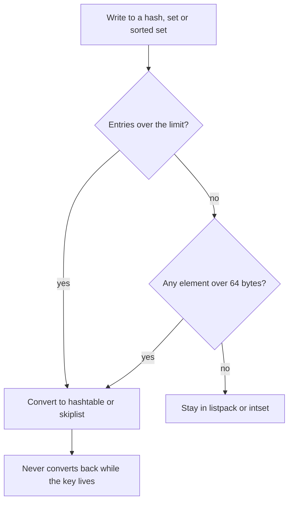

# Reducing memory use: compact encodings

> **Before this lesson:** you should know the five basic data types
> ([What Redis is](#/lesson/redis/what-is-redis)) and the performance tools `MEMORY USAGE` and
> `--bigkeys` ([WATCH, pipelining and performance](#/lesson/redis/watch-pipelining-performance)).
> Big-O notation such as O(1) and O(n) is used; O(1) means "the same cost however large the data is",
> O(n) means "cost grows in proportion to the number of items".

## In plain words

Redis keeps everything in RAM, and RAM is the most expensive kind of storage. So the amount of
memory each piece of data takes is not a detail - it is the bill.

Here is the surprising part: the same data can take very different amounts of memory depending on
*how* Redis arranges it internally. The arrangement is called an **encoding**. Think of packing for a
trip. You can lay each shirt in its own labelled box - easy to find any shirt instantly, but the boxes
take up most of the suitcase. Or you can roll all the shirts tightly into one bag - far less space,
though finding one particular shirt means rummaging through the bag. For five shirts the rummaging is
nothing. For five thousand it would be hopeless.

Redis makes exactly this choice for you, automatically: small collections are rolled tightly into one
block of memory; when a collection grows past a limit, Redis repacks it into the boxed form that
stays fast at any size. This lesson explains both forms, the limits, how to see which one a key is
using, and how to design your data so that it stays in the compact form.

Why it matters for a job: memory decides how many servers a system needs. Engineers who understand
encodings have cut Redis bills by half or more by changing key layout, with no loss of function. It
is also a common senior-level interview topic.

## Part 1 - where the memory goes

A few terms. A **byte** is the basic unit of memory; a short word like `rye` needs 3 bytes. A
**pointer** is a memory address - a note saying "the thing you want is over there" - and on today's
64-bit computers every pointer is 8 bytes. **Overhead** means memory spent on bookkeeping instead of
your actual data.

General-purpose structures are built from many small separately allocated pieces joined by pointers.
Take a hash with three short fields in the ordinary hash-table form. For *each* field, Redis needs:
an entry record with three pointers (to the field, to the value, to the next entry), a separately
allocated string for the field name with its own length header, another for the value, and a slot in
the table. Storing the pair `city` → `Oslo` - eight bytes of real data - costs on the order of 70-90
bytes.

The compact form removes almost all of that. It is one continuous block of memory in which the items
sit one after another, each preceded by a tiny header giving its length:

```
ordinary form (hash table):   table -> entry -> "city"      (each arrow is an 8-byte pointer,
                                            \-> "Oslo"       each box a separate allocation)
compact form (listpack):      [ 4 city | 4 Oslo | 4 pop. | 6 709000 | ... ]   one block, no pointers
```

That block is called a **listpack**. (Versions of Redis before 7.0 used a very similar format called
a **ziplist**; older articles and the configuration names in old versions say "ziplist". The idea is
identical.) In a listpack the same pair costs about 10 bytes.

The price is speed of lookup. With no table, finding a field means starting at the beginning and
reading entry by entry until it is found: O(n) instead of O(1). When n is 20 that is a few dozen
nanoseconds and irrelevant. When n is 20,000 it would be a disaster - which is why Redis switches
forms at a threshold.

## Part 2 - seeing the encoding

`OBJECT ENCODING key` reports the internal form of a key. Start with a tiny hash.

```bash
127.0.0.1:6379> HSET place:1 city Oslo country NO
(integer) 2
127.0.0.1:6379> OBJECT ENCODING place:1
"listpack"
127.0.0.1:6379> MEMORY USAGE place:1
(integer) 80
```

Two fields: compact form. `MEMORY USAGE` reports the total bytes for the key, including the key name
and bookkeeping (exact numbers vary slightly between versions).

Now make one value long:

```bash
127.0.0.1:6379> HSET place:1 notes "A long free-text description that goes on well past sixty-four bytes in total length"
(integer) 1
127.0.0.1:6379> OBJECT ENCODING place:1
"hashtable"
127.0.0.1:6379> MEMORY USAGE place:1
(integer) 296
```

One long value and the whole hash was converted to the ordinary form. The memory more than tripled
although we added well under a hundred bytes of data.

## Part 3 - the thresholds

A collection stays compact only while it is under **both** limits: a maximum number of entries and a
maximum size for any single element. The limits are configuration settings. These are the defaults
in Redis 7:

| Type | Compact encoding | Stays compact while... | Converts to |
|---|---|---|---|
| Hash | listpack | at most 512 fields (`hash-max-listpack-entries`) and every field and value at most 64 bytes (`hash-max-listpack-value`) | hashtable |
| Sorted set | listpack | at most 128 members (`zset-max-listpack-entries`) and every member at most 64 bytes (`zset-max-listpack-value`) | skiplist |
| Set of integers | intset | all members are whole numbers and at most 512 of them (`set-max-intset-entries`) | listpack or hashtable |
| Set of small strings (7.2+) | listpack | at most 128 members (`set-max-listpack-entries`), each at most 64 bytes | hashtable |
| List | quicklist of listpacks | always; each internal node holds up to 8 KB (`list-max-listpack-size -2`) | - |

In Redis 6 and earlier the same settings are spelled with `ziplist` (for example
`hash-max-ziplist-entries`); the old names still work as aliases.

Three rules to remember:

1. **Either limit triggers conversion** - too many entries *or* one oversized element.
2. **Conversion is one-way.** Deleting entries afterwards does not convert a key back. The compact
   form returns only if the key is deleted and recreated (or reloaded from disk after a restart).
3. **It is all automatic.** Commands behave identically in both forms; only memory and speed differ.

Watch the entry-count limit in action with a sorted set:

```bash
127.0.0.1:6379> DEL board
(integer) 0
127.0.0.1:6379> EVAL "for i=1,128 do redis.call('ZADD', KEYS[1], i, 'player:'..i) end" 1 board
(nil)
127.0.0.1:6379> OBJECT ENCODING board
"listpack"
127.0.0.1:6379> ZADD board 129 player:129
(integer) 1
127.0.0.1:6379> OBJECT ENCODING board
"skiplist"
```

The `EVAL` line runs a tiny server-side loop that adds 128 members (scripting is covered in module
11; here it only saves typing). At 128 members the set is compact; the 129th tips it over.

## Part 4 - the special case of integer sets

When every member of a set is a whole number, Redis uses an **intset**: a sorted array of numbers
with no per-member overhead at all. It even picks the smallest width that fits - 2 bytes per member
while all values fit in 16 bits, upgrading to 4 bytes and then 8 bytes when a larger value arrives.

```bash
127.0.0.1:6379> SADD online 12 507 33
(integer) 3
127.0.0.1:6379> OBJECT ENCODING online
"intset"
127.0.0.1:6379> SADD online guest-77
(integer) 1
127.0.0.1:6379> OBJECT ENCODING online
"listpack"
```

A single non-numeric member ends the intset. The practical lesson: **store numeric ids as bare
numbers** (`507`, not `user:507`) in sets whenever you can; a 500-member set of ids then costs about
a kilobyte, against roughly 30 KB as a hash table.

Membership tests in an intset use **binary search** - repeatedly halving the sorted array - so they
are O(log n), and inserting has to shift later elements, O(n). Both are negligible at these sizes.

## Part 5 - strings have encodings too

Even plain string values come in three forms:

```bash
127.0.0.1:6379> SET a 12345
OK
127.0.0.1:6379> OBJECT ENCODING a
"int"
127.0.0.1:6379> SET b "Oslo"
OK
127.0.0.1:6379> OBJECT ENCODING b
"embstr"
127.0.0.1:6379> SET c "a string that is definitely longer than forty-four bytes in length"
OK
127.0.0.1:6379> OBJECT ENCODING c
"raw"
```

- `int` - the value is a whole number that fits in 64 bits and is stored as a number, not text. Small
  non-negative numbers below 10,000 are shared: every key holding `7` points at one common object.
- `embstr` - a short string (up to 44 bytes) stored in the same allocation as its bookkeeping header.
- `raw` - a longer string in a separate allocation.

The practical reading: a key with a small value costs mostly *overhead* - roughly 50-70 bytes for the
key's own entry in the main dictionary, regardless of how small the value is. A million tiny string
keys is 50-70 MB before any data. That observation is the motivation for the next lesson, which packs
many small values into few keys.

## Part 6 - measuring instead of guessing

```bash
127.0.0.1:6379> MEMORY USAGE place:1
(integer) 296
127.0.0.1:6379> INFO memory
# Memory
used_memory:1108432
used_memory_human:1.06M
used_memory_rss:9441280
mem_fragmentation_ratio:8.52
127.0.0.1:6379> DBSIZE
(integer) 6
```

- `MEMORY USAGE key` - bytes attributed to one key. For large collections it estimates by sampling a
  few elements; add `SAMPLES 0` to count every element.
- `used_memory` - bytes Redis has allocated for data.
- `used_memory_rss` - bytes the operating system has given the process (*resident set size*). It is
  larger because of **fragmentation**: memory freed in small scattered pieces that cannot be handed
  back or reused immediately. The ratio between the two is `mem_fragmentation_ratio`; values much
  above 1.5 on a large data set are worth investigating (tiny test servers always show large ratios,
  as above).
- `DBSIZE` - the number of keys.

From Python, a small survey of a keyspace:

```python
import collections
import redis

r = redis.Redis(decode_responses=True)

def survey(pattern="*", limit=10_000):
    by_encoding = collections.Counter()
    bytes_by_encoding = collections.Counter()
    for n, key in enumerate(r.scan_iter(match=pattern, count=500)):
        if n >= limit:
            break
        enc = r.object("encoding", key)
        by_encoding[enc] += 1
        bytes_by_encoding[enc] += r.memory_usage(key) or 0
    for enc, count in by_encoding.most_common():
        print(f"{enc:10s} keys={count:7d} bytes={bytes_by_encoding[enc]:10d}")
```

- `scan_iter` walks key names in small batches using `SCAN`, so the server is never blocked.
- `r.object("encoding", key)` sends `OBJECT ENCODING`.
- `collections.Counter` is a dictionary that counts; `most_common()` lists entries from largest to
  smallest.

Run it against a sample of real keys before and after a design change to see whether the change paid
off. (Two commands per key is slow for big surveys; batch them in a pipeline.)



## Part 7 - should you raise the limits?

The limits are settings, so it is tempting to raise them and keep bigger collections compact.

```bash
127.0.0.1:6379> CONFIG SET hash-max-listpack-entries 1024
OK
```

It is a real trade: memory saved against processor time spent scanning. Every read or write of a
compact collection may walk the block; every insert or delete may shift the bytes after it. Up to
around a thousand small entries, the scan stays within what the processor handles extremely quickly
(the data sits together in its fast cache memory). Push to tens of thousands and commands on those
keys become visibly slow - and because Redis runs commands one at a time, slow commands delay
everyone.

> [!WARNING]
> Do not raise entry limits beyond roughly 1,000-2,000, or value limits beyond a few hundred bytes,
> without measuring. A compact collection is scanned linearly; a too-large one turns every O(1)
> command into an O(n) one and shows up as latency across the whole server.

> [!TIP]
> Changing a limit does not convert existing keys. Keys already converted to the large form stay
> large; keys that are compact stay compact until their next write crosses the *new* limit. To
> re-encode existing data after raising a limit, rewrite the keys or restart with the new setting so
> they are re-evaluated on load.

## Try it: a memory model of both encodings

The block estimates the memory of a hash in both forms using simplified per-entry costs, applies the
default thresholds, and shows the jump at conversion. The byte figures are approximations chosen to be
close to a real 64-bit server; the *shape* of the result is what matters.

```python-run
MAX_ENTRIES, MAX_VALUE = 512, 64

def listpack_bytes(fields):
    # one block: small header + (1-2 byte length header + bytes + 1 byte back-length) per element
    total = 7
    for name, value in fields.items():
        for element in (name, value):
            total += len(element) + (2 if len(element) < 64 else 3)
    return total

def hashtable_bytes(fields):
    # table slots + per entry: entry record (24) + two separately allocated strings with headers
    slots = 4
    while slots < len(fields): slots *= 2
    total = 64 + slots * 8
    for name, value in fields.items():
        total += 24 + (len(name) + 1 + 3 + 12) + (len(value) + 1 + 3 + 12)
    return total

def encoding(fields):
    too_many = len(fields) > MAX_ENTRIES
    too_big = any(len(k) > MAX_VALUE or len(v) > MAX_VALUE for k, v in fields.items())
    return "hashtable" if too_many or too_big else "listpack"

def report(label, fields):
    enc = encoding(fields)
    used = listpack_bytes(fields) if enc == "listpack" else hashtable_bytes(fields)
    print(f"{label:34s} fields={len(fields):4d} encoding={enc:9s} ~{used:6d} bytes "
          f"({used / max(len(fields), 1):5.1f} per field)")

small = {f"f{i}": str(1000 + i) for i in range(10)}
report("10 short fields", small)
report("500 short fields", {f"f{i}": str(1000 + i) for i in range(500)})
report("513 short fields", {f"f{i}": str(1000 + i) for i in range(513)})
report("10 fields, one 80-byte value", {**small, "notes": "x" * 80})

# intset: width grows with the largest value
def intset_bytes(members):
    widest = max(abs(m) for m in members)
    width = 2 if widest < 2**15 else 4 if widest < 2**31 else 8
    return 8 + width * len(members), width
for members in ([1, 2, 3], [1, 2, 70000], [1, 2, 5_000_000_000]):
    size, width = intset_bytes(members)
    print(f"intset {members}: {width} bytes per member, {size} bytes in total")

# cost of scanning: average comparisons to find a field
for n in (16, 512, 20000):
    print(f"listpack with {n:5d} fields: about {n // 2:5d} entries read per lookup; a hash table reads ~1")
```

What the output shows. Ten short fields cost roughly a dozen bytes each in the compact form. At 500
fields the hash is still compact; at 513 it crosses the entry limit and the estimate jumps several
times over. One 80-byte value converts a ten-field hash for the same reason. The intset lines show the
per-member width stepping from 2 to 4 to 8 bytes as larger numbers arrive. The final lines are the
cost side of the trade: a lookup in a compact collection reads half of it on average.

## Pitfalls

- **One long value spoiling a compact hash.** A single field over 64 bytes converts the whole key. Keep
  large text in a separate key.
- **Expecting conversion back after deletions.** It does not happen while the key lives.
- **Prefixed ids in sets.** `user:507` is a string; `507` keeps the set an intset.
- **Raising limits blindly.** Linear scans on large compact collections slow the whole server.
- **Judging by `used_memory` alone.** Compare with `used_memory_rss`; fragmentation can hold far more
  physical memory than the data needs. Redis can defragment in the background when
  `activedefrag yes` is set.
- **Forgetting per-key overhead.** Millions of tiny keys cost more in overhead than in data.
- **Old setting names.** Articles and old configuration files say `ziplist`; current versions say
  `listpack` and treat the old names as aliases.
- **Trusting sampled `MEMORY USAGE` on skewed collections.** Use `SAMPLES 0` when elements vary widely
  in size.

## Command cheat sheet

`n` = elements in the key.

| Command or setting | Meaning | Cost |
|---|---|---|
| `OBJECT ENCODING key` | internal form of a key | O(1) |
| `MEMORY USAGE key [SAMPLES k]` | bytes used by a key | O(k) sampled elements |
| `INFO memory` | totals, RSS, fragmentation ratio | O(1) |
| `MEMORY DOCTOR` / `MEMORY STATS` | plain-language and detailed memory reports | O(1) |
| `DBSIZE` | number of keys | O(1) |
| `redis-cli --bigkeys` / `--memkeys` | largest keys by element count / by bytes (uses `SCAN`) | O(keys), incremental |
| `hash-max-listpack-entries 512`, `-value 64` | compact limits for hashes | - |
| `zset-max-listpack-entries 128`, `-value 64` | compact limits for sorted sets | - |
| `set-max-intset-entries 512` | limit for integer sets | - |
| `set-max-listpack-entries 128` (7.2+) | compact limit for small string sets | - |
| `list-max-listpack-size -2` | each list node up to 8 KB | - |
| lookup in a listpack / intset | scan / binary search | O(n) / O(log n) |
| lookup in a hashtable / skiplist | direct / descent | O(1) / O(log n) |

## Summary

- General-purpose structures spend most of their memory on pointers and per-item allocations; compact
  encodings store small collections in one continuous block.
- Hashes, sorted sets and small sets use listpacks (formerly ziplists); integer-only sets use intsets;
  lists are chains of listpacks.
- A collection stays compact while it is under both an entry-count limit and an element-size limit;
  conversion is automatic and one-way.
- Compact means linear scans, so the limits are a memory-versus-speed dial that should be turned only
  with measurement.
- `OBJECT ENCODING` and `MEMORY USAGE` tell you what you actually have.

> [!INTERVIEW]
> "How would you reduce the memory of a large Redis deployment?" A strong answer: measure first
> (`--bigkeys`, `MEMORY USAGE`, encodings by key pattern); shorten keys and values; keep collections
> under the listpack and intset limits; store numeric ids as integers; group many small keys into
> small hashes (next lesson); set expiries so dead data leaves; check fragmentation; and only then
> consider more hardware or sharding.

## Glossary

- **Encoding** - the internal arrangement Redis uses to store a value.
- **Byte** - the basic unit of memory.
- **Pointer** - an 8-byte memory address referring to data stored elsewhere.
- **Overhead** - memory used for bookkeeping, not for your data.
- **Listpack (ziplist)** - a compact single-block encoding for small collections.
- **Intset** - a compact sorted array encoding for sets of whole numbers.
- **Quicklist** - the list encoding: a chain of listpack nodes.
- **Hash table** - a structure giving direct O(1) lookup by key, at a high memory cost per entry.
- **Skip list** - the ordered structure behind large sorted sets.
- **Threshold** - the limit past which Redis switches encoding.
- **Binary search** - finding a value in sorted data by repeatedly halving the search range.
- **Fragmentation** - memory held by the process but unusable because it is scattered in small gaps.
- **RSS (resident set size)** - the physical memory the operating system has assigned to a process.

```quiz
[
  {"q": "Why does a small hash in listpack form use far less memory than the same data in a hash table?",
   "options": ["The data is compressed with gzip", "Everything sits in one continuous block with tiny length headers, avoiding per-entry pointers and separate allocations", "Field names are not stored", "It is kept on disk"],
   "answer": 1,
   "explain": "The savings come from removing pointers, entry records and per-string allocation overhead."},
  {"q": "With default settings, a hash has 20 fields. One field's value is updated to a 200-byte string. What happens?",
   "options": ["Nothing changes", "The hash is converted to the hashtable encoding", "The write is rejected", "Only that field moves to disk"],
   "answer": 1,
   "explain": "Exceeding the element size limit (64 bytes) converts the whole key, even though the entry count is small."},
  {"q": "A sorted set grows to 300 members, then shrinks back to 50. What is its encoding (default settings)?",
   "options": ["listpack, because it is small again", "skiplist, because conversion is one-way while the key exists", "intset", "It alternates"],
   "answer": 1,
   "explain": "Once converted, a key stays in the large encoding until it is deleted and recreated or reloaded."},
  {"q": "Which set stays in the very compact intset encoding?",
   "options": ["{'user:1', 'user:2', 'user:3'}", "{1, 2, 3}", "{1, 2, 'three'}", "{1.5, 2.5}"],
   "answer": 1,
   "explain": "An intset holds only whole numbers. Any non-integer member forces a different encoding."},
  {"q": "What is the cost of looking up one field in a listpack-encoded hash with n fields?",
   "options": ["O(1)", "O(log n)", "O(n)", "O(n log n)"],
   "answer": 2,
   "explain": "There is no index; the block is scanned entry by entry. That is acceptable only because n is kept small."},
  {"q": "Why is raising hash-max-listpack-entries to 50,000 a bad idea?",
   "options": ["Redis refuses values above 1000", "Commands on such hashes would scan and shift tens of thousands of entries, slowing them and everything queued behind them", "It disables persistence", "It doubles memory use"],
   "answer": 1,
   "explain": "Compact encodings trade speed for space. Past a few thousand entries the linear cost dominates."},
  {"q": "A server stores 5 million keys, each holding a 2-byte value. Roughly where does most of the memory go?",
   "options": ["The 2-byte values", "Per-key overhead: each key's dictionary entry, key name and object header, tens of bytes apiece", "Replication buffers", "The append-only file"],
   "answer": 1,
   "explain": "With tiny values, the fixed cost per key dominates - the motivation for grouping small values into shared hashes."},
  {"q": "used_memory is 4 GB and used_memory_rss is 9 GB. What does this indicate?",
   "options": ["Half the keys have expired", "Heavy fragmentation: the process holds much more physical memory than its data occupies", "Replication is behind", "The server is swapping"],
   "answer": 1,
   "explain": "The ratio of RSS to used memory is the fragmentation ratio; values well above 1.5 suggest fragmented, unreturned memory."}
]
```

> **Source:** Carlson, *Redis in Action*, ch. 9 (section 9.1: short structures - ziplists and intsets); listpack naming, Redis 7 defaults, listpack-encoded sets and measurement tools from redis.io. Explanations, model and code are original.
> Further reading: <https://redis.io/docs/latest/operate/oss_and_stack/management/optimization/memory-optimization/>, <https://redis.io/docs/latest/commands/object-encoding/>, <https://redis.io/docs/latest/commands/memory-usage/>
