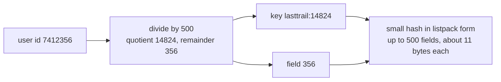

# Reducing memory use: sharded structures and packing bits and bytes

> **Before this lesson:** read [compact encodings](#/lesson/redis/compact-encodings) - this lesson
> depends on knowing that small hashes and sets are stored in a compact *listpack* or *intset* form and
> that large ones are not. You should also know the string commands `GETRANGE`, `SETRANGE`, `SETBIT`
> and `GETBIT` ([strings, lists and sets](#/lesson/redis/strings-lists-sets)).

## In plain words

The previous lesson ended with two facts. Small collections are cheap because Redis stores them in a
tightly packed block. And every separate key carries a fixed bookkeeping cost of several dozen bytes,
however tiny its value.

Put those together and a trick appears. Suppose you have ten million small values. Stored as ten
million separate keys, you pay the per-key cost ten million times. Stored as one gigantic hash, you
lose the compact form because the hash is far over the size limit. But stored as **many small
hashes**, each holding a few hundred values, every hash stays in the compact form *and* you have far
fewer keys. This is called **sharding** a structure: splitting one big collection into many small
pieces according to a rule.

An everyday picture: a library does not keep its membership cards in one enormous drawer (slow to
search) or give every card its own drawer (a wall of drawers). It uses a cabinet of small drawers
labelled "A-B", "C-D" and so on. You know from the surname which drawer to open, and each drawer is
small enough to flick through in a moment.

The second half of the lesson goes further for data that is very regular - for example one small
number per user. There we skip Redis structures entirely and write the numbers side by side in one
long string, like filling in numbered boxes on a form: the box number tells you exactly where to
look.

Why it matters for a job: these techniques are how real companies have stored hundreds of millions of
small records in a fraction of the memory the obvious layout needs. They are also a good exercise in
thinking about what data really costs.

## Part 1 - the problem, with numbers

**Trailmark** is a hiking app. For each of 10 million users it stores the id of the last trail they
viewed. The obvious layout is one string key per user:

```bash
127.0.0.1:6379> SET lasttrail:7412356 88213
OK
127.0.0.1:6379> MEMORY USAGE lasttrail:7412356
(integer) 72
```

About 72 bytes to store a five-digit number. Ten million of them:

$$10{,}000{,}000 \times 72 \text{ bytes} \approx 720 \text{ MB}$$

The real data - a user id and a trail id - is perhaps 8 bytes per user, 80 MB in total. Nearly
ninety per cent of the memory is overhead.

## Part 2 - sharded hashes

### The rule

Choose a **shard size**, say 500. A user's id divided by the shard size, rounded down, names the
shard; the remainder names the field inside it.

$$\text{shard} = \left\lfloor \frac{\text{id}}{500} \right\rfloor \qquad
\text{field} = \text{id} \bmod 500$$

($\lfloor x \rfloor$ means round down; $\bmod$ means "the remainder after division".) For user
7,412,356: $7412356 \div 500 = 14824$ remainder $356$. So the value lives in the hash
`lasttrail:14824`, field `356`.

```bash
127.0.0.1:6379> HSET lasttrail:14824 356 88213
(integer) 1
127.0.0.1:6379> HSET lasttrail:14824 357 5120
(integer) 1
127.0.0.1:6379> HGET lasttrail:14824 356
"88213"
127.0.0.1:6379> OBJECT ENCODING lasttrail:14824
"listpack"
```

Each hash holds at most 500 fields, under the default limit of 512, so it stays in the compact
listpack form. A full shard of 500 short fields costs roughly 5-6 KB, about 11 bytes per user instead
of 72:

$$10{,}000{,}000 \times 11 \text{ bytes} \approx 110 \text{ MB}$$

Same data, same O(1)-feeling access, about one-sixth of the memory. Also notice the field is the
short remainder (`356`), not the whole id: the shard number already carries the rest, so repeating it
in every field would waste space.

### In Python

```python
import redis

r = redis.Redis(decode_responses=True)

SHARD_SIZE = 500

def shard_of(base, item_id):
    return f"{base}:{item_id // SHARD_SIZE}", item_id % SHARD_SIZE

def shard_hset(base, item_id, value):
    key, field = shard_of(base, item_id)
    return r.hset(key, field, value)

def shard_hget(base, item_id):
    key, field = shard_of(base, item_id)
    return r.hget(key, field)

shard_hset("lasttrail", 7412356, 88213)
print(shard_of("lasttrail", 7412356))       # ('lasttrail:14824', 356)
print(shard_hget("lasttrail", 7412356))     # '88213'
```

- `//` is whole-number division and `%` gives the remainder.
- `shard_of` returns two things at once (a *tuple*): the key name and the field.
- The two wrapper functions hide the arithmetic, so the rest of the application still thinks in terms
  of "the value for id 7412356".

### When ids are not numbers

The division rule needs numeric ids that are reasonably dense (few gaps). If ids are text - email
addresses, random tokens - there is nothing to divide. Instead, feed the id to a **hash function**: a
function that turns any input into a number that looks random but is always the same for the same
input. Take that number modulo the number of shards you want.

```python
import zlib

def shard_of_text(base, item_id, shards):
    n = zlib.crc32(item_id.encode()) % shards
    return f"{base}:{n}", item_id

def shards_needed(expected_items, per_shard=400):
    return max(1, -(-expected_items // per_shard))       # ceiling division
```

- `zlib.crc32` is a fast checksum from Python's standard library; it turns bytes into a number between
  0 and about four billion.
- `% shards` maps that number onto one of the shards. Here the field must be the full id, since the
  shard number no longer encodes part of it.
- `shards_needed` picks the number of shards from the expected item count. It aims at 400 per shard,
  not 512, because a hash function spreads items unevenly: some shards receive more than the average,
  and a shard that crosses 512 converts to the expensive form.

> [!WARNING]
> With hashed sharding the number of shards is baked into every key's location. Change it and nearly
> every item hashes to a different shard, so existing data is "lost" until you move it. Choose the
> count for the size you expect to reach, and treat changing it as a migration project.

### What you give up

- **Per-item expiry.** `EXPIRE` works on a whole key, so one user's value cannot expire by itself
  (Redis 7.4 added per-field expiry for hashes with `HEXPIRE`, which removes this drawback there).
- **Atomic single-key tricks** such as `SET ... NX` on an individual item; use `HSETNX` instead.
- **Simplicity.** Every access goes through the wrapper; tools that list keys show shards, not items.



## Part 3 - sharded sets

The same idea applies to sets. Suppose Trailmark tracks which users were active each day, to count
unique visitors: `SADD active:2026-01-01 <user id>`. With two million active users, that one set is a
hash table costing 60-70 bytes per member, about 130 MB per day.

Sharding by id range keeps each piece an **intset** (the ultra-compact sorted array for whole
numbers), provided members are numeric and each shard stays under 512 members:

```bash
127.0.0.1:6379> SADD active:2026-01-01:14824 356
(integer) 1
127.0.0.1:6379> OBJECT ENCODING active:2026-01-01:14824
"intset"
```

```python
def shard_sadd(base, user_id):
    key, member = shard_of(base, user_id)
    return r.sadd(key, member)

def count_unique(day, user_id):
    if shard_sadd(f"active:{day}", user_id):       # 1 only the first time today
        r.incr(f"active:{day}:count")
```

`SADD` replies 1 only when the member is new, so the separate counter key ends up holding the number
of distinct users, readable with one `GET`. Since ids within a shard are below 500, each member needs
two bytes: 2 million users cost about 4 MB plus per-key overhead, against 130 MB.

> [!TIP]
> If you only need the *count* of unique visitors and can accept an error of under one per cent, a
> HyperLogLog (`PFADD`, `PFCOUNT`) does it in 12 KB per day, however many visitors there are. If you
> need to ask "was this exact user active?", a bitmap with one bit per user id costs 1.25 MB for ten
> million users. Both appear in the Modern Redis module; sharded sets are the choice when you need
> exact membership *and* ids are sparse.

## Part 4 - packing fixed-size records into one string

### The idea with a tiny example

When every item needs the *same* small amount of data and items are numbered 0, 1, 2, ..., we can
drop field names altogether and use **position** as the address. A Redis string is a sequence of
bytes that can be read and written at any position:

- `SETRANGE key offset value` overwrites bytes starting at `offset` (growing the string with zero
  bytes if needed).
- `GETRANGE key start end` reads bytes from `start` to `end`, both included.

Say we want to store each user's home country as a two-letter code (`NO`, `PT`, `KE`). Two bytes per
user; user number `n` occupies bytes $2n$ and $2n + 1$.

```bash
127.0.0.1:6379> SETRANGE country 0 NO
(integer) 2
127.0.0.1:6379> SETRANGE country 2 PT
(integer) 4
127.0.0.1:6379> SETRANGE country 10 KE
(integer) 12
127.0.0.1:6379> GETRANGE country 2 3
"PT"
127.0.0.1:6379> GETRANGE country 10 11
"KE"
127.0.0.1:6379> GETRANGE country 6 7
"\x00\x00"
```

User 0 is `NO`, user 1 is `PT`, user 5 is `KE` (bytes 10-11). User 3 was never written, and reading
it returns two zero bytes (`\x00` is how a byte with value 0 is displayed), which the application
treats as "unknown". Each reply to `SETRANGE` is the string's new length.

The cost: exactly 2 bytes per user. Ten million users fit in 20 MB with no per-item overhead at all.

### Keeping each string a sensible size

One practical limit: a string that grows to hundreds of megabytes is a single huge value - slow to
create (the first write at a far offset allocates everything up to it) and awkward to replicate. So
we shard here too: put, say, 65,536 users in each string.

```python
RECORD = 2                     # bytes per user
PER_KEY = 2 ** 16              # users per string -> each string is at most 128 KB

def set_country(user_id, code):
    assert len(code) == RECORD
    key = f"country:{user_id // PER_KEY}"
    r.setrange(key, (user_id % PER_KEY) * RECORD, code)

def get_country(user_id):
    key = f"country:{user_id // PER_KEY}"
    offset = (user_id % PER_KEY) * RECORD
    code = r.getrange(key, offset, offset + RECORD - 1)
    return code if code and code != "\x00\x00" else None
```

- The key is chosen by whole-number division, as with sharded hashes.
- The offset inside the string is the position within the shard multiplied by the record size.
- `getrange` takes inclusive positions, hence `offset + RECORD - 1`.
- A missing key returns an empty string, and an unwritten slot returns zero bytes; both mean "none".

### Numbers instead of letters: BITFIELD

Text codes are easy to read, but most small data is numeric: an age group, a level from 0 to 15, a
counter up to 255. `BITFIELD` treats a string as an array of integers of whatever width you choose,
down to a single bit. A **bit** is one binary digit, 0 or 1; eight bits make a byte.

```bash
127.0.0.1:6379> BITFIELD levels SET u4 #0 9
1) (integer) 0
127.0.0.1:6379> BITFIELD levels SET u4 #1 15
1) (integer) 0
127.0.0.1:6379> BITFIELD levels GET u4 #0 GET u4 #1
1) (integer) 9
2) (integer) 15
127.0.0.1:6379> BITFIELD levels INCRBY u4 #0 3
1) (integer) 12
127.0.0.1:6379> BITFIELD levels OVERFLOW SAT INCRBY u4 #0 10
1) (integer) 15
127.0.0.1:6379> STRLEN levels
(integer) 1
```

Reading the pieces: `u4` means "unsigned integer, 4 bits wide" (values 0-15); `i8` would be a signed
8-bit integer. `#1` means "slot number 1", so the server multiplies by the width for you. `SET`
replies with the previous value. `INCRBY` adds in place. `OVERFLOW SAT` says what to do when a result
does not fit: *saturate*, meaning stop at the largest value (15) - the alternatives are `WRAP`, start
again from zero, which is the default, and `FAIL`, refuse. The final `STRLEN` shows both four-bit
numbers sharing a single byte.

With four bits per user, ten million users' levels occupy 5 MB.

### When packing is and is not appropriate

| Good fit | Poor fit |
|---|---|
| ids are whole numbers, dense, starting near zero | ids are sparse or random (most slots would be empty) |
| every record has the same small size | variable-length data such as names |
| you read and write by id | you need to search by value |
| memory is the main constraint | the data set is small, so clarity matters more |

## Try it: compare the three layouts

The block builds the same data three ways - one key per user, sharded hashes, packed bytes - with a
simplified memory model, and shows the addressing arithmetic. `bytearray` is Python's editable
sequence of bytes, standing in for a Redis string.

```python-run
import zlib

SHARD = 500
def shard_of(base, item_id): return f"{base}:{item_id // SHARD}", item_id % SHARD
print("user 7412356 ->", shard_of("lasttrail", 7412356))
print("user 499     ->", shard_of("lasttrail", 499), "| user 500 ->", shard_of("lasttrail", 500))

# ---- simplified memory model (bytes) ----
PER_KEY_OVERHEAD = 56                               # dictionary entry + object header + key name
def one_key_per_user(n): return n * (PER_KEY_OVERHEAD + 16)
def sharded_hash(n):
    shards = -(-n // SHARD)
    return shards * (PER_KEY_OVERHEAD + 16) + n * 11          # ~11 bytes per listpack field+value
def packed(n, record_bytes): return (-(-n // 65536)) * PER_KEY_OVERHEAD + n * record_bytes

n = 10_000_000
for label, size in [("one string key per user", one_key_per_user(n)),
                    ("hashes of 500 fields", sharded_hash(n)),
                    ("packed, 2 bytes per user", packed(n, 2)),
                    ("packed, 4 bits per user", packed(n, 0.5))]:
    print(f"{label:28s} ~{size / 1e6:7.1f} MB")

# ---- hashed sharding for text ids: how evenly do items spread? ----
shards = 25
counts = [0] * shards
for i in range(10_000):
    counts[zlib.crc32(f"user-{i}@example.com".encode()) % shards] += 1
print(f"10000 text ids over {shards} shards: average {10_000 // shards}, min {min(counts)}, max {max(counts)}")

# ---- fixed-size records in one string ----
store = bytearray()
def setrange(offset, data):
    if len(store) < offset + len(data): store.extend(b"\x00" * (offset + len(data) - len(store)))
    store[offset:offset + len(data)] = data
    return len(store)
def getrange(start, end): return bytes(store[start:end + 1])
def set_country(user, code): return setrange(user * 2, code.encode())
def get_country(user):
    raw = getrange(user * 2, user * 2 + 1)
    return raw.decode() if raw.strip(b"\x00") else None
print("lengths after writes:", set_country(0, "NO"), set_country(1, "PT"), set_country(5, "KE"))
print("user 1:", get_country(1), "| user 5:", get_country(5), "| user 3:", get_country(3), "| user 99:", get_country(99))

# ---- 4-bit unsigned integers, two per byte (BITFIELD u4) ----
levels = bytearray(4)
def set_u4(slot, value):
    byte, high = divmod(slot, 2)
    if high == 0: levels[byte] = (levels[byte] & 0x0F) | (value << 4)     # first slot = high half
    else:         levels[byte] = (levels[byte] & 0xF0) | value
def get_u4(slot):
    byte, low = divmod(slot, 2)
    return levels[byte] >> 4 if low == 0 else levels[byte] & 0x0F
def incr_sat(slot, by): set_u4(slot, min(15, get_u4(slot) + by)); return get_u4(slot)
set_u4(0, 9); set_u4(1, 15); set_u4(5, 3)
print("slots 0,1,5:", get_u4(0), get_u4(1), get_u4(5), "| raw bytes:", levels.hex(),
      "| saturating +10 on slot 0:", incr_sat(0, 10))
```

What to notice. Users 499 and 500 land in different shards, and the field restarts from 0 at each
boundary. In the memory table the one-key-per-user layout costs several times the sharded hashes, and
the packed layouts are smaller again. The spread of hashed ids is uneven - the fullest shard is
visibly above the average - which is why shard counts are chosen with headroom. In the packed-string
section, writing user 5 grows the string to 12 bytes; users never written read back as `None`. In the
last line, two 4-bit values share each byte (the hexadecimal dump `9f` is the pair 9 and 15), and the
saturating increment stops at 15.

## Pitfalls

- **Shards that outgrow the compact limit.** Size shards with headroom, and check with
  `OBJECT ENCODING` on a sample.
- **Changing the shard rule later.** Every item moves. Fix the rule (and, for hashed sharding, the
  shard count) up front.
- **Repeating the full id as the field in range-sharded hashes.** The remainder is enough and shorter.
- **Non-numeric members in sharded sets.** One text member ends the intset encoding for that shard.
- **Sparse ids with packed strings.** If only one slot in a thousand is used, you store 999 empty
  ones. Use sharded hashes there.
- **One enormous packed string.** A write at a far offset allocates everything before it, and huge
  values strain replication. Split into moderately sized strings.
- **Forgetting that zero means "unset".** If 0 is a legitimate value, store value + 1, or keep a
  separate presence bitmap.
- **Record layout changes.** Widening a record from 2 to 3 bytes shifts every later offset; plan the
  width generously or version the key name.
- **Expecting per-item expiry.** Shards and packed strings expire as whole keys.

## Command cheat sheet

`n` = fields or members in one shard (kept small by design).

| Command | Use here | Time |
|---|---|---|
| `HSET base:shard field value` / `HGET` | sharded hash write / read | O(n) scan of a small listpack |
| `HSETNX base:shard field value` | set if absent, per item | O(n) |
| `SADD base:shard member` | sharded set add; replies 1 if new | O(n) insert into an intset |
| `SISMEMBER base:shard member` | membership | O(log n) in an intset |
| `INCR base:count` | running count of unique members | O(1) |
| `SETRANGE key offset bytes` | write a fixed-size record | O(bytes), plus allocation when growing |
| `GETRANGE key start end` | read a fixed-size record | O(bytes) |
| `BITFIELD key SET u4 #i v` | write a small integer at slot i | O(1) |
| `BITFIELD key GET u4 #i` | read it | O(1) |
| `BITFIELD key OVERFLOW SAT INCRBY u4 #i d` | increment with a chosen overflow rule | O(1) |
| `STRLEN key` | bytes in the string | O(1) |
| `OBJECT ENCODING key` | confirm a shard is still compact | O(1) |

## Summary

- Many tiny keys waste memory on per-key overhead; one huge collection loses the compact encoding.
  Many small collections get the best of both.
- Shard by integer division for dense numeric ids, or by a hash function modulo a fixed shard count
  for text ids.
- Sharded sets of numeric ids stay in the intset encoding; pair them with a counter for unique counts.
- Fixed-size records can be packed into strings and addressed by position with
  `SETRANGE`/`GETRANGE`, or as small integers with `BITFIELD`.
- The savings cost simplicity: wrappers, no per-item expiry, and a layout that is hard to change.

> [!INTERVIEW]
> A well-known real-world case: a photo service needed to map 300 million media ids to user ids.
> One key per mapping needed about 21 GB; grouping ids into hashes of 1,000 fields brought it to about
> 5 GB. If asked how to store hundreds of millions of small key-value pairs cheaply, walk through
> per-key overhead, the compact encoding thresholds, the bucket rule, and the trade-offs (expiry,
> resharding, cluster slots).

## Glossary

- **Sharding (of a structure)** - splitting one large collection into many small ones by a fixed rule.
- **Shard** - one of those pieces.
- **Shard size / shard count** - how many items each piece holds / how many pieces there are.
- **Remainder (modulo)** - what is left over after whole-number division.
- **Hash function** - a function mapping any input to a number that looks random yet is always the
  same for the same input.
- **Checksum** - a hash function designed for detecting changes in data, such as CRC-32.
- **Dense / sparse ids** - ids with few gaps / with many gaps.
- **Fixed-size record** - a piece of data that always occupies the same number of bytes.
- **Offset** - a position in a string, counted in bytes from 0.
- **Bit** - a binary digit, 0 or 1; eight bits make a byte.
- **Unsigned integer** - a whole number that cannot be negative; with $k$ bits it ranges from 0 to
  $2^k - 1$.
- **Saturate** - on overflow, stay at the largest (or smallest) representable value.

```quiz
[
  {"q": "With a shard size of 500, where is the value for id 12,345 stored?",
   "options": ["Hash base:12345, field 0", "Hash base:24, field 345", "Hash base:345, field 24", "Hash base:25, field 345"],
   "answer": 1,
   "explain": "12345 divided by 500 is 24 remainder 345, so the shard is 24 and the field is 345."},
  {"q": "Why are sharded hashes kept to at most about 500 fields each?",
   "options": ["Redis rejects larger hashes", "So each stays under the listpack limit of 512 entries and keeps the compact encoding", "To make HGETALL faster than HGET", "Because field names must be three digits"],
   "answer": 1,
   "explain": "The whole benefit comes from the compact encoding, which applies only below the entry threshold."},
  {"q": "For text ids, why aim at about 400 items per shard when the limit is 512?",
   "options": ["Hash functions spread items unevenly, so some shards receive more than the average and need headroom", "400 is a power of two", "CRC-32 only returns values below 400", "To leave room for expiry data"],
   "answer": 0,
   "explain": "Random-looking placement has variance; shards above the average must still stay under the threshold."},
  {"q": "What is the main danger of changing the number of shards in hashed sharding?",
   "options": ["Keys become read-only", "Most items now map to a different shard, so existing data is not found until it is migrated", "Redis restarts", "Fields are renamed automatically"],
   "answer": 1,
   "explain": "The location is computed from the hash modulo the shard count; a different count gives different locations."},
  {"q": "Records are 2 bytes each in a packed string. Which bytes hold record number 7?",
   "options": ["7 and 8", "14 and 15", "16 and 17", "12 and 13"],
   "answer": 1,
   "explain": "Record n starts at offset 2n, so record 7 occupies bytes 14 and 15."},
  {"q": "What does BITFIELD k GET u4 #3 read?",
   "options": ["Byte number 3", "The unsigned 4-bit integer in slot 3, that is bits 12 to 15", "Four bytes starting at offset 3", "The third key matching k"],
   "answer": 1,
   "explain": "u4 is a 4-bit unsigned type and #3 means slot 3, so the offset is 3 x 4 = 12 bits."},
  {"q": "A u4 slot holds 14. What does OVERFLOW SAT INCRBY u4 #0 5 return?",
   "options": ["19", "3", "15", "An error"],
   "answer": 2,
   "explain": "A 4-bit unsigned value tops out at 15, and SAT clamps to the maximum instead of wrapping."},
  {"q": "When is a packed string a poor choice?",
   "options": ["When ids are dense integers", "When each record is one byte", "When ids are sparse, so most positions would be empty", "When memory is tight"],
   "answer": 2,
   "explain": "Position-addressed storage pays for every slot up to the largest id, used or not."}
]
```

> **Source:** Carlson, *Redis in Action*, ch. 9 (sections 9.2-9.3: sharded structures, packing bits and bytes); the hiking-app scenario, memory model, BITFIELD material and simulation are original. Thresholds and commands checked on redis.io.
> Further reading: <https://redis.io/docs/latest/operate/oss_and_stack/management/optimization/memory-optimization/>, <https://redis.io/docs/latest/commands/bitfield/>, <https://redis.io/docs/latest/commands/setrange/>
