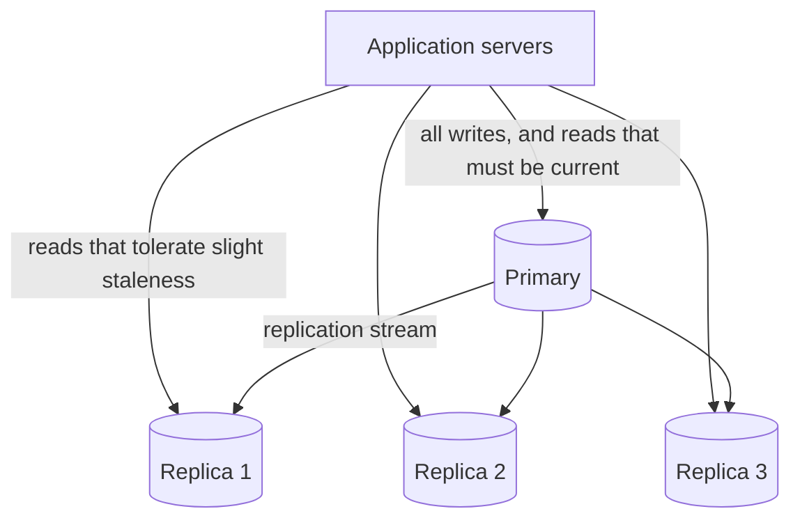
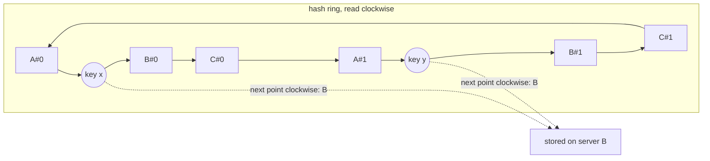

# Scaling Redis: more reads, more writes, more memory

> **Before this lesson:** you should understand replication, replica lag and failover
> ([replication and handling failures](#/lesson/redis/replication-failures)), pipelining
> ([WATCH, pipelining and performance](#/lesson/redis/watch-pipelining-performance)) and the idea of
> hashing an id to pick a shard ([sharded structures](#/lesson/redis/sharded-structures-bits)).

## In plain words

One Redis server can do a great deal - commonly a hundred thousand commands per second or more. But
every server has limits: its processor can run only so many commands, and its RAM can hold only so
much data. **Scaling** means arranging things so the system keeps working as demand grows past what
one machine can do.

Think of a busy library with one librarian at one desk. There are two different kinds of pressure:

- **Too many people asking questions** (reads). Solution: hire assistants who each hold a photocopy of
  the catalogue and can answer questions. They never change the catalogue themselves; changes still go
  to the head librarian, who sends updates to the assistants. This is **replication**.
- **Too many books to fit in the building, or too many changes for one librarian to record** (memory
  and writes). Photocopies do not help - each copy is as big as the original, and every change must
  still pass through one person. Solution: open several branches and split the collection, "authors
  A-H in the north branch, I-P in the east", so each branch holds a part. This is **sharding**, also
  called **partitioning**.

Two words you will hear: scaling **vertically** means buying a bigger machine; scaling
**horizontally** means adding more machines. Vertical scaling is easy but has a ceiling and a steep
price. This lesson is about the horizontal kind.

Why it matters for a job: "the cache is at capacity, what do we do?" is a real conversation on most
growing teams, and knowing the order of the remedies - and the costs of each - separates guesswork
from engineering. Consistent hashing, covered below, is one of the most-asked system-design topics.

## Part 0 - before adding machines

Adding servers adds cost and things that can break. First check that one server is being used well:

1. **Round trips.** Batch commands with pipelines or multi-key commands.
2. **Slow commands.** Read the slow log; replace `KEYS`, huge `SMEMBERS` or `SORT` calls.
3. **Memory.** Apply compact encodings and sharded structures from the previous module; set expiries;
   choose an eviction policy.
4. **Connections.** Reuse them through a pool.

A system that issues 40 separate commands per page view is not "at Redis's limit"; it is paying 40
network waits.

## Part 1 - scaling reads with replicas

### The simplest arrangement

Add replicas of the primary, send all writes to the primary, and send reads that can tolerate being a
moment out of date to the replicas.



```python
import itertools
import redis

primary = redis.Redis(host="10.0.0.5", decode_responses=True)
replicas = itertools.cycle([
    redis.Redis(host="10.0.0.6", decode_responses=True),
    redis.Redis(host="10.0.0.7", decode_responses=True),
])

def read(command, *args, fresh=False):
    conn = primary if fresh else next(replicas)
    return getattr(conn, command)(*args)

def write(command, *args):
    return getattr(primary, command)(*args)

write("hset", "trail:88213", "name", "Besseggen ridge")
print(read("hget", "trail:88213", "name"))                 # may briefly be None on a lagging replica
print(read("hget", "trail:88213", "name", fresh=True))     # always current
```

- `itertools.cycle` produces an endless repeating sequence, so `next(replicas)` hands out the replicas
  in turn. Rotating through servers like this is called **round robin**.
- `getattr(conn, command)(*args)` looks up a method by name and calls it - a compact way to forward
  any command.
- `fresh=True` routes a read to the primary for the cases where the user must see their own latest
  change.

The recurring catch is **replication lag**: a replica is always slightly behind. Right after a user
saves their profile, show them the data from the primary (or from what they submitted), not from a
replica - otherwise their edit appears to vanish for a moment. This need is called
**read-your-writes** consistency.

### Checking a replica from redis-cli

```bash
127.0.0.1:6380> INFO replication
# Replication
role:slave
master_host:10.0.0.5
master_link_status:up
master_last_io_seconds_ago:0
slave_repl_offset:884213
127.0.0.1:6380> GET trail:88213:views
"1502"
127.0.0.1:6380> INCR trail:88213:views
(error) READONLY You can't write against a read only replica.
```

`master_link_status:up` and a small `master_last_io_seconds_ago` mean the replica is connected and
recently heard from the primary. The read works; the write is refused, because replicas are read-only.

### Practical details

- A replica connects with `REPLICAOF host port`; check its health and lag with `INFO replication`.
- Each replica costs the primary one outgoing stream. With many replicas, or a slow network between
  data centres, arrange them as a tree (a replica feeding other replicas) and consider compressing
  the link with a tunnel.
- Replicas help with **reads only**. Every write still executes on the primary and again on every
  replica, so adding replicas does not add write capacity or memory capacity.
- Automatic promotion when the primary fails is the job of Sentinel, covered in
  [Cluster and Sentinel](#/lesson/redis/cluster-sentinel).

## Part 2 - scaling writes and memory by sharding

When the data no longer fits in one machine's RAM, or one processor core cannot run the write
commands fast enough, the data set must be divided among several primaries. Each primary holds a
**shard**: a portion of the keys. (In the previous lesson "shard" meant a piece of one structure; here
it means a whole server's share of the keyspace. The idea - split by a rule - is the same.)

The only question that matters is the rule: **given a key, which server holds it?** Every client must
compute the same answer.

### Rule 1: hash modulo N

Turn the key into a number with a hash function and take the remainder after dividing by the number
of servers, $N$:

$$\text{server} = \text{hash}(\text{key}) \bmod N$$

```python
import zlib

SERVERS = ["10.0.1.1", "10.0.1.2", "10.0.1.3"]

def server_for(key, servers=SERVERS):
    return servers[zlib.crc32(key.encode()) % len(servers)]

print(server_for("user:41"), server_for("user:42"), server_for("user:43"))
```

`zlib.crc32` gives the same number for the same key on every machine, and the remainder is 0, 1 or 2
- an index into the list. This spreads keys evenly and is trivial to implement.

Its flaw appears when $N$ changes. Go from 3 servers to 4, and a key stays put only if its hash gives
the same remainder modulo 3 and modulo 4 - true for roughly a quarter of keys. About **three-quarters
of all keys now map to a different server**. For a cache that means three-quarters of lookups
suddenly miss; for stored data it means moving most of the data set.

### Rule 2: consistent hashing

**Consistent hashing** is a rule designed so that adding or removing a server moves only a small
share of the keys.

Picture a circle - a clock face - numbered from 0 up to the largest hash value, wrapping round to 0.

1. Place each server on the circle at the position given by hashing its name.
2. To find a key's server, hash the key to a position, then walk clockwise until you meet a server.
   That server owns the key.

Add a fourth server and it lands at one point on the circle. The only keys affected are those between
it and the previous server going anticlockwise - they now meet the newcomer first. Every other key
still finds the same server as before. On average about $1/N$ of the keys move, the minimum possible.

One refinement is needed. With only a few points on the circle, the arcs between them are very uneven,
so one server may own half the circle. The fix is to place each server at many positions - say 100
points named `server-1#0`, `server-1#1`, ... - called **virtual nodes**. With hundreds of points the
arcs average out and each server owns close to its fair share.



The code is short: keep the points in a sorted list and use binary search to find the first point at
or after the key's position.

```python
import bisect
import hashlib

class HashRing:
    def __init__(self, servers, points=100):
        self.points = points
        self.ring = []                       # sorted list of (position, server)
        for s in servers:
            self.add(s)

    def _hash(self, text):
        return int(hashlib.md5(text.encode()).hexdigest()[:8], 16)

    def add(self, server):
        for i in range(self.points):
            bisect.insort(self.ring, (self._hash(f"{server}#{i}"), server))

    def remove(self, server):
        self.ring = [(pos, s) for pos, s in self.ring if s != server]

    def server_for(self, key):
        i = bisect.bisect_left(self.ring, (self._hash(key), ""))
        return self.ring[i % len(self.ring)][1]
```

- `_hash` takes the first 8 hexadecimal digits of an MD5 digest as a 32-bit number. MD5 is used here
  only because it spreads values evenly; this has nothing to do with security.
- `add` inserts `points` positions for the server, keeping the list sorted (`bisect.insort`).
- `server_for` finds the first ring position not less than the key's position. `i % len(self.ring)`
  handles wrapping past the end of the list back to the start of the circle.

### Rule 3: a fixed number of slots (what Redis Cluster does)

A third rule separates the two steps. Hash every key into one of a **fixed, large** number of
**slots** - Redis Cluster uses 16,384 - and keep a small table saying which server owns which slots:

$$\text{slot} = \text{CRC16}(\text{key}) \bmod 16384$$

On a server running in cluster mode you can ask for a key's slot directly:

```bash
127.0.0.1:7000> CLUSTER KEYSLOT user:41
(integer) 3691
127.0.0.1:7000> CLUSTER KEYSLOT {user:41}:home
(integer) 3691
```

(The second key lands in the same slot because of the braces - explained in Part 3.)

The number 16,384 never changes, so a key's slot never changes. Growing the cluster means
reassigning some slots to the new server and moving the keys in those slots - a deliberate, gradual
operation the cluster performs while staying online. The same idea done by hand is called
**pre-sharding**: start with, say, 256 logical shards on 4 machines (64 each), and move whole logical
shards to new machines as you grow. The Modern Redis module covers Redis Cluster in detail.

| Rule | Keys moved when adding a server | Who knows the mapping | Notes |
|---|---|---|---|
| hash mod N | most of them | a formula in each client | fine only if N never changes |
| consistent hashing | about 1/N | a ring in each client | classic for caches |
| fixed slots + table | exactly the reassigned slots | the cluster, shared with clients | Redis Cluster |

> [!TIP]
> If you only remember one sentence for an interview: *hash mod N remaps almost everything when N
> changes; consistent hashing or fixed slots remap only a small, controlled share.*

### Where the routing logic lives

- **In the client library** (client-side partitioning): the application computes the server. Simple,
  no extra hop, but every program must agree on the server list.
- **In a proxy**: applications talk to a middleman (twemproxy and Envoy are examples) that forwards
  each command to the right shard. Clients stay simple; the proxy is one more component.
- **In the servers themselves** (Redis Cluster): any server answers "not mine - ask that one" with a
  redirect, and cluster-aware clients cache the slot table.

## Part 3 - what sharding costs you

Splitting keys across servers breaks anything that needs several keys at once.

- **Multi-key commands** (`SINTER a b`, `ZUNIONSTORE`, `RENAME`, `MGET` of arbitrary keys) work only
  when every key involved is on the same server.
- **Transactions and Lua scripts** likewise can touch only one server's keys.
- **Pipelines** must be split per server.
- **Operations** multiply: backups, monitoring and failover for each shard.

The standard remedy is to make related keys land together by hashing only *part* of the key. Redis
Cluster calls this a **hash tag**: if a key contains `{...}`, only the text inside the braces is
hashed. So `{user:41}:profile`, `{user:41}:home` and `{user:41}:followers` are guaranteed to share a
slot, and commands across them work. The next lesson builds on this.

> [!WARNING]
> Sharding adds capacity, not safety. Each shard is still a single primary; without a replica per
> shard, losing one machine loses that portion of the data and every operation that needs it. Plan
> replicas and failover for every shard.

> [!INTERVIEW]
> For "how do you scale Redis?", give the ladder in order: optimise usage on one node; add replicas
> for reads, noting lag and read-your-writes; shard for writes and memory; explain why mod N is
> fragile, how consistent hashing with virtual nodes fixes it, and that Redis Cluster uses 16,384 hash
> slots; then state the cost - no cross-shard multi-key operations without hash tags - and that each
> shard needs its own replica.

## Try it: how many keys move?

The block places 20,000 keys with each rule, then adds a fourth server and counts how many keys
changed owner. It also shows the effect of virtual nodes on balance, and a read router with a lagging
replica.

```python-run
import bisect, hashlib, zlib, collections

def h(text): return int(hashlib.md5(text.encode()).hexdigest()[:8], 16)
keys = [f"user:{i}" for i in range(20_000)]

# ---- rule 1: hash mod N ----
def mod_owner(key, n): return zlib.crc32(key.encode()) % n
moved = sum(mod_owner(k, 3) != mod_owner(k, 4) for k in keys)
print(f"hash mod N, 3 -> 4 servers : {moved / len(keys):6.1%} of keys moved")

# ---- rule 2: consistent hashing ----
class Ring:
    def __init__(self, servers, points):
        self.ring = sorted((h(f"{s}#{i}"), s) for s in servers for i in range(points))
    def owner(self, key):
        i = bisect.bisect_left(self.ring, (h(key), ""))
        return self.ring[i % len(self.ring)][1]

for points in (1, 10, 200):
    before, after = Ring(["A", "B", "C"], points), Ring(["A", "B", "C", "D"], points)
    moved = sum(before.owner(k) != after.owner(k) for k in keys)
    share = collections.Counter(after.owner(k) for k in keys)
    spread = " ".join(f"{s}={share[s] / len(keys):4.0%}" for s in "ABCD")
    print(f"ring, {points:3d} point(s) per server: {moved / len(keys):6.1%} moved | load after: {spread}")

before, after = Ring(["A", "B", "C"], 200), Ring(["A", "B", "C", "D"], 200)
print("every moved key went to the new server:", all(after.owner(k) == "D" for k in keys if before.owner(k) != after.owner(k)))

# ---- rule 3: fixed slots with a table ----
SLOTS = 16384
table = {slot: "ABC"[slot * 3 // SLOTS] for slot in range(SLOTS)}          # three equal ranges
def slot_owner(key, t): return t[zlib.crc32(key.encode()) % SLOTS]
new_table = dict(table)
for slot in range(SLOTS):
    if slot % 4 == 3: new_table[slot] = "D"                                 # hand a quarter of the slots to D
moved = sum(slot_owner(k, table) != slot_owner(k, new_table) for k in keys)
print(f"fixed slots, reassign 1/4  : {moved / len(keys):6.1%} of keys moved")

# ---- reads from a replica that lags ----
primary, replica, pending = {}, {}, []
def write(k, v): primary[k] = v; pending.append((k, v))
def replicate():
    while pending: k, v = pending.pop(0); replica[k] = v
def read(k, fresh=False): return (primary if fresh else replica).get(k)
write("profile:41", "new bio")
print("replica read:", read("profile:41"), "| fresh read:", read("profile:41", fresh=True))
replicate(); print("after the stream catches up:", read("profile:41"))
```

Reading the results. With hash mod N, about three-quarters of the keys change server when a fourth is
added. With the ring, roughly a quarter move - close to the ideal $1/4$ - and the check confirms that
every moved key went to the new server and nowhere else. The load columns show why virtual nodes
matter: with one point per server the shares are badly lopsided, with 200 they are close to 25 % each.
Reassigning a quarter of the fixed slots moves about a quarter of the keys, exactly the slots you
chose. The last lines replay the read-your-writes problem: the replica returns `None` until the
replication stream delivers the write.

## Pitfalls

- **Sharding too early.** It removes multi-key operations and multiplies operational work. Exhaust
  single-node optimisations and replicas first.
- **Expecting replicas to add write capacity.** They do not; every write runs on all of them.
- **Reading your own write from a replica.** Route those reads to the primary.
- **Hash mod N with a server count that will change.** Use consistent hashing or fixed slots.
- **A ring without virtual nodes.** Load is very uneven.
- **Clients with different server lists.** Two programs that disagree about the shards read and write
  different servers for the same key. Distribute the mapping from one source.
- **Using Python's built-in `hash()` for routing.** It is randomised per process for strings; two
  processes disagree. Use a stable function such as CRC or MD5.
- **Hot keys.** Sharding spreads *keys*, not load: one extremely popular key still lives on one
  server. Split it, cache it locally, or replicate reads of it.
- **Forgetting failover per shard.** More machines means more frequent failures somewhere.

## Command cheat sheet

| Command or idea | Meaning | Cost |
|---|---|---|
| `REPLICAOF host port` | attach a replica for read scaling | full sync: O(data) |
| `INFO replication` | role, connected replicas, offsets, lag | O(1) |
| `WAIT n ms` | wait until n replicas have a write | O(1) plus waiting |
| `READONLY` | allow reads from a replica node in Redis Cluster | O(1) |
| `hash(key) mod N` | simplest shard rule | O(1); most keys move when N changes |
| consistent-hash lookup | first ring point clockwise from the key | O(log points) |
| `CLUSTER KEYSLOT key` | the cluster slot (0-16383) of a key | O(key length) |
| `{tag}` in a key name | hash only the tag so related keys share a slot | - |
| `MGET`, `SINTER`, `MULTI` across shards | not possible unless all keys are on one shard | - |
| `DBSIZE`, `INFO memory` per shard | check balance | O(1) |

## Summary

- First make one server efficient. Then add replicas to serve more reads, accepting lag. Then shard to
  gain write throughput and memory.
- A shard rule must give every client the same answer. Hash mod N is simple but remaps most keys when
  the server count changes.
- Consistent hashing with virtual nodes, or a fixed slot space with a slot table, moves only a small
  share of keys.
- Sharding forbids multi-key operations across servers unless related keys are deliberately placed
  together.

## Glossary

- **Scaling vertically / horizontally** - using a bigger machine / using more machines.
- **Read scaling** - serving more read requests, usually with replicas.
- **Replication lag** - how far a replica is behind its primary.
- **Read-your-writes** - the guarantee that a user sees their own latest change.
- **Round robin** - taking servers in turn.
- **Sharding / partitioning** - dividing data among servers by a rule.
- **Shard** - one server's portion of the data.
- **Hash function** - a function mapping any key to an evenly spread, repeatable number.
- **Modulo** - the remainder after division.
- **Consistent hashing** - a placement rule where changing the server set moves only about 1/N of keys.
- **Virtual node** - one of many ring positions assigned to the same server to even out load.
- **Hash slot** - one of a fixed number of buckets (16,384 in Redis Cluster) that keys hash into.
- **Pre-sharding** - starting with many logical shards on few machines.
- **Proxy** - an intermediary that forwards commands to the right shard.
- **Hot key** - a single key receiving a disproportionate share of traffic.

```quiz
[
  {"q": "A system is limited by the amount of RAM one server can hold. Which change helps?",
   "options": ["Adding read replicas", "Sharding the data across several primaries", "Using pipelines", "Raising the replication backlog"],
   "answer": 1,
   "explain": "Each replica holds a full copy, so replicas add no memory capacity. Sharding divides the data."},
  {"q": "Why should a page that shows a user the settings they saved a moment ago read from the primary?",
   "options": ["Replicas cannot run HGET", "A replica may not have received the write yet, so the user would see old data", "Primaries are faster at reads", "Replicas require a password"],
   "answer": 1,
   "explain": "Replication is asynchronous. Read-your-writes needs the primary (or the submitted data)."},
  {"q": "With hash(key) mod N routing, the cluster grows from 4 to 5 servers. Roughly what share of keys change server?",
   "options": ["About 20%", "About 50%", "About 80%", "None"],
   "answer": 2,
   "explain": "A key stays only if its remainders modulo 4 and modulo 5 agree, which happens for about one key in five."},
  {"q": "With consistent hashing, a fifth server is added to four. Roughly what share of keys move, and where to?",
   "options": ["About 80%, to all servers", "About 20%, all to the new server", "About 20%, spread across old servers", "None"],
   "answer": 1,
   "explain": "Only keys whose clockwise walk now meets the new server first move, about 1/N of them, and only to the newcomer."},
  {"q": "What problem do virtual nodes solve?",
   "options": ["They encrypt keys", "They even out load, since a few ring positions per server leave very unequal arcs", "They make lookups O(1)", "They remove the need for replicas"],
   "answer": 1,
   "explain": "Many positions per server average out the arc lengths, so each server owns close to its fair share."},
  {"q": "How does Redis Cluster decide where a key lives?",
   "options": ["Alphabetically by key name", "CRC16 of the key modulo 16384 gives a slot, and a table maps slots to servers", "The client chooses at random", "By key size"],
   "answer": 1,
   "explain": "The slot count is fixed; growing the cluster reassigns slots and migrates their keys."},
  {"q": "After sharding, SINTER tag:a tag:b fails for some pairs of keys. Why?",
   "options": ["SINTER is disabled when replicas exist", "The two keys may live on different servers, and a command can only use keys on one server", "Sets cannot be sharded", "The keys expired"],
   "answer": 1,
   "explain": "Multi-key commands need all their keys together; hash tags are the way to co-locate related keys."},
  {"q": "Why must routing not use Python's built-in hash() on strings?",
   "options": ["It is too slow", "Its result differs between processes, so two programs would send the same key to different servers", "It returns negative numbers only", "It cannot hash long strings"],
   "answer": 1,
   "explain": "String hashing is randomised per process for security. Routing needs a stable function such as CRC-32 or MD5."}
]
```

> **Source:** Carlson, *Redis in Action*, ch. 10 (sections 10.1-10.2: scaling reads, scaling writes and memory capacity); the consistent-hashing material, slot comparison and simulation are original, with Redis Cluster facts from redis.io.
> Further reading: <https://redis.io/docs/latest/operate/oss_and_stack/management/scaling/>, <https://redis.io/docs/latest/operate/oss_and_stack/management/replication/>, <https://redis.io/docs/latest/operate/oss_and_stack/reference/cluster-spec/>
