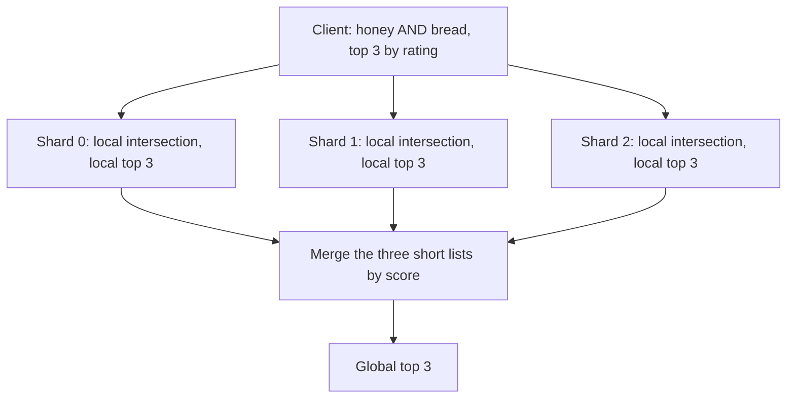

# Scaling Redis: complex queries across shards

> **Before this lesson:** read [scaling reads and writes](#/lesson/redis/scaling-reads-writes) for
> what a shard is and how a key is routed to one. This lesson also reuses the search index from
> [inverted indexes](#/lesson/redis/inverted-index-search) and the timelines from
> [users, posts and timelines](#/lesson/redis/users-timelines).

## In plain words

Once data is split across several servers, single-key commands keep working: the client works out
which server owns the key and talks to it. The trouble starts with questions that need **several keys
at once**. "Which recipes contain both *rye* and *honey*?" needs two sets; if they sit on different
servers, no single server can compute the answer.

Go back to the library with several branches. Asking for one particular book is easy: the catalogue
says which branch holds it. But "which books are about both gardening and Norway?" is harder if the
gardening index is in the north branch and the Norway index is in the east branch. You have three
options:

1. **Arrange things so the indexes you combine are in the same branch** - then one librarian answers
   alone.
2. **Ask every branch the whole question about its own shelves**, collect each branch's answer, and
   combine the answers yourself.
3. **Bring the pieces to one desk** and combine them there - slow, and to be avoided.

Those are exactly the three strategies for multi-key work on sharded Redis: co-locate, scatter and
gather, or fetch and merge on the client. This lesson shows when each applies.

Why it matters for a job: every sharded database, not only Redis, forces this decision. Choosing what
to shard *by* - the **shard key** - is one of the most consequential design choices in a large
system, and being able to reason about it is a core system-design skill.

## Part 1 - seeing the problem

On a Redis Cluster, a multi-key command whose keys hash to different slots is refused:

```bash
127.0.0.1:7000> SADD idx:rye recipe:101
(integer) 1
127.0.0.1:7000> SADD idx:honey recipe:101 recipe:103
-> Redirected to slot [2984] located at 127.0.0.1:7001
(integer) 2
127.0.0.1:7001> SINTER idx:rye idx:honey
(error) CROSSSLOT Keys in request don't hash to the same slot
```

The first `SADD` ran on the node we were connected to. The second key belongs to another node, and
`redis-cli` (started in cluster mode with `-c`) followed the redirect automatically. Then `SINTER`
across the two keys fails with `CROSSSLOT`: Redis will not reach across servers to compute it. The
same applies to `SUNIONSTORE`, `ZINTERSTORE`, `RENAME`, `LMOVE`, multi-key `DEL`, transactions and
scripts.

With hand-rolled sharding (no cluster) you would not even get an error - each server would compute
the intersection using only the keys *it* has and return a wrong answer silently. That is worse.

## Part 2 - strategy one: keep related keys together

### Hash tags

Redis Cluster chooses a key's slot from a hash of the key. If the key contains a `{` and a later `}`
with at least one character between them, **only the text between the first `{` and the next `}` is
hashed**. That text is called a **hash tag**.

```bash
127.0.0.1:7000> CLUSTER KEYSLOT {user:41}:profile
(integer) 3691
127.0.0.1:7000> CLUSTER KEYSLOT {user:41}:home
(integer) 3691
127.0.0.1:7000> CLUSTER KEYSLOT {user:41}:followers
(integer) 3691
127.0.0.1:7000> CLUSTER KEYSLOT {user:42}:home
(integer) 15880
```

All three keys for user 41 share a slot because the hashed part, `user:41`, is identical; user 42's
keys go elsewhere. Now any multi-key command, transaction
or script that touches only one user's keys works:

```bash
127.0.0.1:7000> ZUNIONSTORE {user:41}:feed 2 {user:41}:home {user:41}:pinned
(integer) 57
```

The exact rule, because the edge cases matter:

- only the **first** `{` and the **first `}` after it** count;
- if nothing is between them (`{}`), the tag is ignored and the whole key is hashed;
- with no braces, the whole key is hashed.

### Choosing what goes in the tag

The tag is your **shard key**: the thing all co-located data has in common. Choose it by asking
*which keys do my multi-key operations combine?*

| Application | Natural shard key | Why |
|---|---|---|
| Per-user data (profile, timeline, cart) | user id | operations combine one user's keys |
| Multi-tenant product (many customer companies) | tenant id | queries never span customers |
| Chat | conversation id | messages and read markers of one chat together |
| Site search over everything | none works | every query spans all documents |

> [!WARNING]
> A hash tag puts everything with the same tag on **one** server. If the tag has few distinct values,
> or one value is far larger than the rest (one enormous customer), that server fills up while others
> sit idle. A tag such as `{orders}` on every order key defeats sharding altogether. Use tags with
> many distinct values of similar size.

## Part 3 - strategy two: scatter and gather

Some queries cannot be co-located: a search across every recipe is one. Here we change the layout so
that **each shard is a complete, self-contained index of its own subset of documents**.

Compare the two layouts for a search index:

- **Sharded by word:** `idx:rye` lives wherever that key hashes. Intersecting two words means two
  servers. Bad.
- **Sharded by document:** recipe 101 is assigned to shard 2, and *all* of its index entries are
  written to shard 2 - its own `idx:rye`, its own `idx:honey`. Every shard has a small `idx:rye`
  containing only its own recipes. Any shard can intersect words locally.

A query is then sent to **every** shard (scatter); each computes a local answer over its documents;
the client combines the partial answers (gather). This is also called **fan-out querying**.



### Why "top k from each shard" is enough

Suppose the user wants the 3 best-rated matches overall. Could a result in the global top 3 be
missing from its own shard's top 3? No: if a recipe is among the best three anywhere, at most two
recipes in the world beat it, so at most two on its own shard beat it. Therefore every global
top-$k$ item appears in some shard's local top-$k$, and merging the local lists and keeping the best
$k$ gives exactly the right answer.

For page 2 (results 4-6) you need each shard's top 6, not its "second three": in general, for results
up to position $p$, ask each shard for its top $p$. Deep pages get expensive - one reason search
systems limit how far you can page.

```python
import heapq
import redis

shards = [redis.Redis(host=h, decode_responses=True) for h in ("10.0.2.1", "10.0.2.2", "10.0.2.3")]

def shard_for_doc(doc_id):
    return shards[doc_id % len(shards)]

def index_recipe(doc_id, words, rating):
    conn = shard_for_doc(doc_id)
    pipe = conn.pipeline()
    for w in words:
        pipe.sadd(f"idx:{w}", doc_id)
    pipe.zadd("rank:rating", {doc_id: rating})
    pipe.execute()

def search(words, k=3):
    partial = []
    for conn in shards:                                      # scatter
        pipe = conn.pipeline()
        pipe.zinterstore("tmp:q", {**{f"idx:{w}": 0 for w in words}, "rank:rating": 1})
        pipe.zrange("tmp:q", 0, k - 1, desc=True, withscores=True)
        pipe.zcard("tmp:q")
        pipe.delete("tmp:q")
        _, top, count, _ = pipe.execute()
        partial.append((top, count))
    total = sum(count for _, count in partial)
    best = heapq.nlargest(k, (pair for top, _ in partial for pair in top), key=lambda p: p[1])
    return total, best                                       # gather
```

- `shard_for_doc` routes by document id, so everything about one recipe is on one server.
- `index_recipe` writes that recipe's word sets and its rating to its shard. Note that the keys have
  no shard number in their names: each server has its own `idx:rye`.
- `search` runs the same four commands on each shard: intersect the word sets with the rating ranking
  (weight 0 for the word sets, 1 for the rating), read the local top `k`, count local matches, and
  remove the temporary key.
- `heapq.nlargest(k, ...)` picks the `k` highest-scored pairs from all the partial lists. The total
  number of matches is the sum of the per-shard counts.

The loop above visits shards one after another. Since the shards are independent, real code queries
them **in parallel** (with threads or asynchronous I/O), so the response time is that of the slowest
shard, not the sum of all.

### What scatter-gather costs

- Every query touches every shard, so adding shards does not reduce work per query - it only keeps
  each shard's data small.
- The slowest shard sets the response time. With many shards, *some* shard is usually having a slow
  moment; this is called **tail latency**.
- If one shard is down you must decide: fail the query, or return partial results and say so.

## Part 4 - sharded sorted sets: merging ranges

The same reasoning handles a leaderboard too large for one server. Split players across shards (each
shard holds a sorted set `board` with its own players), and:

- **Global top 10:** take the top 10 from each shard, merge, keep the best 10.
- **A player's score:** ask only the shard that owns the player.
- **A player's global rank:** on each shard, count the players with a higher score (`ZCOUNT board
  (score +inf`) and add the counts. Every shard is asked, but each answer is one cheap command.

```python
def global_rank(player, home):
    score = home.zscore("board", player)
    if score is None:
        return None
    return sum(conn.zcount("board", f"({score}", "+inf") for conn in shards)      # 0 = first place
```

`f"({score}"` builds an exclusive lower bound, so only strictly higher scores are counted; the sum is
the number of players ahead, which is the zero-based rank.

## Part 5 - sharded timelines: choose the tag once

For Chirrup, the social network from module 8, the natural shard key is the user: put
`{user:41}:profile`, `{user:41}:home`, `{user:41}:followers` and `{user:41}:following` together.
Reading a home timeline is then a single-shard operation. Two operations still cross shards:

- **Fan-out on posting** writes one entry into each follower's home timeline, and followers live on
  many shards. That is fine: the writes are independent single-key commands. Group them by shard and
  send one pipeline per shard.
- **Following someone** updates `{user:57}:following` and `{user:41}:followers` - two shards, so not
  one atomic transaction. Accept a brief inconsistency and make the operation safe to repeat, or run
  a periodic repair that compares the two sides.

```python
import collections

def fan_out(cluster_nodes, slot_of, followers, chirp_id, posted):
    by_node = collections.defaultdict(list)
    for uid in followers:
        key = f"{{user:{uid}}}:home"                   # doubled braces produce literal { and }
        by_node[slot_of(key)].append(key)
    for node, keys in by_node.items():
        pipe = cluster_nodes[node].pipeline(transaction=False)
        for key in keys:
            pipe.zadd(key, {chirp_id: posted})
        pipe.execute()
```

`collections.defaultdict(list)` is a dictionary that starts every missing entry as an empty list, so
keys can be appended to their node's batch without checking first. In practice a cluster-aware client
does this grouping for you: redis-py's `RedisCluster` pipeline splits commands by node.

> [!TIP]
> Design rule: pick the shard key so that the **most frequent** operation is single-shard. Reads of a
> user's own data usually win. Cross-shard operations should be the rare ones, and they should be
> writes you can retry or reads you can scatter.

> [!INTERVIEW]
> When a design question reaches "now shard it", say three things: what the shard key is and why (it
> makes the common query single-shard); which operations become cross-shard and how you handle each
> (scatter-gather for reads, idempotent per-shard writes, no cross-shard transactions); and what skew
> or hot spots the key might cause. For Redis specifically, mention hash tags and the `CROSSSLOT`
> error.

## Try it: hash tags, scatter-gather and a global rank

The block implements the hash-tag rule, a document-sharded search with top-k merging (checked against
a single unsharded index), and a global leaderboard rank summed over shards.

```python-run
import heapq, zlib

def hashed_part(key):
    """The part of the key that Redis Cluster hashes."""
    start = key.find("{")
    if start != -1:
        end = key.find("}", start + 1)
        if end != -1 and end != start + 1:           # a closing brace with something inside
            return key[start + 1:end]
    return key

for key in ["{user:41}:home", "{user:41}:followers", "user:41:home", "foo{}bar", "a{b}{c}", "{{x}}y"]:
    print(f"{key:22s} -> hashes {hashed_part(key)!r:12} shard {zlib.crc32(hashed_part(key).encode()) % 3}")

# ---------- document-sharded search ----------
recipes = {  # id: (words, rating)
    101: ({"rye", "bread", "honey"}, 4.9), 102: ({"banana", "bread"}, 4.9), 103: ({"honey", "cake"}, 4.2),
    104: ({"honey", "loaf", "seeds"}, 4.4), 105: ({"honey", "bread", "oats"}, 4.8),
    106: ({"honey", "bread", "nuts"}, 3.9), 107: ({"honey", "bread", "figs"}, 4.85),
}
N = 3
shards = [{"idx": {}, "rating": {}} for _ in range(N)]
for doc, (words, rating) in recipes.items():
    s = shards[doc % N]                               # everything about a recipe on ONE shard
    s["rating"][doc] = rating
    for w in words: s["idx"].setdefault(w, set()).add(doc)

def local_search(shard, words, k):
    hits = set.intersection(*[shard["idx"].get(w, set()) for w in words])
    ranked = sorted(((shard["rating"][d], d) for d in hits), reverse=True)
    return ranked[:k], len(hits)

def search(words, k):
    partial = [local_search(s, words, k) for s in shards]                 # scatter
    total = sum(count for _, count in partial)
    return total, heapq.nlargest(k, (pair for top, _ in partial for pair in top))   # gather

for i, s in enumerate(shards): print(f"shard {i} holds recipes {sorted(s['rating'])}")
total, top = search(["honey", "bread"], k=2)
print("sharded  : total matches", total, "| top 2:", top)
truth = sorted(((r, d) for d, (w, r) in recipes.items() if {"honey", "bread"} <= w), reverse=True)
print("unsharded: total matches", len(truth), "| top 2:", truth[:2])

# asking each shard for only 1 result when we need the top 2 can give a wrong answer
partial = [local_search(s, ["honey", "bread"], 1)[0] for s in shards]
print("top 1 per shard then merge:", heapq.nlargest(2, (p for part in partial for p in part)))

# ---------- global rank on a sharded leaderboard ----------
scores = {"ada": 910, "bo": 870, "cy": 990, "di": 640, "eve": 870, "fay": 720}
boards = [{}, {}, {}]
for name, sc in scores.items(): boards[zlib.crc32(name.encode()) % 3][name] = sc
def global_rank(name):
    sc = scores[name]
    return sum(sum(1 for other in b.values() if other > sc) for b in boards)      # ZCOUNT (score +inf
print("ranks:", {n: global_rank(n) for n in sorted(scores, key=scores.get, reverse=True)})
```

In the first section the two keys tagged `{user:41}` hash the same text and so land on the same
shard, while the untagged key is hashed whole. The odd cases follow the rule: `foo{}bar` has an empty
tag and is hashed whole; `a{b}{c}` uses only the first tag, `b`; `{{x}}y` takes everything between
the first `{` and the first `}` after it, which is `{x`. In the search section the sharded result -
total and top 2 - matches the unsharded truth. The line after it shows the mistake of asking each
shard for too few results: merging only each shard's single best gives a different, wrong second
place when two of the true top 2 live on the same shard. Finally, global ranks are sums of per-shard
counts; the two players tied on 870 share a rank because only strictly higher scores are counted.

## Pitfalls

- **Multi-key commands across slots.** On a cluster they fail with `CROSSSLOT`; with hand-rolled
  sharding they silently return wrong answers.
- **A hash tag with too few distinct values.** All tagged keys pile onto one server.
- **Sharding an index by word.** Intersections then span servers. Shard by document so each shard is a
  self-contained index.
- **Asking each shard for too few results.** For global results up to position p, each shard must
  return its top p.
- **Sequential scatter.** Query shards in parallel, or latency grows with the shard count.
- **Ignoring partial failure.** Decide and document what happens when one shard does not answer.
- **Assuming cross-shard atomicity.** There is none. Make cross-shard writes idempotent and repairable.
- **Temporary keys colliding.** Concurrent queries on a shard that all use `tmp:q` overwrite each
  other; give each query a unique temporary key and an expiry.
- **Counting distinct items by summing shard counts.** That is correct only if each item lives on
  exactly one shard; otherwise duplicates are counted twice.

## Command cheat sheet

`S` = number of shards, `k` = results requested.

| Command or technique | Use here | Cost |
|---|---|---|
| `CLUSTER KEYSLOT key` | which slot a key maps to | O(key length) |
| `{tag}` inside a key | hash only the tag so related keys share a slot | - |
| `CLUSTER COUNTKEYSINSLOT slot` | how many keys a slot holds (skew check) | O(1) |
| `SINTER`, `ZINTERSTORE`, `MULTI`, `EVAL` | allowed when all keys share a slot | as on one node |
| scatter-gather search | same query on every shard, merge top k | S queries; merge O(S·k log k) |
| `ZRANGE board 0 k-1 REV WITHSCORES` per shard | local top k for a global top k | O(log n + k) each |
| `ZCOUNT board (score +inf` per shard | players ahead, summed for a global rank | O(log n) each |
| one pipeline per shard | batched cross-shard independent writes | one round trip per shard |
| `redis.cluster.RedisCluster` (redis-py) | slot-aware client that routes and splits pipelines | - |

## Summary

- Sharding makes single-key commands easy and multi-key commands impossible across servers.
- Co-locate keys that are combined together by giving them a common hash tag - the shard key - with
  many evenly sized values.
- For queries that span everything, make each shard self-contained (shard by document), send the
  query to all shards, and merge each shard's top-k.
- Global ranks and counts are sums of cheap per-shard answers.
- Cross-shard writes are independent and non-atomic: batch per shard, and make them safe to retry.

## Glossary

- **Multi-key command** - a command that reads or writes more than one key.
- **Slot** - one of the 16,384 buckets Redis Cluster maps keys into.
- **CROSSSLOT** - the error returned when a command's keys are in different slots.
- **Hash tag** - the part of a key inside `{}` that alone determines the slot.
- **Shard key** - the attribute by which data is divided among servers.
- **Co-location** - placing related keys on the same server.
- **Skew** - uneven distribution of data or load across shards.
- **Scatter-gather (fan-out query)** - sending a query to every shard and merging the replies.
- **Top-k** - the k best results by some score.
- **Tail latency** - the slow end of the response-time distribution, which dominates when many servers
  must all answer.
- **Idempotent** - safe to perform more than once.

```quiz
[
  {"q": "On Redis Cluster, SINTER idx:rye idx:honey returns a CROSSSLOT error. What does it mean?",
   "options": ["One of the sets is empty", "The two keys hash to different slots, and a command may only use keys in one slot", "The cluster is down", "SINTER is not supported in clusters"],
   "answer": 1,
   "explain": "Multi-key commands require all keys in the same slot; otherwise the cluster refuses them."},
  {"q": "Which part of the key {order:77}:items determines its cluster slot?",
   "options": ["The whole key", "order:77", "items", "77"],
   "answer": 1,
   "explain": "Only the text between the first { and the next } is hashed."},
  {"q": "How is the key report{}2026 hashed?",
   "options": ["Only the empty string is hashed", "The whole key is hashed, because an empty tag is ignored", "Only '2026' is hashed", "It is rejected"],
   "answer": 1,
   "explain": "A tag must contain at least one character; {} does not count."},
  {"q": "Every order key is named {orders}:<id>. What is the consequence on a cluster?",
   "options": ["Orders are spread evenly", "All order keys land in one slot on one server, defeating sharding", "Orders cannot be read", "The keys expire together"],
   "answer": 1,
   "explain": "Identical tags mean identical slots. Tags need many distinct values to spread data."},
  {"q": "Why is a search index sharded by document and not by word?",
   "options": ["Words are too long", "Each shard then holds a complete index for its own documents and can intersect words locally", "Documents hash faster", "To avoid storing ratings"],
   "answer": 1,
   "explain": "Sharding by word scatters the sets needed for one intersection across servers."},
  {"q": "To show global results 1-10 from 4 shards by scatter-gather, how many results must each shard return?",
   "options": ["3 (10 divided by 4, rounded up)", "10", "40", "1"],
   "answer": 1,
   "explain": "All ten best results could live on a single shard, so each shard must return its top 10."},
  {"q": "How is a player's global rank computed on a sharded leaderboard?",
   "options": ["ZRANK on the player's own shard", "Sum over all shards of the number of players with a strictly higher score", "Average of the per-shard ranks", "It cannot be computed"],
   "answer": 1,
   "explain": "Rank is the count of players ahead, and those players may be on any shard."},
  {"q": "Following a user updates {user:57}:following and {user:41}:followers on different shards. What follows?",
   "options": ["It can be wrapped in MULTI/EXEC", "The two writes cannot be one atomic transaction, so the operation should be retry-safe or repaired later", "The cluster merges the shards", "The follow is rejected"],
   "answer": 1,
   "explain": "Transactions are limited to one slot. Cross-shard updates are independent writes."}
]
```

> **Source:** Carlson, *Redis in Action*, ch. 10 (section 10.3: scaling complex queries - sharded search, sharded sorted sets, sharded timelines); hash-tag rules from the Redis Cluster specification on redis.io. The top-k argument, examples and simulation are original.
> Further reading: <https://redis.io/docs/latest/operate/oss_and_stack/reference/cluster-spec/>, <https://redis.io/docs/latest/commands/cluster-keyslot/>, <https://redis.io/docs/latest/operate/oss_and_stack/management/scaling/>
