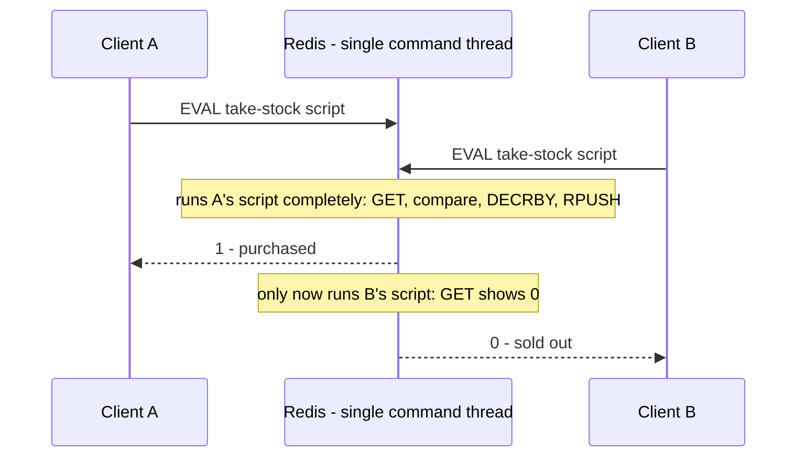

# Lua scripting: running your own logic inside Redis

> **Before this lesson:** you should understand why `MULTI`/`EXEC` cannot branch on a value it reads
> ([pub/sub, transactions and expiry](#/lesson/redis/pubsub-transactions-expiry)) and how `WATCH`
> retries on conflict ([WATCH, pipelining and performance](#/lesson/redis/watch-pipelining-performance)).
> No knowledge of the Lua language is assumed; every piece of Lua used here is explained.

## In plain words

Until now, your program has talked to Redis one command at a time: ask a question, wait for the
answer, decide, send the next command. That back-and-forth has two costs. It is slow, because every
exchange is a trip across the network. And it is unsafe, because between your question and your next
command, another program can change the data you based your decision on.

A **script** removes both problems. You write a small program and send it to Redis; Redis runs the
whole program itself, start to finish, without letting anyone else's commands in between.

A picture: compare phoning a warehouse and saying "Do you have item 42? ... You do? Then reserve one.
... Done? Now add it to order 9" - three calls, during which someone else could take the last item -
with handing the warehouse clerk a written note: *"If item 42 is in stock, reserve one and add it to
order 9; otherwise tell me it is sold out."* The clerk carries out the note in one go, at the shelf,
with nobody able to interrupt.

The notes are written in **Lua**, a small, simple programming language that is built into Redis. You
need only a handful of its features.

Why it matters for a job: scripts are the standard way to make multi-step operations in Redis
correct under heavy concurrency - rate limiters, locks, inventory, queues. Nearly every serious Redis
library uses them internally, and "how would you make that atomic?" is usually answered with "a Lua
script".

## Part 1 - the smallest script

`EVAL` sends a script to the server and runs it.

```bash
127.0.0.1:6379> EVAL "return 42" 0
(integer) 42
127.0.0.1:6379> EVAL "return 'hello from Lua'" 0
"hello from Lua"
```

The first argument is the script text. The second, `0`, is the number of key names that follow -
none yet. `return` hands a value back to the caller.

### Passing keys and arguments

A script receives two lists:

- `KEYS` - the names of the keys it will read or write;
- `ARGV` - any other values (amounts, limits, tokens).

The number after the script says how many of the following words are keys; the rest become `ARGV`.

```bash
127.0.0.1:6379> EVAL "return {KEYS[1], KEYS[2], ARGV[1]}" 2 stock:42 order:9 hello
1) "stock:42"
2) "order:9"
3) "hello"
```

Two things to notice. Lua lists start counting at **1**, not 0: the first key is `KEYS[1]`. And the
curly braces `{ ... }` build a Lua **table**, the language's list type; Redis returns a table as a
list reply.

### Calling Redis commands from the script

Inside a script, `redis.call(...)` runs a Redis command and gives back its result.

```bash
127.0.0.1:6379> SET stock:42 5
OK
127.0.0.1:6379> EVAL "return redis.call('GET', KEYS[1])" 1 stock:42
"5"
127.0.0.1:6379> EVAL "return redis.call('INCRBY', KEYS[1], ARGV[1])" 1 stock:42 10
(integer) 15
```

The command name and each argument are separate values, exactly as you would type them.

## Part 2 - a script that decides

Now the warehouse note itself: *take one unit of stock if any is left*.

```lua
local stock = tonumber(redis.call('GET', KEYS[1]) or '0')
if stock < tonumber(ARGV[1]) then
    return 0
end
redis.call('DECRBY', KEYS[1], ARGV[1])
redis.call('RPUSH', KEYS[2], ARGV[2])
return 1
```

Line by line:

1. `local stock = ...` creates a variable named `stock`. `redis.call('GET', KEYS[1])` reads the stock
   key. Values from Redis arrive as text, so `tonumber(...)` converts the text to a number. The
   `or '0'` part supplies `'0'` when the key does not exist (a missing key arrives as `false`).
2. `if stock < tonumber(ARGV[1]) then` - if there is less stock than the quantity requested...
3. `return 0` - ...stop and report failure.
4. `end` closes the `if`.
5. Otherwise reduce the stock by the requested quantity.
6. Append a line to the orders list.
7. `return 1` - report success.

Run it:

```bash
127.0.0.1:6379> SET stock:42 1
OK
127.0.0.1:6379> EVAL "local s = tonumber(redis.call('GET', KEYS[1]) or '0') if s < tonumber(ARGV[1]) then return 0 end redis.call('DECRBY', KEYS[1], ARGV[1]) redis.call('RPUSH', KEYS[2], ARGV[2]) return 1" 2 stock:42 orders 1 "book:42 for customer 7"
(integer) 1
127.0.0.1:6379> EVAL "local s = tonumber(redis.call('GET', KEYS[1]) or '0') if s < tonumber(ARGV[1]) then return 0 end redis.call('DECRBY', KEYS[1], ARGV[1]) redis.call('RPUSH', KEYS[2], ARGV[2]) return 1" 2 stock:42 orders 1 "book:42 for customer 8"
(integer) 0
```

The first buyer gets the last copy (reply 1); the second is told there is none (reply 0). No
`WATCH`, no retry loop, one round trip each. However many buyers arrive at once, each script runs to
completion before the next begins, so the stock can never go below zero.

### Why this is atomic

Redis executes commands on a single thread, and a script counts as *one command*. While it runs,
nothing else runs. That gives scripts the isolation of `MULTI`/`EXEC` plus the one thing transactions
lack: the ability to read a value and act on it within the same atomic step.



## Part 3 - using scripts from Python

Sending the full script text every time wastes bandwidth. Redis can store a script and let you call
it by a short fingerprint - the **SHA-1 digest** of its text, a 40-character code that identifies
the script. (SHA-1 is a function that turns any text into a fixed-length code; the same text always
gives the same code.)

```bash
127.0.0.1:6379> SCRIPT LOAD "return redis.call('GET', KEYS[1])"
"d3c21d0c2b9ca22f82737626a27bcaf5d288f99f"
127.0.0.1:6379> EVALSHA d3c21d0c2b9ca22f82737626a27bcaf5d288f99f 1 stock:42
"0"
127.0.0.1:6379> EVALSHA ffffffffffffffffffffffffffffffffffffffff 0
(error) NOSCRIPT No matching script. Please use EVAL.
```

`SCRIPT LOAD` stores the script and returns its digest. `EVALSHA` runs a stored script by digest. If
the server does not know the digest (it restarted, or the script cache was flushed) it answers
`NOSCRIPT`, and the client must send the full text again.

redis-py hides all of this behind `register_script`:

```python
import redis

r = redis.Redis(decode_responses=True)

TAKE_STOCK = r.register_script("""
local stock = tonumber(redis.call('GET', KEYS[1]) or '0')
if stock < tonumber(ARGV[1]) then
    return 0
end
redis.call('DECRBY', KEYS[1], ARGV[1])
redis.call('RPUSH', KEYS[2], ARGV[2])
return 1
""")

def buy(customer, book, quantity=1):
    ok = TAKE_STOCK(keys=[f"stock:{book}", "orders"], args=[quantity, f"{book}:{customer}"])
    return ok == 1

r.set("stock:book:42", 1)
print(buy(7, "book:42"))     # True
print(buy(8, "book:42"))     # False
```

- `register_script` returns an object you call like a function. It remembers the script text and its
  digest.
- Calling it sends `EVALSHA`; if the server answers `NOSCRIPT`, redis-py transparently sends the full
  script and carries on.
- `keys=[...]` becomes `KEYS`, `args=[...]` becomes `ARGV`. Python numbers are sent as text, which is
  why the script converts with `tonumber`.

Compare this with the `WATCH` version of `buy` in the earlier lesson: no retry loop, no exception
handling, and it behaves well under any amount of contention.

## Part 4 - the rules you must know

### What comes back: type conversion

Lua and Redis have different types, and replies are converted in ways that surprise people.

| Lua value returned | What the client receives |
|---|---|
| a whole number, e.g. `3` | integer 3 |
| a number with a fraction, e.g. `3.99` | integer **3** - the fraction is cut off |
| a string | a string |
| a table used as a list, `{1, 'a'}` | a list |
| `true` | integer 1 |
| `false` or `nil` | nil (nothing) |

The second row is the trap. To return a fractional number, convert it to text first:
`return tostring(3.99)`. Also, a list stops at the first `nil` inside it, so `{1, nil, 3}` comes back
as only `[1]`.

In the other direction, a Redis `nil` reply (a missing key) arrives in Lua as `false`, which is why
the pattern `redis.call('GET', k) or '0'` works.

### Errors: call versus pcall

If a command fails inside `redis.call`, the script stops immediately and the error goes to the
client. `redis.pcall` ("protected call") instead returns the error as a value the script can inspect
and handle.

> [!WARNING]
> There is **no rollback**. If a script has already written something and then fails at a later step,
> the earlier writes stay. Write scripts so that every check happens *before* the first write:
> validate, then modify.

### Declare your keys

Every key a script touches should be passed in `KEYS`, not built inside the script from other values.
On a single server Redis does not enforce this, but Redis Cluster needs the key names up front to
route the script to the right server - and all the keys must be in the same slot (use hash tags, as
described in [queries across shards](#/lesson/redis/queries-on-shards)).

### Keep scripts short

A script blocks the entire server while it runs. A script that loops over a million elements freezes
every other client for the duration. If a script runs longer than a configured threshold (5 seconds
by default, `busy-reply-threshold`, formerly `lua-time-limit`), Redis starts answering other clients
with a `BUSY` error. At that point an administrator can run `SCRIPT KILL` - which works only if the
script has not yet written anything - or, as a last resort, `SHUTDOWN NOSAVE`.

The guideline: scripts should do a small, bounded amount of work. Never loop over a collection of
unbounded size inside one.

### Scripts must be predictable

Scripts cannot read files, open network connections or sleep. Older Redis versions also forbade
writing after calling anything random or time-dependent, because replicas re-ran the script itself
and had to reach the same result. Since Redis 5 the server sends replicas the script's *effects*
(the individual write commands) instead, and from Redis 7 that is the only mode. So calling
`redis.call('TIME')` to read the server's clock and then writing is fine in current versions.

### Functions: the successor to ad-hoc scripts

Redis 7 added **Functions**. Instead of each client carrying script text and hoping it is cached,
you load a named library into the server once; it is saved with the data and copied to replicas, and
clients call functions by name.

```bash
127.0.0.1:6379> FUNCTION LOAD "#!lua name=shop\nredis.register_function('take_stock', function(keys, args) local s = tonumber(redis.call('GET', keys[1]) or '0') if s < tonumber(args[1]) then return 0 end redis.call('DECRBY', keys[1], args[1]) return 1 end)"
"shop"
127.0.0.1:6379> FCALL take_stock 1 stock:42 1
(integer) 0
```

`FUNCTION LOAD` registers the library `shop` containing one function; `FCALL name numkeys keys...
args...` calls it. `EVAL` scripts remain fully supported; Functions are tidier when many applications
share the same server-side logic.

> [!TIP]
> Develop scripts in a file, not inline in a string. `redis-cli --eval take_stock.lua stock:42 orders
> , 1 "book:42:7"` runs a script file - keys go before the comma, arguments after - and makes
> testing far less painful.

## Part 5 - a second example: a counter with a ceiling

A rate limit in four lines: allow at most `limit` actions per time window.

```lua
local current = redis.call('INCR', KEYS[1])
if current == 1 then
    redis.call('EXPIRE', KEYS[1], ARGV[1])
end
if current > tonumber(ARGV[2]) then
    return 0
end
return 1
```

`INCR` counts this attempt. If the counter was created by this very call (`current == 1`), the script
gives it a lifetime equal to the window length, so the counter resets by itself. Then it compares the
count with the limit. Done as separate commands from a client, a crash between `INCR` and `EXPIRE`
would leave a counter that never expires and a user locked out for ever. In a script the two cannot
be separated.

```python
LIMIT = r.register_script("""
local current = redis.call('INCR', KEYS[1])
if current == 1 then redis.call('EXPIRE', KEYS[1], ARGV[1]) end
if current > tonumber(ARGV[2]) then return 0 end
return 1
""")

def allowed(user, window_seconds=60, limit=100):
    return LIMIT(keys=[f"rate:{user}"], args=[window_seconds, limit]) == 1
```

> [!INTERVIEW]
> "When would you use a Lua script instead of MULTI/EXEC or WATCH?" Answer: when the operation must
> read data and decide what to write, atomically; when contention is high enough that optimistic
> retries waste work; or when collapsing several round trips into one matters. Then give the costs:
> scripts block the server while they run, have no rollback, need their keys declared (and co-located
> on a cluster), and add logic that lives outside your application's main code.

## Try it: atomic scripts versus interleaved commands

Your browser cannot run Lua inside a Redis server, so the model below represents a script as a Python
function that the "server" runs without interruption. It then replays the same purchase logic as
separate commands with a deliberately unlucky interleaving, and shows the reply conversion rules.

```python-run
class Server:
    def __init__(self): self.data = {}
    def get(self, k): return self.data.get(k)
    def set(self, k, v): self.data[k] = v
    def decrby(self, k, n): self.data[k] = int(self.data.get(k, 0)) - n; return self.data[k]
    def incr(self, k): self.data[k] = int(self.data.get(k, 0)) + 1; return self.data[k]
    def rpush(self, k, v): self.data.setdefault(k, []).append(v)
    def eval(self, script, keys, args):
        """Run the whole function before anything else: that is the atomicity of a script."""
        return to_reply(script(self, keys, args))

def to_reply(value):
    if value is True: return 1
    if value is False or value is None: return None
    if isinstance(value, float): return int(value)            # fractions are cut off
    if isinstance(value, list):
        out = []
        for item in value:
            if item is None: break                            # a list stops at the first nil
            out.append(to_reply(item))
        return out
    return value

def take_stock(redis, KEYS, ARGV):
    stock = int(redis.get(KEYS[0]) or 0)
    if stock < int(ARGV[0]): return 0
    redis.decrby(KEYS[0], int(ARGV[0])); redis.rpush(KEYS[1], ARGV[1])
    return 1

s = Server(); s.set("stock:42", 1)
results = [s.eval(take_stock, ["stock:42", "orders"], [1, f"customer {c}"]) for c in (7, 8, 9)]
print("scripted  :", results, "| stock:", s.get("stock:42"), "| orders:", s.get("orders"))

# the same logic as separate commands, interleaved: both clients read before either writes
s = Server(); s.set("stock:42", 1)
seen_a = int(s.get("stock:42")); seen_b = int(s.get("stock:42"))
for who, seen in (("customer 7", seen_a), ("customer 8", seen_b)):
    if seen >= 1: s.decrby("stock:42", 1); s.rpush("orders", who)
print("unscripted:", "stock:", s.get("stock:42"), "| orders:", s.get("orders"), "<- oversold")

def limiter(redis, KEYS, ARGV):
    current = redis.incr(KEYS[0])
    return 0 if current > int(ARGV[1]) else 1
s = Server()
print("rate limit of 3:", [s.eval(limiter, ["rate:ana"], [60, 3]) for _ in range(5)])

print("return 3.99      ->", to_reply(3.99))
print("return '3.99'    ->", to_reply("3.99"))
print("return true/false->", to_reply(True), to_reply(False))
print("return {1,nil,3} ->", to_reply([1, None, 3]))

# no rollback: a failure after a write leaves the write in place
def faulty(redis, KEYS, ARGV):
    redis.decrby(KEYS[0], 1)
    raise RuntimeError("WRONGTYPE at step 2")
s = Server(); s.set("stock:42", 5)
try: s.eval(faulty, ["stock:42"], [])
except RuntimeError as e: print("script failed:", e, "| stock is now", s.get("stock:42"), "(the first write stayed)")
```

What the output shows. Three scripted purchases against one unit of stock give `[1, 0, 0]`: one
success, stock 0, one order. The unscripted version, with both readers seeing "1" before either
writes, records two orders and ends with stock at -1. The limiter allows three calls and refuses the
next two. The conversion lines show the fraction being cut from 3.99, the string surviving intact,
booleans becoming 1 and nil, and the list ending at the first nil. The last line demonstrates the
absence of rollback.

## Pitfalls

- **Forgetting that Lua indexes from 1.** `KEYS[0]` is `nil`.
- **Comparing text with numbers.** Redis values are strings; wrap them in `tonumber(...)`.
- **Returning a fraction.** It is truncated to an integer; return `tostring(x)`.
- **Writes before validation.** With no rollback, a late failure leaves partial changes.
- **Building key names inside the script.** It works on one server and breaks on a cluster. Pass every
  key in `KEYS`.
- **Long loops.** The server is frozen for the duration. Bound the work.
- **Assuming the script cache is permanent.** `EVALSHA` can return `NOSCRIPT` after a restart or
  failover; use a client helper that falls back to `EVAL`.
- **Generating script text with values pasted in.** Every distinct text is a new cached script, and it
  invites injection bugs. Keep the text constant and pass values through `ARGV`.
- **Too much logic on the server.** Scripts are harder to test, version and debug than application
  code. Use them for atomicity, not as a place to put business rules.

## Command cheat sheet

| Command | Meaning | Cost |
|---|---|---|
| `EVAL script numkeys key... arg...` | run a script | cost of the commands it executes |
| `EVALSHA sha1 numkeys key... arg...` | run a cached script by digest | same |
| `SCRIPT LOAD script` | cache a script, return its digest | O(script length) |
| `SCRIPT EXISTS sha1...` | is a digest cached? | O(number of digests) |
| `SCRIPT FLUSH` | clear the script cache | O(cached scripts) |
| `SCRIPT KILL` | stop a running script that has not written | O(1) |
| `EVAL_RO` / `EVALSHA_RO` (7.0+) | read-only scripts, runnable on replicas | cost of the script |
| `FUNCTION LOAD code` / `FCALL name numkeys ...` (7.0+) | named, persistent server-side functions | cost of the function |
| `redis.call(cmd, ...)` | run a command; an error aborts the script | cost of the command |
| `redis.pcall(cmd, ...)` | run a command; an error is returned as a value | cost of the command |
| `tonumber(x)` / `tostring(x)` | convert between text and numbers in Lua | O(1) |
| `redis-cli --eval file.lua keys , args` | run a script from a file | - |

## Summary

- A script is a small Lua program that Redis runs as one uninterrupted command.
- It receives key names in `KEYS` and other values in `ARGV` (both starting at index 1) and calls
  commands with `redis.call`.
- Unlike `MULTI`/`EXEC`, a script can read, decide and write atomically; unlike `WATCH`, it never
  retries.
- Replies are converted: fractions are truncated, `false` and `nil` become nil, tables become lists.
- Scripts block the server, do not roll back, and should declare every key; keep them short.

## Glossary

- **Script** - a program sent to the server to be run there.
- **Lua** - the small programming language embedded in Redis.
- **EVAL / EVALSHA** - run a script by its text / by the digest of its text.
- **KEYS / ARGV** - the two input lists of a script: key names and other arguments.
- **redis.call** - the function a script uses to execute a Redis command.
- **Table** - Lua's list and dictionary type.
- **Atomic** - executed completely with nothing interleaved.
- **SHA-1 digest** - a fixed-length fingerprint computed from text.
- **Script cache** - the server's store of scripts it has seen, indexed by digest.
- **Rollback** - undoing earlier writes after a failure; scripts do not do this.
- **Effects replication** - sending replicas the write commands a script produced, not the script.
- **Function (Redis 7)** - a named server-side script stored in a library and called with `FCALL`.

```quiz
[
  {"q": "In EVAL \"return KEYS[1]\" 1 stock:42 hello, what is ARGV[1]?",
   "options": ["stock:42", "hello", "1", "nil"],
   "answer": 1,
   "explain": "The number 1 says one key follows; everything after the keys goes into ARGV, so ARGV[1] is hello."},
  {"q": "Why can a Lua script safely do 'read stock, check it, then decrement' when MULTI/EXEC cannot?",
   "options": ["Lua is faster than C", "A script runs as one command and receives real values from redis.call, so it can branch on what it read with nothing interleaved", "MULTI/EXEC cannot run DECR", "Scripts lock the key on disk"],
   "answer": 1,
   "explain": "Inside MULTI, commands are only queued. A script executes commands immediately yet atomically."},
  {"q": "A script ends with return 7.5. What does the client receive?",
   "options": ["7.5", "8", "7", "An error"],
   "answer": 2,
   "explain": "Lua numbers are converted to integers by cutting off the fraction. Return a string to keep decimals."},
  {"q": "redis.call('GET', KEYS[1]) is run on a key that does not exist. What does the script see?",
   "options": ["An empty string", "The number 0", "false", "An error that aborts the script"],
   "answer": 2,
   "explain": "A nil reply becomes false in Lua, which is why 'or' can supply a default value."},
  {"q": "A script performs DECRBY and then a later redis.call fails. What is the state afterwards?",
   "options": ["Everything is rolled back", "The DECRBY remains applied", "The key is deleted", "The server restarts"],
   "answer": 1,
   "explain": "There is no rollback. Do all validation before the first write."},
  {"q": "The server replies NOSCRIPT to EVALSHA. What should the client do?",
   "options": ["Give up", "Send the full script with EVAL (or SCRIPT LOAD it), since the cache no longer has that digest", "Run FLUSHALL", "Wait five seconds"],
   "answer": 1,
   "explain": "The script cache is not durable across restarts. Client helpers fall back to the full text automatically."},
  {"q": "Why should scripts not loop over a very large collection?",
   "options": ["Lua cannot count past 65535", "The script blocks the single command thread, so every other client waits until it finishes", "Loops are forbidden in Lua", "The results cannot be returned"],
   "answer": 1,
   "explain": "A script is one command; a long one stalls the entire server and eventually triggers BUSY errors."},
  {"q": "Why must all keys be passed through KEYS on Redis Cluster?",
   "options": ["To encrypt them", "The cluster needs the key names in advance to route the script to the node owning them, and they must share one slot", "KEYS is faster than ARGV", "Otherwise the script cannot return values"],
   "answer": 1,
   "explain": "Routing happens before execution. Keys computed inside the script could belong to another node."}
]
```

> **Source:** Carlson, *Redis in Action*, ch. 11 (section 11.1: adding functionality with Lua, loading scripts, atomicity); effects replication, EVAL_RO and Functions from redis.io. Examples and simulation are original.
> Further reading: <https://redis.io/docs/latest/develop/programmability/eval-intro/>, <https://redis.io/docs/latest/develop/programmability/lua-api/>, <https://redis.io/docs/latest/develop/programmability/functions-intro/>
