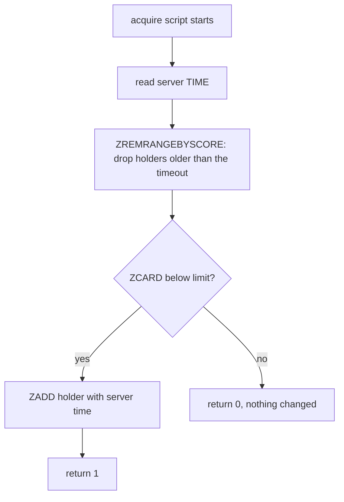

# Lua scripting: rewriting locks, semaphores and transactions

> **Before this lesson:** read [Lua scripting basics](#/lesson/redis/lua-basics) (what `EVAL`,
> `KEYS`, `ARGV` and `redis.call` are) and the first versions of the lock and the semaphore in
> [autocomplete, locks and semaphores](#/lesson/redis/autocomplete-locks-semaphores). The `WATCH`-based
> purchase from [WATCH, pipelining and performance](#/lesson/redis/watch-pipelining-performance) is
> rewritten here too.

## In plain words

Earlier in this track we built three things the hard way:

- a **lock** (only one worker at a time), whose release needed a "check that it is still mine, then
  delete" step;
- a **counting semaphore** (at most N workers at a time), which was unfair when computers' clocks
  disagreed and had a gap between "add myself" and "check my position";
- a **purchase** that used `WATCH` and retried whenever someone else touched the same data.

Each had the same underlying weakness: several separate commands with gaps between them, in which
another program could interfere.

A script closes the gaps. Remember the picture from the last lesson - a written note handed to the
warehouse clerk, carried out in one go. This lesson rewrites all three components as notes. They
become shorter, exact, and faster under load. It is the "after" picture to the earlier lessons'
"before".

Why it matters for a job: these are the forms you will meet in real codebases and libraries.
redis-py's own `Lock` class uses scripts very like the ones below. Being able to read, write and
reason about them - including what they still do *not* protect against - is practical, sought-after
knowledge.

## Part 1 - the lock, done properly

### Acquire: already one command

Taking a lock needs no script, because one command does it:

```bash
127.0.0.1:6379> SET lock:report:daily 3f9a-token NX PX 30000
OK
127.0.0.1:6379> SET lock:report:daily other-token NX PX 30000
(nil)
127.0.0.1:6379> PTTL lock:report:daily
(integer) 29874
```

`NX` - only if the key is absent; `PX 30000` - expire after 30,000 milliseconds. The value is a
random **token** unique to this holder. The second attempt returns `nil`: the lock is held.

### Release: compare, then delete

Releasing must delete the key only if it still holds *our* token (otherwise we might delete a lock
that expired and was taken by someone else).

```lua
if redis.call('GET', KEYS[1]) == ARGV[1] then
    return redis.call('DEL', KEYS[1])
end
return 0
```

- `redis.call('GET', KEYS[1])` reads the lock's current value.
- `== ARGV[1]` compares it with the token we pass in.
- If they match, `DEL` removes the key and its reply (1) is returned.
- Otherwise the script returns 0: not ours, nothing deleted.

```bash
127.0.0.1:6379> EVAL "if redis.call('GET', KEYS[1]) == ARGV[1] then return redis.call('DEL', KEYS[1]) end return 0" 1 lock:report:daily wrong-token
(integer) 0
127.0.0.1:6379> EVAL "if redis.call('GET', KEYS[1]) == ARGV[1] then return redis.call('DEL', KEYS[1]) end return 0" 1 lock:report:daily 3f9a-token
(integer) 1
```

### Extend: compare, then push the deadline

A long job should keep its lock alive. Extending follows the same shape: only the current holder may
do it.

```lua
if redis.call('GET', KEYS[1]) == ARGV[1] then
    return redis.call('PEXPIRE', KEYS[1], ARGV[2])
end
return 0
```

`PEXPIRE key ms` sets a new lifetime in milliseconds and replies 1.

### The whole lock in Python

```python
import time
import uuid
import redis

r = redis.Redis(decode_responses=True)

_RELEASE = r.register_script("""
if redis.call('GET', KEYS[1]) == ARGV[1] then return redis.call('DEL', KEYS[1]) end
return 0
""")
_EXTEND = r.register_script("""
if redis.call('GET', KEYS[1]) == ARGV[1] then return redis.call('PEXPIRE', KEYS[1], ARGV[2]) end
return 0
""")

class Lock:
    def __init__(self, name, hold_ms=30_000):
        self.key, self.hold_ms, self.token = f"lock:{name}", hold_ms, None

    def acquire(self, wait_seconds=10):
        token = str(uuid.uuid4())
        deadline = time.time() + wait_seconds
        while time.time() < deadline:
            if r.set(self.key, token, nx=True, px=self.hold_ms):
                self.token = token
                return True
            time.sleep(0.05)
        return False

    def extend(self):
        return _EXTEND(keys=[self.key], args=[self.token, self.hold_ms]) == 1

    def release(self):
        ok = _RELEASE(keys=[self.key], args=[self.token]) == 1
        self.token = None
        return ok
```

- A `class` bundles data (the key name, the hold time, the current token) with the functions that use
  it.
- `acquire` generates a fresh random token and retries `SET ... NX PX` every 50 ms until it succeeds
  or the waiting time runs out.
- `extend` and `release` call the scripts with the key and this holder's token. A reply other than 1
  tells the caller it no longer holds the lock - information the first version of the lock could not
  give reliably.

> [!WARNING]
> A script makes release and extension *atomic*. It does not make the lock *safe against expiry*: if
> your work outlasts the lock, another holder can enter while you are still running. Check the result
> of `extend()`, stop work if it returns `False`, and for anything that must never overlap, protect
> the resource itself with fencing tokens as described in the earlier lock lesson.

## Part 2 - the semaphore, done properly

Recall the design: a sorted set of holders scored by time; remove the stale ones; add yourself; you
hold a slot if your position is below the limit. The first version had two flaws - scores came from
each client's own clock, and "add" and "check position" were separate steps that could interleave
between clients.

In a script both flaws disappear: we use the *server's* clock for everyone, and the whole sequence is
one atomic step. Better still, we can check for a free slot **before** adding, so a failed attempt
leaves no trace.

```lua
local now = redis.call('TIME')
local ms = now[1] * 1000 + math.floor(now[2] / 1000)
redis.call('ZREMRANGEBYSCORE', KEYS[1], '-inf', ms - tonumber(ARGV[2]))
if redis.call('ZCARD', KEYS[1]) < tonumber(ARGV[1]) then
    redis.call('ZADD', KEYS[1], ms, ARGV[3])
    return 1
end
return 0
```

Line by line (`ARGV[1]` = limit, `ARGV[2]` = timeout in milliseconds, `ARGV[3]` = this holder's id):

1. `redis.call('TIME')` asks the server for its clock. The reply is a two-item list: whole seconds,
   and the microseconds within the current second.
2. Combine them into one number of milliseconds. `math.floor` rounds down.
3. Remove holders who entered more than `timeout` ago: they crashed or forgot to release.
4. `ZCARD` counts the current holders. If that is below the limit...
5. ...add this holder with the current server time as its score, and
6. report success.
7. Otherwise report failure, having changed nothing.

Because one clock (the server's) stamps every holder and nobody can slip in between the count and
the add, the limit can never be exceeded and no client gains an advantage from a fast or slow clock.

Refreshing a slot (for long work) and releasing it:

```lua
-- refresh: only if still a holder
if redis.call('ZSCORE', KEYS[1], ARGV[1]) then
    local now = redis.call('TIME')
    redis.call('ZADD', KEYS[1], now[1] * 1000 + math.floor(now[2] / 1000), ARGV[1])
    return 1
end
return 0
```

A line beginning with `--` is a comment in Lua. `ZSCORE` returns the holder's score, or `false` if it
is no longer a member (it was removed as stale); in the second case the script must **not** re-add
it, because someone else may already have taken the slot. Release is a plain `ZREM`, which is atomic
by itself.

```python
_SEM_ACQUIRE = r.register_script("""
local now = redis.call('TIME')
local ms = now[1] * 1000 + math.floor(now[2] / 1000)
redis.call('ZREMRANGEBYSCORE', KEYS[1], '-inf', ms - tonumber(ARGV[2]))
if redis.call('ZCARD', KEYS[1]) < tonumber(ARGV[1]) then
    redis.call('ZADD', KEYS[1], ms, ARGV[3])
    return 1
end
return 0
""")

def acquire_slot(name, limit, timeout_ms=10_000):
    holder = str(uuid.uuid4())
    if _SEM_ACQUIRE(keys=[f"sem:{name}"], args=[limit, timeout_ms, holder]) == 1:
        return holder
    return None

def release_slot(name, holder):
    return r.zrem(f"sem:{name}", holder) == 1
```

```bash
127.0.0.1:6379> ZRANGE sem:partner-api 0 -1 WITHSCORES
1) "0c1d-holder-a"
2) "1767225600120"
3) "77be-holder-b"
4) "1767225600480"
127.0.0.1:6379> ZCARD sem:partner-api
(integer) 2
```

With a limit of three, one slot is free. The scores are server-clock milliseconds.



## Part 3 - replacing WATCH / MULTI / EXEC

The bookshop purchase from module 4 watched two keys, read them, and retried on conflict. Here is the
same operation as a script: stock and credit are checked, then stock, credit and the order list are
updated - or nothing is.

```lua
local stock = tonumber(redis.call('GET', KEYS[1]) or '0')
local credit = tonumber(redis.call('GET', KEYS[2]) or '0')
local price = tonumber(ARGV[1])
if stock < 1 then return 'sold-out' end
if credit < price then return 'insufficient-credit' end
redis.call('DECR', KEYS[1])
redis.call('DECRBY', KEYS[2], price)
redis.call('RPUSH', KEYS[3], ARGV[2])
return 'ok'
```

Notice the structure insisted on in the last lesson: **every check comes before the first write**, so
the absence of rollback cannot leave a half-finished purchase. Returning short text codes lets the
caller tell the two failures apart.

```python
_BUY = r.register_script("""
local stock = tonumber(redis.call('GET', KEYS[1]) or '0')
local credit = tonumber(redis.call('GET', KEYS[2]) or '0')
local price = tonumber(ARGV[1])
if stock < 1 then return 'sold-out' end
if credit < price then return 'insufficient-credit' end
redis.call('DECR', KEYS[1])
redis.call('DECRBY', KEYS[2], price)
redis.call('RPUSH', KEYS[3], ARGV[2])
return 'ok'
""")

def buy(customer, book, price_cents):
    return _BUY(keys=[f"stock:{book}", f"credit:{customer}", "orders"],
                args=[price_cents, f"{book}:{customer}"])
```

### Why this is faster under load

Count the work for $n$ clients all trying to buy the same popular item at once.

With `WATCH`, every successful purchase changes the stock key and so cancels every other client's
pending attempt. In the worst case the first round has $n$ attempts and one success, the second
$n - 1$ attempts and one success, and so on:

$$\text{attempts} = n + (n-1) + \dots + 1 = \frac{n(n+1)}{2}$$

For 100 clients that is 5,050 attempts, each costing several round trips. With the script, each
client makes exactly one call: 100 attempts. The retry storm is gone because there is nothing to
retry - each script sees the true state when it runs.

| | WATCH / MULTI / EXEC | Lua script |
|---|---|---|
| Round trips per attempt | 3 or more (watch, reads, exec) | 1 |
| Attempts under contention | grows roughly with the square of the number of clients | exactly one each |
| Can branch on data | in the client, between watch and exec | on the server |
| Blocks other clients | no | for the script's (short) duration |
| Logic lives | in application code | in a server-side script |

> [!TIP]
> Optimistic locking is still the right tool when conflicts are rare and the decision logic is complex
> or needs data from outside Redis. Reach for a script when the logic is small and the same keys are
> fought over.

## Part 4 - one more pattern: a token-bucket rate limiter

A **token bucket** allows bursts while enforcing an average rate. Picture a bucket that holds up to
`capacity` tokens and is refilled at a steady `rate` per second. Each request removes a token; an
empty bucket means "slow down". It needs two stored numbers - tokens remaining and the time of the
last refill - and they must be updated together, which makes it a natural script.

```lua
local data = redis.call('HMGET', KEYS[1], 'tokens', 'stamp')
local capacity, rate = tonumber(ARGV[1]), tonumber(ARGV[2])
local now = redis.call('TIME')
local ms = now[1] * 1000 + math.floor(now[2] / 1000)
local tokens = tonumber(data[1]) or capacity
local stamp = tonumber(data[2]) or ms
tokens = math.min(capacity, tokens + (ms - stamp) / 1000 * rate)
local allowed = 0
if tokens >= 1 then
    tokens = tokens - 1
    allowed = 1
end
redis.call('HSET', KEYS[1], 'tokens', tostring(tokens), 'stamp', ms)
redis.call('PEXPIRE', KEYS[1], math.ceil(capacity / rate * 1000) + 1000)
return allowed
```

`HMGET` reads both fields in one call; a brand-new bucket (fields missing) starts full. The refill
line adds `elapsed seconds × rate` tokens, capped at the capacity. `tostring(tokens)` stores the
fractional token count as text so nothing is lost. The final `PEXPIRE` lets idle buckets disappear
once they would be full again anyway.

> [!INTERVIEW]
> If asked to "implement a distributed lock" or "a rate limiter" in Redis, write the script version
> directly and say why: check-and-act must be atomic, and a script is the simplest way to get that.
> Then discuss limits: scripts block the server, so keep them O(1) or O(log n); all keys must be in
> one slot on a cluster; and a lock's expiry still allows overlap, so correctness-critical resources
> need fencing tokens.

## Try it: script-style atomic operations and the retry storm

The model runs each "script" as an uninterruptible function with a server clock. It exercises the
lock (including a stale holder trying to release and extend), the semaphore with a deliberately
skewed client clock that no longer matters, and counts attempts for optimistic retries versus
scripts.

```python-run
class Server:
    def __init__(self): self.kv, self.expires, self.zsets, self.now = {}, {}, {}, 0
    def _live(self, k):
        if k in self.expires and self.expires[k] <= self.now: self.kv.pop(k, None); self.expires.pop(k)
        return k in self.kv
    # --- lock commands ---
    def set_nx_px(self, k, v, ms):
        if self._live(k): return None
        self.kv[k], self.expires[k] = v, self.now + ms; return "OK"
    def release(self, k, token):                       # script: GET == token -> DEL
        if self._live(k) and self.kv[k] == token:
            del self.kv[k]; self.expires.pop(k, None); return 1
        return 0
    def extend(self, k, token, ms):                    # script: GET == token -> PEXPIRE
        if self._live(k) and self.kv[k] == token:
            self.expires[k] = self.now + ms; return 1
        return 0
    # --- semaphore script: uses the SERVER clock only ---
    def sem_acquire(self, k, limit, timeout, holder):
        z = self.zsets.setdefault(k, {})
        for h in [h for h, t in z.items() if t <= self.now - timeout]: del z[h]
        if len(z) < limit:
            z[holder] = self.now; return 1
        return 0
    def sem_refresh(self, k, holder):
        z = self.zsets.get(k, {})
        if holder in z: z[holder] = self.now; return 1
        return 0

s = Server()
print("A acquires:", s.set_nx_px("lock", "token-A", 30_000), "| B acquires:", s.set_nx_px("lock", "token-B", 30_000))
s.now = 20_000; print("A extends at 20 s:", s.extend("lock", "token-A", 30_000))
s.now = 55_000; print("at 55 s B acquires (A's lock ran out at 50 s):", s.set_nx_px("lock", "token-B", 30_000))
print("stale A tries to extend:", s.extend("lock", "token-A", 30_000), "| to release:", s.release("lock", "token-A"))
print("B releases:", s.release("lock", "token-B"), "| holder now:", s.kv.get("lock"))

s = Server(); s.now = 1_000_000
got = [s.sem_acquire("sem", 3, 10_000, f"holder-{c}") for c in "abcd"]
print("semaphore limit 3, four arrivals:", got, "| holders:", sorted(s.zsets["sem"]))
s.now += 6_000; s.sem_refresh("sem", "holder-a")
s.now += 6_000
print("12 s later, e arrives:", s.sem_acquire("sem", 3, 10_000, "holder-e"), "| holders:", sorted(s.zsets["sem"]))
print("stale b tries to refresh:", s.sem_refresh("sem", "holder-b"))

def watch_attempts(n):                  # every success invalidates all other pending attempts
    attempts, waiting = 0, n
    while waiting:
        attempts += waiting; waiting -= 1
    return attempts
for n in (5, 20, 100):
    print(f"{n:3d} clients buying the same item: WATCH attempts={watch_attempts(n):5d}  script calls={n}")

def bucket(state, now, capacity, rate):
    tokens = min(capacity, state.get("tokens", capacity) + (now - state.get("stamp", now)) * rate)
    ok = tokens >= 1
    state["tokens"], state["stamp"] = tokens - (1 if ok else 0), now
    return int(ok)
state = {}
print("token bucket, capacity 3, 1 per second:",
      [(t, bucket(state, t, 3, 1)) for t in (0, 0, 0, 0, 0.5, 1.5, 1.6, 10, 10, 10, 10)])
```

What to look for. B cannot take the lock while A holds it; A's extension at 20 seconds pushes the
deadline to 50 seconds; at 55 seconds B takes over. The stale holder A then gets 0 from both `extend`
and `release` - it is told the truth and B's lock is untouched. In the semaphore, the fourth arrival
is refused; twelve seconds later the holders that were never refreshed have timed out, a newcomer
gets in, and the evicted holder `b` cannot sneak back with a refresh. The attempt counts show the
quadratic growth of optimistic retries (5,050 for 100 clients) against one call each for scripts. The
token bucket allows a burst of three, refuses the fourth and fifth, then admits requests as tokens
drip back in.

## Pitfalls

- **Using the client's clock inside time-based logic.** Read the server's `TIME` in the script so all
  clients agree.
- **Re-adding a stale holder on refresh.** If the holder was removed, its slot may be taken; refresh
  must fail.
- **Writes before checks.** With no rollback, validate everything first.
- **Ignoring the result of `extend` or `release`.** A 0 means you lost the lock; stop work.
- **Believing scripted locks are safe against expiry.** Atomic release does not prevent two holders
  after a timeout. Use fencing where it matters.
- **Scripts that scan.** Keep each script's work constant or logarithmic; a semaphore with thousands
  of holders is the wrong tool.
- **Keys in different slots on a cluster.** The purchase script touches three keys; give them a common
  hash tag or it will be refused.
- **Returning fractional numbers.** The token count would be truncated; store it as text with
  `tostring`.
- **Reinventing the library.** Before writing your own lock, check whether your client's built-in one
  (redis-py's `r.lock(...)`) already does what you need.

## Command cheat sheet

`n` = holders in the semaphore's sorted set.

| Command or script step | Use here | Time |
|---|---|---|
| `SET key token NX PX ms` | acquire a lock | O(1) |
| script: `GET == token` then `DEL` | release only your own lock | O(1) |
| script: `GET == token` then `PEXPIRE` | extend only your own lock | O(1) |
| `PTTL key` | milliseconds left on a lock | O(1) |
| `TIME` | server clock: seconds and microseconds | O(1) |
| `ZREMRANGEBYSCORE sem -inf cutoff` | drop stale holders | O(log n + removed) |
| `ZCARD sem` | holders now | O(1) |
| `ZADD sem ms holder` | take or refresh a slot | O(log n) |
| `ZSCORE sem holder` | am I still a holder? | O(1) |
| `ZREM sem holder` | release a slot | O(log n) |
| `HMGET` / `HSET bucket tokens stamp` | token-bucket state | O(1) |
| `EVALSHA sha numkeys keys... args...` | run any of the scripts | cost of its commands |

## Summary

- Lock acquisition is a single `SET ... NX PX`; release and extension are compare-then-act scripts
  keyed by a random token.
- The semaphore script uses the server's clock, counts before adding, and so is exact and fair where
  the multi-command version was neither.
- Check-then-update transactions become one script with all checks before all writes; contention no
  longer causes retries.
- Scripts give atomicity, not immunity from expiry, long pauses or failover - design around those
  separately.

## Glossary

- **Token** - the unique random value identifying a lock's current holder.
- **Compare-and-delete** - deleting a key only if it holds an expected value, atomically.
- **Extend (renew)** - pushing a held lock's deadline further into the future.
- **Stale holder** - a client that still believes it holds a lock or slot that has expired.
- **Server clock** - the time reported by the Redis server (`TIME`), shared by all clients.
- **Clock skew** - disagreement between different machines' clocks.
- **Contention** - several clients competing to change the same keys.
- **Retry storm** - a burst of repeated attempts caused by clients invalidating each other.
- **Token bucket** - a rate limiter that refills at a steady rate and allows bursts up to a capacity.
- **Fencing token** - an increasing number checked by the protected resource to reject stale writers.

```quiz
[
  {"q": "Why does acquiring the lock not need a script?",
   "options": ["Locks cannot be scripted", "SET key token NX PX ms already checks for absence, writes the token and sets the expiry in one atomic command", "Acquisition is never contended", "Scripts cannot call SET"],
   "answer": 1,
   "explain": "One command is atomic by itself. Scripts are needed only where several commands must act together."},
  {"q": "The release script returns 0. What should the caller conclude?",
   "options": ["The lock was released twice", "It no longer holds the lock (it expired or was taken over), and nothing was deleted", "Redis is down", "The token was too long"],
   "answer": 1,
   "explain": "The stored value did not match the caller's token, so the lock belongs to someone else or to nobody."},
  {"q": "Why does the semaphore script read redis.call('TIME') instead of receiving a timestamp from the client?",
   "options": ["Clients cannot send numbers", "A single server clock stamps every holder, so differences between client clocks cannot make it unfair", "TIME is faster than ARGV", "It avoids using sorted sets"],
   "answer": 1,
   "explain": "Client-supplied times let a machine with a slow clock jump the queue; the server's clock is the same for all."},
  {"q": "In the scripted semaphore, what happens when no slot is free?",
   "options": ["The holder is added and then removed", "Nothing is written; the script returns 0", "The oldest holder is evicted", "The limit is raised"],
   "answer": 1,
   "explain": "The script counts first and adds only if there is room, so a failed attempt leaves no trace."},
  {"q": "A holder was removed as stale and then calls the refresh script. Why must the refresh fail?",
   "options": ["Refresh is not implemented", "Its slot may already have been given to someone else; re-adding it would exceed the limit", "Scores cannot be updated", "ZSCORE is slow"],
   "answer": 1,
   "explain": "Only a current member may update its timestamp. A removed holder has to acquire again."},
  {"q": "100 clients try to buy the same item at the same moment using WATCH. In the worst case, about how many attempts occur in total?",
   "options": ["100", "200", "5,050", "10,000"],
   "answer": 2,
   "explain": "100 + 99 + ... + 1 = 100 x 101 / 2 = 5,050, since each success invalidates every other pending attempt."},
  {"q": "In the purchase script, why do both checks come before any DECR?",
   "options": ["Lua requires it", "Scripts have no rollback, so a failed check after a write would leave a half-applied purchase", "GET must precede DECR in Redis", "To save memory"],
   "answer": 1,
   "explain": "Validate first, then write: the only way to be all-or-nothing without rollback."},
  {"q": "What does a scripted lock still NOT protect against?",
   "options": ["Another client deleting the lock with the wrong token", "A holder whose work outlasts the lock's expiry while another client acquires it", "Two clients acquiring at the same instant", "Releasing without a token"],
   "answer": 1,
   "explain": "Expiry-based locks can be held by two parties after a timeout. Fencing tokens at the resource handle that case."}
]
```

> **Source:** Carlson, *Redis in Action*, ch. 11 (sections 11.2-11.3: rewriting locks and semaphores with Lua, doing away with WATCH/MULTI/EXEC); the server-clock semaphore, purchase script, attempt analysis, token bucket and simulation are original.
> Further reading: <https://redis.io/docs/latest/develop/programmability/eval-intro/>, <https://redis.io/docs/latest/develop/clients/patterns/distributed-locks/>, <https://redis.io/docs/latest/commands/time/>
