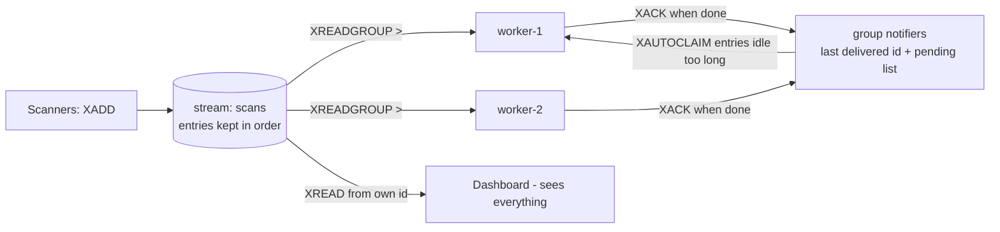

# Modern Redis: streams and consumer groups

> **Before this lesson:** you should know why pub/sub loses messages
> ([pub/sub, transactions and expiry](#/lesson/redis/pubsub-transactions-expiry)) and how a list-based
> queue with acknowledgements works, including the terms *at-least-once* and *idempotent*
> ([queues, messaging and files](#/lesson/redis/queues-messaging-files)).

## In plain words

Earlier lessons gave us two ways of passing messages between programs, each with a gap:

- **Pub/sub** broadcasts to everyone listening right now, but remembers nothing. Miss it and it is
  gone.
- **Lists as queues** remember messages until a worker takes them, but once taken a message is
  removed - nobody else can read it, and there is no history to look back on.

A **stream** fills the gap. It is an **append-only log**: a list of entries where new ones are only
ever added at the end, each stamped with an ever-increasing id, and reading does **not** remove
anything.

Think of a ship's logbook. Every event is written on the next line with the time. Anyone may read it,
starting from any page, as often as they like; reading does not tear the page out. The navigator can
read from where they last stopped; the captain can re-read last week. And if a team of clerks shares
the job of processing the entries, each entry is assigned to one clerk, who ticks it off when done -
that team is what Redis calls a **consumer group**.

Why it matters for a job: streams are the modern answer in Redis for event pipelines, job queues
with several independent consumers, activity feeds and audit trails. The same model - a log with
consumer groups - is how Apache Kafka works, so learning it here transfers directly to one of the
most widely used tools in data engineering.

The scenario: **Parcelwise**, the delivery company, records every scan of a parcel as an event.

## Part 1 - adding and reading entries

### Appending with XADD

Stream commands start with `X`. `XADD` appends one entry made of field-value pairs.

```bash
127.0.0.1:6379> XADD scans * parcel P-1001 depot oslo status arrived
"1767225600000-0"
127.0.0.1:6379> XADD scans * parcel P-1002 depot oslo status arrived
"1767225600000-1"
127.0.0.1:6379> XADD scans * parcel P-1001 depot oslo status out-for-delivery
"1767225605120-0"
127.0.0.1:6379> XLEN scans
(integer) 3
```

The `*` asks Redis to generate the entry's id. The reply is that id. `XLEN` counts entries.

### Understanding ids

An id has two parts joined by a hyphen: `<milliseconds>-<sequence>`.

- The first part is the server's clock in milliseconds since 1 January 1970.
- The second part is a counter that distinguishes entries added within the same millisecond: the
  first two entries above share a millisecond, so they got `-0` and `-1`.

Ids only ever increase. So an id is both a unique name and a position in time, which is what lets
you say "give me everything after this id" or "everything between 09:00 and 10:00".

### Reading a range with XRANGE

```bash
127.0.0.1:6379> XRANGE scans - + COUNT 2
1) 1) "1767225600000-0"
   2) 1) "parcel"
      2) "P-1001"
      3) "depot"
      4) "oslo"
      5) "status"
      6) "arrived"
2) 1) "1767225600000-1"
   2) 1) "parcel"
      2) "P-1002"
      3) "depot"
      4) "oslo"
      5) "status"
      6) "arrived"
127.0.0.1:6379> XRANGE scans (1767225600000-1 +
1) 1) "1767225605120-0"
   2) 1) "parcel"
      2) "P-1001"
      3) "depot"
      4) "oslo"
      5) "status"
      6) "out-for-delivery"
```

`-` and `+` mean "the smallest possible id" and "the largest". `COUNT 2` limits the reply. Each entry
comes back as its id followed by its fields. In the second command, the `(` makes the start
exclusive: everything *after* that id - the standard way to continue where you stopped. `XREVRANGE`
reads backwards (newest first).

Nothing was removed. Run the same `XRANGE` again and you get the same entries.

### Waiting for new entries with XREAD

`XREAD` reads entries with ids greater than the one you give, and can wait for new ones to arrive.

```bash
127.0.0.1:6379> XREAD COUNT 10 BLOCK 5000 STREAMS scans $
(nil)
(5.02s)
127.0.0.1:6379> XREAD COUNT 10 STREAMS scans 1767225600000-1
1) 1) "scans"
   2) 1) 1) "1767225605120-0"
         2) 1) "parcel"
            2) "P-1001"
            3) "depot"
            4) "oslo"
            5) "status"
            6) "out-for-delivery"
```

`BLOCK 5000` waits up to 5,000 milliseconds. The special id `$` means "only entries added after I
started waiting"; none arrived, so the reply was empty after five seconds. The second call passes a
real id and receives everything after it. A reader loops: read, process, remember the last id seen,
read again from that id. Because the reader holds its own position, a reader that was offline for an
hour resumes exactly where it stopped. That is the property pub/sub lacks.

## Part 2 - consumer groups: sharing the work

`XREAD` gives *every* reader *every* entry. That suits independent listeners (a dashboard and an
archiver both want everything). But when five identical workers process scan events, each event must
go to exactly **one** of them. That is the job of a consumer group.

Three terms:

- A **consumer group** is a named team reading one stream. The group remembers which entries have
  been handed out.
- A **consumer** is one named member of the team (one worker process).
- The **pending entries list** (PEL) records entries that were handed to a consumer but not yet
  confirmed as finished.

### Create a group

```bash
127.0.0.1:6379> XGROUP CREATE scans notifiers $ MKSTREAM
OK
```

This creates the group `notifiers` on the stream `scans`. The `$` means "start with entries added
from now on" (use `0` to start from the very beginning of the stream). `MKSTREAM` creates the stream
if it does not exist.

### Read as a member of the group

```bash
127.0.0.1:6379> XADD scans * parcel P-1003 depot bergen status arrived
"1767225700000-0"
127.0.0.1:6379> XADD scans * parcel P-1004 depot bergen status arrived
"1767225700500-0"
127.0.0.1:6379> XREADGROUP GROUP notifiers worker-1 COUNT 1 STREAMS scans >
1) 1) "scans"
   2) 1) 1) "1767225700000-0"
         2) 1) "parcel"
            2) "P-1003"
            3) "depot"
            4) "bergen"
            5) "status"
            6) "arrived"
127.0.0.1:6379> XREADGROUP GROUP notifiers worker-2 COUNT 1 STREAMS scans >
1) 1) "scans"
   2) 1) 1) "1767225700500-0"
         2) 1) "parcel"
            2) "P-1004"
            3) "depot"
            4) "bergen"
            5) "status"
            6) "arrived"
```

`XREADGROUP GROUP <group> <consumer>` reads on behalf of a named consumer. The special id `>` means
"entries never delivered to anyone in this group". Worker 1 received the first entry; worker 2, asking
a moment later, received the *next* one - not the same one. The group divides the work.

### Acknowledge when done

Each delivered entry now sits in the pending list under the consumer that received it. When the
worker has finished the job, it acknowledges:

```bash
127.0.0.1:6379> XPENDING scans notifiers
1) (integer) 2
2) "1767225700000-0"
3) "1767225700500-0"
4) 1) 1) "worker-1"
      2) "1"
   2) 1) "worker-2"
      2) "1"
127.0.0.1:6379> XACK scans notifiers 1767225700000-0
(integer) 1
127.0.0.1:6379> XPENDING scans notifiers
1) (integer) 1
2) "1767225700500-0"
3) "1767225700500-0"
4) 1) 1) "worker-2"
      2) "1"
```

`XPENDING` summarises the pending list: how many entries, the lowest and highest pending ids, and the
count per consumer. `XACK` removes an entry from the pending list (reply 1 = one entry acknowledged).
The entry stays in the stream - acknowledging is about the *group's* bookkeeping, not deletion.



### When a worker dies: claiming its entries

Worker 2 crashes after receiving its entry and before acknowledging. The entry stays in the pending
list under `worker-2` for ever unless someone takes it over. `XAUTOCLAIM` transfers pending entries
that have been idle (unacknowledged) for longer than a given time to another consumer.

```bash
127.0.0.1:6379> XAUTOCLAIM scans notifiers worker-1 60000 0 COUNT 10
1) "0-0"
2) 1) 1) "1767225700500-0"
      2) 1) "parcel"
         2) "P-1004"
         3) "depot"
         4) "bergen"
         5) "status"
         6) "arrived"
3) (empty array)
```

Read the arguments: stream, group, the consumer taking over (`worker-1`), the minimum idle time in
milliseconds (60,000 = one minute), and a starting id for the scan (`0` = from the beginning). The
reply has three parts: the id to pass next time (`0-0` means the scan is complete), the claimed
entries, and a list of ids that no longer exist in the stream. Worker 1 now owns the entry and will
process and acknowledge it.

Each time an entry is delivered or claimed, its **delivery counter** goes up. An entry delivered many
times is probably a "poison" message that crashes whoever handles it; move such entries to a separate
**dead-letter** stream instead of retrying for ever.

> [!WARNING]
> A claimed entry may already have been processed by the consumer that crashed (it died after doing
> the work and before `XACK`). Consumer groups therefore give **at-least-once** delivery, and handlers
> must be idempotent - safe to run twice - exactly as with the list-based reliable queue.

## Part 3 - a worker in Python

```python
import redis

r = redis.Redis(decode_responses=True)
STREAM, GROUP = "scans", "notifiers"

def ensure_group():
    try:
        r.xgroup_create(STREAM, GROUP, id="$", mkstream=True)
    except redis.ResponseError as e:
        if "BUSYGROUP" not in str(e):
            raise                                   # a real error, not "already exists"

def worker(name, handle):
    ensure_group()
    while True:
        # 1. take over entries another consumer left unfinished for more than a minute
        _, stale, _ = r.xautoclaim(STREAM, GROUP, name, min_idle_time=60_000, start_id="0", count=10)
        # 2. then ask for new entries, waiting up to 5 seconds
        fresh = r.xreadgroup(GROUP, name, {STREAM: ">"}, count=10, block=5000)
        new = fresh[0][1] if fresh else []
        for entry_id, fields in stale + new:
            handle(fields)                          # must be idempotent
            r.xack(STREAM, GROUP, entry_id)

def publish_scan(parcel, depot, status):
    return r.xadd(STREAM, {"parcel": parcel, "depot": depot, "status": status},
                  maxlen=1_000_000, approximate=True)
```

- `ensure_group` creates the group. If it already exists, Redis answers with an error whose text
  begins `BUSYGROUP`; that case is expected and ignored, any other error is re-raised.
- `xautoclaim` returns three values, matching the three-part reply above; the middle one is the list
  of `(id, fields)` pairs.
- `xreadgroup` takes a dictionary of stream name to id; `">"` asks for never-delivered entries. Its
  reply is a list with one item per stream, each `[stream_name, entries]`, hence `fresh[0][1]`.
- Each entry is handled and then acknowledged. If `handle` raises an error, the `xack` is skipped and
  the entry stays pending, to be retried or claimed later.
- `publish_scan` appends an entry and trims the stream, explained next.

## Part 4 - keeping a stream from growing for ever

A log that is never trimmed eventually fills memory. Two ways to cap it:

```bash
127.0.0.1:6379> XADD scans MAXLEN ~ 1000000 * parcel P-1005 depot oslo status arrived
"1767225800000-0"
127.0.0.1:6379> XTRIM scans MINID ~ 1767139200000
(integer) 0
```

`MAXLEN ~ 1000000` keeps roughly the newest million entries. `MINID` removes entries older than a
given id - since ids begin with a timestamp, that is "delete everything older than this moment"
(here, 24 hours earlier). The `~` means "approximately": Redis stores a stream in blocks and, with
`~`, removes only whole blocks, which is much cheaper than trimming to an exact count.

> [!TIP]
> Trimming ignores the pending list. If entries are trimmed before a slow group has processed them,
> those entries are lost to that group. Size the retention for your slowest consumer, and monitor
> **lag** - how far behind each group is - with `XINFO GROUPS`.

```bash
127.0.0.1:6379> XINFO GROUPS scans
1)  1) "name"
    2) "notifiers"
    3) "consumers"
    4) (integer) 2
    5) "pending"
    6) (integer) 0
    7) "last-delivered-id"
    8) "1767225700500-0"
    9) "entries-read"
   10) (integer) 2
   11) "lag"
   12) (integer) 1
```

`pending` is the number of delivered-but-unacknowledged entries; `lag` (Redis 7+) is the number of
entries not yet delivered to the group at all. Growing lag means the workers cannot keep up.

## Part 5 - choosing between pub/sub, lists and streams

| Need | Pub/sub | List queue | Stream |
|---|---|---|---|
| Messages kept if nobody is listening | no | yes | yes |
| Several independent readers each see everything | yes | no | yes (`XREAD`, or one group each) |
| Work shared among a team, one worker per message | no | yes | yes (consumer group) |
| Acknowledgement and takeover of a dead worker's messages | no | build it yourself | built in (`XACK`, `XAUTOCLAIM`) |
| Re-read history, query by time | no | no | yes (`XRANGE`) |
| Lowest overhead for throwaway notifications | yes | - | - |

Compared with Apache Kafka, streams offer the same log-and-groups model with far less to operate, but
the data must fit in RAM, a stream lives on one server (there are no built-in partitions - you create
several streams and choose one by key), and durability depends on Redis's persistence settings.

> [!INTERVIEW]
> "Pub/sub or streams?" Pub/sub is fire-and-forget fan-out with no persistence; streams are a
> persistent log with ids, replay, consumer groups, acknowledgements and pending-entry recovery,
> giving at-least-once delivery. Mention trimming (`MAXLEN ~`), lag monitoring, idempotent consumers
> and dead-lettering by delivery count, and you have covered what interviewers look for.

## Try it: a stream with a consumer group

The block implements the essentials in plain Python: id generation, range reads, a group with a
last-delivered position, per-consumer pending entries, acknowledgement, and claiming idle entries.

```python-run
class Stream:
    def __init__(self):
        self.entries = []                 # list of (id_tuple, fields) in increasing id order
        self.groups = {}                  # name -> {"last": id_tuple, "pending": {id: [consumer, since, deliveries]}}
        self.last_id = (0, 0)

    def xadd(self, now_ms, fields):
        ms, seq = self.last_id
        new = (now_ms, 0) if now_ms > ms else (ms, seq + 1)      # same millisecond -> bump sequence
        self.entries.append((new, fields)); self.last_id = new
        return fmt(new)

    def xrange(self, after=(0, -1)):
        return [(fmt(i), f) for i, f in self.entries if i > after]

    def xgroup_create(self, group, from_start=True):
        self.groups[group] = {"last": (0, -1) if from_start else self.last_id, "pending": {}}

    def xreadgroup(self, group, consumer, count, now_ms):
        g = self.groups[group]
        fresh = [(i, f) for i, f in self.entries if i > g["last"]][:count]
        for i, _ in fresh:
            g["pending"][i] = [consumer, now_ms, 1]; g["last"] = i
        return [(fmt(i), f) for i, f in fresh]

    def xack(self, group, entry_id):
        return 1 if self.groups[group]["pending"].pop(parse(entry_id), None) else 0

    def xpending(self, group):
        return {fmt(i): (c, n) for i, (c, _, n) in sorted(self.groups[group]["pending"].items())}

    def xautoclaim(self, group, consumer, min_idle, now_ms):
        claimed = []
        for i, info in sorted(self.groups[group]["pending"].items()):
            if now_ms - info[1] >= min_idle:
                info[0], info[1], info[2] = consumer, now_ms, info[2] + 1
                claimed.append((fmt(i), dict(self.entries_by_id()[i])))
        return claimed

    def entries_by_id(self): return dict(self.entries)

    def xtrim_maxlen(self, n):
        removed = max(0, len(self.entries) - n); self.entries = self.entries[removed:]
        return removed

def fmt(i): return f"{i[0]}-{i[1]}"
def parse(s): a, b = s.split("-"); return (int(a), int(b))

s = Stream()
ids = [s.xadd(1000, {"parcel": "P-1"}), s.xadd(1000, {"parcel": "P-2"}), s.xadd(1005, {"parcel": "P-3"})]
print("ids:", ids)
print("everything after the first id:", [i for i, _ in s.xrange(after=parse(ids[0]))])

s.xgroup_create("notifiers")
a = s.xreadgroup("notifiers", "worker-1", count=2, now_ms=2000)
b = s.xreadgroup("notifiers", "worker-2", count=2, now_ms=2000)
print("worker-1 got:", [i for i, _ in a], "| worker-2 got:", [i for i, _ in b])
print("ack by worker-1:", s.xack("notifiers", a[0][0]), s.xack("notifiers", a[1][0]),
      "| ack again:", s.xack("notifiers", a[0][0]))
print("pending:", s.xpending("notifiers"))

print("claim at t=30 s (idle 28 s < 60 s):", s.xautoclaim("notifiers", "worker-1", 60_000, 30_000))
print("claim at t=70 s:", s.xautoclaim("notifiers", "worker-1", 60_000, 70_000))
print("pending:", s.xpending("notifiers"), "<- now owned by worker-1, delivered twice")

s.xgroup_create("archiver")                         # a second group sees the whole stream independently
print("archiver reads:", [i for i, _ in s.xreadgroup("archiver", "arch-1", 10, 80_000)])
print("trimmed:", s.xtrim_maxlen(1), "| stream still holds:", [i for i, _ in s.xrange()])
```

Reading the output. The two entries added in the same millisecond receive sequence numbers 0 and 1.
Worker 1 is handed the first two entries and worker 2 the third - no overlap. Worker 1 acknowledges
both; acknowledging the same id again returns 0. Worker 2 never acknowledges, so its entry remains
pending. A claim attempt after 28 seconds of idleness takes nothing; after 68 seconds it transfers the
entry to worker 1 and the delivery count becomes 2. A second group, created later, independently
reads all three entries from the beginning. Finally, trimming to one entry removes the two oldest.

## Pitfalls

- **Forgetting to acknowledge.** The pending list grows without bound and entries are redelivered on
  every recovery pass.
- **Never claiming.** Entries held by a dead consumer wait for ever. Run `XAUTOCLAIM` regularly.
- **Handlers that are not idempotent.** Claimed entries may already have been processed.
- **Retrying poison entries for ever.** Check the delivery count and dead-letter after a few attempts.
- **No trimming.** Streams keep everything until told otherwise.
- **Trimming faster than the slowest group reads.** Entries vanish before it sees them. Watch lag.
- **Reusing consumer names across live processes.** Two processes with the same name share one
  pending list and confuse recovery. Use unique names, and delete consumers that are gone for good
  (`XGROUP DELCONSUMER`), which also discards their pending entries - claim those first.
- **Expecting global ordering across streams.** Order is guaranteed within one stream only.
- **Treating a stream as durable by default.** It is as durable as the server's persistence and
  replication settings.

## Command cheat sheet

`N` = entries in the stream, `M` = entries returned.

| Command | Meaning | Time |
|---|---|---|
| `XADD key [MAXLEN ~ n] * field value ...` | append an entry (optionally trimming) | O(1) |
| `XLEN key` | number of entries | O(1) |
| `XRANGE key start end [COUNT n]` | entries in id order (`-`, `+`, `(id`) | O(log N + M) |
| `XREVRANGE key end start` | the same, newest first | O(log N + M) |
| `XREAD [COUNT n] [BLOCK ms] STREAMS key id` | entries after an id; `$` = only new ones | O(M) |
| `XGROUP CREATE key group id [MKSTREAM]` | create a consumer group | O(1) |
| `XREADGROUP GROUP g consumer [COUNT n] [BLOCK ms] STREAMS key >` | take undelivered entries for a consumer | O(M) |
| `XACK key group id ...` | mark entries as processed | O(1) per id |
| `XPENDING key group [start end count [consumer]]` | inspect unacknowledged entries | O(M) |
| `XAUTOCLAIM key group consumer min-idle start [COUNT n]` | take over idle pending entries (6.2+) | O(1) for small counts |
| `XCLAIM key group consumer min-idle id ...` | take over specific entries | O(log N) per id |
| `XTRIM key MAXLEN\|MINID [~] threshold` | cap by count or age | O(removed) |
| `XDEL key id ...` | delete specific entries | O(1) per id |
| `XINFO STREAM\|GROUPS\|CONSUMERS key ...` | inspect a stream, its groups and consumers | O(1) to O(groups) |

## Summary

- A stream is an append-only log of field-value entries with increasing `<ms>-<seq>` ids; reading
  never removes entries.
- `XRANGE` and `XREAD` let any reader start from any id, so readers can resume after downtime.
- A consumer group delivers each entry to one member, tracks unacknowledged entries per consumer, and
  lets another consumer claim the entries of one that died.
- Delivery is at-least-once; handlers must tolerate repeats.
- Trim with `MAXLEN ~` or `MINID ~`, and monitor pending counts and lag.

## Glossary

- **Stream** - an append-only log of entries stored under one key.
- **Entry** - one record in a stream: an id plus field-value pairs.
- **Entry id** - `<milliseconds>-<sequence>`, unique and always increasing.
- **Append-only** - new data is added only at the end; existing data is not modified.
- **Consumer group** - a named set of consumers that share a stream so each entry goes to one of them.
- **Consumer** - one named reader inside a group.
- **Pending entries list (PEL)** - entries delivered to a consumer and not yet acknowledged.
- **Acknowledge (XACK)** - confirm that an entry has been processed.
- **Claim** - transfer ownership of a pending entry to another consumer.
- **Idle time** - how long a pending entry has gone without being acknowledged or re-delivered.
- **Delivery count** - how many times an entry has been handed to a consumer.
- **Lag** - how many entries a group has not yet been given.
- **Trimming** - removing old entries to bound the stream's size.
- **Dead-letter stream** - where entries that repeatedly fail are parked.

```quiz
[
  {"q": "Two entries are added to a stream within the same millisecond 1700000000000. What are their ids?",
   "options": ["Both 1700000000000", "1700000000000-0 and 1700000000000-1", "1700000000000-0 and 1700000000001-0", "Random UUIDs"],
   "answer": 1,
   "explain": "The sequence part distinguishes entries created in the same millisecond, keeping ids unique and increasing."},
  {"q": "After XRANGE returns an entry, what happens to that entry in the stream?",
   "options": ["It is deleted", "It stays; reading a stream never removes entries", "It moves to the pending list", "It is marked read-only"],
   "answer": 1,
   "explain": "A stream is a log. Entries leave only through trimming or XDEL."},
  {"q": "Two workers in the same consumer group both call XREADGROUP ... STREAMS scans >. How are entries distributed?",
   "options": ["Both receive every entry", "Each entry is delivered to only one of them", "Only the first worker ever receives entries", "Entries alternate strictly"],
   "answer": 1,
   "explain": "The group tracks the last delivered id, so the special id > hands each new entry to a single consumer."},
  {"q": "What does the special id > mean in XREADGROUP?",
   "options": ["Entries with ids greater than zero", "Entries never delivered to any consumer in this group", "The newest entry only", "All pending entries"],
   "answer": 1,
   "explain": "Passing a real id instead re-reads that consumer's own pending entries; > asks for new work."},
  {"q": "A worker crashes after reading an entry and before XACK. Where is the entry now?",
   "options": ["Lost", "Back at the head of the stream", "In the group's pending list under that consumer, until acknowledged or claimed", "In a dead-letter stream"],
   "answer": 2,
   "explain": "Unacknowledged deliveries stay in the pending list. Another consumer can take them with XAUTOCLAIM."},
  {"q": "Why must stream consumers be idempotent?",
   "options": ["Streams reorder entries", "An entry can be processed, then re-delivered after a crash before acknowledgement, so it may be handled twice", "XACK is asynchronous", "Field names can repeat"],
   "answer": 1,
   "explain": "Consumer groups give at-least-once delivery; duplicates are possible on recovery."},
  {"q": "What does the ~ in XADD scans MAXLEN ~ 1000000 * ... do?",
   "options": ["Makes the id approximate", "Allows approximate trimming, removing whole internal blocks so the length may slightly exceed the limit but trimming is cheap", "Disables trimming", "Trims by time"],
   "answer": 1,
   "explain": "Exact trimming costs more. Approximate trimming keeps the stream near the limit efficiently."},
  {"q": "Which requirement points to pub/sub over a stream?",
   "options": ["Readers must be able to resume after downtime", "Work must be shared with acknowledgements", "Throwaway notifications to whoever is connected, where a missed message does not matter", "History must be queried by time"],
   "answer": 2,
   "explain": "Pub/sub is the lightest option when no persistence or replay is needed. Everything else in the list needs a stream."}
]
```

> **Source:** redis.io documentation on streams (introduced in Redis 5.0, after the book was written); for contrast with earlier messaging designs see Carlson, *Redis in Action*, ch. 6 (sections 6.4-6.5). All explanations and code are original.
> Further reading: <https://redis.io/docs/latest/develop/data-types/streams/>, <https://redis.io/docs/latest/commands/xreadgroup/>, <https://redis.io/docs/latest/commands/xautoclaim/>, <https://redis.io/docs/latest/commands/xadd/>
