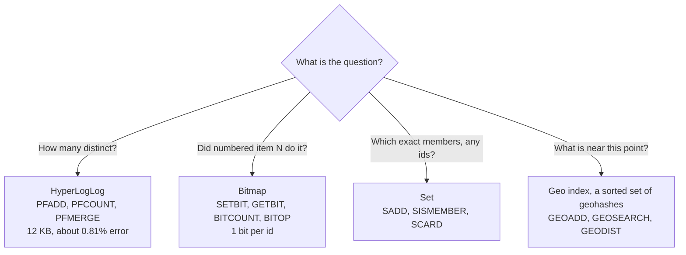

# Modern Redis: HyperLogLog, bitmaps and geospatial indexes

> **Before this lesson:** you should know sets and sorted sets
> ([strings, lists and sets](#/lesson/redis/strings-lists-sets),
> [hashes and sorted sets](#/lesson/redis/hashes-sorted-sets)), the bit commands `SETBIT` / `GETBIT`,
> and why memory per item matters ([sharded structures and bits](#/lesson/redis/sharded-structures-bits)).
> A **hash function** - a function that turns any input into an evenly spread, repeatable number - was
> introduced in that lesson and is used again here.

## In plain words

This lesson covers three special-purpose tools. Each answers one kind of question extremely cheaply.

**"How many different visitors did we have?"** Counting *distinct* things normally means remembering
every one you have seen, so memory grows with the count. A **HyperLogLog** gives an estimate - within
about 1 % - using a tiny, fixed amount of memory, no matter whether there were a thousand visitors or
a billion. It is like estimating the size of a crowd from a clever observation instead of writing
down every name.

**"Did user 5,120 log in on Tuesday?"** When the things are numbered and the answer is yes or no, a
**bitmap** stores one bit - a single 0 or 1 - per item. Picture an attendance sheet with one tick box
per pupil: a whole school's attendance fits on a page.

**"Which depots are within 5 km of this customer?"** A **geospatial index** stores points on the
Earth and finds those near a location, the way a map app finds nearby cafés.

Why it matters for a job: daily and monthly active users, unique page views, feature usage, "near
me" search - these are everyday product metrics and features. Knowing that each has a purpose-built
structure, and what accuracy and memory it costs, is exactly the kind of judgement that
distinguishes an experienced engineer.

## Part 1 - HyperLogLog: counting distinct items approximately

The number of distinct items in a collection is called its **cardinality**.

### The exact way and its cost

A set counts distinct visitors exactly:

```bash
127.0.0.1:6379> SADD visitors:2026-01-01 u1001 u1002 u1001
(integer) 2
127.0.0.1:6379> SCARD visitors:2026-01-01
(integer) 2
```

The duplicate `u1001` was ignored and `SCARD` reports 2. The trouble is memory: every member is
stored. Ten million visitors a day at around 60 bytes each is 600 MB per day.

### The approximate way

```bash
127.0.0.1:6379> PFADD hll:visitors:2026-01-01 u1001 u1002 u1001
(integer) 1
127.0.0.1:6379> PFCOUNT hll:visitors:2026-01-01
(integer) 2
127.0.0.1:6379> PFADD hll:visitors:2026-01-01 u1002
(integer) 0
127.0.0.1:6379> PFADD hll:visitors:2026-01-02 u1002 u1003
(integer) 1
127.0.0.1:6379> PFCOUNT hll:visitors:2026-01-01 hll:visitors:2026-01-02
(integer) 3
127.0.0.1:6379> PFMERGE hll:visitors:week hll:visitors:2026-01-01 hll:visitors:2026-01-02
OK
127.0.0.1:6379> PFCOUNT hll:visitors:week
(integer) 3
```

- `PFADD` adds items. It replies 1 if the internal state changed (the estimate may have changed) and
  0 if not - adding `u1002` again changed nothing.
- `PFCOUNT` returns the estimated number of distinct items. With several keys it estimates the
  distinct count of their **union**: `u1002` visited on both days and is counted once, giving 3.
- `PFMERGE` stores the union of several HyperLogLogs in a new key - daily counters roll up into
  weekly and monthly ones without double counting.

(The `PF` prefix honours Philippe Flajolet, the mathematician who devised the method.)

The cost: a HyperLogLog uses **at most 12 KB**, whatever the count, and its estimate has a standard
error of about **0.81 %**. What you give up: you cannot list the members, cannot ask whether a
particular item was added, and cannot remove an item.

### How can that possibly work? The intuition

Flip a coin repeatedly and note the longest run of heads before the first tail. One person rarely
gets five heads in a row. But if a thousand people each try, someone almost certainly will. So the
*longest run observed* tells you roughly how many people tried: a run of $k$ suggests about $2^k$
attempts.

HyperLogLog does this with hashes. Hashing an item gives a number whose bits look random - each bit
is a coin flip, and the same item always produces the same flips, so duplicates add nothing new. The
algorithm tracks the longest run of leading zero bits it has seen.

One observation is far too noisy (a single lucky hash would wreck the estimate), so the items are
split into many groups - Redis uses 16,384 of them, called **registers** - by using the first 14 bits
of the hash to choose a register. Each register remembers the longest run seen among its own items,
and the final estimate combines all the registers using a particular kind of average (the harmonic
mean) that is not thrown off by a few lucky ones. More registers mean better accuracy; with
$m$ registers the standard error is about $1.04 / \sqrt{m}$, and $1.04 / \sqrt{16384} \approx 0.81\,\%$.
Each register needs only 6 bits, and $16384 \times 6$ bits is 12 KB. The runnable block at the end
implements a small version so you can watch it work.

> [!TIP]
> Use a HyperLogLog when you need *how many*, a set when you need *which ones*, and a bitmap when you
> need *which ones* and the items are numbered densely. For small counts Redis stores a HyperLogLog
> in a compact "sparse" form far smaller than 12 KB, so there is no penalty for using one on
> low-traffic keys.

## Part 2 - bitmaps: one bit per numbered item

A bitmap is not a separate data type: it is an ordinary Redis string treated as a row of bits, each
addressed by its position (its **offset**), counting from 0.

### Marking and testing

Suppose user ids are whole numbers. To record who was active on a day, set the bit at the position
equal to the user's id.

```bash
127.0.0.1:6379> SETBIT active:2026-01-01 5120 1
(integer) 0
127.0.0.1:6379> SETBIT active:2026-01-01 77 1
(integer) 0
127.0.0.1:6379> GETBIT active:2026-01-01 5120
(integer) 1
127.0.0.1:6379> GETBIT active:2026-01-01 9999
(integer) 0
127.0.0.1:6379> BITCOUNT active:2026-01-01
(integer) 2
127.0.0.1:6379> STRLEN active:2026-01-01
(integer) 641
```

`SETBIT key offset 1` turns a bit on and replies with its *previous* value. `GETBIT` reads one bit;
positions never written (or beyond the end) read as 0. `BITCOUNT` counts the bits that are 1 - the
number of active users, exactly. `STRLEN` shows the size: setting bit 5120 made the string 641 bytes
long, because bits 0 to 5120 need $\lfloor 5120 / 8 \rfloor + 1 = 641$ bytes.

That size rule is the key fact: a bitmap's size depends on the **highest id**, not on how many bits
are set. Ten million users cost 1.25 MB per day regardless of how many were active.

### Combining days with BITOP

`BITOP` combines bitmaps position by position: `AND` (bit is 1 only if 1 in all inputs), `OR` (1 if
in any), `XOR` (1 if the inputs differ), `NOT` (flip every bit).

```bash
127.0.0.1:6379> SETBIT active:2026-01-02 5120 1
(integer) 0
127.0.0.1:6379> SETBIT active:2026-01-02 300 1
(integer) 0
127.0.0.1:6379> BITOP AND both:jan01-02 active:2026-01-01 active:2026-01-02
(integer) 641
127.0.0.1:6379> BITCOUNT both:jan01-02
(integer) 1
127.0.0.1:6379> BITOP OR either:jan01-02 active:2026-01-01 active:2026-01-02
(integer) 641
127.0.0.1:6379> BITCOUNT either:jan01-02
(integer) 3
```

`AND` answers "who was active on *both* days?" - one user (5120), a measure of **retention** (users
who come back). `OR` answers "who was active on *either* day?" - three users. The reply to `BITOP` is
the length of the result in bytes. Chain seven days with `OR` for weekly active users, thirty for
monthly.

`BITPOS key 1` returns the position of the first bit that is set - "the lowest active user id" - and
`BITPOS key 0` the first unset bit, handy for "find a free slot".

### When a bitmap is the wrong choice

If ids are sparse - say only user 4,000,000,000 is active - one bit forces a 500 MB string. Bitmaps
suit dense, small integer ids. For sparse ids use sets (or sharded sets), or map ids to small
sequential numbers first.

| | Set | Bitmap | HyperLogLog |
|---|---|---|---|
| Count | exact | exact | about 0.81 % error |
| "Is X in it?" | yes | yes | no |
| Memory for 10 million items | hundreds of MB | 1.25 MB (ids up to 10 million) | 12 KB |
| Works with any item | yes | dense integer ids only | yes |
| Combine (and / or) | `SINTER` / `SUNION` | `BITOP AND` / `OR` | union only (`PFMERGE`) |

## Part 3 - geospatial indexes

### Storing points

A place on Earth is given by two angles: **longitude** (how far east or west, from -180 to 180
degrees) and **latitude** (how far north or south, from -90 to 90). `GEOADD` stores named points.

```bash
127.0.0.1:6379> GEOADD depots 10.7522 59.9139 oslo 5.3221 60.3913 bergen 10.3951 63.4305 trondheim
(integer) 3
127.0.0.1:6379> GEOPOS depots oslo
1) 1) "10.75219959020614624"
   2) "59.91390089595138608"
127.0.0.1:6379> GEODIST depots oslo bergen km
"305.1560"
```

The order is **longitude first, then latitude** - the reverse of how coordinates are usually spoken
("59.9 north, 10.7 east"), and the most common mistake with these commands. `GEOPOS` returns a stored
position, differing from the input in the far decimal places because coordinates are stored at
limited precision (accurate to well under a metre). `GEODIST` gives the straight-line distance over
the Earth's surface, here in kilometres.

### Searching nearby

```bash
127.0.0.1:6379> GEOSEARCH depots FROMLONLAT 10.40 63.40 BYRADIUS 500 km ASC COUNT 2 WITHDIST
1) 1) "trondheim"
   2) "3.4"
2) 1) "oslo"
   2) "388.2"
127.0.0.1:6379> GEOSEARCH depots FROMMEMBER oslo BYBOX 700 200 km ASC
1) "oslo"
2) "bergen"
```

`GEOSEARCH` (Redis 6.2; it replaces the older `GEORADIUS`) finds members inside a shape. `FROMLONLAT`
gives the centre as coordinates, `FROMMEMBER` uses a stored member as the centre. `BYRADIUS 500 km`
is a circle; `BYBOX 700 200 km` is a rectangle 700 km wide and 200 km tall. `ASC` sorts nearest
first, `COUNT 2` limits the reply, `WITHDIST` adds each distance. (Distances here are rounded.)

### How it works: geohash in a sorted set

A geospatial index is a sorted set in disguise:

```bash
127.0.0.1:6379> TYPE depots
zset
127.0.0.1:6379> ZSCORE depots oslo
"3684363714920782"
```

The score is a **geohash**: a single number built by interleaving the bits of the longitude and the
latitude. Imagine cutting the world in half east-west (first bit), then north-south (second bit),
and repeating, each cut halving the remaining area. Points whose numbers share a long common prefix
lie in the same small cell, so nearby points tend to have nearby scores. A radius search works out
which cells the circle touches, reads those score ranges from the sorted set, and filters the
candidates by exact distance.

Because it is a sorted set, ordinary commands apply: `ZREM depots oslo` removes a point, `ZCARD`
counts them, and `EXPIRE` works on the whole key.

> [!WARNING]
> Valid latitudes for `GEOADD` run only from about -85.05 to 85.05 degrees (the limits of the map
> projection used), so points at the poles cannot be stored. And a single geo key lives on one server:
> a worldwide index with hundreds of millions of points should be split by region.

## Part 4 - the three tools in Python

```python
import redis

r = redis.Redis(decode_responses=True)

# HyperLogLog: unique visitors per day and for the week
def saw(day, visitor):
    r.pfadd(f"hll:visitors:{day}", visitor)

def unique_visitors(*days):
    return r.pfcount(*[f"hll:visitors:{d}" for d in days])

# Bitmap: daily active users and retention
def mark_active(day, user_id):
    r.setbit(f"active:{day}", user_id, 1)

def daily_active(day):
    return r.bitcount(f"active:{day}")

def retained(day_a, day_b):
    r.bitop("AND", "tmp:retained", f"active:{day_a}", f"active:{day_b}")
    r.expire("tmp:retained", 60)
    return r.bitcount("tmp:retained")

# Geo: nearest depots to a customer
def add_depot(name, lon, lat):
    r.geoadd("depots", (lon, lat, name))

def nearest_depots(lon, lat, radius_km=50, limit=3):
    return r.geosearch("depots", longitude=lon, latitude=lat, radius=radius_km, unit="km",
                       sort="ASC", count=limit, withdist=True)
```

- `pfcount` with several keys returns the distinct count across all of them.
- `retained` writes the `AND` of two days to a temporary key with a short expiry, then counts its
  bits.
- `geoadd` takes a tuple in the order `(longitude, latitude, name)`.
- `geosearch` with `withdist=True` returns `[name, distance]` pairs, nearest first.



> [!INTERVIEW]
> "Count daily active users for 100 million users." Offer the trade-off table: a set is exact but
> huge; a bitmap is exact, about 12.5 MB per day, and supports retention with `BITOP AND`, provided
> ids are dense integers; a HyperLogLog is 12 KB with about 0.81 % error and merges across days, but
> cannot say who. Then ask what the product needs - exact numbers and membership, or an approximate
> count.

## Try it: a toy HyperLogLog, a bitmap and distance on a sphere

The block implements each idea in plain Python: a small HyperLogLog with a chosen number of
registers, a bitmap in a `bytearray`, and the haversine formula for distance between two points on
the globe.

```python-run
import hashlib, math

# ---------------- HyperLogLog ----------------
def hash64(item):
    return int.from_bytes(hashlib.sha1(str(item).encode()).digest()[:8], "big")

class ToyHLL:
    def __init__(self, bits=10):
        self.bits, self.m = bits, 1 << bits                 # m registers
        self.reg = [0] * self.m
    def add(self, item):
        h = hash64(item)
        index = h >> (64 - self.bits)                       # first `bits` bits choose a register
        rest = h & ((1 << (64 - self.bits)) - 1)
        rank = (64 - self.bits) - rest.bit_length() + 1     # leading zeros in the rest, plus one
        if rank > self.reg[index]: self.reg[index] = rank; return 1
        return 0
    def count(self):
        alpha = 0.7213 / (1 + 1.079 / self.m)
        estimate = alpha * self.m * self.m / sum(2.0 ** -r for r in self.reg)
        zeros = self.reg.count(0)
        if estimate <= 2.5 * self.m and zeros:              # small-range correction
            estimate = self.m * math.log(self.m / zeros)
        return round(estimate)
    def merge(self, other):
        self.reg = [max(a, b) for a, b in zip(self.reg, other.reg)]

for true_count in (100, 10_000, 200_000):
    h = ToyHLL(bits=10)
    for i in range(true_count):
        h.add(f"user-{i}")
        h.add(f"user-{i}")                                  # duplicates change nothing
    est = h.count()
    print(f"true={true_count:7d}  estimate={est:7d}  error={abs(est - true_count) / true_count:5.1%}  "
          f"(1024 registers, expected about {1.04 / math.sqrt(1024):.1%})")

mon, tue = ToyHLL(), ToyHLL()
for i in range(0, 6000): mon.add(f"user-{i}")
for i in range(4000, 9000): tue.add(f"user-{i}")
mon.merge(tue); print("union of two days (true 9000):", mon.count())

# ---------------- bitmap ----------------
class Bitmap:
    def __init__(self): self.b = bytearray()
    def setbit(self, offset, value):
        byte, bit = divmod(offset, 8)
        if len(self.b) <= byte: self.b.extend(bytes(byte + 1 - len(self.b)))
        old = (self.b[byte] >> (7 - bit)) & 1                # Redis numbers bits from the left
        if value: self.b[byte] |= 1 << (7 - bit)
        else: self.b[byte] &= ~(1 << (7 - bit)) & 0xFF
        return old
    def getbit(self, offset):
        byte, bit = divmod(offset, 8)
        return (self.b[byte] >> (7 - bit)) & 1 if byte < len(self.b) else 0
    def bitcount(self): return sum(bin(x).count("1") for x in self.b)
    def combine(self, other, op):
        n = max(len(self.b), len(other.b)); out = Bitmap()
        a, c = self.b.ljust(n, b"\0"), other.b.ljust(n, b"\0")
        out.b = bytearray((x & y) if op == "AND" else (x | y) for x, y in zip(a, c))
        return out

d1, d2 = Bitmap(), Bitmap()
for uid in (77, 5120): d1.setbit(uid, 1)
for uid in (300, 5120): d2.setbit(uid, 1)
print("day 1 active:", d1.bitcount(), "| bytes used:", len(d1.b), "| was 5120 active?", d1.getbit(5120),
      "| 9999?", d1.getbit(9999))
print("both days:", d1.combine(d2, "AND").bitcount(), "| either day:", d1.combine(d2, "OR").bitcount())
print("ten million users need", 10_000_000 // 8 // 1000, "KB per day")

# ---------------- distance on a sphere ----------------
def haversine_km(lon1, lat1, lon2, lat2):
    lon1, lat1, lon2, lat2 = map(math.radians, (lon1, lat1, lon2, lat2))
    a = math.sin((lat2 - lat1) / 2) ** 2 + math.cos(lat1) * math.cos(lat2) * math.sin((lon2 - lon1) / 2) ** 2
    return 2 * 6372.797560856 * math.asin(math.sqrt(a))     # the Earth radius Redis uses, in km
depots = {"oslo": (10.7522, 59.9139), "bergen": (5.3221, 60.3913), "trondheim": (10.3951, 63.4305)}
print("oslo-bergen:", round(haversine_km(*depots["oslo"], *depots["bergen"]), 1), "km")
here = (10.40, 63.40)
near = sorted((round(haversine_km(*here, *pos), 1), name) for name, pos in depots.items())
print("nearest to", here, "->", [(n, d) for d, n in near if d <= 500])
```

What to notice. The toy HyperLogLog, with only 1,024 registers (about 1 KB), estimates 100, 10,000
and 200,000 distinct users to within a few per cent, and adding each user twice makes no difference.
Merging two days whose users overlap gives roughly 9,000, not the 11,000 you would get by adding the
two counts. The bitmap needs 641 bytes because the highest id is 5120; the `AND` and `OR` counts
match the redis-cli session. The haversine distances are close to what `GEODIST` and `GEOSEARCH`
return.

## Pitfalls

- **Expecting exact numbers from `PFCOUNT`.** It is an estimate; do not use it for billing.
- **Trying to remove an item from a HyperLogLog, or list its members.** Neither is possible.
- **Adding per-day HyperLogLog counts to get a weekly total.** Returning visitors are counted
  repeatedly. Merge, then count.
- **Bitmaps with sparse or huge ids.** Size follows the largest offset. Use sets or remap ids.
- **Bitmaps with non-numeric ids.** You need a stable mapping from id to small integer first.
- **`BITOP` on very large bitmaps.** It is O(n) in the bitmap size and blocks the server; run heavy
  combinations on a replica or split bitmaps into chunks.
- **Latitude and longitude swapped.** `GEOADD` takes longitude first.
- **Using the deprecated `GEORADIUS`.** Prefer `GEOSEARCH` on Redis 6.2 and later.
- **One geo key for the whole planet.** It cannot be sharded as a single key; partition by region.

## Command cheat sheet

`N` = items or members, `M` = results returned.

| Command | Meaning | Time |
|---|---|---|
| `PFADD key item ...` | add items to a HyperLogLog | O(1) per item |
| `PFCOUNT key [key ...]` | estimated distinct count (of the union) | O(1) for one key; O(keys) for several |
| `PFMERGE dest src ...` | store the union | O(sources), each a 12 KB scan |
| `SETBIT key offset 0\|1` | set one bit; replies with the old value | O(1) |
| `GETBIT key offset` | read one bit | O(1) |
| `BITCOUNT key [start end]` | number of set bits | O(N) in bytes |
| `BITOP AND\|OR\|XOR\|NOT dest src ...` | combine bitmaps | O(N) in bytes |
| `BITPOS key bit` | first position holding that bit | O(N) in bytes |
| `GEOADD key lon lat member` | store a point | O(log N) |
| `GEOPOS key member` / `GEODIST key a b unit` | position / distance | O(1) |
| `GEOSEARCH key FROMLONLAT lon lat BYRADIUS r unit [ASC] [COUNT n] [WITHDIST]` | members within a circle | O(log N + candidates in the area) |
| `GEOSEARCH key FROMMEMBER m BYBOX w h unit` | members within a rectangle | same |
| `GEOSEARCHSTORE dest src ...` | store search results | same |
| `ZREM key member` | remove a point (it is a sorted set) | O(log N) |

## Summary

- A HyperLogLog estimates the number of distinct items in at most 12 KB with about 0.81 % error; it
  supports adding, counting and merging, and nothing else.
- A bitmap stores one bit per numbered item in an ordinary string: exact counts, membership tests and
  AND/OR across days, with memory set by the largest id.
- A geospatial index is a sorted set whose scores are geohashes; `GEOSEARCH` finds members within a
  radius or box.
- Choose by the question: how many, which numbered ones, which arbitrary ones, or what is nearby.

## Glossary

- **Cardinality** - the number of distinct items in a collection.
- **HyperLogLog** - a probabilistic structure that estimates cardinality in fixed, small memory.
- **Probabilistic data structure** - one that trades a small, known error for large savings.
- **Register** - one of the small counters inside a HyperLogLog (Redis uses 16,384).
- **Standard error** - the typical size of an estimate's deviation from the true value.
- **Union** - everything that appears in at least one of several collections.
- **Bit / bitmap** - a single 0 or 1 / a sequence of bits addressed by position.
- **Offset** - the position of a bit, counted from 0.
- **AND / OR / XOR / NOT** - bitwise operations: both, either, exactly one, inverted.
- **Retention** - the share of users who come back in a later period.
- **Longitude / latitude** - east-west / north-south angles locating a point on Earth.
- **Geohash** - a single number encoding a location by interleaving longitude and latitude bits.
- **Haversine formula** - a formula for the distance between two points on a sphere.

```quiz
[
  {"q": "What does PFCOUNT return?",
   "options": ["The exact number of PFADD calls", "An estimate of the number of distinct items added, with about 0.81% standard error", "The memory used in bytes", "The list of items"],
   "answer": 1,
   "explain": "A HyperLogLog estimates cardinality. Duplicates do not increase it, and the result is approximate."},
  {"q": "A HyperLogLog has had one billion distinct items added. Roughly how much memory does it use?",
   "options": ["About 12 KB", "About 12 MB", "About 1 GB", "It grows without limit"],
   "answer": 0,
   "explain": "The structure has a fixed number of small registers, so its size is bounded at 12 KB regardless of the count."},
  {"q": "Monday's HyperLogLog estimates 6,000 visitors and Tuesday's 5,000. How do you get the number of distinct visitors over both days?",
   "options": ["Add them: 11,000", "PFCOUNT with both keys (or PFMERGE then PFCOUNT), which counts people who came on both days once", "Take the larger one", "It cannot be done"],
   "answer": 1,
   "explain": "Adding counts double-counts returning visitors. The union is computed from the registers themselves."},
  {"q": "After SETBIT flags 80000 1 on a new key, about how many bytes does the string occupy?",
   "options": ["1", "8", "10,001", "80,000"],
   "answer": 2,
   "explain": "Bits 0 to 80000 need floor(80000/8) + 1 = 10,001 bytes. Size follows the highest offset, not the number of set bits."},
  {"q": "Two daily bitmaps record active users. Which operation counts users active on both days?",
   "options": ["BITOP OR then BITCOUNT", "BITOP AND then BITCOUNT", "PFMERGE", "BITPOS"],
   "answer": 1,
   "explain": "AND keeps a bit only where both days have it set; counting those bits gives the retained users."},
  {"q": "Why is a bitmap a poor fit when user ids are random 64-bit numbers?",
   "options": ["SETBIT only accepts text", "The string would have to extend to the largest id, wasting enormous memory on unused positions", "BITCOUNT would be wrong", "Bits cannot be unset"],
   "answer": 1,
   "explain": "Bitmaps suit dense, small integer ids. Sparse ids need a set or a mapping to compact numbers."},
  {"q": "In GEOADD depots 10.75 59.91 oslo, which number is the latitude?",
   "options": ["10.75", "59.91", "Neither; both are distances", "It depends on the unit"],
   "answer": 1,
   "explain": "GEOADD takes longitude first and latitude second. Oslo is at about 59.91 degrees north."},
  {"q": "What does TYPE return for a key created with GEOADD, and why does that matter?",
   "options": ["geo; it has its own commands only", "zset; the index is a sorted set of geohash scores, so ZREM, ZCARD and other sorted-set commands work on it", "string; it is a bitmap", "hash; one field per point"],
   "answer": 1,
   "explain": "Geo commands are a layer over a sorted set. Removing a point, for example, is done with ZREM."}
]
```

> **Source:** redis.io documentation on HyperLogLog (Redis 2.8.9), bitmaps and geospatial indexes (Redis 3.2, GEOSEARCH in 6.2) - features newer than the book; for the bit-packing background see Carlson, *Redis in Action*, ch. 9 (section 9.3). All explanations, the toy implementation and code are original.
> Further reading: <https://redis.io/docs/latest/develop/data-types/probabilistic/hyperloglogs/>, <https://redis.io/docs/latest/develop/data-types/bitmaps/>, <https://redis.io/docs/latest/develop/data-types/geospatial/>, <https://redis.io/docs/latest/commands/geosearch/>
