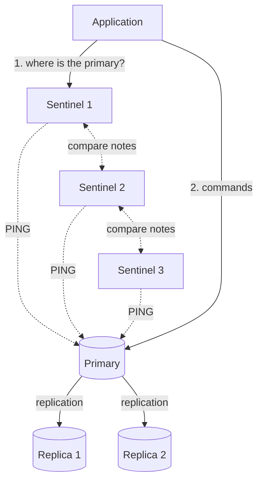
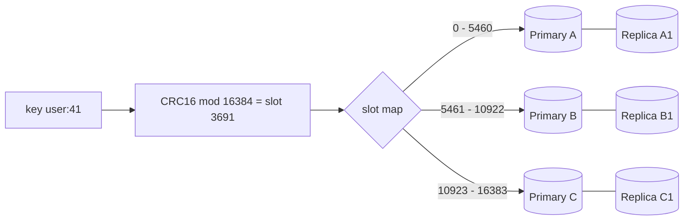

# Modern Redis: Sentinel and Redis Cluster

> **Before this lesson:** you should understand replication, promotion and split brain
> ([replication and handling failures](#/lesson/redis/replication-failures)), the reasons for sharding
> and the idea of hash slots ([scaling reads and writes](#/lesson/redis/scaling-reads-writes)), and
> hash tags ([queries across shards](#/lesson/redis/queries-on-shards)).

## In plain words

Earlier lessons showed two things done by hand. When a primary server died, a person had to promote
a replica and tell every application the new address. And when data outgrew one machine, the
application had to work out which server held which key. Both chores are error-prone at three in the
morning, so Redis ships two systems that automate them.

**Redis Sentinel** automates *failover*. Think of lifeguards watching a swimmer. One lifeguard who
thinks they see trouble might be mistaken - the sun was in their eyes. So lifeguards confer: only
when enough of them agree is the rescue launched, and exactly one of them is put in charge of it.
Sentinels are small watcher programs that monitor a primary and its replicas; when enough of them
agree the primary is down, one of them promotes a replica and announces the new address. Sentinel
does **not** split data: there is still one primary holding everything.

**Redis Cluster** automates *sharding and failover together*. The data is divided among several
primaries, each with its own replicas, and the servers themselves keep track of who owns what and
replace failed primaries. It is like a library with several branches whose staff keep an agreed list
of which shelf-ranges each branch holds, and who promote a deputy if a branch manager disappears.

Why it matters for a job: "high availability" (staying up when a machine fails) is a requirement of
almost every production system, and these are the two standard ways to get it with Redis - whether
you run it yourself or use a cloud service, which is built on the same mechanisms. Interviewers
regularly ask how failover is decided and what data can be lost.

| | Replication alone | Sentinel | Cluster |
|---|---|---|---|
| Copies of the data | yes | yes | yes |
| Automatic failover | no | yes | yes |
| Data split across primaries | no | no | yes |
| Multi-key commands on any keys | yes | yes | only within one hash slot |
| Typical use | small setups, read scaling | data fits one machine, must stay up | data or write load beyond one machine |

## Part 1 - Sentinel

### The cast

A Sentinel deployment has one primary, one or more replicas, and at least **three** Sentinel
processes on separate machines. Each Sentinel regularly sends `PING` to every server and to the other
Sentinels.



### Configuration, line by line

Each Sentinel has a small configuration file:

```bash
sentinel monitor shop-cache 10.0.0.5 6379 2
sentinel down-after-milliseconds shop-cache 5000
sentinel failover-timeout shop-cache 60000
sentinel parallel-syncs shop-cache 1
```

- `monitor shop-cache 10.0.0.5 6379 2` - watch the primary at that address, calling the group
  `shop-cache`. The final `2` is the **quorum**: the number of Sentinels that must agree the primary
  is unreachable before a failover is considered.
- `down-after-milliseconds 5000` - a server that has not answered properly for 5 seconds is suspect.
- `failover-timeout 60000` - how long to wait before retrying a failover that did not complete.
- `parallel-syncs 1` - after a failover, re-point replicas to the new primary one at a time, so they
  are not all resynchronising (and unavailable for reads) at once.

Sentinels discover the replicas and each other automatically; you list only the primary.

### How a failover is decided

Four steps, each with a name worth knowing.

1. **Subjectively down (SDOWN).** One Sentinel has had no valid reply from the primary for
   `down-after-milliseconds`. This is one observer's opinion - perhaps only *its* network link is
   broken.
2. **Objectively down (ODOWN).** That Sentinel asks the others. If at least *quorum* Sentinels agree,
   the primary is considered really down.
3. **Leader election.** The Sentinels vote for one of themselves to carry out the failover. A leader
   needs the votes of a **majority of all Sentinels** - not merely the quorum. With three Sentinels
   that is two; with five, three. Requiring a majority guarantees that two groups cut off from each
   other cannot both run a failover.
4. **Promotion.** The leader picks the best replica - preferring a lower `replica-priority` setting,
   then the most up-to-date replication offset - sends it `REPLICAOF NO ONE`, re-points the other
   replicas to it, and records the new primary address. When the old primary returns, Sentinel
   reconfigures it as a replica.

The distinction between quorum and majority catches people out: quorum decides *whether the primary
is down*; a majority is needed *to act on it*. With 3 Sentinels and quorum 2, if two Sentinels are
lost, the remaining one can neither reach quorum nor elect a leader, so no failover happens.

> [!TIP]
> Run an odd number of Sentinels (three or five) on machines that fail independently - different
> hosts, ideally different availability zones. Two Sentinels are worse than useless: if either one
> fails, no majority exists.

### How applications find the primary

Applications do not hard-code the primary's address. They ask a Sentinel.

```bash
127.0.0.1:26379> SENTINEL get-master-addr-by-name shop-cache
1) "10.0.0.5"
2) "6379"
127.0.0.1:26379> SENTINEL replicas shop-cache
127.0.0.1:26379> SENTINEL failover shop-cache
OK
127.0.0.1:26379> SENTINEL get-master-addr-by-name shop-cache
1) "10.0.0.6"
2) "6379"
```

Sentinels listen on port 26379 by default. The first command returns the current primary's address.
`SENTINEL failover` forces a failover by hand (useful for planned maintenance and for testing);
afterwards the same question returns a different address.

```python
from redis.sentinel import Sentinel

sentinel = Sentinel([("10.0.0.11", 26379), ("10.0.0.12", 26379), ("10.0.0.13", 26379)],
                    socket_timeout=0.5)

primary = sentinel.master_for("shop-cache", decode_responses=True)
replica = sentinel.slave_for("shop-cache", decode_responses=True)

primary.set("motd", "open until 22:00")
print(replica.get("motd"))
```

- `Sentinel([...])` is given the addresses of the Sentinels, not of the Redis servers.
- `master_for("shop-cache")` returns a client that asks the Sentinels where the primary is and
  reconnects to the new one after a failover. `slave_for` does the same for a replica (the method
  names keep the older vocabulary).
- During a failover, commands fail for a few seconds; the application should catch connection errors
  and retry.

### What can be lost

Sentinel inherits everything said about asynchronous replication. A write acknowledged by the old
primary that had not reached the promoted replica is gone. And if the old primary is cut off from the
Sentinels but still reachable by some clients, it keeps accepting writes that will be discarded when
it rejoins as a replica. Limit that window with the settings from the replication lesson:

```bash
min-replicas-to-write 1
min-replicas-max-lag 10
```

An isolated primary then stops accepting writes after about ten seconds without a replica.

## Part 2 - Redis Cluster

### Slots: the central idea

A cluster divides the key space into **16,384 hash slots**. Every key belongs to exactly one slot:

$$\text{slot} = \text{CRC16}(\text{key}) \bmod 16384$$

**CRC16** is a checksum: a function that turns bytes into a number from 0 to 65,535, always the same
for the same input. (If the key contains a hash tag such as `{user:41}`, only the tag is fed to
CRC16.) Each primary owns a set of slots. With three primaries the usual split is:

| Primary | Slots owned |
|---|---|
| A | 0 - 5460 |
| B | 5461 - 10922 |
| C | 10923 - 16383 |

To find a key's server: compute the slot, look up the owner. Every node knows the full slot map, and
so does every cluster-aware client after its first conversation with the cluster.



### Building and inspecting a cluster

Six servers started with `cluster-enabled yes` become a three-primary, three-replica cluster with one
command:

```bash
$ redis-cli --cluster create 10.0.1.1:6379 10.0.1.2:6379 10.0.1.3:6379 \
      10.0.1.4:6379 10.0.1.5:6379 10.0.1.6:6379 --cluster-replicas 1
```

`--cluster-replicas 1` means "one replica for each primary". Then, from any node:

```bash
10.0.1.1:6379> CLUSTER INFO
cluster_state:ok
cluster_slots_assigned:16384
cluster_known_nodes:6
cluster_size:3
10.0.1.1:6379> CLUSTER KEYSLOT user:41
(integer) 3691
10.0.1.1:6379> CLUSTER KEYSLOT user:42
(integer) 15880
10.0.1.1:6379> CLUSTER NODES
e7d1...a1 10.0.1.1:6379@16379 myself,master - 0 0 1 connected 0-5460
67ed...b2 10.0.1.2:6379@16379 master - 0 1767225600 2 connected 5461-10922
292f...c3 10.0.1.3:6379@16379 master - 0 1767225600 3 connected 10923-16383
a5c9...d4 10.0.1.4:6379@16379 slave e7d1...a1 0 1767225600 1 connected
```

`cluster_state:ok` with all 16,384 slots assigned means the cluster is healthy. `CLUSTER KEYSLOT`
computes a key's slot. `CLUSTER NODES` lists each node's id, address, role and slot ranges; a replica
line names the primary it follows. The `@16379` is the **cluster bus** port (data port plus 10,000),
which nodes use to talk to one another.

### Redirects: MOVED and ASK

A client may ask any node for any key. If the node does not own the key's slot it replies with a
**redirect** telling the client where to go.

```bash
10.0.1.1:6379> GET user:42
(error) MOVED 15880 10.0.1.3:6379
```

`MOVED 15880 10.0.1.3:6379` means "slot 15880 lives at that address - permanently, as far as I know".
A cluster-aware client updates its copy of the slot map and resends the command there; from then on
it goes straight to the right node. `redis-cli -c` follows redirects for you:

```bash
$ redis-cli -c -h 10.0.1.1
10.0.1.1:6379> GET user:42
-> Redirected to slot [15880] located at 10.0.1.3:6379
"..."
```

The second kind of redirect, `ASK`, appears only while a slot is being moved between nodes (next
section). It means "for *this one request*, try the other node - but do not update your map yet".

```python
from redis.cluster import RedisCluster

rc = RedisCluster(host="10.0.1.1", port=6379, decode_responses=True)

rc.set("user:41", "mira")                   # routed to the node owning slot 3691
print(rc.get("user:42"))                    # routed to the node owning slot 15880

rc.set("{user:41}:name", "mira")
rc.set("{user:41}:city", "oslo")
print(rc.mget("{user:41}:name", "{user:41}:city"))     # same slot, so a multi-key command is allowed
```

- `RedisCluster` needs one reachable node; it downloads the slot map and opens connections to the
  others as required.
- Each command is routed by the slot of its key; `MOVED` replies refresh the map automatically.
- The last three lines use a hash tag so both keys share a slot, which makes `MGET` legal.

### Growing the cluster: moving slots

To add capacity you add a node and move some slots to it. Slots move one at a time, key by key, while
the cluster keeps serving requests.

```bash
$ redis-cli --cluster add-node 10.0.1.7:6379 10.0.1.1:6379
$ redis-cli --cluster reshard 10.0.1.1:6379 --cluster-from <id-of-A> --cluster-to <id-of-new> \
      --cluster-slots 1365 --cluster-yes
$ redis-cli --cluster rebalance 10.0.1.1:6379
```

`add-node` introduces the new server (owning no slots yet). `reshard` moves 1,365 slots from A to it.
`rebalance` evens out slot counts automatically. While a slot is in transit, a key in it may be on
either node: the source answers for keys it still has and replies `ASK` for those already moved.
Only the keys in the moved slots are touched - the "move a controlled share" property promised in the
scaling lesson.

### Failure detection and failover

Cluster nodes do Sentinel's job themselves. Every node regularly exchanges small status messages with
a few others over the cluster bus; this style of spreading information is called a **gossip
protocol**, because news travels the way a rumour does.

1. If a node does not answer within `cluster-node-timeout` (15 seconds by default), the nodes that
   noticed mark it as *possibly failing* (PFAIL) - one node's opinion.
2. When a **majority of primaries** report the same node as failing, it is marked *failed* (FAIL) and
   the news is broadcast.
3. A replica of the failed primary asks the primaries for votes. With votes from a majority of
   primaries it promotes itself and takes over the slots.
4. Clients receive `MOVED` replies pointing at the new owner.

Two consequences:

- A cluster needs at least **three primaries**, so that a majority still exists when one fails.
- If a primary fails and has **no** working replica, its slots have no owner. By default
  (`cluster-require-full-coverage yes`) the whole cluster then stops accepting commands, on the
  reasoning that answering for only part of the data could mislead applications.

A minority partition protects itself too: a primary that cannot reach a majority of the other
primaries for `cluster-node-timeout` stops accepting writes.

> [!WARNING]
> Redis Cluster does **not** guarantee that acknowledged writes survive a failover. Replication is
> asynchronous: a primary can acknowledge a write and fail before its replica receives it, and the
> promoted replica will not have it. A primary cut off on the minority side can also accept writes
> for up to the node timeout that are then lost. `WAIT` narrows the first window; nothing in Cluster
> removes it. Do not keep the only copy of money in it.

### What you give up in a cluster

- **Multi-key commands, transactions and scripts** must stay within one slot - use hash tags.
- **Only database 0.** The `SELECT` command for numbered databases is not available.
- **Pub/sub** is broadcast to all nodes; use sharded pub/sub (`SSUBSCRIBE`, Redis 7) to keep channels
  on one shard.
- **Clients must be cluster-aware**, or sit behind a proxy that is.
- **More machines to run**: at least six for a sensible production cluster.

> [!INTERVIEW]
> Typical questions and compact answers. *Why 16,384 slots?* It is enough granularity for up to about
> a thousand primaries while keeping the slot bitmap that nodes exchange small (2 KB). *MOVED versus
> ASK?* MOVED is permanent - update the map; ASK is a one-off during a slot migration. *Sentinel or
> Cluster?* Sentinel when the data fits one primary and you need failover; Cluster when you must
> shard. *Can writes be lost?* Yes, in both, because replication is asynchronous.

## Try it: slots, redirects, a reshard and a failover vote

The block implements CRC16 exactly as Redis Cluster defines it, the hash-tag rule, a slot map with
`MOVED` redirects, moving slots to a new node, and the quorum-versus-majority arithmetic of Sentinel.

```python-run
def crc16(data: bytes) -> int:
    """CRC-16/XMODEM: polynomial 0x1021, initial value 0 - the variant Redis Cluster uses."""
    crc = 0
    for byte in data:
        crc ^= byte << 8
        for _ in range(8):
            crc = ((crc << 1) ^ 0x1021) & 0xFFFF if crc & 0x8000 else (crc << 1) & 0xFFFF
    return crc

def key_slot(key: str) -> int:
    start = key.find("{")
    if start != -1:
        end = key.find("}", start + 1)
        if end != -1 and end != start + 1:
            key = key[start + 1:end]                 # hash only the tag
    return crc16(key.encode()) % 16384

print("crc16('123456789') =", hex(crc16(b"123456789")), "(the standard check value is 0x31c3)")
for k in ["user:41", "user:42", "{user:41}:home", "{user:41}:followers", "foo"]:
    print(f"  {k:22s} slot {key_slot(k)}")

class Cluster:
    def __init__(self, names):
        self.owner = {s: names[s * len(names) // 16384] for s in range(16384)}     # equal ranges
        self.data = {n: {} for n in names}
    def ask(self, node, key):
        slot = key_slot(key); real = self.owner[slot]
        if real != node: return f"MOVED {slot} {real}"
        return self.data[node].get(key)
    def set(self, key, value): self.data[self.owner[key_slot(key)]][key] = value
    def reshard(self, src, dst, count):
        self.data.setdefault(dst, {})
        slots = [s for s, n in self.owner.items() if n == src][:count]
        moved_keys = 0
        for s in slots: self.owner[s] = dst
        for key in [k for k in self.data[src] if self.owner[key_slot(k)] == dst]:
            self.data[dst][key] = self.data[src].pop(key); moved_keys += 1
        return len(slots), moved_keys
    def counts(self): return {n: len(d) for n, d in self.data.items()}

c = Cluster(["A", "B", "C"])
for i in range(3000): c.set(f"user:{i}", i)
print("keys per node:", c.counts())
print("ask A for user:42 ->", c.ask("A", "user:42"), "| ask C ->", c.ask("C", "user:42"))
slots, keys = c.reshard("A", "D", 1365)
print(f"moved {slots} slots and {keys} keys from A to D; keys per node now:", c.counts())

def sentinel_outcome(total, quorum, reachable_and_agreeing):
    odown = reachable_and_agreeing >= quorum
    majority = total // 2 + 1
    can_elect = reachable_and_agreeing >= majority
    return "failover" if odown and can_elect else ("ODOWN but no leader" if odown else "no action")
for total, quorum, agree in [(3, 2, 3), (3, 2, 2), (3, 2, 1), (5, 2, 2), (5, 2, 3), (2, 1, 1)]:
    print(f"sentinels={total} quorum={quorum} agreeing={agree}: {sentinel_outcome(total, quorum, agree)}")
```

Check the output against the text. The CRC of `123456789` is the published test value `0x31c3`, so
the function is right. `user:41` maps to slot 3691 and `user:42` to 15880, and both tagged keys share
slot 3691 with `user:41`. The 3,000 keys spread roughly evenly over three nodes. Asking node A for a
key in C's range returns a `MOVED` redirect; asking C returns the value. Resharding 1,365 slots moves
about a quarter of A's keys and nothing from B or C. In the Sentinel table, note the fourth and last
rows: with five Sentinels and quorum 2, two agreeing Sentinels can declare the primary down but
cannot elect a leader; and with only two Sentinels, a single survivor can never form a majority.

## Pitfalls

- **Two Sentinels, or all Sentinels on one machine.** No majority survives a failure.
- **Confusing quorum with majority.** Quorum marks the primary as down; a majority of all Sentinels is
  needed to perform the failover.
- **Hard-coding the primary's address.** After failover the application keeps writing to a dead or
  demoted server. Ask Sentinel, or use a Sentinel-aware client.
- **Assuming failover is instant or lossless.** Expect seconds of errors and possible loss of the
  last writes.
- **A non-cluster client against a cluster.** It will not follow `MOVED` and fails on most keys.
- **Multi-key operations across slots.** `CROSSSLOT` errors; design hash tags up front.
- **A primary without a replica in a cluster.** Its failure takes its slots - and by default the whole
  cluster - offline.
- **Firewalls blocking the cluster bus port** (data port + 10,000). Nodes cannot gossip and the
  cluster never forms.
- **Hash tags with too few distinct values.** One slot becomes enormous and cannot be split.
- **Huge keys during resharding.** A key is moved as one unit; a multi-gigabyte key stalls the
  migration.

## Command cheat sheet

| Command | Meaning | Cost |
|---|---|---|
| `SENTINEL get-master-addr-by-name name` | current primary address | O(1) |
| `SENTINEL replicas name` / `SENTINEL sentinels name` | known replicas / other Sentinels | O(n) |
| `SENTINEL failover name` | force a failover | O(1) to start |
| `SENTINEL ckquorum name` | check that quorum and majority are reachable | O(1) |
| `CLUSTER INFO` | state, slots assigned, node count | O(1) |
| `CLUSTER NODES` / `CLUSTER SHARDS` (7.0+) | topology and slot ranges | O(nodes) |
| `CLUSTER KEYSLOT key` | slot of a key | O(key length) |
| `CLUSTER COUNTKEYSINSLOT slot` | keys in a slot | O(1) |
| `CLUSTER FAILOVER` (on a replica) | coordinated manual failover | O(1) to start |
| `redis-cli --cluster create ... --cluster-replicas 1` | build a cluster | - |
| `redis-cli --cluster add-node` / `reshard` / `rebalance` / `check` | grow, move slots, verify | proportional to keys moved |
| `redis-cli -c` | follow `MOVED` / `ASK` redirects | - |
| `READONLY` | allow reads on a cluster replica connection | O(1) |
| `WAIT n ms` | wait for n replicas to confirm a write | O(1) plus waiting |

## Summary

- Sentinel watches one primary and its replicas; quorum Sentinels declare it down, a majority elects
  a leader, the leader promotes the best replica, and clients ask Sentinel for the address.
- Redis Cluster maps every key to one of 16,384 slots by CRC16, assigns slot ranges to primaries, and
  redirects clients with `MOVED` (permanent) and `ASK` (during migration).
- Cluster nodes detect failures by gossip and promote replicas by a majority vote of primaries.
- Both systems rely on asynchronous replication, so a failover can lose recently acknowledged writes.
- Cluster restricts multi-key operations to a single slot; hash tags place related keys together.

## Glossary

- **High availability** - continuing to serve requests when a machine fails.
- **Failover** - replacing a failed primary with a promoted replica.
- **Sentinel** - a watcher process that monitors Redis servers and coordinates failover.
- **Quorum** - the number of Sentinels that must agree the primary is unreachable.
- **Majority** - more than half of all members.
- **SDOWN / ODOWN** - "subjectively down" (one Sentinel's view) / "objectively down" (quorum agrees).
- **Leader election** - choosing one member to carry out an action.
- **Hash slot** - one of 16,384 buckets that keys are mapped into.
- **CRC16** - the checksum function used to compute a key's slot.
- **Slot map** - the table of which node owns which slots.
- **MOVED / ASK** - permanent / temporary redirect to another node.
- **Resharding** - moving slots (and their keys) between nodes.
- **Cluster bus** - the port and protocol nodes use to talk to each other.
- **Gossip protocol** - spreading state by periodic exchanges between pairs of nodes.
- **Partition** - a network failure that splits nodes into groups that cannot reach each other.

```quiz
[
  {"q": "What does Redis Sentinel provide that plain replication does not?",
   "options": ["Sharding across primaries", "Automatic detection of a failed primary and promotion of a replica", "Stronger durability", "Faster reads"],
   "answer": 1,
   "explain": "Sentinel automates monitoring, failover and telling clients the new primary address. It does not split data."},
  {"q": "With 5 Sentinels and quorum 2, two Sentinels agree the primary is down and the other three are unreachable. What happens?",
   "options": ["Failover proceeds", "The primary is marked objectively down, but no failover occurs because electing a leader needs 3 of 5 votes", "Nothing is marked", "The replicas promote themselves"],
   "answer": 1,
   "explain": "Quorum decides ODOWN; performing the failover requires a majority of all Sentinels."},
  {"q": "How does Redis Cluster decide which node stores the key order:7?",
   "options": ["By the first letter of the key", "CRC16 of the key modulo 16384 gives a slot, and the slot map says which primary owns that slot", "Round robin", "The client picks any node"],
   "answer": 1,
   "explain": "Every key maps to exactly one of 16,384 slots and each slot has one owning primary."},
  {"q": "A client receives (error) MOVED 15880 10.0.1.3:6379. What should it do?",
   "options": ["Retry on the same node", "Update its slot map so slot 15880 points to that address and resend the command there", "Give up", "Send ASKING first and keep its map unchanged"],
   "answer": 1,
   "explain": "MOVED signals a permanent ownership fact. ASK, by contrast, is a one-time redirect during migration."},
  {"q": "Which keys are guaranteed to be in the same slot?",
   "options": ["user:41:home and user:41:followers", "{user:41}:home and {user:41}:followers", "home:{41} and followers:{42}", "Any keys starting with the same letter"],
   "answer": 1,
   "explain": "Only the text inside the braces is hashed, so identical tags give identical slots."},
  {"q": "Why does a Redis Cluster need at least three primaries?",
   "options": ["To have enough memory", "Failure detection and replica promotion need a majority of primaries, which cannot exist after a failure with fewer than three", "CRC16 requires three inputs", "Because there are three slot ranges by definition"],
   "answer": 1,
   "explain": "With two primaries, losing one leaves no majority to declare the failure or authorise the promotion."},
  {"q": "A primary in a cluster acknowledges a write and crashes before its replica receives it. After the replica is promoted, where is the write?",
   "options": ["Recovered from the cluster bus", "Lost, because replication is asynchronous", "On the other primaries", "In the slot map"],
   "answer": 1,
   "explain": "Cluster does not provide strong consistency. Acknowledged writes can be lost in a failover."},
  {"q": "A slot's primary fails and it has no replica. With default settings, what does the cluster do?",
   "options": ["Reassigns the slot automatically to another primary with empty data", "Stops accepting commands, because part of the key space has no owner", "Continues normally", "Deletes the slot"],
   "answer": 1,
   "explain": "cluster-require-full-coverage defaults to yes: with uncovered slots the cluster reports itself as down."}
]
```

> **Source:** redis.io documentation on Sentinel and the Redis Cluster specification (Cluster became stable in Redis 3.0, after the book; the book's own sharding approach is in Carlson, *Redis in Action*, ch. 10). Explanations, analogies and simulation are original.
> Further reading: <https://redis.io/docs/latest/operate/oss_and_stack/management/sentinel/>, <https://redis.io/docs/latest/operate/oss_and_stack/reference/cluster-spec/>, <https://redis.io/docs/latest/operate/oss_and_stack/management/scaling/>
