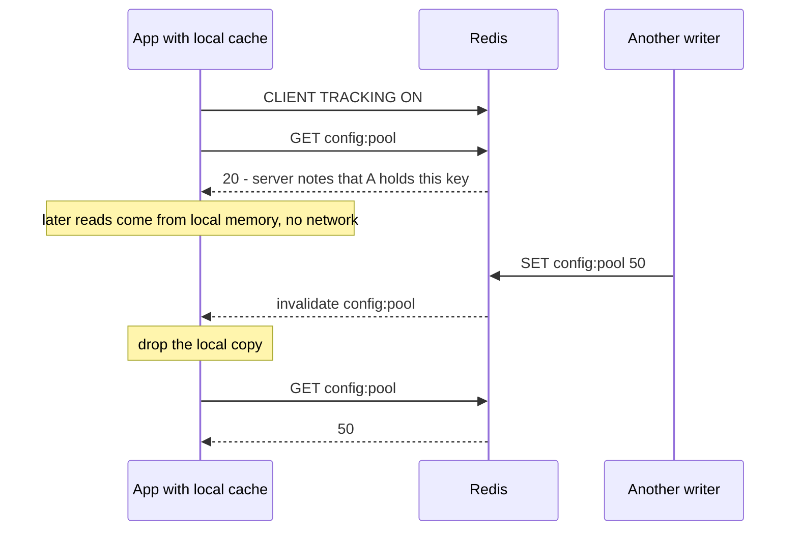

# Modern Redis: access control, client-side caching, modules and vector search

> **Before this lesson:** you should know pub/sub and key expiry
> ([pub/sub, transactions and expiry](#/lesson/redis/pubsub-transactions-expiry)), the local
> configuration cache built by hand in [range lookups and configuration](#/lesson/redis/ip-lookup-config),
> hashes ([hashes and sorted sets](#/lesson/redis/hashes-sorted-sets)) and the idea of an index from
> [inverted indexes](#/lesson/redis/inverted-index-search).

## In plain words

The book this track follows was written when Redis was at version 2.6. A great deal has been added
since. Streams, HyperLogLog, geospatial indexes, Sentinel and Cluster had their own lessons; this one
gathers four more developments that a working engineer is expected to know.

1. **Access control lists (ACLs).** Originally Redis had at most one shared password, and anyone who
   knew it could do anything. ACLs give each program its own username, password and permissions -
   like an office where each employee's badge opens only the doors they need, instead of everyone
   sharing one master key.
2. **Client-side caching.** Your application can keep copies of frequently read values in its own
   memory, and Redis will tell it the moment one of those values changes. It is like keeping a
   photocopy of a timetable at your desk, with the office promising to phone you if the timetable is
   updated - so you can trust the photocopy until the phone rings.
3. **Modules and the bundled extensions.** Redis can be extended with new data types - JSON
   documents, full-text search, time series, probabilistic filters - which now ship with Redis
   itself.
4. **Vector search.** Redis can store lists of numbers that capture the *meaning* of text and find
   the stored items most similar to a query. This is the storage layer behind many AI assistants
   that answer questions from your own documents.

Why it matters for a job: security reviews ask who can run which commands; performance work reaches
for client-side caching; and "store embeddings and retrieve the nearest ones" is now among the most
common new uses of Redis. An overview of what changed between versions also stops you from
re-implementing by hand something the server already does.

## Part 1 - a short history of what changed

| Version | Year | Notable additions |
|---|---|---|
| 2.6 | 2012 | Lua scripting; millisecond expiry (the book's era) |
| 2.8 | 2013 | partial resynchronisation, `SCAN`, HyperLogLog, a rewritten Sentinel |
| 3.0 | 2015 | Redis Cluster |
| 3.2 | 2016 | geospatial commands, quicklist, `BITFIELD` |
| 4.0 | 2017 | modules, `UNLINK` and lazy freeing, LFU eviction, `MEMORY` commands, mixed RDB+AOF |
| 5.0 | 2018 | streams, `ZPOPMIN`/`ZPOPMAX`, `REPLICAOF` naming |
| 6.0 | 2020 | ACLs, TLS encryption, RESP3 protocol, client-side caching, threaded network I/O |
| 6.2 | 2021 | `GETDEL`, `GETEX`, `SET ... GET`, `LMOVE`, `ZRANGE` with `BYSCORE`/`BYLEX`, `GEOSEARCH`, `XAUTOCLAIM`, `COPY` |
| 7.0 | 2022 | Functions, multi-part AOF, sharded pub/sub, listpack replaces ziplist, `EXPIRE` with `NX`/`XX`/`GT`/`LT`, ACL selectors |
| 7.2 | 2023 | `WAITAOF`, listpack-encoded sets |
| 7.4 | 2024 | per-field expiry for hashes (`HEXPIRE`) |
| 8.0 | 2025 | JSON, search and query, time series and probabilistic types bundled in; a native vector set type |

A note on licensing, because it affects which product a company runs: in March 2024 Redis moved from
the permissive BSD licence to source-available licences. In response the Linux Foundation started
**Valkey**, a fork of Redis 7.2 that stays under the BSD licence and is offered by the large cloud
providers. With version 8, Redis added the AGPLv3 open-source licence as an option. Commands and
concepts in this track apply to both Redis and Valkey unless a version is named.

## Part 2 - ACLs: who may do what

### The problem with one password

A single password shared by the web application, the background workers, the analytics job and
every engineer's laptop means any of them can run `FLUSHALL` (delete everything) or read session
tokens. The security principle violated here is **least privilege**: each party should have only the
permissions its job requires.

### A first user

```bash
127.0.0.1:6379> ACL SETUSER reporter on >s3cret-pass ~stats:* +@read
OK
127.0.0.1:6379> ACL LIST
1) "user default on nopass ~* &* +@all"
2) "user reporter on #9b1f...e2 ~stats:* resetchannels -@all +@read"
```

Each word after the username is a rule:

- `on` - the user may log in (`off` disables it).
- `>s3cret-pass` - adds a password. Redis stores only a hash of it, which is why `ACL LIST` shows
  `#9b1f...`.
- `~stats:*` - the **key pattern**: this user may touch only keys whose names start with `stats:`.
- `+@read` - allow every command in the `read` **category**. A `+` allows, a `-` denies; `@name` is a
  category (a named group of commands), while a bare name such as `+get` is a single command.

The listing also shows the built-in user `default`, which has no password and may do everything.
That is the account you have been using throughout this track.

### Trying it out

```bash
127.0.0.1:6379> AUTH reporter s3cret-pass
OK
127.0.0.1:6379> GET stats:tracking:load_ms
"182"
127.0.0.1:6379> SET stats:tracking:load_ms 0
(error) NOPERM User reporter has no permissions to run the 'set' command
127.0.0.1:6379> GET sess:Zk3vR9
(error) NOPERM No permissions to access the 'sess:Zk3vR9' key
127.0.0.1:6379> ACL WHOAMI
"reporter"
```

`AUTH username password` logs in. Reading a `stats:` key works. Writing is refused (the command is
outside `@read`), and reading a session key is refused (the key is outside `~stats:*`). Each refusal
is a `NOPERM` error naming what was missing.

### A realistic set of users

```bash
127.0.0.1:6379> ACL SETUSER webapp on >long-random-1 ~sess:* ~cart:* ~page:* +@read +@write +@string +@hash -@dangerous
OK
127.0.0.1:6379> ACL SETUSER worker on >long-random-2 ~queue:* ~processing:* ~delayed +@list +@sortedset +@scripting
OK
127.0.0.1:6379> ACL SETUSER default off
OK
127.0.0.1:6379> ACL CAT dangerous
 1) "flushall"
 2) "flushdb"
 3) "keys"
 4) "config"
 5) "shutdown"
...
```

The web application may read and write only session, cart and page-cache keys, and is denied the
`dangerous` category (which contains `FLUSHALL`, `KEYS`, `CONFIG`, `SHUTDOWN` and similar). Workers
may operate on queue keys only. Disabling `default` means nobody can connect without credentials.
`ACL CAT` lists categories, or the commands inside one.

Rules are applied from left to right, so `+@all -@dangerous` means "everything except the dangerous
commands", while `-@dangerous +@all` would allow everything.

Users defined with `ACL SETUSER` live in memory. To keep them across restarts, either write them in
`redis.conf`, or use a separate ACL file (`aclfile /etc/redis/users.acl`) with `ACL SAVE` and
`ACL LOAD`. `ACL LOG` shows recent denied commands, which is the quickest way to find out what
permission an application is missing.

```python
import redis

r = redis.Redis(host="cache.internal", port=6379, username="webapp", password="long-random-1",
                ssl=True, decode_responses=True)
print(r.acl_whoami())            # 'webapp'
```

`username=` and `password=` make redis-py send `AUTH` on every new connection. `ssl=True` turns on
**TLS** (Transport Layer Security), the encryption used by HTTPS; without it, passwords and data
cross the network readable by anyone who can observe the traffic.

> [!WARNING]
> ACLs limit what an authenticated user may do; they do not replace network security. Never expose a
> Redis port to the internet. Bind it to private addresses, firewall it, require authentication, and
> use TLS when traffic leaves a trusted network. Unprotected Redis servers are scanned for and
> compromised within hours.

## Part 3 - client-side caching

### The idea

The fastest Redis read is the one you never send. If the application keeps a copy of a value in its
own memory - a **local cache** - a read costs nanoseconds instead of a network round trip. The hard
part of any cache is knowing when a copy has gone stale. In the configuration lesson we handled that
with a time limit plus a hand-built pub/sub notification. Since version 6, the server does the
notifying itself: this feature is called **tracking**.

1. The client turns tracking on for its connection.
2. Whenever that client reads a key, the server remembers "this client holds a copy of that key".
3. When *anyone* changes or deletes the key, or it expires, the server sends the client an
   **invalidation message** naming the key.
4. The client removes the key from its local cache. The next read fetches the fresh value.



### Seeing it in redis-cli

Invalidation messages are **push messages** - data the server sends without being asked - which need
version 3 of the Redis protocol, **RESP3**. `HELLO 3` switches a connection to it.

```bash
127.0.0.1:6379> HELLO 3
127.0.0.1:6379> CLIENT TRACKING ON
OK
127.0.0.1:6379> GET config:pool
"20"
```

Now, from a second terminal, run `SET config:pool 50`. The first terminal prints, unprompted:

```bash
-> invalidate: 'config:pool'
```

The server sends one invalidation per key and then forgets it; the client must read the key again to
be told about its next change.

### Two modes

| | Default mode | Broadcasting mode (`BCAST`) |
|---|---|---|
| Server remembers | every key each client has read | only the prefixes each client registered |
| Client is notified about | keys it read | every change to keys with those prefixes |
| Server memory | grows with keys tracked (bounded by `tracking-table-max-keys`) | very small |
| Network traffic | precise | more messages, some irrelevant |
| Turn on with | `CLIENT TRACKING ON` | `CLIENT TRACKING ON BCAST PREFIX config: PREFIX flag:` |

Two useful options: `NOLOOP` stops the server telling a client about changes it made itself, and
`OPTIN` tracks only reads the client explicitly marks with `CLIENT CACHING YES`, so you choose which
keys are worth caching.

### In Python

Recent versions of redis-py (5.1 and later) build this in:

```python
import redis
from redis.cache import CacheConfig

r = redis.Redis(protocol=3, cache_config=CacheConfig(max_size=10_000), decode_responses=True)

r.set("config:pool", 20)
print(r.get("config:pool"))      # goes to the server, and is stored locally
print(r.get("config:pool"))      # answered from local memory
```

`protocol=3` selects RESP3; `cache_config` enables the local cache with a size limit. The library
turns tracking on, stores replies to read commands, and removes entries when invalidation messages
arrive.

What to cache this way: values read very often and changed rarely - configuration, feature flags,
product details. What not to: keys that change constantly (the invalidations cost more than they
save) or that are read once.

> [!TIP]
> Keep a time limit on locally cached entries even with tracking. If the connection to Redis drops,
> invalidations sent meanwhile are lost; a well-behaved client clears its whole local cache on
> reconnect, and a maximum age protects you if something does not.

## Part 4 - modules and the types bundled with Redis 8

Version 4 introduced **modules**: add-ons, loaded into the server, that define new commands and data
types. The most widely used ones became "Redis Stack" and, from Redis 8, are part of the standard
server.

| Capability | Example commands | What it gives you |
|---|---|---|
| JSON | `JSON.SET`, `JSON.GET`, `JSON.NUMINCRBY` | store a JSON document and read or change parts of it by path |
| Search and query | `FT.CREATE`, `FT.SEARCH`, `FT.AGGREGATE` | automatic secondary indexes, full-text, numeric, tag, geo and vector search over hashes and JSON |
| Time series | `TS.ADD`, `TS.RANGE`, `TS.CREATERULE` | timestamped samples with retention and downsampling |
| Probabilistic | `BF.ADD`/`BF.EXISTS` (Bloom filter), `CF.*`, `CMS.*`, `TOPK.*`, `TDIGEST.*` | approximate membership, frequency, top-k and percentiles in small memory |

```bash
127.0.0.1:6379> JSON.SET recipe:101 $ '{"title":"Slow rye bread","rating":4.6,"tags":["bread","rye"]}'
OK
127.0.0.1:6379> JSON.GET recipe:101 $.title
"[\"Slow rye bread\"]"
127.0.0.1:6379> JSON.NUMINCRBY recipe:101 $.rating 0.1
"[4.7]"
127.0.0.1:6379> BF.ADD seen:emails ana@example.com
(integer) 1
127.0.0.1:6379> BF.EXISTS seen:emails raj@example.com
(integer) 0
```

`$` is the root of the JSON document, and `$.title` is a **path** selecting the title field.
`JSON.NUMINCRBY` changes one number inside the document atomically, without rewriting the rest. A
**Bloom filter** answers "have I seen this item?" in very little memory: "no" is always correct,
"yes" is occasionally wrong (a *false positive*).

Earlier lessons built search indexes, time-bucket counters and statistics by hand. That remains the
way to understand how they work; in new projects, check first whether a bundled type already does
the job.

## Part 5 - Redis as a vector store

### What a vector is, from the beginning

Computers compare text poorly: "car" and "automobile" share no letters. An **embedding model** is a
program (usually a neural network) that converts a piece of text into a list of numbers - an
**embedding**, or **vector** - such that texts with similar *meanings* get lists that are close
together. Real embeddings have hundreds or thousands of numbers; each count is called a
**dimension**.

A toy example with three dimensions:

| Text | Vector |
|---|---|
| "How do I reset my password?" | [0.9, 0.1, 0.0] |
| "I forgot my login details" | [0.8, 0.2, 0.1] |
| "Opening hours of the Oslo depot" | [0.0, 0.1, 0.9] |

The first two are close; the third points somewhere else. "Close" is usually measured by **cosine
similarity**: the cosine of the angle between two vectors, which is 1 when they point the same way
and 0 when they are unrelated.

$$\text{cosine}(a, b) = \frac{a \cdot b}{\lVert a \rVert \, \lVert b \rVert}
= \frac{\sum_i a_i b_i}{\sqrt{\sum_i a_i^2}\,\sqrt{\sum_i b_i^2}}$$

For the first two rows: the top is $0.9 \times 0.8 + 0.1 \times 0.2 + 0 \times 0.1 = 0.74$; the
lengths are $\sqrt{0.82} \approx 0.906$ and $\sqrt{0.69} \approx 0.831$; so the similarity is
$0.74 / (0.906 \times 0.831) \approx 0.98$ - nearly identical in meaning. Redis reports cosine
*distance*, which is 1 minus the similarity, so smaller means closer.

### Why this matters: retrieval-augmented generation

A large language model knows only what it was trained on, not your company's documents.
**Retrieval-augmented generation (RAG)** fixes that in three steps: split your documents into
passages and store each passage's embedding; when a question arrives, embed the question and find
the most similar passages; give those passages to the model with the question, so it answers from
them. The middle step - "find the nearest vectors" - is what a **vector store** does.

### Creating an index and searching

With the search engine built into Redis, vectors are stored as a field of a hash (or JSON document)
and indexed:

```bash
127.0.0.1:6379> FT.CREATE idx:docs ON HASH PREFIX 1 doc: SCHEMA text TEXT team TAG embedding VECTOR HNSW 6 TYPE FLOAT32 DIM 3 DISTANCE_METRIC COSINE
OK
127.0.0.1:6379> FT.SEARCH idx:docs "(@team:{support})=>[KNN 2 @embedding $q AS score]" PARAMS 2 q "<12 bytes>" SORTBY score RETURN 2 text score DIALECT 2
```

Reading `FT.CREATE`: index every hash whose key starts with `doc:`. The schema has a full-text field
`text`, a `TAG` field `team` for exact-match filtering, and a `VECTOR` field `embedding`. `HNSW` is
the indexing method (explained below); `6` is the count of option words that follow; vectors are
32-bit floating-point numbers with 3 dimensions, compared by cosine distance.

Reading `FT.SEARCH`: among documents whose team is `support`, find the 2 nearest neighbours
(`KNN 2`) of the query vector passed as parameter `q`, call the distance `score`, and sort by it.
The vector travels as raw bytes: 4 bytes for each 32-bit number.

### Exact versus approximate search

- **FLAT** compares the query with every stored vector. Exact, and fine up to roughly tens of
  thousands of vectors.
- **HNSW** (*hierarchical navigable small world*) builds a layered graph linking each vector to some
  near neighbours and searches by hopping through it. It is an **approximate nearest neighbour**
  method: far faster on millions of vectors, at the price of occasionally missing a true nearest
  neighbour and of extra memory for the graph.

### In Python

```python
import numpy as np
import redis
from redis.commands.search.field import TagField, TextField, VectorField
from redis.commands.search.query import Query

r = redis.Redis()                                  # bytes in and out: vectors are binary

r.ft("idx:docs").create_index([
    TextField("text"), TagField("team"),
    VectorField("embedding", "HNSW", {"TYPE": "FLOAT32", "DIM": 3, "DISTANCE_METRIC": "COSINE"}),
])

def add_doc(doc_id, text, team, vector):
    r.hset(f"doc:{doc_id}", mapping={
        "text": text, "team": team,
        "embedding": np.array(vector, dtype=np.float32).tobytes(),
    })

def search(vector, team, k=2):
    q = (Query(f"(@team:{{{team}}})=>[KNN {k} @embedding $q AS score]")
         .sort_by("score").return_fields("text", "score").dialect(2))
    blob = np.array(vector, dtype=np.float32).tobytes()
    return [(d.text, float(d.score)) for d in r.ft("idx:docs").search(q, {"q": blob}).docs]
```

- `np.array(vector, dtype=np.float32).tobytes()` packs the numbers into the raw bytes the index
  expects.
- The index needs no explicit prefix here because, by default, it covers all hashes; a production
  index would restrict itself to a prefix.
- The triple braces in the f-string produce a single literal `{` around the tag value.
- In a real system `vector` comes from an embedding model; the dimension in the index must match the
  model's output exactly.

Redis 8 also introduced a dedicated **vector set** type (`VADD`, `VSIM`) for similarity search
without defining a schema. A dedicated vector database may still be the better choice when the
vectors do not fit in memory.

> [!INTERVIEW]
> Likely questions: *How do you restrict a service to its own keys?* An ACL user with a key pattern
> and command categories, plus TLS. *How does client-side caching stay correct?* The server tracks
> which keys a client read and pushes invalidations; default mode versus `BCAST`. *How would you
> build semantic search or RAG on Redis?* Embed passages, store vectors in hashes or JSON, create an
> HNSW index, run KNN queries with metadata filters, and pass the retrieved text to the model.

## Try it: an ACL check, an invalidating cache and nearest-neighbour search

Three small models in plain Python: a permission checker with key patterns and command categories; a
server that tracks which client read which key and pushes invalidations; and exact cosine search
over toy vectors.

```python-run
import fnmatch, math

# ---------------- ACL ----------------
CATEGORIES = {"read": {"get", "hget", "lrange"}, "write": {"set", "hset", "del", "lpush"},
              "dangerous": {"flushall", "keys", "config"}}
class User:
    def __init__(self, patterns, rules): self.patterns, self.allowed = patterns, set()
    def apply(self, rules):
        for rule in rules:                                   # left to right, later rules win
            sign, name = rule[0], rule[1:]
            cmds = set().union(*CATEGORIES.values()) if name == "@all" else CATEGORIES.get(name[1:], {name}) if name.startswith("@") else {name}
            self.allowed = self.allowed | cmds if sign == "+" else self.allowed - cmds
        return self
def check(user, command, key=None):
    if command not in user.allowed: return f"NOPERM no permission for '{command}'"
    if key is not None and not any(fnmatch.fnmatchcase(key, p) for p in user.patterns):
        return f"NOPERM no access to key '{key}'"
    return "OK"
reporter = User(["stats:*"], None).apply(["+@read"])
webapp = User(["sess:*", "cart:*"], None).apply(["+@all", "-@dangerous"])
print("reporter GET stats:load ->", check(reporter, "get", "stats:load"))
print("reporter SET stats:load ->", check(reporter, "set", "stats:load"))
print("reporter GET sess:abc   ->", check(reporter, "get", "sess:abc"))
print("webapp   SET cart:9     ->", check(webapp, "set", "cart:9"), "| webapp FLUSHALL ->", check(webapp, "flushall"))

# ---------------- client-side caching with tracking ----------------
class Server:
    def __init__(self): self.data, self.tracking, self.round_trips = {}, {}, 0
    def get(self, client, key):
        self.round_trips += 1
        self.tracking.setdefault(key, set()).add(client)      # remember who holds a copy
        return self.data.get(key)
    def set(self, key, value):
        self.data[key] = value
        for client in self.tracking.pop(key, ()):             # push one invalidation, then forget
            client.local.pop(key, None); client.invalidations += 1
class Client:
    def __init__(self, server): self.server, self.local, self.invalidations = server, {}, 0
    def get(self, key):
        if key not in self.local: self.local[key] = self.server.get(self, key)
        return self.local[key]
srv = Server(); srv.set("config:pool", 20); app = Client(srv)
values = [app.get("config:pool") for _ in range(1000)]
print("1000 reads ->", set(values), "| round trips:", srv.round_trips)
srv.set("config:pool", 50)
print("after a change elsewhere:", app.get("config:pool"), "| round trips:", srv.round_trips,
      "| invalidations received:", app.invalidations)

# ---------------- nearest neighbours by cosine distance ----------------
docs = {"doc:1": ("Reset your password from the login page", "support", [0.9, 0.1, 0.0]),
        "doc:2": ("Recover a forgotten username", "support", [0.8, 0.2, 0.1]),
        "doc:3": ("Oslo depot opening hours", "logistics", [0.0, 0.1, 0.9]),
        "doc:4": ("Change your delivery address", "support", [0.3, 0.6, 0.4])}
def cosine_distance(a, b):
    dot = sum(x * y for x, y in zip(a, b))
    return 1 - dot / (math.sqrt(sum(x * x for x in a)) * math.sqrt(sum(y * y for y in b)))
def knn(query, k, team=None):
    pool = [(round(cosine_distance(query, v), 3), key, text) for key, (text, t, v) in docs.items() if team in (None, t)]
    return sorted(pool)[:k]
question = [0.85, 0.15, 0.05]                                 # "I can't log in" as a toy embedding
for row in knn(question, 2): print("nearest:", row)
print("filtered to logistics:", knn(question, 1, team="logistics"))
print("similarity of the two password texts:", round(1 - cosine_distance(docs["doc:1"][2], docs["doc:2"][2]), 3))
```

Reading the output. The reporter may read `stats:` keys, may not write, and may not touch session
keys; the web application may write carts but is refused `FLUSHALL` because the later rule removed
the dangerous commands. A thousand reads cost one round trip; after another client changes the value,
the application receives one invalidation and its next read fetches the new value with a second round
trip. The nearest passages to the "cannot log in" question are the two password and username texts,
with distances near zero; restricting to the logistics team returns the depot text, much further
away. The last line reproduces the 0.98 similarity computed by hand above.

## Pitfalls

- **Leaving the `default` user open.** Anyone who can reach the port has full control.
- **Rule order in ACLs.** Rules apply left to right; `-@dangerous +@all` re-allows everything.
- **ACL changes not persisted.** `ACL SETUSER` alone is lost at restart; use an ACL file with
  `ACL SAVE`, or `CONFIG REWRITE`.
- **Secrets on the command line or in logs.** Passwords typed into shell history or printed by
  monitoring leak.
- **Client-side caching without RESP3 or a redirect connection.** Invalidation messages have nowhere
  to go, so the client serves stale data.
- **Caching rapidly changing keys locally.** Invalidation traffic outweighs the saved reads.
- **Assuming local caches survive disconnection correctly.** Flush them on reconnect.
- **Vector dimension mismatch.** The index dimension must equal the embedding model's output size, and
  changing models means re-embedding everything.
- **Mixing distance metrics.** Compare vectors with the metric the model was trained for; cosine is
  the usual default.
- **Expecting exact results from HNSW.** It is approximate; tune its parameters and measure recall.
- **Forgetting memory.** A million 1,536-dimension float32 vectors is about 6 GB before index
  overhead.

## Command cheat sheet

| Command | Meaning | Cost |
|---|---|---|
| `ACL SETUSER name on >pass ~pattern +@category -command` | create or change a user | O(rules) |
| `ACL LIST` / `ACL GETUSER name` / `ACL WHOAMI` | inspect users | O(users) |
| `ACL CAT [category]` | list categories or their commands | O(1) |
| `ACL LOG` | recent denied commands | O(entries) |
| `ACL SAVE` / `ACL LOAD` | persist to / reload from the ACL file | O(users) |
| `AUTH username password` | authenticate a connection | O(passwords) |
| `HELLO 3` | switch the connection to RESP3 | O(1) |
| `CLIENT TRACKING ON [BCAST PREFIX p] [OPTIN] [NOLOOP]` | enable invalidation messages | O(1) |
| `CLIENT CACHING YES` | track the next read (with `OPTIN`) | O(1) |
| `JSON.SET key path value` / `JSON.GET key path` | JSON documents | O(size of the value) |
| `BF.ADD key item` / `BF.EXISTS key item` | Bloom filter membership | O(number of hash functions) |
| `FT.CREATE idx ON HASH PREFIX 1 p: SCHEMA ...` | define a search index | O(1); indexing runs in the background |
| `FT.SEARCH idx "(filter)=>[KNN k @field $q]" PARAMS 2 q <bytes> DIALECT 2` | nearest-neighbour query | FLAT: O(n); HNSW: about O(log n) |
| `VADD key VALUES n v1 ... element` / `VSIM key ...` (8.0+) | vector set add / similarity search | about O(log n) |

## Summary

- ACLs give each client its own credentials, key patterns and command categories; disable the open
  `default` user and use TLS.
- Client-side caching keeps hot values in application memory and relies on server-pushed
  invalidations (RESP3 tracking) to stay correct.
- JSON, search, time series and probabilistic types, once modules, are part of Redis 8.
- An embedding turns text into a vector; cosine distance measures closeness; a vector index (FLAT or
  HNSW) finds nearest neighbours, which is the retrieval step of RAG.
- Redis and its fork Valkey share the commands in this track; check the version before relying on a
  newer feature.

## Glossary

- **ACL (access control list)** - per-user rules about which commands and keys are allowed.
- **Least privilege** - granting each party only the permissions it needs.
- **Category** - a named group of commands, written `@name` in ACL rules.
- **Key pattern** - a wildcard expression limiting which keys a user may touch.
- **TLS** - encryption of data travelling over the network.
- **RESP3** - version 3 of the Redis protocol, which supports server-initiated push messages.
- **Client-side caching** - keeping copies of server data in the application's own memory.
- **Tracking** - the server remembering which keys a client has read, to notify it of changes.
- **Invalidation message** - a notice that a cached key is no longer valid.
- **Module** - an add-on that gives Redis new commands and data types.
- **Bloom filter** - a compact structure for membership tests that may give false positives.
- **Embedding / vector** - a list of numbers representing the meaning of a piece of data.
- **Dimension** - the number of values in a vector.
- **Cosine similarity / distance** - the cosine of the angle between two vectors / one minus it.
- **KNN (k nearest neighbours)** - the k stored vectors closest to a query.
- **HNSW** - a graph-based method for fast approximate nearest-neighbour search.
- **RAG (retrieval-augmented generation)** - answering with a language model using passages retrieved
  for the question.
- **Valkey** - the BSD-licensed fork of Redis 7.2.

```quiz
[
  {"q": "What does the rule ~orders:* mean in ACL SETUSER?",
   "options": ["The user may run commands starting with 'orders'", "The user may access only keys whose names match orders:*", "The user's password is orders", "The user is subscribed to that channel"],
   "answer": 1,
   "explain": "A tilde introduces a key pattern. Commands on keys outside the pattern are refused with NOPERM."},
  {"q": "A user is defined with +@all -@dangerous. Can it run FLUSHALL?",
   "options": ["Yes, +@all includes it", "No: rules apply left to right, and the later rule removes the dangerous commands", "Only on replicas", "Only with TLS"],
   "answer": 1,
   "explain": "Order matters. Reversing the two rules would allow everything again."},
  {"q": "Why should the default user be disabled or given a strong password in production?",
   "options": ["It uses more memory", "By default it needs no password and may run every command on every key", "It cannot use TLS", "It is slower"],
   "answer": 1,
   "explain": "An open default user means anyone who can reach the port has full control of the data."},
  {"q": "With CLIENT TRACKING ON in default mode, when does the server send a client an invalidation for key K?",
   "options": ["Every second", "When K is modified, deleted or expires after that client read it", "Whenever any key changes", "Only when the client asks"],
   "answer": 1,
   "explain": "The server remembers which keys each client fetched and notifies exactly those clients once."},
  {"q": "What is the main trade-off of BCAST (broadcasting) mode?",
   "options": ["It is slower for reads", "The server stores almost nothing per client, but clients receive notifications for all keys with the registered prefixes, including ones they never cached", "It disables expiry", "It requires Redis Cluster"],
   "answer": 1,
   "explain": "Less server memory in exchange for more, less precise, invalidation traffic."},
  {"q": "Two unit-length vectors point in exactly the same direction. What are their cosine similarity and cosine distance?",
   "options": ["0 and 1", "1 and 0", "1 and 1", "-1 and 2"],
   "answer": 1,
   "explain": "The angle is zero, its cosine is 1, and distance is defined as 1 minus similarity."},
  {"q": "What is the role of the vector store in retrieval-augmented generation?",
   "options": ["It trains the language model", "It finds the stored passages whose embeddings are closest to the question's embedding, so they can be given to the model", "It translates text", "It caches the model's weights"],
   "answer": 1,
   "explain": "Retrieval is a nearest-neighbour search over embeddings; the retrieved text grounds the model's answer."},
  {"q": "When would you choose a FLAT index over HNSW?",
   "options": ["For hundreds of millions of vectors", "For a small collection where exact results matter and scanning every vector is fast enough", "When vectors have more than 1000 dimensions", "Never"],
   "answer": 1,
   "explain": "FLAT is exact and simple but linear in the number of vectors; HNSW trades a little accuracy and extra memory for speed at scale."}
]
```

> **Source:** redis.io documentation for ACLs, client-side caching, Redis Open Source 8 data types and vector search - all newer than the book (for the hand-built counterparts see Carlson, *Redis in Action*, ch. 5 and ch. 7). The version timeline, examples and simulation are original.
> Further reading: <https://redis.io/docs/latest/operate/oss_and_stack/management/security/acl/>, <https://redis.io/docs/latest/develop/reference/client-side-caching/>, <https://redis.io/docs/latest/develop/ai/search-and-query/vectors/>, <https://redis.io/docs/latest/develop/data-types/json/>
