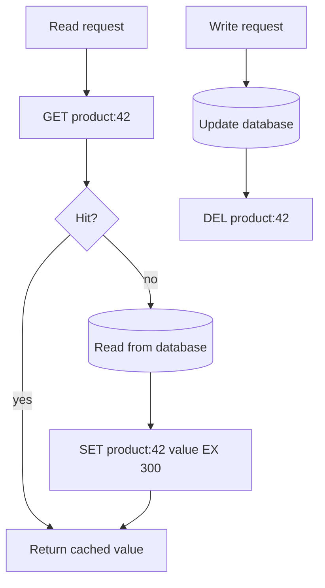

# Caching patterns: cache-aside, write-through, stampedes and eviction

> **Before this lesson:** you should have read the first caching lesson
> ([page caching, row caching and analytics](#/lesson/redis/caching-analytics)) for hit ratio and TTL,
> and know `SET ... NX EX` and locks
> ([autocomplete, locks and semaphores](#/lesson/redis/autocomplete-locks-semaphores)). Lua scripts
> ([Lua basics](#/lesson/redis/lua-basics)) and client-side caching
> ([ACLs, client-side caching and vectors](#/lesson/redis/acl-csc-vector)) are referred to briefly.

## In plain words

A **cache** is a small, fast store of copies, placed in front of a slower store that holds the real
data. The slower store - usually a database - is called the **source of truth**, because when the two
disagree it is the one that is right.

Picture your kitchen. The supermarket has everything (the database) but is ten minutes away. The
fridge (the cache) is two steps away but small. You keep in the fridge the things you reach for most
often, and you go to the shop only when the fridge does not have what you need. That simple picture
raises every question this lesson answers:

- **Who puts things in the fridge, and when?** (the caching *pattern*)
- **How long is the milk good for?** (time to live)
- **What do you throw out when the fridge is full?** (eviction)
- **What if you buy new milk but the old carton is still at the front?** (staleness and consistency)
- **What if the whole family discovers the milk is gone at the same moment and all drive to the
  shop?** (the cache stampede)

Why it matters for a job: caching is the most common use of Redis, the cheapest large performance win
in most systems, and a source of subtle bugs when done carelessly. It is also near-certain to come up
in backend and system-design interviews, where you are expected to name the patterns, their failure
modes and the fixes.

Vocabulary used throughout: a **hit** is finding the item in the cache; a **miss** is not finding it;
the **hit ratio** is the fraction of lookups that hit; **stale** data is a cached copy that no longer
matches the source of truth.

## Part 1 - cache-aside: the default pattern

In **cache-aside** (also called *lazy loading*), the application does all the work, and the cache
knows nothing about the database.

**Reading:**

1. Look in the cache.
2. Hit: return the value.
3. Miss: read from the database, put a copy in the cache with a TTL, return the value.

**Writing:**

1. Update the database.
2. Delete the cached copy. (The next reader will reload it.)



```bash
127.0.0.1:6379> GET product:42
(nil)
127.0.0.1:6379> SET product:42 "{\"name\":\"Trail stove\",\"price\":\"49.00\"}" EX 300
OK
127.0.0.1:6379> GET product:42
"{\"name\":\"Trail stove\",\"price\":\"49.00\"}"
127.0.0.1:6379> DEL product:42
(integer) 1
```

A miss (`nil`), the application's fill with a five-minute lifetime, a hit, and the delete that
follows a price change.

```python
import json
import redis

r = redis.Redis(decode_responses=True)

def get_product(product_id, db):
    key = f"product:{product_id}"
    cached = r.get(key)
    if cached is not None:
        return json.loads(cached)                     # hit
    row = db.load_product(product_id)                 # miss: go to the source of truth
    if row is not None:
        r.set(key, json.dumps(row), ex=300)
    return row

def update_price(product_id, new_price, db):
    db.set_price(product_id, new_price)               # 1. the database first
    r.delete(f"product:{product_id}")                 # 2. then drop the cached copy
```

- `r.get` returns `None` on a miss. A cached value is JSON text, turned back into a dictionary by
  `json.loads`.
- On a miss the database is consulted (`db` stands for your database access code), and the result is
  stored with `ex=300`, a 300-second TTL.
- `update_price` writes the database and then deletes the key.

### Why delete, not update, the cache on a write?

It is tempting to write the new value into the cache directly. Deleting is safer for two reasons.
Two writers that update the cache can do so in the opposite order from their database writes,
leaving the *older* value cached indefinitely; a delete has no such ordering problem. And a delete
is cheap, whereas recomputing a cached value (say, a rendered page) that nobody then reads is wasted
work.

### The remaining race

Cache-aside has one well-known race, worth being able to draw:

1. Reader A misses and reads price 49 from the database.
2. Writer B updates the price to 39 and deletes the key (which is already absent).
3. Reader A, a moment late, writes 49 into the cache.

The cache now holds 49 until the TTL expires. The window is narrow (A must be slower than B's whole
write), and the **TTL is the safety net** that bounds the damage - which is why every cache entry
should have one. Where even brief staleness is unacceptable, a common extra measure is the *delayed
double delete*: delete the key, and delete it again a second later to remove anything a slow reader
put back.

## Part 2 - the other patterns

| Pattern | How a read works | How a write works | Strength | Weakness |
|---|---|---|---|---|
| **Cache-aside** | app checks cache, loads from DB on a miss | app writes DB, deletes the key | simple; tolerates cache outages | first read is slow; small stale window |
| **Read-through** | app asks the cache; the cache layer loads from DB on a miss | as cache-aside | loading logic lives in one place | needs a library or service around the cache |
| **Write-through** | from cache | app writes the cache layer, which writes the DB before returning | cache always fresh after a write | slower writes; caches data that may never be read |
| **Write-behind** (write-back) | from cache | app writes the cache; the DB is updated later, in batches | very fast writes; batching relieves the DB | data is lost if the cache fails before flushing |
| **Refresh-ahead** | from cache | a background job reloads entries before they expire | no slow first read for hot keys | wasted work for keys nobody reads |

Redis is not a read-through or write-through cache by itself - it has no idea your database exists -
so those patterns are implemented by a library or a thin service in front of it. **Write-behind** is
worth a closer look, because Redis makes it easy: write to Redis, and push a note onto a list or
stream; a background worker drains the notes and writes to the database in batches.

```python
def record_view(product_id):
    pipe = r.pipeline()
    pipe.hincrby("views:pending", product_id, 1)      # fast in-memory counter
    pipe.execute()

def flush_views(db):
    """Run every few seconds by a background worker."""
    pipe = r.pipeline()
    pipe.hgetall("views:pending")
    pipe.delete("views:pending")
    pending, _ = pipe.execute()                       # read and clear atomically
    if pending:
        db.add_views({int(pid): int(n) for pid, n in pending.items()})
```

A thousand page views become one database statement. The price is stated in the table: if Redis
loses its data before a flush, those counts are gone. Use write-behind only for data you can afford
to lose a few seconds of, such as view counts.

## Part 3 - designing TTLs

The TTL is the longest you agree to serve stale data. Choosing it is a judgement about the data:

| Data | Typical TTL | Reasoning |
|---|---|---|
| product description | 10 minutes to hours | changes rarely; staleness is harmless |
| price, stock level | seconds, or invalidate on write | staleness costs money or trust |
| rendered page fragment | 1-5 minutes | cheap to rebuild, read constantly |
| user session | 30 minutes, sliding | defines the idle timeout |
| "not found" result | 30-60 seconds | see cache penetration below |

Two rules apply to all of them.

**Always set one.** An entry without a TTL lives until evicted, and a bug that fails to invalidate
it becomes permanent.

**Add jitter.** If ten thousand entries are created together with the same TTL (after a deployment,
or a cache restart), they all expire in the same second and the database receives ten thousand
simultaneous reloads. Adding a random amount spreads the expiries out:

```python
import random

def ttl_with_jitter(base_seconds, spread=0.1):
    return int(base_seconds * random.uniform(1 - spread, 1 + spread))

r.set("product:42", "...", ex=ttl_with_jitter(300))   # between 270 and 330 seconds
```

`random.uniform(a, b)` returns a random number between `a` and `b`; here the lifetime varies by ten
per cent either way.

## Part 4 - three ways a cache can hurt you

### Cache stampede (also: thundering herd, dogpile)

A popular key expires. In the next few milliseconds a hundred requests all miss, and all hundred run
the same expensive database query at once. The database slows down, requests pile up, more keys
expire unrefreshed - a brief expiry has become an outage.

**Fix 1 - a rebuild lock (single flight).** Only the request that wins a short lock rebuilds the
value; the others wait briefly and read the cache again.

```python
import time

def get_with_lock(key, load, ttl=300, lock_ttl=10):
    for _ in range(50):
        value = r.get(key)
        if value is not None:
            return json.loads(value)
        if r.set(f"lock:{key}", "1", nx=True, ex=lock_ttl):      # I am the one who rebuilds
            try:
                fresh = load()
                r.set(key, json.dumps(fresh), ex=ttl_with_jitter(ttl))
                return fresh
            finally:
                r.delete(f"lock:{key}")
        time.sleep(0.05)                                         # someone else is rebuilding
    return load()                                                # give up waiting; go direct
```

- `load` is whatever function computes the value from the database.
- `set(..., nx=True, ex=lock_ttl)` succeeds for exactly one caller. The expiry on the lock means a
  crashed rebuilder cannot block everyone for ever.
- Losers sleep 50 ms and loop back to the `get`, which soon hits.
- After 50 tries (2.5 seconds) the function stops waiting and loads directly, so a stuck lock degrades
  to slow instead of broken.

**Fix 2 - serve stale while refreshing.** Store the value with a *soft* expiry time inside it and a
longer real TTL. A reader that finds the soft time has passed still returns the old value at once,
while one request (chosen by the same lock) refreshes it in the background. Nobody waits.

**Fix 3 - probabilistic early refresh.** Each reader, on a hit, occasionally decides to refresh
*before* expiry, with a probability that grows as expiry approaches. Refreshes are spread over time
and happen while the old value is still valid.

**Fix 4 - refresh ahead** for the handful of keys known to be hot: a scheduled job rebuilds them so
they never expire under load.

### Cache penetration

Requests for keys that **do not exist** in the database - a mistyped id, or an attacker inventing
ids - miss the cache every time, and each one costs a database query, because there is nothing to
cache.

- **Cache the absence.** Store a marker for "not found" with a short TTL:
  `SET product:999999 "__none__" EX 60`. Repeated requests then hit the marker.
- **A Bloom filter** in front (`BF.EXISTS products 999999`): if it says the id was never added, skip
  both the cache and the database.
- **Validate input** before any lookup.

### Cache avalanche

Many keys expire together, or the cache server itself goes down, and the full load lands on the
database at once. Defences: TTL jitter; replicas and automatic failover for the cache; a limit on
how many requests may rebuild at the same time (a semaphore); and a database sized, or protected by
load shedding, so that a cold cache is slow, not fatal.

> [!WARNING]
> Design for the cache being **empty**. After a restart or a flush every request is a miss. If the
> database cannot survive that, the cache has quietly become a critical component, and you need
> warming scripts, gradual traffic ramp-up or rebuild limits before you find out the hard way.

## Part 5 - eviction: what to throw out when memory is full

A cache must have a size limit. `maxmemory` sets it, and `maxmemory-policy` decides what happens when
a write would exceed it. Removing an entry to make room is called **eviction**.

```bash
127.0.0.1:6379> CONFIG SET maxmemory 2gb
OK
127.0.0.1:6379> CONFIG SET maxmemory-policy allkeys-lru
OK
127.0.0.1:6379> INFO stats
# Stats
keyspace_hits:981244
keyspace_misses:40211
evicted_keys:1532
expired_keys:88012
```

| Policy | Which keys may be evicted | Which one is chosen |
|---|---|---|
| `noeviction` (default) | none - writes fail with an error | - |
| `allkeys-lru` | any key | least recently used |
| `allkeys-lfu` | any key | least frequently used |
| `allkeys-random` | any key | random |
| `volatile-lru` | only keys with a TTL | least recently used |
| `volatile-lfu` | only keys with a TTL | least frequently used |
| `volatile-random` | only keys with a TTL | random |
| `volatile-ttl` | only keys with a TTL | the one closest to expiring |

- **LRU** (*least recently used*) evicts what has gone longest without being touched. It assumes that
  what was used recently will be used again.
- **LFU** (*least frequently used*) evicts what is used least often. It protects steadily popular keys
  from being pushed out by a burst of one-off reads, and its counters decay over time so that
  yesterday's hits fade.

Redis does not keep a perfect ordering of all keys - that would cost memory and time on every access.
It **samples** a few keys (`maxmemory-samples`, 5 by default) and evicts the best candidate among
them. This approximation behaves very close to true LRU at a fraction of the cost.

Choosing: for a pure cache, `allkeys-lru` is the safe default and `allkeys-lfu` is often better when
popularity is stable. Use a `volatile-*` policy when the same server also holds data that must never
be evicted (those keys have no TTL). Leave `noeviction` for servers used as a database or
queue, where silently losing keys would be worse than a failed write.

From `INFO stats`, the hit ratio is

$$\frac{\text{keyspace\_hits}}{\text{keyspace\_hits} + \text{keyspace\_misses}} =
\frac{981244}{981244 + 40211} \approx 96.1\,\%$$

A steadily rising `evicted_keys` together with a falling hit ratio says the cache is too small for
its workload.

## Part 6 - hot keys, big keys and consistency

**Hot keys.** A single key receiving a large share of all traffic (the home page, a celebrity
profile) concentrates load on one server and makes its expiry a stampede risk. Remedies: a local
in-process cache in front of Redis (ideally with client-side caching invalidation), reading it from
replicas, or splitting it into several copies (`home:1` ... `home:8`) chosen at random. Find hot keys
with `redis-cli --hotkeys` (needs an LFU policy) or by sampling.

**Big keys.** A multi-megabyte value is slow to transfer, blocks the server while it is serialised
or deleted, and wastes memory if only part of it is needed. Split it, compress it, or cache smaller
fragments; delete large keys with `UNLINK`, which frees memory in the background.

**Consistency.** A cache and a database are two systems, and no cheap operation updates both
atomically. What you choose is the *size of the window* in which they may differ:

| Approach | Staleness window | Cost |
|---|---|---|
| TTL only | up to the TTL | none |
| delete on write + TTL | milliseconds normally; TTL in the rare race | a delete per write |
| write-through | none after a successful write (if all writes go through the layer) | slower writes |
| change data capture (the database's change log drives invalidation) | sub-second, and catches writes from any source | more infrastructure |
| do not cache it | none | every read hits the database |

The last row is a real option. For data where a wrong answer is costly - an account balance at the
moment of payment - read the source of truth.

> [!TIP]
> Version your cache keys (`v3:product:42`). When the format of a cached value changes in a new
> release, bump the version: new code never reads old-format entries, and the old ones expire quietly.

> [!INTERVIEW]
> A complete answer to "how would you add a cache here?" covers: the pattern (cache-aside, and why
> delete-on-write); the TTL per kind of data, with jitter; what happens on a miss storm (lock or
> stale-while-revalidate); negative caching against penetration; the eviction policy and memory
> limit; what you monitor (hit ratio, evictions, latency); and an honest statement of the consistency
> you are giving up.

## Try it: cache-aside, a stampede and its fix, LRU against LFU

The block models a slow database with a call counter, a TTL cache, a stampede of simultaneous
requests with and without a rebuild lock, negative caching, and two eviction policies on the same
access pattern.

```python-run
import collections, random

class SlowDB:
    def __init__(self, rows): self.rows, self.queries = dict(rows), 0
    def load(self, key): self.queries += 1; return self.rows.get(key)

class TTLCache:
    def __init__(self): self.data = {}
    def get(self, key, now):
        hit = self.data.get(key)
        if hit and hit[1] > now: return hit[0]
        self.data.pop(key, None); return None
    def set(self, key, value, ttl, now): self.data[key] = (value, now + ttl)
    def set_nx(self, key, value, ttl, now):
        if self.get(key, now) is not None: return False
        self.set(key, value, ttl, now); return True
    def delete(self, key): self.data.pop(key, None)

MISSING = "__none__"
def cache_aside(cache, db, key, now, ttl=300, negative_ttl=60):
    cached = cache.get(key, now)
    if cached is not None: return None if cached == MISSING else cached
    row = db.load(key)
    cache.set(key, MISSING if row is None else row, negative_ttl if row is None else ttl, now)
    return row

db, cache = SlowDB({"product:42": {"price": 49}}), TTLCache()
print([cache_aside(cache, db, "product:42", t) for t in (0, 1, 2)], "| DB queries:", db.queries)
db.rows["product:42"] = {"price": 39}; cache.delete("product:42")          # write: DB then DEL
print("after update:", cache_aside(cache, db, "product:42", 3), "| DB queries:", db.queries)
for t in range(4, 9): cache_aside(cache, db, "product:999", t)             # an id that does not exist
print("five lookups of a missing id cost", db.queries - 2, "DB query thanks to negative caching")

# ---------- stampede: 100 requests arrive while the key is absent ----------
def stampede(use_lock, requests=100, build_time=5):
    db, cache = SlowDB({"home": "<html>"}), TTLCache()
    finish_at = {}                                    # request id -> time its DB query completes
    for tick in range(build_time + 3):
        for req, done in list(finish_at.items()):
            if done == tick: cache.set("home", "<html>", 300, tick); del finish_at[req]
        if tick == 0:
            for req in range(requests):               # everyone misses at the same instant
                if not use_lock or cache.set_nx("lock:home", req, 10, tick):
                    db.load("home"); finish_at[req] = tick + build_time
    return db.queries
print("stampede without a lock:", stampede(False), "DB queries | with a rebuild lock:", stampede(True))

# ---------- eviction: LRU versus LFU ----------
def run(policy, capacity, accesses):
    store, freq, hits = collections.OrderedDict(), collections.Counter(), 0
    for key in accesses:
        freq[key] += 1
        if key in store:
            hits += 1; store.move_to_end(key)
        else:
            if len(store) >= capacity:
                victim = next(iter(store)) if policy == "lru" else min(store, key=lambda k: (freq[k], k))
                del store[victim]
            store[key] = True
    return hits / len(accesses)

rng = random.Random(3)
popular = [f"hot{i}" for i in range(8)]
workload = []
for step in range(4000):
    workload.append(rng.choice(popular))                       # steady popular traffic
    if step % 2 == 0: workload.append(f"scan{step}")           # a crawler touching each key once
print(f"hit ratio  LRU: {run('lru', 10, workload):.1%}   LFU: {run('lfu', 10, workload):.1%}")

def jittered(base, n, spread, seed=1):
    r2 = random.Random(seed); return collections.Counter(int(base * r2.uniform(1 - spread, 1 + spread)) for _ in range(n))
print("10000 keys, same TTL  -> most expiring in one second:", max(jittered(300, 10000, 0.0).values()))
print("10000 keys, 10% jitter -> most expiring in one second:", max(jittered(300, 10000, 0.1).values()))
```

Reading the output. Three reads of the product cost one database query; after the update and delete,
the next read reloads the new price (second query). Five lookups of a non-existent id cost a single
query, because the "not found" marker was cached. In the stampede, a hundred simultaneous misses
cause a hundred database queries without protection and exactly one with a rebuild lock. In the
eviction test, a crawler reading many keys once each pushes popular keys out of an LRU cache, while
LFU keeps the popular keys and scores a visibly higher hit ratio. The last two lines show jitter
turning ten thousand simultaneous expiries into a few hundred per second.

## Pitfalls

- **No TTL.** A missed invalidation becomes permanent.
- **Identical TTLs.** Synchronised expiry causes a miss storm. Add jitter.
- **Updating the cache before the database**, or updating instead of deleting. Ordering races leave
  old values cached.
- **No stampede protection on hot keys.** One expiry can overload the database.
- **Not caching "not found".** Missing ids hit the database every time.
- **`noeviction` on a cache.** When memory fills, writes fail and the application sees errors.
- **Mixing cache and must-keep data under `allkeys-*`.** Important keys get evicted. Separate the
  instances, or use a `volatile-*` policy and leave important keys without a TTL.
- **Caching personalised data under a shared key.** One user sees another's data.
- **Caching huge values.** Memory, latency and blocking problems; cache fragments.
- **Treating the cache as reliable storage.** Anything in it may vanish at any moment.
- **No monitoring.** Without the hit ratio and eviction count you cannot tell whether the cache helps.

## Command cheat sheet

| Command or setting | Use here | Time |
|---|---|---|
| `GET key` / `SET key value EX ttl` | cache-aside read and fill | O(1) |
| `DEL key` / `UNLINK key` | invalidate on write / free a large value in the background | O(1) / O(1) plus background work |
| `SET lock:key 1 NX EX 10` | rebuild lock against stampedes | O(1) |
| `SET key __none__ EX 60` | negative caching | O(1) |
| `TTL key` / `EXPIRE key seconds` | inspect / set a lifetime | O(1) |
| `MGET k1 k2 ...` | fetch many cached values in one round trip | O(number of keys) |
| `maxmemory 2gb` | memory limit | - |
| `maxmemory-policy allkeys-lru \| allkeys-lfu \| volatile-ttl \| ...` | eviction policy | - |
| `maxmemory-samples 5` | keys sampled per eviction | - |
| `INFO stats` | `keyspace_hits`, `keyspace_misses`, `evicted_keys` | O(1) |
| `OBJECT FREQ key` / `OBJECT IDLETIME key` | LFU counter / seconds since last access | O(1) |
| `redis-cli --hotkeys` / `--bigkeys` | find hot and large keys | O(keys), incremental |
| `BF.EXISTS filter item` | Bloom-filter guard against penetration | O(k) hash functions |

## Summary

- Cache-aside: read the cache, on a miss load and store with a TTL; on a write, update the database
  and delete the key.
- Write-through keeps the cache fresh at the cost of slower writes; write-behind makes writes fast at
  the risk of losing recent ones.
- TTLs bound staleness and should carry jitter.
- Protect hot keys from stampedes with a rebuild lock or by serving stale data while refreshing; cache
  "not found" to stop penetration; plan for an empty cache.
- Set `maxmemory` and an eviction policy: LRU for recency, LFU for stable popularity, `volatile-*` to
  spare keys without a TTL.
- A cache trades consistency for speed; decide how much staleness each kind of data may have.

## Glossary

- **Cache** - a fast store of copies in front of a slower store.
- **Source of truth** - the store whose data is authoritative.
- **Hit / miss / hit ratio** - found in cache / not found / hits divided by all lookups.
- **Stale** - a cached copy that no longer matches the source.
- **Cache-aside (lazy loading)** - the application loads into the cache on a miss.
- **Read-through / write-through** - a cache layer loads on a miss / writes the database on every
  write.
- **Write-behind** - writes go to the cache first and reach the database later.
- **Invalidation** - removing or replacing a cached copy because the original changed.
- **TTL** - the lifetime of an entry.
- **Jitter** - random variation added to a TTL.
- **Cache stampede (thundering herd)** - many requests rebuilding the same expired entry at once.
- **Cache penetration** - repeated lookups of keys that do not exist anywhere.
- **Cache avalanche** - a large part of the cache disappearing at the same time.
- **Negative caching** - caching the fact that something was not found.
- **Eviction** - removing entries to stay under a memory limit.
- **LRU / LFU** - evict the least recently / least frequently used entry.
- **Hot key / big key** - a key with a very high access rate / a very large value.

```quiz
[
  {"q": "In cache-aside, what should the application do when it updates a record?",
   "options": ["Update the cache, then the database", "Update the database, then delete the cached key", "Delete the cached key only", "Wait for the TTL"],
   "answer": 1,
   "explain": "Writing the source of truth first and deleting the copy avoids ordering races between concurrent cache updates; the next reader reloads."},
  {"q": "Reader A misses and reads an old value from the database; writer B then updates the database and deletes the key; A then stores its old value. What limits how long the stale value is served?",
   "options": ["Nothing; it stays for ever", "The entry's TTL", "The eviction policy", "The replication backlog"],
   "answer": 1,
   "explain": "This race is rare but possible, which is why every cache entry needs a TTL as a safety net."},
  {"q": "Which pattern gives the fastest writes but can lose recent data if the cache fails?",
   "options": ["Cache-aside", "Write-through", "Write-behind", "Read-through"],
   "answer": 2,
   "explain": "Write-behind acknowledges after writing the cache and flushes to the database later, so unflushed writes are at risk."},
  {"q": "A very popular key expires and 500 concurrent requests all recompute it. What is this called and what is one fix?",
   "options": ["Cache penetration; a Bloom filter", "Cache stampede; let only one request rebuild using a short lock while the others wait or get stale data", "Eviction; raise maxmemory", "Replication lag; use WAIT"],
   "answer": 1,
   "explain": "A rebuild lock (or stale-while-revalidate) collapses many simultaneous rebuilds into one."},
  {"q": "Requests keep arriving for product ids that do not exist, each causing a database query. Which technique helps?",
   "options": ["A longer TTL on existing products", "Caching a 'not found' marker with a short TTL", "Switching to allkeys-random", "Disabling persistence"],
   "answer": 1,
   "explain": "Negative caching turns repeated lookups of a missing key into cache hits; a Bloom filter is an alternative."},
  {"q": "Why add random jitter to TTLs?",
   "options": ["To make keys more secure", "So entries created together do not all expire in the same instant and overload the database", "To increase the hit ratio to 100%", "Because Redis requires distinct TTLs"],
   "answer": 1,
   "explain": "Spreading expiry times spreads the reload work."},
  {"q": "A server holds both cache entries (with TTLs) and configuration that must never be evicted (no TTL). Which policy fits?",
   "options": ["allkeys-lru", "volatile-lru", "noeviction", "allkeys-random"],
   "answer": 1,
   "explain": "volatile-* policies evict only keys that have a TTL, sparing the keys without one."},
  {"q": "A crawler reads thousands of distinct keys once each while a few keys are read constantly. Which policy better protects the constantly read keys, and why?",
   "options": ["LRU, because it tracks time", "LFU, because eviction is based on how often keys are used, so one-off reads do not displace popular keys", "volatile-ttl, because it ignores usage", "noeviction, because nothing is removed"],
   "answer": 1,
   "explain": "Under LRU every fresh one-off read looks recent and pushes out popular keys; LFU keeps those with higher access counts."}
]
```

> **Source:** caching patterns are general system-design practice; Redis specifics (eviction policies, sampling, LFU, client-side caching) from redis.io. For the book's caching examples see Carlson, *Redis in Action*, ch. 2 (sections 2.3-2.4). Explanations, code and simulation are original.
> Further reading: <https://redis.io/docs/latest/develop/reference/eviction/>, <https://redis.io/docs/latest/develop/reference/client-side-caching/>, <https://redis.io/docs/latest/commands/set/>
