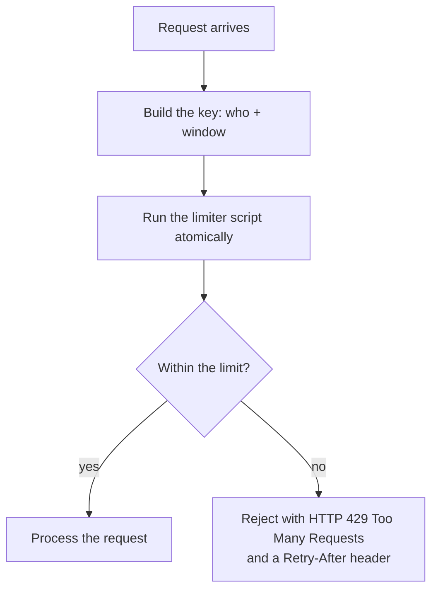

# Redis interview essentials: rate limiters, leaderboards, locks and limits

> **Before this lesson:** this is the capstone of the track. It draws on sorted sets
> ([hashes and sorted sets](#/lesson/redis/hashes-sorted-sets)), key expiry
> ([pub/sub, transactions and expiry](#/lesson/redis/pubsub-transactions-expiry)), locks
> ([autocomplete, locks and semaphores](#/lesson/redis/autocomplete-locks-semaphores)), Lua scripts
> ([Lua basics](#/lesson/redis/lua-basics)), persistence and replication
> ([persistence](#/lesson/redis/persistence), [replication](#/lesson/redis/replication-failures)) and
> caching ([caching patterns](#/lesson/redis/caching-patterns)).

## In plain words

Interviews about Redis rarely ask you to recite commands. They ask you to **design something small
and defend it**: "limit each user to 100 requests a minute", "build a leaderboard", "make sure only
one worker runs this job", "should we even use Redis here?". Each has a standard answer, a standard
weakness, and a standard follow-up question.

This lesson is a set of worked answers. Think of it as a driving test: you already know how the
pedals work; now you practise the manoeuvres examiners ask for, and learn what they are watching for
- do you state your assumptions, name the trade-off, and know where your design breaks?

Two of the manoeuvres deserve a quick picture before we start.

A **rate limiter** is a bouncer with a counter: "no more than 100 people through this door per
minute". Its purpose is to protect a service from being overwhelmed, by accident or on purpose.

A **leaderboard** is a ranking table like a sports league: who is first, what is my position, who are
the ten people around me.

Why it matters for a job: these exact components are built in real products every day, so the
interview questions are honest previews of the work.

## Part 1 - rate limiters

A rate limit has three parts: **who** is being limited (a user id, an API key, an IP address), the
**limit** (how many), and the **window** (per how long). Four algorithms are worth knowing, in order
of sophistication.

### 1. Fixed window counter

Divide time into fixed windows - each calendar minute, say - and count requests per user per window.

```bash
127.0.0.1:6379> INCR rate:user:7:29453760
(integer) 1
127.0.0.1:6379> EXPIRE rate:user:7:29453760 60
(integer) 1
127.0.0.1:6379> INCR rate:user:7:29453760
(integer) 2
```

The number at the end of the key is the window: the current Unix time divided by 60, rounded down
($1767225600 \div 60 = 29453760$). `INCR` counts a request. The first request in a window also sets
an expiry, so old windows clean themselves up. If the count exceeds the limit, reject the request.

```python
import time
import redis

r = redis.Redis(decode_responses=True)

FIXED = r.register_script("""
local n = redis.call('INCR', KEYS[1])
if n == 1 then redis.call('EXPIRE', KEYS[1], ARGV[1]) end
return n
""")

def allow_fixed(user, limit=100, window=60):
    key = f"rate:{user}:{int(time.time()) // window}"
    return FIXED(keys=[key], args=[window]) <= limit
```

The two commands are in a script so that a crash can never leave a counter without an expiry.

**Weakness: bursts at the boundary.** A user can send 100 requests in the last second of one window
and 100 in the first second of the next: 200 requests in two seconds while never breaking "100 per
minute" in either window.

### 2. Sliding window log

Remember the **timestamp of every request** in a sorted set, and count those within the last 60
seconds, measured from *now*, not from a clock boundary.

```bash
127.0.0.1:6379> ZREMRANGEBYSCORE rate:log:user:7 -inf 1767225540
(integer) 0
127.0.0.1:6379> ZCARD rate:log:user:7
(integer) 2
127.0.0.1:6379> ZADD rate:log:user:7 1767225600.731 "1767225600.731-a91f"
(integer) 1
127.0.0.1:6379> EXPIRE rate:log:user:7 60
(integer) 1
```

Remove entries older than the window; count what is left; if under the limit, add this request (the
member needs a unique suffix so that two requests in the same instant do not collide); refresh the
key's expiry so idle users cost nothing. These steps must run atomically, so in practice they are one
script.

**Strength:** exact - no boundary burst. **Weakness:** memory proportional to the limit, per user. At
a limit of 10,000 per hour that is 10,000 sorted-set entries for each active user.

### 3. Sliding window counter

A compromise: keep fixed-window counters for the current and the previous window, and estimate the
sliding count by weighting the previous window by how much of it still overlaps:

$$\text{estimate} = \text{current} + \text{previous} \times \left(1 - \frac{\text{seconds into the current window}}{\text{window length}}\right)$$

Fifteen seconds into the current minute, with 40 requests so far and 80 in the previous minute, the
estimate is $40 + 80 \times (1 - 15/60) = 40 + 60 = 100$. Two small counters per user, and the
boundary burst is smoothed away. It assumes requests in the previous window were evenly spread, so it
is an approximation - an accepted one; large public APIs use it.

### 4. Token bucket

Imagine a bucket holding up to `capacity` tokens, refilled at `rate` tokens per second. Each request
takes one token; with none left, the request is refused. A full bucket permits a **burst** of
`capacity` requests at once, after which requests flow at the refill rate.

The state is two numbers per user - tokens remaining and the time of the last refill - updated
together by a script (the full script is in
[rewriting locks and semaphores](#/lesson/redis/lua-locks-semaphores)):

$$\text{tokens} = \min\bigl(\text{capacity},\ \text{tokens} + \text{elapsed seconds} \times \text{rate}\bigr)$$

Its relative, the **leaky bucket**, queues requests and releases them at a constant rate, giving
perfectly smooth output and no bursts.

### Comparison

| Algorithm | Memory per user | Accuracy | Bursts | Typical use |
|---|---|---|---|---|
| Fixed window | one counter | boundary can admit twice the limit | at boundaries | simple quotas |
| Sliding log | one entry per request | exact | none | low limits, strict fairness |
| Sliding counter | two counters | close approximation | smoothed | high-volume APIs |
| Token bucket | two numbers | exact for its own definition | allowed up to capacity | APIs that tolerate bursts |



Points interviewers probe:

- **Atomicity.** Check-and-increment as separate commands lets concurrent requests slip past the
  limit; use a script.
- **What to do when Redis is unreachable.** *Fail open* (allow requests) favours availability; *fail
  closed* (reject) favours protection. State your choice and why.
- **Where the limiter runs.** At the API gateway, so rejected requests never reach the application.
- **Telling the client.** HTTP status 429 with a `Retry-After` header.

## Part 2 - leaderboards

### The whole feature in six commands

```bash
127.0.0.1:6379> ZADD board:week 2450 ada 1980 bo 3120 cy 1980 di
(integer) 4
127.0.0.1:6379> ZINCRBY board:week 300 bo
"2280"
127.0.0.1:6379> ZRANGE board:week 0 2 REV WITHSCORES
1) "cy"
2) "3120"
3) "ada"
4) "2450"
5) "bo"
6) "2280"
127.0.0.1:6379> ZREVRANK board:week bo
(integer) 2
127.0.0.1:6379> ZSCORE board:week bo
"2280"
127.0.0.1:6379> ZCARD board:week
(integer) 4
```

`ZADD` sets scores, `ZINCRBY` adds points, `ZRANGE ... REV` returns the top three, `ZREVRANK` gives a
player's zero-based position from the top (add 1 to display it), `ZSCORE` the score, `ZCARD` the
number of players. Each is O(log n) or better, so a board of ten million players answers in
microseconds - the operation a relational database struggles with, since computing a rank there
means counting all higher rows.

"Players around me" is a rank lookup followed by a range:

```python
def around(board, player, radius=2):
    rank = r.zrevrank(board, player)
    if rank is None:
        return []
    start = max(0, rank - radius)
    rows = r.zrange(board, start, rank + radius, desc=True, withscores=True)
    return [(start + i + 1, name, int(score)) for i, (name, score) in enumerate(rows)]
```

`max(0, ...)` stops the range from going below the first place. The list comprehension numbers each
row with its displayed position.

### The follow-up questions

**Ties.** Equal scores are ordered by member name, which players find arbitrary. To rank the player
who reached the score *first* higher, pack the time into the score: store
$\text{points} \times 10^{10} + (10^{10} - \text{timestamp})$. Higher points always win; among equal
points, the earlier timestamp gives the larger number. Keep the total below $2^{53}$ so the score
stays exact.

**Keep only each player's best.** `ZADD board GT score player` updates only if the new score is
higher.

**Daily, weekly, all-time.** One sorted set per period (`board:2026-01-01`), each with an expiry;
combine days into a week with `ZUNIONSTORE`.

**Dense ranking** (tied players share a rank). `ZREVRANK` gives each member a distinct position. For
shared ranks, count the *distinct scores* above - or accept standard competition ranking using
`ZCOUNT board (score +inf`, which counts players with strictly higher scores.

**A hundred million players.** One sorted set of that size is roughly 10 GB on a single server.
Options: shard by score range or by player and merge (see
[queries across shards](#/lesson/redis/queries-on-shards)); keep exact ranks only for the top tier
and show approximate percentiles to everyone else.

**Durability.** Treat the board as derived data: store each score event in a database as well, so the
sorted set can be rebuilt after a loss.

## Part 3 - distributed locks and their limits

The essentials, compressed:

```bash
127.0.0.1:6379> SET lock:invoice:881 9c1e-token NX PX 30000
OK
127.0.0.1:6379> EVAL "if redis.call('GET', KEYS[1]) == ARGV[1] then return redis.call('DEL', KEYS[1]) end return 0" 1 lock:invoice:881 9c1e-token
(integer) 1
```

1. **Acquire** with `SET key token NX PX ttl` - one atomic command; the expiry prevents deadlock.
2. **A unique token per holder**, so nobody releases a lock they do not own.
3. **Release with compare-and-delete in a script.**
4. **Extend** the same way for long work.

Then the limits, which are what interviewers want to hear:

| Failure | What happens | Mitigation |
|---|---|---|
| The holder pauses or is slow past the TTL | the lock expires; a second holder enters while the first is still working | fencing tokens checked by the resource; keep work short; extend the lock |
| The primary fails before replicating the lock key | the promoted replica has no lock; a second client acquires it | accept it, use Redlock across independent servers, or use a consensus system |
| Clocks jump | expiry happens early or late | monotonic clocks; do not rely on tight timing |
| The client crashes | the lock stays until the TTL | choose the TTL sensibly |

The summary sentence to memorise: **a Redis lock is good for efficiency (avoiding duplicate work) and
insufficient alone for correctness (preventing harmful overlap).** For correctness, the protected
resource must reject stale writers using a **fencing token** - a number that increases with every
lock grant - or the lock must come from a system built on consensus, such as ZooKeeper or etcd.

## Part 4 - when not to use Redis

Being able to say "not here" is a sign of judgement. Redis is a poor choice when:

- **The data does not fit in RAM, or is not worth RAM prices.** Terabytes of rarely read history
  belong on disk.
- **You need the last write to be safe, always.** Asynchronous replication and periodic fsync can lose
  acknowledged writes. Money movements and legal records belong in a database with synchronous
  durability.
- **You need rich queries.** Joins, ad-hoc filters, reports across many fields: use a relational or
  analytical database.
- **You need multi-key transactions with rollback, or constraints** such as foreign keys.
- **Values are large blobs.** Images and videos go to object storage; cache a reference.
- **You need a durable, replayable event log at high volume.** Streams work up to a point; beyond
  it, a log system such as Kafka is designed for the job.
- **A single slow command would be a disaster.** Everything shares one command thread.

And the positive list, for balance: caching, sessions, rate limiting, leaderboards and counters,
queues and lightweight streams, pub/sub notifications, short-lived coordination, and precomputed
views such as timelines - data that is small, hot, derived or short-lived.

> [!WARNING]
> The most damaging pattern in practice is Redis becoming the *only* copy of important data by
> accident: a "cache" that nobody can rebuild. For every key family, be able to answer: *if this
> vanished right now, what breaks, and how is it restored?*

## Part 5 - short answers to frequent questions

**Why is Redis fast?** Data in memory; simple, purpose-built data structures; a single command thread
with no locking; non-blocking network I/O that handles many connections on one thread; a compact
protocol with pipelining.

**Single-threaded - so how does it use many cores?** Commands execute on one thread. Background
threads handle disk flushes, lazy freeing and (optionally, since version 6) socket reads and writes.
To use more cores for commands, run several instances or a cluster.

**How are expired keys removed?** Lazily when accessed, plus an active cycle that samples keys with
TTLs several times a second.

**RDB or AOF?** A snapshot is compact and loads fast but loses minutes; the append-only file with
`everysec` loses about a second; many deployments use both.

**What happens when memory is full?** With `noeviction`, writes fail; otherwise keys are evicted by
the configured policy, chosen by sampling.

**Sentinel or Cluster?** Sentinel gives failover for one data set; Cluster adds sharding over 16,384
hash slots.

**How do you make several commands atomic?** `MULTI`/`EXEC` for unconditional groups; `WATCH` for
check-and-set under low contention; a Lua script when logic must run on the server.

**How do you find a slow command or a big key?** `SLOWLOG GET`, `redis-cli --bigkeys`, `MEMORY
USAGE`, `INFO commandstats`.

**What is a hot key and what do you do about it?** A key with a disproportionate share of traffic;
cache it locally, read it from replicas, or split it.

> [!TIP]
> A reliable structure for any design answer: restate the requirement with numbers; pick the data
> structure and show the two or three commands; state the time and memory cost; name the failure
> modes; say what you would monitor. Five short paragraphs beat one long ramble.

> [!INTERVIEW]
> Practise saying trade-offs aloud in one sentence each: "Fixed windows are cheap but allow double
> the limit at a boundary." "Sorted sets make rank queries logarithmic, at about 100 bytes per
> member." "A lock with a TTL can be held by two clients after a pause, so I add a fencing token."
> Interviewers are listening for the second half of each sentence.

## Try it: four rate limiters and a leaderboard

The block implements each limiter with a controllable clock and replays the same burst pattern
against all of them, then builds a leaderboard with rank queries and first-to-reach tie-breaking.

```python-run
import bisect

class FixedWindow:
    def __init__(self, limit, window): self.limit, self.window, self.counts = limit, window, {}
    def allow(self, now):
        w = int(now // self.window)
        self.counts[w] = self.counts.get(w, 0) + 1
        return self.counts[w] <= self.limit

class SlidingLog:
    def __init__(self, limit, window): self.limit, self.window, self.log = limit, window, []
    def allow(self, now):
        self.log = [t for t in self.log if t > now - self.window]      # ZREMRANGEBYSCORE
        if len(self.log) >= self.limit: return False                   # ZCARD
        self.log.append(now); return True                              # ZADD

class SlidingCounter:
    def __init__(self, limit, window): self.limit, self.window, self.counts = limit, window, {}
    def allow(self, now):
        w = int(now // self.window)
        into = (now % self.window) / self.window
        estimate = self.counts.get(w, 0) + self.counts.get(w - 1, 0) * (1 - into)
        if estimate >= self.limit: return False
        self.counts[w] = self.counts.get(w, 0) + 1; return True

class TokenBucket:
    def __init__(self, capacity, rate): self.capacity, self.rate, self.tokens, self.stamp = capacity, rate, capacity, 0.0
    def allow(self, now):
        self.tokens = min(self.capacity, self.tokens + (now - self.stamp) * self.rate); self.stamp = now
        if self.tokens < 1: return False
        self.tokens -= 1; return True

# 10 requests right before the minute boundary and 10 right after: 20 requests within 2 seconds
burst = [59.0 + i * 0.09 for i in range(10)] + [60.0 + i * 0.09 for i in range(10)]
limiters = {"fixed window (10/min)": FixedWindow(10, 60), "sliding log (10/min)": SlidingLog(10, 60),
            "sliding counter (10/min)": SlidingCounter(10, 60), "token bucket (10, 1 per 6 s)": TokenBucket(10, 1 / 6)}
for name, lim in limiters.items():
    allowed = sum(lim.allow(t) for t in burst)
    print(f"{name:30s} allowed {allowed:2d} of 20 in the boundary burst")

steady = TokenBucket(3, 1.0)
print("token bucket, capacity 3, 1 per second:", [(t, int(steady.allow(t))) for t in (0, 0.1, 0.2, 0.3, 1.3, 1.4, 5, 5, 5, 5)])

class Leaderboard:
    def __init__(self): self.score, self.order = {}, []               # order: sorted (-score, member)
    def add(self, member, points):
        if member in self.score: self.order.remove((-self.score[member], member))
        self.score[member] = self.score.get(member, 0) + points
        bisect.insort(self.order, (-self.score[member], member))
        return self.score[member]
    def top(self, n): return [(m, -s) for s, m in self.order[:n]]
    def rank(self, member):
        if member not in self.score: return None
        return bisect.bisect_left(self.order, (-self.score[member], member)) + 1
    def around(self, member, radius=1):
        r = self.rank(member) - 1; start = max(0, r - radius)
        return [(start + i + 1, m, -s) for i, (s, m) in enumerate(self.order[start:r + radius + 1])]

b = Leaderboard()
for name, pts in [("ada", 2450), ("bo", 1980), ("cy", 3120), ("di", 1980), ("eve", 900)]: b.add(name, pts)
print("bo gains 300 ->", b.add("bo", 300))
print("top 3:", b.top(3), "| rank of bo:", b.rank("bo"), "| rank of nobody:", b.rank("zed"))
print("around di:", b.around("di"))

def packed(points, timestamp): return points * 10**10 + (10**10 - timestamp)   # earlier time ranks higher
first, later = packed(1980, 1_767_225_600), packed(1980, 1_767_229_999)
print("same points, earlier wins:", first > later, "| more points always wins:", packed(1981, 1_767_299_999) > first,
      "| still exact as a double:", first < 2**53)
```

Compare the first four lines. The fixed window admits all 20 requests of the boundary burst - twice
the limit - because ten fall in each window. The sliding log admits exactly 10. The sliding counter
admits 10 or 11, close to exact with only two counters. The token bucket admits its capacity of 10
and then almost nothing until tokens return. The next line shows a small bucket allowing a burst of
three, refusing the fourth, and refilling at one per second. In the leaderboard, after gaining 300
points `bo` is third; a missing player has no rank; and the packed-score check confirms that with
equal points the earlier timestamp ranks higher while staying within exact floating-point range.

## Pitfalls

- **Non-atomic limiters.** `GET`, compare, `INCR` as separate commands lets concurrent requests exceed
  the limit.
- **`INCR` without ensuring an expiry.** A counter that never resets locks the user out permanently.
- **Rate limiting by IP address alone.** Many users share one address behind a network gateway, and
  attackers rotate addresses.
- **Forgetting the boundary burst** when choosing fixed windows.
- **Sliding logs with large limits.** Memory per user grows with the limit.
- **Treating a leaderboard as durable.** Keep the score events elsewhere so it can be rebuilt.
- **Floating-point scores beyond $2^{53}$**, or fractional increments, losing exactness.
- **Displaying `ZREVRANK` directly.** It is zero-based; add one.
- **Claiming a Redis lock guarantees mutual exclusion.** State its limits and the fencing remedy.
- **Reaching for Redis by habit.** Check size, durability and query needs first.

## Command cheat sheet

`n` = members in the sorted set, `m` = members returned.

| Command | Use here | Time |
|---|---|---|
| `INCR key` + `EXPIRE key window` (scripted) | fixed-window counter | O(1) |
| `ZREMRANGEBYSCORE key -inf (now - window)` | drop old log entries | O(log n + removed) |
| `ZCARD key` / `ZADD key now id` | count / record a request | O(1) / O(log n) |
| `HMGET` / `HSET bucket tokens stamp` (scripted) | token-bucket state | O(1) |
| `ZADD board [GT] score member` | set a score (optionally best only) | O(log n) |
| `ZINCRBY board points member` | add points | O(log n) |
| `ZRANGE board 0 9 REV WITHSCORES` | top ten | O(log n + m) |
| `ZREVRANK board member` | zero-based position from the top | O(log n) |
| `ZCOUNT board (score +inf` | players strictly ahead | O(log n) |
| `ZUNIONSTORE week 7 day1 ... day7` | combine periods | O(N) + O(M log M) |
| `SET lock token NX PX ttl` | acquire a lock | O(1) |
| script: compare token then `DEL` / `PEXPIRE` | release / extend | O(1) |
| `INCR lock:fence` | fencing token | O(1) |
| `SLOWLOG GET`, `INFO stats`, `MEMORY USAGE key` | diagnostics | O(1) to O(entries) |

## Summary

- Rate limiters: fixed windows are cheapest and burst at boundaries; sliding logs are exact and
  memory-hungry; sliding counters approximate well with two counters; token buckets allow controlled
  bursts. All must be atomic.
- Leaderboards are sorted sets: add, increment, top-n, rank and neighbours are each one logarithmic
  command; ties, periods and scale are the usual follow-ups.
- A Redis lock needs `SET NX PX`, a token and scripted release; it prevents duplicate work, and needs
  fencing tokens where overlap would corrupt data.
- Redis fits small, hot, derived or short-lived data; it does not fit data larger than memory, data
  that must never be lost, or complex queries.
- In an interview, pair every design with its cost and its failure mode.

## Glossary

- **Rate limiting** - restricting how many requests a client may make in a period.
- **Window** - the period over which requests are counted.
- **Fixed window** - windows aligned to the clock (each minute, each hour).
- **Sliding window** - a window that always ends at the present moment.
- **Token bucket** - a limiter that refills at a steady rate and allows bursts up to its capacity.
- **Leaky bucket** - a limiter that releases queued requests at a constant rate.
- **Burst** - many requests in a very short time.
- **Fail open / fail closed** - allow / reject requests when the limiter itself is unavailable.
- **HTTP 429** - the status code meaning "too many requests".
- **Leaderboard** - a ranking of members by score.
- **Rank** - a member's position in the ordering.
- **Dense ranking** - tied members share a rank and the next rank is not skipped.
- **Fencing token** - an increasing number that lets a resource reject stale lock holders.
- **Consensus system** - software (such as etcd or ZooKeeper) in which a majority of servers must
  agree on each change.
- **Derived data** - data that can be recomputed from another source.

```quiz
[
  {"q": "A fixed-window limiter allows 100 requests per minute. What is the largest number of requests a client can get through in a two-second span?",
   "options": ["100", "101", "200", "Unlimited"],
   "answer": 2,
   "explain": "100 at the very end of one window and 100 at the start of the next are both within their windows' limits."},
  {"q": "Why is the sliding window log exact, and what does that cost?",
   "options": ["It rounds timestamps; it costs CPU", "It stores a timestamp for every request in the window, so memory grows with the limit per client", "It uses a HyperLogLog; it costs accuracy", "It locks the key; it costs latency"],
   "answer": 1,
   "explain": "Counting actual timestamps in the last window is precise, but each allowed request is an entry to store."},
  {"q": "Twenty seconds into the current minute the counter is 30 and the previous minute's total was 60. What does the sliding window counter estimate?",
   "options": ["90", "70", "50", "30"],
   "answer": 1,
   "explain": "30 + 60 x (1 - 20/60) = 30 + 40 = 70."},
  {"q": "A token bucket has capacity 5 and refills at 1 token per second. After a long idle period, 8 requests arrive at once. How many are allowed?",
   "options": ["1", "5", "8", "0"],
   "answer": 1,
   "explain": "The bucket holds at most 5 tokens, so a burst of 5 passes and the rest wait for refills."},
  {"q": "Why must the rate-limit check and increment run in one script or atomic command?",
   "options": ["Scripts are faster", "With separate commands, concurrent requests can all read a count below the limit and all proceed, exceeding it", "INCR cannot be pipelined", "EXPIRE requires a script"],
   "answer": 1,
   "explain": "Check-then-act across round trips is a race condition; atomic execution removes it."},
  {"q": "ZREVRANK board player returns 0. What position should be displayed, and what does a nil reply mean?",
   "options": ["Position 0; nil means last place", "Position 1; nil means the player is not on the board", "Position 1; nil means a tie", "Position 2; nil means an error"],
   "answer": 1,
   "explain": "Ranks are zero-based, so add one. A missing member has no rank."},
  {"q": "Why is a Redis lock alone not enough when two overlapping writers would corrupt data?",
   "options": ["SET NX is not atomic", "The lock can expire while its holder is paused, or be lost in a failover, so two clients may both believe they hold it", "Locks cannot have TTLs", "Redis forbids locks on replicas"],
   "answer": 1,
   "explain": "Expiry and asynchronous replication mean exclusivity is not guaranteed; fencing tokens at the resource enforce correctness."},
  {"q": "Which workload is the WORST fit for Redis as the primary store?",
   "options": ["Session data expiring after 30 minutes", "A per-user request counter", "A ledger of financial transfers that must never lose an acknowledged write and needs complex reporting queries", "The top-100 players of a game"],
   "answer": 2,
   "explain": "Strict durability and rich queries are outside what Redis is designed for; the other three are classic uses."}
]
```

> **Source:** synthesis of the whole track; for the underlying building blocks see Carlson, *Redis in Action*, ch. 3 (sorted sets), ch. 5 (counters) and ch. 6 (locks). Rate-limiting algorithms are general practice; Redis details from redis.io. Worked answers and simulation are original.
> Further reading: <https://redis.io/docs/latest/develop/data-types/sorted-sets/>, <https://redis.io/docs/latest/develop/clients/patterns/distributed-locks/>, <https://redis.io/docs/latest/develop/reference/eviction/>, <https://redis.io/docs/latest/operate/oss_and_stack/management/persistence/>
