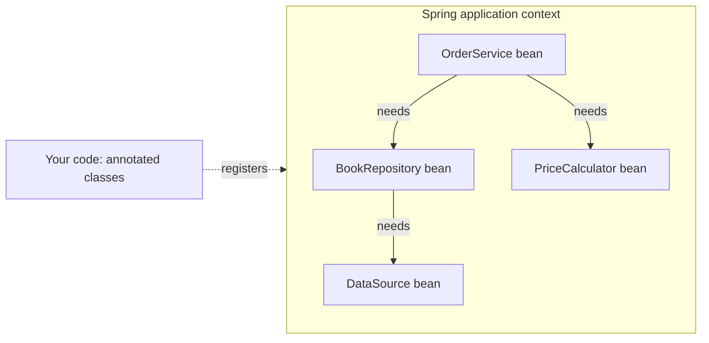

# What a framework is and why Spring exists

> **Before this lesson:** you can write Java classes with fields, constructors and methods, and you know what an interface is ([Interfaces](#/lesson/java/java-interfaces)). You do not need to have seen any framework, web server or database library before.

## In plain words

Imagine opening a small restaurant. You could build the oven yourself, lay the gas pipes, weld the extractor hood and write your own food-safety rules. Or you could rent a professional kitchen that already has all of that, built by people who have equipped thousands of kitchens. In the rented kitchen you concentrate on the one thing nobody else can do for you: your menu.

A **framework** is that rented kitchen for software. It is a large body of ready-made code that handles the parts every application needs (starting up, receiving web requests, talking to a database, security, logging) and leaves clearly marked places where you add the part that is unique to your business.

**Spring** is the most widely used framework for Java. **Spring Boot** is a layer on top of Spring that removes most of the set-up work, so a new project runs within minutes. Almost every Java back-end job advert mentions one or both, which is the practical reason to learn them.

This lesson explains what problem a framework solves, what "the framework calls your code" means, and what Spring is made of. There is very little Spring code yet. The goal is that every later lesson has somewhere to hang.

## An application is mostly not your idea

Suppose you are asked to build the back end of an online bookshop. The business idea fits on a napkin:

- show the catalogue,
- let a customer put books into a cart,
- take an order and charge for it.

Now list what the program must also do before a single customer can buy a book:

| Need | What it means |
|---|---|
| Listen for HTTP requests | open a network port, parse the text a browser sends, run many requests at once |
| Turn data into JSON and back | convert Java objects to the text format web clients expect |
| Talk to a database | open connections, reuse them, send SQL, convert rows into objects |
| Transactions | make "take payment" and "reduce stock" succeed or fail together |
| Security | check who the caller is and what they may do |
| Configuration | different database address on a laptop and in production |
| Logging and monitoring | write down what happened so that failures can be investigated |
| Testing | start parts of the program in isolation |

A **back end** is the part of an application that runs on a server and is not seen directly by the user. **HTTP** (HyperText Transfer Protocol) is the set of rules browsers and servers use to talk. **JSON** (JavaScript Object Notation) is a text format for structured data, for example `{"title": "Dune", "price": 12}`. **SQL** (Structured Query Language) is the language used to ask a relational database for data.

Count the lines of code each row would need if you wrote it from nothing, and the napkin idea turns out to be perhaps one tenth of the total. The other nine tenths are the same in every shop, bank and booking site. Code that is necessary but identical everywhere is often called **boilerplate** or **plumbing**.

The table is the reason frameworks exist. Somebody writes the nine tenths once, very carefully, with thousands of users reporting bugs. You write the one tenth.

## Library versus framework

Both are code written by someone else. The difference is who is in charge.

- A **library** is a toolbox. Your code is in control and calls a tool when it wants one. `Math.sqrt(9)` is a library call.
- A **framework** is in control. It runs the program and calls *your* code at the right moments.

Here is the difference in a runnable miniature. The first half uses a library function. The second half defines a tiny "framework" with a `run` function that owns the main loop and calls whatever functions you registered.

```python-run
# --- library style: YOUR code drives, and calls the library ---
def format_price(cents):                 # pretend this lives in a library
    return f"{cents / 100:.2f} EUR"

for cents in [1250, 999]:                # your loop, your decisions
    print("library says:", format_price(cents))

# --- framework style: the FRAMEWORK drives, and calls your code ---
handlers = {}                            # the framework's registry

def route(path):                         # you use this to register a function
    def remember(function):
        handlers[path] = function
        return function
    return remember

def run(incoming_requests):              # the framework owns the loop
    for path in incoming_requests:
        handler = handlers.get(path)
        print(path, "->", handler() if handler else "404 not found")

# ---- everything below is "your application" ----
@route("/books")
def list_books():
    return ["Dune", "Emma"]

@route("/cart")
def show_cart():
    return {"items": 0}

run(["/books", "/cart", "/unknown"])
```

Read the second half slowly:

- `handlers` is a dictionary the framework uses to remember which function serves which path.
- `route("/books")` is a *decorator*: a function that receives your function and stores it in the registry. You never call `list_books()` yourself.
- `run(...)` loops over incoming requests, looks up the handler and calls it. When no handler is registered the framework answers `404 not found` by itself.

Your two functions contain only bookshop logic. The loop, the lookup and the error case belong to the framework. Change the list passed to `run` and press Run again to see that your functions are called only when the framework decides.

This reversal has a name: **inversion of control**, usually shortened to **IoC**. Normally your code controls the flow and calls helpers. With a framework the control is inverted: the framework controls the flow and calls you. People sometimes call it the Hollywood principle: "don't call us, we'll call you".

> [!INTERVIEW]
> "What is the difference between a library and a framework?" A solid answer: with a library my code calls it; with a framework it calls my code (inversion of control). The framework also dictates structure: where files go, how objects are created, what the lifecycle looks like.

## The same idea in Java, without a framework

Let us see the cost of doing things by hand in Java. Three classes of the bookshop depend on one another: a service needs a repository, and the repository needs a connection to the database.

```java
// src/main/java/com/bookshop/manual/Main.java
package com.bookshop.manual;

public class Main {
    public static void main(String[] args) {
        // 1. build every object yourself, in the right order
        DatabaseConnection connection = new DatabaseConnection("jdbc:postgresql://localhost/bookshop");
        BookRepository repository = new BookRepository(connection);
        PriceCalculator calculator = new PriceCalculator();
        OrderService orderService = new OrderService(repository, calculator);

        // 2. use them
        orderService.placeOrder("9780441172719", 2);

        // 3. clean up yourself
        connection.close();
    }
}
```

Line by line:

- `new DatabaseConnection(...)` creates the object that knows how to reach the database. The address is typed directly into the code, so changing it means recompiling.
- `new BookRepository(connection)` creates the object responsible for reading and writing books. It must be created after the connection because it needs it.
- `new OrderService(repository, calculator)` creates the object containing business rules and hands it the two helpers it needs.
- `connection.close()` must not be forgotten, and must happen even if `placeOrder` fails.

With four classes this is fine. A real system has several hundred. Somebody has to decide the creation order, pass the right objects to the right constructors, make sure there is only one connection pool, and close things at shutdown. That hand-written start-up code grows into thousands of lines that have nothing to do with selling books.

An object that another object needs in order to work is called a **dependency**. `OrderService` *depends on* `BookRepository`. Creating objects and handing each one its dependencies is called **wiring**.

## The same idea with Spring

Spring's central feature is that it does the wiring for you. You mark your classes, and Spring creates one object of each, works out who needs whom, and passes the dependencies in.

```java
// src/main/java/com/bookshop/order/OrderService.java
package com.bookshop.order;

import org.springframework.stereotype.Service;

@Service                                  // "Spring, please create and manage an object of this class"
public class OrderService {

    private final BookRepository repository;
    private final PriceCalculator calculator;

    // Spring sees this constructor and supplies both arguments itself
    public OrderService(BookRepository repository, PriceCalculator calculator) {
        this.repository = repository;
        this.calculator = calculator;
    }

    public void placeOrder(String isbn, int quantity) {
        // business rules only
    }
}
```

- `@Service` is an **annotation**: a label starting with `@` that you attach to a class, method or field. An annotation does nothing by itself. It is a note that some other code (here, Spring) reads and acts on.
- The constructor lists what the class needs. There is no `new BookRepository(...)` anywhere in your code. Spring finds the `BookRepository` object it manages and passes it in. Receiving your dependencies from outside instead of creating them is called **dependency injection**, shortened to **DI**.

An object that Spring creates and manages is called a **bean**. The place where Spring keeps all the beans is the **application context** (also called the Spring container). Both get full lessons next: [The application context and @Bean](#/lesson/spring/spring-context-bean).



The diagram shows the application context as a box of managed objects. The arrows are dependencies that Spring connects. Your contribution is the dotted arrow: annotated classes.

> [!NOTE]
> IoC and DI are related but not the same. IoC is the general principle (the framework is in control). DI is one specific use of it: the framework controls *object creation and wiring*. Interviewers like to ask for the distinction; the lesson [Spring interview essentials: the container](#/lesson/spring/spring-interview-core) has a worked answer.

## What Spring gives you

Spring started in 2003 as a lighter alternative to the heavyweight enterprise Java standards of the time. Today "Spring" means a family of projects. The parts you will meet in this track:

| Part | What it does for the bookshop | Lessons |
|---|---|---|
| Spring Core | the application context, beans, dependency injection | modules 2 to 5 |
| Spring AOP | wraps methods with extra behaviour such as logging or transactions | module 6 |
| Spring MVC | receives HTTP requests and calls your controller methods | modules 7 to 10 |
| Spring Data access | `JdbcTemplate`, transactions, Spring Data repositories | modules 12 to 14 |
| Spring Test | starts all or part of the context inside tests | module 15 |
| Spring Boot | starters, auto-configuration, an embedded web server, Actuator | module 7 and module 16 |
| Spring Security | authentication and authorization | module 16 |

**AOP** stands for aspect-oriented programming; **MVC** stands for model-view-controller. Both are explained when their module arrives. For now, read the table as "Spring covers each row of the plumbing table from the start of this lesson".

Every part rests on Spring Core. Transactions, security and web handling all work because Spring creates your objects and can therefore wrap them, connect them and call them. That is why this track spends five modules on beans before it serves a single web page.

## Where Spring is used, and where it is not

Typical uses:

- **Back ends for web and mobile apps.** A browser page or a phone app sends HTTP requests; a Spring application answers with JSON. This is the most common job.
- **Microservices.** A large system split into many small services that call each other over the network. Spring Boot makes each one a self-contained program.
- **Batch and integration jobs.** Nightly imports, file processing, moving messages between systems.
- **Automation of tests** for other systems, because Spring's wiring makes complicated test set-ups manageable.

Spring is usually the wrong tool when:

- the program is a tiny script, where start-up time and memory matter more than structure;
- the device is very constrained (a sensor with a few megabytes of memory);
- the team needs every microsecond and every byte under manual control, such as in a game engine;
- the runtime is not the Java Virtual Machine at all.

> [!TIP]
> A framework is a trade. You give up some control and accept its conventions; in return you receive years of other people's testing. The trade pays off when your application looks like many others, which describes most business software.

## A framework has a price

Being honest about costs makes you a better engineer and a better interview candidate.

1. **Things happen that you did not write.** Objects appear, methods are intercepted, configuration is applied automatically. Until you understand the mechanism it feels like magic, and magic is hard to debug. This track therefore models each mechanism in small runnable Python programs.
2. **You must learn the conventions.** Where classes live, which annotation does what, in which order things start.
3. **Start-up and memory overhead.** A Spring Boot web application typically needs a second or more to start and a few hundred megabytes of memory.
4. **Upgrades.** A major version of the framework can require changes across your code. Spring Boot 3 moved from the `javax.*` package names to `jakarta.*`, which touched many import statements.

> [!WARNING]
> Many tutorials on the internet were written for Spring Boot 1 or 2. Signs of outdated material: imports starting with `javax.servlet` or `javax.persistence`, a class called `WebSecurityConfigurerAdapter`, or Java 8 as the baseline. This track teaches Spring Boot 3, which needs Java 17 or newer and uses `jakarta.*` imports.

## A first look at a complete Spring Boot program

You are not expected to understand every word yet. The aim is to see how small the visible part is. The next lesson builds this project step by step.

```java
// src/main/java/com/bookshop/BookshopApplication.java
package com.bookshop;

import org.springframework.boot.SpringApplication;
import org.springframework.boot.autoconfigure.SpringBootApplication;
import org.springframework.web.bind.annotation.GetMapping;
import org.springframework.web.bind.annotation.RestController;

import java.util.List;

@SpringBootApplication
public class BookshopApplication {
    public static void main(String[] args) {
        SpringApplication.run(BookshopApplication.class, args);   // hand control to Spring
    }
}

@RestController
class CatalogueController {
    @GetMapping("/books")
    List<String> books() {
        return List.of("Dune", "Emma");
    }
}
```

```bash
curl http://localhost:8080/books
```

```text
["Dune","Emma"]
```

What you wrote: a `main` method that hands control to Spring, and one method that returns a list. What you did not write: the web server, the request parsing, the routing from `/books` to your method, the conversion of a Java `List` to JSON, the error pages. The single line `SpringApplication.run(...)` is inversion of control in action: after it, Spring runs the show and calls `books()` whenever a matching request arrives. Compare it with the `run([...])` call in the Python miniature above. It is the same shape.

## Pitfalls: common misunderstandings

- **"Spring is a web framework."** The web part is one module. The core is an object container, and you can use it in a program with no network at all.
- **"Spring Boot replaces Spring."** Boot configures Spring for you. Everything underneath is still the Spring Framework, and when Boot's defaults do not fit you configure plain Spring.
- **"Annotations do the work."** An annotation is a label. The work is done by framework code that reads the label when the application starts. If a class is never seen by Spring, its annotations are ignored without any error. That fact explains a whole family of beginner bugs.
- **"With a framework I do not need to understand what happens underneath."** You can get surprisingly far, until the first unexpected behaviour. Understanding the container is what separates someone who can use Spring from someone who can fix it.

## Cheat sheet

| Term or annotation | One-line meaning |
|---|---|
| Framework | ready-made application skeleton that calls your code |
| Library | ready-made code that your code calls |
| Inversion of control (IoC) | the framework, not your code, controls the flow and object lifecycle |
| Dependency injection (DI) | an object receives the objects it needs from outside |
| Bean | an object created and managed by Spring |
| Application context | Spring's container holding all beans |
| `@Service`, `@RestController` | labels asking Spring to create a bean of the class |
| `@SpringBootApplication` | marks the main class of a Spring Boot program |
| `SpringApplication.run(...)` | starts Spring and hands it control |

## Summary

- Most of an application is plumbing that is the same everywhere; a framework supplies it so you write only the business-specific part.
- A library is called by you. A framework calls you. That reversal is inversion of control.
- Spring's core job is creating your objects (beans) and wiring their dependencies (dependency injection) inside the application context.
- The rest of Spring, including web handling, transactions and security, is built on that core.
- Spring Boot is Spring with sensible defaults and an embedded server, so a project starts quickly.
- The price is hidden behaviour, conventions to learn, and some overhead. Understanding the mechanisms removes most of the pain.

## Glossary

- **Annotation**: a label beginning with `@` attached to code, read by tools or frameworks.
- **Application context**: the Spring object that holds and manages all beans.
- **Back end**: the server-side part of an application.
- **Bean**: an object whose creation and lifetime are managed by Spring.
- **Boilerplate / plumbing**: necessary code that is the same in every application.
- **Dependency**: an object that another object needs in order to do its work.
- **Dependency injection (DI)**: supplying dependencies from outside instead of creating them inside the class.
- **Framework**: a reusable application skeleton that controls the flow and calls your code.
- **Inversion of control (IoC)**: the principle that the framework, not the application code, is in charge.
- **Library**: reusable code that your program calls when it chooses.
- **Wiring**: connecting objects to the dependencies they need.

```quiz
[
  {"q": "Which statement best separates a framework from a library?",
   "options": ["A framework is bigger than a library", "A framework calls your code; your code calls a library", "A library needs annotations; a framework does not", "A framework is always for web applications"],
   "answer": 1,
   "explain": "Size is not the point. The defining property is who is in control: the framework owns the flow and calls your code (inversion of control)."},
  {"q": "In the Python miniature, who calls list_books()?",
   "options": ["The line @route(\"/books\")", "The programmer, directly", "The run function, when a request for /books arrives", "Nobody; it is never called"],
   "answer": 2,
   "explain": "The decorator only registers the function. The framework's run loop looks it up and calls it when a matching path comes in."},
  {"q": "What does dependency injection mean?",
   "options": ["A class creates its helpers with new", "A class receives the objects it needs from outside", "A class has no fields", "A class is loaded from a database"],
   "answer": 1,
   "explain": "With DI the class declares what it needs, typically as constructor parameters, and something else (the Spring container) supplies the objects."},
  {"q": "What is a bean?",
   "options": ["Any Java object", "A class with getters and setters", "An object created and managed by the Spring container", "A configuration file"],
   "answer": 2,
   "explain": "In Spring vocabulary a bean is an object that lives in the application context and whose lifecycle Spring controls."},
  {"q": "What does the @Service annotation do on its own, if Spring never looks at the class?",
   "options": ["It still creates an object", "Nothing; an annotation is only a label", "It causes a compilation error", "It starts a web server"],
   "answer": 1,
   "explain": "Annotations are metadata. Framework code must find and read them. An annotated class outside Spring's view is an ordinary class."},
  {"q": "How do Spring and Spring Boot relate?",
   "options": ["Spring Boot is a competitor of Spring", "Spring Boot is an older version of Spring", "Spring Boot sits on top of Spring and configures it with sensible defaults", "Spring is the web part and Boot is the database part"],
   "answer": 2,
   "explain": "Boot adds starters, auto-configuration and an embedded server. The beans, DI, MVC and data access underneath are the Spring Framework."},
  {"q": "Which situation is the weakest fit for Spring?",
   "options": ["A JSON back end for a mobile app", "A set of microservices", "A tiny script on a device with a few megabytes of memory", "A nightly batch import"],
   "answer": 2,
   "explain": "Spring brings start-up time and memory overhead that a very constrained device or a tiny script cannot afford. The other three are everyday uses."}
]
```

> **Source:** Spilcă, *Spring Start Here*, ch. 1. Documentation: https://docs.spring.io/spring-framework/reference/overview.html and https://docs.spring.io/spring-boot/index.html
