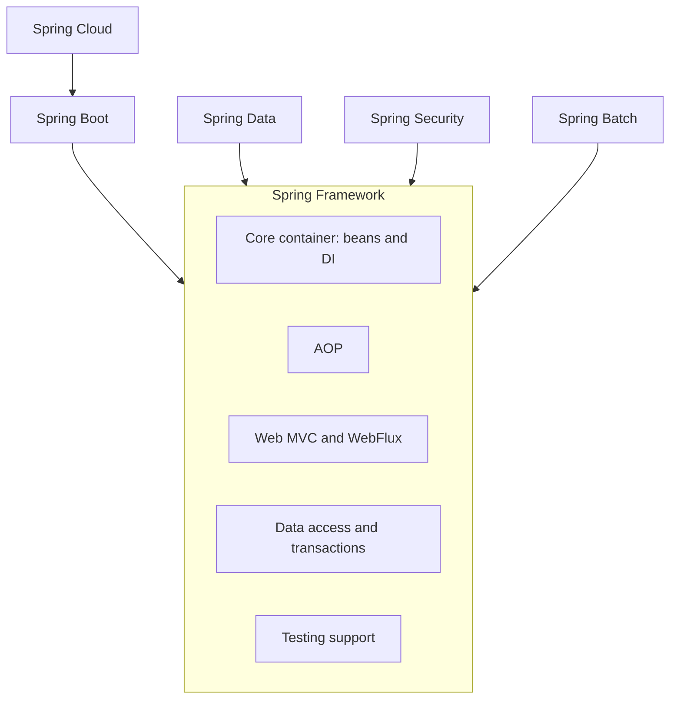

# The Spring ecosystem and your first project

> **Before this lesson:** you know what a framework, a bean and dependency injection are in outline ([What a framework is and why Spring exists](#/lesson/spring/spring-why-frameworks)), and you have compiled Java from the command line or an editor. Knowing a build tool helps ([Maven, Gradle and the module system](#/lesson/java/java-maven-gradle-modules)) but everything needed is repeated here.

## In plain words

Think of a large hardware shop. Aisle one has the foundations: cement, bricks, beams. Other aisles have plumbing, electrics, locks, garden tools. Nobody buys the whole shop. You take a trolley, put in the foundation materials, then add the aisles your building needs.

The Spring **ecosystem** is that shop. The foundation aisle is the Spring Framework. The other aisles are separate projects (data access, security, cloud integration and more) that all assume the foundation is there. Your project's **build file** is the trolley list: it names which pieces you take, and a build tool fetches them.

This lesson walks the aisles, then creates the bookshop project twice: once with plain Spring so nothing is hidden, and once with Spring Boot so you see what Boot adds. For a job, being able to read a build file and say which starter brings which capability is a day-one skill.

## The map of the ecosystem



Read the arrows as "is built on".

| Project | What it is for | You need it when |
|---|---|---|
| **Spring Framework** | the container, AOP, the web layer (MVC and the reactive WebFlux), transactions, test support | always; everything else depends on it |
| **Spring Boot** | starters, auto-configuration, embedded server, production endpoints | you start a new application (nearly always) |
| **Spring Data** | repositories that generate data-access code for SQL and NoSQL stores | you store data |
| **Spring Security** | login, permissions, protection against common web attacks | anything reachable from a network |
| **Spring Cloud** | tools for many services working together: configuration servers, service discovery, declarative HTTP clients | you run microservices |
| **Spring Batch** | large scheduled jobs that read, transform and write records in chunks | nightly imports and exports |
| **Spring Integration, Spring AMQP, Spring for Apache Kafka** | connecting to message brokers and other systems | services communicate by messages |

A **microservice** is a small, independently deployed application that is one part of a larger system. A **message broker** is a server that passes messages between programs so that they do not need to call each other directly.

Two words inside the Framework box deserve an early definition because you will see both in job descriptions:

- **Spring MVC** handles each web request on its own thread and is what this track teaches. A **thread** is one independent line of execution inside a program.
- **Spring WebFlux** is the *reactive* alternative: a small number of threads serve many requests by never waiting idly. You will meet its HTTP client, `WebClient`, in [WebClient, timeouts and resilient calls](#/lesson/spring/spring-webclient).

> [!INTERVIEW]
> "Name some Spring projects and what they do." Give the foundation first (Framework: IoC container, AOP, MVC, transactions), then Boot (auto-configuration and starters), then two or three others with one use each. Listing ten names without purposes impresses nobody.

## Build tools and dependencies in five minutes

Your program needs Spring's compiled code. That code is shipped as **JAR** files (Java ARchive: a zip file of compiled classes). Spring's JARs need other JARs, which need others. Downloading them by hand is not realistic.

A **build tool** does it for you. You declare what you need; the tool downloads it from a public server called **Maven Central**, together with everything those pieces need in turn. The two common build tools are **Maven** (configured in an XML file named `pom.xml`) and **Gradle** (configured in `build.gradle`). This track shows Maven because its file is easier to read for a newcomer; the concepts are identical in Gradle.

Three terms:

- A **dependency** (in the build-tool sense) is a JAR your project uses. It is identified by three coordinates: `groupId` (the organisation), `artifactId` (the piece), and `version`.
- A **transitive dependency** is a dependency of your dependency. You did not ask for it, yet it arrives.
- A **BOM** (bill of materials) is a published list saying "these versions of these pieces are tested together". Importing a BOM means you can leave out version numbers.

The following simulation resolves a dependency list the way a build tool does. It follows transitive dependencies and, when no version is given, takes it from the BOM.

```python-run
# A toy repository: artifact -> list of what it depends on
REPOSITORY = {
    "spring-boot-starter-web": ["spring-boot-starter", "spring-webmvc", "spring-boot-starter-tomcat",
                                "jackson-databind"],
    "spring-boot-starter": ["spring-boot", "spring-boot-autoconfigure", "spring-core", "logback-classic"],
    "spring-webmvc": ["spring-web", "spring-context"],
    "spring-web": ["spring-core"],
    "spring-context": ["spring-core", "spring-aop", "spring-beans"],
    "spring-boot-starter-tomcat": ["tomcat-embed-core"],
}

# The BOM: versions that were tested together
BOM = {"spring-core": "6.2.1", "spring-context": "6.2.1", "spring-aop": "6.2.1", "spring-beans": "6.2.1",
       "spring-web": "6.2.1", "spring-webmvc": "6.2.1", "spring-boot": "3.4.1",
       "spring-boot-autoconfigure": "3.4.1", "spring-boot-starter": "3.4.1",
       "spring-boot-starter-web": "3.4.1", "spring-boot-starter-tomcat": "3.4.1",
       "jackson-databind": "2.18.2", "logback-classic": "1.5.12", "tomcat-embed-core": "10.1.34"}

def resolve(declared):
    resolved, queue = {}, list(declared)
    while queue:
        artifact = queue.pop(0)
        if artifact in resolved:          # already on the classpath: skip
            continue
        resolved[artifact] = BOM[artifact]
        queue.extend(REPOSITORY.get(artifact, []))
    return resolved

classpath = resolve(["spring-boot-starter-web"])
print("you declared 1 dependency, you received", len(classpath))
for name, version in sorted(classpath.items()):
    print(f"  {name}:{version}")
```

How it works:

- `resolve` keeps a queue of artifacts still to visit, starting with what you declared.
- For each artifact it records the BOM version and adds that artifact's own dependencies to the queue.
- `if artifact in resolved: continue` stops the same JAR being added twice.

One declared line produced fourteen JARs. That list of JARs available to your program is called the **classpath**. Try changing the declared list to `["spring-context"]` and run again: you get only the core container, which is what the first project below uses.

## Project one: plain Spring, nothing hidden

The lessons on beans use the smallest possible set-up so that you can see every moving part. Create a folder and these two files.

```xml
<!-- pom.xml -->
<project xmlns="http://maven.apache.org/POM/4.0.0">
    <modelVersion>4.0.0</modelVersion>

    <groupId>com.bookshop</groupId>
    <artifactId>bookshop-core</artifactId>
    <version>0.1.0</version>

    <properties>
        <maven.compiler.release>21</maven.compiler.release>
    </properties>

    <dependencies>
        <dependency>
            <groupId>org.springframework</groupId>
            <artifactId>spring-context</artifactId>
            <version>6.2.1</version>
        </dependency>
    </dependencies>
</project>
```

- `groupId`, `artifactId`, `version` name *your* project with the same three coordinates other people's JARs use.
- `maven.compiler.release` says which Java version to compile for. Spring Framework 6 needs at least 17.
- The single `<dependency>` asks for `spring-context`, the JAR containing the application context. Maven adds `spring-core`, `spring-beans`, `spring-aop` and a few others transitively.

```java
// src/main/java/com/bookshop/Main.java
package com.bookshop;

import org.springframework.context.annotation.AnnotationConfigApplicationContext;

public class Main {
    public static void main(String[] args) {
        var context = new AnnotationConfigApplicationContext();   // an empty container
        context.refresh();                                        // finish start-up
        System.out.println("beans in the context: " + context.getBeanDefinitionCount());
        context.close();
    }
}
```

- `new AnnotationConfigApplicationContext()` creates an application context that understands annotations. It contains none of your objects yet.
- `refresh()` tells the context that configuration is complete and it should start. With a configuration class passed to the constructor (next lesson) this call happens automatically.
- `getBeanDefinitionCount()` reports how many beans are registered.
- `close()` shuts the context down in an orderly way.

```bash
mvn -q compile exec:java -Dexec.mainClass=com.bookshop.Main
```

```text
beans in the context: 4
```

The number is not zero even though you registered nothing. Spring adds a handful of internal helper beans that process annotations. They are infrastructure; ignore them. The important observation is that Spring is an ordinary Java library you can start from a `main` method. There is no server and no magic process.

> [!NOTE]
> Maven expects a fixed folder layout: production code under `src/main/java`, files such as configuration under `src/main/resources`, tests under `src/test/java`. Spring Boot relies on the same layout.

## Project two: the same thing with Spring Boot

Real projects start from the generator at [start.spring.io](https://start.spring.io) (also built into most Java editors). You choose a build tool, a Java version and a list of *starters*, and download a zip. The generated `pom.xml` looks like this once trimmed:

```xml
<!-- pom.xml -->
<project xmlns="http://maven.apache.org/POM/4.0.0">
    <modelVersion>4.0.0</modelVersion>

    <parent>
        <groupId>org.springframework.boot</groupId>
        <artifactId>spring-boot-starter-parent</artifactId>
        <version>3.4.1</version>
    </parent>

    <groupId>com.bookshop</groupId>
    <artifactId>bookshop</artifactId>
    <version>0.1.0</version>

    <properties>
        <java.version>21</java.version>
    </properties>

    <dependencies>
        <dependency>
            <groupId>org.springframework.boot</groupId>
            <artifactId>spring-boot-starter-web</artifactId>
        </dependency>
        <dependency>
            <groupId>org.springframework.boot</groupId>
            <artifactId>spring-boot-starter-test</artifactId>
            <scope>test</scope>
        </dependency>
    </dependencies>

    <build>
        <plugins>
            <plugin>
                <groupId>org.springframework.boot</groupId>
                <artifactId>spring-boot-maven-plugin</artifactId>
            </plugin>
        </plugins>
    </build>
</project>
```

Four things are new.

1. **The parent.** `spring-boot-starter-parent` brings Boot's BOM. That is why the two dependencies below it have **no version**: the parent decides, and all versions are guaranteed to work together.
2. **Starters.** A **starter** is a dependency that contains no code of its own, only a curated list of other dependencies for one purpose. `spring-boot-starter-web` means "everything for a web application": Spring MVC, a JSON library called Jackson, and an embedded web server called Tomcat.
3. **Test scope.** `<scope>test</scope>` makes a dependency available to tests only, so test libraries are not shipped to production.
4. **The Boot plugin.** It packages the application and all its dependencies into one runnable JAR, sometimes called a *fat JAR*.

The generated project layout:

```text
bookshop/
├── pom.xml
├── mvnw, mvnw.cmd                      (Maven wrapper: runs the right Maven version without installing it)
└── src/
    ├── main/
    │   ├── java/com/bookshop/
    │   │   └── BookshopApplication.java
    │   └── resources/
    │       ├── application.properties  (configuration)
    │       ├── static/                 (files served as they are: CSS, images)
    │       └── templates/              (HTML templates)
    └── test/
        └── java/com/bookshop/
            └── BookshopApplicationTests.java
```

```java
// src/main/java/com/bookshop/BookshopApplication.java
package com.bookshop;

import org.springframework.boot.SpringApplication;
import org.springframework.boot.autoconfigure.SpringBootApplication;

@SpringBootApplication
public class BookshopApplication {
    public static void main(String[] args) {
        SpringApplication.run(BookshopApplication.class, args);
    }
}
```

- `@SpringBootApplication` marks the main class. It combines three older annotations: "this class may define beans", "search this package and those below it for annotated classes", and "switch on auto-configuration". Each is explained in [Spring Boot: starters and auto-configuration](#/lesson/spring/spring-boot-autoconfig).
- `SpringApplication.run(...)` creates the application context, fills it, starts the embedded server and keeps the program alive.

```bash
./mvnw spring-boot:run
```

```text
  .   ____          _            __ _ _
 /\\ / ___'_ __ _ _(_)_ __  __ _ \ \ \ \
( ( )\___ | '_ | '_| | '_ \/ _` | \ \ \ \
 :: Spring Boot ::                (v3.4.1)

INFO  Starting BookshopApplication using Java 21
INFO  Tomcat initialized with port 8080 (http)
INFO  Started BookshopApplication in 1.412 seconds
```

A web server is now listening on port 8080 although you wrote no server code. Requests to it return a 404 page for the moment because no controller exists.

To produce and run the deliverable:

```bash
./mvnw package
java -jar target/bookshop-0.1.0.jar
```

The single JAR file contains your classes, every dependency and the web server. Copying that one file to a machine with Java installed is a complete deployment.

> [!WARNING]
> Keep the main class in the **root package** of the project (`com.bookshop`), with all other classes in sub-packages such as `com.bookshop.order`. Boot searches for your annotated classes starting from the main class's package downward. A class placed in `com.other` is silently ignored. The problem [Component scanning: which classes become beans?](#/problem/spring-component-scan) drills this rule.

## Plain Spring versus Spring Boot, side by side

| Question | Plain Spring (project one) | Spring Boot (project two) |
|---|---|---|
| Who chooses library versions? | you, one by one | the Boot parent's BOM |
| Who creates the application context? | you, with `new AnnotationConfigApplicationContext(...)` | `SpringApplication.run(...)` |
| Web server | you install and configure one separately | embedded, started automatically |
| Common beans such as a JSON converter | you declare each | auto-configured when the library is on the classpath |
| Deliverable | depends on your set-up | one runnable JAR |
| What you learn from it | exactly how the container works | how real projects look |

The next four modules use plain Spring where it makes a mechanism visible, and mention what Boot does differently. From module 7 on, everything is Spring Boot.

## Choosing starters

A short list covers most projects:

| Starter | Brings |
|---|---|
| `spring-boot-starter-web` | Spring MVC, Jackson (JSON), embedded Tomcat |
| `spring-boot-starter-thymeleaf` | the Thymeleaf HTML template engine |
| `spring-boot-starter-validation` | Bean Validation annotations such as `@NotBlank` |
| `spring-boot-starter-jdbc` | `JdbcTemplate` and the HikariCP connection pool |
| `spring-boot-starter-data-jpa` | Spring Data JPA with Hibernate |
| `spring-boot-starter-security` | Spring Security |
| `spring-boot-starter-actuator` | health checks and metrics endpoints |
| `spring-boot-starter-test` | JUnit 5, Mockito, AssertJ, Spring's test support |

> [!TIP]
> When you are unsure what a starter drags in, ask the build tool: `./mvnw dependency:tree` prints the full tree of direct and transitive dependencies. It is the first command to run when two libraries seem to disagree about a version.

## Pitfalls

- **Adding a version to a managed dependency.** Writing `<version>` on a dependency the Boot parent already manages overrides the tested combination and invites subtle incompatibilities. Leave it out unless you have a specific reason.
- **Mixing Boot 2 and Boot 3 material.** Boot 3 requires Java 17 and `jakarta.*` imports. Pasting a Boot 2 snippet that imports `javax.persistence.Entity` fails to compile.
- **Adding starters "to be safe".** Each starter switches on auto-configuration. Adding `spring-boot-starter-security` to an application instantly puts a login in front of every URL. Add what you need, when you need it.
- **Running `java -jar` on the wrong file.** The Boot plugin writes the runnable JAR to `target/`. A file ending in `.jar.original` is the thin JAR without dependencies and will not start.
- **Forgetting `refresh()` in plain Spring.** A context built with the no-argument constructor must be refreshed before use; asking it for a bean earlier throws `IllegalStateException`.

## Cheat sheet

| Item | Meaning |
|---|---|
| `pom.xml` | Maven build file: project coordinates, dependencies, plugins |
| `groupId:artifactId:version` | the coordinates that identify a JAR |
| `spring-context` | the JAR containing the application context (plain Spring) |
| `spring-boot-starter-parent` | parent build file that manages versions |
| `spring-boot-starter-*` | curated dependency bundle for one purpose |
| `spring-boot-maven-plugin` | builds the runnable JAR; provides `spring-boot:run` |
| `@SpringBootApplication` | main class marker: configuration + scanning + auto-configuration |
| `./mvnw spring-boot:run` | run from source |
| `./mvnw package` then `java -jar target/x.jar` | build and run the deliverable |
| `./mvnw dependency:tree` | show every dependency and where it came from |

## Summary

- "Spring" is a family: the Framework is the foundation; Boot, Data, Security, Cloud and others build on it.
- A build tool downloads the JARs you declare plus their transitive dependencies; a BOM fixes versions that work together.
- Plain Spring is a library you start from `main` by creating an application context.
- Spring Boot adds a version-managing parent, starters, an embedded server and a runnable JAR.
- Keep the main class in the root package so that Boot finds your classes.

## Glossary

- **BOM (bill of materials)**: a list of dependency versions tested together.
- **Build tool**: a program (Maven, Gradle) that downloads dependencies, compiles, tests and packages a project.
- **Classpath**: the set of classes and JARs available to a running Java program.
- **Embedded server**: a web server that runs inside your application process instead of being installed separately.
- **Fat JAR**: a single runnable archive containing the application and all its dependencies.
- **JAR**: Java archive, a zip of compiled classes.
- **Maven Central**: the public server from which build tools download open-source JARs.
- **Starter**: a Spring Boot dependency that groups the libraries needed for one capability.
- **Thread**: an independent line of execution within a program.
- **Transitive dependency**: a dependency brought in by another dependency.

```quiz
[
  {"q": "Which project is the foundation that the other Spring projects build on?",
   "options": ["Spring Boot", "Spring Framework", "Spring Cloud", "Spring Data"],
   "answer": 1,
   "explain": "The Spring Framework contains the container, AOP, MVC and transaction support. Boot, Data, Security and the rest assume it is present."},
  {"q": "Why do the dependencies in a Spring Boot pom.xml usually have no version element?",
   "options": ["Maven always picks the newest version", "The Boot parent supplies a BOM that fixes compatible versions", "Versions are stored in application.properties", "Starters have no versions"],
   "answer": 1,
   "explain": "spring-boot-starter-parent manages versions through a bill of materials, so every library is one that was tested with that Boot release."},
  {"q": "What is a starter?",
   "options": ["A class with a main method", "A script that starts the server", "A dependency that bundles the libraries needed for one capability", "A code generator"],
   "answer": 2,
   "explain": "A starter contains almost no code. It is a curated dependency list, for example everything needed for a web application."},
  {"q": "In the simulation, declaring one artifact produced fourteen. What are the other thirteen called?",
   "options": ["Plugins", "Transitive dependencies", "Profiles", "Parents"],
   "answer": 1,
   "explain": "They are dependencies of dependencies. The build tool follows the chain and puts all of them on the classpath."},
  {"q": "A class annotated with @Service lives in package com.other while the main class is in com.bookshop. What happens at start-up?",
   "options": ["Spring reports an error", "The class becomes a bean as usual", "The class is ignored because it is outside the scanned packages", "The application refuses to compile"],
   "answer": 2,
   "explain": "Boot scans the main class's package and its sub-packages. Classes elsewhere are not seen, and no error is raised."},
  {"q": "Which command shows where an unexpected library on the classpath came from?",
   "options": ["./mvnw package", "./mvnw dependency:tree", "./mvnw spring-boot:run", "java -jar"],
   "answer": 1,
   "explain": "dependency:tree prints direct and transitive dependencies as a tree, so you can see which declared dependency pulled a library in."},
  {"q": "What does the spring-boot-maven-plugin produce when you run the package goal?",
   "options": ["A zip of the source code", "A runnable JAR containing the application, its dependencies and the embedded server", "A Docker image", "Only the compiled classes of your own code"],
   "answer": 1,
   "explain": "The plugin repackages the thin JAR into a self-contained runnable one that java -jar can start."}
]
```

> **Source:** Spilcă, *Spring Start Here*, ch. 1–2 (ecosystem, creating a Maven project). Documentation: https://docs.spring.io/spring-boot/reference/using/build-systems.html and https://docs.spring.io/spring-boot/tutorial/first-application/index.html
