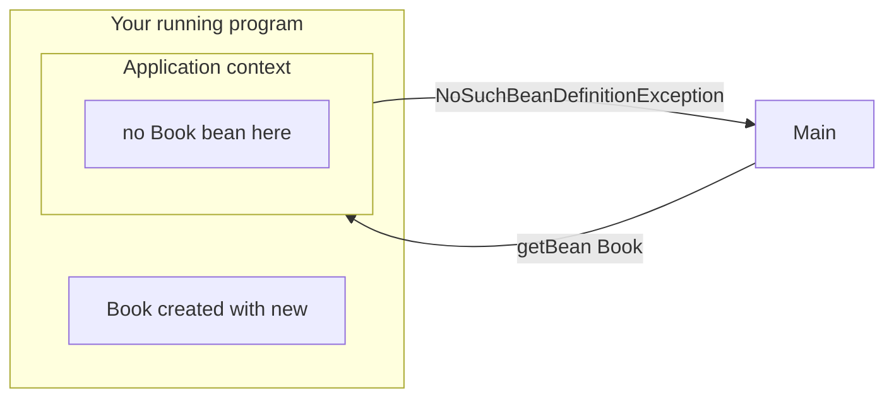
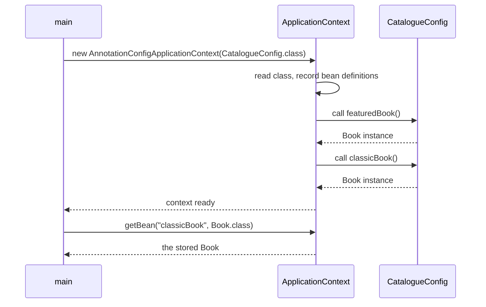

# The application context and @Bean

> **Before this lesson:** you have the plain Spring project from [The Spring ecosystem and your first project](#/lesson/spring/spring-ecosystem-first-project) with `spring-context` in its `pom.xml`, and you remember that a bean is an object managed by Spring.

## In plain words

A theatre has a props room. Before the play starts, the props manager fills the room with everything the actors will need: one crown, one sword, two lanterns. Each item has a label. During the play an actor does not go shopping for a crown; they ask the props manager, by label or by kind, and receive the one that was prepared.

The **application context** is the props room, and Spring is the props manager. The items in the room are **beans**. This lesson shows the first way of putting items into the room: writing a small "shopping list" class whose methods each produce one bean. The method is marked with `@Bean`.

Why it matters for work: every feature of Spring (web requests, transactions, security) only applies to objects that are in the context. "Is this object a bean or did somebody create it with `new`?" is the first question to ask when Spring seems to ignore your code.

## The context starts empty

Spring manages only what you tell it about. An object you create yourself is invisible to Spring.

```java
// src/main/java/com/bookshop/Book.java
package com.bookshop;

public class Book {
    private String title = "untitled";

    public String getTitle() { return title; }
    public void setTitle(String title) { this.title = title; }
}
```

```java
// src/main/java/com/bookshop/Main.java
package com.bookshop;

import org.springframework.context.annotation.AnnotationConfigApplicationContext;

public class Main {
    public static void main(String[] args) {
        var context = new AnnotationConfigApplicationContext();
        context.refresh();

        Book mine = new Book();                 // created by us, not by Spring
        System.out.println(mine.getTitle());

        Book fromSpring = context.getBean(Book.class);   // ask Spring for a Book
    }
}
```

```text
untitled
Exception in thread "main" org.springframework.beans.factory.NoSuchBeanDefinitionException:
  No qualifying bean of type 'com.bookshop.Book' available
```

- `new Book()` works as in any Java program. The object exists, but Spring knows nothing about it.
- `context.getBean(Book.class)` asks the context for the bean whose type is `Book`. There is none, so Spring throws `NoSuchBeanDefinitionException`.

Remember that exception name. It is the most common Spring error message and always means the same thing: you asked for something that was never put into the context.



## Adding a bean with @Bean

To add beans you write a **configuration class**: an ordinary class marked `@Configuration`. Inside it, each method marked `@Bean` creates and returns one object. Spring calls every such method once while it starts and stores what the method returns.

```java
// src/main/java/com/bookshop/config/CatalogueConfig.java
package com.bookshop.config;

import com.bookshop.Book;
import org.springframework.context.annotation.Bean;
import org.springframework.context.annotation.Configuration;

@Configuration                        // "this class tells Spring which beans to create"
public class CatalogueConfig {

    @Bean                             // "call me at start-up and keep what I return"
    Book featuredBook() {
        Book book = new Book();
        book.setTitle("Dune");
        return book;
    }
}
```

```java
// src/main/java/com/bookshop/Main.java
package com.bookshop;

import com.bookshop.config.CatalogueConfig;
import org.springframework.context.annotation.AnnotationConfigApplicationContext;

public class Main {
    public static void main(String[] args) {
        var context = new AnnotationConfigApplicationContext(CatalogueConfig.class);

        Book book = context.getBean(Book.class);
        System.out.println(book.getTitle());

        Book again = context.getBean(Book.class);
        System.out.println(book == again);
    }
}
```

```text
Dune
true
```

Walk through it:

1. `new AnnotationConfigApplicationContext(CatalogueConfig.class)` gives the context a configuration class. Because a class is passed to the constructor, the context refreshes itself; no explicit `refresh()` is needed.
2. During start-up Spring finds the `@Bean` method `featuredBook`, calls it, and stores the returned `Book`.
3. `getBean(Book.class)` returns that stored object.
4. The second `getBean` returns the **same** object, which is why `book == again` prints `true`. By default Spring keeps exactly one instance of each bean. That default is called *singleton scope* and is the subject of [Singleton scope, eager and lazy beans, thread safety](#/lesson/spring/spring-singleton-scope).

Notice the method name is a noun, `featuredBook`, not a verb such as `createBook`. The method name becomes the **bean name**, so the convention is to name it after the thing it produces.

> [!NOTE]
> A bean does not have to be a class you wrote. `@Bean` methods are the standard way to put objects from the Java library or from third-party JARs into the context, because you cannot add annotations to classes you do not own. Typical examples: a `Clock`, an HTTP client, a `DataSource`.

```java
// inside CatalogueConfig
@Bean
String shopName() {
    return "The Paper Lantern";       // a String bean
}

@Bean
Integer pageSize() {
    return 20;                        // an Integer bean
}

@Bean
java.time.Clock clock() {
    return java.time.Clock.systemUTC();   // a JDK class as a bean
}
```

## A model of the mechanism

The container is less mysterious once you build a toy version. The Python class below does what Spring does with a configuration class: find the marked methods, call each once, and keep the results in a dictionary keyed by name.

```python-run
def bean(method):                      # our stand-in for @Bean
    method.is_bean = True
    return method

class MiniContext:
    def __init__(self, config_class):
        self.beans = {}                              # name -> object: "the props room"
        config = config_class()
        for name in dir(config):
            member = getattr(config, name)
            if callable(member) and getattr(member, "is_bean", False):
                self.beans[name] = member()          # call once, store the result
                print(f"registered bean '{name}' of type {type(self.beans[name]).__name__}")

    def get_bean(self, wanted):
        if isinstance(wanted, str):                  # lookup by name
            if wanted not in self.beans:
                raise LookupError(f"NoSuchBeanDefinitionException: no bean named '{wanted}'")
            return self.beans[wanted]
        matches = [b for b in self.beans.values() if isinstance(b, wanted)]   # lookup by type
        if not matches:
            raise LookupError(f"NoSuchBeanDefinitionException: no bean of type {wanted.__name__}")
        if len(matches) > 1:
            raise LookupError(f"NoUniqueBeanDefinitionException: {len(matches)} beans of type {wanted.__name__}")
        return matches[0]

class Book:
    def __init__(self, title): self.title = title

class CatalogueConfig:
    @bean
    def featured_book(self): return Book("Dune")
    @bean
    def classic_book(self): return Book("Emma")
    @bean
    def shop_name(self): return "The Paper Lantern"
    def helper(self): return "not a bean"            # no marker: ignored

context = MiniContext(CatalogueConfig)
print(context.get_bean(str))                         # one str bean: fine
print(context.get_bean("classic_book").title)        # by name: fine
print(context.get_bean("classic_book") is context.get_bean("classic_book"))
try:
    context.get_bean(Book)                           # two Book beans: which one?
except LookupError as problem:
    print(problem)
```

What to observe:

- `MiniContext.__init__` scans the configuration object for methods carrying the marker and calls each exactly once. That is the whole trick behind `@Bean`.
- `get_bean` by type collects every stored object of that type. Zero matches and several matches are both errors.
- The method `helper` has no marker and is never called. An unannotated method in a Spring configuration class is likewise a plain method.

Add a third book method and run again to convince yourself the two-match error still names the count.

## Several beans of the same type

The simulation ended with an error that real Spring raises too. Two `@Bean` methods returning `Book` are perfectly legal:

```java
@Configuration
public class CatalogueConfig {

    @Bean
    Book featuredBook() {
        Book book = new Book();
        book.setTitle("Dune");
        return book;
    }

    @Bean
    Book classicBook() {
        Book book = new Book();
        book.setTitle("Emma");
        return book;
    }
}
```

But now `context.getBean(Book.class)` is ambiguous:

```text
org.springframework.beans.factory.NoUniqueBeanDefinitionException:
  No qualifying bean of type 'com.bookshop.Book' available:
  expected single matching bean but found 2: featuredBook,classicBook
```

There are three ways out.

**1. Ask by name and type.**

```java
Book classic = context.getBean("classicBook", Book.class);
```

The first argument is the bean name, which by default is the method name.

**2. Give the bean a different name.**

```java
@Bean("bestseller")                 // or @Bean(name = "bestseller")
Book featuredBook() { ... }
```

Now the bean is found with `context.getBean("bestseller", Book.class)`.

**3. Mark one as the default.**

```java
@Bean
@Primary                            // "when in doubt, take this one"
Book featuredBook() { ... }
```

`@Primary` tells Spring which bean to hand out when several of one type exist and the request does not say more. `context.getBean(Book.class)` then returns `featuredBook` without complaint.

> [!INTERVIEW]
> "What is the difference between `NoSuchBeanDefinitionException` and `NoUniqueBeanDefinitionException`?" The first means zero candidates of the requested type or name; the second means more than one candidate of the type and no rule to pick between them. Fixes for the second: `@Primary`, a qualifier or name, or injecting a collection. The problem [Pick the bean to inject](#/problem/spring-resolve-candidate) makes you implement the full decision.

## What @Configuration adds

You may wonder why the class needs `@Configuration` when the `@Bean` methods already carry labels. The annotation makes Spring treat the class specially: Spring creates a *subclass* of it at start-up and uses that subclass instead. The subclass intercepts calls to `@Bean` methods, so that calling such a method a second time returns the bean already in the context instead of running the method body again. You will rely on this in the next module, where one `@Bean` method calls another to obtain its dependency.

Two consequences worth knowing now:

- A `@Configuration` class and its `@Bean` methods must not be `final`, because Spring needs to subclass and override them. (`private` `@Bean` methods are rejected for the same reason.)
- The configuration class is itself a bean. `context.getBean(CatalogueConfig.class)` works, and its printed class name ends with something like `$$SpringCGLIB$$0`, the visible trace of the generated subclass.

## Bean definitions versus bean instances

Spring works in two phases, and separating them explains many error messages.

1. **Registration.** Spring reads the configuration and records a **bean definition** for each bean: its name, its type, how to create it, its scope. No object exists yet.
2. **Instantiation.** Spring goes through the definitions and creates the objects, in an order that respects their dependencies.



That is why the exceptions are named `NoSuchBeanDefinition…`: the lookup fails already at the level of definitions. It is also why a mistake in one bean can stop the whole application from starting. Spring creates all default-scope beans during start-up, so a broken bean is discovered immediately and not three days later when a customer triggers it. This "fail fast" behaviour is intentional.

## Useful methods on the context

| Call | Result |
|---|---|
| `context.getBean(Book.class)` | the single bean of that type, or an exception |
| `context.getBean("classicBook", Book.class)` | the bean with that name, checked against the type |
| `context.getBean("classicBook")` | the bean as `Object`; you must cast |
| `context.getBeansOfType(Book.class)` | a `Map<String, Book>` of every bean of the type, by name |
| `context.containsBean("classicBook")` | whether a bean with that name exists |
| `context.getBeanDefinitionNames()` | every bean name, including Spring's internal ones |
| `context.close()` | orderly shutdown; destruction callbacks run |

> [!WARNING]
> Calling `getBean` from business code is a habit to avoid. It hides a class's dependencies and ties the class to Spring. In real applications you declare what you need as constructor parameters and let Spring inject it, which is the topic of [Wiring beans with @Bean methods and @Autowired](#/lesson/spring/spring-wiring-autowired). In these early lessons `getBean` appears only in `main` to inspect what the context contains.

## Practise in real Java

The judge has the JDK only, without Spring jars, so in these exercises you write in real Java 21 the mechanism that Spring provides. That is the level interview questions probe.

- [Java: a bean registry with lookup by name and by type](#/problem/spring-java-bean-registry): a bean registry with lookup by name and by type, including the NoSuchBeanDefinitionException and NoUniqueBeanDefinitionException messages.

## Pitfalls

- **Forgetting to pass the configuration class.** `new AnnotationConfigApplicationContext()` without arguments creates an empty context. Your `@Bean` methods are never read.
- **Forgetting `@Bean` on a method.** The method stays an ordinary method. No error, and no bean.
- **Expecting `new` objects to be managed.** `new Book()` inside your `main` or inside another class never becomes a bean. Only the object *returned from* an `@Bean` method (or created by one of the mechanisms in the next lesson) is in the context.
- **Two beans, one type, lookup by type.** Add `@Primary`, or ask by name.
- **Bean names collide.** Two `@Bean` methods with the same name in different configuration classes define the same bean name. In Spring Boot this fails at start-up with a `BeanDefinitionOverrideException`; in plain Spring the later definition silently replaces the earlier one. Use distinct method names.
- **`void` `@Bean` methods.** A bean method must return the object. Returning nothing is rejected at start-up.

## Cheat sheet

| Annotation / class | Where | Meaning |
|---|---|---|
| `@Configuration` | class | this class declares beans; Spring subclasses it |
| `@Bean` | method in a configuration class | call at start-up, register the returned object |
| `@Bean("name")` | method | same, with an explicit bean name |
| `@Primary` | with `@Bean` (or on a class) | preferred bean when several share a type |
| `AnnotationConfigApplicationContext` | `main` | application context configured by annotated classes |
| `NoSuchBeanDefinitionException` | runtime | no bean matches the request |
| `NoUniqueBeanDefinitionException` | runtime | several beans match and none is preferred |

## Summary

- The application context holds the objects Spring manages. It contains only what you register.
- A `@Configuration` class with `@Bean` methods is one way to register beans: Spring calls each method once and stores the result under the method's name.
- `@Bean` works for any type, including classes you cannot edit.
- By default there is one instance per bean; asking twice returns the same object.
- Several beans of one type are allowed; resolve the ambiguity by name or with `@Primary`.
- Spring first records bean definitions, then creates instances, and fails at start-up when something is wrong.

## Glossary

- **Application context**: Spring's container of beans; the interface `ApplicationContext`.
- **Bean definition**: Spring's recorded recipe for a bean: name, type, creation method, scope.
- **Bean name**: the unique identifier of a bean in the context; by default the `@Bean` method name.
- **Configuration class**: a class marked `@Configuration` that declares beans.
- **Fail fast**: detecting errors at start-up instead of later during use.
- **Singleton scope**: the default rule that a bean has exactly one instance per context.
- **`@Primary`**: marks the bean to prefer among several of the same type.

```quiz
[
  {"q": "What does context.getBean(Book.class) do when the context holds no Book bean?",
   "options": ["Returns null", "Creates a new Book with its default constructor", "Throws NoSuchBeanDefinitionException", "Throws NullPointerException"],
   "answer": 2,
   "explain": "Spring never invents beans. A request for a type that was not registered fails with NoSuchBeanDefinitionException."},
  {"q": "How many times does Spring call an @Bean method of a @Configuration class for a default-scope bean?",
   "options": ["Every time getBean is called", "Once, during start-up", "Twice: once to register and once to create", "Never; you call it yourself"],
   "answer": 1,
   "explain": "The container calls the method once and keeps the returned object. Later lookups return the stored instance."},
  {"q": "A configuration class has methods @Bean Book featuredBook() and @Bean Book classicBook(). What does getBean(Book.class) do?",
   "options": ["Returns featuredBook because it is declared first", "Returns a list of both", "Throws NoUniqueBeanDefinitionException", "Throws NoSuchBeanDefinitionException"],
   "answer": 2,
   "explain": "Two candidates and no rule to choose. Spring refuses to guess. Use a name, or mark one with @Primary."},
  {"q": "What is the default name of a bean declared with an @Bean method?",
   "options": ["The class name of the returned object", "The method name", "A random identifier", "The name of the configuration class"],
   "answer": 1,
   "explain": "The method name becomes the bean name unless you provide one with @Bean(\"name\")."},
  {"q": "Why are @Bean methods the usual way to register objects of third-party classes?",
   "options": ["They are faster", "You cannot add annotations to classes you do not own", "Third-party classes are always final", "Spring forbids other ways"],
   "answer": 1,
   "explain": "Stereotype annotations go on the class itself. For a JDK or library class you write an @Bean method that builds and returns the object."},
  {"q": "In the Python model, why is the method helper never called?",
   "options": ["It has no return value", "It lacks the bean marker, so the scan skips it", "Its name starts with h", "It is private"],
   "answer": 1,
   "explain": "The container only calls methods carrying the marker, in the same way Spring ignores unannotated methods of a configuration class."},
  {"q": "Why does a broken bean usually stop the whole application at start-up?",
   "options": ["Spring creates default-scope beans eagerly during start-up, so the failure surfaces immediately", "The Java compiler detects it", "Maven refuses to package the project", "The operating system kills the process"],
   "answer": 0,
   "explain": "Eager creation is deliberate fail-fast behaviour: configuration mistakes are found when the application starts, not when a user hits the faulty path."}
]
```

> **Source:** Spilcă, *Spring Start Here*, ch. 2 (adding beans with @Bean). Documentation: https://docs.spring.io/spring-framework/reference/core/beans/java/bean-annotation.html and https://docs.spring.io/spring-framework/reference/core/beans/java/basic-concepts.html
