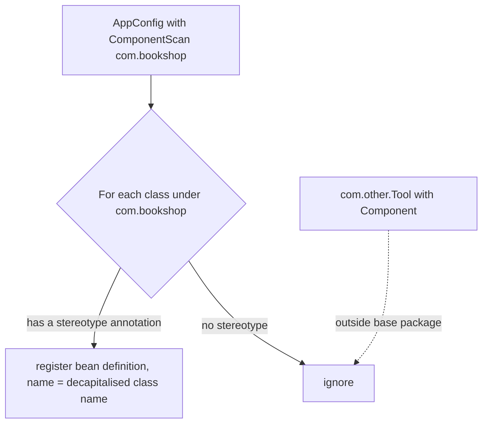

# Stereotype annotations, component scanning and programmatic registration

> **Before this lesson:** you can register a bean with a `@Bean` method in a `@Configuration` class and read it back with `getBean` ([The application context and @Bean](#/lesson/spring/spring-context-bean)).

## In plain words

At a conference, staff could type every attendee into the system one at a time at the front desk. That is the `@Bean` approach: explicit, one entry per person. The quicker way is to hand out badges in advance and put a scanner at the door: anyone wearing a badge who walks through is registered automatically.

**Stereotype annotations** are the badges. You put `@Component` (or one of its relatives) on a class. **Component scanning** is the scanner at the door: you tell Spring which packages to walk through, and it registers every badged class it finds as a bean.

A third way exists for unusual cases: **programmatic registration**, where your code decides at run time whether to register a bean. It is like a staff member adding someone by hand because of a special rule.

In everyday Spring work, more than nine beans out of ten are registered with stereotype annotations. Knowing all three ways, and when each is appropriate, is a standard interview topic.

## The badge: @Component

Take a class from the bookshop and put the annotation on it.

```java
// src/main/java/com/bookshop/pricing/PriceCalculator.java
package com.bookshop.pricing;

import org.springframework.stereotype.Component;

@Component                                   // the badge
public class PriceCalculator {

    public int totalCents(int unitPriceCents, int quantity) {
        return unitPriceCents * quantity;
    }
}
```

`@Component` says "Spring, create one object of this class and keep it in the context". There is no method that calls `new PriceCalculator()`; Spring calls the constructor itself.

The badge alone is not enough. Spring does not read every class on the classpath, since there are tens of thousands of them. You must tell it where to look.

## The scanner: @ComponentScan

```java
// src/main/java/com/bookshop/config/AppConfig.java
package com.bookshop.config;

import org.springframework.context.annotation.ComponentScan;
import org.springframework.context.annotation.Configuration;

@Configuration
@ComponentScan(basePackages = "com.bookshop")     // search this package and everything below it
public class AppConfig {
}
```

```java
// src/main/java/com/bookshop/Main.java
package com.bookshop;

import com.bookshop.config.AppConfig;
import com.bookshop.pricing.PriceCalculator;
import org.springframework.context.annotation.AnnotationConfigApplicationContext;

public class Main {
    public static void main(String[] args) {
        var context = new AnnotationConfigApplicationContext(AppConfig.class);

        PriceCalculator calculator = context.getBean(PriceCalculator.class);
        System.out.println(calculator.totalCents(1250, 3));
        System.out.println(context.containsBean("priceCalculator"));
    }
}
```

```text
3750
true
```

- `@ComponentScan(basePackages = "com.bookshop")` names the **base package**. Spring inspects every class in `com.bookshop` and in all its sub-packages (`com.bookshop.pricing`, `com.bookshop.order.internal`, and so on).
- `PriceCalculator` lives in `com.bookshop.pricing`, carries `@Component`, and is therefore registered.
- The bean's **name** was generated: the class name with its first letter in lower case, `priceCalculator`. That is why `containsBean("priceCalculator")` prints `true`.

If `@ComponentScan` is written without any package, Spring scans the package of the class that carries the annotation. Spring Boot uses exactly this: `@SpringBootApplication` includes `@ComponentScan` without arguments, which is the reason the main class belongs in the root package.



> [!WARNING]
> A sub-package is recognised by a dot, not by a shared prefix. `com.bookshop.web` is inside `com.bookshop`. `com.bookshopping` is a different package that happens to start with the same letters, and is **not** scanned.

## Naming rules for scanned beans

| Class | Generated bean name |
|---|---|
| `PriceCalculator` | `priceCalculator` |
| `Clock` | `clock` |
| `URLShortener` | `URLShortener` |
| `X` | `x` |

The third row surprises people. When the first **two** characters are upper-case, Spring leaves the name untouched, following an old JavaBeans naming convention for acronyms. You can always choose the name yourself:

```java
@Component("prices")
public class PriceCalculator { }
```

## The stereotype family

`@Component` has three specialised relatives. A **stereotype** here means "a label describing the role a class plays".

| Annotation | Put it on | Extra behaviour beyond `@Component` |
|---|---|---|
| `@Component` | any Spring-managed class without a more specific role | none |
| `@Service` | classes holding business rules (use cases) | none; it documents intent |
| `@Repository` | classes that read and write stored data | database exceptions are translated into Spring's `DataAccessException` family |
| `@Controller` / `@RestController` | classes handling web requests | Spring MVC looks inside them for request-handling methods |
| `@Configuration` | classes declaring `@Bean` methods | subclassed so that `@Bean` methods are called once |

Each of them is itself annotated with `@Component`, which is how the scanner recognises them. An annotation placed on another annotation is called a **meta-annotation**.

```java
// src/main/java/com/bookshop/order/OrderService.java
package com.bookshop.order;

import org.springframework.stereotype.Service;

@Service
public class OrderService {
    public String confirm(String isbn) {
        return "order confirmed for " + isbn;
    }
}
```

```java
// src/main/java/com/bookshop/catalogue/InMemoryBookRepository.java
package com.bookshop.catalogue;

import org.springframework.stereotype.Repository;
import java.util.Map;

@Repository
public class InMemoryBookRepository {
    private final Map<String, String> titles = Map.of("9780441172719", "Dune");

    public String titleOf(String isbn) {
        return titles.get(isbn);
    }
}
```

Why bother with different names when most behave identically? Because they tell the reader, and tools, which layer a class belongs to. The lesson [Dependency injection with abstractions and layered design](#/lesson/spring/spring-di-abstractions-layers) builds on these roles.

> [!INTERVIEW]
> "What is the difference between `@Component`, `@Service`, `@Repository` and `@Controller`?" All four register a bean through component scanning. `@Service` is purely descriptive. `@Repository` additionally enables translation of persistence exceptions. `@Controller` makes the class a candidate for request mappings in Spring MVC. Using the right one documents the architecture.

## A model of component scanning

The toy scanner below receives a list of "classes" (name plus annotations) and a base package, and produces the bean names Spring would register.

```python-run
STEREOTYPES = {"Component", "Service", "Repository", "Controller", "RestController", "Configuration"}

CLASSPATH = [
    ("com.bookshop.BookshopApplication", {"Configuration"}),
    ("com.bookshop.pricing.PriceCalculator", {"Component"}),
    ("com.bookshop.order.OrderService", {"Service"}),
    ("com.bookshop.catalogue.InMemoryBookRepository", {"Repository"}),
    ("com.bookshop.catalogue.Book", set()),                 # plain class: no badge
    ("com.bookshop.util.URLShortener", {"Component"}),
    ("com.bookshopping.Basket", {"Service"}),               # look-alike package
    ("com.other.Tool", {"Component"}),                      # outside
]

def bean_name(simple):
    if len(simple) > 1 and simple[0].isupper() and simple[1].isupper():
        return simple                                       # acronym rule
    return simple[0].lower() + simple[1:]

def scan(base_package):
    found = {}
    for fqcn, annotations in CLASSPATH:
        package, _, simple = fqcn.rpartition(".")
        inside = package == base_package or package.startswith(base_package + ".")
        badged = bool(annotations & STEREOTYPES)
        verdict = "bean" if inside and badged else "skip (outside)" if not inside else "skip (no stereotype)"
        print(f"{fqcn:48} {verdict}")
        if inside and badged:
            found[bean_name(simple)] = fqcn
    return found

beans = scan("com.bookshop")
print()
print(sorted(beans))
```

- `rpartition(".")` splits a fully qualified class name at its last dot into package and simple name. A **fully qualified class name** is the class name including its package, such as `com.bookshop.order.OrderService`.
- `inside` implements the dot rule from the warning above.
- `annotations & STEREOTYPES` is the set intersection: non-empty when the class carries at least one badge.

Change the argument of `scan` to `"com.bookshop.catalogue"` and observe that only the repository remains. The practice problem [Component scanning: which classes become beans?](#/problem/spring-component-scan) asks you to write this function yourself.

## @Bean or stereotype?

| | `@Bean` method | Stereotype annotation |
|---|---|---|
| Where you write it | a method in a configuration class | on the class itself |
| Who calls the constructor | your method body | Spring |
| Works for classes you do not own | yes | no |
| Several beans of one class | yes, one method each | no, one bean per class |
| Custom construction logic | any Java code | limited to the constructor |
| Amount of code | more | less |

Rule of thumb used by most teams:

- your own classes → a stereotype annotation;
- classes from libraries, or objects that need set-up code (an HTTP client with timeouts, a `Clock`, a `DataSource`) → `@Bean`.

Both can be mixed freely in one application, and both produce the same kind of bean.

## Doing something right after creation: @PostConstruct

With `@Bean` you could configure the object inside the method body. With a stereotype annotation Spring calls the constructor, so where does set-up code go? In a method marked `@PostConstruct`, which Spring calls once, immediately after it has created the bean and supplied its dependencies.

```java
// src/main/java/com/bookshop/catalogue/FeaturedShelf.java
package com.bookshop.catalogue;

import jakarta.annotation.PostConstruct;
import org.springframework.stereotype.Component;
import java.util.ArrayList;
import java.util.List;

@Component
public class FeaturedShelf {

    private final List<String> titles = new ArrayList<>();

    @PostConstruct
    void fill() {                       // called by Spring after construction
        titles.add("Dune");
        titles.add("Emma");
    }

    public List<String> titles() { return titles; }
}
```

`@PostConstruct` comes from the Jakarta Annotations library, not from Spring. In Spring Boot it is already on the classpath. In the plain Spring project add the dependency `jakarta.annotation:jakarta.annotation-api`. Its counterpart `@PreDestroy` runs when the context closes. The full order of these callbacks is covered in [Prototype scope and the bean lifecycle](#/lesson/spring/spring-prototype-lifecycle).

> [!TIP]
> When a bean only needs values computed from its dependencies, do that work in the constructor instead. Reserve `@PostConstruct` for actions that must happen after injection is completely finished, such as starting a background task or validating configuration.

## Programmatic registration

Occasionally the decision "should this bean exist, and how is it built?" depends on something known only when the program runs: a command-line switch, the number of entries in a file, the operating system. For that, the context offers `registerBean`.

```java
// src/main/java/com/bookshop/Main.java
package com.bookshop;

import com.bookshop.catalogue.Book;
import org.springframework.context.annotation.AnnotationConfigApplicationContext;

public class Main {
    public static void main(String[] args) {
        var context = new AnnotationConfigApplicationContext();

        boolean holidaySeason = args.length > 0 && args[0].equals("--holiday");

        if (holidaySeason) {
            context.registerBean(
                    "seasonalBook",                 // bean name
                    Book.class,                     // bean type
                    () -> {                         // supplier: how to create the instance
                        Book book = new Book();
                        book.setTitle("A Christmas Carol");
                        return book;
                    },
                    definition -> definition.setPrimary(true));   // optional customisation
        }

        context.refresh();                          // finish start-up after registering

        System.out.println(context.containsBean("seasonalBook"));
    }
}
```

```text
false        (run without arguments)
true         (run with --holiday)
```

The four arguments of `registerBean`:

1. the bean name (may be omitted; Spring then derives one from the class);
2. the type;
3. a **supplier**: a small function with no parameters that returns the object. The arrow `() -> { ... }` is a Java lambda expression, a compact way of writing such a function. Spring calls it when it creates the bean;
4. zero or more customisers that adjust the bean definition, for example marking it primary.

Note the order: register first, then `refresh()`. Bean definitions must be in place before the context starts creating instances.

> [!NOTE]
> In Spring Boot applications you rarely call `registerBean` directly. The more common tool for "only if…" is a conditional annotation on a `@Bean` method, such as `@ConditionalOnProperty` or `@Profile`. They are covered in [Spring Boot: starters and auto-configuration](#/lesson/spring/spring-boot-autoconfig) and [Configuration properties, profiles and logging](#/lesson/spring/spring-config-profiles-logging). Programmatic registration remains the right answer when you need a loop, for instance one bean per entry in a list.

## The three ways compared

| Way | Typical use | Share of beans in a normal project |
|---|---|---|
| Stereotype annotation + scanning | your own services, repositories, controllers | most |
| `@Bean` method | library classes, objects needing set-up code, several beans of one type | some |
| `registerBean` | beans decided or multiplied at run time | rare |

## Pitfalls

- **Badge without scanner.** A class with `@Component` outside every scanned package is ignored without warning. Symptom: `NoSuchBeanDefinitionException` for a class that "clearly has the annotation".
- **Scanner without badge.** A class inside the scanned package but without a stereotype annotation is not a bean. Entities and plain data classes are intentionally unmarked.
- **Scanning too widely.** `@ComponentScan("com")` walks through every library whose package starts with `com`, slows start-up and may register beans you never intended.
- **Same simple class name in two packages.** `com.bookshop.order.Validator` and `com.bookshop.cart.Validator` both produce the bean name `validator`, and start-up fails with `ConflictingBeanDefinitionException`. Give one an explicit name.
- **Annotation on an interface or abstract class.** Spring cannot instantiate those. Put the stereotype on the concrete class.
- **Creating the object with `new` anyway.** `new PriceCalculator()` in your code gives you an unmanaged object beside the bean. Dependencies are not injected into it and aspects do not apply to it.
- **Registering after refresh.** Calling `registerBean` on a context that has already been refreshed is not supported by `AnnotationConfigApplicationContext` and throws an exception.

## Cheat sheet

| Annotation / method | Meaning |
|---|---|
| `@Component` | generic badge: register a bean of this class |
| `@Service` | badge for business-logic classes |
| `@Repository` | badge for data-access classes, with exception translation |
| `@Controller`, `@RestController` | badge for web request handlers |
| `@ComponentScan("pkg")` | scan `pkg` and its sub-packages for badged classes |
| `@ComponentScan` (no package) | scan the package of the annotated class |
| `@Component("name")` | choose the bean name |
| `@PostConstruct` | method Spring calls once after creating and injecting the bean |
| `@PreDestroy` | method Spring calls when the context closes |
| `context.registerBean(name, type, supplier, customisers…)` | register a bean in code |

## Summary

- Stereotype annotations mark your classes as beans; component scanning finds them.
- Scanning covers the base package and all sub-packages, where "sub" means separated by a dot.
- The default bean name is the class name with a lower-case first letter, unless the first two letters are capitals.
- `@Service`, `@Repository` and `@Controller` are role-specific forms of `@Component`.
- Use `@Bean` for classes you do not own or that need construction logic; use `registerBean` when the decision is made at run time.
- `@PostConstruct` is the place for set-up code that must run after injection.

## Glossary

- **Base package**: the package where component scanning starts.
- **Component scanning**: Spring's search through packages for classes with stereotype annotations.
- **Fully qualified class name**: a class name including its package.
- **Lambda expression**: compact Java syntax for a small function, written with `->`.
- **Meta-annotation**: an annotation applied to another annotation.
- **Programmatic registration**: adding bean definitions through method calls such as `registerBean`.
- **Stereotype annotation**: an annotation that marks a class as a Spring bean with a certain role.
- **Supplier**: a function without parameters that returns a value; here, the bean instance.

```quiz
[
  {"q": "A class has @Component but Spring throws NoSuchBeanDefinitionException for it. What is the most likely cause?",
   "options": ["@Component only works together with @Bean", "The class is outside the packages covered by component scanning", "The class has no fields", "The class is public"],
   "answer": 1,
   "explain": "The annotation is only a badge. If no scan covers the class's package, nobody reads the badge."},
  {"q": "With base package com.bookshop, which class is scanned?",
   "options": ["com.bookshopping.Basket", "org.bookshop.Tool", "com.bookshop.web.api.BookApi", "com.Bookshop"],
   "answer": 2,
   "explain": "Sub-packages are separated by dots. com.bookshop.web.api is beneath com.bookshop; com.bookshopping only shares a text prefix."},
  {"q": "What bean name does Spring generate for a scanned class called URLShortener?",
   "options": ["uRLShortener", "urlShortener", "URLShortener", "shortener"],
   "answer": 2,
   "explain": "When the first two characters are upper-case the name is left unchanged; otherwise only the first letter is lower-cased."},
  {"q": "Which extra behaviour does @Repository add compared with @Component?",
   "options": ["It opens a database connection", "It makes the bean a prototype", "It enables translation of persistence exceptions into Spring's DataAccessException hierarchy", "It creates database tables"],
   "answer": 2,
   "explain": "Functionally @Repository is @Component plus exception translation; it also documents that the class belongs to the data-access layer."},
  {"q": "You need a java.time.Clock bean. Which approach fits?",
   "options": ["Put @Component on java.time.Clock", "Write an @Bean method that returns Clock.systemUTC()", "Add com.java.time to @ComponentScan", "It is impossible"],
   "answer": 1,
   "explain": "You cannot annotate a JDK class. An @Bean method builds the object in your code and registers the result."},
  {"q": "When does Spring call a method annotated with @PostConstruct?",
   "options": ["Before the constructor", "Once, after the bean is created and its dependencies are injected", "On every method call", "When the context closes"],
   "answer": 1,
   "explain": "It is an initialisation callback that runs after construction and injection. @PreDestroy is the shutdown counterpart."},
  {"q": "When using registerBean on a plain AnnotationConfigApplicationContext, when must it be called?",
   "options": ["After context.close()", "Before context.refresh()", "After the first getBean()", "At any time"],
   "answer": 1,
   "explain": "Definitions must be registered before the context is refreshed, because refresh is the moment Spring instantiates the beans."}
]
```

> **Source:** Spilcă, *Spring Start Here*, ch. 2 (stereotype annotations, programmatic registration). Documentation: https://docs.spring.io/spring-framework/reference/core/beans/classpath-scanning.html
