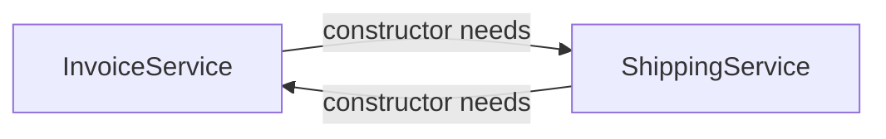
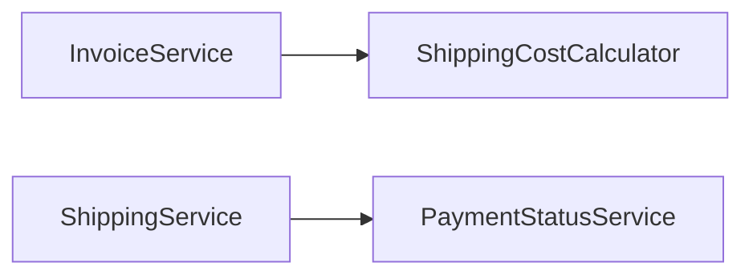
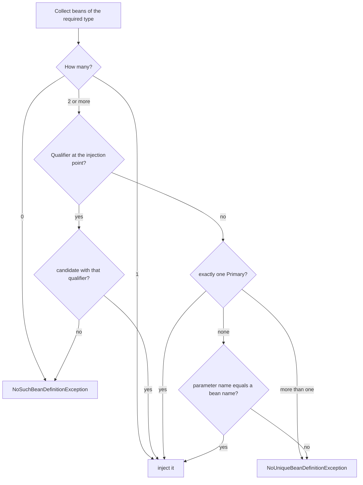

# Circular dependencies, @Primary and @Qualifier

> **Before this lesson:** you can inject one bean into another through a constructor ([Wiring beans with @Bean methods and @Autowired](#/lesson/spring/spring-wiring-autowired)), and you have met `NoUniqueBeanDefinitionException` ([The application context and @Bean](#/lesson/spring/spring-context-bean)).

## In plain words

Two things can go wrong when an office manager hands out equipment.

First, a deadlock of paperwork: the bank will not open an account without proof of address, and the landlord will not sign a rental contract without a bank account. Each waits for the other and nothing can start. In Spring this is a **circular dependency**: bean A needs bean B to be built, and bean B needs bean A.

Second, too much choice: the employee's form says "needs a printer" and the store room holds three printers. Which one? In Spring this is an **ambiguous dependency**: several beans have the requested type. The office needs a rule, either "the laser printer is the default" (`@Primary`) or "this employee specifically gets the colour printer" (`@Qualifier`).

Both situations stop a Spring application from starting, both have precise error messages, and both are favourite interview questions because they reveal whether a candidate understands how the container builds objects.

## Part 1: circular dependencies

### What it looks like

The bookshop has an invoicing component and a shipping component. Someone decides invoicing must ask shipping for the delivery cost, and shipping must ask invoicing whether the order is paid.

```java
// src/main/java/com/bookshop/order/InvoiceService.java
@Service
public class InvoiceService {
    private final ShippingService shipping;

    public InvoiceService(ShippingService shipping) {     // needs ShippingService first
        this.shipping = shipping;
    }
}
```

```java
// src/main/java/com/bookshop/order/ShippingService.java
@Service
public class ShippingService {
    private final InvoiceService invoices;

    public ShippingService(InvoiceService invoices) {      // needs InvoiceService first
        this.invoices = invoices;
    }
}
```

```text
***************************
APPLICATION FAILED TO START
***************************

Description:

The dependencies of some of the beans in the application context form a cycle:

┌─────┐
|  invoiceService defined in file [.../InvoiceService.class]
↑     ↓
|  shippingService defined in file [.../ShippingService.class]
└─────┘
```

To call the constructor of `InvoiceService`, Spring needs a finished `ShippingService`. To call the constructor of `ShippingService`, it needs a finished `InvoiceService`. Neither can be first. Spring notices that it has come back to a bean it is still in the middle of creating and throws `BeanCurrentlyInCreationException`.



### How the container detects it

While creating beans the container keeps a list of names "currently in creation". Before it starts a bean it adds the name; when the bean is finished it removes it. Meeting a name that is already on the list means the chain has closed into a loop.

```python-run
DEFINITIONS = {                       # bean -> constructor dependencies
    "orderController": ["orderService"],
    "orderService": ["invoiceService", "bookRepository"],
    "invoiceService": ["shippingService"],
    "shippingService": ["invoiceService"],       # <- closes the loop
    "bookRepository": [],
}

built, in_creation = [], []

def create(name, depth=0):
    pad = "  " * depth
    if name in built:
        print(f"{pad}{name}: already built, reuse")
        return
    if name in in_creation:
        cycle = in_creation[in_creation.index(name):] + [name]
        raise RuntimeError("BeanCurrentlyInCreationException: " + " -> ".join(cycle))
    print(f"{pad}{name}: start (in creation: {in_creation})")
    in_creation.append(name)
    for dependency in DEFINITIONS[name]:
        create(dependency, depth + 1)
    in_creation.pop()
    built.append(name)
    print(f"{pad}{name}: built")

try:
    for bean in DEFINITIONS:
        create(bean)
    print("context started, creation order:", built)
except RuntimeError as problem:
    print(problem)
```

Follow the indentation in the output. `orderController` waits for `orderService`, which waits for `invoiceService`, which waits for `shippingService`, which asks for `invoiceService` again while it is still on the in-creation list. The error names the loop only (`invoiceService -> shippingService -> invoiceService`), not the innocent beans that led to it.

Now edit the definitions: change `"shippingService": ["invoiceService"]` to `"shippingService": []` and run again. The context starts and prints the creation order, leaves first.

Note that a *diamond* is not a cycle. If two beans both need `bookRepository`, the second request finds it in `built` and reuses it.

### How to fix a cycle

A cycle is almost always a design signal: two classes know too much about each other. Fixes in order of preference:

**1. Redesign: extract the shared part.** Usually both classes need a third thing, not each other.

```java
@Service
public class PaymentStatusService {            // the piece both sides were after
    public boolean isPaid(long orderId) { ... }
}

@Service
public class InvoiceService {
    public InvoiceService(ShippingCostCalculator shippingCosts) { ... }
}

@Service
public class ShippingService {
    public ShippingService(PaymentStatusService paymentStatus) { ... }
}
```



**2. Use an event.** One side publishes "invoice paid" with `ApplicationEventPublisher`; the other listens with `@EventListener`. Neither holds a reference to the other.

**3. Break the cycle at one point with `@Lazy`.**

```java
@Service
public class ShippingService {
    private final InvoiceService invoices;

    public ShippingService(@Lazy InvoiceService invoices) {
        this.invoices = invoices;      // a stand-in object; the real bean is fetched on first use
    }
}
```

`@Lazy` on an injection point makes Spring inject a **proxy**: a lightweight stand-in that looks like an `InvoiceService` and fetches the real bean the first time one of its methods is called. Construction can now finish for both. Use this as a temporary bandage while you plan fix 1.

**4. Setter or field injection.** With these styles Spring can create both objects with their no-argument constructors first and connect them afterwards. Older Spring versions accepted this by default.

> [!WARNING]
> Since Spring Boot 2.6, circular references are **prohibited by default**, including those through setters and fields. The property `spring.main.allow-circular-references=true` switches the old behaviour back on. Treat that property as a last resort for legacy code, not as a solution.

> [!INTERVIEW]
> "What happens with a circular dependency in Spring, and how do you resolve it?" With constructor injection the context fails to start with `BeanCurrentlyInCreationException`, because neither bean can be instantiated first. Best fix: remove the cycle by extracting a third class or using events. Stop-gaps: `@Lazy` on one injection point, or setter injection together with allowing circular references. Mention that Boot forbids cycles by default since 2.6.

## Part 2: several beans of the same type

### What it looks like

The bookshop notifies customers. There are two ways to do it, so there is an interface with two implementations.

```java
// src/main/java/com/bookshop/notify/Notifier.java
public interface Notifier {
    void send(String customer, String message);
}
```

```java
@Component
public class EmailNotifier implements Notifier {
    public void send(String customer, String message) { System.out.println("EMAIL to " + customer + ": " + message); }
}

@Component
public class SmsNotifier implements Notifier {
    public void send(String customer, String message) { System.out.println("SMS to " + customer + ": " + message); }
}
```

```java
@Service
public class ReminderService {
    private final Notifier notifier;

    public ReminderService(Notifier notifier) {       // which one?
        this.notifier = notifier;
    }
}
```

```text
Parameter 0 of constructor in com.bookshop.notify.ReminderService required a single bean, but 2 were found:
	- emailNotifier: defined in file [.../EmailNotifier.class]
	- smsNotifier: defined in file [.../SmsNotifier.class]

Action:

Consider marking one of the beans as @Primary, updating the consumer to accept multiple beans,
or using @Qualifier to identify the bean that should be consumed
```

Spring will not guess. The message even lists the three remedies.

### Remedy 1: @Primary, a default for everyone

```java
@Component
@Primary
public class EmailNotifier implements Notifier { ... }
```

`@Primary` says: whenever someone asks for a `Notifier` without further detail, give them this one. Every injection point in the application is affected. Use it when one implementation is the normal choice and the others are special.

### Remedy 2: @Qualifier, a choice at one injection point

```java
@Service
public class ReminderService {
    private final Notifier notifier;

    public ReminderService(@Qualifier("smsNotifier") Notifier notifier) {
        this.notifier = notifier;
    }
}
```

`@Qualifier("smsNotifier")` selects the candidate with that name. The default qualifier of a bean is its bean name. You can also give beans a more meaningful qualifier that is independent of the class name:

```java
@Component
@Qualifier("urgent")
public class SmsNotifier implements Notifier { ... }

public ReminderService(@Qualifier("urgent") Notifier notifier) { ... }
```

Now renaming `SmsNotifier` does not break the injection point.

### Remedy 3: the parameter name as a last resort

When there is no `@Primary` and no `@Qualifier`, Spring makes one more attempt: it compares the **parameter name** with the candidate bean names.

```java
public ReminderService(Notifier smsNotifier) {     // name matches the bean "smsNotifier"
    this.notifier = smsNotifier;
}
```

It works, but a harmless-looking rename of the parameter breaks start-up, so teams usually prefer an explicit `@Qualifier`.

> [!NOTE]
> Matching by parameter name needs the names to survive compilation. Spring Boot's build plugins switch on the compiler option `-parameters` for you. In a hand-made build, Spring Framework 6.1 and later can no longer discover the names without that option.

### Remedy 4: take them all

```java
@Service
public class BroadcastService {
    private final List<Notifier> notifiers;        // both beans

    public BroadcastService(List<Notifier> notifiers) {
        this.notifiers = notifiers;
    }

    public void announce(String customer, String message) {
        notifiers.forEach(n -> n.send(customer, message));
    }
}
```

### The decision order

When Spring resolves one injection point it applies these steps:



Three facts to memorise from the diagram:

- **`@Qualifier` beats `@Primary`.** A qualifier is a statement about this one injection point; a primary flag is a general default. The specific statement wins.
- **`@Primary` beats the parameter name.**
- **Two `@Primary` beans of the same type are an error**, not "the first one wins".

The simulation below implements the diagram. Change the arguments in the last lines to test your understanding before reading the output.

```python-run
BEANS = [
    {"name": "emailNotifier", "types": {"Notifier", "EmailNotifier"}, "primary": True},
    {"name": "smsNotifier",   "types": {"Notifier", "SmsNotifier"},   "primary": False},
    {"name": "pushNotifier",  "types": {"Notifier", "PushNotifier"},  "primary": False},
]

def resolve(required_type, qualifier=None, parameter_name=""):
    candidates = [b for b in BEANS if required_type in b["types"]]
    if not candidates:
        return "NoSuchBeanDefinitionException"
    if qualifier is not None:
        named = [b for b in candidates if b["name"] == qualifier]
        return named[0]["name"] if named else "NoSuchBeanDefinitionException"
    if len(candidates) == 1:
        return candidates[0]["name"]
    primaries = [b for b in candidates if b["primary"]]
    if len(primaries) == 1:
        return primaries[0]["name"]
    if len(primaries) > 1:
        return "NoUniqueBeanDefinitionException (several @Primary)"
    by_name = [b for b in candidates if b["name"] == parameter_name]
    return by_name[0]["name"] if by_name else "NoUniqueBeanDefinitionException"

print("plain Notifier              ->", resolve("Notifier", parameter_name="notifier"))
print("@Qualifier('smsNotifier')   ->", resolve("Notifier", qualifier="smsNotifier"))
print("parameter named pushNotifier->", resolve("Notifier", parameter_name="pushNotifier"))
print("concrete type SmsNotifier   ->", resolve("SmsNotifier"))
print("unknown qualifier           ->", resolve("Notifier", qualifier="faxNotifier"))
```

The third line is the instructive one: the parameter is called `pushNotifier`, yet the answer is `emailNotifier`, because the primary rule is checked before the name rule. Set `"primary": False` for the email bean and run again to see the name rule take over.

### Choosing between @Primary and @Qualifier

| Situation | Use |
|---|---|
| One implementation is the normal one; others are rare | `@Primary` on the normal one |
| Different consumers need different implementations | `@Qualifier` at each injection point |
| A test or a special environment replaces the real bean | `@Primary` on the replacement, or a profile |
| Every implementation should run | inject `List<T>` |
| The choice depends on configuration | conditional beans or profiles so that only one exists |

## A worked configuration with both

`@Primary` and `@Qualifier` work with `@Bean` methods as well.

```java
// src/main/java/com/bookshop/config/NotifierConfig.java
@Configuration
public class NotifierConfig {

    @Bean
    @Primary
    Notifier emailNotifier() { return new EmailNotifier(); }

    @Bean
    Notifier smsNotifier() { return new SmsNotifier(); }

    @Bean
    ReminderService reminderService(Notifier notifier) {                        // gets emailNotifier
        return new ReminderService(notifier);
    }

    @Bean
    AlertService alertService(@Qualifier("smsNotifier") Notifier notifier) {    // gets smsNotifier
        return new AlertService(notifier);
    }
}
```

```java
var context = new AnnotationConfigApplicationContext(NotifierConfig.class);
context.getBean(ReminderService.class).remind("ana@example.com", "Your order has shipped");
context.getBean(AlertService.class).alert("+34 600 000 000", "Payment failed");
```

```text
EMAIL to ana@example.com: Your order has shipped
SMS to +34 600 000 000: Payment failed
```

## Practise in real Java

The judge has the JDK only, without Spring jars, so in these exercises you write in real Java 21 the mechanism that Spring provides. That is the level interview questions probe.

- [Java: constructor injection and cycle detection with reflection](#/problem/spring-java-constructor-injection): constructor injection with circular-dependency detection and a clear error message.
- [Java: choose the bean with @Qualifier, @Primary and the parameter name](#/problem/spring-java-qualifier-primary): the decision procedure for @Qualifier, @Primary and the parameter-name fallback.

## Pitfalls

- **Hiding a cycle with field injection and the allow flag.** The application starts, and the design problem stays. Cycles make classes impossible to test or reuse separately.
- **`@Lazy` on the class instead of the injection point.** `@Lazy` on a class delays creating that bean. It does not break a constructor cycle; the annotation has to be on the parameter.
- **A typo in a qualifier.** `@Qualifier("smsNotifer")` yields `NoSuchBeanDefinitionException` although two `Notifier` beans exist. The message says no bean *with that qualifier* was found.
- **Two `@Primary` beans.** Often caused by a test configuration that adds its own primary while the production one is still loaded.
- **Qualifying by class name and then renaming the class.** Prefer a meaningful custom qualifier such as `"urgent"`.
- **Expecting `@Primary` to win over `@Qualifier`.** It never does.
- **Injecting the concrete class to avoid the choice.** `ReminderService(SmsNotifier notifier)` compiles and starts, but ties the service to one implementation. The next lesson explains why depending on the interface is worth keeping.

## Cheat sheet

| Annotation / property | Meaning |
|---|---|
| `@Primary` | preferred candidate when several beans share a type |
| `@Qualifier("x")` on an injection point | select the candidate named or qualified `x` |
| `@Qualifier("x")` on a bean class or `@Bean` method | give the bean the qualifier `x` |
| `@Lazy` on an injection point | inject a proxy; fetch the real bean on first use |
| `List<T>` / `Map<String, T>` | inject all candidates |
| `BeanCurrentlyInCreationException` | a circular dependency was detected |
| `NoUniqueBeanDefinitionException` | several candidates, no tie-breaker |
| `spring.main.allow-circular-references` | re-enable setter/field cycles (default `false` in Boot) |

## Summary

- A circular dependency through constructors cannot be built; Spring detects it by tracking beans in creation and refuses to start.
- Remove cycles by redesigning. `@Lazy` on one injection point is a stop-gap.
- Several beans of one type make injection ambiguous. `@Primary` sets a global default; `@Qualifier` chooses at one injection point; the parameter name is a fragile last fallback.
- Order of precedence: qualifier, then primary, then parameter name.
- Injecting a `List<T>` receives all candidates.

## Glossary

- **Ambiguous dependency**: an injection point for which more than one bean qualifies.
- **`BeanCurrentlyInCreationException`**: the error raised when a bean is requested while it is still being created.
- **Circular dependency**: beans that depend on each other directly or through a chain.
- **Proxy**: a stand-in object with the same interface that forwards calls to the real object.
- **`@Primary`**: marks the default candidate among beans of the same type.
- **Qualifier**: a name attached to a bean and referenced at an injection point to select it.

```quiz
[
  {"q": "InvoiceService needs ShippingService in its constructor and vice versa. What happens at start-up in Spring Boot 3?",
   "options": ["Spring creates both with null fields", "The context fails to start and reports a dependency cycle", "Spring picks one at random to create first", "The second bean becomes a prototype"],
   "answer": 1,
   "explain": "Neither constructor can run first. Spring detects the bean already in creation and throws BeanCurrentlyInCreationException."},
  {"q": "Which is the preferred fix for a circular dependency?",
   "options": ["Set spring.main.allow-circular-references=true", "Switch both classes to field injection", "Redesign so that the shared responsibility lives in a third class", "Mark both classes @Primary"],
   "answer": 2,
   "explain": "A cycle signals tangled responsibilities. Extracting the shared part or using events removes the cause; the other options hide it."},
  {"q": "Two Notifier beans exist: emailNotifier (@Primary) and smsNotifier. A constructor parameter is declared as @Qualifier(\"smsNotifier\") Notifier notifier. Which bean is injected?",
   "options": ["emailNotifier, because @Primary always wins", "smsNotifier, because a qualifier beats @Primary", "Both", "Neither; start-up fails"],
   "answer": 1,
   "explain": "The qualifier is a specific instruction for this injection point and takes precedence over the general default."},
  {"q": "Two Notifier beans exist, neither is @Primary, no qualifier is used, and the constructor parameter is named notifier. Result?",
   "options": ["The first registered bean is injected", "NoUniqueBeanDefinitionException", "NoSuchBeanDefinitionException", "null is injected"],
   "answer": 1,
   "explain": "The name fallback only helps when the parameter name equals a bean name. Here it does not, so the ambiguity remains."},
  {"q": "What does @Lazy on a constructor parameter do?",
   "options": ["Delays the whole application start", "Injects a proxy that fetches the real bean on first use", "Makes the dependency optional", "Turns the bean into a prototype"],
   "answer": 1,
   "explain": "The proxy lets construction finish without the real bean, which is why it can break a cycle at that point."},
  {"q": "In the detection model, why is a diamond (two beans needing the same third bean) not reported as a cycle?",
   "options": ["Because the third bean is found in the built list, not in the in-creation list", "Because diamonds are forbidden", "Because the model ignores duplicates", "Because the third bean is created twice"],
   "answer": 0,
   "explain": "Only meeting a bean that is still in creation indicates a loop. A finished bean is reused."},
  {"q": "What happens when two beans of the same type are both marked @Primary and injected by type without a qualifier?",
   "options": ["The first one wins", "The last one wins", "NoUniqueBeanDefinitionException", "Spring merges them"],
   "answer": 2,
   "explain": "More than one primary candidate leaves the choice ambiguous again, and Spring refuses to start."}
]
```

> **Source:** Spilcă, *Spring Start Here*, ch. 3 (circular dependencies; choosing from multiple beans). Documentation: https://docs.spring.io/spring-framework/reference/core/beans/annotation-config/autowired-primary.html and https://docs.spring.io/spring-framework/reference/core/beans/annotation-config/autowired-qualifiers.html
