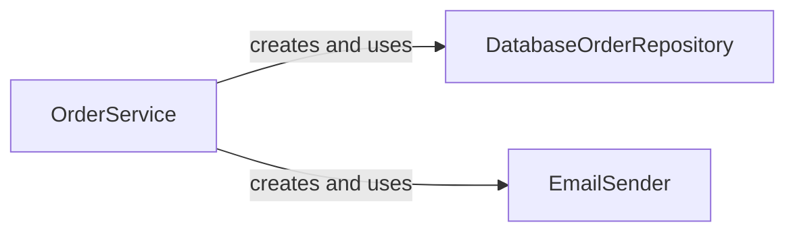
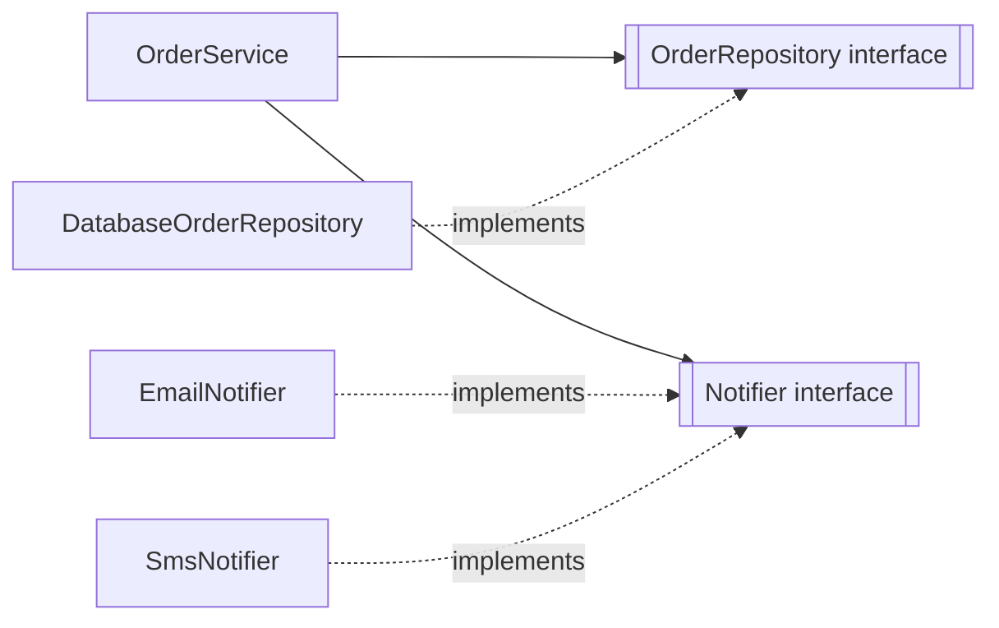

# Interfaces as contracts: decoupling your classes

> **Before this lesson:** you know Java interfaces and polymorphism ([Interfaces](#/lesson/java/java-interfaces), [Polymorphism](#/lesson/java/java-polymorphism)), and you can inject a dependency through a constructor ([Wiring beans with @Bean methods and @Autowired](#/lesson/spring/spring-wiring-autowired)).

## In plain words

A wall socket is an agreement. It promises a certain shape and a certain voltage. The lamp maker does not know which power station feeds your house, and the power company has never heard of your lamp. Because both respect the socket, you can change the lamp, or the country can switch from coal to wind, and nothing else has to change.

In Java the socket is an **interface**: a list of method signatures without bodies. A class that needs a service depends on the interface (it has a plug). A class that provides the service implements the interface (it is a power source). Neither knows the other. This arrangement is called **decoupling**, and an interface used this way is often called a **contract** or an **abstraction**.

This lesson is deliberately light on Spring. It first shows the design problem in plain Java, because dependency injection only pays off when classes depend on abstractions. The next lesson hands the wiring to Spring. In interviews this topic appears as "why program to an interface?" and as the letter D of the SOLID principles.

## The use case

A customer places an order in the bookshop. The application must:

1. store the order,
2. tell the customer that it worked.

Three kinds of responsibility are involved, and they have conventional names you will see in every Spring code base:

| Name | Responsibility | Example here |
|---|---|---|
| **Service** | implements a use case (business rules) | `OrderService` |
| **Repository** | stores and retrieves data | something that saves orders |
| **Proxy** (or client, gateway) | talks to a system outside the application | something that sends a message |

A data object that these classes pass around is often called a **model**:

```java
// src/main/java/com/bookshop/order/Order.java
package com.bookshop.order;

public record Order(String customer, String isbn, int quantity) { }
```

A `record` is a compact Java class for immutable data: the line above generates a constructor, the accessor methods `customer()`, `isbn()` and `quantity()`, plus `equals`, `hashCode` and `toString`.

## Version 1: tightly coupled

The quickest thing that works:

```java
// src/main/java/com/bookshop/order/DatabaseOrderRepository.java
public class DatabaseOrderRepository {
    public void save(Order order) {
        System.out.println("INSERT INTO orders ... " + order);
    }
}
```

```java
// src/main/java/com/bookshop/notify/EmailSender.java
public class EmailSender {
    public void sendEmail(String address, String text) {
        System.out.println("EMAIL to " + address + ": " + text);
    }
}
```

```java
// src/main/java/com/bookshop/order/OrderService.java
public class OrderService {

    private final DatabaseOrderRepository repository = new DatabaseOrderRepository();   // (1)
    private final EmailSender emailSender = new EmailSender();                         // (2)

    public void placeOrder(Order order) {
        repository.save(order);
        emailSender.sendEmail(order.customer(), "Thank you for ordering " + order.isbn());
    }
}
```

Lines (1) and (2) are the problem. `OrderService` names two concrete classes and creates them itself. It is **tightly coupled** to them: it cannot exist without exactly those two classes. Consequences:

- **Changing the channel means editing the service.** When marketing wants text messages instead of e-mail, a class containing business rules must change although no business rule changed.
- **Testing needs the real things.** A test of `placeOrder` talks to a real database and sends real e-mail, or cannot run at all.
- **No variation.** Two installations with different storage need two copies of the service.



Every arrow points at a concrete class. The service at the centre of the business depends on low-level details.

## Version 2: contracts in the middle

Introduce one interface per need, named after what the *service* wants, not after a technology.

```java
// src/main/java/com/bookshop/order/OrderRepository.java
public interface OrderRepository {
    void save(Order order);
}
```

```java
// src/main/java/com/bookshop/notify/Notifier.java
public interface Notifier {
    void send(String customer, String message);
}
```

The concrete classes implement them:

```java
public class DatabaseOrderRepository implements OrderRepository {
    @Override
    public void save(Order order) {
        System.out.println("INSERT INTO orders ... " + order);
    }
}

public class EmailNotifier implements Notifier {
    @Override
    public void send(String customer, String message) {
        System.out.println("EMAIL to " + customer + ": " + message);
    }
}
```

And the service depends on the interfaces only, receiving the implementations from outside:

```java
// src/main/java/com/bookshop/order/OrderService.java
public class OrderService {

    private final OrderRepository repository;      // an interface
    private final Notifier notifier;               // an interface

    public OrderService(OrderRepository repository, Notifier notifier) {
        this.repository = repository;
        this.notifier = notifier;
    }

    public void placeOrder(Order order) {
        repository.save(order);
        notifier.send(order.customer(), "Thank you for ordering " + order.isbn());
    }
}
```

Somebody still has to choose the concrete classes. For now that is `main`:

```java
// src/main/java/com/bookshop/Main.java
public class Main {
    public static void main(String[] args) {
        OrderRepository repository = new DatabaseOrderRepository();
        Notifier notifier = new EmailNotifier();
        OrderService service = new OrderService(repository, notifier);

        service.placeOrder(new Order("ana@example.com", "9780441172719", 1));
    }
}
```

```text
INSERT INTO orders ... Order[customer=ana@example.com, isbn=9780441172719, quantity=1]
EMAIL to ana@example.com: Thank you for ordering 9780441172719
```



Compare the two diagrams. In the second, no arrow goes from the service to a concrete class. The dotted arrows of the implementations point *towards* the interfaces. The direction of dependency for the details has been turned around, which is where the name **dependency inversion principle** comes from: high-level code (business rules) and low-level code (database, e-mail) should both depend on abstractions.

Adding text messages is now a new class and one changed line in `main`. `OrderService` is not touched:

```java
public class SmsNotifier implements Notifier {
    @Override
    public void send(String customer, String message) {
        System.out.println("SMS to " + customer + ": " + message);
    }
}
```

> [!INTERVIEW]
> "What does 'program to an interface, not an implementation' buy you?" Three things: the implementation can be replaced without touching its users; users can be tested with a fake implementation; and the interface documents exactly what the user needs, nothing more. Tie it to the dependency inversion principle (the D in SOLID) and to dependency injection as the technique that supplies the implementation.

## See the swap run

Python has no `interface` keyword, but the idea is identical: the service calls methods that it expects its collaborators to have. Run this, then change the two lines marked `# swap me`.

```python-run
class Order:
    def __init__(self, customer, isbn, quantity):
        self.customer, self.isbn, self.quantity = customer, isbn, quantity

# ---- two implementations of the "Notifier" contract: send(customer, message)
class EmailNotifier:
    def send(self, customer, message):
        print(f"EMAIL to {customer}: {message}")

class SmsNotifier:
    def send(self, customer, message):
        print(f"SMS to {customer}: {message}")

# ---- two implementations of the "OrderRepository" contract: save(order)
class DatabaseOrderRepository:
    def save(self, order):
        print(f"INSERT INTO orders VALUES ('{order.customer}', '{order.isbn}', {order.quantity})")

class InMemoryOrderRepository:
    def __init__(self):
        self.saved = []
    def save(self, order):
        self.saved.append(order)
        print(f"kept in memory ({len(self.saved)} order(s))")

# ---- the service knows only the contracts
class OrderService:
    def __init__(self, repository, notifier):
        self.repository, self.notifier = repository, notifier
    def place_order(self, order):
        self.repository.save(order)
        self.notifier.send(order.customer, f"Thank you for ordering {order.isbn}")

repository = DatabaseOrderRepository()      # swap me: InMemoryOrderRepository()
notifier = EmailNotifier()                  # swap me: SmsNotifier()

service = OrderService(repository, notifier)
service.place_order(Order("ana@example.com", "9780441172719", 1))
```

`OrderService` has no line that mentions e-mail, SMS, SQL or memory. All four combinations of repository and notifier work with the same service code. That is decoupling you can observe.

## Testing becomes easy

The largest practical gain shows up in tests. A **test double** is a stand-in implementation written for a test: it records what happened instead of doing the real thing.

```java
// src/test/java/com/bookshop/order/OrderServiceTest.java
class OrderServiceTest {

    static class RecordingNotifier implements Notifier {
        final List<String> messages = new ArrayList<>();
        @Override
        public void send(String customer, String message) {
            messages.add(customer + "|" + message);
        }
    }

    static class InMemoryOrderRepository implements OrderRepository {
        final List<Order> saved = new ArrayList<>();
        @Override
        public void save(Order order) { saved.add(order); }
    }

    @Test
    void placingAnOrderStoresItAndNotifiesTheCustomer() {
        var repository = new InMemoryOrderRepository();
        var notifier = new RecordingNotifier();
        var service = new OrderService(repository, notifier);

        service.placeOrder(new Order("ana@example.com", "9780441172719", 1));

        assertEquals(1, repository.saved.size());
        assertEquals("ana@example.com|Thank you for ordering 9780441172719", notifier.messages.get(0));
    }
}
```

No database, no mail server, no Spring. The test runs in milliseconds and checks the business rule. The lesson [Unit tests with JUnit and Mockito](#/lesson/spring/spring-unit-tests) replaces the hand-written doubles with a mocking library, but the principle stays the same and depends entirely on the constructor accepting interfaces.

## How to design the interface

Good contracts share a few properties.

1. **Named from the consumer's point of view.** `Notifier.send(customer, message)` describes what the order service needs. `SmtpClient.sendMime(...)` describes how one technology works. The first can be implemented by e-mail, SMS or a test double; the second cannot.
2. **Small.** Each method added to an interface must be implemented by every implementation, including test doubles. Several focused interfaces beat one large one. This is the **interface segregation principle**, the I of SOLID.
3. **No leaking details.** If `OrderRepository.save` threw `java.sql.SQLException`, every caller would be tied to SQL databases after all. Use your own exception types, or unchecked ones.
4. **Owned by the consumer.** Place the interface in the package of the code that uses it (`com.bookshop.order.OrderRepository`), and the implementation in a technical package (`com.bookshop.order.jdbc.JdbcOrderRepository`). Then the business package has no dependency on the technical one.

> [!TIP]
> A quick test for a contract: can you think of a second implementation, even if it is only a fake for tests? If yes, the interface is at the right level. If the only possible implementation is the one you already have, the interface may be describing that implementation instead of a need.

## When an interface is not needed

Abstraction has a cost: one more file, one more step when navigating the code. Do not create interfaces by reflex.

| Kind of class | Interface? | Why |
|---|---|---|
| Something that talks to the outside (database, HTTP, mail, clock, file system) | yes | you will want a fake in tests, and the technology may change |
| A component with several variants (discount rules, notification channels) | yes | the variants are the point |
| A service with one implementation, used inside the same application | usually no | Spring can inject, and Mockito can mock, a concrete class |
| Data objects (records, entities) | no | they hold values and have no behaviour to substitute |
| Utility classes with pure functions | no | nothing to swap |

Many teams once followed a rule of "every `FooService` has an interface and a `FooServiceImpl`". An interface with exactly one implementation named `…Impl` rarely earns its keep; introduce the interface on the day a second implementation or a real boundary appears.

> [!WARNING]
> Decoupling does not mean "no dependencies". `OrderService` still depends on *something* that can save orders. What changed is that it depends on the smallest possible description of that something. Removing the dependency altogether, for example by calling a static method inside the service, would bring the tight coupling straight back.

## Who chooses the implementation?

In version 2 the `main` method contains three lines of wiring. In a system with three hundred classes that becomes the hand-written start-up code from the first lesson. The class that holds the knowledge "use the database repository and the e-mail notifier" is called the **composition root**: the single place where the object graph is put together.

Spring's application context *is* a composition root that writes itself. You mark the implementations as beans, the service declares interface-typed constructor parameters, and the context finds an implementation for each. When two implementations exist, the tools from [Circular dependencies, @Primary and @Qualifier](#/lesson/spring/spring-circular-primary-qualifier) pick one. The next lesson, [Dependency injection with abstractions and layered design](#/lesson/spring/spring-di-abstractions-layers), does exactly this.

## Pitfalls

- **An interface that mirrors one class.** Copying every public method of `EmailSender` into `IEmailSender` decouples nothing: the contract still speaks e-mail. Start from what the caller needs.
- **`new` inside the consumer.** `private final Notifier notifier = new EmailNotifier();` has an interface-typed field and is still tightly coupled, because the class picks the implementation itself.
- **Casting back.** `((EmailNotifier) notifier).setSmtpHost(...)` in the service defeats the purpose and fails with `ClassCastException` as soon as another implementation is supplied.
- **Technology words in contract names or signatures.** `saveToPostgres`, parameters of type `ResultSet`, exceptions such as `SQLException`.
- **One giant interface.** A `ShopOperations` interface with forty methods forces every test double to implement forty methods.
- **Interfaces for data.** `IOrder` with getters adds ceremony and no flexibility.

## Cheat sheet

| Idea | In one line |
|---|---|
| Contract / abstraction | an interface describing what a consumer needs |
| Tight coupling | a class names and creates its concrete collaborators |
| Loose coupling | a class depends on interfaces and receives implementations |
| Dependency inversion principle | business code and technical code both depend on abstractions |
| Interface segregation principle | prefer small, focused interfaces |
| Composition root | the one place where implementations are chosen and connected |
| Test double | a substitute implementation used in tests |
| Service / repository / proxy | use case / storage / outside system |

## Summary

- A class that creates its own collaborators is tied to them; changing or faking a collaborator means editing the class.
- An interface describes what the consumer needs. The consumer depends on it; implementations fulfil it.
- With implementations passed in through the constructor, swapping one is a one-line change outside the business class.
- The same structure lets tests use fast, deterministic stand-ins.
- Design contracts from the consumer's side, keep them small and free of technology details, and do not create them where there is nothing to vary.
- Someone must choose the implementations: the composition root. In Spring applications that is the application context.

## Glossary

- **Abstraction**: a description of behaviour without its implementation; in Java usually an interface.
- **Composition root**: the place where an application's objects are created and connected.
- **Contract**: the set of methods an interface promises.
- **Coupling**: the degree to which one class depends on the details of another.
- **Decoupling**: reducing that dependence by placing an abstraction between the classes.
- **Dependency inversion principle**: high-level and low-level modules should both depend on abstractions.
- **Interface segregation principle**: clients should not be forced to depend on methods they do not use.
- **Model**: an object that carries data between parts of the application.
- **Record**: a compact Java declaration for an immutable data class.
- **Test double**: an object that replaces a real collaborator in a test.

```quiz
[
  {"q": "Which line makes OrderService tightly coupled?",
   "options": ["private final Notifier notifier;", "public OrderService(Notifier notifier) { this.notifier = notifier; }", "private final Notifier notifier = new EmailNotifier();", "notifier.send(customer, message);"],
   "answer": 2,
   "explain": "The field type is an interface, but the class itself selects and creates the implementation, so it cannot work with any other."},
  {"q": "After introducing the Notifier interface, what must change in OrderService to switch from e-mail to SMS?",
   "options": ["The placeOrder method", "The field type", "Nothing; only the code that chooses the implementation changes", "The Order record"],
   "answer": 2,
   "explain": "The service depends only on the contract. The choice of implementation lives in the composition root."},
  {"q": "What does the dependency inversion principle state?",
   "options": ["Low-level classes must call high-level classes", "High-level and low-level code should both depend on abstractions", "Every class needs an interface", "Dependencies must be created with new"],
   "answer": 1,
   "explain": "Business rules should not depend on technical details; both sides depend on an interface, so the details can change freely."},
  {"q": "Why does the version with interfaces make unit testing easier?",
   "options": ["Interfaces run faster", "The test can pass in stand-in implementations instead of a real database or mail server", "JUnit requires interfaces", "It removes the need for assertions"],
   "answer": 1,
   "explain": "Because the service accepts any implementation, a test supplies in-memory or recording doubles and checks behaviour in isolation."},
  {"q": "Which interface method leaks an implementation detail?",
   "options": ["void save(Order order)", "Optional<Order> findById(long id)", "void save(Order order) throws SQLException", "List<Order> findByCustomer(String customer)"],
   "answer": 2,
   "explain": "SQLException ties every caller to SQL databases. A contract should not expose the technology behind it."},
  {"q": "For which class is an interface least useful?",
   "options": ["A client that calls an external payment provider", "A set of interchangeable discount rules", "The Order record that only holds data", "A component that reads the system clock"],
   "answer": 2,
   "explain": "Data objects have no behaviour to substitute. Boundaries to the outside and components with variants benefit most from abstractions."},
  {"q": "What is a composition root?",
   "options": ["The top-level package", "The single place where implementations are chosen and objects are wired together", "The main database table", "The first interface in a project"],
   "answer": 1,
   "explain": "Some code must decide which implementation fulfils each contract. Keeping that in one place, or letting the Spring context do it, keeps the rest of the code free of such choices."}
]
```

> **Source:** Spilcă, *Spring Start Here*, ch. 4 (using interfaces to define contracts). Documentation: https://docs.spring.io/spring-framework/reference/core/beans/introduction.html
