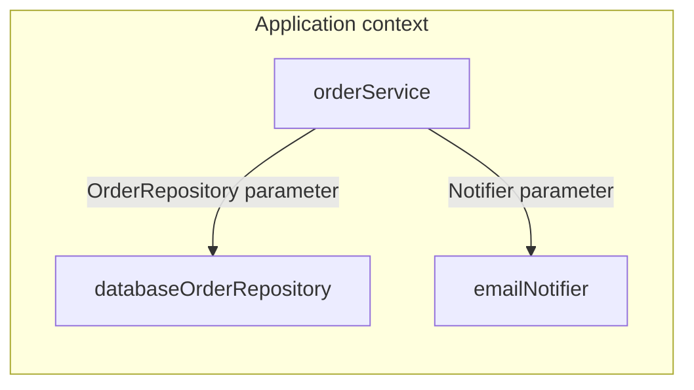
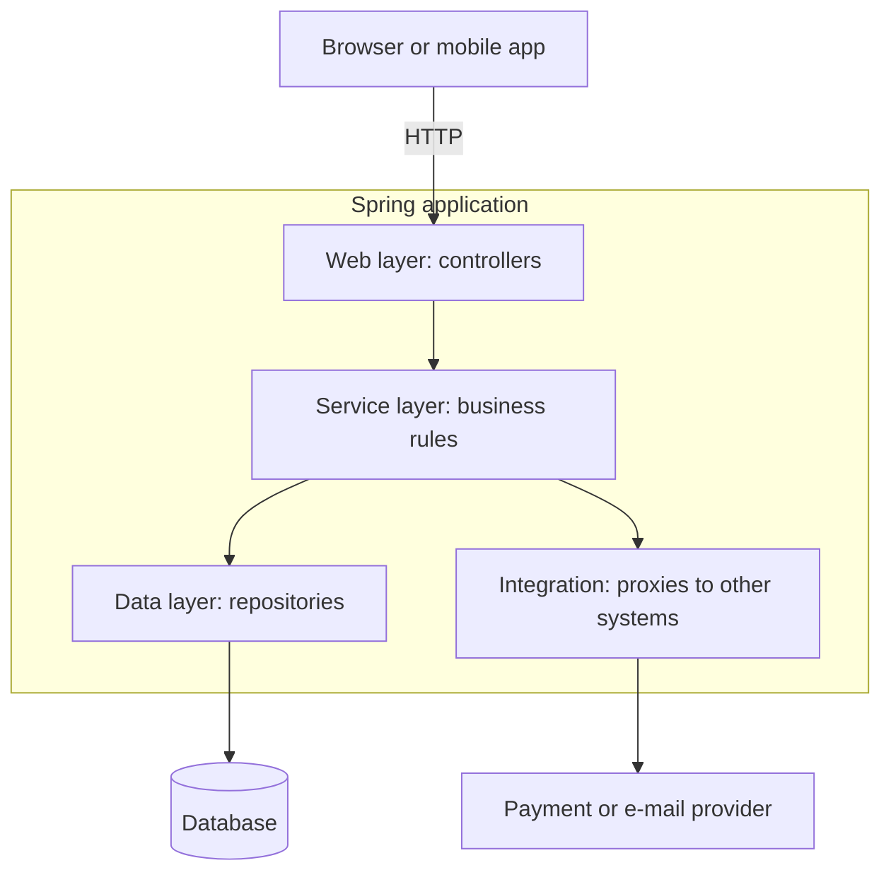
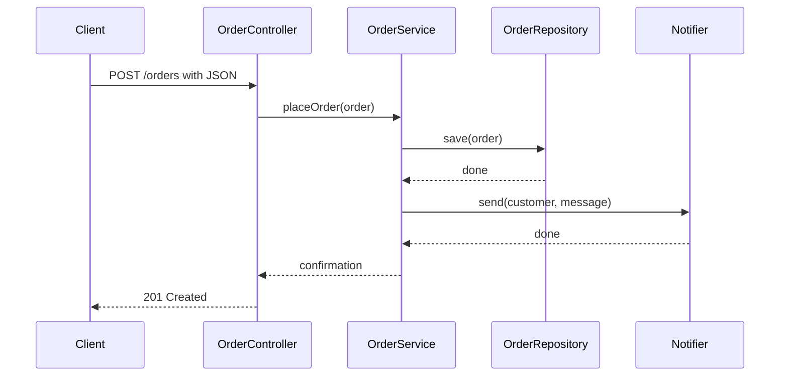

# Dependency injection with abstractions and layered design

> **Before this lesson:** you have the decoupled `OrderService`, `OrderRepository` and `Notifier` from [Interfaces as contracts: decoupling your classes](#/lesson/spring/spring-interfaces-contracts), you know stereotype annotations ([Stereotype annotations, component scanning and programmatic registration](#/lesson/spring/spring-stereotypes-scan)) and `@Primary`/`@Qualifier` ([Circular dependencies, @Primary and @Qualifier](#/lesson/spring/spring-circular-primary-qualifier)).

## In plain words

A restaurant is organised in stations. The waiter talks to guests and writes down orders. The chef decides how a dish is made. The store keeper fetches ingredients from the cellar. The waiter never walks into the cellar, and the store keeper never talks to guests. Requests travel in one direction: waiter to chef to store keeper. Because each station has one job, you can replace the cellar with a delivery service and the waiter will never notice.

A Spring application is organised the same way, in **layers**: a web layer that talks to the outside, a service layer that holds the business rules, and a data layer that stores things. Each layer is a group of beans with one kind of responsibility, marked with its own stereotype annotation. Between layers sit interfaces, and Spring's dependency injection plugs an implementation into each.

This lesson moves the previous lesson's hand-wired example into Spring and then draws the bigger picture that nearly every Spring code base follows. Being able to sketch that picture and say what belongs in each box is expected of anyone joining a Spring team.

## Step 1: let Spring be the composition root

Last lesson's `main` method chose the implementations by hand. Now the implementations and the service become beans. Which classes get an annotation? The ones Spring must create or inject: the two implementations and the service. Interfaces never get a stereotype annotation, because Spring cannot instantiate an interface, and neither does the `Order` record, because it is data created per order, not a managed component.

```java
// src/main/java/com/bookshop/order/OrderRepository.java
package com.bookshop.order;

public interface OrderRepository {
    void save(Order order);
}
```

```java
// src/main/java/com/bookshop/order/jdbc/DatabaseOrderRepository.java
package com.bookshop.order.jdbc;

import com.bookshop.order.Order;
import com.bookshop.order.OrderRepository;
import org.springframework.stereotype.Repository;

@Repository
public class DatabaseOrderRepository implements OrderRepository {
    @Override
    public void save(Order order) {
        System.out.println("INSERT INTO orders ... " + order);
    }
}
```

```java
// src/main/java/com/bookshop/notify/EmailNotifier.java
package com.bookshop.notify;

import org.springframework.stereotype.Component;

@Component
public class EmailNotifier implements Notifier {
    @Override
    public void send(String customer, String message) {
        System.out.println("EMAIL to " + customer + ": " + message);
    }
}
```

```java
// src/main/java/com/bookshop/order/OrderService.java
package com.bookshop.order;

import com.bookshop.notify.Notifier;
import org.springframework.stereotype.Service;

@Service
public class OrderService {

    private final OrderRepository repository;
    private final Notifier notifier;

    public OrderService(OrderRepository repository, Notifier notifier) {   // interface types
        this.repository = repository;
        this.notifier = notifier;
    }

    public void placeOrder(Order order) {
        repository.save(order);
        notifier.send(order.customer(), "Thank you for ordering " + order.isbn());
    }
}
```

```java
// src/main/java/com/bookshop/config/AppConfig.java
@Configuration
@ComponentScan(basePackages = "com.bookshop")
public class AppConfig { }
```

```java
// src/main/java/com/bookshop/Main.java
public class Main {
    public static void main(String[] args) {
        var context = new AnnotationConfigApplicationContext(AppConfig.class);
        OrderService service = context.getBean(OrderService.class);
        service.placeOrder(new Order("ana@example.com", "9780441172719", 1));
    }
}
```

```text
INSERT INTO orders ... Order[customer=ana@example.com, isbn=9780441172719, quantity=1]
EMAIL to ana@example.com: Thank you for ordering 9780441172719
```

What happened at start-up:

1. The scan found three badged classes and registered three bean definitions.
2. To build `orderService`, Spring looked at its constructor: a parameter of type `OrderRepository` and one of type `Notifier`.
3. For each parameter it searched the context for a bean **that can be assigned to that type**. `DatabaseOrderRepository` implements `OrderRepository`, so it qualifies. `EmailNotifier` implements `Notifier`.
4. Spring created the two implementations, then the service with both passed in.

The key sentence: **injection by type considers every type a bean has**: its own class, its superclasses and all interfaces it implements. That is how an interface-typed parameter is satisfied by a concrete bean. `main` no longer contains any wiring; the three lines that chose implementations are gone.



## Step 2: add a second implementation

Add `SmsNotifier` with `@Component`. Start-up now fails with the ambiguity error from the previous module, because two beans can be assigned to `Notifier`. You already know the cures; here they are applied to abstractions.

**A default with `@Primary`:**

```java
@Component
@Primary
public class EmailNotifier implements Notifier { ... }
```

**A specific choice with `@Qualifier`:**

```java
@Component
@Qualifier("urgent")
public class SmsNotifier implements Notifier { ... }

@Service
public class PaymentAlertService {
    private final Notifier notifier;

    public PaymentAlertService(@Qualifier("urgent") Notifier notifier) {
        this.notifier = notifier;
    }
}
```

`OrderService` still asks for a plain `Notifier` and receives the primary one. `PaymentAlertService` asks for the urgent one. Neither class mentions a concrete class name.

**Only one bean exists per environment.** Often the cleanest answer is to make sure that only one candidate is present. A **profile** is a named group of beans that is switched on or off as a whole:

```java
@Component
@Profile("prod")
public class EmailNotifier implements Notifier { ... }

@Component
@Profile("dev")
public class ConsoleNotifier implements Notifier {      // prints instead of sending
    @Override
    public void send(String customer, String message) {
        System.out.println("[dev] would notify " + customer + ": " + message);
    }
}
```

With the `dev` profile active only `ConsoleNotifier` is registered, so there is nothing to disambiguate. Profiles get full treatment in [Configuration properties, profiles and logging](#/lesson/spring/spring-config-profiles-logging).

## A model: matching by assignable type

The container below stores, for each bean, all the types it can be viewed as. Injection searches that list. Run it, then uncomment the SMS notifier to reproduce the ambiguity and see `primary` resolve it.

```python-run
class Bean:
    def __init__(self, name, types, needs=(), primary=False):
        self.name, self.types, self.needs, self.primary = name, types, list(needs), primary

BEANS = [
    Bean("orderService", ["OrderService"], needs=["OrderRepository", "Notifier"]),
    Bean("databaseOrderRepository", ["DatabaseOrderRepository", "OrderRepository"]),
    Bean("emailNotifier", ["EmailNotifier", "Notifier"], primary=True),
    # Bean("smsNotifier", ["SmsNotifier", "Notifier"]),
    Bean("orderController", ["OrderController"], needs=["OrderService"]),
]

def candidate_for(required_type):
    matches = [b for b in BEANS if required_type in b.types]        # class OR any interface
    if not matches:
        raise LookupError(f"NoSuchBeanDefinitionException: {required_type}")
    if len(matches) == 1:
        return matches[0]
    primaries = [b for b in matches if b.primary]
    if len(primaries) == 1:
        return primaries[0]
    names = ", ".join(b.name for b in matches)
    raise LookupError(f"NoUniqueBeanDefinitionException: {required_type} -> {names}")

try:
    for bean in BEANS:
        injected = [candidate_for(t).name for t in bean.needs]
        print(f"{bean.name:26} <- {injected}")
except LookupError as problem:
    print(problem)
```

The line `required_type in b.types` is the whole secret of injecting abstractions: a bean is a candidate if the requested type appears anywhere in its list of types. Set `primary=False` on the e-mail bean with the SMS bean enabled to see the failure message name both candidates.

## Step 3: the layered architecture

The roles from the last lesson scale up to a structure that almost every Spring application uses.



| Layer | Stereotype | Knows about | Must not know about |
|---|---|---|---|
| **Web** (also called presentation) | `@Controller`, `@RestController` | HTTP: URLs, status codes, JSON | SQL, tables |
| **Service** (business) | `@Service` | use cases, business rules, transactions | HTTP details, SQL |
| **Data access** (persistence) | `@Repository` | how data is stored and queried | HTTP, business decisions |
| **Integration** | `@Component` | protocols of external systems | business decisions |
| **Configuration** | `@Configuration` | how library objects are built | everything else |

The rules that make layering useful:

1. **Dependencies point downwards.** A controller may use a service; a service may use a repository. A repository never calls a controller.
2. **No skipping in the wrong spirit.** A controller that runs SQL has absorbed two other layers' jobs and can no longer be tested without a database.
3. **Each layer talks in its own vocabulary.** The web layer deals in requests and responses, the service layer in business objects, the data layer in rows.

A request for "place an order" travels through the layers like this:



The controller translates HTTP into a method call. The service makes the decisions. The repository and the notifier carry out the technical work. You will write the controller in [REST endpoints with @RestController and ResponseEntity](#/lesson/spring/spring-rest-controllers).

> [!INTERVIEW]
> "Describe the layers of a typical Spring application." Controller (HTTP in and out, validation of input shape), service (business logic and transaction boundaries), repository (persistence). Controllers depend on services, services on repositories, never the other way. Mention that the stereotypes `@Controller`, `@Service` and `@Repository` mark these layers, and that DI with interfaces keeps them replaceable and testable.

## What the stereotypes really mean

From the scanner's point of view `@Service`, `@Repository` and `@Component` are the same badge. The difference is communication, plus two technical extras.

- `@Service`: no extra behaviour. It tells the reader that this is where a use case lives. A new team member who opens the `order` package finds the business rules by looking for this annotation.
- `@Repository`: marks data access and switches on **exception translation**. Different database libraries throw different exceptions for the same event; Spring converts them into one consistent family, `DataAccessException`, so that services do not depend on a particular library.
- `@Controller` / `@RestController`: Spring MVC inspects these beans for methods mapped to URLs.
- `@Component`: for everything that is a bean but fits none of the roles: a clock wrapper, a mapper, a client for another system.

> [!TIP]
> When you cannot decide which stereotype fits, ask what the class would be called in a conversation. "It decides whether the order is allowed" is a service. "It fetches orders" is a repository. "It answers the request" is a controller. "It helps the others" is a component.

## Package structure

Two common ways to arrange layers in packages.

**By layer:**

```text
com.bookshop
├── controller   OrderController, BookController
├── service      OrderService, BookService
├── repository   OrderRepository, BookRepository
└── model        Order, Book
```

**By feature:**

```text
com.bookshop
├── order        OrderController, OrderService, OrderRepository, Order
├── catalogue    BookController, BookService, BookRepository, Book
└── notify       Notifier, EmailNotifier, SmsNotifier
```

By-layer is easy to grasp in small tutorials. By-feature keeps everything about orders together and scales better: a change to ordering touches one package. Either works with component scanning as long as everything sits below the root package.

## Thin controllers, focused services

A layered structure only helps if the code respects it. Compare:

```java
// too much in the controller
@PostMapping("/orders")
String create(@RequestBody Order order) {
    if (order.quantity() <= 0) { ... }                    // business rule
    jdbcTemplate.update("INSERT INTO orders ...");        // data access
    mailSender.send(...);                                 // integration
    return "ok";
}
```

```java
// controller delegates
@PostMapping("/orders")
ResponseEntity<Void> create(@RequestBody Order order) {
    orderService.placeOrder(order);
    return ResponseEntity.status(201).build();
}
```

The second controller can be tested by checking that it calls the service. The business rule, tested once in the service, is also available to a batch job or a message listener that never goes through HTTP.

## Pitfalls

- **Stereotype on the interface.** `@Repository` on `OrderRepository` (the interface) registers nothing useful for hand-written repositories; the implementation is the bean. (Spring Data repositories, where you write only an interface, are a special mechanism covered later.)
- **Injecting the concrete class.** `OrderService(DatabaseOrderRepository repository)` works until someone adds a proxy around the bean, for example for transactions. With interface-based proxies the bean is then no longer an instance of the concrete class and injection fails. Inject the interface.
- **Business logic in controllers or repositories.** Rules scattered across layers are tested badly and duplicated quickly.
- **Services calling controllers, or repositories calling services.** Upward dependencies create cycles.
- **Returning database-shaped objects all the way to the client.** It couples your public API to your tables. Many teams convert to separate response objects (often called DTOs, data transfer objects) at the web layer.
- **An interface per class by reflex.** Interfaces belong at real boundaries; see the table in the previous lesson.

## Cheat sheet

| Annotation | Layer | Notes |
|---|---|---|
| `@RestController` / `@Controller` | web | maps HTTP requests to methods |
| `@Service` | service | business logic; usual place for `@Transactional` |
| `@Repository` | data access | adds exception translation |
| `@Component` | any | generic bean |
| `@Configuration` + `@Bean` | configuration | library objects, special construction |
| `@Primary` | any | default among implementations of an interface |
| `@Qualifier("x")` | injection point or bean | pick one implementation |
| `@Profile("x")` | bean | register only when profile `x` is active |

## Summary

- Spring injects by assignable type: an interface-typed constructor parameter is satisfied by any bean implementing that interface.
- Put stereotype annotations on implementations and on the classes that need injection, never on interfaces or data classes.
- With several implementations use `@Primary`, `@Qualifier`, or profiles so that only one exists.
- Applications are organised in layers: web, service, data access (and integration). Dependencies point downward.
- The stereotype annotations document the layer; `@Repository` and `@Controller` add specific behaviour.
- Keep controllers thin and put rules in services, so that the rules are testable and reusable.

## Glossary

- **Assignable type**: a type a bean can be treated as: its class, a superclass or an implemented interface.
- **DTO (data transfer object)**: an object shaped for transport between layers or systems.
- **Exception translation**: converting library-specific persistence exceptions into Spring's `DataAccessException` hierarchy.
- **Layer**: a group of classes sharing one kind of responsibility.
- **Layered architecture**: organising an application into layers with one-directional dependencies.
- **Presentation (web) layer**: the layer that communicates with clients.
- **Profile**: a named set of beans that can be activated per environment.
- **Service layer**: the layer containing business logic.

```quiz
[
  {"q": "OrderService has a constructor parameter of type OrderRepository (an interface). Which bean can Spring inject?",
   "options": ["Only a bean whose class is named OrderRepository", "Any bean whose class implements OrderRepository", "None; interfaces cannot be injected", "Only a bean created with @Bean"],
   "answer": 1,
   "explain": "Injection by type considers all types a bean is assignable to, including the interfaces its class implements."},
  {"q": "Where should the @Repository annotation go for a hand-written repository with an interface and one implementation?",
   "options": ["On the interface", "On the implementation class", "On both", "On the Order record"],
   "answer": 1,
   "explain": "Spring instantiates classes. The annotated implementation becomes the bean and is injected wherever the interface type is requested."},
  {"q": "In a layered architecture, which dependency direction is correct?",
   "options": ["Repository uses controller", "Service uses controller", "Controller uses service, service uses repository", "Repository uses service"],
   "answer": 2,
   "explain": "Dependencies point from the outside inward and downward: web to service to data access."},
  {"q": "What technical behaviour does @Repository add that @Service does not?",
   "options": ["Transactions", "Translation of persistence exceptions to DataAccessException", "Automatic SQL generation", "Caching"],
   "answer": 1,
   "explain": "@Service is descriptive only. @Repository enables Spring's persistence exception translation."},
  {"q": "Two beans implement Notifier and neither is primary. What is the cleanest way to make sure only one exists per environment?",
   "options": ["Delete one class before each deployment", "Use @Profile so that each implementation is registered only in its environment", "Inject both and ignore one", "Catch the exception at start-up"],
   "answer": 1,
   "explain": "Profiles activate groups of beans per environment, so the ambiguity never arises."},
  {"q": "Why should a controller method not contain SQL?",
   "options": ["SQL is slower in controllers", "It merges web and data-access responsibilities, making the logic hard to test and reuse", "Spring forbids it", "Controllers cannot access beans"],
   "answer": 1,
   "explain": "Each layer has one kind of responsibility. Mixing them means the rule cannot be tested without HTTP and a database, and cannot be reused elsewhere."},
  {"q": "In the Python model, what does the expression required_type in b.types represent?",
   "options": ["Matching by bean name", "Matching by any type the bean can be assigned to", "Checking the scope", "Checking for cycles"],
   "answer": 1,
   "explain": "Each bean lists its class and its interfaces; a bean is a candidate when the requested type is among them."}
]
```

> **Source:** Spilcă, *Spring Start Here*, ch. 4 (dependency injection with abstractions; stereotype responsibilities). Documentation: https://docs.spring.io/spring-framework/reference/core/beans/classpath-scanning.html and https://docs.spring.io/spring-framework/reference/data-access/dao.html
